This tutorial makes the front cover of an imaginary literary novel, **Ice Nocturne**. It's a 1400 × 2100 px cover in the style of a 19th-century line engraving, like Gustave Doré's plates for *The Rime of the Ancient Mariner*. It's printed in black ink on cream paper, plus two flat colours: a glacier-teal hand-tint and one vermilion accent.

The picture is Shackleton's ship *Endurance*, frozen into the Weddell Sea in the winter of 1915. It's engraved from Frank Hurley's famous night photograph,
[Endurance night 1915 SLNSW.jpg](https://commons.wikimedia.org/wiki/File:Endurance_night_1915_SLNSW.jpg),
which is on Wikimedia Commons and in the **public domain**. Download the 1280 px wide preview (1280 × 1731). Hurley lit the ship with flash powder, so it stands out frost-white against a black sky. That makes it easy to cut out.

You never engrave a line by hand. Every engraved area is made the same way. First you make a soft grey picture. Then you lay evenly spaced, slightly blurred black lines over it in **Multiply** and run **Threshold**. Where the grey is dark, the lines come out thick and merge. Where it's light, they come out thin or vanish. The new trick here is the sky. The **Kaleidoscope** filter folds straight lines into concentric rings around the moon.

Along the way you'll use:

- ruler **guides** and the exact-corners marquee dialog
- the **Pencil** with [[Shift]]-click straight lines
- **Define Pattern** and **Fill with Pattern**
- a radial **gradient**
- the **Kaleidoscope**, **Gaussian Blur**, **Desaturate**, **Threshold** and **Fibers** filters
- the **Move** tool's rotate and scale handles, including [[Cmd]] to snap and keep proportions
- the **Magic Wand** with **Contiguous** off, and the **Lasso** with [[Alt]] to subtract
- the **Pen** tool, with **Path to Selection** and Enter to stroke a path
- copy, paste and **Flip Horizontal**
- **Grow**, **Shrink** and **Select → Inverse**
- [[Cmd]]-clicking layer thumbnails to load a layer's shape as a selection
- the **Spray** tool
- **Group Layers** and a group mask
- **Text** in IM Fell English SC, IM Fell Double Pica and Cinzel

The palette:

- Paper `#EFE7D4`
- Ink `#000000`
- Glacier tint `#8DB6B4` (Multiply at 45%)
- Vermilion `#C6432B`
- Sky tone greys `#FFFFFF` → `#F4F4F4` → `#D8D8D8` → `#ACACAC` → `#848484` → `#636363`

> **Tip:** Positions are written as `x, y` in document pixels. The status bar at the bottom left shows the cursor's position, and the **Info** panel shows the active layer's position and, while something is selected, the selection's size. Key names use Mac keys. On Windows and Linux, use Ctrl for Cmd. A few pixels either way won't show. The steps say when a number really matters.

> **Tip:** "Select **From** … **To** …" means the exact-corners dialog. Pick the Rectangular (or Elliptical) Marquee, make sure nothing is selected ([[Cmd+D]]), and click once on the canvas without dragging. With a selection active, that click only deselects. "Fill with a colour" means set the foreground colour to it and choose **Edit → Fill**. To remove a helper line, select a box around it with the dialog and press [[Delete]].

## Set up the paper and guides

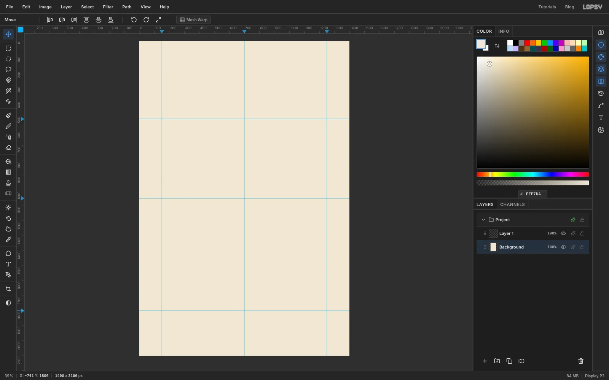

Open [Lopsy](/). In the **New Document** dialog, set **Width** to `1400` and **Height** to `2100` and click **Create**. You get a white `Background` and an empty `Layer 1`.

1. Click the `Background` row in the Layers panel. Set the foreground colour to `#EFE7D4` by typing it into the hex field of the Color panel, then choose **Edit → Fill**.
2. Click the top ruler at **150**, **700** and **1250** to drop three vertical guides. Then click the left ruler at **520**, **1050** and **1800** for three horizontal guides.

The outer guides frame the engraved plate. The centre of the canvas, 700, 1050, is where the moon goes. That matters later, because the Kaleidoscope filter always works around the canvas centre.

## Paint the sky's tone

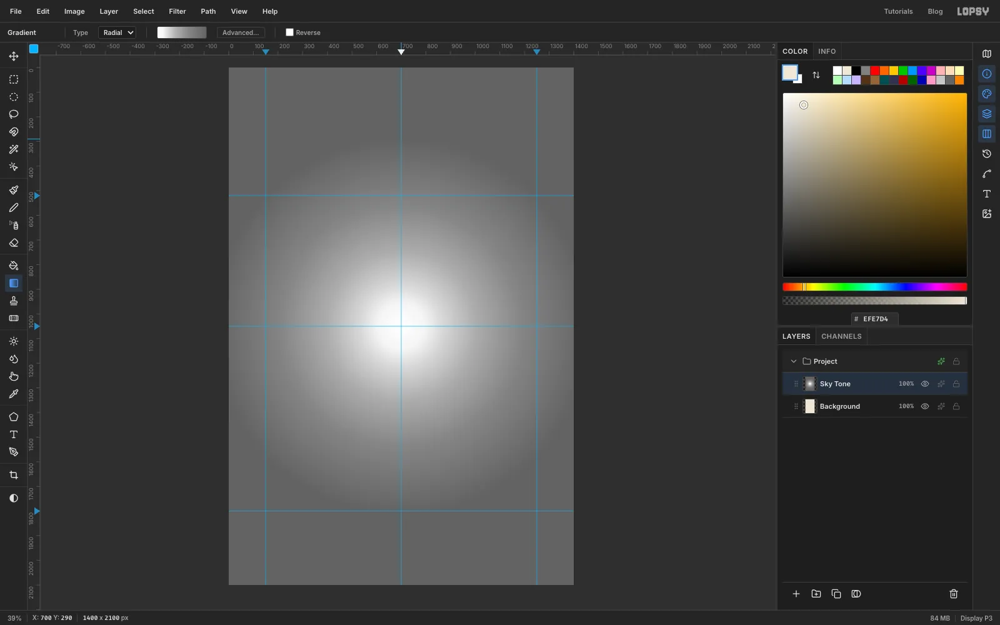

This grey picture decides how thick the sky's lines will be. White makes no lines, so the moon will get a clean glowing halo. The darker greys towards the edges will make lines that thicken until the night goes solid black.

1. Click `Layer 1`, double-click its name and rename it `Sky Tone`.
2. Pick the **Gradient** tool in the toolbox. It has no keyboard shortcut. Set **Type** to **Radial** and click **Advanced…**.
3. Click the handle row to add stops, click each handle and type its colour into the hex field. Use `#FFFFFF` at 0%, `#F4F4F4` at 13%, `#D8D8D8` at 22%, `#ACACAC` at 40%, `#848484` at 65% and `#636363` at 100%. Click **Done**.
4. Drag from the centre guide crossing (700, 1050) straight up to 700, 290. The drag length is the radius.

## Make a rule cell

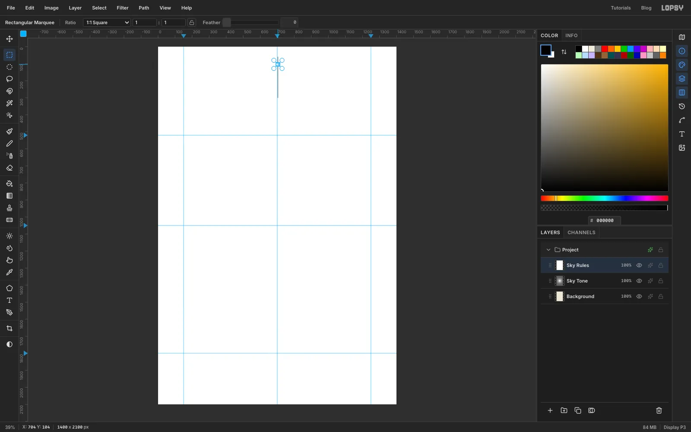

The sky's lines start as a pattern: a 2 px black line in an 8 px cell.

1. Click **Add Layer** at the bottom of the Layers panel and rename the new layer `Sky Rules`. Set the foreground to white (`#FFFFFF`) and choose **Edit → Fill**.
2. Pick the **Pencil** (`N`), set **Size** to `2` and the foreground to black.
3. Click at 704, 60, then hold [[Shift]] and click at 704, 300. You get a straight vertical line.
4. Pick the **Rectangular Marquee** (`M`). Click once on the canvas without dragging to open the **Rectangular Selection** dialog. Enter **From** `700`, `100` and **To** `708`, `108` and press Enter. This 8 × 8 box holds white with the black line running through it.
5. Choose **Edit → Define Pattern**, then **Select → Deselect** ([[Cmd+D]]).

## Fill the layer with soft vertical rules

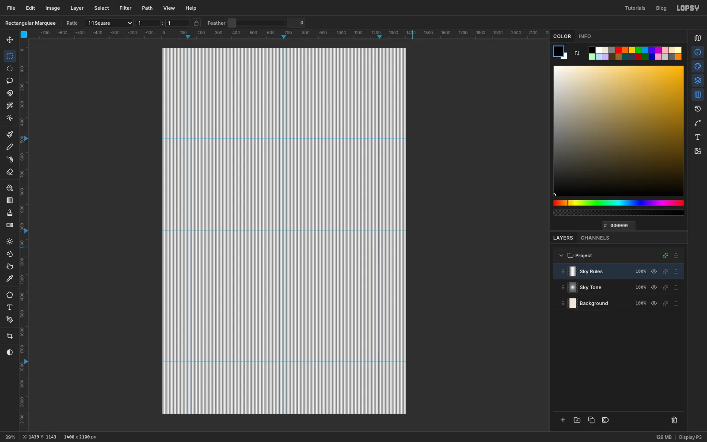

1. Choose **Edit → Fill with Pattern…**, click the pattern you just made and click **Apply**. The whole layer fills with vertical rules 8 px apart.
2. Choose **Filter → Gaussian Blur…**, set **Radius** to `4` and click **Apply**.

The blur is what makes the engraving trick work. A blurred line is darkest at its centre and fades out. When it is multiplied over a grey and thresholded, a darker grey keeps more of that fade, so the line comes out thicker.

## Tilt the rules a hair

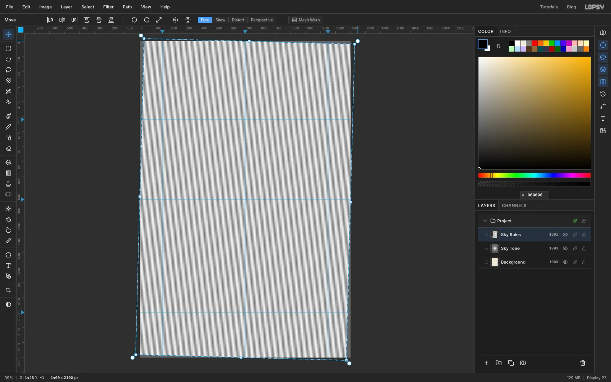

If the rules are perfectly vertical, the rings made from them in the next step show a lighter cross through the moon. That's where the ring facets sit exactly on the pixel grid. A slight tilt fixes it.

1. Press [[Cmd+A]] to select all. Pick the **Move** tool (`V`).
2. Hover just outside the top-right corner handle until the cursor becomes a curved arrow. Drag a little clockwise, until the box has turned about 1.5°. The exact amount doesn't matter. Anything between 1° and 3° works.
3. Press Enter to apply, then [[Cmd+D]] to deselect.

## Fold the rules into rings with Kaleidoscope

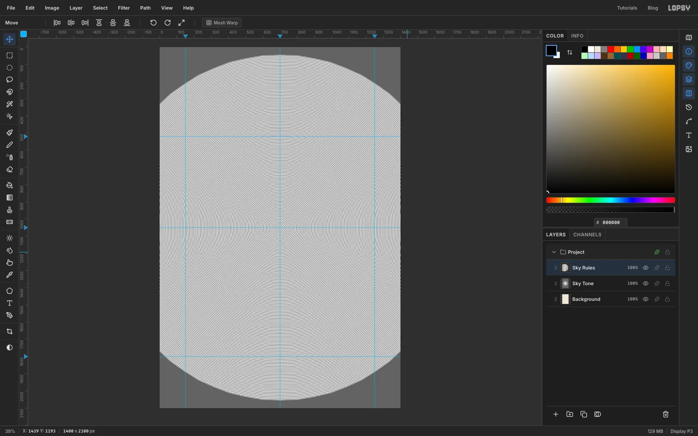

The Kaleidoscope filter takes one wedge of the layer just right of the canvas centre and mirrors it around the full circle. A vertical line in that wedge comes back as a ring. Rings only reach as far as the layer does, though, and the canvas edge is only 700 px from the centre. So you'll first slide the layer to the right so it hangs past the edge.

1. With the **Move** tool still active and `Sky Rules` selected, press [[Shift+Right]] 30 times and [[Right]] 4 times. That's 304 px. The layer now runs off the right side of the canvas, which is fine.
2. Choose **Filter → Kaleidoscope…**, set **Segments** to `32` (the maximum) and leave **Rotation** at `0`. Click **Apply**.

The rings are really many-sided polygons, not true circles. At engraving scale, nobody will notice.

## Lay the rings over the tone

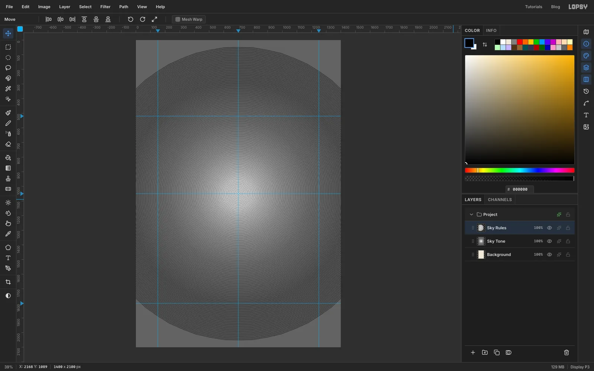

1. Choose **Filter → Gaussian Blur…** with **Radius** `1` to smooth the rings after the fold.
2. Click the effects button on the `Sky Rules` row, the sparkle icon. This opens the layer's Effects drawer. Set the **Blend** dropdown at its top to **Multiply** and close the drawer.

The rings are now darkened by the grey underneath them, but they're still soft. Threshold sharpens them in the next step.

## Engrave the sky with Threshold

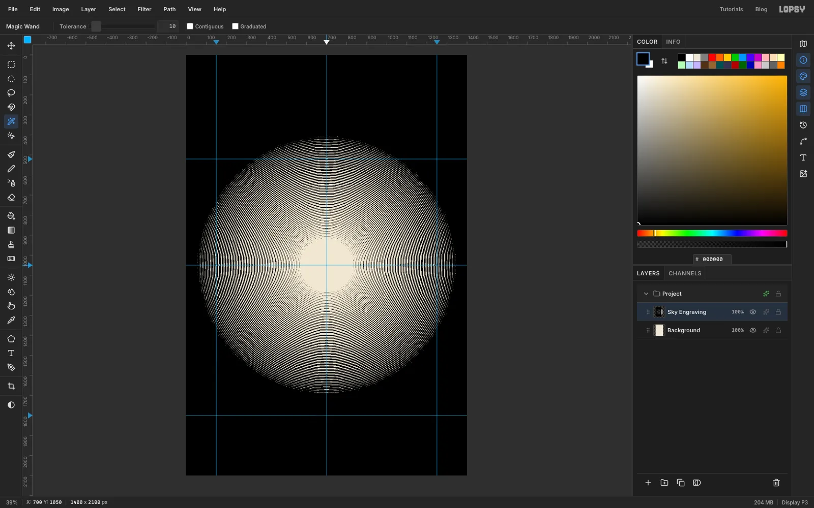

1. With `Sky Rules` selected, choose **Layer → Merge Down** to merge it into `Sky Tone`. Rename the result `Sky Engraving`.
2. Choose **Filter → Threshold…**, set **Level** to `110` and click **Apply**.
3. Pick the **Magic Wand** (`W`). Turn **Contiguous** off and set **Tolerance** to `10`. Click the white at the centre of the canvas. Every white pixel in the layer is selected.
4. Press [[Delete]], then [[Cmd+D]].

Only black lines are left now, over the cream `Background`. The lines are thin near the centre, where the moon will go, and thicken outward until they merge into a solid night sky.

## Drop in Hurley's photo

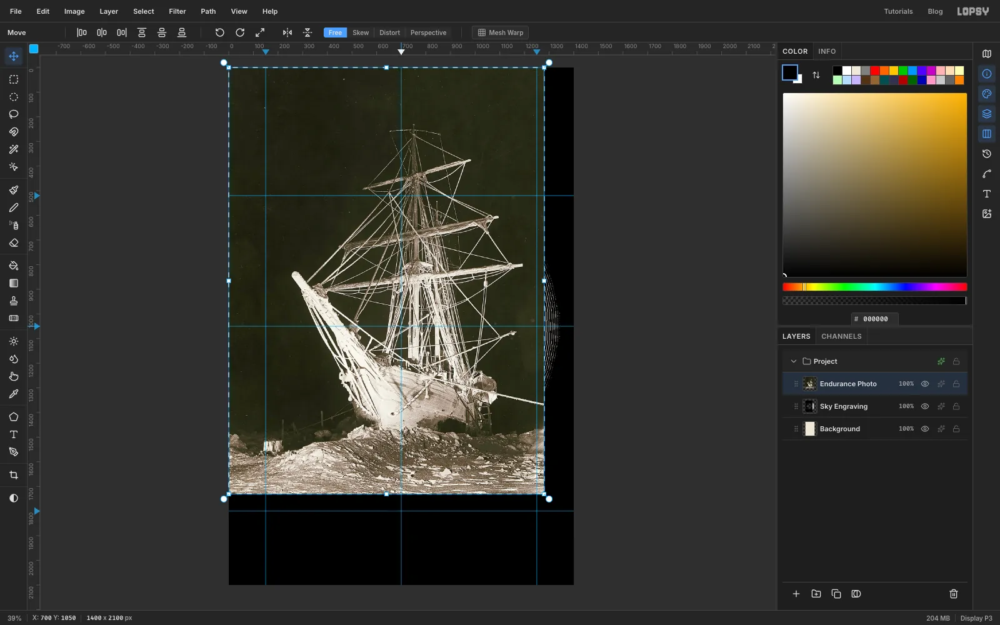

With `Sky Engraving` selected, drag the downloaded photo from your file browser onto the canvas. It lands on a new layer above `Sky Engraving`, at full size, with the Move tool and its handles active. Rename the layer `Endurance Photo`.

## Scale the photo to the plate

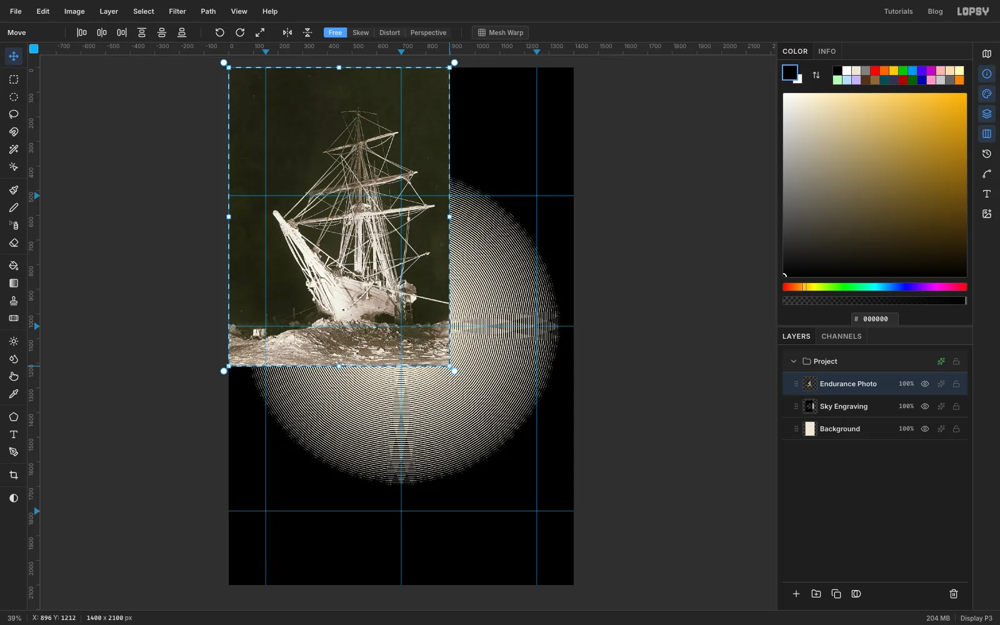

1. The photo lands with its top-left corner at 0, 0. Hold [[Cmd]] and drag the bottom-right corner handle up and to the left. [[Cmd]] keeps the proportions. Stop when the right edge reaches **896** on the top ruler, which is 70% of the original width. This number matters: later selections assume the photo's bottom edge ends up at y 1842.
2. Press Enter to apply.

## Place the ship

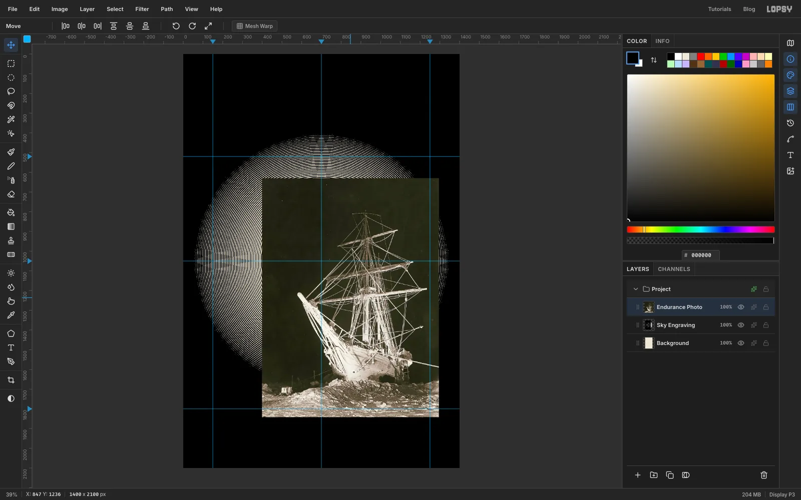

Drag the photo with the **Move** tool so that its top-left corner sits at **399, 630**. Then use the arrow keys to get it exact. The Info panel shows the layer's X and Y.

This position puts the canvas centre, where the moon will go, in the patch of black sky between the bowsprit and the foremast. The ship stands to its right, and the pack ice runs along the bottom of the plate.

## Select the photo's sky

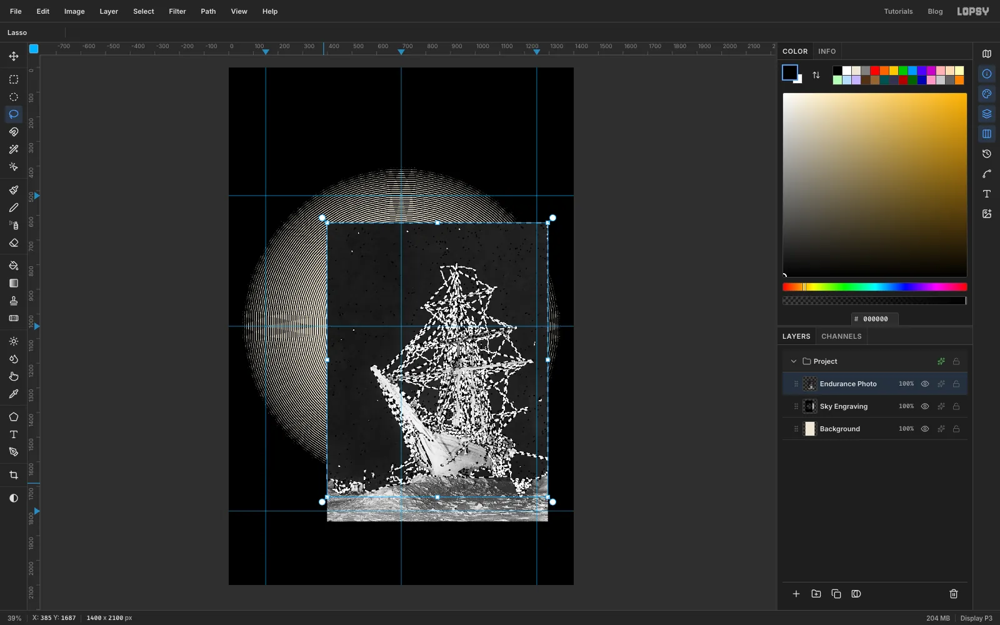

1. Choose **Filter → Desaturate**, then **Filter → Gaussian Blur…** with **Radius** `1`. The blur stops the wand from picking up single noisy pixels.
2. Pick the **Magic Wand**. Turn **Contiguous** off, set **Tolerance** to `34`, and click the black sky in the photo's top-right corner. The whole sky is selected, including the gaps between the ropes, but not the frosted ship.
3. The dark crevices in the pack ice got selected too, and you want to keep them. Pick the **Lasso** (`L`). Hold [[Alt]] and draw around the ice along the bottom of the photo. Start just under its moonlit top edge, which runs at about y 1690 to 1750, and go around the bottom of the photo. That takes the ice out of the selection.

## Cut the sky away

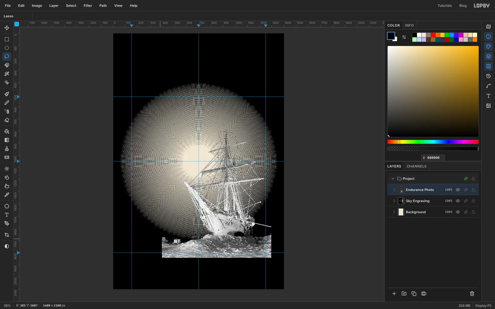

Press [[Delete]], then [[Cmd+D]]. The photo now shows the ship and the ice, with the engraved sky showing through the rigging.

## Rule the ship

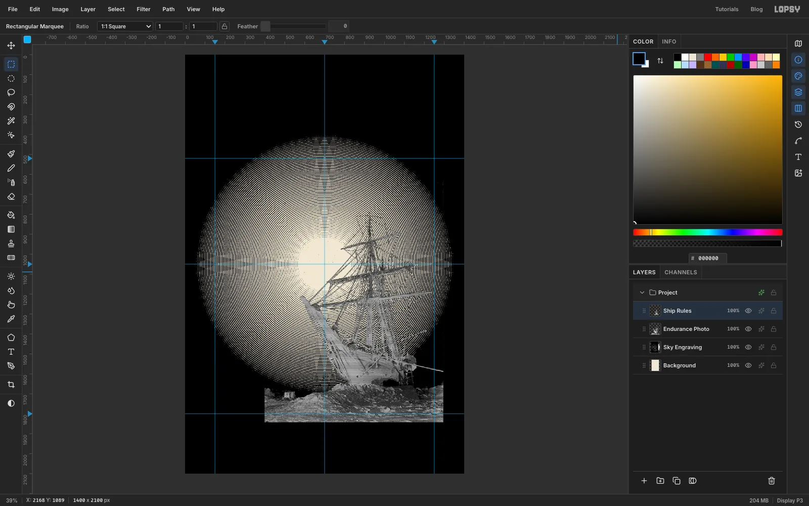

The ship gets the same treatment as the sky, but with finer horizontal lines.

1. Click **Add Layer**. A new layer always appears directly above the selected one. Rename it `Ship Rules`, set the foreground to white and choose **Edit → Fill**.
2. With the **Pencil** at **Size** `2` in black, click at 60, 302 and [[Shift]]-click at 300, 302 for a horizontal line.
3. Use the marquee dialog to select **From** `100`, `300` **To** `106`, `306`. Choose **Edit → Define Pattern**, deselect, then **Edit → Fill with Pattern…** with the new pattern. Run **Gaussian Blur** with **Radius** `3`.
4. [[Cmd]]-click the `Endurance Photo` thumbnail in the Layers panel. This loads the ship's shape as a selection.
5. Click `Sky Engraving` and press [[Delete]]. That clears the rings inside the ship, so they won't run through the hull.
6. Choose **Select → Inverse**, click `Ship Rules` and press [[Delete]]. That clears the rules outside the ship. Deselect.
7. Open the `Ship Rules` Effects drawer and set **Blend** mode to **Multiply**.

## Engrave the ship

1. With `Ship Rules` selected, choose **Layer → Merge Down** and rename the result `Ship Engraving`.
2. Choose **Filter → Threshold…** with **Level** `96`.
3. Set the layer's **Blend** mode to **Multiply**. The white drops out, and only the ink prints over the paper.

## Redraw the spars with the Pen

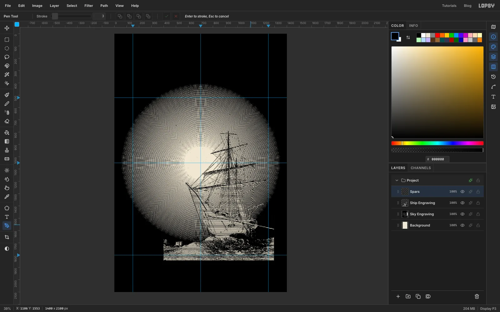

The threshold breaks up thin spars. Real engravers would draw them with a firm burin line, and you'll do the same with the Pen.

1. Click **Add Layer** and rename it `Spars`. Set the foreground to black.
2. Pick the **Pen** (`P`) and set **Stroke** in the options bar to the width you want. Click once at each end of a spar, then press Enter. Enter strokes the path in the foreground colour.
3. After each stroke, open the **Paths** panel and click **Delete Path**. Otherwise your next click can land on the old path and edit it.

Draw these over the engraved spars. Each is two or three clicks:

- the main mast, from its top at about 925, 797 down to the deck at 931, 1456, at width `4`
- the thinner mast behind it, from 988, 1014 to 991, 1456, at width `3`
- the top yard, from 858, 811 to 998, 820, at width `2`
- the next yard down, from 783, 974 to 1085, 895, at width `3`
- the third yard, from 766, 1122 to 1166, 1054, at width `3`. Starting it there keeps it clear of the moon.
- the lowest and longest yard, from 676, 1260 to 1236, 1190, at width `4`
- the bowsprit, from its tip at 580, 1213 through 665, 1302 to the bow at 749, 1435, at width `5`

Then draw three hull lines at width `3`:

- the bow (stem): 609, 1264 → 641, 1358 → 679, 1463 → 711, 1561 → 734, 1631
- the waterline: 734, 1631 → 847, 1642 → 959, 1637 → 1050, 1624
- the deck edge (sheer): 763, 1483 → 889, 1506 → 1015, 1533 → 1106, 1553

## Copy a piece of the pack ice

The photo stops at x 399, so the plate's left side has no ice. You'll borrow some.

1. Click `Ship Engraving`. Use the marquee dialog to select **From** `400`, `1630` **To** `660`, `1842`.
2. Press [[Cmd+C]].

## Paste and flip it

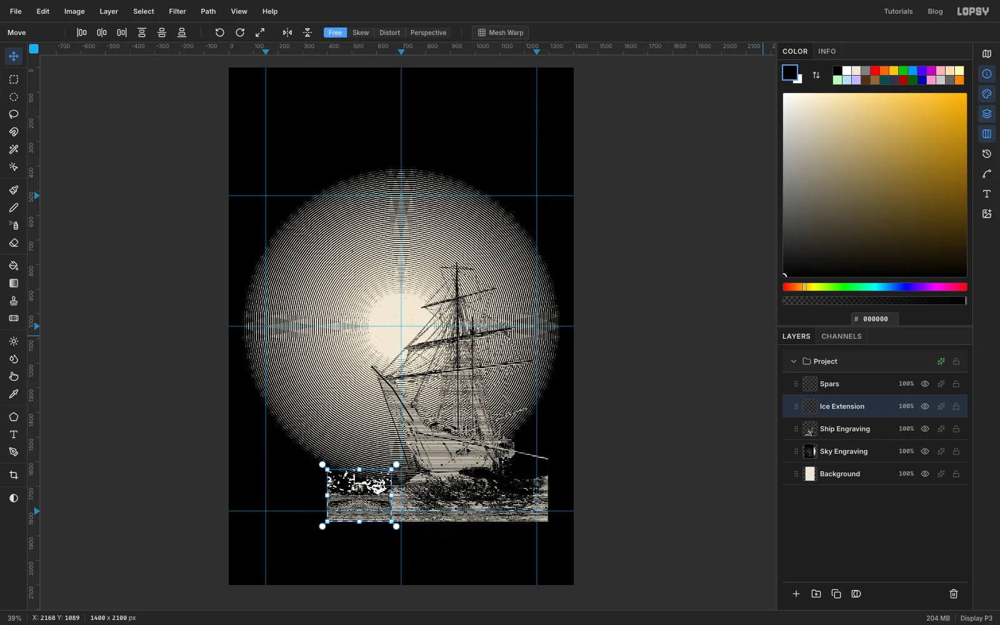

1. Press [[Cmd+V]]. The ice pastes in place on a new layer, with the Move tool active. Rename the layer `Ice Extension` and set its **Blend** mode to **Multiply**.
2. Click **Flip Horizontal** in the Move tool's options bar. A mirrored copy doesn't look like an obvious repeat.

## Place the extra ice

1. Deselect, then drag the layer with the **Move** tool so its top-left corner is at **150, 1630**.
2. The top edge of the copy is ragged. Use the marquee dialog to select **From** `140`, `1600` **To** `420`, `1700` and press [[Delete]]. Deselect.

## Rule a continuous sea under the ice

The rings still show through the gaps in the ice, and you can see a seam where the copy meets the photo. One continuous field of horizontal lines underneath hides both.

1. Click `Sky Engraving`, select **From** `140`, `1696` **To** `1260`, `1820` and press [[Delete]].
2. Click **Add Layer** and rename it `Sea Rules`.
3. With the Pencil at size `2` in black, draw a short line in the top margin, from 60, 21 to 200, 21. Select **From** `100`, `20` **To** `106`, `26` and choose **Define Pattern**. This tile is transparent apart from the line, so the pattern won't cover what's underneath.
4. Select **From** `50`, `10` **To** `210`, `32` and press [[Delete]] to remove the helper line.
5. Select **From** `140`, `1690` **To** `1260`, `1820` and choose **Fill with Pattern…** with the new pattern. Deselect.
6. Finally, click `Ship Engraving`, select **From** `390`, `1380` **To** `408`, `1700` and press [[Delete]]. This removes a thin dotted edge the threshold left along the photo's left side.

## Draw the iceberg with the Pen

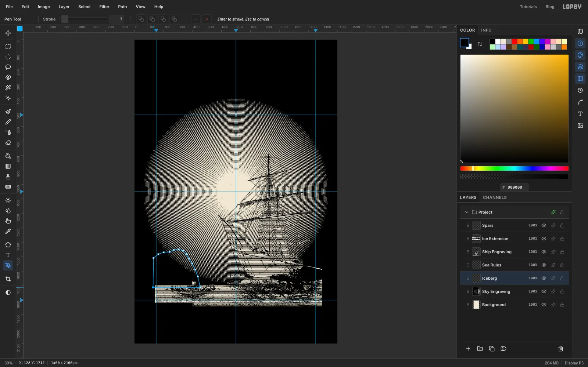

1. Click `Sky Engraving`, then **Add Layer**. Rename the new layer `Iceberg`. It sits just above the sky, under everything else.
2. With the **Pen**, click corner points around a tabular berg. Start on the horizon at 128, 1712. Go up the left side to about 131, 1509, then along a lumpy, nearly flat top that peaks at about 306, 1450. Bring the right side down in a long slope to 454, 1712. Click the first point again to close the path.

## Fill and outline the berg

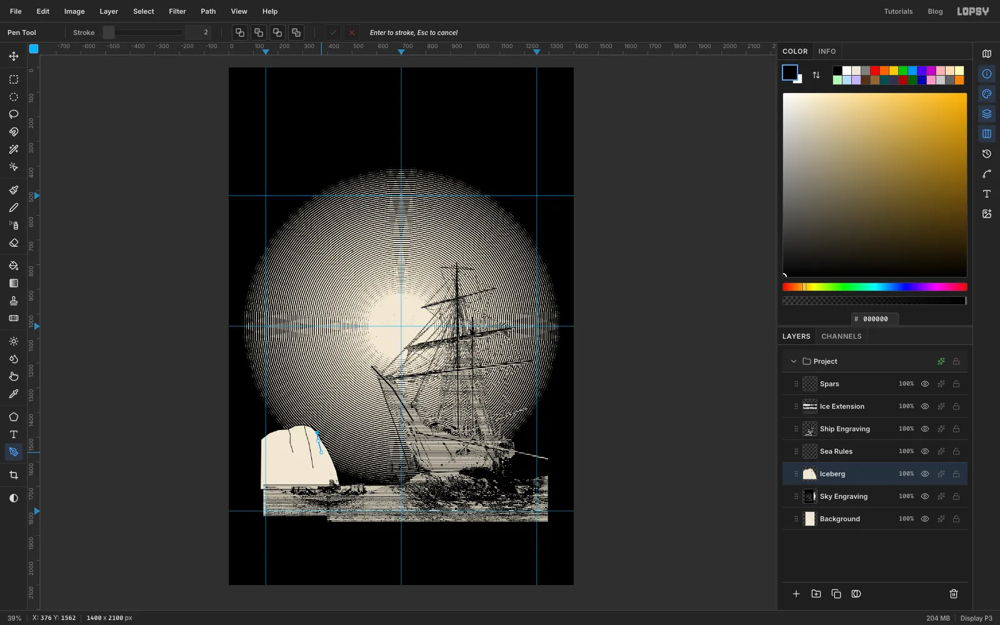

1. In the **Paths** panel, click **Path to Selection**. Leave the path there.
2. Set the foreground to `#EFE7D4`, choose **Edit → Fill**, then deselect. The berg now covers the rings behind it.
3. Set the foreground to black. With the Pen tool active, set **Stroke** to `3` and press Enter. The selected path is stroked as the outline. Then click **Delete Path**.
4. Set **Stroke** to `2` and draw three open paths from the top edge down the lit face. Press Enter after each one, then click **Delete Path**. These are the cracks. Each should run 100 to 150 px and wander a little.

## Make a hatch tile

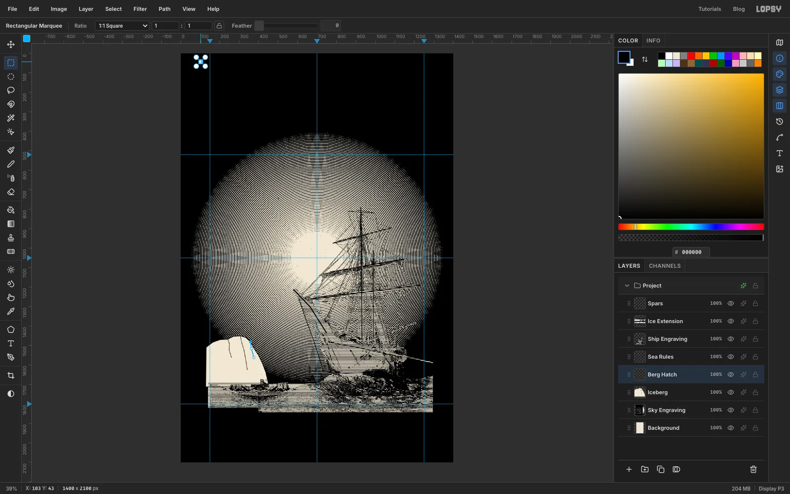

1. Click **Add Layer** and rename it `Berg Hatch`.
2. With the **Pencil** at size `2`, draw a short line from 60, 41 to 300, 41.
3. Select **From** `100`, `40` **To** `106`, `46` and choose **Define Pattern**. You'll delete the helper line along with everything else outside the berg's shadow in the next steps.

## Fill and rotate the hatching

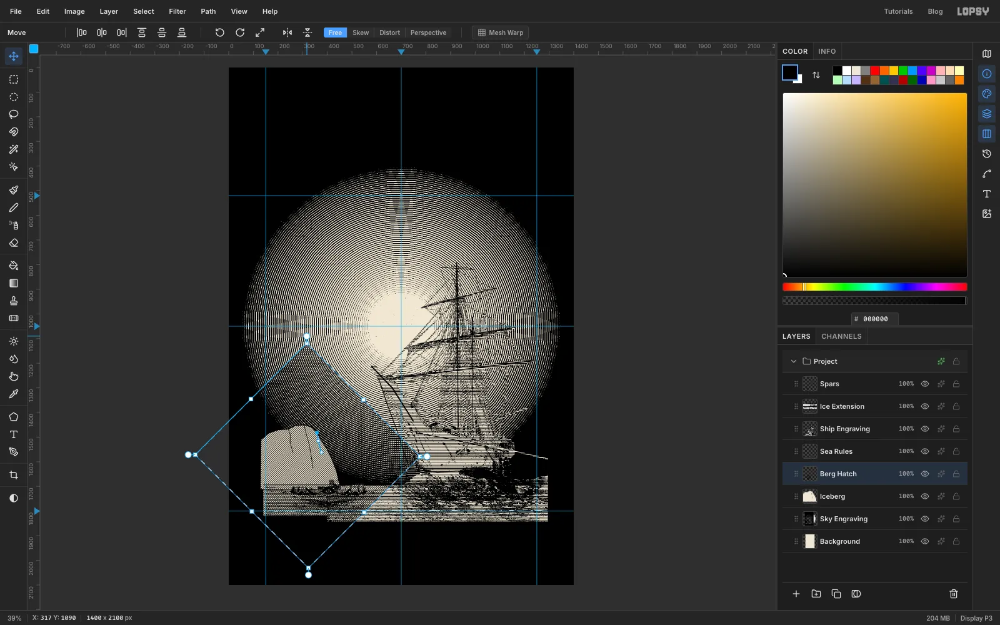

1. Select **From** `0`, `1250` **To** `640`, `1900`, a box well bigger than the berg, and choose **Fill with Pattern…** with the new tile.
2. With the selection still active, pick the **Move** tool. Hold [[Cmd]] and drag the top-right rotate handle anticlockwise until the hatching turns **45°**. [[Cmd]] snaps the angle in 15° steps. Press Enter, then deselect.

## Keep the hatching on the shadow face

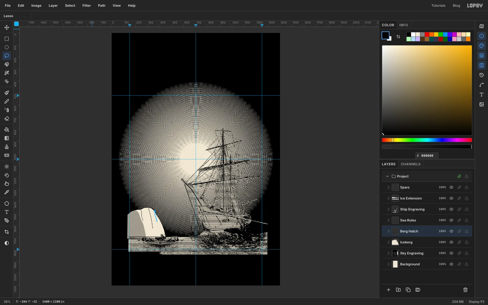

The moon is up and to the right of the berg, so the left cliff is in shadow.

1. With the **Lasso**, trace the shadow face. Run from the bottom-left corner up the left edge, along the top to about 201, 1470, and then down a slanting line through about 242, 1547 to about 290, 1716 on the horizon.
2. Choose **Select → Inverse** and press [[Delete]]. Deselect.

## Add a distant berg

1. With `Berg Hatch` selected, choose **Layer → Merge Down** to merge the hatching into `Iceberg`.
2. Draw a marquee around the berg, then copy and paste it. Rename the pasted layer `Far Berg` and click **Flip Horizontal** in the Move tool's options bar.
3. Hold [[Cmd]] and drag the bottom-right corner handle inward until the copy is about a quarter of the original's size, about 100 px wide. Press Enter.
4. Move it onto the horizon just to the right of the big berg, so its base sits at about y 1702 and its left edge at about x 462.

## Engrave the moon

1. Click `Sky Engraving`, then **Add Layer**, and rename the new layer `Moon`.
2. Pick the **Elliptical Marquee**, click once on the canvas to open its dialog, and enter **From** `624`, `974` **To** `776`, `1126`. That's a 152 px circle centred on the canvas.
3. Fill it with black. Choose **Select → Shrink…** by `1` and fill with `#EFE7D4`. That leaves a hairline outline. Deselect.

## Hatch the moon's seas

The dark seas on the moon are called *maria*. Two soft patches of fine hatching are enough to suggest them.

1. Click **Add Layer** and rename it `Maria`.
2. With the Pencil at size `1`, draw a helper line from 60, 21 to 200, 21. Define a pattern from **From** `100`, `20` **To** `104`, `24`, then delete the helper line.
3. With the **Lasso**, draw an irregular patch on the upper left of the moon. Hold [[Shift]] and draw a second patch lower right.
4. Choose **Fill with Pattern…** with the fine tile, deselect, and set the layer's opacity to **40%** using the opacity control on its row.

## Cut the first star

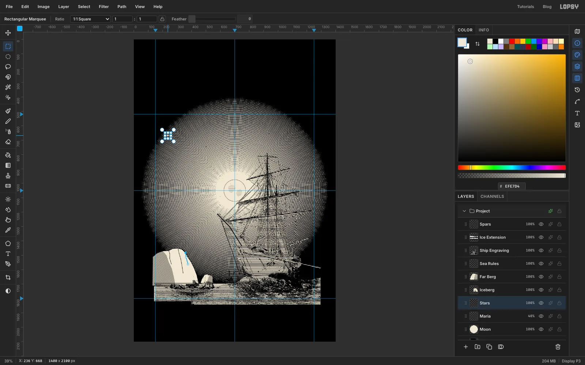

Stars on an engraving are cut out of the ink, so you draw them in the paper colour.

1. Click **Add Layer** and rename it `Stars`. Pick the **Pencil** and set the foreground to `#EFE7D4`.
2. At size `3`, click at 236, 651 and [[Shift]]-click at 236, 685. Then click at 225, 668 and [[Shift]]-click at 247, 668. At size `2`, add two short diagonals the same way, from 230, 662 to 242, 674 and from 230, 674 to 242, 662.
3. Draw a marquee around the star, about 41 × 41 px, and press [[Cmd+C]].

## Scatter the stars

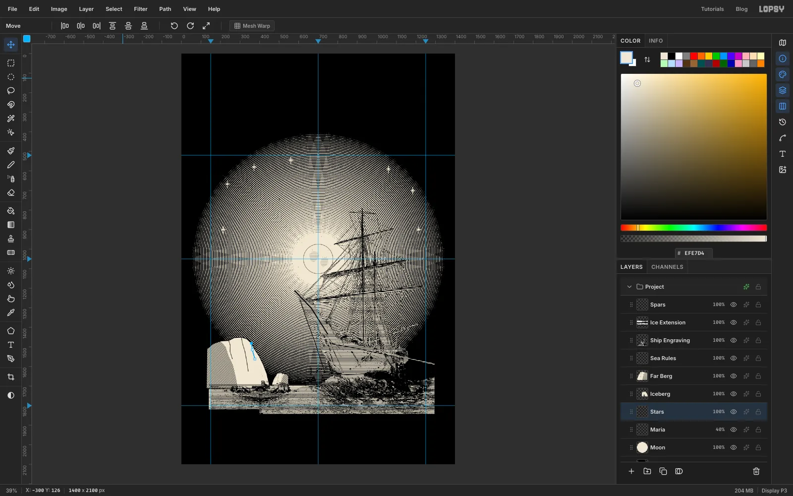

Repeat this six times: press [[Cmd+V]], drag the pasted copy to a dark part of the sky with the Move tool, then choose **Layer → Merge Down** so it joins `Stars`. For two of the copies, hold [[Cmd]] and drag a corner handle inward a little before merging, then press Enter, so they come out smaller.

Keep the stars in the outer ring of darkness. The upper corners of the plate and the sky well above the ship work best. A star in the bright halo would vanish.

## Hang the lantern

The lantern is the only warm light in the picture, so keep it small and crisp.

1. Click `Ice Extension`, then **Add Layer**, and rename the new layer `Lantern Halo`.
2. Select a circle with the elliptical marquee dialog, **From** `966`, `1477` **To** `1008`, `1519`. Fill it with `#C6432B`, shrink the selection by `2` and fill with `#EFE7D4`. This knocks the hull lines out of the halo and leaves a crisp 2 px ring.
3. Add another layer, `Lantern`. Deselect, then use the **Rectangular** Marquee dialog to select **From** `980`, `1489` **To** `994`, `1508`. Fill with black, shrink by `2` and fill with vermilion. With the Pencil at size `2` in black, add a short cap line on top and a hook above it.

## Select the areas to tint

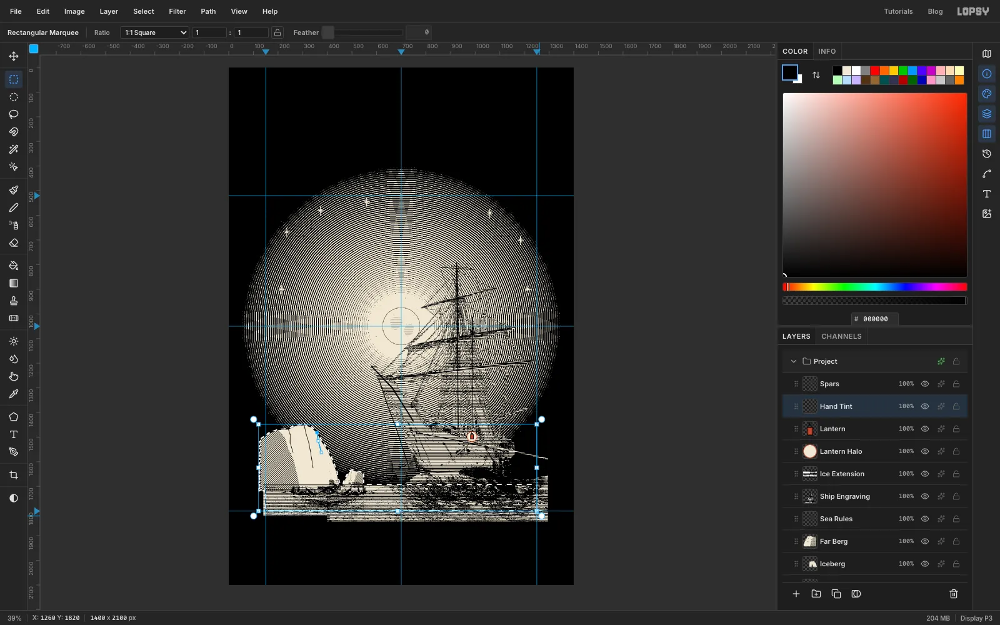

Hand-tinted prints were coloured with flat washes. You'll lay one wash of glacier teal over the ice.

1. Select **From** `140`, `1692` **To** `1260`, `1820`. That's the band of pack ice.
2. Hold [[Cmd+Shift]] and click the `Iceberg` thumbnail to add the berg's shape.
3. Do the same with the `Far Berg` thumbnail.

## Lay the teal wash

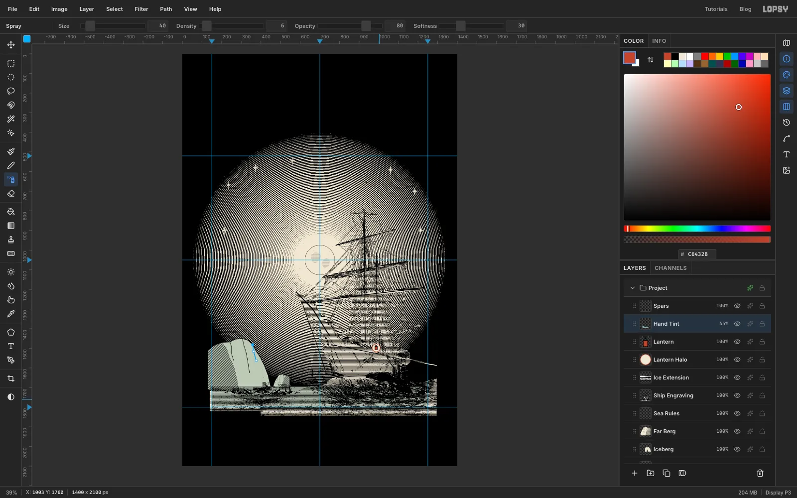

1. Click `Lantern`, then **Add Layer**, and rename it `Hand Tint`. Set its **Blend** mode to **Multiply**.
2. Fill the selection with `#8DB6B4`, deselect, and set the layer's opacity to **45%**.

To add a few warm glints of lantern light on the ice, stay on `Hand Tint` and pick the **Spray** tool (`J`). The Multiply blend softens the glints so they look like reflected light rather than paint. Set **Size** `40`, **Density** `6`, **Opacity** `80` and **Softness** `30`, set the foreground to vermilion, and make one short drag on the ice straight below the lantern, at about y 1745.

## Select the arched plate

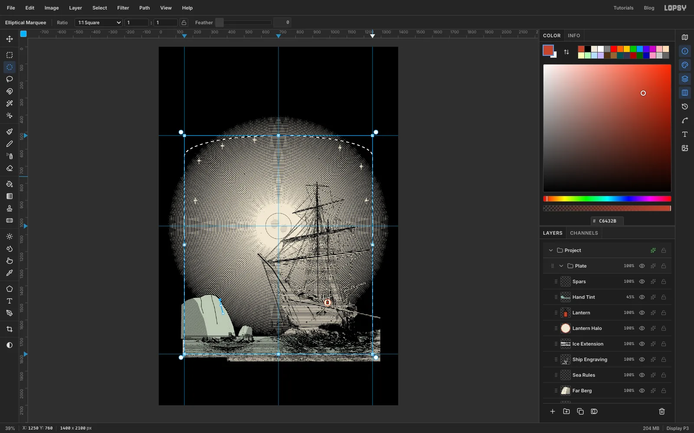

1. Click `Sky Engraving`, then [[Shift]]-click `Spars`, the top layer of the plate. All the plate's layers are now selected.
2. Click **Group Layers** at the bottom of the Layers panel and rename the group `Plate`.
3. Use the Rectangular Marquee dialog to select **From** `150`, `640` **To** `1250`, `1800`.
4. Pick the **Elliptical Marquee**. Check that the lock next to **Ratio** in the options bar is off, then hold [[Shift]] and drag from 150, 520 to 1250, 760. That adds a shallow arch across the top.

## Mask the plate

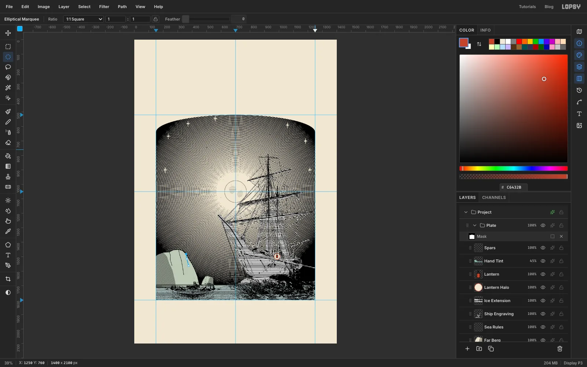

With the `Plate` group selected, click **Add Mask** at the bottom of the Layers panel. The mask copies the selection, so everything in the group is now trimmed to the arch. The layers underneath are untouched, so you can still move or redo any of them.

## Rule a frame around the plate

1. Click `Background`, then **Add Layer**, and rename it `Plate Frame`.
2. Make the plate selection again, the same rectangle and Shift-drag arch as before.
3. Choose **Select → Grow…** by `14` and fill with black. Shrink by `4` and press [[Delete]]. That leaves a 4 px ring outside the plate.
4. Shrink by `9` and fill with black, then shrink by `2` and press [[Delete]]. That adds a 2 px ring right on the plate's edge. Deselect.

## Rule the cover's border

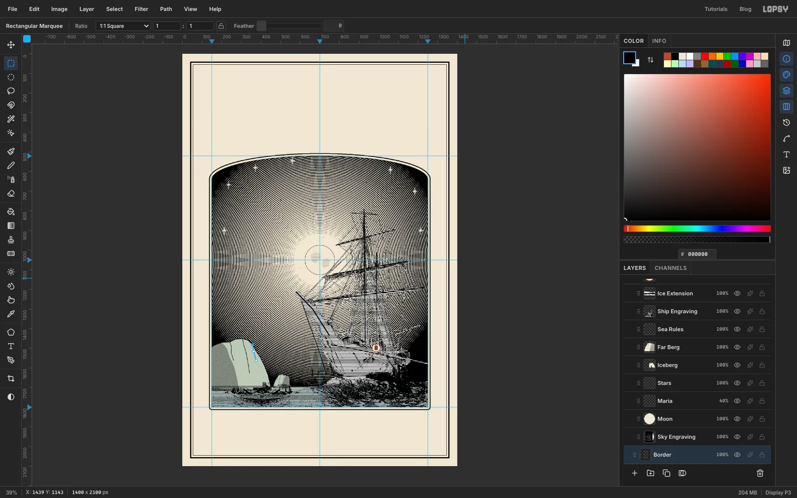

1. Click **Add Layer** and rename it `Border`.
2. Select **From** `40`, `40` **To** `1360`, `2060`. Fill with black, shrink by `6` and delete. Then shrink by `8`, fill, shrink by `2` and delete.

The result is a 6 px outer rule with a 2 px inner rule 8 px inside it.

## Set the author and title

1. With `Border` selected, pick the **Text** tool (`T`). In the options bar, set **Size** to `46` and the font to **IM Fell English SC**. Set the colour to black, click above the plate and type `Margit Halvorsen`. Press [[Tab]] to finish. Rename the layer `Author`. In the **Text** panel, set **Letter spacing** to `6`.
2. Click `Border` again so the next text doesn't restyle this one. Make a second text layer, `Ice Nocturne`, in **IM Fell Double Pica** at size `176` with letter spacing `2`. Rename it `Title`.
3. Centre each one with the Move tool and arrow keys, measuring by the visible letters. The author's letters should be centred on 700, 172 and the title's on 700, 335. The title then runs from about x 226 to 1175, with its capitals from y 271 to 400.

## Select the title's letters

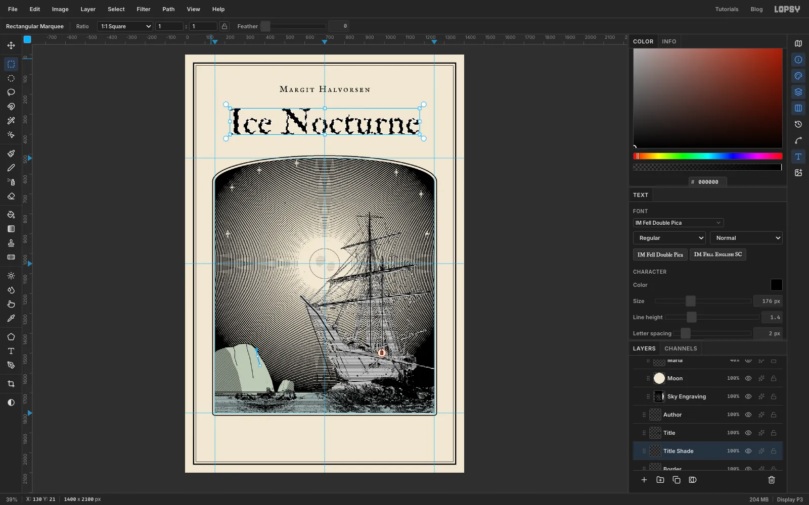

The title gets a shadow made of engraved lines.

1. Click `Border`, then **Add Layer**, and rename the new layer `Title Shade`. It sits under the title.
2. Make a fine tile. With the Pencil at size `1` in black, draw a helper line from 60, 21 to 200, 21. Define a pattern from **From** `100`, `20` **To** `103`, `23`, then delete the helper line.
3. [[Cmd]]-click the `Title` thumbnail to select its letters.

## Fill and offset the shadow

1. Choose **Fill with Pattern…** with the 3 px tile, then deselect.
2. With the **Move** tool, press [[Right]] four times and [[Down]] four times.
3. Set the layer's opacity to **60%**.

The hatching sticks out only below and to the right of each letter, so the letters look raised off the page.

## Add the rule ornament

1. Click **Add Layer** and rename it `Ornament`.
2. With the Pencil at size `2` in black, draw two lines at y 452: one from 520 to 680, and one from 720 to 880.
3. With the **Lasso**, draw a small diamond in the gap, about 18 px wide and 22 px tall, centred on 700, 452. Fill it with black and deselect.

## Set the imprint

1. With `Ornament` selected, make a text layer `A Novel` in **IM Fell English SC** at size `40`, in `#C6432B`, with letter spacing `14`. Centre its letters on 700, 1876.
2. Click `Ornament` again. Make `Northlight Editions` in the same font at size `26`, black, with letter spacing `8`, and rename the layer `Imprint`. Centre its letters on 700, 1959.

The two lines are spread evenly between the plate frame and the border.

## Turn the coordinates up the margin

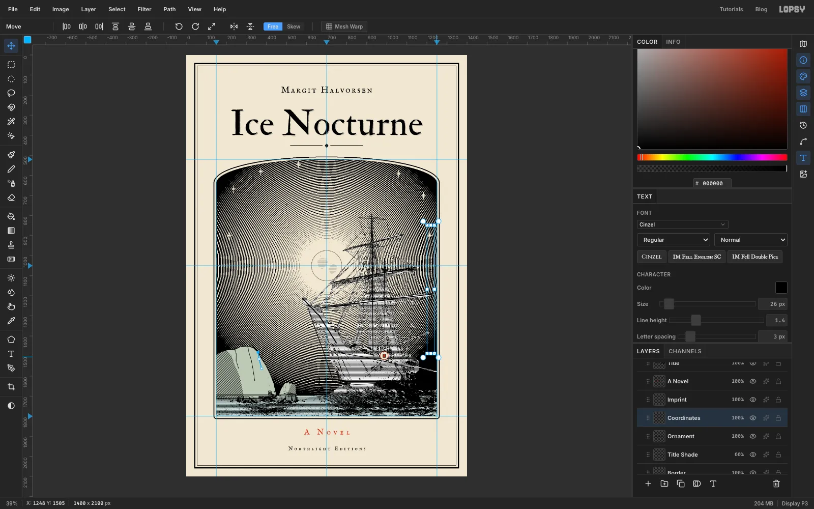

1. Click `Ornament`. Make a text layer in **Cinzel** at size `26` with letter spacing `3`: `76° 35′ S  ·  31° 30′ W  ·  Weddell Sea  ·  1915`, and rename it `Coordinates`. Use the prime mark `′` after the minutes, not an apostrophe. Cinzel is used here because its figures all sit on the baseline (lining figures), so the 1 reads as a 1.
2. With the **Move** tool, hold [[Cmd]] and drag the text's rotate handle clockwise until it snaps to **90°**. Press Enter.

## Centre the coordinates in the gutter

Move the rotated text so it's centred on **1304, 1160**. That's halfway between the plate frame (about x 1264) and the border's inner rule (about x 1345), and level with the middle of the plate.

## Add paper fibre

1. Click `Author`, then **Add Layer**, and rename it `Paper Fibre`.
2. Choose **Filter → Fibers…** with **Variance** `24` and **Strength** `10`, then **Gaussian Blur** with **Radius** `1`.
3. Set the layer's **Blend** mode to **Multiply** and its opacity to **7%**.

At this strength it reads as paper. Any stronger and it starts to look like wood grain.

## Group the type, then save and export

1. Click `Author`, then [[Cmd]]-click `Title`, `Title Shade` and `Ornament`. Click **Group Layers** and rename the group `Title Block`.
2. Do the same with `A Novel`, `Imprint` and `Coordinates`, and call that group `Imprint Block`.

With the type grouped, you can move a whole block at once. Select `Title Block` and drag it with the Move tool, and all four layers go together. [[Cmd+Z]] puts it back.

Choose **File → Save Project** to keep a `.lopsy` with every layer, then **File → Quick Export PNG** for the finished cover.
