Before photographs could be printed in newspapers, pictures were *engraved*.
The engraver cut thousands of parallel lines into a steel plate. Where a
picture was dark the lines were cut wider, and where it was light they
thinned out to nothing. Skies were ruled by a machine, one perfectly even line
after another. Stencils work in a similar way: a sheet of oiled card with the
picture cut out of it, one sheet per colour.

In this tutorial you'll combine the two. You'll make **Bodensee**, a
2400 × 1800 px contact sheet for the 1919 passenger airship LZ 120
*Bodensee*. A cream proof is taped to a green cutting mat. It shows the
zeppelin over Lake Constance in Prussian blue ruled lines, with an oxide-red
sun setting behind the Alps. Around it lie the three cut stencil plates and a
typed index card.

The airship comes from
[Airship Bodensee, Oct. 1919](https://commons.wikimedia.org/wiki/File:Airship_Bodensee,_Oct._1919.jpg)
on Wikimedia Commons, a Library of Congress photo in the **public domain**.
Download the 1920 × 1142 px version. Any side-on photo of an airship or a long
boat works the same way.

The engraving comes from a simple trick, and you never draw a single engraved
line by hand. You paint the picture as soft greys, lay evenly spaced blurred
lines over it in **Multiply**, then run **Threshold**. Where the grey is dark
the lines come out thick, and where it's light they come out thin. The steps
explain why when you get there.

Along the way you'll use:

- ruler **guides**, the exact-corners marquee dialog and the **Pencil** with [[Shift]]-click straight lines
- a step-and-repeat loop of **Duplicate Layer**, arrow-key nudges and **Merge Down**
- **Clouds**, **Motion Blur**, **Gaussian Blur**, **Surface Blur**, **Add Noise**, **Brightness/Contrast**, **Desaturate** and **Threshold**
- linear and radial **gradients**, including a gradient that fades to transparent
- dropping in a photo and scaling it with the **Move** tool's handles
- the **Pen** tool with **Path to Selection**, the **Lasso** with [[Shift]] to add, and **Select → Inverse**
- the **Clone Stamp**
- **Mesh Warp** and rotation handles
- [[Cmd]]-clicking layer thumbnails, with [[Shift]] to add and [[Alt]] to subtract
- the **Magic Wand** with **Contiguous** off, **Grow** and **Shrink**
- **Text** in Big Shoulders Stencil, IM Fell English, Oswald and Special Elite, and **Rasterize Layer**
- copy and paste in place, **Image → Flip Horizontal**, the **Spray** tool
- layer effects (**Drop Shadow**, **Inner Glow**) and the **Multiply** and **Overlay** blend modes
- groups, including rotating a whole group with live text inside

The palette:

- Cutting mat `#2B5446`, grid lines `#8DB3A2`
- Proof paper `#EFE7D3`, plate mark `#E7DEC7`
- Prussian blue `#1E3B62`, oxide red `#B3452E`
- Stencil board `#C99E5E`, board pencil `#4A3418`
- Index card `#F5F1E6`, blue rules `#9DB6CC`, red rules `#D88A84`, typewriter ink `#2B2A28`
- Masking tape `#E4D6A6`

Keep the **Info** panel open throughout. It shows the active layer's **X** and **Y** and, while something is selected, the selection's size. Lopsy has no numeric fields for moving or scaling, so the Info panel is how you check a nudge or a scale.

## Set up the sheet with guides

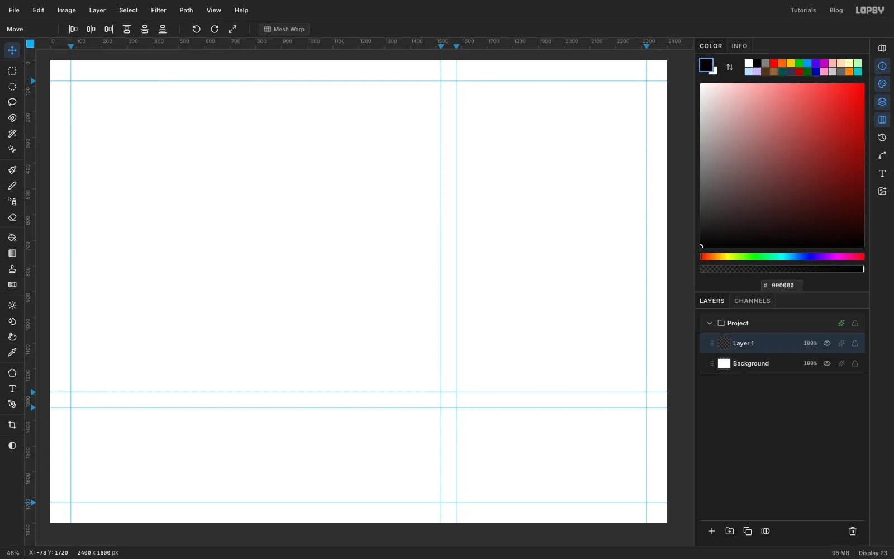

The sheet has a big proof at top left, a column of two plates on the right, and a bottom row with a long plate and an index card. Everything sits 80 px in from the edges, with a 60 px gap between the parts.

1. Choose **File → New**, set **Width** `2400`, **Height** `1800`, **Pixels**, and click **Create**.
2. Click the top ruler to drop vertical guides at the proof's left and right edges (`x 80` and `1520`) and the plate column's left and right edges (`1580` and `2320`). Zoom in on each spot first so the click lands on the exact pixel, and watch **X** in the status bar.
3. Click the left ruler for the proof's top and bottom (`y 80` and `1290`) and the bottom row's top and bottom (`1350` and `1720`).

## Lay down the cutting mat

1. Click **Background**, set the foreground colour to `#2B5446` and choose **Edit → Fill**.
2. Run **Filter → Add Noise…** with **Amount** `5` and **Mono**. A plain flat green looks like a screen, not a mat.
3. Click **Layer 1** and rename it `Mat Grid`. Pick the **Pencil** (**N**), set **Size** `2` and colour `#8DB3A2`.
4. Click at the very top of the canvas at `x 30`, hold [[Shift]] and click at the very bottom. You get one straight vertical line.

## Repeat the line across the mat

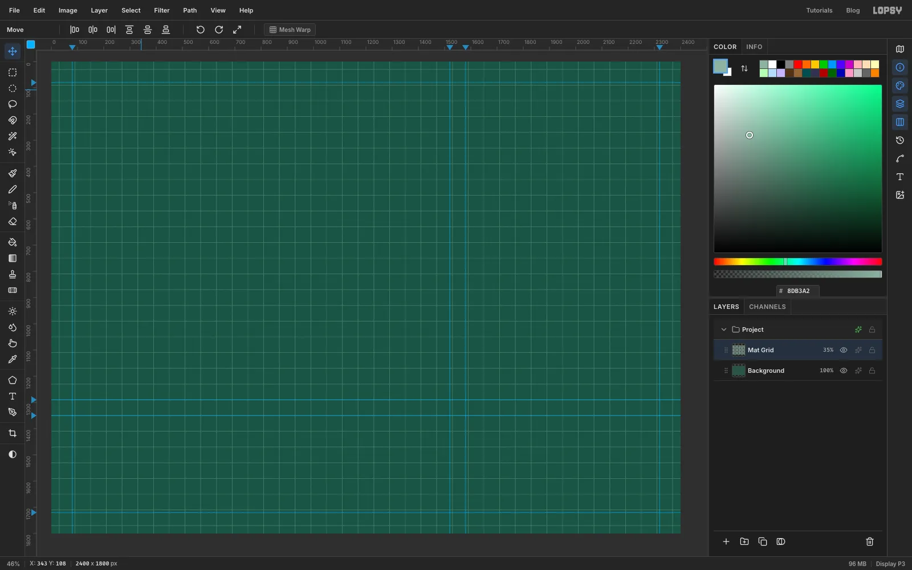

You need 40 lines, 60 px apart. Drawing them one by one is slow. Instead, double them with a step-and-repeat:

1. Click **Duplicate Layer** at the bottom of the Layers panel. Press **V** for the **Move** tool and nudge the copy `60` px right with the arrow keys. [[Shift]]+arrow moves 10 px, and holding it down repeats, so long nudges are quick. Watch **Layer X** in the Info panel. Choose **Layer → Merge Down**. You now have two lines.
2. Do it again, but nudge `120` px. Now you have four. Keep doubling the nudge: `240`, `480`, `960`, `1920`. Six passes give 64 lines, more than enough for the width. The extra lines simply hang off the canvas.
3. Click **Add Layer**, draw one horizontal line across the full width at `y 30` in the same way, and double it with nudges of `60`, `120`, `240`, `480` and `960` px straight down.
4. **Merge Down** the horizontal lines onto `Mat Grid` and set the layer's opacity to `35%`.

You'll use this step-and-repeat four more times: for the engraving lines, the red sun's lines, the stencil ties and the index card's rules.

## Lay down the proof paper and the plate mark

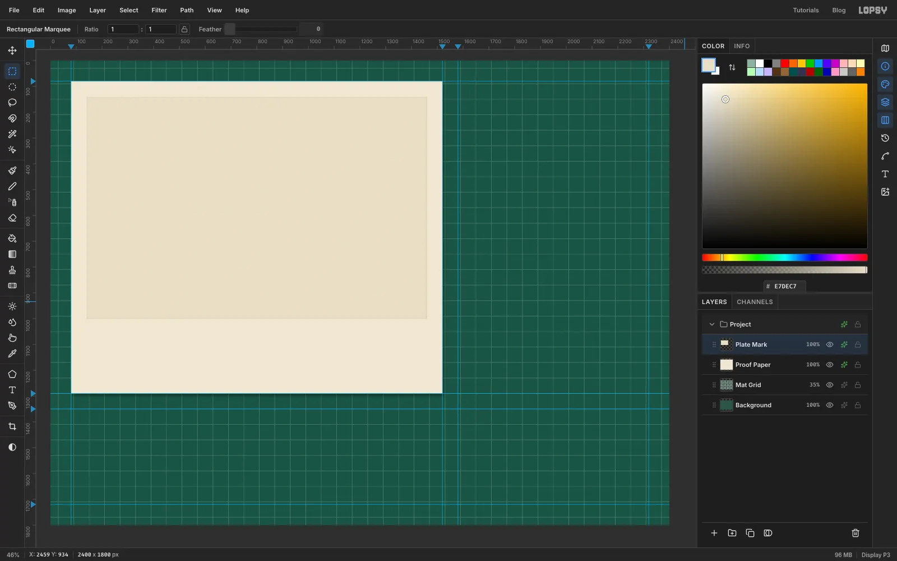

An engraving printed on a press leaves a shallow dent the size of the metal plate. That's the *plate mark*.

1. Add a layer called `Proof Paper`. Pick the **Rectangular Marquee** (**M**) and drag from the top-left guide corner (`80, 80`) to where the `1520` and `1290` guides cross. The marquee snaps onto the guides.
2. Fill it with `#EFE7D3`, run **Add Noise…** at `3`, **Mono**, and press [[Cmd+D]].
3. Open the layer's effects drawer (the ✦ button on its row) and turn on **Drop Shadow**: **Offset X** `6`, **Offset Y** `10`, **Blur** `18`, **Opacity** `45`, colour `#0A1A14`.
4. Add a layer called `Plate Mark`. With nothing selected, click once on the canvas with the **Rectangular Marquee** without dragging. The **Rectangular Selection** dialog opens. Enter **From** `140`, `140` and **To** `1460`, `1000`, and fill with `#E7DEC7`.
5. Give it an **Inner Glow** (**Size** `6`, **Opacity** `45`, colour `#8A7650`) and a pale **Drop Shadow** up and to the left (**Offset** `-2`, `-2`, **Blur** `2`, **Opacity** `80`, colour `#FFFAF0`). The dark inner edge and the light rim read as a dent. Press [[Cmd+D]].

> **Tip:** The exact-corners dialog only opens when nothing is selected. If a selection is still active, the click just deselects. So press [[Cmd+D]] before every "select … to …" in this tutorial. The same dialog works for the **Elliptical Marquee**.

## Paint the sky as soft grey

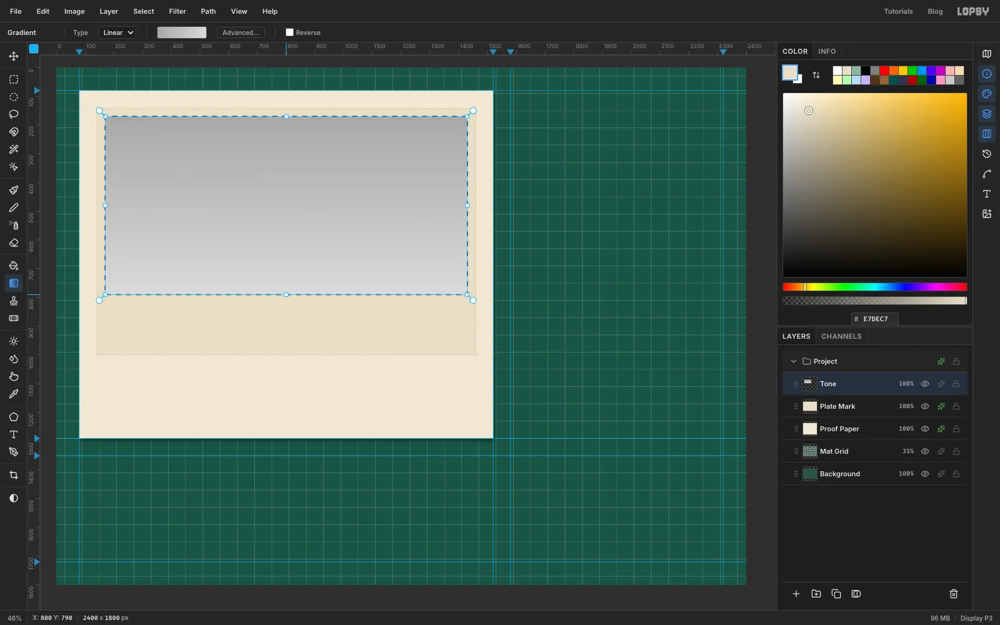

The picture lives inside the plate mark, from `170, 170` to `1430, 970`, with the horizon at `y 790`. For now you paint it as plain greys. The grey decides how thick each engraved line will be later, so keep everything between mid grey and near white. Anything darker than about `#888888` turns solid.

1. Add a layer called `Tone`. Use the marquee dialog to select `170, 170` to `1430, 790`.
2. Pick the **Gradient** tool from the toolbox (it has no shortcut). Open the gradient editor and set the stops to `#A8A8A8` and `#DADADA`. Drag from the top of the selection straight down to the horizon. The sky gets darker toward the top, the way engraved skies do.
3. Now a glow round the sun. Switch the gradient to **Radial**, set both stops to `#F4F4F4`, and drag the right-hand stop's opacity to `0`. Drag from the sun's centre at `1180, 705` about `420` px to the right. Then press [[Cmd+D]].

> **Tip:** A gradient stop keeps its opacity when you change only its colour. Before every later gradient in this tutorial, open the editor and push both stops back to 100% opacity, or the fill will fade out.

## Add the clouds

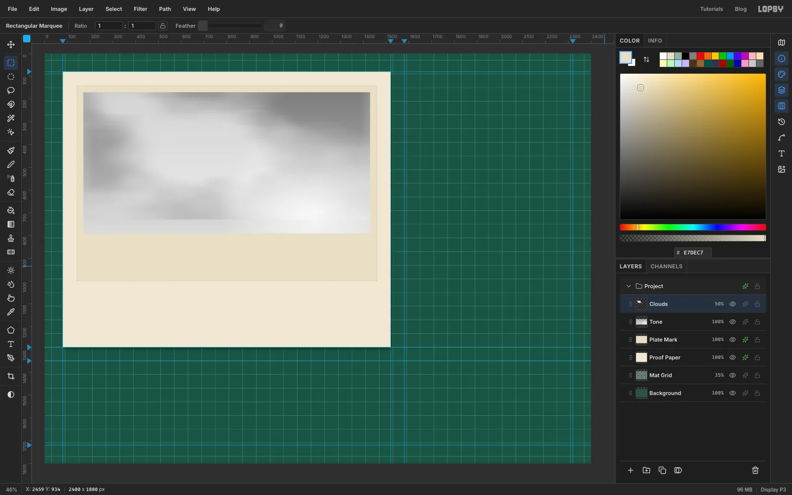

1. Add a layer called `Clouds`. Select `170, 170` to `1430, 730`.
2. Run **Filter → Clouds…** with **Scale** `4`, then **Brightness/Contrast…** with **Contrast** `25`.
3. Run **Motion Blur…** with **Angle** `0` and **Distance** `90`. Clouds in old engravings lie in long flat banks, and this stretches them sideways.
4. Press [[Cmd+D]]. In the layer's effects drawer (✦), set the blend mode to **Overlay**. Set the layer's opacity to `50%`, then **Merge Down** onto `Tone`.

Clouds are random, so yours will look different from the screenshot. That's fine.

## Paint the sun and the lake

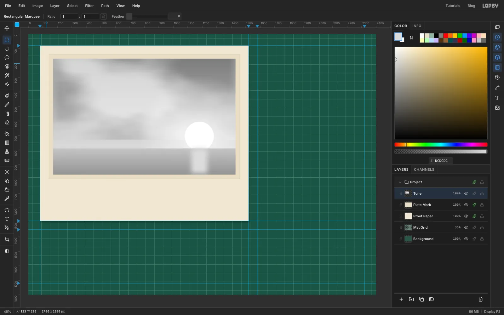

1. Pick the **Elliptical Marquee** and use its dialog to select `1080, 605` to `1280, 805`, a 200 px circle. Fill with white. The sun belongs to the red plate, so the blue lines will be cleared out of it later.
2. Press [[Cmd+D]] and select the lake: `170, 790` to `1430, 970`. Draw a linear gradient from `#C4C4C4` at the horizon to `#949494` at the bottom.
3. Press [[Cmd+D]] and select a narrow strip under the sun, from `1125, 790` to `1235, 960`. Choose **Select → Feather…** at `35` and fill with `#DCDCDC`. That's the sun's reflection. With the edges feathered, it fades into the water.
4. Press [[Cmd+D]].

## Draw the Alps

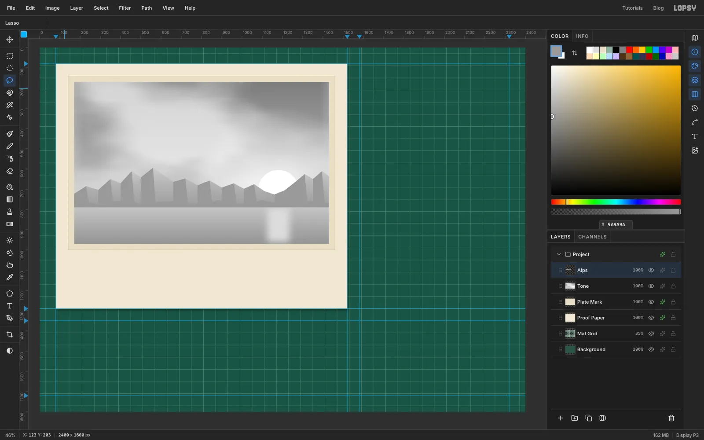

Lake Constance has the Alps on its far shore.

1. Add a layer called `Alps`. With the **Lasso** (**L**), drag a jagged ridge across the full width of the picture. Keep the peaks between about `y 560` and `y 750`, put the tallest ones left of centre, and leave a dip around `x 1160`, where the sun will set. Then drag straight down to the horizon, back along it, and up to your starting point.
2. Draw a three-stop linear gradient inside it from `y 600` to the horizon: `#CACACA`, `#B4B4B4` at 40%, and `#9C9C9C`.
3. Lasso a low wavy band of foothills along the bottom of the range, about 20 px tall, and fill it with `#989898`.
4. The sun is low on the right, so each peak's left-hand slope is in shade. For every peak, lasso a thin triangle: start at the valley to its left, go up to the summit, then straight down to the foothills, and back. Fill each one with `#9A9A9A`. Press [[Cmd+D]].

## Keep a copy of the Alps and finish the tone study

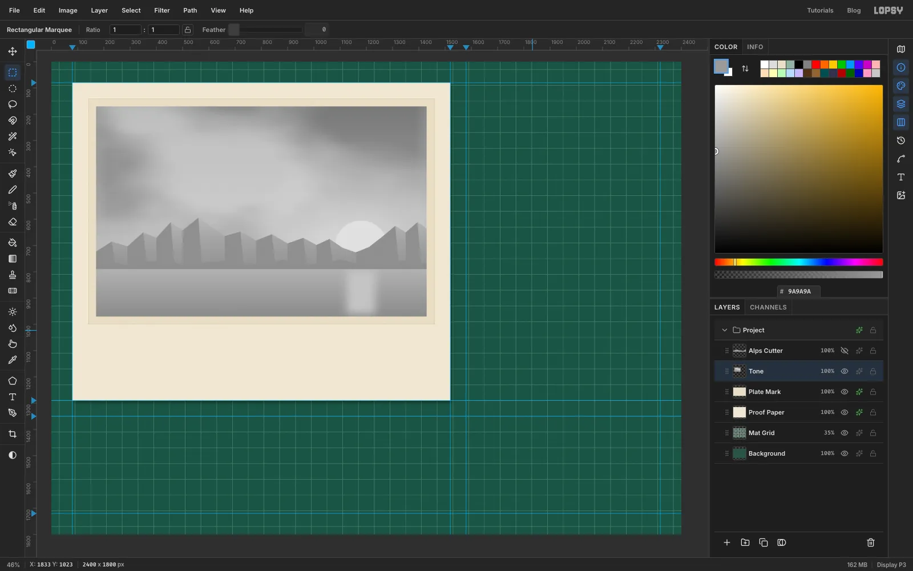

1. Click **Duplicate Layer**, rename the copy `Alps Cutter` and hide it with its eye icon. You'll use its outline several times to cut things.
2. Click `Alps` and **Merge Down** onto `Tone`.
3. Select the picture area (`170, 170` to `1430, 970`), choose **Select → Inverse** and press [[Delete]]. This keeps the tone study inside the frame. Press [[Cmd+D]].
4. Run **Brightness/Contrast…** on `Tone` with **Brightness** `-2` and **Contrast** `-20`. This pulls the very brightest greys down a little. Without it, a light patch of cloud can come out with no lines at all.

## Drop in the photo and scale it

1. With `Tone` selected, drag the downloaded photo from your desktop onto the canvas. It lands as a new layer at the top-left corner, already selected. Rename it `Zeppelin Photo`.
2. With the **Move** tool, hold [[Cmd]] and drag the bottom-right corner handle up and to the left. [[Cmd]] keeps the proportions. Stop when the Info panel's selection **W** reads about `1306`, which is 68%.
3. Nudge it with the arrow keys until the photo's top-left corner is at `159, 177`. The zeppelin now crosses the upper half of the picture, nose high on the right. Press [[Cmd+D]].

## Trace the hull with the Pen

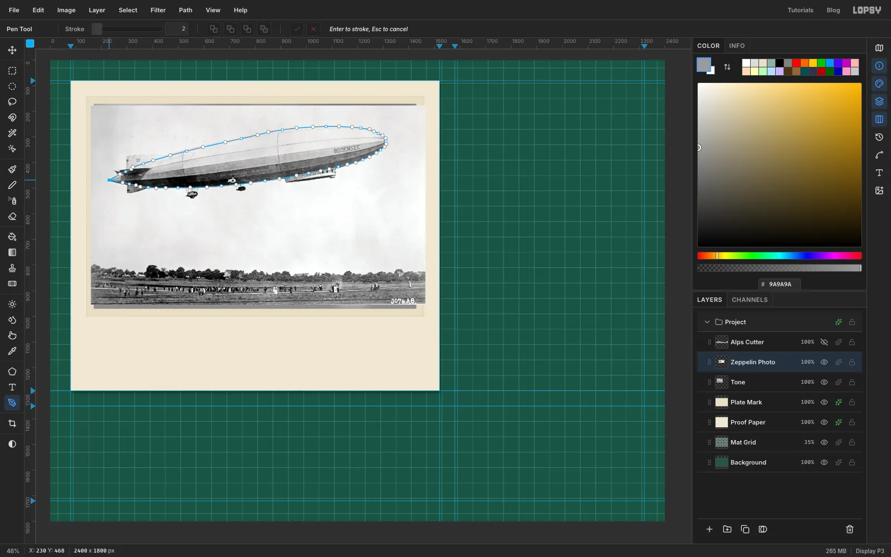

The sky in this photo is almost as pale as the top of the hull, so the **Magic Wand** can't find the edge. Trace it instead.

1. Pick the **Pen** (**P**). Start with a plain click on the tip of the tail, so it stays a sharp corner.
2. Work along the top of the hull to the nose and back along the underside. Press at each point and drag a short way along the hull's direction, so the curve stays smooth. Place points closer together round the nose and the tail, where the outline bends most. Around 40 points is about right. Follow the outside edge of the hull and leave out the fins and the cars.
3. Finish by clicking the first point again. That closes the path.

## Add the fins and cars to the selection

1. Open the **Paths** panel and click **Path to Selection**, then **Delete Path**. The hull is now a marching-ants selection.
2. Pick the **Lasso**, hold [[Shift]] and drag round the upper tail fin. [[Shift]] adds to the selection. Do the same for the long horizontal fin, the lower fin, the passenger car under the nose and the three engine cars.

## Cut out the airship

1. Choose **Select → Inverse** and press [[Delete]]. The sky, the field and the crowd disappear.
2. Press [[Cmd+D]].

## Clone out the painted lettering

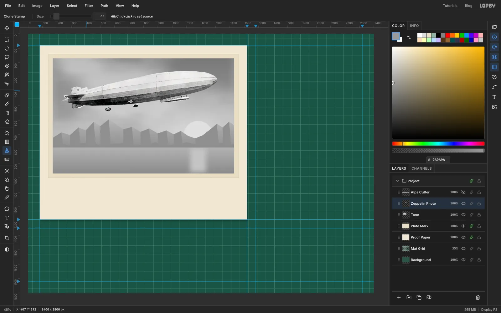

The real ship has *BODENSEE* painted near its nose. You'll add your own sharp red version later, so remove the photo's lettering now. If you left it, it would print as a blue smudge under the red.

1. Pick the **Clone Stamp** (**S**) and set **Size** `22`.
2. [[Alt]]-click on the plain pale band of the hull about 170 px to the left of the lettering, at the same height on the hull. That's the source.
3. Paint three strokes along the lettering, following the hull's slope: one along the tops of the letters, one through the middle and one along the bottoms. The clean band is copied over the letters.
4. Paint out the small *D1* marks on the tail fin and under the hull the same way.

## Tone the airship

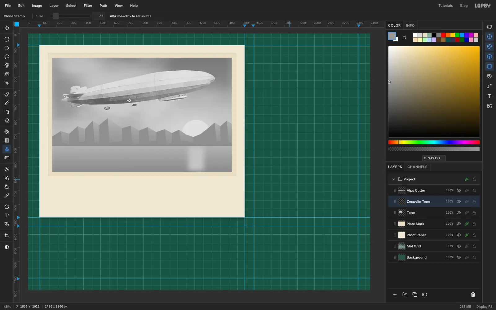

1. Choose **Filter → Desaturate**.
2. Run **Surface Blur…** with **Radius** `8` and **Threshold** `25`. It smooths the photo's grain but keeps the edges sharp. Without it, the underside comes out as a blotchy speckle instead of clean lines.
3. Run **Brightness/Contrast…** with **Brightness** `14` and **Contrast** `-45`. This keeps the darkest underside from going solid and leaves a few lines on the pale fins.
4. Rename the layer `Zeppelin Tone`.

## Rule the engraving lines

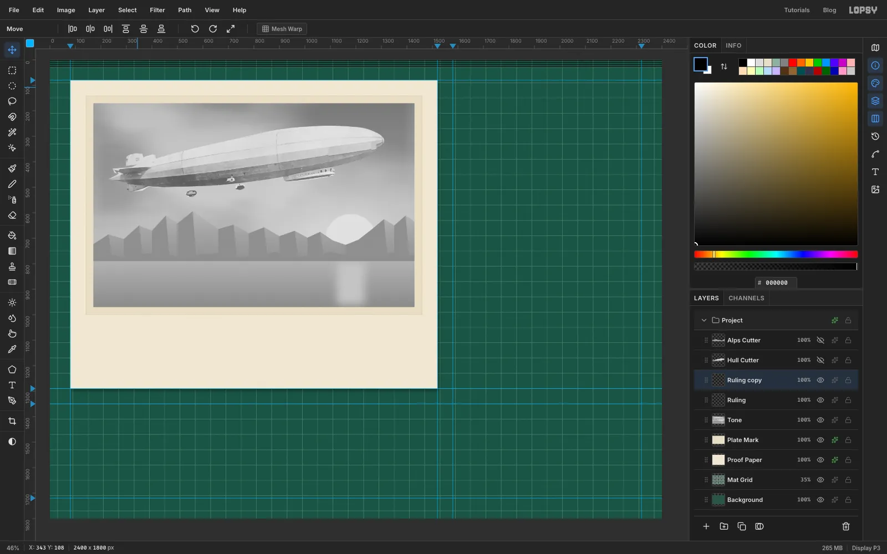

1. Click **Duplicate Layer** on `Zeppelin Tone`, rename the copy `Hull Cutter` and hide it.
2. Click `Zeppelin Tone` and **Merge Down** onto `Tone`.
3. Add a layer called `Ruling`. With the **Pencil** at **Size** `2`, set the foreground to black and draw one line right across the canvas at `y 4`.
4. Double it with the step-and-repeat, straight down this time: nudges of `8`, `16`, `32`, `64`, `128`, `256`, `512` and `1024` px. Eight passes give 256 lines, 8 px apart. This is your ruling machine.

## Soften the lines

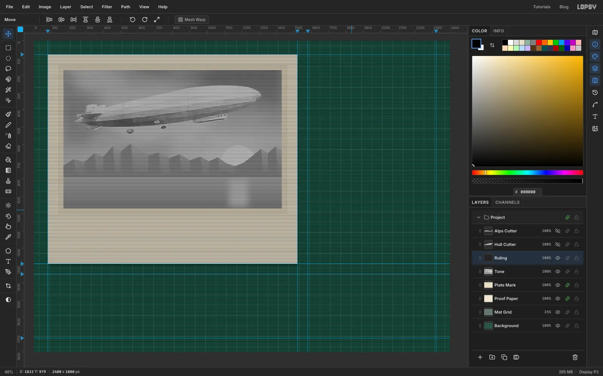

Run **Filter → Gaussian Blur…** with **Radius** `4`.

Here's why this works. Each line is now a soft hill of ink that fades out to nothing halfway to the next line. In **Multiply** the hills darken the grey picture underneath. **Threshold** then turns every pixel darker than one level black and everything else white, like a water level:

- Over dark grey, the hills already sit low, so more of each hill is below the level and prints as a thick line.
- Over pale grey, only the very centre of each hill dips below, so the line prints thin.
- A grey darker than about `#888888` is below the level even between the hills, so it prints solid black.

## Make the cross-ruling and the hull band

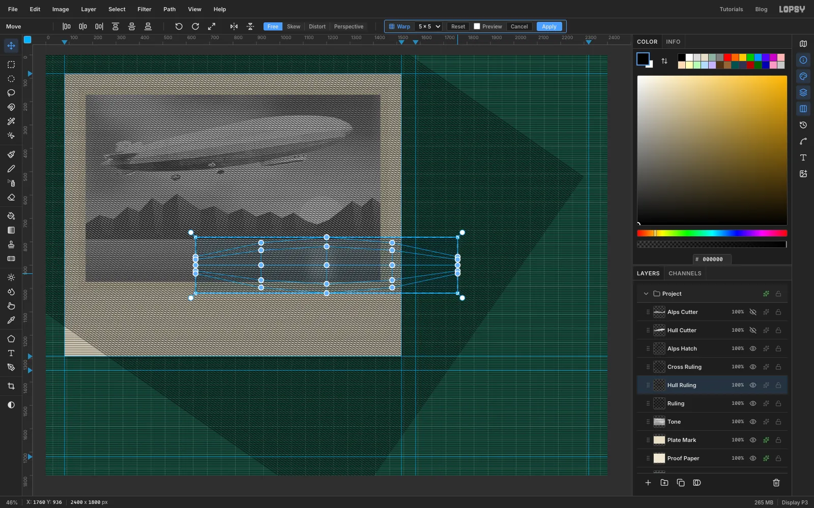

Real engravers changed the angle of their lines for different parts of a picture. You'll make three more copies of the ruling.

1. **Cross-ruling.** **Duplicate** `Ruling` and rename the copy `Cross Ruling`. Press [[Cmd+A]]. With the **Move** tool, drag the rotation handle just outside the top-right corner to turn it about **35°** clockwise. There's no angle readout, so judge it by eye. If you hold [[Cmd]] it snaps to **30°**, which works just as well. Press [[Cmd+D]], then nudge the layer `400` px left and `330` px up so it covers the whole picture.
2. **Alps hatch.** **Duplicate** `Cross Ruling` and rename it `Alps Hatch`. [[Cmd]]-click the `Alps Cutter` thumbnail, choose **Select → Inverse** and press [[Delete]]. Only the diagonal lines inside the mountains are left. Press [[Cmd+D]].
3. **Hull band.** Click `Ruling`, **Duplicate** it and rename the copy `Hull Ruling`. Select a band from `640, 780` to `1760, 1020`. That's about the length and height of the hull. **Select → Inverse**, [[Delete]], press [[Cmd+D]], then select the band again with the same numbers.
4. With the **Move** tool, click **Mesh Warp** in the options bar and set the grid to **5 × 5**.

## Pinch the band to the hull's shape

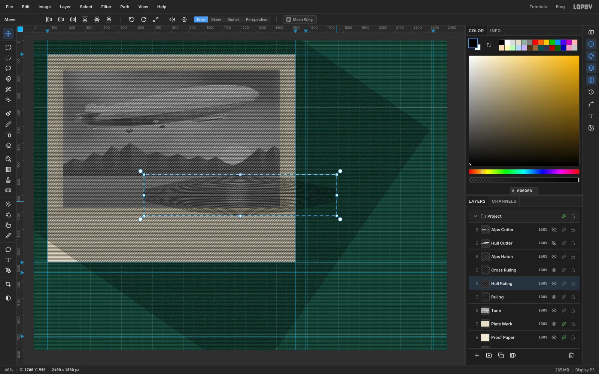

The lines on a cigar-shaped hull squeeze together toward the nose and the tail. Toward the top and bottom edges they crowd together too, because you see them at a slant. Recreate that with the grid. Number the five handles in each column 1 to 5 from the top. The middle handle (3) never moves.

1. **Left and right columns:** drag handles 1 and 5 about 85 px in toward the middle, and handles 2 and 4 about 35 px in. The ends of the band pinch to about a third of their height.
2. **Second and fourth columns:** drag handles 1 and 5 about 25 px in.
3. **Middle column:** drag handle 2 up about 20 px and handle 4 down about 20 px. The lines spread out through the middle of the hull.
4. Tick **Preview** to check, then click **Apply**.

Press each handle right on its dot. A drag that starts between handles moves the whole selection instead of warping it.

## Turn the band to the hull's angle

The zeppelin climbs to the right at about 8°.

1. Select the band again (`640, 780` to `1760, 1020`).
2. Drag the rotation handle at the top-right corner upward until the band runs parallel to the hull. Its right end should finish about 155 px higher than its left. Press [[Cmd+D]].
3. With the **Move** tool, drag the band over the zeppelin. Then nudge it until its pinched ends meet the tail and nose and its middle runs along the hull's centre line.

## Clip the band to the hull

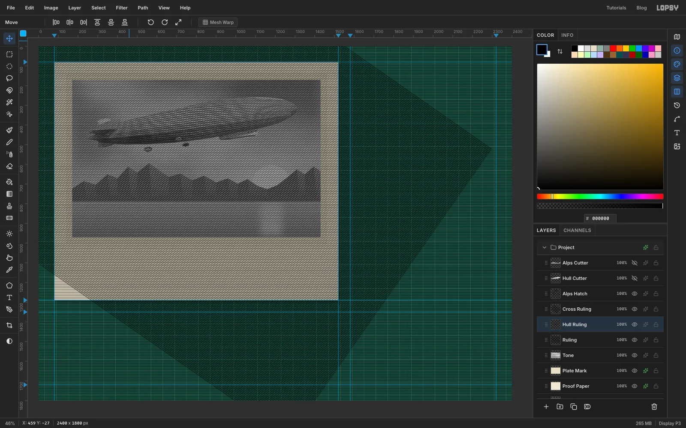

1. [[Cmd]]-click the `Hull Cutter` thumbnail. Its outline becomes the selection.
2. With `Hull Ruling` active, choose **Select → Inverse** and press [[Delete]]. Press [[Cmd+D]].

## Trim the rulings and set them to Multiply

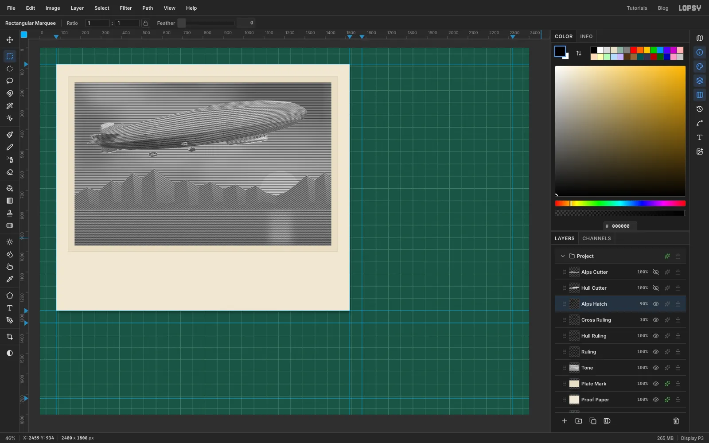

1. Click `Ruling`. [[Cmd]]-click the `Hull Cutter` thumbnail, then [[Shift]]+[[Cmd]]-click the `Alps Cutter` thumbnail to add the mountains. Press [[Delete]], then [[Cmd+D]]. The sky's straight lines no longer run over the hull or the Alps.
2. On both `Ruling` and `Cross Ruling`, select the picture area (`170, 170` to `1430, 970`), choose **Select → Inverse**, press [[Delete]] and [[Cmd+D]].
3. On `Cross Ruling`, select the sky (`170, 170` to `1430, 790`), then [[Alt]]+[[Cmd]]-click the `Hull Cutter` thumbnail to subtract the hull. Press [[Delete]] and [[Cmd+D]]. A clean ruled sky uses just one set of lines, so only the lake and the hull keep the cross-hatching.
4. In each layer's effects drawer, set `Ruling`, `Hull Ruling`, `Cross Ruling` and `Alps Hatch` to **Multiply**. Set `Cross Ruling`'s opacity to `30%` and `Alps Hatch` to `90%`. At 30% the cross lines only reach the threshold where the picture is dark.

## Merge everything into one grey layer

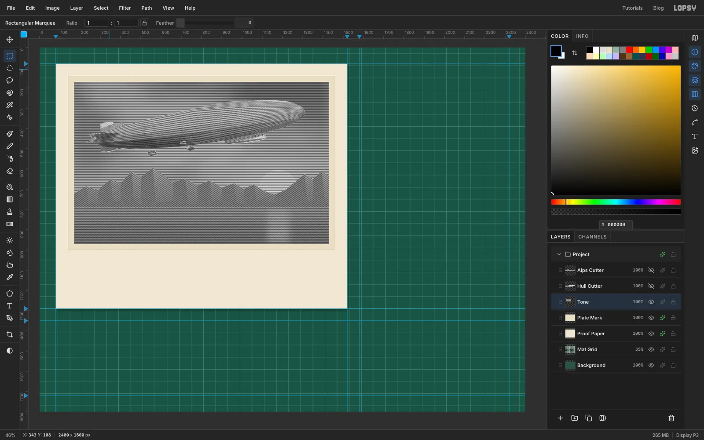

Check the Layers panel: the four ruling layers should sit directly above `Tone`, with the hidden cutters above them. Then:

1. Click `Ruling` and **Merge Down**.
2. Do the same for `Hull Ruling`, `Cross Ruling` and `Alps Hatch`, in that order. Each one lands on `Tone`.

## Run Threshold

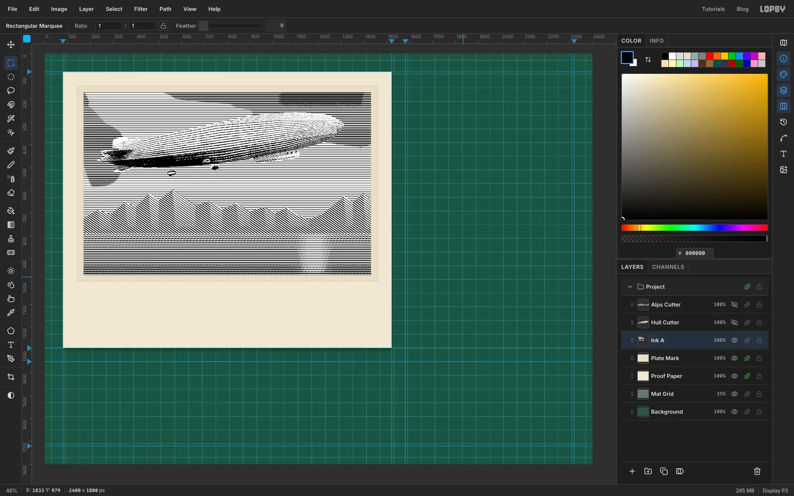

1. Run **Filter → Threshold…** with **Level** `110` and click **Apply**.
2. Rename the layer `Ink A`.

Zoom to 100% and look. The sky lines swell where the clouds are darker and thin out near the sun. The hull lines curve and pinch toward the ends. The lake gets heavier toward the shore.

## Lift the ink off, add a contour and draw the ties

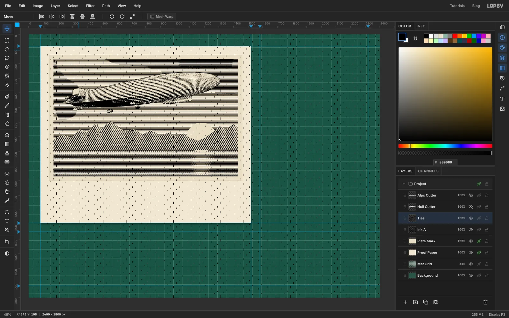

1. Pick the **Magic Wand** (**W**), untick **Contiguous** and set **Tolerance** `40`. Click a white gap between two lines. Every white pixel in the layer is selected. Press [[Delete]], then [[Cmd+D]].
2. Select the sun's circle 1 px larger than before (`1079, 604` to `1281, 806`) so the soft rim goes too. Then [[Alt]]+[[Cmd]]-click the `Alps Cutter` thumbnail to subtract the mountains. Press [[Delete]] and [[Cmd+D]]. The sun is now clear for the red.
3. Add a layer called `Contour` above `Ink A`. [[Cmd]]-click `Hull Cutter`, fill with black, choose **Select → Shrink…** `2` and press [[Delete]]. You're left with a 2 px outline round the hull. Press [[Cmd+D]] and **Merge Down** onto `Ink A`.
4. A stencil can't hold a long thin slot without falling apart, so every line needs small *ties*, or bridges. Add a layer called `Ties`. With the **Pencil** at **Size** `2` in black, draw a short vertical tick from `30, 1` to `30, 7`. It's 6 px tall, so it crosses exactly one ruled line (the one at `y 4`).
5. Step-and-repeat it sideways with nudges of `160`, `320`, `640` and `1280` px. That's one row of ties.
6. Now make the next rows start at different places, so the ties don't line up in columns. Duplicate, nudge `100` right and `8` down (one line lower), merge. Duplicate, nudge `40` right and `16` down, merge. Duplicate, nudge `20` right and `32` down, merge. You have eight rows, each shifted differently.
7. Step-and-repeat those eight rows straight down with nudges of `64`, `128`, `256`, `512` and `1024`. The ticks cover the whole sheet, but you'll hide them in a moment.

## Cut the ties and ink it blue

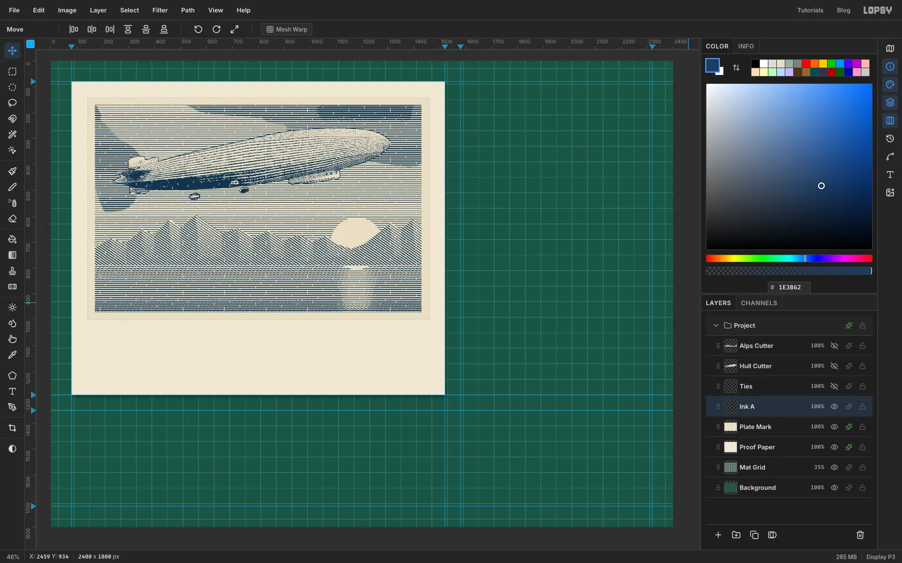

1. [[Cmd]]-click the `Ties` thumbnail, click `Ink A` and press [[Delete]]. Press [[Cmd+D]] and hide `Ties`.
2. [[Cmd]]-click the `Ink A` thumbnail and fill with Prussian blue `#1E3B62`. Press [[Cmd+D]].
3. In its effects drawer, set `Ink A` to **Multiply**, so the paper shows through the ink like a real print.

## Rule the red sun

The red plate gets its own small set of lines.

1. Click `Ink A` and add a layer called `Ink B`. Select the sun's circle (`1080, 605` to `1280, 805`) and draw a linear gradient from `#E8E8E8` at the top of the circle to `#8E8E8E` at the bottom. Press [[Cmd+D]].
2. Add a layer called `Sun Ruling`. Set the foreground back to black (it's still blue from the last fill). With the **Pencil** at **Size** `2`, draw a line at `y 604` from `x 1060` to `x 1300`. Step-and-repeat it straight down with nudges of `8`, `16`, `32`, `64` and `128`.
3. Run **Gaussian Blur…** at `4`, set the layer to **Multiply** and **Merge Down** onto `Ink B`.
4. Select the circle again, **Select → Inverse**, [[Delete]], [[Cmd+D]].
5. Run **Threshold…** at `110`. With the **Magic Wand** (**Contiguous** still off), click a white gap and press [[Delete]].
6. [[Cmd]]-click `Alps Cutter`, press [[Delete]] so the sun sinks behind the ridge, and press [[Cmd+D]].

## Add the glint on the water

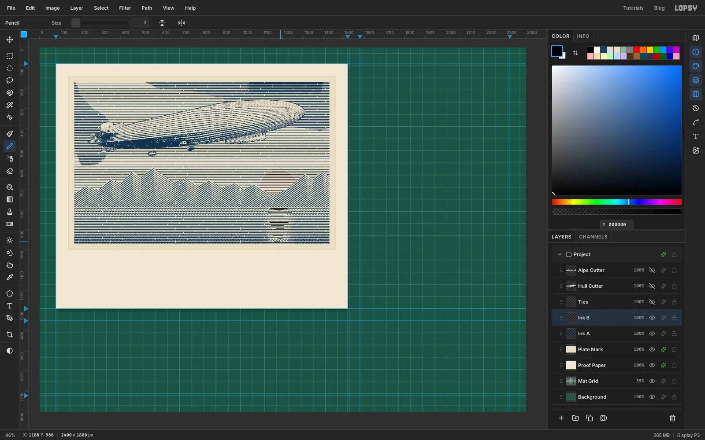

1. Still on `Ink B`, with the **Pencil** at **Size** `2` in black, draw short horizontal dashes in the pale column under the sun. Use [[Shift]]-click for each one. Start at `y 800` with a dash about 130 px long, centred under the sun. Then draw ten more, 16 px apart, down to `y 960`. Make each a little shorter than the last, ending at about 20 px, and wobble them a few pixels left and right. Spaced 16 px apart, they fall between the blue lines.
2. [[Cmd]]-click `Ties`, click `Ink B` and press [[Delete]], so the red has ties too. Press [[Cmd+D]].

## Type the painted name

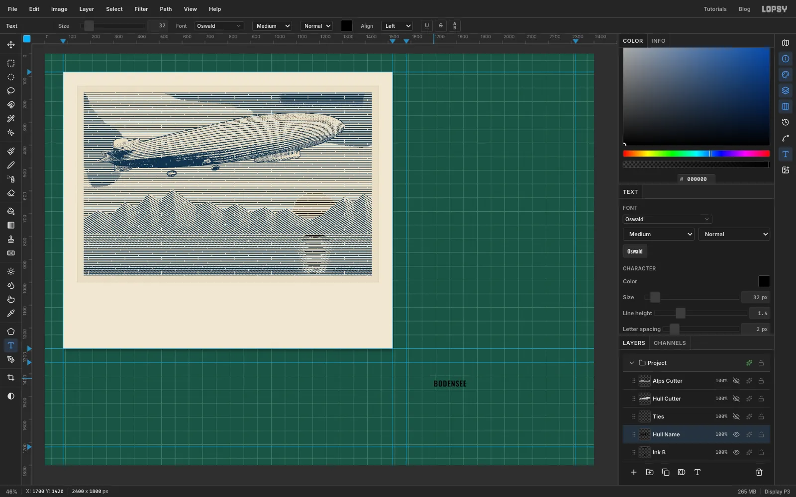

1. Pick the **Text** tool (**T**). Set **Oswald**, **Medium**, size `32`, colour black, and **Align** **Left**.
2. Click on an empty patch of mat, away from any other text, and type `BODENSEE`. Press [[Tab]] to finish. Rename the layer `Hull Name`.
3. In the **Text** panel, set **Letter spacing** to `2`.

## Turn the name and seat it on the hull

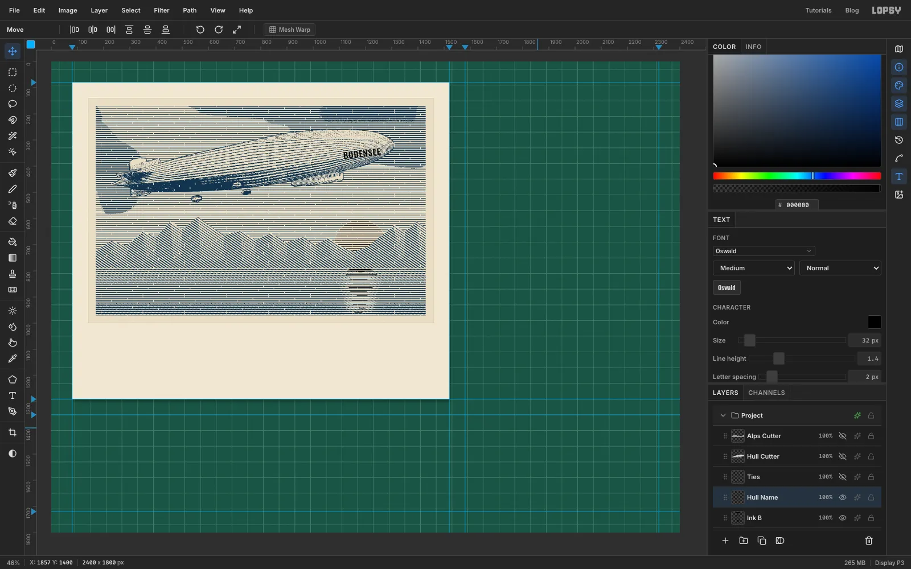

1. Click **Rasterize Layer** at the bottom of the Layers panel.
2. [[Cmd]]-click its thumbnail, then drag the rotation handle up until the word's slope matches the hull's lower edge near the nose, about 6° anticlockwise. Press [[Cmd+D]].
3. With the **Move** tool, place it on the pale band near the nose, where the photo's lettering was.
4. [[Cmd]]-click `Hull Name`, choose **Select → Grow…** `2`, click `Ink A` and press [[Delete]]. This knocks the blue lines out from under the letters, so the red prints clean. Press [[Cmd+D]].
5. Click `Hull Name` and **Merge Down** onto `Ink B`.

## Ink the red plate

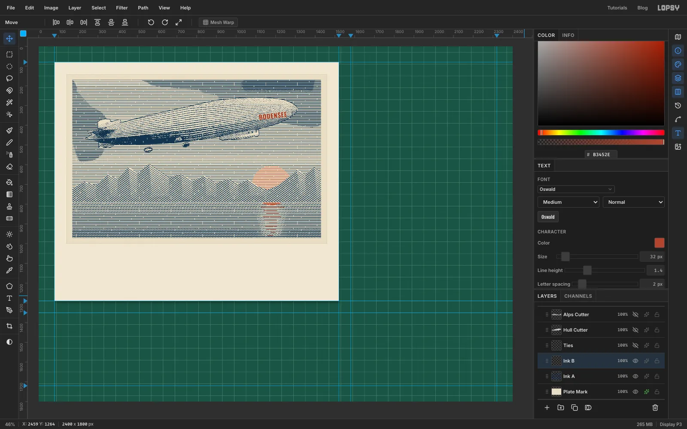

1. [[Cmd]]-click `Ink B` and fill with oxide red `#B3452E`. Press [[Cmd+D]].
2. Set `Ink B` to **Multiply**.

## Set the title and the caption

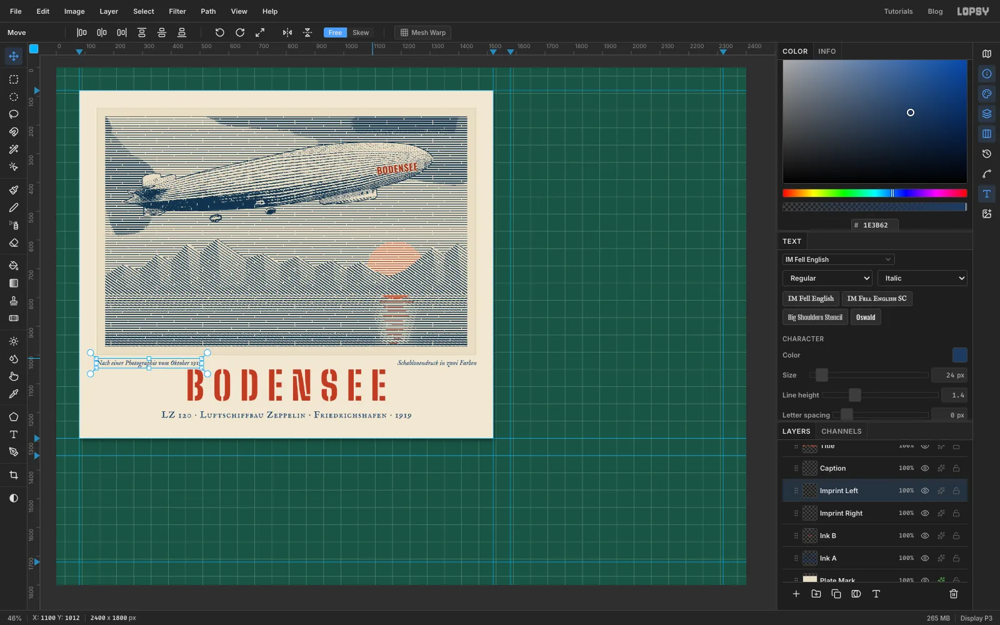

Click `Ink B` before each new text, so the Text tool doesn't restyle the previous one. In the **Text** panel, set **Letter spacing** back to `0` before you type.

1. **Title.** **Big Shoulders Stencil**, **ExtraBold**, `136`, `#B3452E`. Type `BODENSEE` and rename the layer `Title`. Set **Letter spacing** `30`. With the **Move** tool, nudge it until it's centred on the paper: the middle of the word at `x 800`, about halfway between the plate mark and the bottom edge. Check the Layer **X** and width in the Info panel.
2. **Caption.** **IM Fell English SC**, `32`, `#1E3B62`, letter spacing `2`: `LZ 120 · Luftschiffbau Zeppelin · Friedrichshafen · 1919`. Rename it `Caption` and centre it the same way below the title. Leave at least 60 px of paper below it, a little more than at the sides.
3. **Imprint lines.** **IM Fell English**, **Italic**, `24`, blue. Type `Nach einer Photographie vom Oktober 1919` just under the plate mark, lined up with its left edge, and rename it `Imprint Left`. Type `Schablonendruck in zwei Farben` and nudge it until its right end lines up with the plate mark's right edge. Rename it `Imprint Right`. Old prints credit the source and the printer in exactly this spot.

## Make the first stencil board

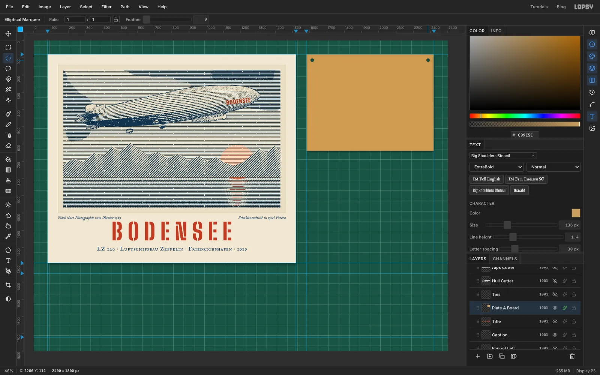

1. Click `Title` and add a layer called `Plate A Board`. (Check that it lands above all the proof's layers.)
2. Use the marquee dialog to select `1580, 80` to `2320, 640`. Fill with `#C99E5E`. Run **Add Noise…** at `8`, **Mono**, then **Motion Blur…** at **Angle** `0`, **Distance** `12` for a fibrous card. Press [[Cmd+D]].
3. Add a **Drop Shadow** (**Offset** `4`, `7`, **Blur** `10`, **Opacity** `42`, colour `#08130F`) and an **Inner Glow** (**Size** `16`, **Opacity** `40`, colour `#6B4A1E`) for oily edges.
4. Punch two registration holes. With the **Elliptical Marquee** dialog, select `1604, 104` to `1624, 124`, press [[Delete]], then do the same at `2276, 104` to `2296, 124`. Every plate gets holes in the same place, so they all line up on the same pins.

## Copy the key plate onto the board at half size

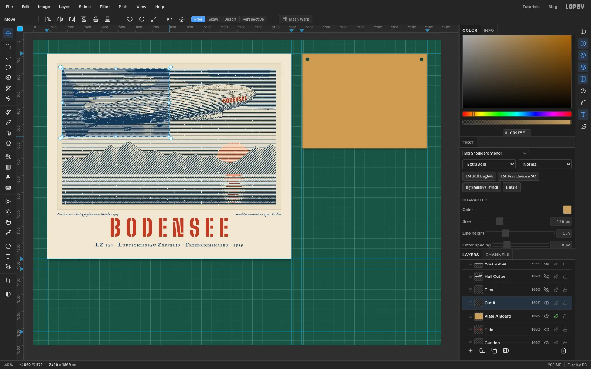

A contact sheet shows the plates small. Plates A and B are shown at half size.

1. Click `Ink A`, select the picture area (`170, 170` to `1430, 970`) and press [[Cmd+C]].
2. Click `Plate A Board` and press [[Cmd+V]]. The copy is pasted in place, right above the board. Rename it `Cut A` and press [[Cmd+D]].
3. Select the picture area again. With the **Move** tool, hold [[Cmd]] and drag the bottom-right handle up and left until the selection **W** in the Info panel reads `630`, half size.
4. Drag it onto the board, then nudge it until its top-left corner sits at `1635, 150`, 55 px in from the board's left edge. Press [[Cmd+D]].

## Cut the plate

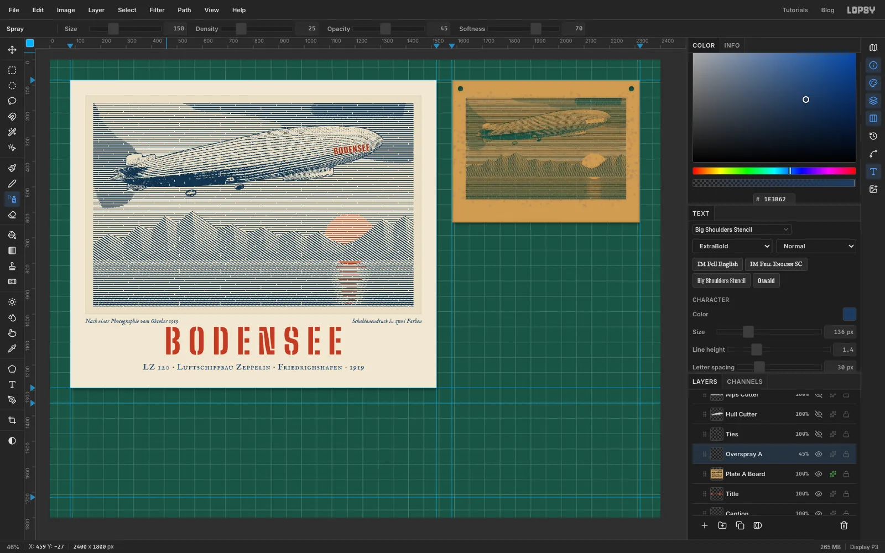

1. [[Cmd]]-click the `Cut A` thumbnail, click `Plate A Board` and press [[Delete]]. The lines are now holes in the board. The mat grid shows through them, and the drop shadow gives the cuts depth. Press [[Cmd+D]].
2. Click `Cut A`, run **Gaussian Blur…** at `6` and rename it `Overspray A`. Sprayed paint always mists a little past the edges of the holes.
3. Pick the **Spray** tool (**J**) at **Size** `150`, **Density** `25`, **Opacity** `45%`, in blue `#1E3B62`. Zigzag across the cut area four times.
4. [[Cmd]]-click `Plate A Board`, **Select → Inverse**, [[Delete]], [[Cmd+D]]. This keeps the haze on the card, so the holes stay clean. Set the layer to `45%`.
5. Label it: **Text**, **Big Shoulders Stencil**, **Bold**, `34`, `#4A3418`, letter spacing `3`. Type `A · PRUSSIAN BLUE · KEY PLATE` along the bottom-left of the board, starting 55 px in from the left like the art above. Rename it `Label A`.

## Cut the red plate

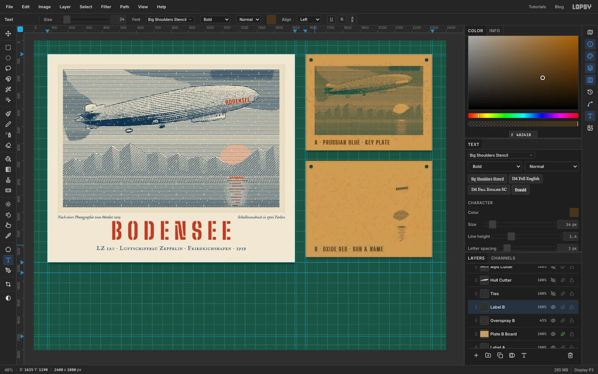

Plate B is made exactly like plate A, one cell lower.

1. Click `Label A` and add a layer `Plate B Board`. Select `1580, 700` to `2320, 1260` and repeat steps 2 to 4 of *Make the first stencil board*: the fill, Noise and Motion Blur, both effects, and pin holes at `1604, 724` and `2276, 724` (20 px each).
2. Click `Ink B`, select the picture area and copy. Click `Plate B Board` and paste, rename the copy `Cut B`, and scale it to half size as before.
3. Nudge it to `1635, 770`. That's the same spot in its cell as plate A's art, so the two plates register.
4. [[Cmd]]-click `Cut B`, click the board and [[Delete]]. Blur `Cut B` at `6` and rename it `Overspray B`. Spray the haze over it in oxide red `#B3452E`, trim it to the board, and set it to `45%`.
5. Label it `B · OXIDE RED · SUN & NAME`, renamed `Label B`. Reset **Letter spacing** to `3` if needed.

Most of plate B is plain card. A plate only carries its own colour.

## Cut the title plate at full size

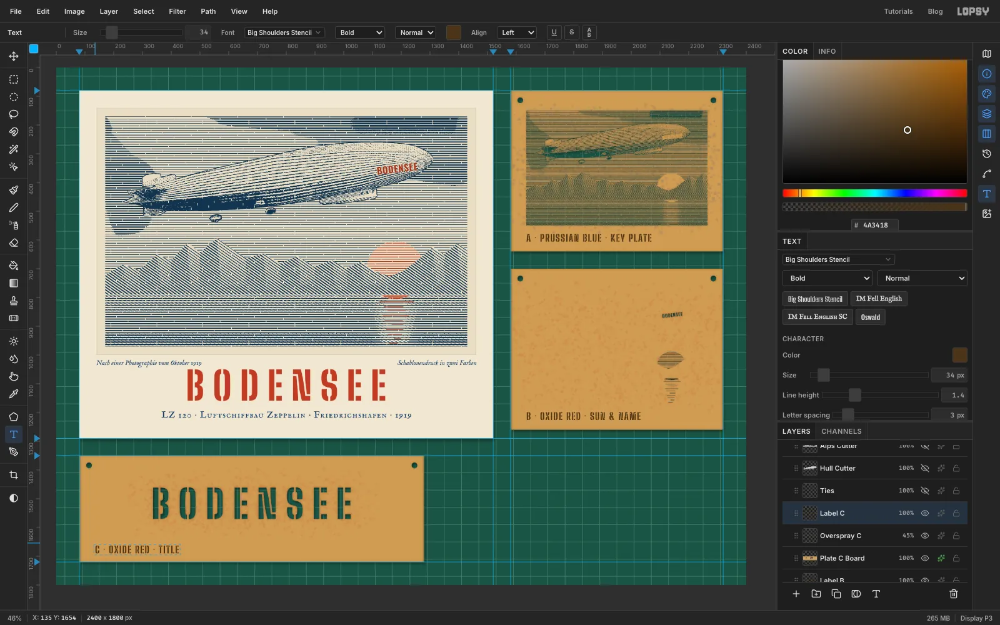

1. Click `Label B` and add `Plate C Board` from `80, 1350` to `1280, 1720`, styled like the others, with pin holes 34 px in from its top corners.
2. Click `Title`, **Duplicate** it, and click **Rasterize Layer**. [[Cmd]]-click the copy and press [[Cmd+X]]. Delete the now-empty copy.
3. Click `Plate C Board` and press [[Cmd+V]]. The title is pasted in place above the board. Rename it `Cut C`, press [[Cmd+D]], and drag it down into the middle of the board, a little above centre to leave room for the label.
4. [[Cmd]]-click `Cut C`, click `Plate C Board`, [[Delete]], [[Cmd+D]]. Blur `Cut C` at `6`, rename it `Overspray C`, spray red over the letters, trim it to the board and set it to `45%`.
5. Label it `C · OXIDE RED · TITLE` and rename it `Label C`.

## Rule an index card

1. Click `Label C` and add a layer called `Card`. Select `1460, 1360` to `2220, 1710`, fill with `#F5F1E6`, add **Noise** `3` **Mono**, and give it a **Drop Shadow** (**Offset** `4`, `7`, **Blur** `10`, **Opacity** `45`, colour `#08130F`).
2. Add a layer called `Card Rules`. With the **Pencil** at **Size** `2` in `#9DB6CC`, draw a line across the card at `y 1462`. Step-and-repeat it down with nudges of `36`, `72` and `144`. That gives seven rules on the card. The eighth falls off the bottom and gets trimmed.
3. In `#D88A84`, draw the red header rule at `y 1422` and a vertical margin line at `x 1532`.
4. Select the card's rectangle again, **Inverse**, [[Delete]], [[Cmd+D]] to trim the rules to the card.

## Type the card

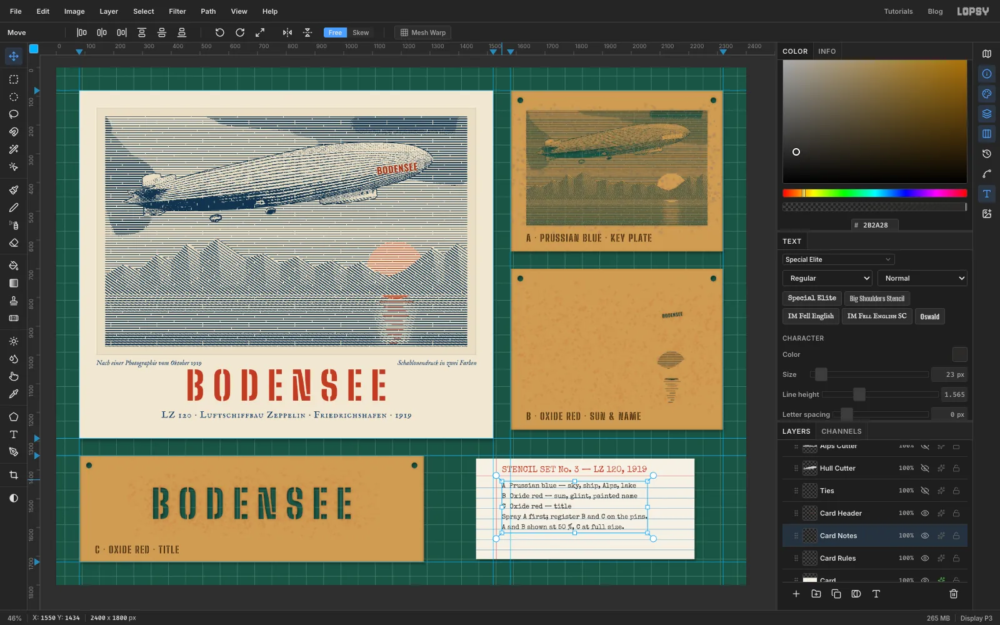

1. With `Card Rules` selected, set **Letter spacing** to `0`. Pick **Text**, **Special Elite**, `30`, `#B3452E` and type `STENCIL SET No. 3 — LZ 120, 1919` just above the red rule, starting right of the margin. Rename it `Card Header`.
2. Click `Card Rules` again. Switch to size `23` in `#2B2A28`, click below the red rule and type the notes, pressing [[Enter]] between lines:
   - `A  Prussian blue — sky, ship, Alps, lake`
   - `B  Oxide red — sun, glint, painted name`
   - `C  Oxide red — title`
   - `Spray A first; register B and C on the pins.`
   - `A and B shown at 50 %, C at full size.`
3. Rename it `Card Notes`. In the **Text** panel, set **Line height** to `1.565`. At this size that's exactly 36 px, the same as the rules.
4. Nudge the block with the **Move** tool until the bottoms of the letters sit just on the blue rules, with descenders hanging through them.
5. For the ink tests, click `Card Rules` and add a layer `Test Sprays`. With the **Spray** tool at **Size** `60`, **Density** `60`, spray a small blue circle and a red one next to it near the bottom-right corner. Set the layer to **Multiply**.

## Group the card and tilt it

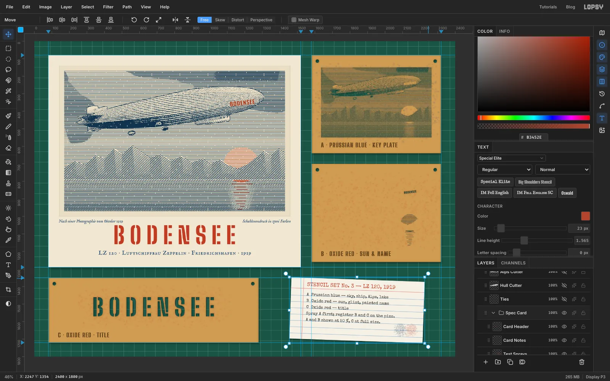

1. Click `Card` in the Layers panel and [[Shift]]-click `Card Header` to select everything in between. Choose **Layer → Group Layers** and name the group `Spec Card`.
2. With the group active and nothing selected, drag the **Move** tool's rotation handle to turn it a degree or two clockwise. The right end of the card should drop about 25 px.

The text stays live text. It turns with the card and stays sharp.

## Group the plates and tilt them

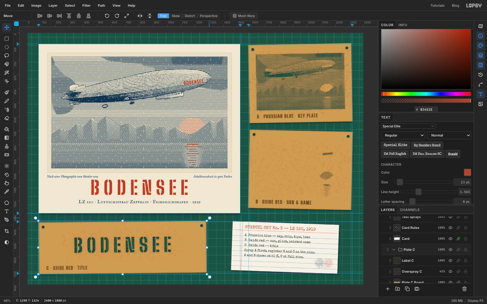

1. Click `Proof Paper`, [[Shift]]-click `Title`, and choose **Layer → Group Layers**. Name the group `Proof`. Group each board with its overspray and label the same way, as `Plate A`, `Plate B` and `Plate C`.
2. With nothing selected, rotate `Plate A` about **1°** anticlockwise (its right end rises about 13 px), `Plate B` about **1°** clockwise, and `Plate C` just over half a degree anticlockwise.

Nothing on a real workbench lies perfectly square, and alternating the tilts keeps the sheet lively.

## Add registration targets and tape

1. Click the hidden `Alps Cutter` (still a top-level layer, above the groups) and add a layer called `Reg Marks`. That way it stays out of the groups.
2. With the **Pencil** at **Size** `2` in black, draw a 48 px cross in each side margin of the proof, centred at `110, 570` and `1490, 570`. Add a ring round each: select a 26 px circle on the centre, fill, **Select → Shrink…** `2`, [[Delete]], [[Cmd+D]].
3. **Duplicate** the layer and rename it `Reg Marks Red`. [[Cmd]]-click its thumbnail, fill red, nudge it `2` px right and `1` down, and set it to **Multiply**. Then [[Cmd]]-click `Reg Marks`, fill it blue and set it to **Multiply** too. The slight mismatch is how real two-colour targets look.
4. Add a layer called `Tape`. Select `10, 70` to `190, 120`, fill with `#E4D6A6`, add **Noise** `6`. With the **Move** tool, turn it about **40°** anticlockwise with the rotation handle so it crosses the proof's top-left corner. Press [[Cmd+D]].

## Copy the tape to the other corner

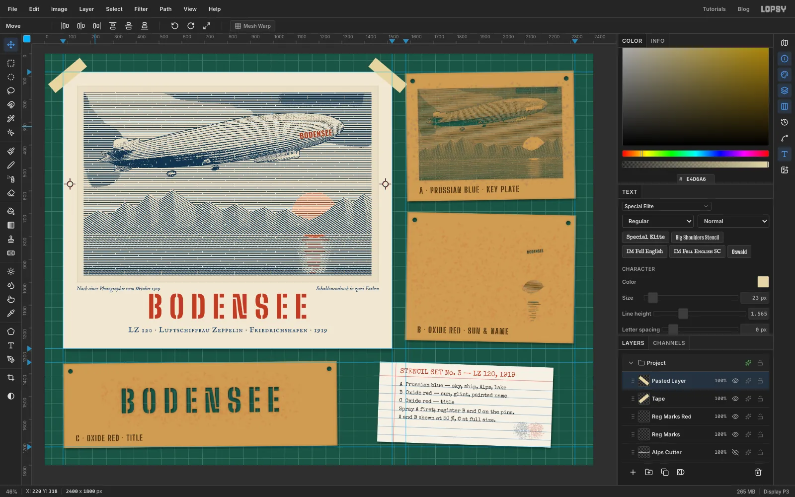

1. [[Cmd]]-click `Tape`, press [[Cmd+C]] then [[Cmd+V]], and press [[Cmd+D]].
2. Choose **Image → Flip Horizontal** to mirror the copy. It mirrors across the whole canvas, so the copy jumps to the far right edge. Drag it back over the proof's top-right corner, near `1520, 80`.
3. **Merge Down** onto `Tape`. Add a light **Drop Shadow** (**Offset** `2`, `3`, **Blur** `4`, **Opacity** `30`, colour `#2A2010`) and set the layer to `82%`.
4. Add a last layer called `Grain`. Press [[Cmd+A]], fill with `#808080`, run **Add Noise…** at `30` **Mono**, set it to **Overlay** at `14%` and press [[Cmd+D]].
5. Group `Ties`, `Hull Cutter` and `Alps Cutter` as `Cutters`. The three layers inside stay hidden, but keep them: they're handy if you re-cut a plate later.

## Check the line work at 100%

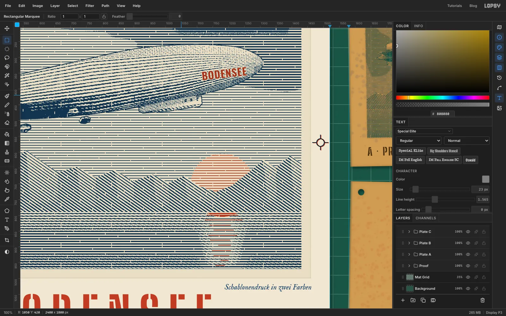

Hold [[Cmd]] and scroll over the zeppelin's nose to zoom to 100%. Check that:

- the hull lines curve and pinch toward the nose, and the red name sits on clean paper
- the sky lines thicken under the darker cloud bands and never vanish completely
- the Alps' diagonals meet the sun's red lines without a gap

Choose **File → Save Project** to keep the `.lopsy` with all its groups and live text, and **File → Export…** for a PNG.
