An *etching* is printed from a copper plate. The artist scratches lines
through a waxy ground, and acid bites them into the metal. Ink caught in
those lines makes the print. An etcher has no grey. Every tone is built
from lines: open parallel lines for light, and lines crossed over lines
(*cross-hatching*) for shadow. The plate also leaves its mark. Its edge
presses a shallow step into the paper, and a film of ink left on its
surface tints the printed area slightly darker than the margin around it.

In this tutorial you'll present a moon phase app called **Lunar Quarters**
as if it were a plate from an old astronomy book. The board is
1800 × 1200 px. It has two phones drawn as engraved objects with hatched
shadows. The hero screen carries a moon engraved from a NASA photograph.
The second screen shows the lunar cycle as a dial. A title column sits on
the left, and pencil notes in the margin finish the piece, the way
printmakers sign and number an edition.

Along the way you'll use:

- **Define Pattern** and **Edit → Fill with Pattern** to make three engraving patterns: rules, hatching and back-hatching
- the **Shape** tool's click-to-size dialog for the phones, and **⌘-click** on layer thumbnails to load a layer as a selection
- marquee **add**, **subtract** and **intersect** drags ([[Shift]], [[Alt]] and [[Shift+Alt]]), plus the exact-size marquee dialog
- **Magic Wand**, **Select → Shrink**, **Select → Inverse** and **Delete**
- **Gaussian Blur**, **Posterize**, **Liquify** (Bloat), **Sunburst**, **Desaturate** and **Add Noise**
- the **Pencil** with [[Shift]]-click straight lines, and the **Pen** tool, pressing [[Enter]] to stroke a path
- **Copy**, **Paste**, scaling with the **Move** tool, **Merge Down** and **New Group**
- the **Stroke**, **Inner Glow** and **Color Overlay** layer effects
- **Text** in Cormorant SC, Old Standard TT, Pinyon Script and Cedarville Cursive
- rotating a whole group, and undo and redo

The palette is one ink and one red on a family of warm paper tones, plus a pencil grey:

- Paper `#F2ECDF`, plate tone `#E8DEC8`, wiped plate edge `#B49C76`
- Ink `#1F2331`, sanguine `#9E3F2B`
- Screen `#F4EEE2`
- Plate mark shadow `#CDB892`, plate mark light `#F8F3E8`, crease `#DCD1BC`
- Pencil `#77736C`

The moon is a public-domain image from NASA's Scientific Visualization
Studio, *Moon Phase and Libration, 2024 (SVS5187 - phase waxing gibbous
2158)* on Wikimedia Commons. Its preview PNG shows the moon on a white
background. I cropped it close around the disc and saved it 800 px square.
Any photo of a gibbous moon on a plain background works the same way.

Watch **X** and **Y** in the status bar at the bottom of the window as you
move the pointer. Positions are given as document coordinates where two
things have to line up. Many small circles are easier to get exact if you
click once with the **Elliptical Marquee** without dragging: a dialog asks
for the two corners of the box around the circle. Drags with
[[Shift]], [[Alt]] or [[Shift+Alt]] still have to be dragged by hand, so
watch X and Y for those. Freehand shapes only need to be close. Lopsy names
each text layer after its text, and I renamed a few as I went (double-click
a name), so the screenshots show names like `Clock A`.

## Set up the sheet and guides

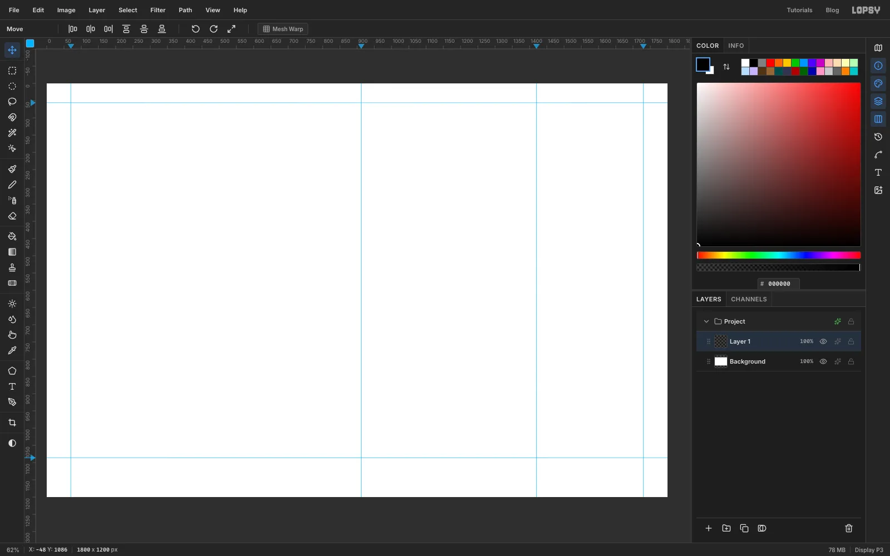

1. Choose **File → New**, set **Width** `1800`, **Height** `1200`, **Pixels**, and click **Create**.
2. Click the top ruler at `x 70` and `x 1730` to mark the left and right edges of the plate. Then click at `x 912` and `x 1420`, the centres of the two phones.
3. Click the left ruler at `y 56` and `y 1086` for the top and bottom of the plate.

## Lay down the paper

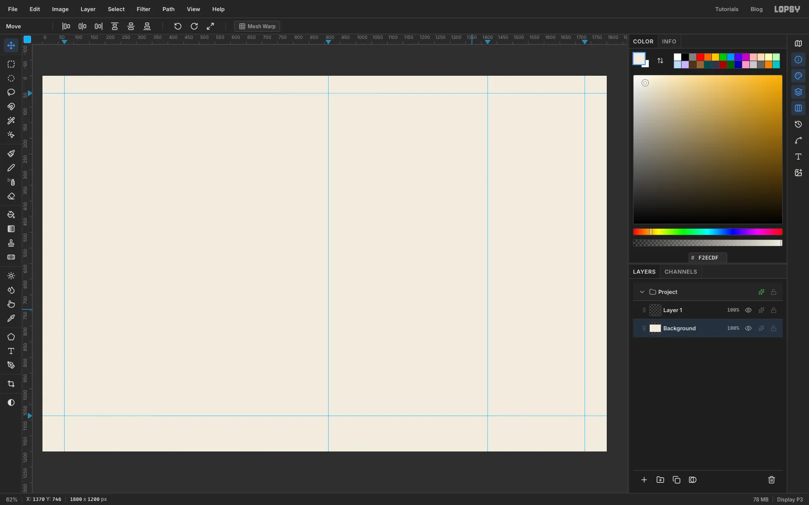

1. Click **Background**, set the foreground colour to `#F2ECDF` in the **Hex** field of the Color panel, and choose **Edit → Fill**.
2. Choose **Filter → Add Noise…**, set **Amount** `8`, pick **Mono** and **Gaussian**, and click **Apply**. The grain is barely there, which is right. Rag paper isn't flat, but you shouldn't notice why.

## Ink the plate

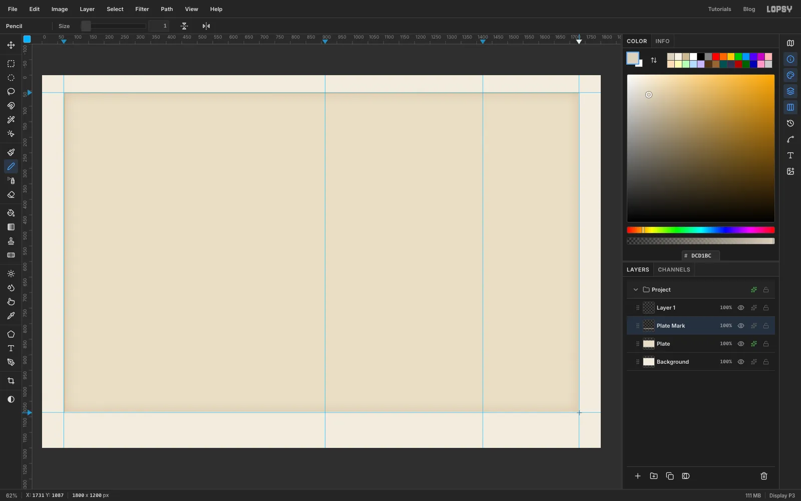

The plate is where the ink film sits, so it prints a little darker than the paper.

1. Add a layer called `Plate`. With the **Rectangular Marquee**, drag from the guide crossing at the top left (`70, 56`) to the one at the bottom right (`1730, 1086`). The guides catch the marquee edges.
2. Fill it with `#E8DEC8`, then press [[⌘+D]]. Run **Add Noise** again with **Amount** `6` (still Mono, Gaussian).
3. Open the layer's effects (the ✦ button on its row) and enable **Inner Glow**. Set **Size** `80`, **Opacity** `45` and the colour `#B49C76`. A printer wipes the middle of a plate cleaner than its edges, and this glow fakes that.
4. Add a layer called `Plate Mark` for the step the plate presses into the paper. The light comes from the top left, so the top and left edges sit in shadow. Pick the **Pencil**, **Size** `3`, colour `#CDB892`. Click just inside the top-left corner of the plate, then [[Shift]]-click just inside the top-right corner. Click the top-left corner again and [[Shift]]-click the bottom-left corner.
5. Switch to **Size** `2` and `#F8F3E8`, and draw the same kind of lines just inside the bottom and right edges. They catch the light.
6. Finally, at **Size** `1` in `#DCD1BC`, draw a crease line just *outside* the bottom and right edges.

## Rule the border

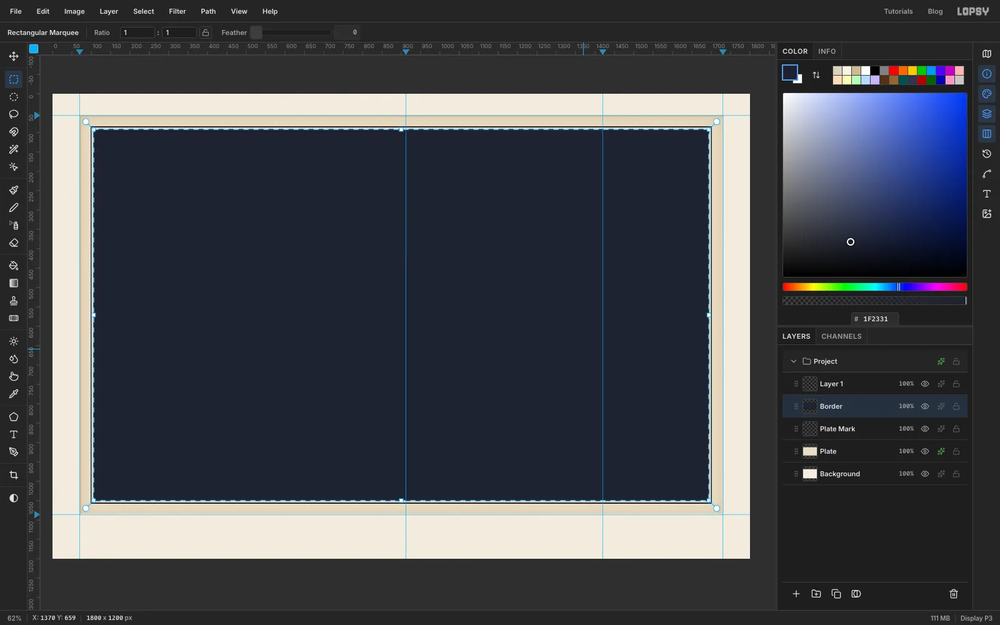

1. Add a layer called `Border`. Drag a marquee from `98, 84` to `1702, 1058`, set the colour to the ink `#1F2331`, and **Edit → Fill**.
2. Choose **Select → Shrink…**, **3** px, and press [[Delete]]. That leaves a 3 px ink frame.
3. **Shrink** the selection by **4** more and **Fill** again. Then **Shrink** by **1** and press [[Delete]], which leaves a hairline 4 px inside the heavy rule. Press [[⌘+D]].

## Make a rules pattern

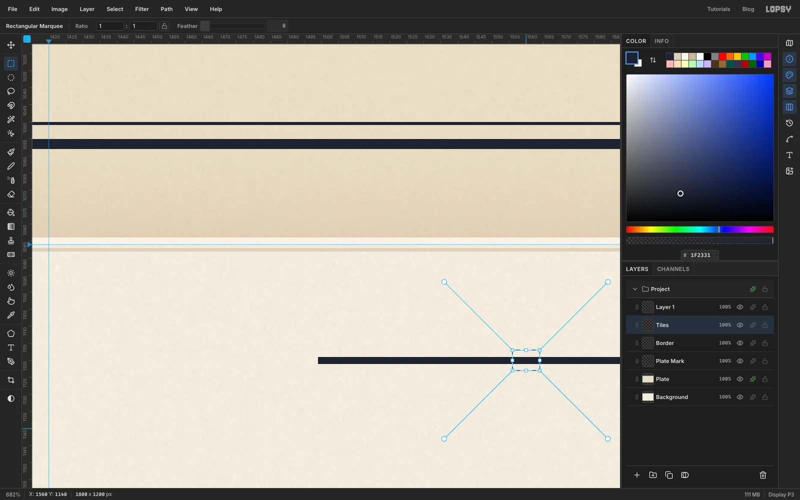

Engravers built tone from a few kinds of line, and you'll make three of them into patterns. Patterns only last for the session, so make them before you need them and don't reload the page.

1. Add a temporary layer called `Tiles` and zoom in on an empty spot near the bottom right of the sheet.
2. Pick the **Pencil**, **Size** `2`, ink colour. Click and [[Shift]]-click a horizontal line about 120 px long.
3. Pick the **Rectangular Marquee** and click once on the canvas without dragging. In the dialog, enter corners 8 px apart across and 6 px apart down, with the line in the middle (I used `1556, 1117` to `1564, 1123`). Click **Select**.
4. Choose **Edit → Define Pattern**. This is the **rules** pattern: a 2 px line every 6 px.

## Make a hatching pattern

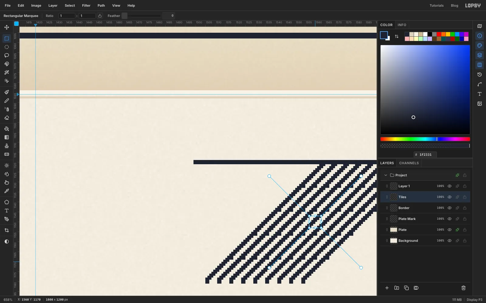

1. Still on `Tiles`, draw nine parallel lines at 45°, running up to the right, each about 85 px long. Start each one 6 px to the right of the last. Hold [[⌘]] as well as [[Shift]] when you click the end of each line. That snaps the angle to 15° steps, so every line is exactly 45°.
2. Click once with the marquee and select a **6 × 6** square in the middle of the lines, away from their ends. Choose **Edit → Define Pattern**. Because the lines are exactly 45° and 6 px apart, the tile repeats without a seam.

## Make a back-hatching pattern

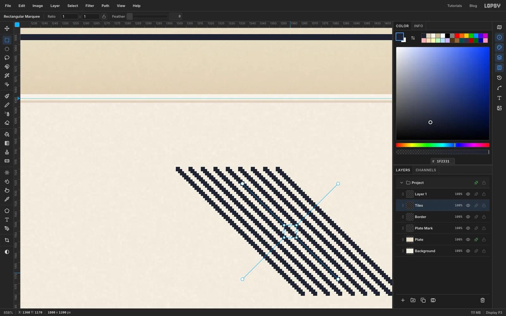

1. Draw nine more 45° lines leaning the other way (down to the right), again 6 px apart.
2. Define a **6 × 6** tile from the middle of them. Then delete the `Tiles` layer, and the empty `Layer 1` the new document started with.

**Edit → Fill with Pattern…** now shows three tiles, in this order: rules, hatching and back-hatching.

## Draw the first phone

1. Click `Border` and press **New Group** in the Layers panel. Name the group `Phone A`. Add a layer called `Shadow A`, then another called `Body A`.
2. Pick the **Shape** tool. Set **Shape** to **Rectangle**, **Output** to **Pixels**, **Corner Radius** `66`, the fill to the ink colour and the stroke to none.
3. Click once at `912, 562`, on the centre guide. In the **Shape Size** dialog enter `440` × `860` and click **Create**.
4. Set **Corner Radius** to `3` and add the side buttons the same way. On the left edge, add two **8 × 64** buttons centred at `689, 373` and `689, 459`. On the right edge, add one **8 × 100** button at `1135, 416`.

## Hatch a cast shadow

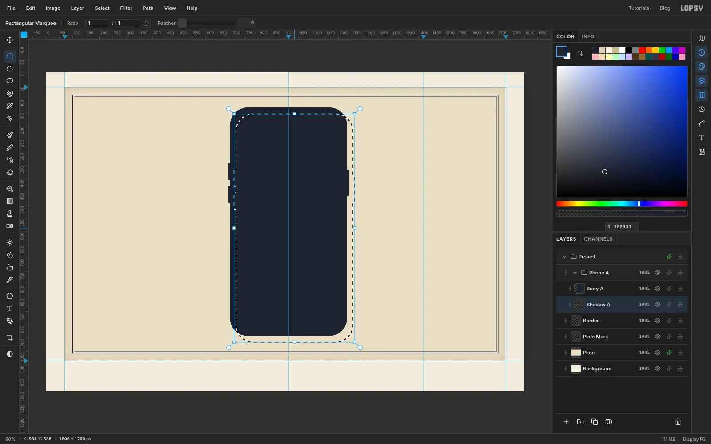

Etchers never draw a soft shadow. They hatch one.

1. Click `Shadow A`. Hold [[⌘]] and click the **thumbnail** of `Body A`. That loads the phone's shape as a selection, but `Shadow A` stays the active layer.
2. With a marquee tool, drag from inside the selection about 20 px right and 25 px down. Starting inside a selection moves only its outline.
3. Choose **Edit → Fill with Pattern…**, pick the **hatching** tile and click **Apply**. Press [[⌘+D]]. The body covers most of it, so only a hatched sliver shows to the right and below.

## Engrave the bezel and add the screen

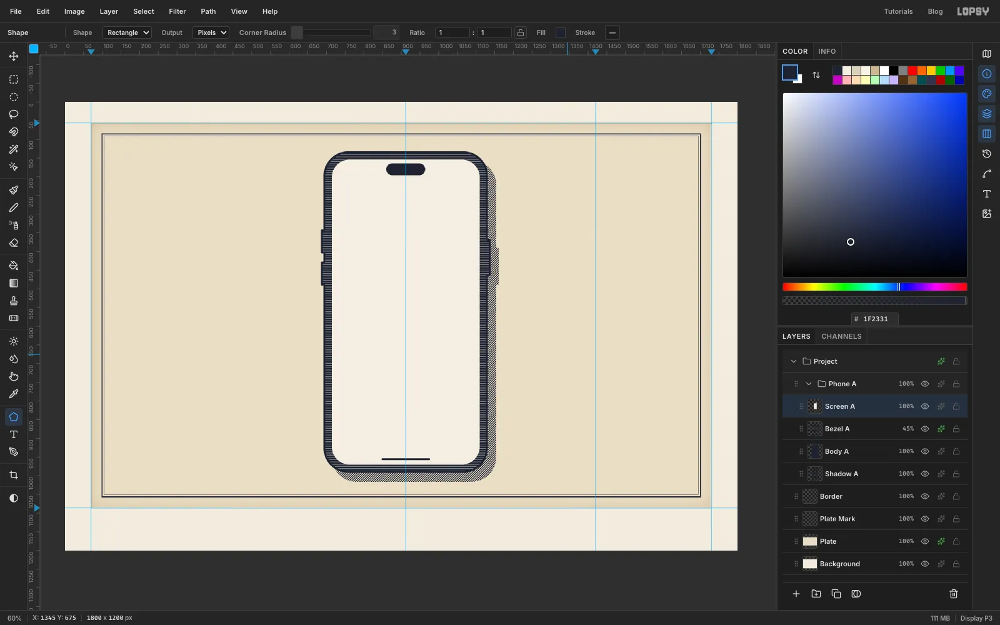

1. Click `Body A` and add a layer called `Bezel A`. [[⌘]]-click the `Body A` thumbnail and choose **Select → Shrink…** `5`.
2. **Fill with Pattern** using the **rules** tile, and press [[⌘+D]]. Then add a **Color Overlay** effect in the paper colour `#F2ECDF` and set the layer's opacity to `45%`. Light lines over the black body read as polished metal.
3. Add a layer called `Screen A`. With the **Shape** tool, set **Corner Radius** `48` and the fill to `#F4EEE2`. Click the phone's centre and make it `396` × `816`. The screen is lighter than the plate, like a wiped highlight.
4. Set the fill back to ink and **Corner Radius** `16`, and click at `912, 180` for a `104` × `32` camera island. Then set **Corner Radius** `3` and click at `912, 956` for a `130` × `5` home bar.

## Draw the second phone

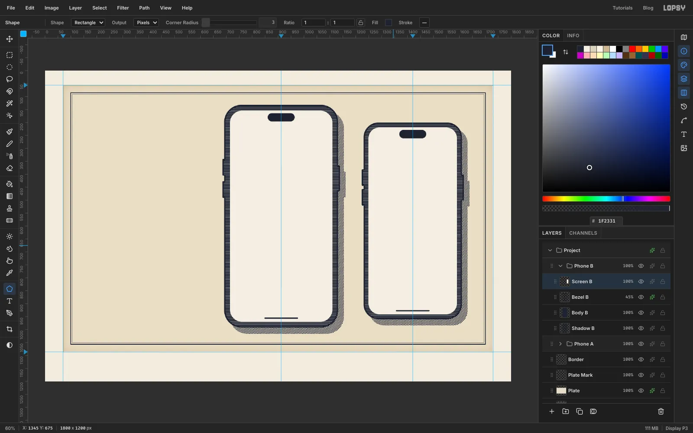

1. Collapse `Phone A`, click its row, and press **New Group**. Name the group `Phone B`. It lands above `Phone A`.
2. Repeat the last three sections inside the new group, naming the layers `Shadow B`, `Body B`, `Bezel B` and `Screen B`. The phone is a little smaller and centred on the second guide:
   - Body: `380` × `760` at `1420, 580`, **Corner Radius** `58`
   - Buttons: **8 × 64** at `1227, 413` and `1227, 489`, and **8 × 100** at `1613, 451`
   - Shadow: the same hatched shadow, about 20 px right and 25 px down
   - Bezel: rules in paper colour at 45%
   - Screen: `342` × `722`, **Corner Radius** `43`
   - Camera island at `1420, 245` and home bar at `1420, 927`, the same sizes as on the first phone

## Drop in the moon photo

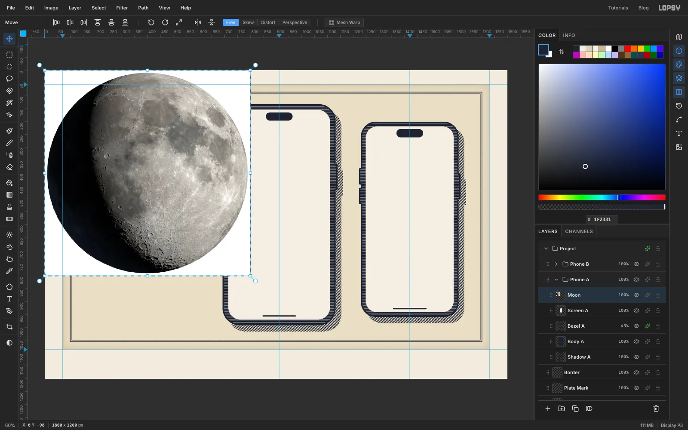

1. Collapse `Phone B`, expand `Phone A`, and click `Screen A`.
2. Drag the moon photo from your desktop onto the canvas. It lands in the top-left corner on its own layer, already selected. Rename the layer `Moon`.

## Cut out and scale the moon

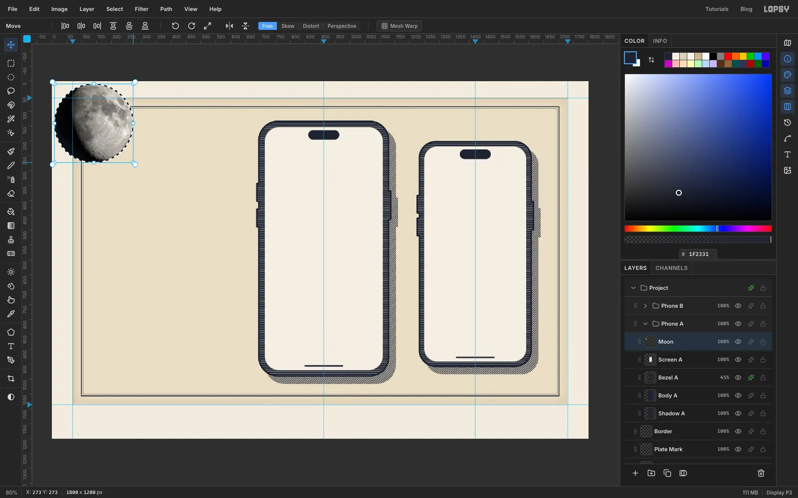

1. Pick the **Magic Wand**, **Tolerance** `10`, **Contiguous** on, and click the white sky in a corner of the photo. Press [[Delete]], then [[⌘+D]].
2. [[⌘]]-click the `Moon` thumbnail so the transform box hugs the disc. With the **Move** tool, hold [[⌘]] (which keeps the proportions) and drag the bottom-right handle in until the disc is **264** px across. Press [[⌘+D]] to commit.
3. Drag the moon onto the first phone and centre it on `912, 452`. Arrow keys nudge 1 px, and [[Shift]]+arrow nudges 10 px.
4. Choose **Filter → Desaturate**.

## Posterize the photo into a tracing guide

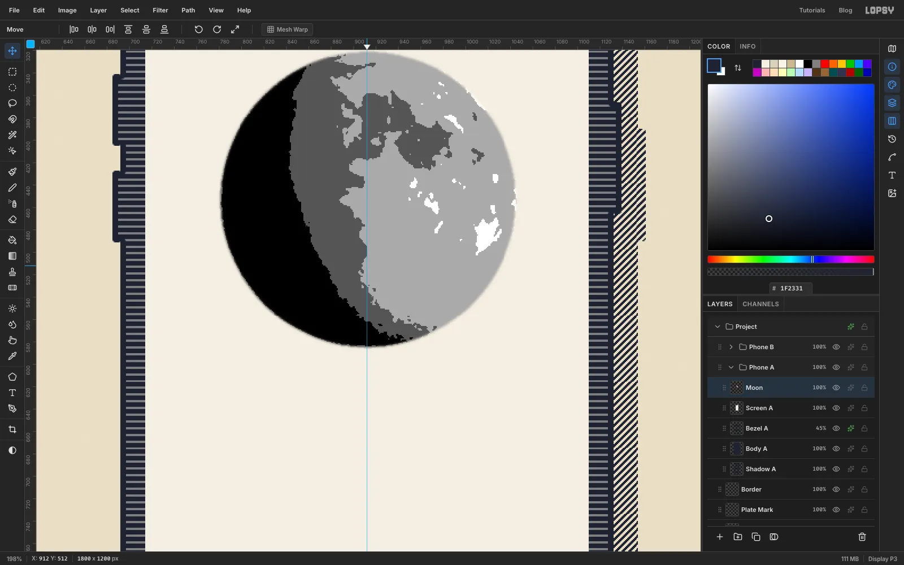

You won't keep the photo. You'll engrave over it the way an engraver works from a drawing, so it only needs to show where the tones change.

1. With `Moon` active, run **Filter → Gaussian Blur…** at **Radius** `3`.
2. Run **Filter → Posterize…** with **Levels** `4`. Now the shadow is black, the seas (the *maria*) are dark grey and the highlands are light grey.

## Rule the disc and bulge the lines

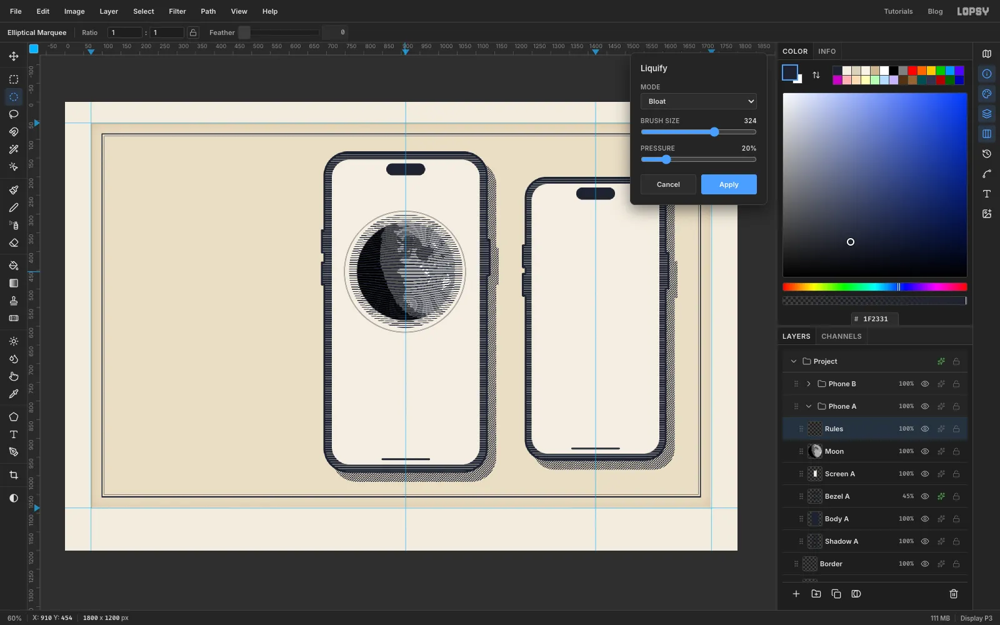

1. Add a layer called `Rules` above `Moon`. Click once with the **Elliptical Marquee** and enter `760, 300` to `1064, 604`. That's a circle 20 px bigger than the moon all round.
2. **Fill with Pattern** using the **rules** tile, and press [[⌘+D]].
3. Choose **Filter → Liquify…**. Set **Mode** to **Bloat**, **Brush Size** `324` and **Pressure** `20`. Press the mouse on the centre of the moon, wiggle it in a tiny circle once, and let go. Click **Apply**.

The straight rules now bow outwards from the middle, as if they had been cut around a ball. Don't overdo it. Bloat keeps magnifying as long as you hold and move, so stop after a second. If the lines bulge off the disc, undo and try again.

## Hatch the shadow side

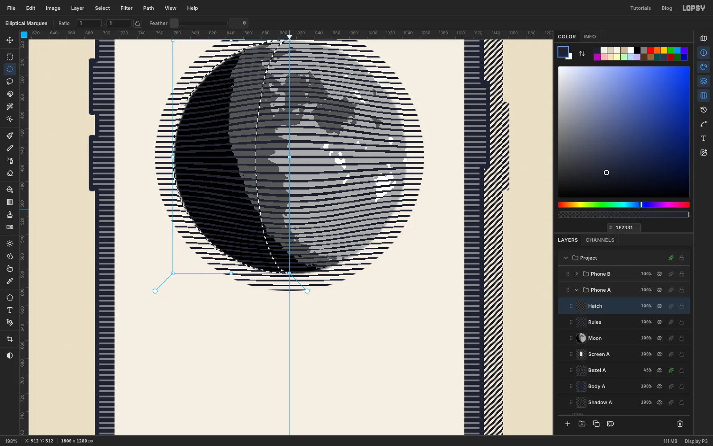

The *terminator* is the line where lunar day meets night. On a gibbous moon it's half an ellipse, so you can build the shadow from three marquee drags.

1. Add a layer called `Hatch`. With the **Elliptical Marquee**, select the moon's disc again: a circle from `780, 320` to `1044, 584`.
2. With the **Rectangular Marquee**, hold [[Shift+Alt]] and drag from above and left of the disc down to the bottom of the disc at the centre guide (`x 912`). Holding both keys *intersects*, so only the left half stays selected.
3. With the **Elliptical Marquee**, hold [[Alt]] and drag a tall ellipse from `874, 320` to `950, 584`. That subtracts its left half from the selection and leaves a curved shadow.
4. **Fill with Pattern** using **hatching**.
5. Add a layer called `Back Hatch` and build the same selection again, but make the subtracted ellipse wider, from `862, 320` to `962, 584`. **Fill with Pattern** using **back-hatching**.

The cross-hatching makes the true shadow the darkest part of the moon. The hatching alone runs 12 px further into the light, which softens the terminator.

## Hatch the seas

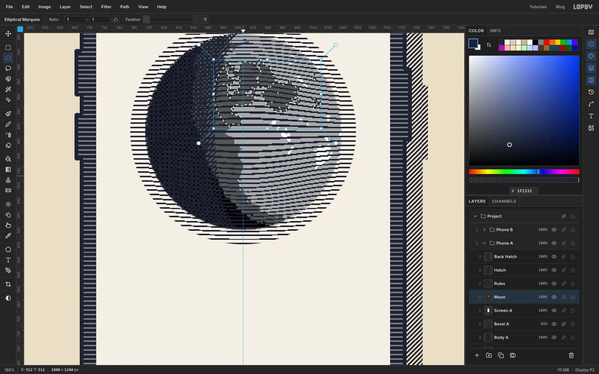

1. Click the `Moon` layer. With the **Magic Wand**, **Tolerance** `8`, **Contiguous** off, click one of the dark grey seas in the upper right of the disc.
2. That also picks up dark grey near the terminator, which would read as a coastline. To keep only the northern seas, pick the **Elliptical Marquee**, hold [[Shift+Alt]] and drag an ellipse from `872, 337` to `1037, 467`.
3. Click `Hatch`, **Fill with Pattern** using **hatching**, and press [[⌘+D]].

## Cut in the craters

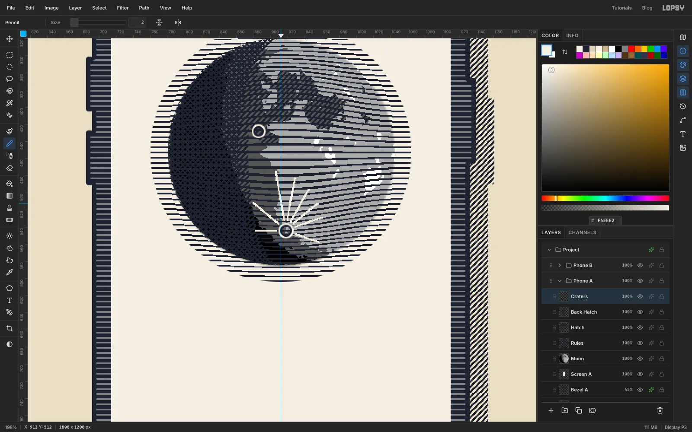

1. Click `Back Hatch` and add a layer called `Craters`.
2. Crater circles are small, so use exact sizes. Click once with the **Elliptical Marquee** and enter `909, 535` to `927, 553` for a clearing around Tycho. Fill it with the screen colour `#F4EEE2`.
3. Click again and enter `911, 537` to `925, 551`. Fill it with ink, choose **Select → Shrink…** `2`, and press [[Delete]] for the crater's rim.
4. Do the same for Copernicus near the terminator: a clearing from `878, 420` to `894, 436`, then a rim from `880, 422` to `892, 434`.
5. Tycho is famous for its bright rays. Pick the **Pencil**, **Size** `2`, colour `#F4EEE2`, and [[Shift]]-click eight straight rays out from Tycho, between 35 and 70 px long, mostly fanning upwards.

## Flatten and trim the engraving

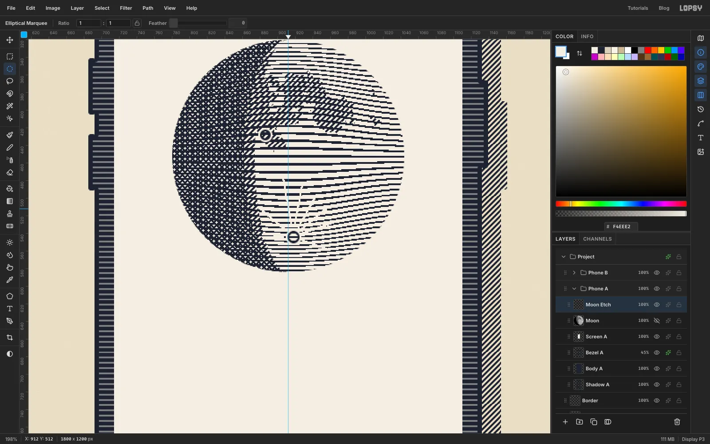

1. With `Craters` active, choose **Layer → Merge Down** three times. The craters, back-hatching and hatching fold into `Rules`. Rename it `Moon Etch`.
2. Select the moon disc with the **Elliptical Marquee** again, choose **Select → Inverse**, and press [[Delete]] to trim everything outside it. Press [[⌘+D]].
3. Hide `Moon` with its eye icon. Once you're happy with the engraving, delete it.

## Add a glory of rays

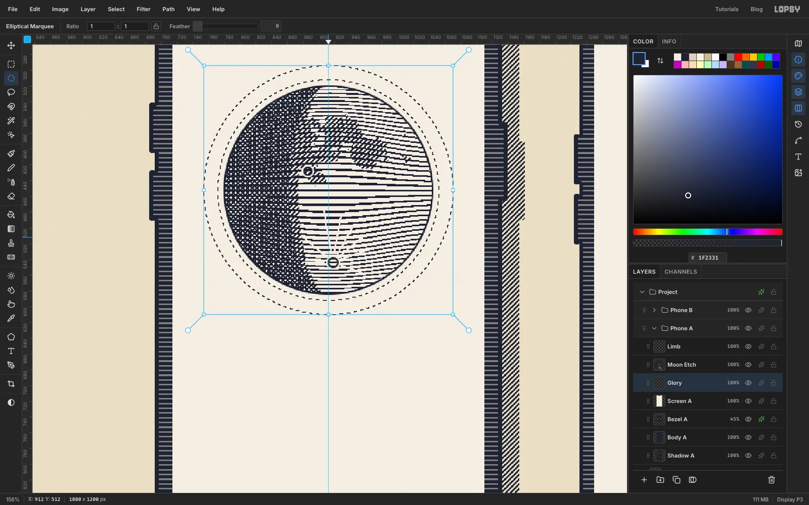

Old engravings ring the Moon and Sun with a *glory* of rays. **Sunburst** draws them, and a ring-shaped selection keeps them short.

1. First give the disc a clean outline. Add a layer called `Limb` above `Moon Etch`, select a circle 1 px bigger than the moon (`779, 319` to `1045, 585`), fill it with ink, **Shrink** `2` and press [[Delete]].
2. Click `Screen A` and add a layer called `Glory`. Click once with the **Elliptical Marquee** and enter `754, 294` to `1070, 610`, a circle of radius 158. Then hold [[Alt]] and drag from `772, 312` to `1052, 592`, watching X and Y. That subtracts a circle of radius 140 and leaves a ring.
3. With ink as the foreground colour, choose **Filter → Sunburst…**. Set **Rays** `48`, **Length** `100`, **Width** `16`, **Taper** `0`, **Center X** `51` and **Center Y** `38`. Set **Fade**, **Softness**, **Rotation** and **Jitter** to `0`, and **Opacity** to `100`. Click **Apply**. The Center fields are percentages of the canvas: 51% of 1800 is 918 and 38% of 1200 is 456, close to the moon's centre at `912, 452`.
4. Make a thinner ring the same way, from `764, 304` to `1060, 600` minus the same inner circle. Run **Sunburst** again with **Width** `9` and **Rotation** `4`. This sets a short ray between each pair of long ones.
5. Press [[⌘+D]]. The percentages put the burst centre a few pixels off the moon's. With the **Move** tool, nudge the layer 6 px left and 4 px up so the rays point straight at the middle.

> **Tip:** Keep **Taper** at `0` so each ray is a thin wedge. At `100`, rays this long are widest at the centre and fill the ring solid.

## Rule the screen

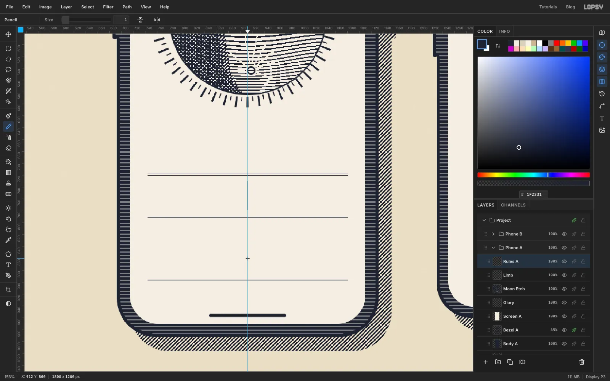

1. Click `Limb` and add a layer called `Rules A`. Pick the **Pencil**, **Size** `1`, ink.
2. [[Shift]]-click these lines from `x 744` to `x 1080`:
   - A double rule at `y 716` and `y 720`
   - A single rule at `y 790`
   - The tab-bar rule at `y 896`
3. Draw a short vertical divider at `x 912` from `y 730` to `y 778`, between the moonrise and moonset columns.

## Draw the tide chart

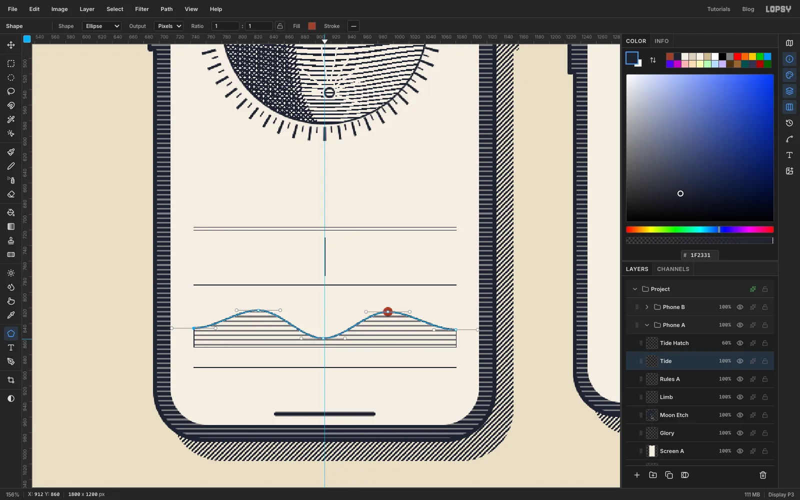

1. Add a layer called `Tide`. Pick the **Pen**, set **Stroke** `2`, ink.
2. Drag out five smooth anchors from left to right, pulling each handle about 28 px to the right. Start at `744, 846`, then go up to a crest at `827, 823`, down to `910, 859`, up to `993, 825`, and end at `1080, 848`. Press [[Enter]] to stroke the path.
3. With the **Pencil** at **Size** `1`, close off the area under the wave. Draw a line down from each end to `y 870`, and a baseline between them.
4. Click inside the closed area with the **Magic Wand** (Contiguous on). Add a layer called `Tide Hatch`, **Fill with Pattern** using **rules**, press [[⌘+D]] and set the layer to `60%`.
5. Click `Tide`. With the **Shape** tool (**Ellipse**, fill `#9E3F2B`, no stroke), click the second crest at `993, 825` for a `12` × `12` "now" marker.

## Draw the status and tab icons

1. Add a layer called `Icons A`. For the status bar, use the exact-size marquee and ink fills:
   - A battery outline: fill `1058, 171` to `1082, 183`, **Shrink** `2` and [[Delete]]
   - The charge inside it: `1061, 174` to `1074, 180`
   - A cap on the right: `1083, 175` to `1085, 179`
   - Four signal bars to the left of it, each 4 px wide with 2 px gaps, from `x 1024` to `x 1046`. They step up from 2 px to 11 px tall, all standing on `y 183`.
2. All four tab icons sit on `y 926`, at `x 772`, `865`, `959` and `1052`. Every icon is an outline 2 px thick:
   - **Moon** (the active tab, in sanguine): click once with the Elliptical Marquee and enter `761, 915` to `783, 937`. Then [[Alt]]-drag from `768, 912` to `788, 932` to bite a crescent out of it. **Fill**, **Shrink** `2`, [[Delete]].
   - **Calendar** (ink): fill a 22 × 21 box, **Shrink** `2` and [[Delete]], then fill a 5 px bar across its top.
   - **Tides** (ink): two short waves with the **Pen** at **Stroke** `2`. For the first, drag out three anchors 12 px apart at `947, 922`, `959, 922` and `971, 922`, pulling their handles 4 px right and alternately 5 px up, down and up. Press [[Enter]] to stroke it. Draw the second wave the same way 9 px lower. Deselect the first path in the **Paths** panel before you start the second, or the Pen edits the first one.
   - **Sky** (ink): with the **Lasso**, draw a small four-pointed star about 26 px across with its points up, down, left and right, then **Fill**, **Shrink** `2`, [[Delete]]. At this size its pinched sides read almost as a diamond.

## Set the type on the first phone

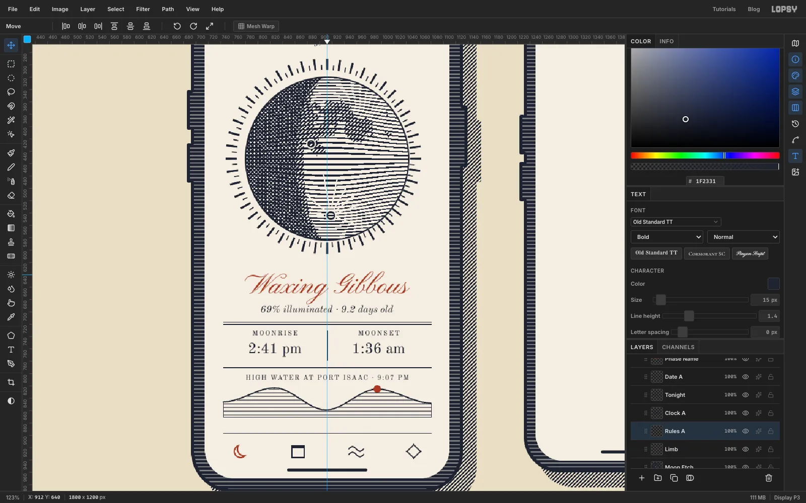

Text tool clicks near existing type re-edit it, so set the lines **from the bottom up**. Before each new line, click a raster layer such as `Rules A`, because changing font settings while a text layer is active restyles that layer. Check the letter spacing in the **Text** panel each time, because it carries over to the next text.

Every line except the clock is centred on the phone. Type the line anywhere nearby, press [[Tab]] to commit it, then nudge it into place with the arrow keys. The "y" values are the tops of the letters. For the middle dot press [[Alt+Shift+9]] on a Mac, and for the en dash press [[Alt+-]].

1. `HIGH WATER AT PORT ISAAC · 9:07 PM` in **Old Standard TT**, size `11`, letter spacing `1.5`, ink, with its top at `y 802`.
2. The times in Old Standard TT, size `24`, with their tops at `y 750`: `1:36 am` (moonset) centred on `x 996`, then `2:41 pm` (moonrise) centred on `x 828`. Old Standard's figures all sit on the baseline, so the two times match.
3. The labels in Old Standard TT, size `11`, spacing `2`, at `y 730`: `MOONSET` over the right time, then `MOONRISE` over the left.
4. `69% illuminated · 9.2 days old` in Old Standard TT **Italic**, size `16`, at `y 690`.
5. `Waxing Gibbous` in **Pinyon Script**, size `46`, sanguine, at `y 634`. This is the screen's one splash of red type.
6. `Tuesday, 20 October` in Old Standard TT Italic, size `16`, at `y 254`.
7. `Tonight` in **Cormorant SC**, **SemiBold**, size `34`, at `y 214`. The font sets lowercase as small capitals.
8. `9:41` in Old Standard TT **Bold**, size `15`, left-aligned at `x 744`, `y 172`.

## Draw the Earth

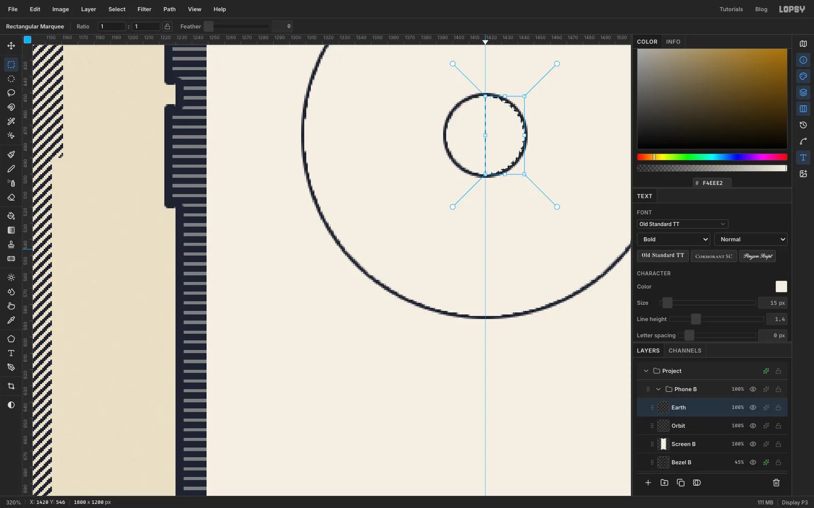

The second screen shows the whole cycle: the phases as seen from Earth, with sunlight coming from the left.

1. Collapse `Phone A`, expand `Phone B`, and click `Screen B`. Choose **View → Snap to Guides** to turn it off until the icons are done. Otherwise the small marquees jump to the centre guide.
2. Add a layer called `Orbit`. Select the circle `1307, 363` to `1533, 589` (radius 113, centred on `1420, 476`). Fill it with ink, **Shrink** `2` and [[Delete]].
3. Add a layer called `Earth`. Select `1394, 450` to `1446, 502` (radius 26, same centre) and fill it with ink. **Shrink** `2` and fill with the screen colour.
4. [[Shift+Alt]]-drag a rectangle over the right half of the Earth to keep only that half, and **Fill with Pattern** using **hatching**. That's the night side, facing away from the sun.
5. Select an ellipse 22 px wide and 50 px tall on the Earth's centre. Fill it with ink, **Shrink** `1` and [[Delete]] for a meridian. Draw an equator with the Pencil at **Size** `1`.

## Lay out the phase discs

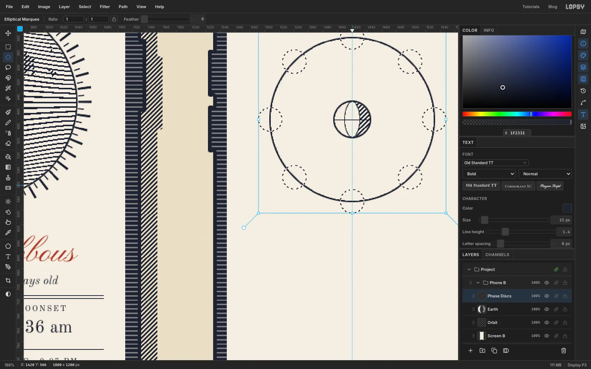

1. Add a layer called `Phase Discs`. Select a circle of radius `16` on the orbit at 9 o'clock: `1292, 460` to `1324, 492`.
2. Hold [[Shift]] and drag seven more, every 45° around the orbit, each 32 px square. Their centres are:
   - Bottom left `1341, 555`, bottom `1420, 588`, bottom right `1499, 555`
   - Right `1532, 476`
   - Top right `1499, 397`, top `1420, 364`, top left `1341, 397`
3. Fill them with the screen colour in one go and press [[⌘+D]].
4. Add a **Stroke** effect, **Width** `2`, ink. It outlines all eight at once.

## Shade each phase

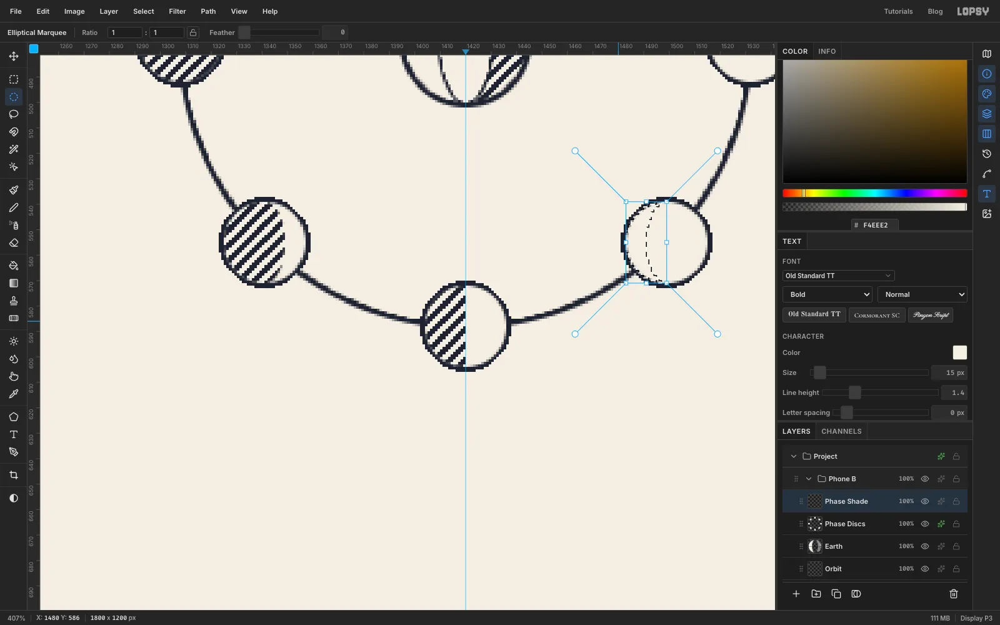

Add a layer called `Phase Shade`. Each phase's shadow is the same build you used on the big moon, scaled down to a 32 px disc. Here is the waxing gibbous in full:

1. Click once with the **Elliptical Marquee** and enter `1483, 539` to `1515, 571`.
2. [[Shift+Alt]]-drag a rectangle from above and left of the disc to its bottom edge at `x 1499`, which keeps the left half.
3. [[Alt]]-drag an ellipse from `1491, 539` to `1507, 571` to take the middle back out.
4. **Fill with Pattern** using **hatching**.

The others follow the same pattern:

- **New moon**, at 9 o'clock: the whole disc.
- **Waxing crescent**, bottom left: the left half (intersect), then [[Shift]]-add a centred ellipse 16 px wide. Only a thin lit crescent is left on the right.
- **First quarter**, bottom: the left half.
- **Waxing gibbous**, bottom right: the left half, then [[Alt]]-subtract the 16 px ellipse.
- **Full moon**, 3 o'clock: no shadow.
- **Waning gibbous**, **last quarter** and **waning crescent**: the same shapes mirrored, using the right half.

After each selection, **Fill with Pattern** using **hatching**. Then **Merge Down** into `Phase Discs` and rename it `Phases`. Its Stroke effect stays live.

Tonight's phase is the waxing gibbous. Add a layer called `Tonight Ring`, select `1475, 531` to `1523, 579` around that disc, fill it with sanguine, **Shrink** `2` and [[Delete]].

## Copy, paste and scale the list moons

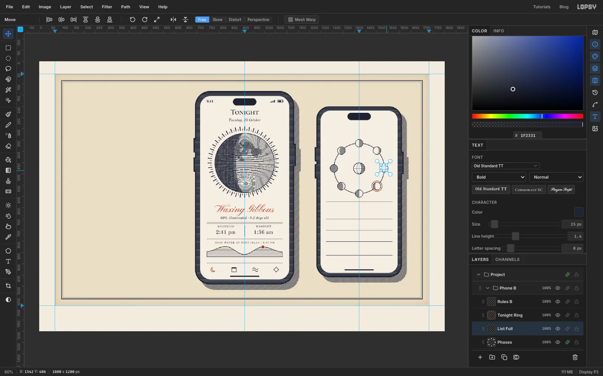

The list under the dial reuses four of the dial's discs.

1. Add a layer called `Rules B`. With the Pencil at **Size** `1`, draw a rule at `y 624` and the row dividers at `y 701`, `751` and `801`, all from `x 1273` to `x 1567`. Draw the tab-bar rule at `y 862`.
2. Click `Phases`, drag a marquee just around the full-moon disc, and press [[⌘+C]], then [[⌘+V]]. The copy pastes in place on a new layer, selected and ready to move.
3. With the **Move** tool, [[⌘]]-drag its bottom-right corner handle in to about three-quarters of its size, so the disc is 26 px across instead of 32. Press [[⌘+D]].
4. Drag it down to the first row and centre it on `1283, 676`.
5. Repeat for last quarter (centred on `1283, 726`), new moon (`1283, 776`) and first quarter (`1283, 826`). Click `Phases` again before each copy.
6. Each paste lands directly above `Phases`, so the newest is lowest. Click the top one (the full moon) and **Merge Down** three times. Rename the result `List Moons` and give it a **Stroke** of `2` in ink.

## Copy the icons across

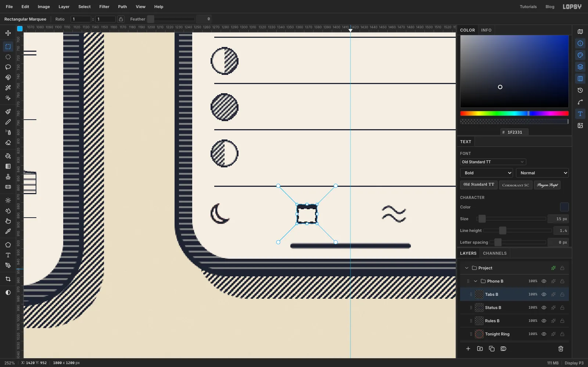

1. Expand `Phone A`, click `Icons A`, and marquee the status icons. Press [[⌘+C]], click `Rules B`, and press [[⌘+V]]. Drag the copy into the second phone's status bar so the battery's right end sits at about `1563, 243`, the same distance from the screen edge as on the first phone.
2. Do the same with the four tab icons, pasting above the status copy. Drag them onto the second tab bar so the crescent is centred on `1280, 892`. Name the layer `Tabs B`.
3. This screen's active tab is the calendar. [[⌘]]-click the `Tabs B` thumbnail. Then, with the **Rectangular Marquee**, [[Shift+Alt]]-drag a box around just the crescent. Fill it with ink.
4. [[⌘]]-click the thumbnail again, [[Shift+Alt]]-drag around the calendar, and fill it with sanguine. Turn **Snap to Guides** back on.

## Set the type on the second phone

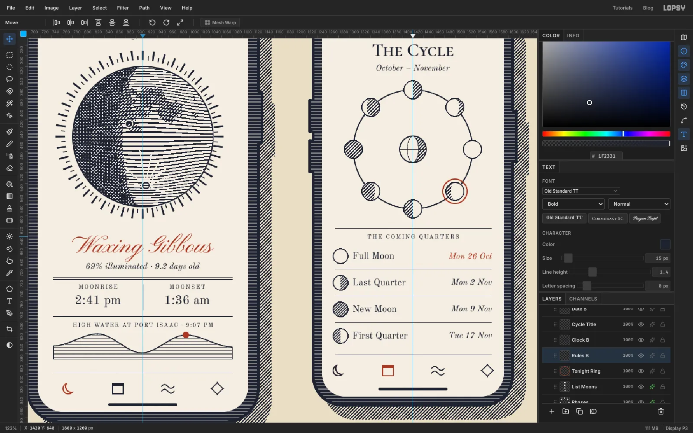

Bottom up again, with `Rules B` clicked before each line:

1. For each list row from the bottom, set the date first, then the name. Centre each row's text vertically on its moon (rows at `y 676`, `726`, `776` and `826`):
   - Dates in **Old Standard TT Italic**, size `16`. Point text doesn't align, so nudge each date until its right edge ends at `x 1567`
   - Names in Old Standard TT, size `18`, starting at `x 1307`
   - The rows are `First Quarter` / `Tue 17 Nov`, `New Moon` / `Mon 9 Nov`, `Last Quarter` / `Mon 2 Nov` and `Full Moon` / `Mon 26 Oct`
   - The full moon's date is next, so make it sanguine
2. `THE COMING QUARTERS` in Old Standard TT, size `11`, spacing `2`, centred at `y 636`.
3. `October – November` in Old Standard TT Italic, size `16`, centred at `y 316`.
4. `The Cycle` in Cormorant SC SemiBold, size `34`, centred at `y 278`.
5. `9:41` in Old Standard TT Bold, size `15`, at `x 1279`, `y 237`.

## Set the title column

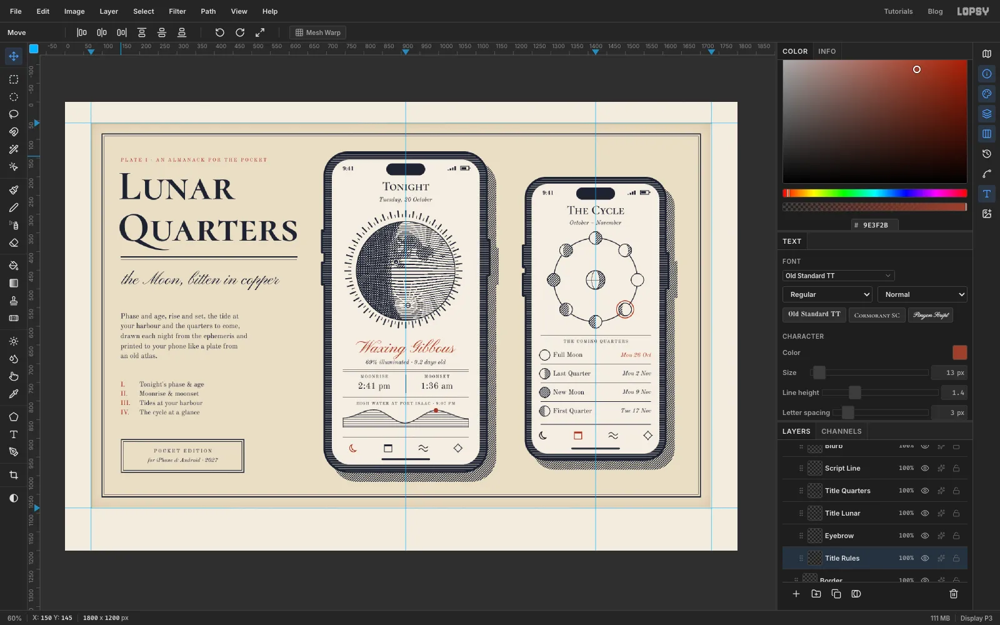

1. Collapse `Phone B`, click `Border`, and make a **New Group** called `Title` with a layer called `Title Rules`.
2. Draw the double rule under the title with the Pencil. Use **Size** `3` at `y 414` and **Size** `1` at `y 421`, both from `x 150` to `x 620`, the width of the title.
3. For the box, marquee `150, 902` to `480, 992`, **Fill** with ink, **Shrink** `2`, [[Delete]], **Shrink** `4`, **Fill**, **Shrink** `1`, [[Delete]]. Its bottom lines up with the first phone's body.
4. Set the type bottom up, all left-aligned at `x 150` unless noted:
   - Inside the box, centred on `x 315`: `POCKET EDITION` in Old Standard TT, size `13`, spacing `3`, at `y 928`, and `for iPhone & Android · 2027` in Old Standard TT Italic, size `15`, at `y 952`.
   - `I.` to `IV.` on four lines in sanguine, with `Tonight's phase & age`, `Moonrise & moonset`, `Tides at your harbour` and `The cycle at a glance` beside them at `x 200`. Both are Old Standard TT, size `18`, with their tops at `y 748`.
   - The paragraph in Old Standard TT, size `19`, at `y 565`, broken with [[Enter]] into five lines: *Phase and age, rise and set, the tide at / your harbour and the quarters to come, / drawn each night from the ephemeris and / printed to your phone like a plate from / an old atlas.*
   - `the Moon, bitten in copper` in Pinyon Script, size `46`, at `y 451`.
   - `Quarters` and `Lunar` in **Cormorant SC Bold**, size `112`, at `y 300` and `y 190`.
   - `PLATE I · AN ALMANACK FOR THE POCKET` in Old Standard TT, size `13`, spacing `3`, sanguine, at `y 150`.

The blocks below the rule are spaced about 63 px apart, so the column has an even rhythm.

## Tilt the second phone

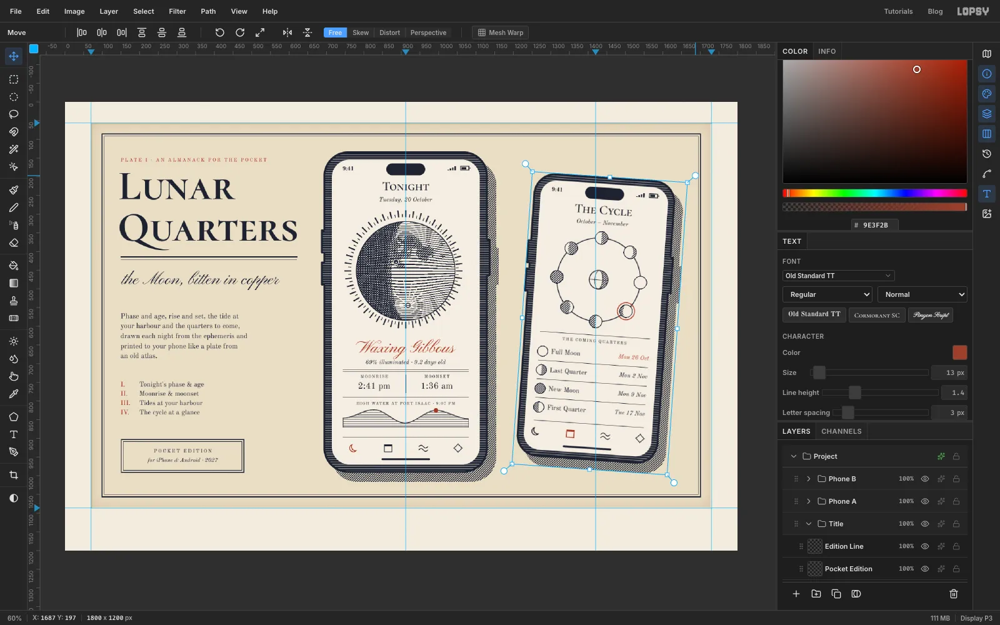

1. Press [[⌘+D]] so nothing is selected. Click the `Phone B` group row and pick the **Move** tool. The transform box wraps the whole phone, shadow included.
2. Hover just outside the top-right corner until the pointer turns into a curved arrow, then drag to rotate the group about **4°** clockwise. Press [[⌘+D]] to commit.

Every layer turns together: body, bezel, screen, dial, list and type.

## Sign the edition in pencil

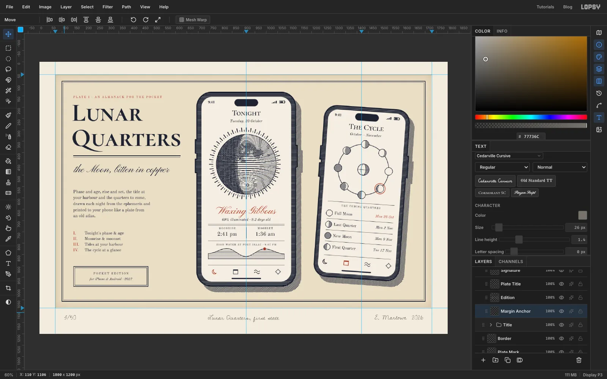

Printmakers write in pencil under the plate mark: the edition number on the left, the title in the middle and the signature on the right.

1. Collapse `Title`, click it, and make a **New Group** called `Margin` with an empty layer called `Margin Anchor` inside it. Click `Margin Anchor` before each line, so new type doesn't restyle the last one.
2. In **Cedarville Cursive**, size `26`, colour `#77736C`, set these with their tops at `y 1116`:
   - `E. Marlowe  2026`, ending at `x 1690`
   - `Lunar Quarters, first state`, centred on `x 900`
   - `3/50`, starting at `x 110`
3. Hide the guides with **View → Show Guides**. Choose **File → Save Project** to keep the layers, and **File → Quick Export PNG** for the board.
