Before photography could be printed, shops advertised with **engraved trade
cards and handbills**. An engraver cut the picture into a copper plate as
lines, the printer added type set in heavy display capitals and a curly
script, and the job came off the press in black ink with perhaps one extra
colour. In this tutorial you'll make one for an imaginary repair shop:
**Porcupine Zipper Works**, a 1200 × 1600 px flier.

The centrepiece is a porcupine's head, turned into a line engraving from a
photo. You'll lay a layer of soft stripes over the photo at half opacity and
run **Threshold**. Where the photo is dark, the stripes fatten into heavy
lines. Where it's light, they thin away. A second set of stripes at a
different angle adds cross-hatching in the shadows. The porcupine then sits
inside a frame that suits the shop: a ring of zipper teeth, cut with the
**Sunburst** filter.

The photo is
[Porcupine NPS11952](https://commons.wikimedia.org/wiki/File:Porcupine_NPS11952.jpg)
from the U.S. National Park Service, on Wikimedia Commons. It's in the
**public domain**. Download the full-size version (1915 × 1355 px). Any
close-up of a porcupine's head in profile works the same way. The numbers
below assume this photo.

Along the way you'll use:

- **Add Noise**, **Motion Blur**, **Gaussian Blur**, **Unsharp Mask**, **Desaturate**, **Brightness/Contrast**, **Threshold** and **Sunburst**
- **Define Pattern** (twice: a stripe tile for the line screen and a rule tile for the title shade) and **Edit → Fill with Pattern**
- the **Rectangular** and **Elliptical Marquee** (with their exact-size dialog), the **Lasso**, **Shrink** and **Feather** and **Select → Inverse**
- [[Cmd]]-clicking layer thumbnails to select a layer's shape
- the **Brush** with **Taper** and **Radial Symmetry**, the **Pencil** with [[Shift]]-click lines, and the **Eraser**
- the **Pen** tool, both to stroke a curve and to make a path for **text on a path**
- **Text** in Playfair Display, Pinyon Script, IM Fell English and IM Fell English SC, with one word recoloured
- copy and paste, **Flip Horizontal / Vertical**, and rotating and scaling with the **Move** tool, including whole groups
- **Duplicate Layer**, **Merge Down**, **Group Layers**, **New Group** and **Rasterize Layer**
- **Inner Glow**, **Stroke** and **Drop Shadow**, and the **Multiply**, **Lighten**, **Soft Light** and **Overlay** blend modes
- the **Reference** drawer, ruler **guides** and undo / redo

The palette:

- Paper `#F1E9D6`, plate `#E6D9BC`
- Ink `#2A1D15` (sepia-black)
- Spot red `#9B2D20`, red fold `#5E1A12`
- Cream metal `#F4ECD9` (zipper teeth, slider, quill highlights)
- Plate-mark shadow `#A38D63`, plate-mark light `#FBF7EC`

## Set up the document and guides

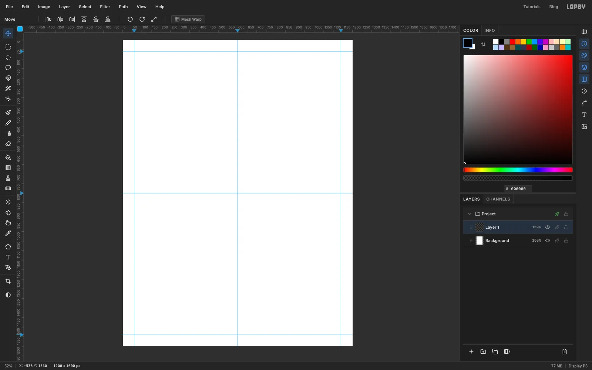

Create a new document **1200 × 1600 px** with a **White** background.

Click the rulers to drop guides. Click the top ruler at **600** for the centre
line, then at **60** and **1140**. Click the left ruler at **800** for the
middle, then at **60** and **1540**. The four outer guides mark the edge of
the copper plate. The status bar shows the cursor's position, so you can
check where you are.

## Lay down the paper and the plate

In the Layers panel, rename **Background** to **Paper** and fill it with
`#F1E9D6` (**Edit → Fill**).

Paper has a little tooth. Select **Layer 1**, rename it **Paper Grain**, fill
it with mid-grey `#808080` and run **Filter → Add Noise** at **30**, then
**Gaussian Blur** at **1**. Set its blend mode to **Soft Light** and its
opacity to **30%**. Grey is invisible in Soft Light, so only the speckle
shows.

Add a new layer called **Plate**. Choose the **Rectangular Marquee** and,
with nothing selected, click once on the canvas. A dialog opens where you
can type exact corners. Enter **60, 60** to **1140, 1540** and press
**Select**. Fill it with `#E6D9BC`, then press [[Cmd+D]] to deselect.

> **Tip:** The exact-corners dialog only opens when nothing is selected (a
> click with a selection active deselects instead). Whenever this tutorial says
> "select **x, y** to **x, y**", press [[Cmd+D]] first if anything is still
> selected.

## Add plate tone and a plate mark

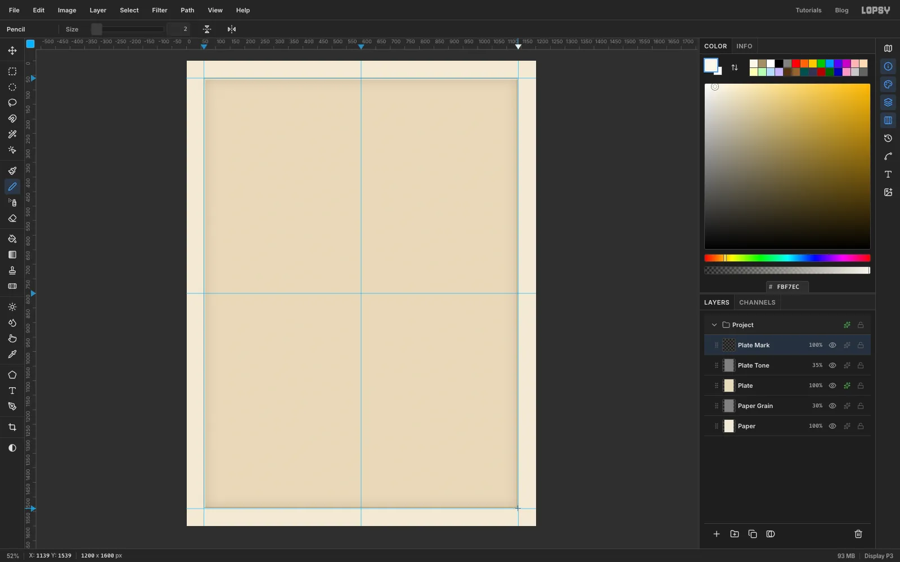

When a printer wipes a plate, a little ink is left in it, mostly near the
edges. Open the Plate layer's effects and add an **Inner Glow** in ink
`#2A1D15`, **Size 90**, **Opacity 22**.

Add a layer called **Plate Tone**. Select the plate area again (**60, 60** to
**1140, 1540**), fill it with `#808080`, run **Add Noise** at **40**, then
**Motion Blur** at an **Angle** of **4** and a **Distance** of **90**. That gives
long, faint streaks like a wiping rag. Deselect, set the layer to **Overlay**
and its opacity to **35%**.

The press pushes the plate into the paper and leaves a bevelled edge. Add a
layer called **Plate Mark** and choose the **Pencil** at **Size 2**. In
`#A38D63`, click the plate's top-left corner and [[Shift]]-click the top-right
corner to draw a straight line along the top edge. Draw another down the
left edge. Then draw the bottom and right edges 4 px inside the plate. Switch
to `#FBF7EC` and do the opposite: draw the top and left lines 4 px inside, and
the bottom and right lines on the edge itself. Light falls on one side of the
bevel and shadow on the other.

## Rule a double border

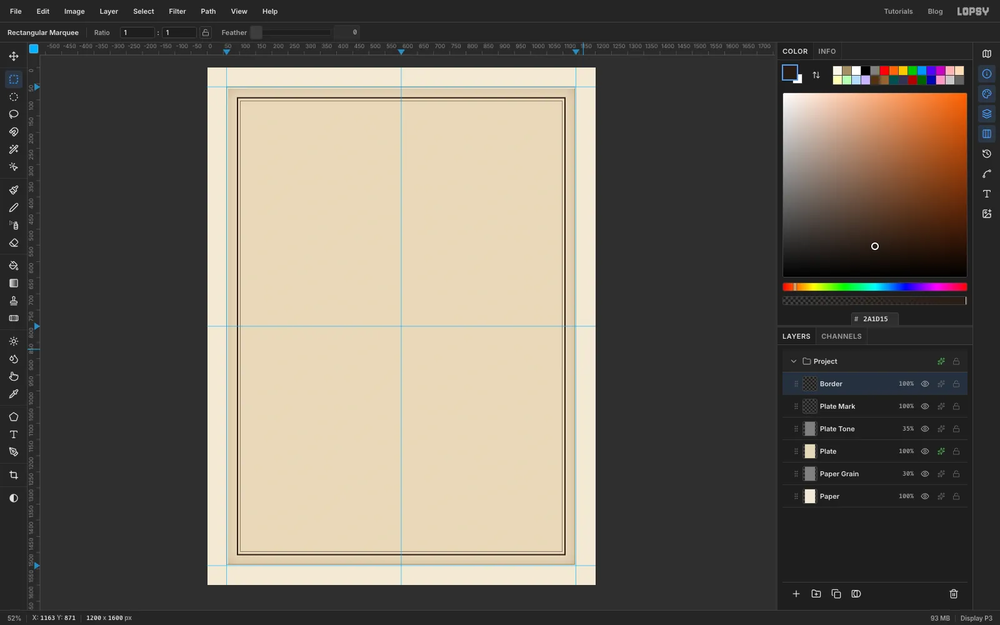

Add a layer called **Border**. With the exact-corners dialog, select **92, 92**
to **1108, 1508** and fill it with ink `#2A1D15`. Choose **Select → Shrink**
by **4** and press [[Delete]] to leave a 4 px frame. Deselect.

Now select **102, 102** to **1098, 1498**, fill it, **Shrink** by **1** and
press [[Delete]]. You now have a heavy outer rule and a hairline inside it,
the classic engraver's double rule. Deselect.

## Drop in the porcupine photo

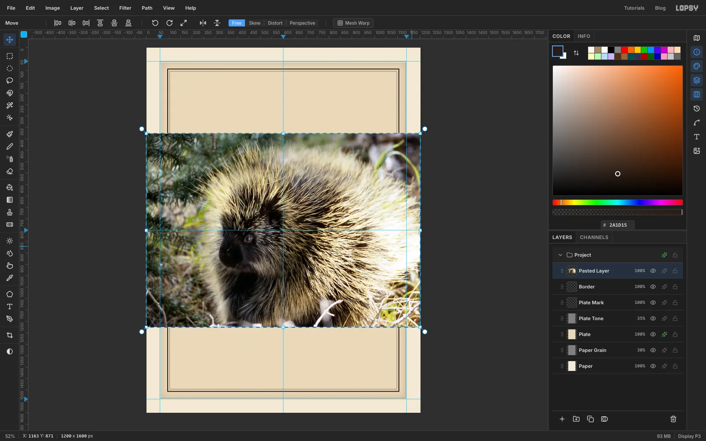

With **Border** selected, drag the photo file from your desktop onto the
canvas. Lopsy adds it as a new layer and shrinks it to fit the canvas. It
selects the pasted pixels and switches to the Move tool, so you can
transform it straight away.

## Scale the photo up and place the head

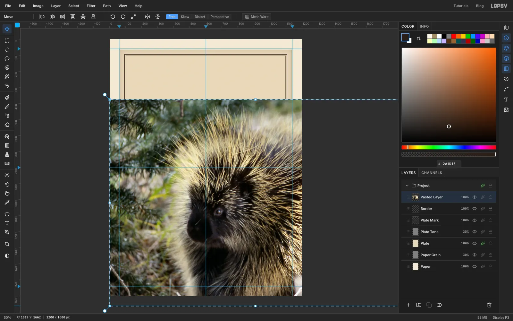

Zoom out one step ([[Cmd+-]]) so you can reach the bottom-right corner
handle. Hold [[Cmd]] to keep the proportions and drag that handle out until
the photo is about **1820 px** wide, 95% of its original size. Much of it
will hang off the right side; that's fine.

Drag the photo so the porcupine's eye sits about **85 px right of the centre
guide** and about **20 px above the middle guide**, with the snout pointing
left. Press [[Cmd+D]] to drop it and
[[Cmd+0]] to zoom back to fit. Rename the layer **Porcupine**.

## Prepare the tone and lasso out the background

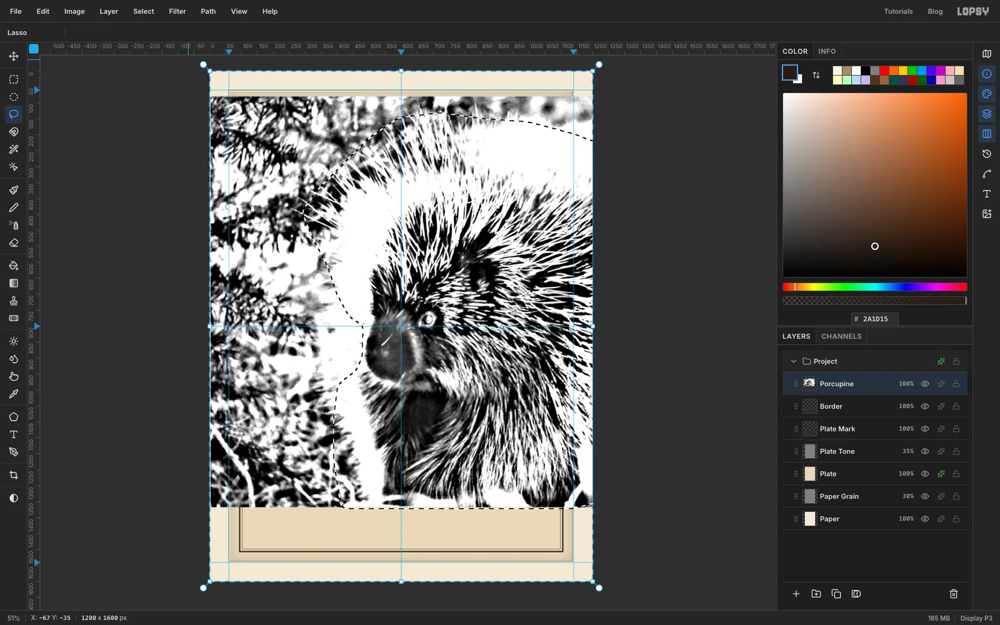

An engraving needs a clean, punchy grey image to work from.

1. Choose **Filter → Desaturate**.
2. Run **Brightness/Contrast** with **Brightness 45** and **Contrast 70**.
3. The snout and cheek are nearly black, so the lines would fill in there. Lasso
   loosely around the snout and cheek, **Feather** by **20**, and run
   **Brightness/Contrast** again with **Brightness 15**, then deselect.
4. Run **Unsharp Mask** at **Radius 30**, **Amount 1.5**, **Threshold 0** to make
   the quills stand out.
5. Run **Gaussian Blur** at **2** to smooth the noise.

Now remove the busy fir branches. With the **Lasso**, draw loosely around
the porcupine: start below the chin, go up the front of the face, over the
quills on top of the head and down the back. **Feather** the selection by
**22**, choose **Select → Inverse**, and fill with white.

## Fade the portrait into a circle

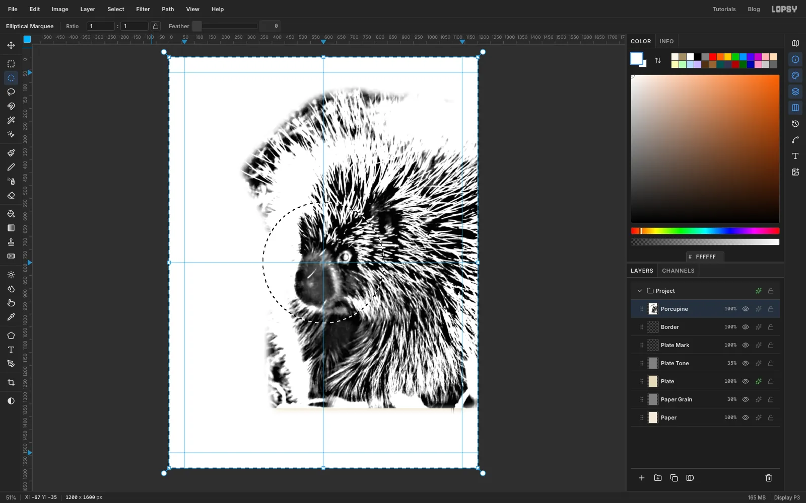

Old engravings fade out at their edges instead of stopping hard. Choose the
**Elliptical Marquee**, click once on the canvas to open its exact-size
dialog, and enter **364, 564** to **836, 1036**. That is a 472 px circle on the
centre guides. **Feather** it by **40**, choose **Select → Inverse** and fill
with white.

The neck runs off the bottom of the frame, so fade that as well. Deselect, then
select an ellipse from **270, 990** to **930, 1250**, **Feather** it by **60** and fill
with white. Deselect.

## Make a stripe pattern and rotate the first screen

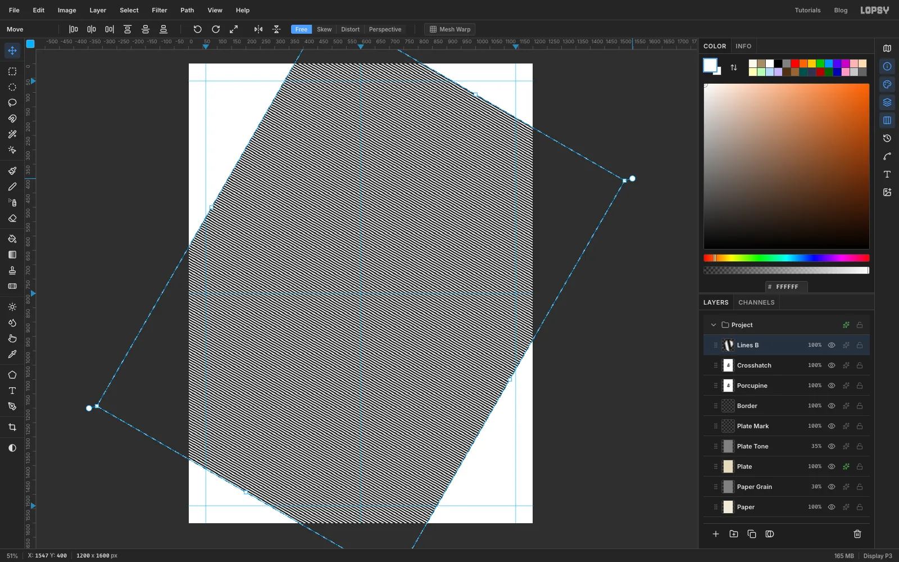

Add a layer called **Tile**. Select **0, 0** to **16, 8** and fill it white,
then select **0, 0** to **16, 4** and fill it black. Select the full **16 × 8**
tile again and choose **Edit → Define Pattern**. Delete the Tile layer;
the pattern is saved.

The shadows get a second set of lines first. Select **Porcupine** and choose
**Layer → Duplicate Layer**. Rename the copy **Crosshatch**.

Above it, add a layer called **Lines B**. Choose **Select → All**, fill it
white, then choose **Edit → Fill with Pattern** and pick your stripe tile.
Run **Gaussian Blur** at **2** so each stripe becomes a soft ridge.

Choose the **Move** tool. Hold [[Cmd]] and drag the rotation handle at the
top-right corner clockwise: [[Cmd]] snaps to 15° steps, so stop at **30°**.
Press [[Cmd+D]] to apply.

## Threshold the cross-hatching

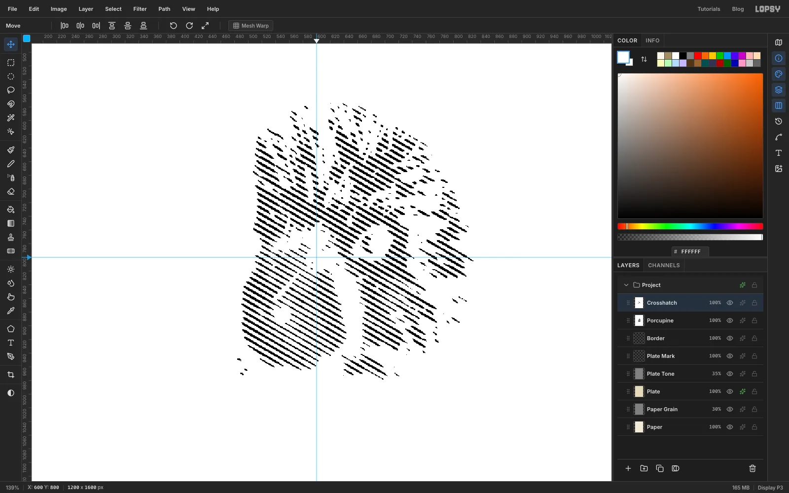

Set Lines B to **50%** opacity and choose **Layer → Merge Down** to merge it
into Crosshatch. Run **Filter → Threshold** at **50**.

Only the darkest tones push the stripes below 50, so this leaves short
lines in the deep shadows and nothing anywhere else.

## Lay the main line screen

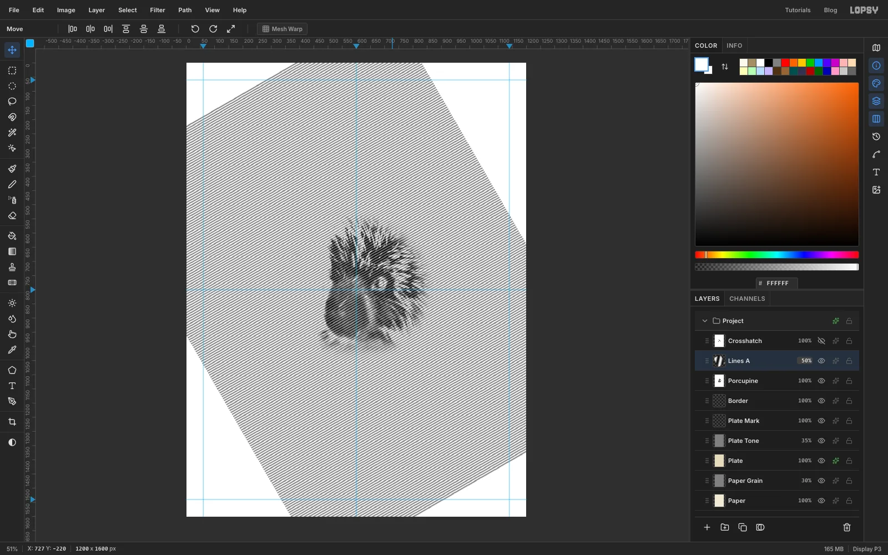

Hide **Crosshatch** for now with its eye icon, so you can see what you're
doing underneath. Select the **Porcupine** layer and add another layer above
it called **Lines A**. Choose **Select → All**, fill it white, **Fill with
Pattern** with the same tile, and run
**Gaussian Blur** at **2**. With the Move tool, hold [[Cmd]] and rotate it
**30°** the other way (anticlockwise). Press [[Cmd+D]], then set its opacity
to **50%**.

Through the stripes you can still see the grey porcupine. That mix is what
Threshold will read.

## Threshold the portrait

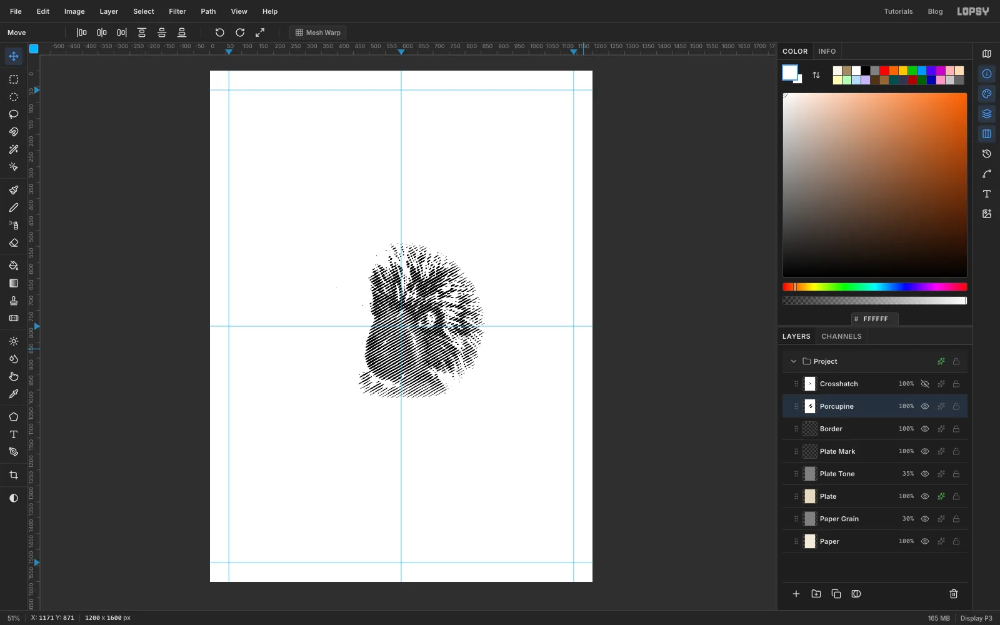

**Merge Down** Lines A into Porcupine and run **Threshold** at **118**. The
whole head turns into lines: thick where the fur is dark, thin across the
quills, and gone in the white background.

## Combine the two screens

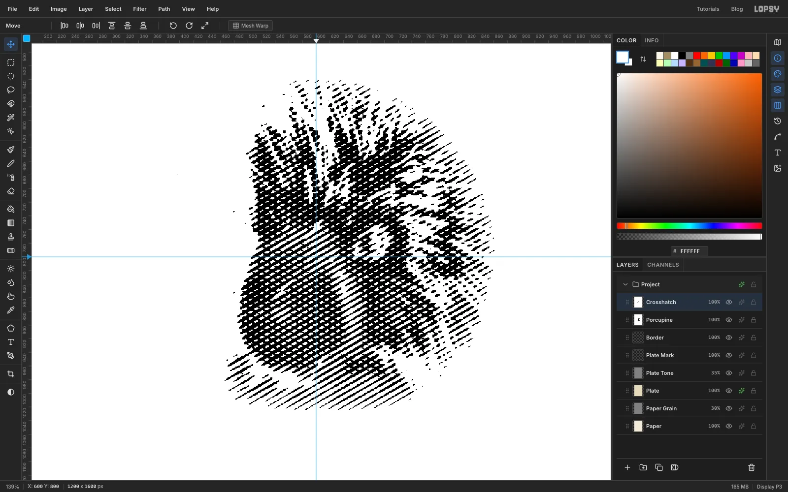

Show **Crosshatch** again, select it and set its blend mode to **Multiply**. Its white
disappears and its lines fall across the main screen, so the darkest
shadows are now cross-hatched. **Merge Down** to combine them into the
Porcupine layer.

## Print it in sepia ink inside a circle

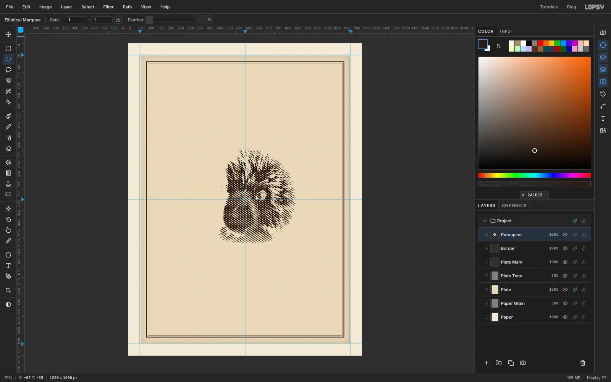

Pure black looks digital. Add a layer, select all and fill it with ink
`#2A1D15`. Set it to **Lighten** and **Merge Down**. Black becomes sepia
and white stays white.

Set the Porcupine layer to **Multiply** so its white vanishes and the plate
shows through. Then select a circle from **318, 518** to **882, 1082**, choose
**Select → Inverse** and press [[Delete]] to trim the edge. Deselect.

## Make the red zipper tape

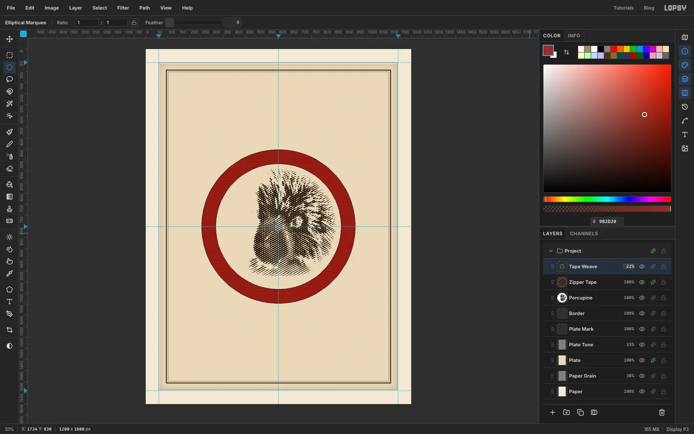

Add a layer called **Zipper Tape**. Select a circle from **254, 454** to
**946, 1146**, fill it with spot red `#9B2D20`, then select **316, 516** to
**884, 1084** and press [[Delete]]. You're left with a ring. Give it a
**Stroke** effect of **2** in ink.

For a woven look, [[Cmd]]-click the Zipper Tape thumbnail to select the
ring. Add a layer called **Tape Weave**, **Fill with Pattern** with the
stripe tile at **Scale 50**, and deselect. Set it to **Multiply** at
**22%**.

## Cut the zipper teeth with Sunburst

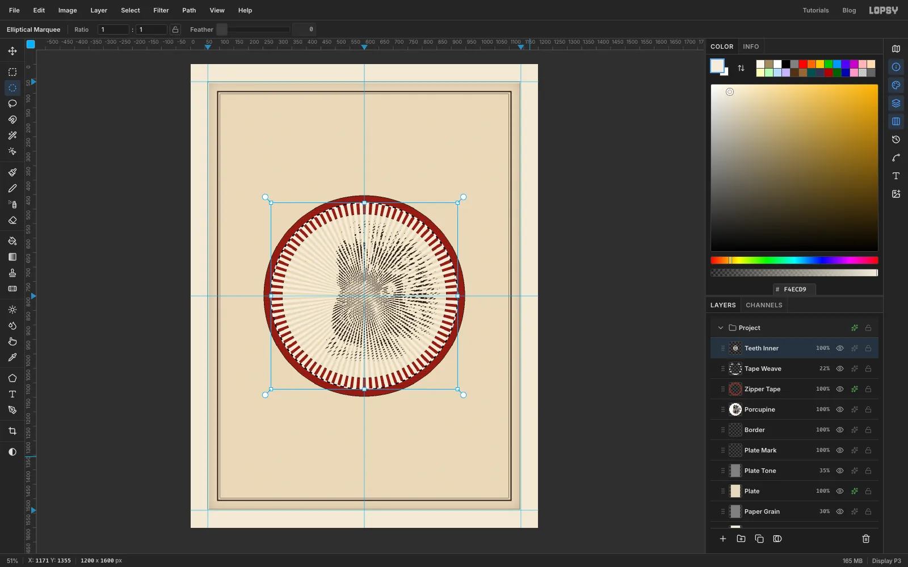

A zipper's teeth are evenly spaced around the ring, and **Sunburst** paints
evenly spaced rays.

Add a layer called **Teeth Inner**. Select a circle from **278, 478** to
**922, 1122** and set the foreground to cream `#F4ECD9`. Run
**Filter → Sunburst** with **Rays 90**, **Length 100**, **Width 55**,
**Taper 0**, **Rotation 0** and the centre at **50 / 50**. The rays fill the
circle like a fan.

Select **302, 502** to **898, 1098** and press [[Delete]] to hollow out the
middle. Each ray becomes a short, chunky tooth. Add a **Stroke** of **2** in
ink.

## Interlock a second row

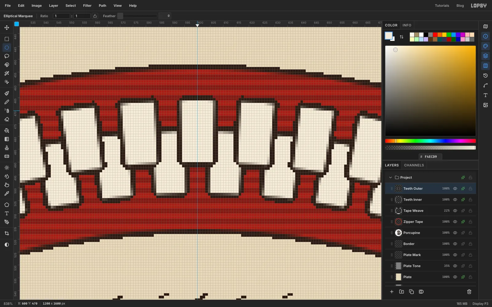

Add a layer called **Teeth Outer** and do the same with a slightly larger
ring. Select **266, 466** to **934, 1134**, run Sunburst with the same
settings but **Rotation 2**, then delete **290, 490** to **910, 1110**.
Stroke it the same way.

With 90 rays each slot is 4°, so a rotation of 2° moves every tooth half a
slot. The outer teeth fall between the inner ones, as on a real zipper.

## Add a bead rule with Radial Symmetry

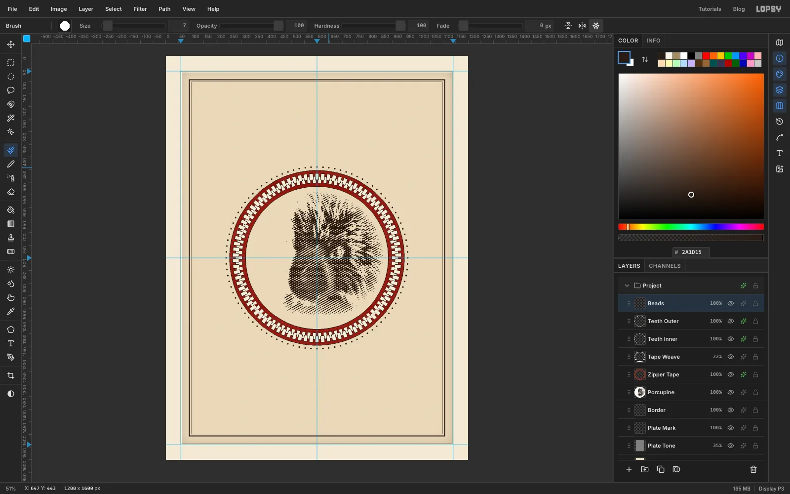

Add a layer called **Beads** and choose the **Brush**. In the options bar,
turn on **Radial Symmetry** and set **Segments** to **32**. The symmetry
centre is the canvas centre, which is also the centre of the ring. Set
**Size 7**, then open the brush settings and set **Hardness 100**.

In ink, click once just above the top of the ring, 360 px above the centre,
at **600, 440**. That one click places 32 dots. Click twice more a little
to the right along the same circle, each about 23 px further round, to fill
the ring with 96 beads. Turn Radial Symmetry off when you're done.

## Draw the slider and pull tab

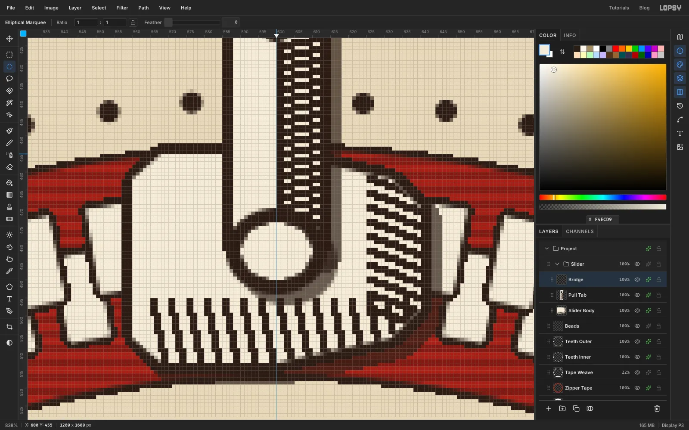

Click the **New Group** button at the bottom of the Layers panel and name
the group **Slider**. You'll draw the slider upright at twelve o'clock and
rotate it into place later.

1. Add a layer called **Slider Body**. With the **Lasso**, draw a box with
   clipped corners, about 80 px wide and 60 px tall, over the teeth at
   twelve o'clock. Fill it with cream `#F4ECD9`.
2. Keep the selection, choose the **Pencil** at **Size 2** and, in ink,
   hatch the lower edge with short slanted [[Shift]]-click lines about 5 px
   apart. Add a few more down the right side. The selection stops the lines
   spilling out. Deselect and give the layer a **Stroke** of **3** in ink.
3. Add a layer called **Pull Tab**. Select **588, 396** to **612, 482**, fill it
   cream, then select an ellipse from **594, 404** to **606, 424** and press
   [[Delete]] to cut the slot. [[Cmd]]-click the thumbnail and hatch the
   right half with short Pencil lines. Give it a **Stroke** of **3**.
4. Add a layer called **Bridge**. Select an ellipse from **586, 470** to
   **614, 494**, fill it with ink, **Shrink** by **4**, fill with cream and
   deselect.

Give each of the three layers a hard **Drop Shadow**: **Offset 3, 3**,
**Blur 0**, **Opacity 70**, in ink. A hard shadow suits the engraved look.

## Rotate the slider group into place

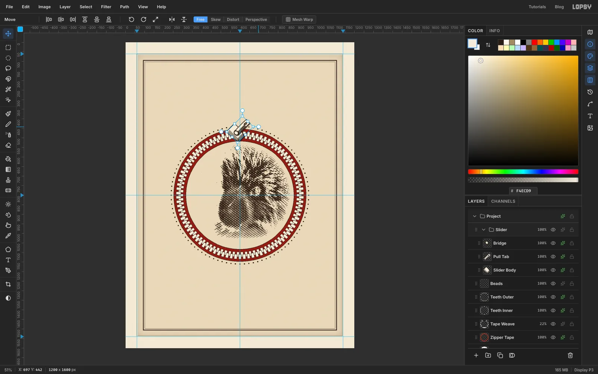

Click the **Slider** group's row and choose the **Move** tool. The handles
go around all three layers. Hold [[Cmd]] and drag the rotation handle
clockwise to **45°**, then press [[Cmd+D]].

Try [[Cmd+Z]] and [[Cmd+Shift+Z]] here. The group should snap back upright
and then return to exactly the same angle.

Now drag the group down and to the right until the slider sits on the
teeth at **half past one** (the body's centre at about **823, 577**), and
fine-tune with the arrow keys so it sits squarely on the teeth.

## Group the medallion and scale it down

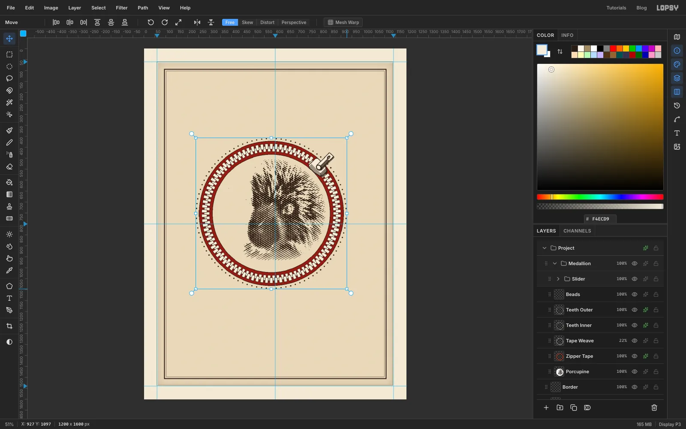

Collapse the Slider group. Click **Porcupine**, then [[Shift]]-click
**Slider** to select everything from the engraving up to the slider. Choose
**Layer → Group Layers** and name the group **Medallion**.

Choose the **Move** tool and press [[Shift+Up]] three times to lift the
whole group 30 px, leaving room for the price list. Then hold [[Cmd]] and
drag the group's bottom-right corner handle inwards to **95%**. Nudge it
back onto the vertical centre guide so the ring's centre sits about 42 px
above the middle guide (**600, 758**).

## Set the masthead

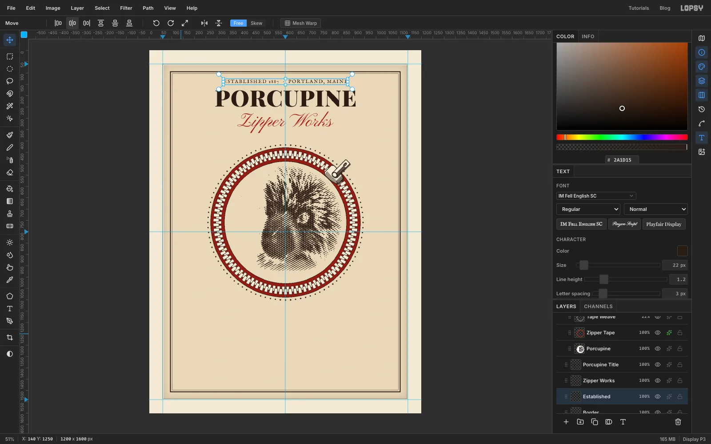

Click the **Border** row first, so the text tool doesn't restyle another text
layer. Set the type in empty space low on the canvas, then move it up. Text
clicks near existing text would edit that text instead.

- **PORCUPINE**: **Playfair Display**, weight **Black**, **100 px**, ink, letter
  spacing **2**. Name the layer **Porcupine Title**.
- **Zipper Works**: **Pinyon Script**, **84 px**, spot red. Name it **Zipper Works**.
- **ESTABLISHED 1887 · PORTLAND, MAINE**: **IM Fell English SC**, **22 px**, ink,
  letter spacing **3**, with two spaces either side of the middle dot. Name it
  **Established**.

Commit each line with [[Tab]] and click **Border** again before starting
the next one. Then, for each one, choose the **Move** tool
and click **Align center horizontally** in the options bar, and use the
arrow keys to set its height. The small caps sit at about **y 128**, the top of
PORCUPINE at **176**, and Zipper Works at **270**. Leave a clear gap under the
small caps so the 7's tail doesn't touch the capitals.

## Make a ribbon tail and mirror it

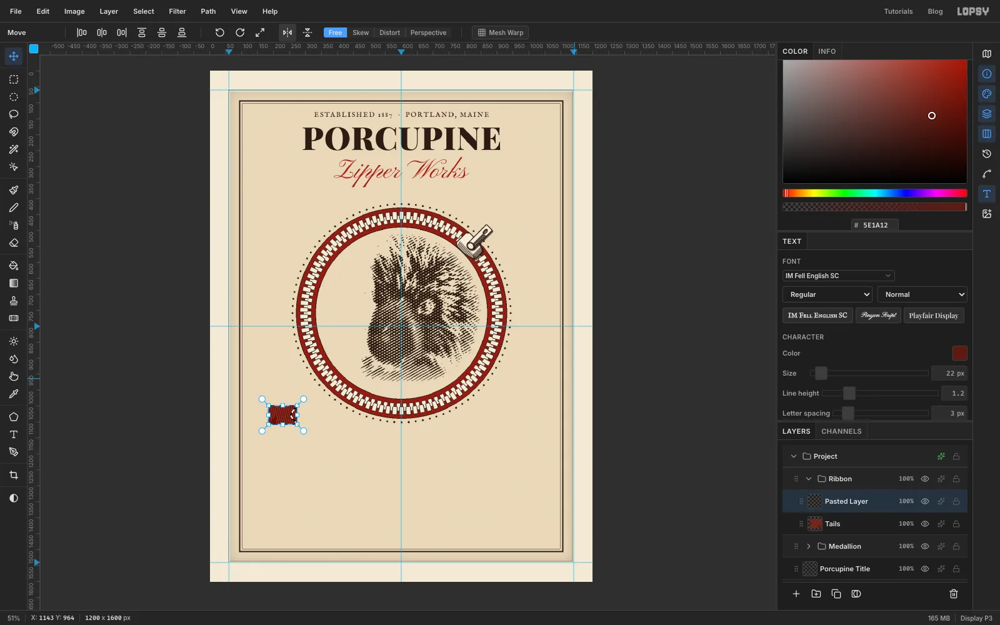

Click the **Medallion** group's row and collapse it, then click **New
Group**. The new group lands above Medallion, so the ribbon will sit in
front of the ring. Name it **Ribbon**.

Add a layer called **Tails**. With the Lasso, draw a swallowtail at the
lower left of the ring, about 90 px wide: a rectangle with a V cut into its
outer end, starting under where the band will end at **x 250**. Fill it
with spot red. While it's still selected, hatch it with diagonal ink Pencil
lines (Size 2) to shade it. Then lasso a small triangle where the band folds
behind the tail and fill it with the darker red `#5E1A12`.

Select a box around the tail, press [[Cmd+C]] and [[Cmd+V]]. The paste lands
in place and is selected with the Move tool active. Click **Flip
Horizontal** in the options bar, then drag the copy across to the matching
spot at the right end and line it up with the arrow keys. Deselect, **Merge Down** the copy into
Tails, and give Tails a **Stroke** of **2** in ink.

## Draw the ribbon band

Add a layer called **Band**. Lasso a gently curved band, 60 px tall, from
**x 250** to **950**. Its centre line is at **y 1082** in the middle and rises
32 px to about **y 1050** at each end. Fill it with spot red.

Keep the selection and use the Pencil to hatch where the band turns under
at each end: about ten short ink lines that get closer together towards the
end. Add a row of short ticks just inside the lower edge to round the band.
Deselect and give it a **Stroke** of **2**.

## Set the ribbon text on a path

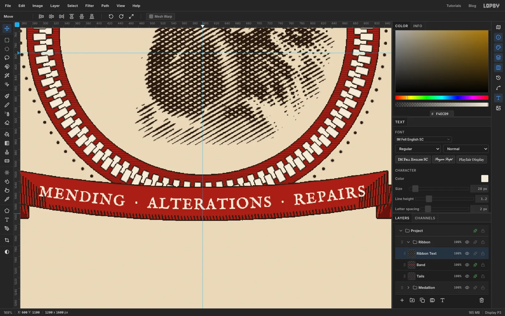

Choose the **Pen** tool. Click from left to right along the middle of the
band, 10 px below its centre line, at **x 260, 430, 600, 770** and **940**.
On the three middle anchors, drag a little to the right along the curve to
pull out handles so the path stays smooth. Commit it with the **✓** button
in the options bar so the path isn't stroked.

Set **MENDING · ALTERATIONS · REPAIRS** (two spaces either side of each dot) in **IM Fell English SC**, **28 px**,
cream, letter spacing **2**, with **Align** set to **Center**. Type it in empty
space and commit with [[Tab]]. With the text layer still selected, choose
your new path from the **Path** menu in the Text options bar. The words wrap
onto the curve, centred, with equal room at both folds. Open the **Paths**
panel from the panel toolbar and click the path's row to hide its outline.

## Write the tagline and colour one word

Click **Border**, then set **No snag too prickly.** in **IM Fell English**,
**Italic**, **34 px**, ink, and name the layer **Tagline**. Centre it and
nudge its top to about **y 1150**.

Click into the text with the Text tool and drag across the word **prickly**
to select it, leaving the full stop out. Click the **Text
color** swatch in the options bar and enter `#9B2D20`. Commit with the **✓**
button next to the text. Only that word turns red, as if the printer had
added a second colour.

## Add a needle and thread

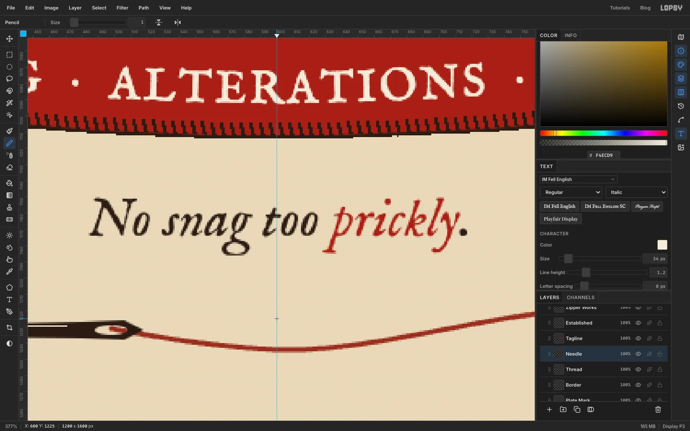

Click **Border** and add a layer called **Thread**. Choose the **Pen**
tool, set **Stroke** to **3** and the foreground to spot red. Click to start
about 100 px left of the centre guide at about **y 1230**. Drag out a
smooth anchor on the centre guide a little below that line, another about
160 px right of centre a little above it, and click to end about 270 px
right of centre.
The thread makes a lazy S. Press [[Enter]] to stroke it, then hide the path
outline in the Paths panel.

Add a layer called **Needle**. Lasso a long, thin needle that ends at the
start of the thread: about 185 px long, 12 px thick at the eye end and
sharp at the left. Fill it with ink. Select a small ellipse at the right
end, **488, 1229** to **508, 1235**, and press [[Delete]] to open the eye
around the thread. Deselect, then draw one 1 px cream Pencil line along the
shaft as a highlight.

## Set the price list

Use four text layers, all **IM Fell English**, **25 px**, ink, **Line height
1.35**. Make each in empty space and then move it into place:

- **Prices Left**, left-aligned: New zips fitted / Coats & jackets / Tents & awnings / Luggage & saddlery. Its left edge goes at **x 150**.
- **Amounts Left**, **right-aligned**: $14 / $22 / $30 / $26. Its right edge goes at **x 568**.
- **Prices Right**: Hems & cuffs / Darning & patches / Leather mending / Alterations. Its left edge goes at **x 632**.
- **Amounts Right**, right-aligned: $9 / $7 / $18 / $12. Its right edge goes at **x 1050**.

Put the tops of all four at about **y 1284** so the lines match across the
columns.

## Draw dotted leaders

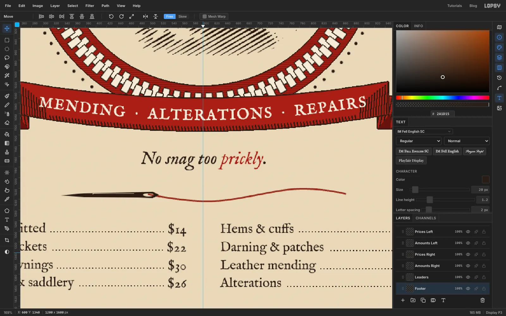

Add a layer called **Leaders**. Choose the **Brush** at **Size 3**, then
in the brush settings set **Hardness 100** and **Spacing 200%**. At 200% each
dab sits a full dab-width from the next, so a stroke becomes a row of
dots.

For each line, click about 9 px before the price, then [[Shift]]-click just
after the item name. Keep the dots on the text baseline. Because the prices
are right-aligned, starting at the price keeps that gap the same on every
line.

Finally, add the footer: **No. 9 Thimble Lane, Portland · Tuesday to
Saturday, nine till six** in **IM Fell English SC**, **20 px**, letter
spacing **2**, with two spaces either side of the dot. Name it **Footer**,
centre it and nudge its top to about **y 1454**.

## Burnish the quills

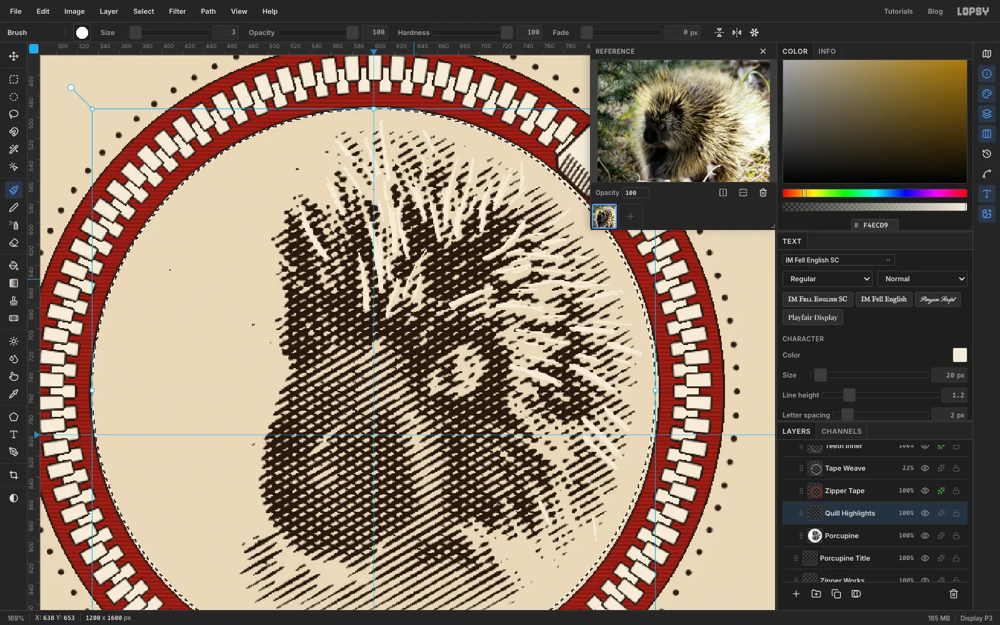

Engravers burnish highlights back into a plate. Open the **Reference** drawer
from the panel toolbar and load the porcupine photo, so you can see where
the bright quills run.

Expand the Medallion group, select **Porcupine** and add a layer above it
called **Quill Highlights**. Select a circle just inside the zipper,
**334, 492** to **866, 1024**, so nothing spills onto the teeth. Choose the **Brush** at **Size 3**,
**Hardness 100**, **Spacing 10%**, with **Taper 45** in the brush settings, and
cream `#F4ECD9`.

Taper thins a stroke from where it starts, so start each stroke at the root
of a quill and flick outwards. Follow the pale quills in the photo: they
fan up and back from the crown and sweep back along the cheek. Paint a few
hundred short strokes of different lengths. Leave the face clear.

## Ink the eye and the snout

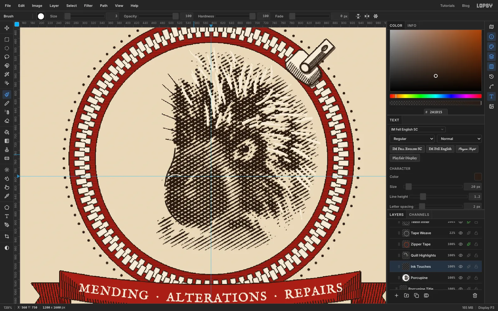

Deselect. On the Porcupine layer, use the **Eraser** at **Size 14** to
click away any stray specks the line screen left in the empty paper.

Add a layer called **Ink Touches**. With the Brush at **Taper 0**:

1. At **Size 18**, click once in ink over the eye.
2. At **Size 5**, click once in cream at its upper left for the catchlight.
3. At **Size 3**, paint a short cream curve over the bridge of the nose.

With the **Pen** tool at **Stroke 3**, trace the front of the snout in two
strokes with a small break at the nose, pressing [[Enter]] after each. An
engraver's contour is never one unbroken wire. Last, set the Brush back to
**Taper 48** and flick six dark quills up and to the left from the
forehead, above the snout, so the top of the head reads as rounded rather
than cut off. Close the Reference drawer when you're done.

## Engrave a shade under the title

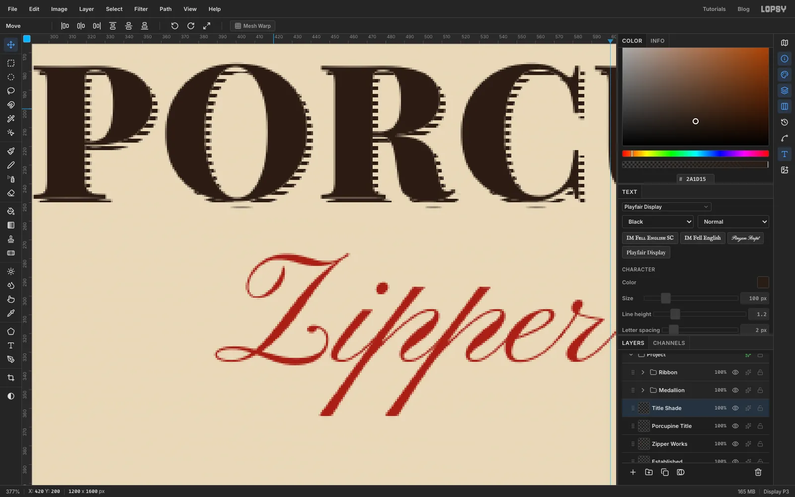

Victorian display type often has a shade made of fine rules. Add a layer
called **Rule Tile**. Select **0, 0** to **12, 2** and fill it with ink, then
select **0, 0** to **12, 4** and choose **Edit → Define Pattern**. Half the tile
is transparent, so the pattern is ink rules with gaps between them. Delete
the Rule Tile layer.

Select **Porcupine Title**, choose **Duplicate Layer** and rename the copy
**Title Shade**. Click **Rasterize Layer** at the bottom of the Layers
panel. With the Move tool, nudge it **3 px right and 3 px down**.

[[Cmd]]-click the Title Shade thumbnail, press [[Delete]], then choose
**Edit → Fill with Pattern** with the rule tile. The letters are now
ruled. To keep the rules only in the offset, [[Cmd]]-click the **Porcupine
Title** thumbnail, click the Title Shade row and press [[Delete]]. Deselect.

## Draw a quill-fan corner ornament

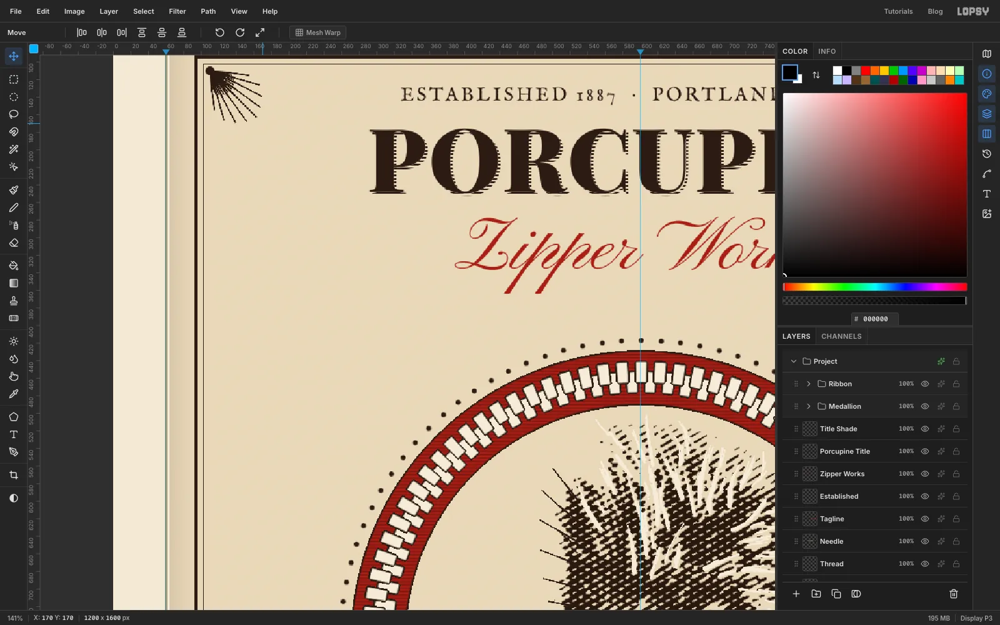

Click **Border** and add a layer called **Corners**. Choose the Brush at
**Size 3** with **Taper 72**. Starting each stroke at the inner corner of
the border (**110, 110**), flick out nine quills from almost horizontal to
almost vertical. Make them longest in the middle (about 75 px) and
shortest at the ends (about 45 px).

Set **Size 2** and **Taper 30** and add eight short quills, about 30 px long,
between the long ones. Finish with a single **Size 11** dot at the root
with **Taper 0**.

## Copy the ornament to all four corners

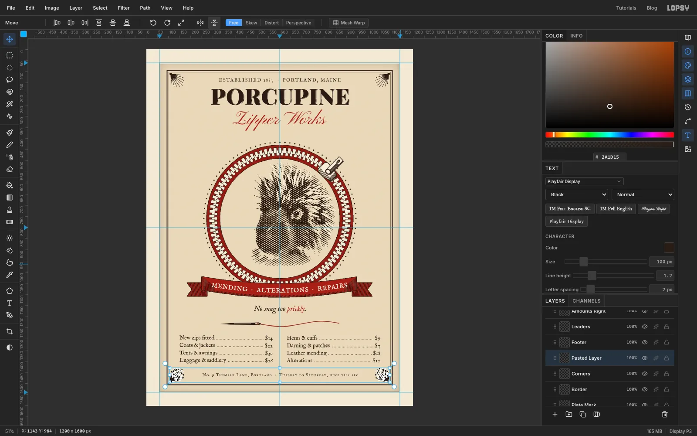

Select a box around the fan (**104, 104** to **200, 200**), press [[Cmd+C]]
and then [[Cmd+V]]. Click **Flip Horizontal** in the Move options and drag
the copy to the top-right corner, then line it up with the arrow keys. Deselect and **Merge
Down**.

Now select a strip across the whole top of the border (**104, 104** to
**1096, 200**), copy and paste it, click **Flip Vertical**, and drag the
pair down to the bottom corners, lining them up with the arrow keys. Deselect and **Merge Down**.

## Finish and export

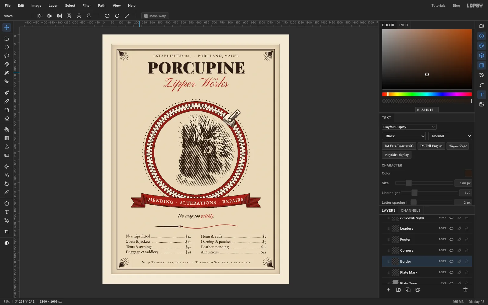

Choose **View → Show Guides** to hide the guides and look the flier over.
Then choose **File → Quick Export PNG** for the finished image and
**File → Save Project** to keep a `.lopsy` you can come back to.

> **Tip:** The line screen is the part worth experimenting with. A finer
> stripe tile gives a finer engraving. A higher Threshold level gives
> heavier lines. Changing the Brightness/Contrast settings before the
> screen changes the most.
