**Film noir** is the look of 1940s crime films: hard light, deep shadow, rain on the windows and a detective who has seen too much. Its most famous shot is the light that falls through **venetian blinds** and lays stripes across the wall and the people in the room. Noir posters added a single spot of colour, a red title or a lit match, to an otherwise black-and-white world.

In this tutorial you'll turn that look into a birthday card: **The Case of the Surprise Party**, a 1500 × 2100 px card (5 × 7 in at 300 dpi). A detective in a fedora watches from the shadows, slatted light with rain in it falls across the wall, and the only warm thing in the room is the candle on a birthday cupcake. A manila case tag on the desk spells out the joke, and a red rubber stamp closes the case.

You'll work from two photos:

- [Mr. Cermák from Kolín](https://www.rawpixel.com/image/14253449/mr-cermak-from-kolin-jaromir-funke), a 1920s portrait by Jaromír Funke from the Getty Museum's Open Content programme (CC0), via rawpixel. Download the 772 × 1024 px version.
- [Birthday Cupcake 3](https://www.flickr.com/photos/35608308@N05/25956069823) by megforce1 on Flickr (CC0), a cupcake with one candle, already cut out onto black. Download the 820 × 1024 px size.

The tools you'll use:

- **guides**, the **Pen** tool, **Path to Selection**, the **Rectangular** and **Elliptical Marquee**, the **Lasso**, the **Magic Wand**, and **Select → Feather / Shrink / Inverse**
- a **Levels** and a **Saturation & Vibrance** adjustment on a group
- the **Skew** and **Distort** transform modes, the scale and rotation handles, and rotating a whole group
- the **Gradient** tool, a **layer mask**, **Add Noise**, **Motion Blur**, **Threshold**, **Gaussian Blur**, **Desaturate**, **Brightness/Contrast** and the **Smoke** render filter
- the **Screen**, **Multiply** and **Overlay** blend modes, **Outer Glow** and **Drop Shadow**
- **Cut** and **Paste**, the **Pencil**, the **Eraser**, **Merge Down**, and live text in Bebas Neue, Special Elite and Cutive Mono

The palette:

- Wall ink `#0B0B0D` → `#3C3D43`
- Blind light `#ECE4D0`, rain grey `#808080`
- Desk `#2E2925` → `#191614` → `#070606`, desk edge `#8E877A`
- Candle glow `#FF9A2E`, warm light `#FFA040` → `#5A2E0C`, frosting spill `#FFBE78`, rim `#FF9A40`
- Title `#F4EEDF` → `#A59C88`, tagline `#D8D0BD`
- Manila `#CDB27C`, eyelet `#9E8150`, string `#C9BFA6`, tag ink `#2B2118`
- Stamp red `#C1121F`, kicker red `#D9222E`

> **Tip:** On a wide-gamut (Display P3) screen, Lopsy reads typed hex codes as P3 colours. These codes were picked on a P3 screen, so they look a touch duller on an sRGB screen.

> **Note:** Shortcuts are written for a Mac. On Windows use [[Ctrl]] wherever it says [[Cmd]].

> **Tip:** Keep an eye on the **X** and **Y** readout at the bottom left of the window. It follows the pointer in document pixels, so you can hit the positions below.

## Set up the card and the wall

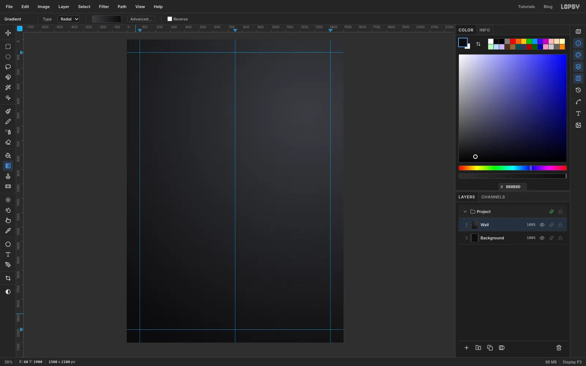

Choose **File → New**, keep the units on **Pixels**, and make the document **1500** wide and **2100** high. Click *Background*, set the foreground colour to `#0B0B0D` and choose **Edit → Fill**.

Add guides for the margins and the centre line: click the top ruler at **90**, **750** and **1410**, and the left ruler at **90** and **2010**.

Double-click *Layer 1* and rename it *Wall*. Pick the **Gradient** tool ([[G]]), set it to **Radial**, open **Advanced…** and make a two-stop gradient from `#3C3D43` to `#0B0B0D`. Drag from the upper right of the card (about **x 1250, y 520**) down to the bottom left corner. The wall is now faintly lit from the side where the window will be.

## Drop in the detective photo inside a group

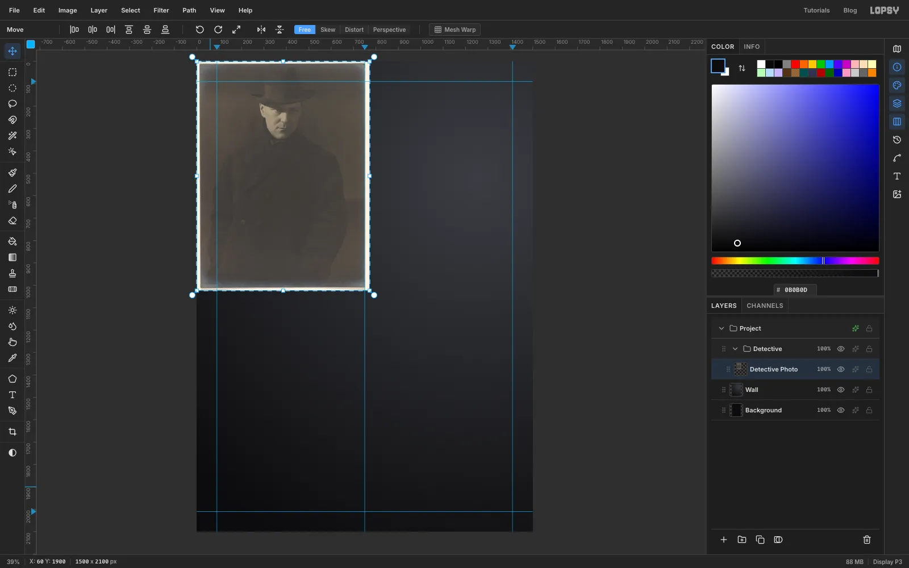

With *Wall* selected, click **New Group** at the bottom of the Layers panel and name the group *Detective*. Anything you add while the group is open goes inside it.

Drag the Funke portrait from your desktop onto the canvas. It lands in the top left corner as *Pasted Layer*. Rename it *Detective Photo*.

The photo has a pale paper mount around it. Pick the **Rectangular Marquee** ([[M]]) and click once on the canvas without dragging. This opens a dialog where you can type exact corners. Enter **From 24, 24** and **To 748, 1000**, which is just inside the mount. Choose **Select → Inverse** and press [[Delete]], then [[Cmd+D]].

## Trace him with the Pen

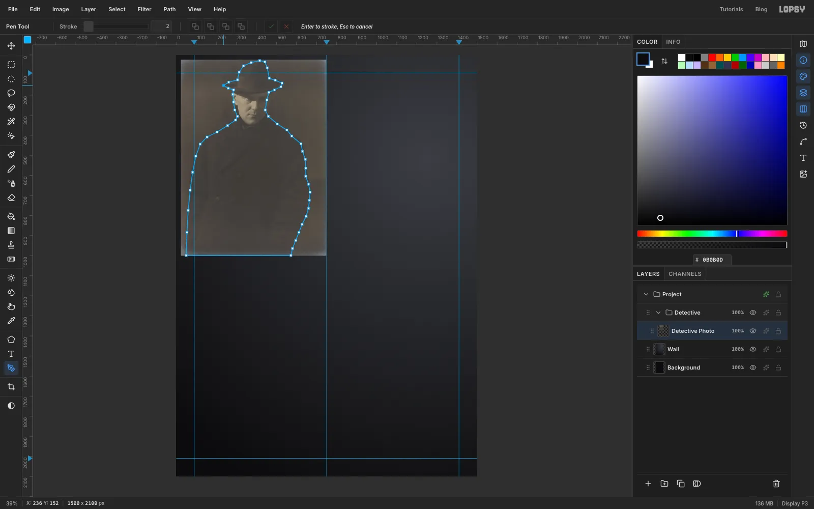

The background behind him is only a little lighter than his coat, so the Magic Wand can't separate them. Trace him by hand instead.

Pick the **Pen** tool ([[P]]) and click your way around him, one corner point at a time. Start at the left tip of the hat brim. Go up over the crown and down to the other tip of the brim. Then go in under the brim, down the side of his face and collar that's on the right of the picture, out along the shoulder on that side and down the coat to the bottom of the photo. Come back along the bottom and up the coat on the left of the picture to the other shoulder, then up the face to the brim. About 40 points is plenty.

Stay a few pixels *inside* the coat edges, where the dark coat meets the lighter wall. Any wall you leave inside the path will show up later as a pale fringe. Click the first point again to close the path.

## Cut away the background

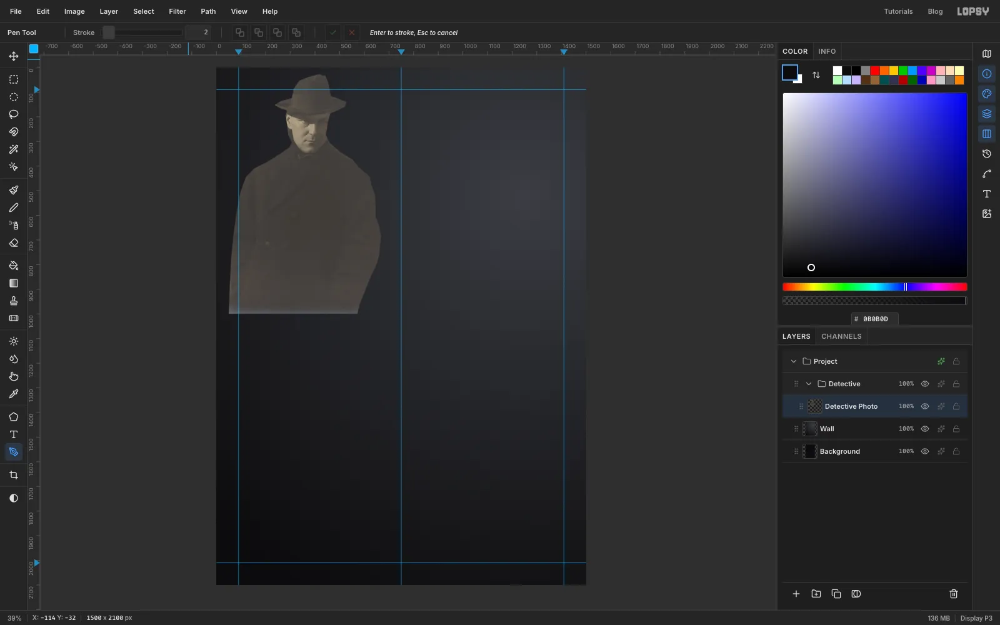

Open the **Paths** panel and click **Path to Selection**, then **Delete Path**. Choose **Select → Feather…** with **2** so the edge isn't razor sharp. Then choose **Select → Inverse**, press [[Delete]] and press [[Cmd+D]].

## Scale him up and place him on the left

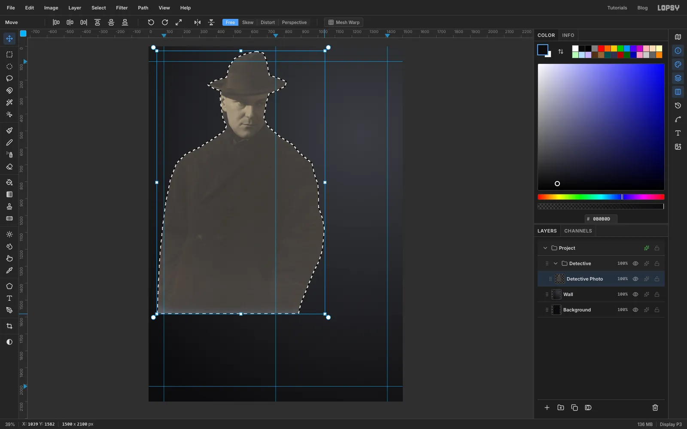

[[Cmd]]-click the *Detective Photo* thumbnail to load his outline as a selection. Pick the **Move** tool ([[V]]), hold [[Cmd]] and drag the bottom-right corner handle outward until he's about **160%** of his size. That's roughly 990 px wide. Press [[Enter]], then [[Cmd+D]].

Now drag him down and to the left. The top of his hat should sit at about **y 436**, and the shoulder on the left of the picture should run off the left edge of the card by about 200 px. His face ends up about a fifth of the way across the card.

## Grade him with Levels

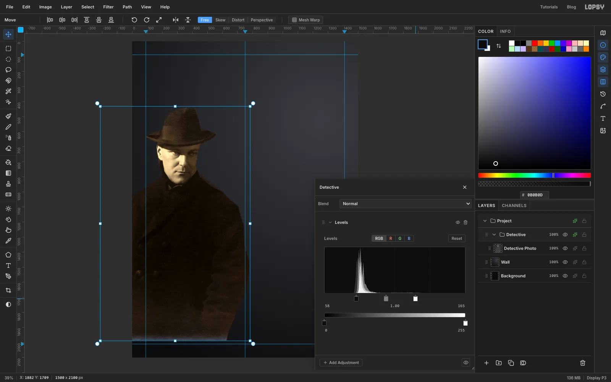

The old print is soft and brown, with almost everything between grey 60 and grey 160. Noir needs black coats and a bright face.

Click the *Detective* group row, then the effects button on its row. For a group, the drawer shows adjustments. Click **Add Adjustment → Levels**. Drag the black input handle under the histogram right until the readout says **58**, and the white handle left to **165**. The coat drops to black and the face lights up.

## Take out the sepia

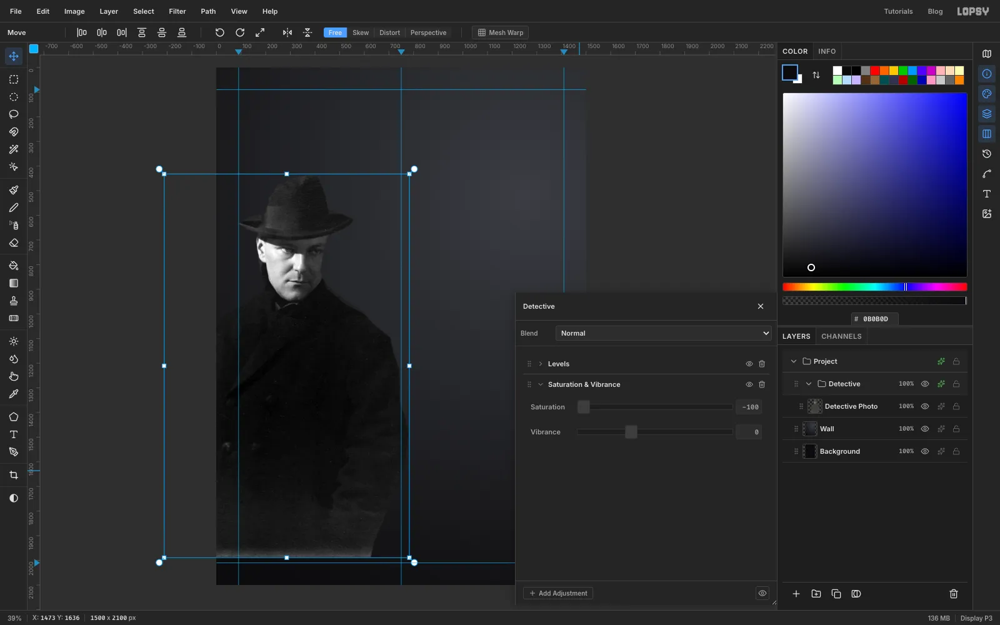

Still in the *Detective* drawer, click **Add Adjustment → Saturation & Vibrance** and set **Saturation** to **-100**. The brown tint goes and he's a neutral black-and-white photo.

Close the drawer and click the arrow on the *Detective* row to collapse the group. A collapsed group won't swallow the layers you add next.

## Marquee the window slats

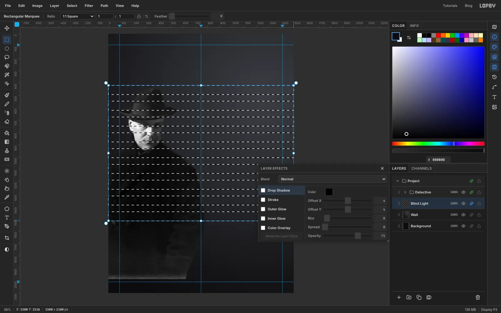

Click *Wall* and click **Add Layer**. Name the new layer *Blind Light*. It sits between the wall and the detective, so the light falls on the wall behind him.

Now make the slats of light. With the **Rectangular Marquee**, drag a band right across the card from **y 418** to **y 492**. Hold [[Shift]] and drag another from **y 546** to **y 620**. Keep going down the card with [[Shift]] held, making each band 74 px tall and starting 128 px below the last. The ninth band runs from **y 1442** to **y 1516**. (If the layer effects drawer is still open from earlier, you can leave it or close it.)

## Fill the slats

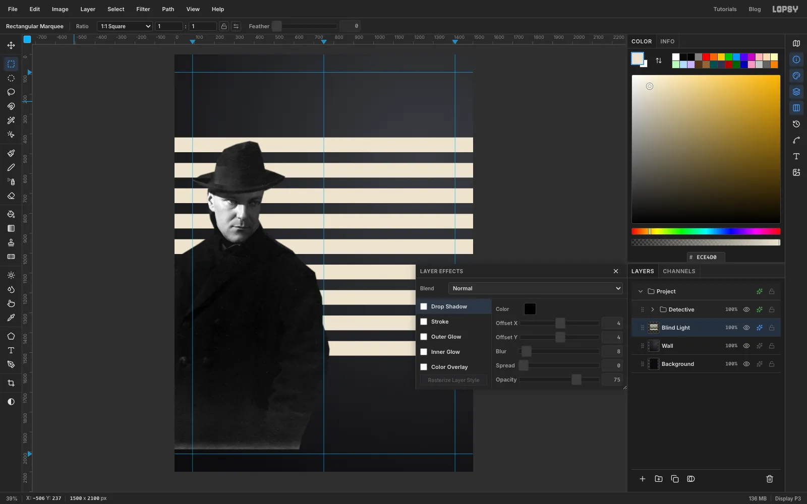

Set the foreground colour to blind light `#ECE4D0`, choose **Edit → Fill** and press [[Cmd+D]].

## Skew the slats toward the window

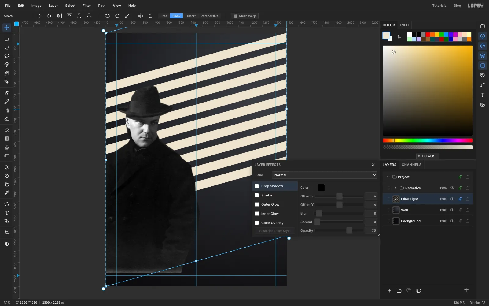

Light through a window high on the right lands as slanted bands. Choose **Select → All**, pick the **Move** tool and click **Skew** in the options bar. Drag the handle in the middle of the right edge straight up by about **420 px**. The bands now rise toward the upper right, and their left ends stay put.

## Fan them out with Distort

Click **Distort** in the options bar. Switching modes applies the skew and gives you a fresh box. Drag the top-right corner handle down by about **170 px**, then the bottom-right corner up by about **170 px**.

Now the bands are packed tighter at the right, near the window, and spread out as they cross the room. That's how real slatted light behaves.

## Apply the transform

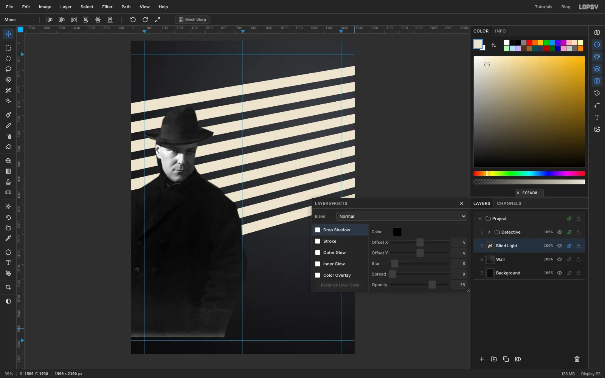

Press [[Enter]] to apply the transform, then [[Cmd+D]]. Click **Free** in the options bar so the Move tool is back to normal for later.

## Soften the light and fade it with a mask

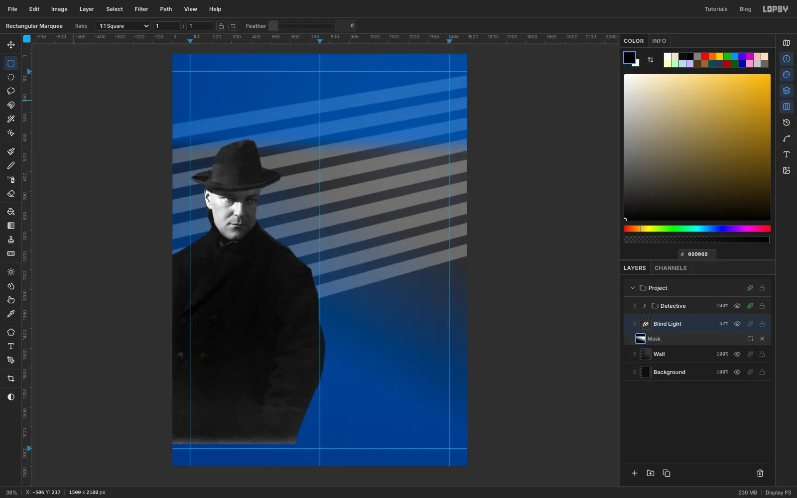

Real shadows from blinds have soft edges. Choose **Filter → Gaussian Blur…** with **Radius 5**.

Next, put a band of light across his eyes. It's the classic noir shot. With the **Move** tool, tap [[↑]] ([[Shift]] moves 10 px at a time) until one of the bright bands crosses his eyes, just under the hat brim. Here that was about **60 px** up. Open the layer's effects, set the **Blend** to **Screen** and set the layer's opacity to **32%**.

Now fade the light out with a layer mask:

1. Click **Add Mask** at the bottom of the Layers panel, then the mask thumbnail on the row to edit the mask.
2. Pick the **Gradient** tool, set it to **Linear**, and make a gradient from black `#000000` to white `#FFFFFF`. Drag from the lower middle of the card (about **x 640, y 1500**) up toward the upper right (about **x 1000, y 800**). The bottom bands now fade out instead of stopping hard.
3. The title will go at the top, so clear the light from there too. Drag a **Rectangular Marquee** across the full width of the card from the top down to **y 470**. Choose **Select → Feather…** with **60**, set the foreground colour to black and choose **Edit → Fill**. Press [[Cmd+D]].

## Give the detective his own light

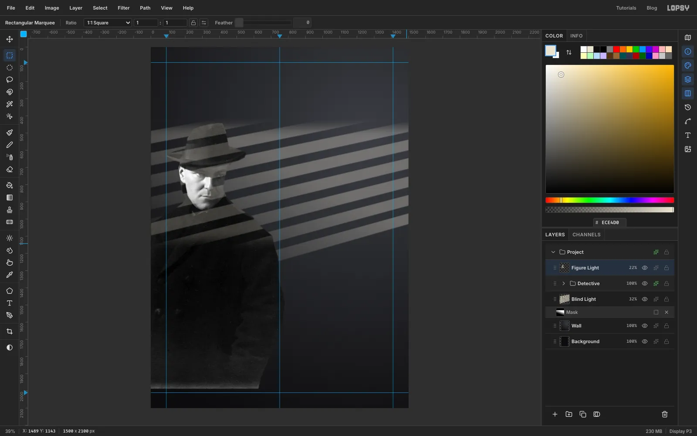

The wall's bands stop at his outline, so he now reads as a dark cut-out. Give him his own, weaker copy of the light. On a person the bands shift slightly, because he stands in front of the wall.

1. Click the collapsed *Detective* group and click **Add Layer**. Name the layer *Figure Light*. It lands above the group.
2. [[Cmd]]-click the *Blind Light* thumbnail to select the bands. Fill with `#ECE4D0` and press [[Cmd+D]].
3. With the **Move** tool, press [[Shift+↓]] twice and [[↓]] four times to nudge the bands down 24 px.
4. Expand the *Detective* group, [[Cmd]]-click the *Detective Photo* thumbnail, then collapse the group again. Choose **Select → Inverse**, click *Figure Light* and press [[Delete]]. Only the bands on him are left.
5. Only the top two or three bands should cross him. Drag a marquee across the full width of the card from about **y 1120** down to the bottom. **Feather** it by **100**, press [[Delete]], then press [[Cmd+D]].
6. Set **Blend** to **Screen** and the opacity to **22%**.

## Start the rain with noise and Motion Blur

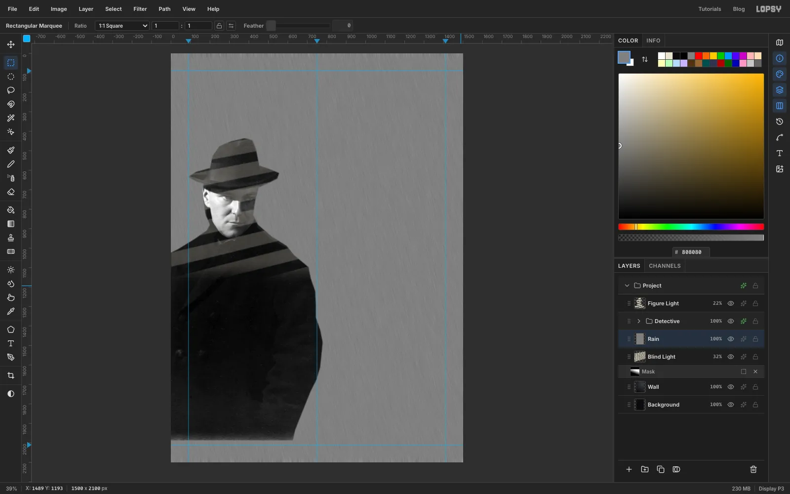

In noir, rain on the window shows up as streaks inside the light. Click *Blind Light*, then **Add Layer**, and name the layer *Rain*.

Fill it with grey `#808080`. Choose **Filter → Add Noise…**, set **Amount 100** and click **Mono**. Then choose **Filter → Motion Blur…** with **Angle 76** and **Distance 60**. The speckles smear into fine, nearly vertical streaks.

## Pull out the streaks with Threshold

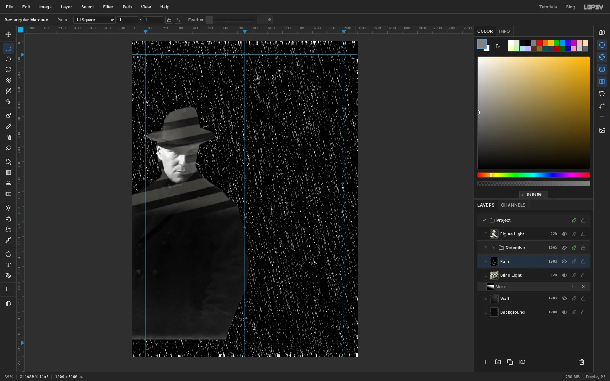

Choose **Filter → Threshold…** and raise the **Level** until only a scattering of fine streaks stays white. Around **133** works. Then run **Filter → Gaussian Blur…** with **Radius 1** to take the hard edge off.

## Keep the rain inside the light

[[Cmd]]-click the *Blind Light* thumbnail. Choose **Select → Inverse**, click *Rain* and press [[Delete]]. The streaks are now only where the light is.

The bands under the title are masked off, but the rain isn't, so drag a marquee from the top of the card down to **y 500**. **Feather** it by **60** and press [[Delete]], then [[Cmd+D]].

Set the *Rain* layer's **Blend** to **Screen** and its opacity to **34%**.

## Cast his shadow on the wall

The light comes from the right, so his shadow falls to the left behind him. With *Rain* selected, click **Add Layer** and name the layer *Figure Shadow*. It sits under the detective.

Load his outline again (expand the group, [[Cmd]]-click *Detective Photo*, collapse the group). Click *Figure Shadow*, set the foreground colour to black `#000000`, choose **Edit → Fill** and press [[Cmd+D]]. With the **Move** tool, drag the layer about **70 px** left and **34 px** down. Blur it with **Gaussian Blur** at **Radius 22** and set the opacity to **70%**. It's subtle: you'll see it as a darker gap in the light bands just left of his hat and shoulder.

## Build the desk

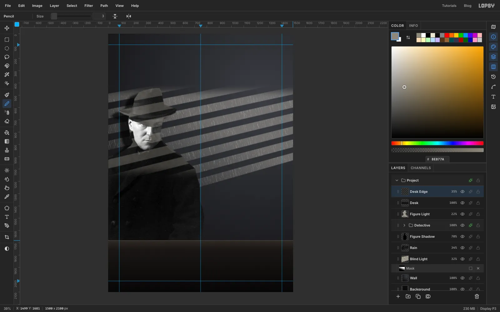

Click *Figure Light* and **Add Layer**. Name the layer *Desk*. It goes above the detective, so the desk hides the bottom of his coat.

Drag a **Rectangular Marquee** right across the card from **y 1680** to the bottom edge. With the **Gradient** tool on **Linear**, make three stops: `#2E2925` as the first stop, `#191614` at about 18% and `#070606` as the last stop. Drag straight down from the top of the selection to the bottom of the card. Press [[Cmd+D]].

For the front edge of the desk, **Add Layer** and name it *Desk Edge*. Pick the **Pencil** ([[N]]) at **Size 3** with colour `#8E877A`. Click at the left edge of the card at **y 1681**, then [[Shift]]-click at the right edge for a straight line. Set the layer's opacity to **35%** so it reads as a soft highlight rather than a rule.

## Drop in the cupcake and remove the black

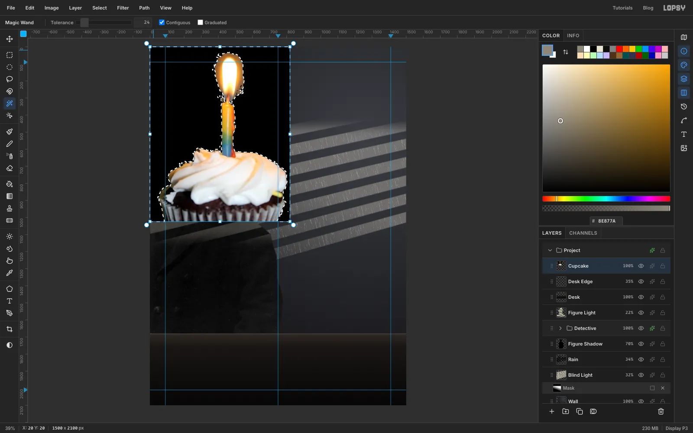

With *Desk Edge* selected, drag the cupcake photo onto the canvas and rename the layer *Cupcake*.

Pick the **Magic Wand** ([[W]]), set **Tolerance** to **24**, keep **Contiguous** on, and click the black background. Press [[Delete]].

The wand leaves a thin dark fringe. Clean it up: [[Cmd]]-click the *Cupcake* thumbnail, choose **Select → Shrink…** with **1**, then **Feather…** with **1**. Choose **Select → Inverse**, press [[Delete]] and press [[Cmd+D]].

## Soften the ragged halo round the flame

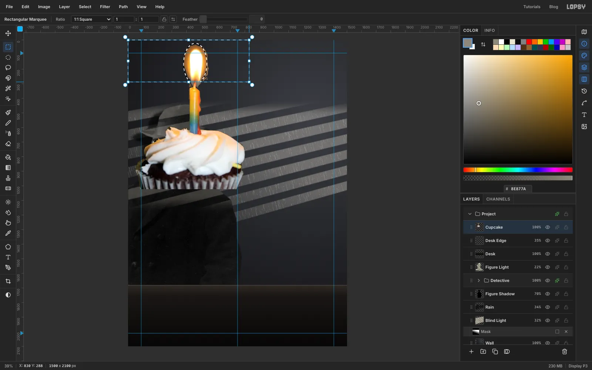

Whoever cut out this photo left a ragged brown halo around the flame. Use a feathered ellipse to trim it:

1. Drag an **Elliptical Marquee** about 160 px wide and 280 px tall around the flame, centred on it.
2. **Select → Feather…** with **18**, then **Select → Inverse**.
3. Hold [[Shift+Option]] and drag a **Rectangular Marquee** over the top of the photo, down to just above the candle (about **y 288**). [[Shift+Option]] *intersects*, so only the area outside the ellipse *and* above the candle stays selected.
4. Press [[Delete]], then [[Cmd+D]].

## Turn the cupcake grey but keep the flame

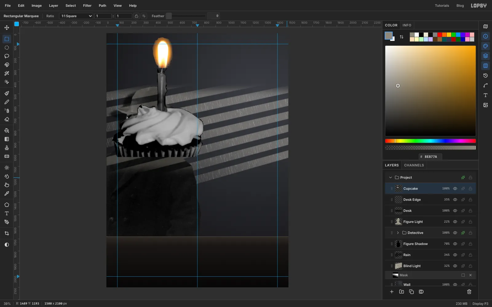

Only the flame keeps its colour. Drag a **Rectangular Marquee** from just under the flame (about **y 288**) to below the bottom of the photo, across its full width. Choose **Filter → Desaturate**.

With the marquee still active, choose **Filter → Brightness/Contrast…** with **Brightness -14** and **Contrast 25** to give the grey some snap. Then run it again with **Brightness -18** and **Contrast -12**. The second pass pulls the pure white frosting down to a soft grey, so it no longer outshines the flame. Press [[Cmd+D]].

## Scale the cupcake and set it on the desk

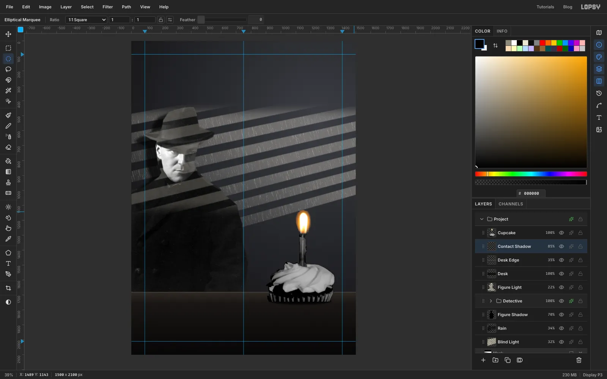

[[Cmd]]-click the *Cupcake* thumbnail. With the **Move** tool, hold [[Cmd]] and drag the bottom-right corner handle inward until the cupcake is about **62%** of its size. Press [[Enter]] and [[Cmd+D]]. Drag it to the right of the card so its centre is near **x 1125** and the bottom of the wrapper sits at about **y 1745**, on the desk.

There's a scrap of torn wrapper on the cake's left side. Lasso round it and press [[Delete]].

To seat it on the desk, click *Desk Edge*, **Add Layer** and name the layer *Contact Shadow*. Drag an **Elliptical Marquee** under the cupcake, a little narrower than the wrapper and about 46 px tall, from **y 1718** to **y 1764**. Fill with black, press [[Cmd+D]], blur with **Gaussian Blur** at **Radius 12** and set the opacity to **85%**.

## Lift the flame onto its own layer

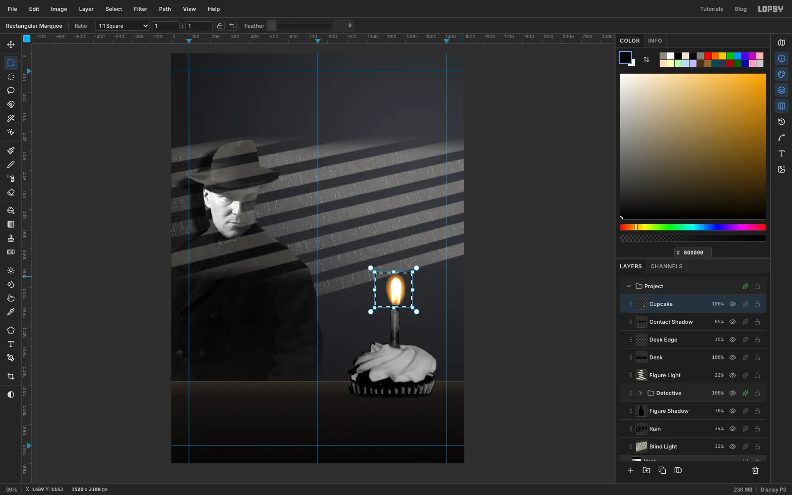

The flame needs a glow, and the cupcake shouldn't get one. So move the flame onto its own layer.

Click *Cupcake* and drag a **Rectangular Marquee** around the flame, from just above its tip down to the wick. **Feather** it by **6** so there's no hard line at the wick. Press [[Cmd+X]] to cut, then [[Cmd+V]]. The paste lands in place on a new layer. Rename it *Flame* and press [[Cmd+D]].

The cut picked up a faint rectangle of dark pixels around the flame. Drag an **Elliptical Marquee** snugly around the flame (about 96 px wide). **Feather** it by **14**, choose **Select → Inverse**, press [[Delete]] and [[Cmd+D]].

## Make the flame glow and light the room

Open the effects for *Flame* and set its **Blend** to **Screen**, so any dark pixels left round it drop out. Turn on **Outer Glow** with colour `#FF9A2E`, **Size 46**, **Spread 4** and **Opacity 85**.

Now let the candle light the room. Click *Cupcake*, **Add Layer** and name the layer *Candle Light*. Make a **Radial** gradient with three stops: `#FFA040` at the left, `#5A2E0C` at about 35% and black `#000000` at the right. Drag from the middle of the flame about 670 px out toward the lower left. Set the layer's **Blend** to **Screen**, where black does nothing, and its opacity to **45%**.

## Warm the frosting and the detective's near side

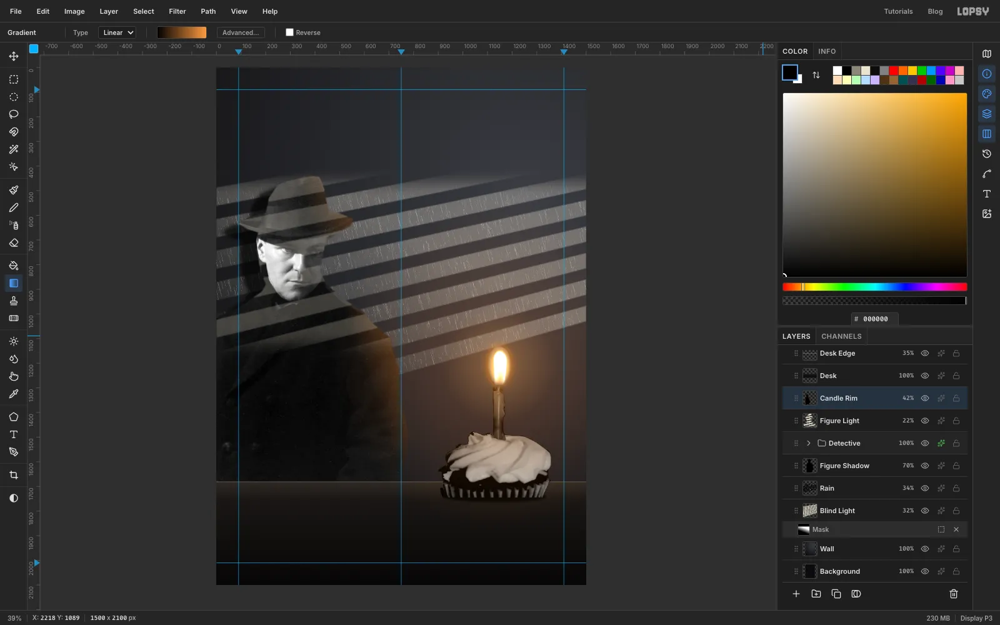

White frosting doesn't pick up warmth in Screen mode, so tint it with **Multiply** instead. Click *Cupcake*, **Add Layer** and name the layer *Warm Spill*. Make a **Radial** gradient from `#FFBE78` to white `#FFFFFF` and drag it from the flame about 600 px outward. [[Cmd]]-click the *Cupcake* thumbnail, choose **Select → Inverse**, click *Warm Spill* and press [[Delete]], then [[Cmd+D]]. Set **Blend** to **Multiply** and the opacity to **75%**.

The candle should also catch the side of the detective that faces it. Click *Figure Light*, **Add Layer** and name the layer *Candle Rim*. Load his outline (expand the group, [[Cmd]]-click *Detective Photo*, collapse the group) and click *Candle Rim*. Make a **Linear** gradient from black to `#FF9A40`. Drag it from the middle of his coat toward the shoulder nearest the candle, about **x 520** to **x 800**. Press [[Cmd+D]], set **Blend** to **Screen** and the opacity to **42%**.

## Add a curl of smoke

Click *Flame*, **Add Layer** and name the layer *Smoke*. With the **Lasso** ([[L]]), draw a narrow plume about 300 px tall. Start at the tip of the flame, curve it slightly as it rises, drift it a little to the left and let it widen toward the top. **Feather** the selection by **16**.

Choose **Filter → Smoke…** with **Scale 5** and **Turbulence 80**. This fills the plume with wispy smoke. Press [[Cmd+D]], set **Blend** to **Screen** and the opacity to **50%**.

To make the top fade away, pick the **Eraser** ([[E]]) at **Size 90** and **Opacity 40%**, and brush once across the top of the wisp. Set the Eraser's opacity back to **100%** afterwards.

## Set the kicker line

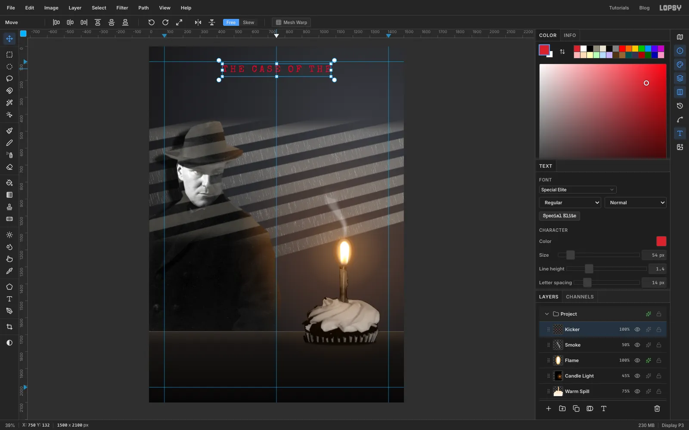

With *Smoke* selected, pick the **Text** tool ([[T]]). In the options bar choose **Special Elite** at **Size 54**, and set the colour to `#D9222E`. Click anywhere in empty canvas, type **THE CASE OF THE** and press [[Tab]] to commit. In the **Text** panel set **Letter spacing** to **14**. Rename the layer *Kicker*.

With the **Move** tool, drag it to the top of the card. Its letters should start at about **y 112** and it should be centred on the middle guide at **x 750**.

## Set the title

Click *Smoke* again first. If the *Kicker* is still active when you change the font, the change restyles the kicker.

With the **Text** tool, choose **Bebas Neue** at **Size 224** with colour `#ECE4D0`. Click in empty canvas lower down, type **SURPRISE PARTY** and press [[Tab]]. In the **Text** panel set **Letter spacing** to **4**, since a new text layer starts with the last spacing you used. Rename the layer *Title*. Move it so the tops of the letters sit at about **y 184**, centred on **x 750**. That leaves a gap of about 35 px under the kicker.

## Slant the title

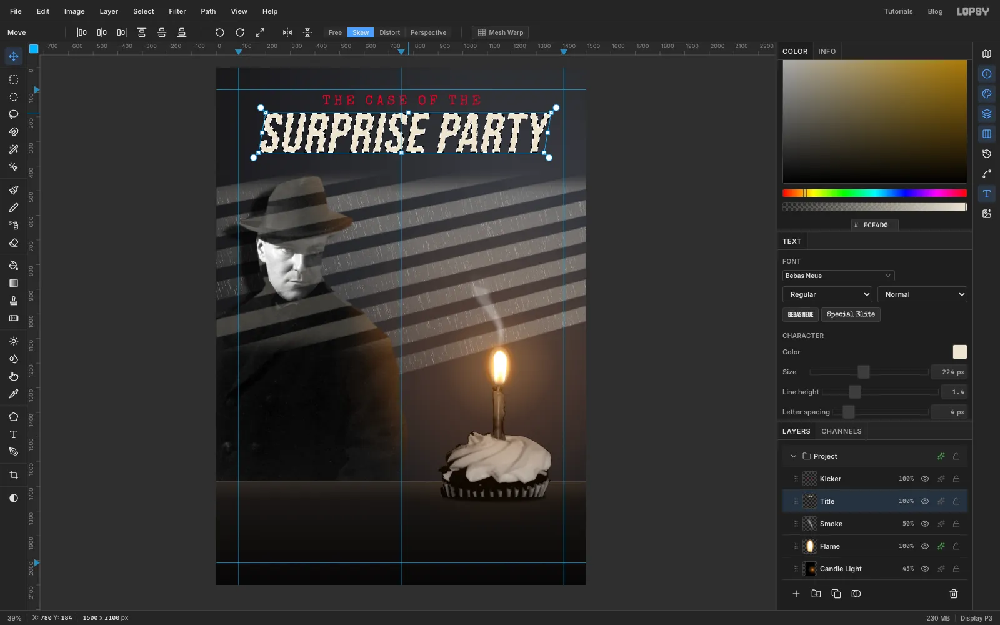

Pulp titles lean forward. Click **Rasterize Layer** at the bottom of the Layers panel, then [[Cmd]]-click the *Title* thumbnail. With the **Move** tool, click **Skew** and drag the handle in the middle of the top edge about **30 px** to the right. Every letter leans by the same amount. Press [[Enter]] and [[Cmd+D]], click **Free**, and nudge the title back so it's centred on **x 750** again.

## Give the title a metal gradient and a shadow

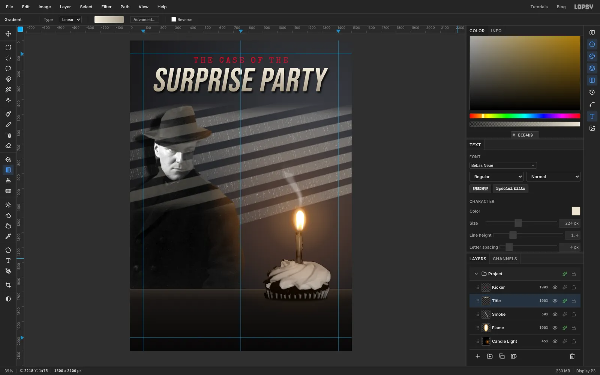

[[Cmd]]-click the *Title* thumbnail again. Make a **Linear** gradient from `#F4EEDF` to `#A59C88` and drag it straight down from the top of the letters to their baseline. Press [[Cmd+D]].

In the layer's effects, turn on **Drop Shadow**: colour black, **Offset X 8**, **Offset Y 12**, **Blur 16**, **Opacity 80**.

## Cut the case-file tag

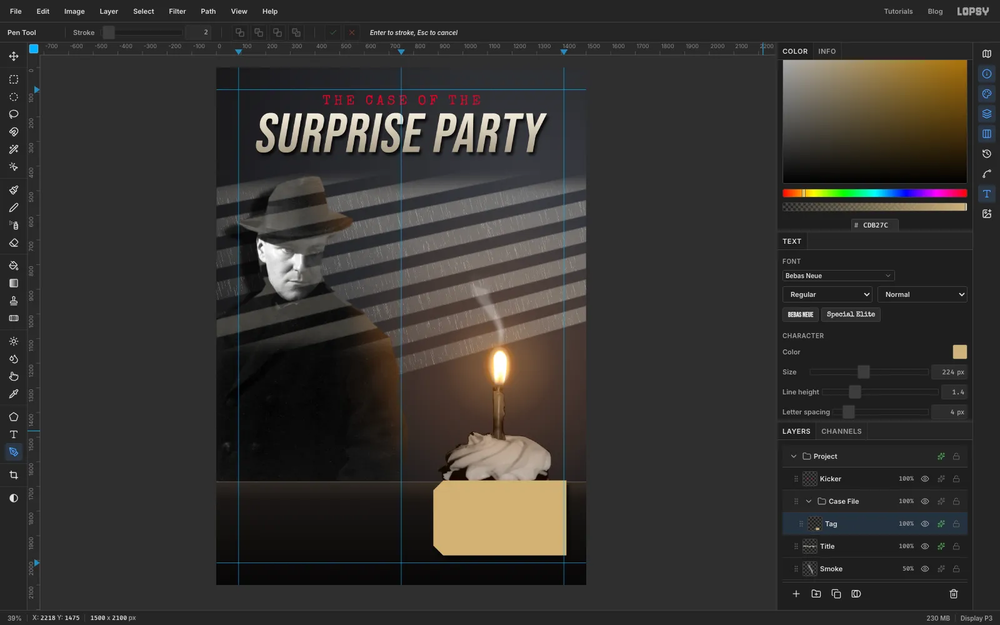

The tag and everything on it go in a group, so you can turn the whole thing at the end. With *Title* selected, click **New Group** and name it *Case File*. Then click **Add Layer** and name the layer *Tag*. It goes inside the group.

With the **Pen** tool, click out a classic shipping-tag shape on the desk, overlapping the bottom of the cupcake: a 540 × 304 px rectangle with its two left corners clipped off at 45°. Mine runs from **x 880** to **x 1420** and **y 1676** to **y 1980**, with 40 px clipped corners, so the six points are (920, 1676), (1420, 1676), (1420, 1980), (920, 1980), (880, 1940) and (880, 1716). Click the first point again to close it.

In the **Paths** panel, click **Path to Selection** and **Delete Path**. Fill with manila `#CDB27C`. For a little paper texture, run **Add Noise** at **Amount 10** with **Mono**. Press [[Cmd+D]] and give the layer a **Drop Shadow**: black, **Offset X 10**, **Offset Y 14**, **Blur 22**, **Opacity 75**.

## Punch the eyelet and tie the string

**Add Layer** and name the layer *Eyelet*. Drag an **Elliptical Marquee** from **x 891, y 1801** to **x 945, y 1855**, a 54 px circle near the tag's left end, and fill it with `#9E8150`. Then drag a smaller circle in the middle of it, from **x 907, y 1817** to **x 929, y 1839**, and press [[Delete]]. Then click *Tag* and press [[Delete]] again, so the hole goes through the tag. Press [[Cmd+D]].

Click *Eyelet*, **Add Layer** and name the layer *String*. Set the foreground colour to `#C9BFA6`. With the **Pen** tool, set **Stroke** to **4** in the options bar. Click in the middle of the hole. Press at about **x 862, y 1930** and drag a little down to curve the string. Then click just below the bottom of the card. Press [[Enter]] to stroke the path. The string drops off the bottom of the card and stays well clear of the tagline.

## Type the case notes

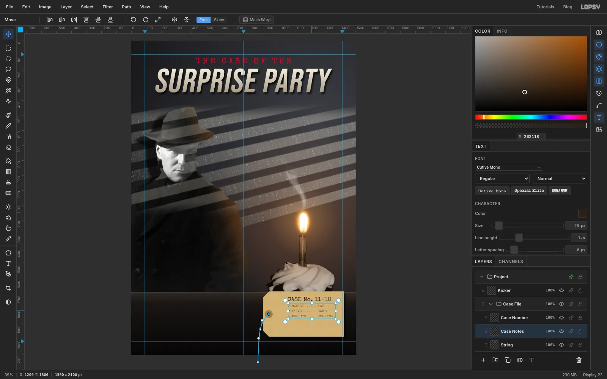

With *String* selected, pick the **Text** tool. Choose **Special Elite** at **Size 40** with colour `#2B2118`, and set **Letter spacing** back to **0**. Type **CASE No. 11-10** in empty canvas, press [[Tab]] and rename the layer *Case Number*. Move it onto the tag at about **x 1046, y 1712**.

Click *String* again. For the notes, switch to **Cutive Mono** at **Size 25**. It's a monospaced typewriter face, so the dot leaders line up. Type these three lines, pressing [[Enter]] between them:

- `SUBJECT .... YOU`
- `MOTIVE ..... CAKE`
- `SUSPECTS ... EVERYONE`

Press [[Tab]], rename the layer *Case Notes* and move it under the case number at about **x 1048, y 1764**. Both blocks now share a left edge, about 90 px in from the eyelet.

## Set the rubber stamp

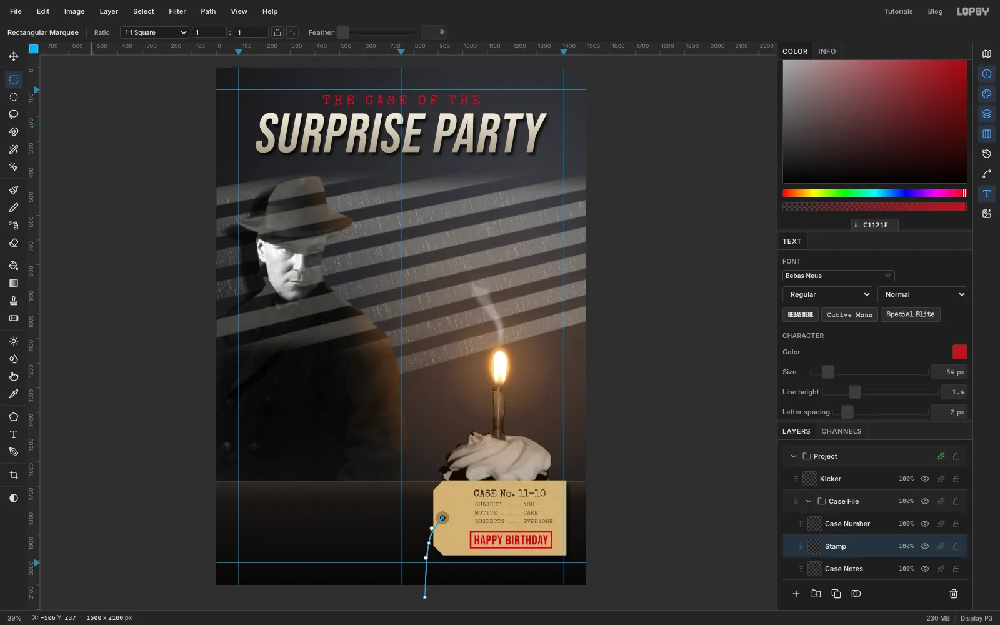

With *Case Notes* selected, click **Add Layer** and name the layer *Stamp*. The empty raster layer keeps the next text from restyling the notes.

With the **Text** tool, choose **Bebas Neue** at **Size 54** with colour `#C1121F` and **Letter spacing 2**. Type **HAPPY BIRTHDAY** and press [[Tab]]. Click **Rasterize Layer**, then move the words onto the tag so they're centred at about **x 1196**, with their tops at **y 1898**. Choose **Layer → Merge Down** to merge them into *Stamp*.

For the frame, drag a **Rectangular Marquee** around the words with a little room to spare, from about **x 1028, y 1881** to **x 1364, y 1952**. Then hold [[Option]] and drag a second marquee just inside it, from **x 1035, y 1888** to **x 1357, y 1945**. The [[Option]] drag cuts it out of the first, leaving a thin ring. Choose **Edit → Fill** with the stamp red and press [[Cmd+D]].

## Wear the stamp down

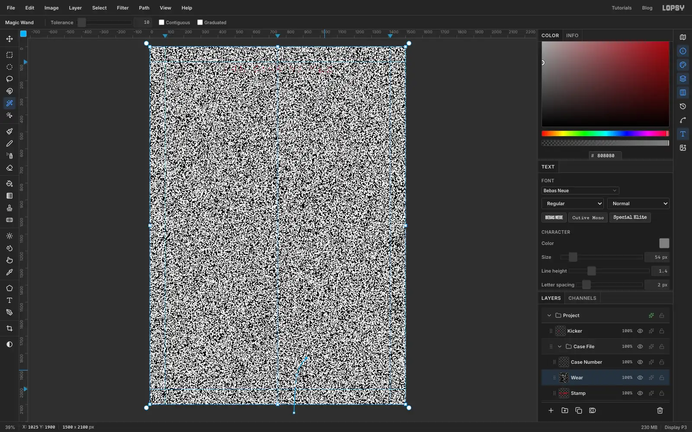

A rubber stamp never prints evenly. **Add Layer** and name the layer *Wear*. Fill it with `#808080`, run **Add Noise** at **Amount 100** with **Mono**, then **Gaussian Blur** at **Radius 3**. Finish with **Threshold**. Pick a level that leaves the white specks as small separate blots rather than one big web. **135** works.

Pick the **Magic Wand** at **Tolerance 10**, untick **Contiguous**, and click any white speck. Every white speck is now selected. Click *Stamp* and press [[Delete]], then [[Cmd+D]]. Delete the *Wear* layer, and tick **Contiguous** again for next time.

## Rotate the stamp and keep it on the tag

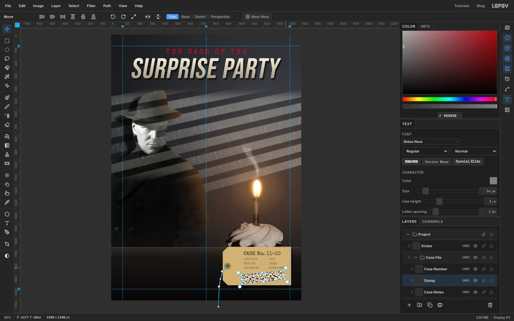

[[Cmd]]-click the *Stamp* thumbnail, pick the **Move** tool and drag a corner rotation handle until the stamp tilts up about **6°** to the right. Press [[Enter]] and [[Cmd+D]].

Rubber stamps don't print past the edge of the paper. [[Cmd]]-click the *Tag* thumbnail, choose **Select → Inverse**, click *Stamp* and press [[Delete]]. Press [[Cmd+D]]. Set the stamp's **Blend** to **Multiply** so the paper grain shows through the ink.

## Turn the whole tag

Click the *Case File* group row and press [[Cmd+D]] so nothing is selected. With the **Move** tool, the handles frame everything in the group. Drag a rotation handle so the tag turns about **4°** counter-clockwise, as if it had been dropped on the desk. Press [[Enter]]. The tag, eyelet, string, notes and stamp all turn together.

## Add the tagline

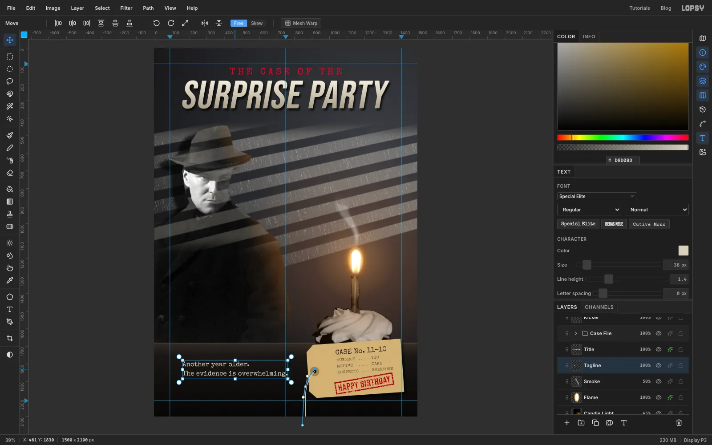

Collapse the *Case File* group and click *Smoke*. With the **Text** tool, choose **Special Elite** at **Size 38** with colour `#D8D0BD` and **Letter spacing 0**. Type **Another year older.**, press [[Enter]], type **The evidence is overwhelming.** and press [[Tab]]. Rename it *Tagline*.

Move it onto the desk so it starts at **x 162**, lined up with the left end of the title, with its top at about **y 1786**. That puts the middle of the two lines level with the middle of the tag.

## Finish with a vignette and film grain

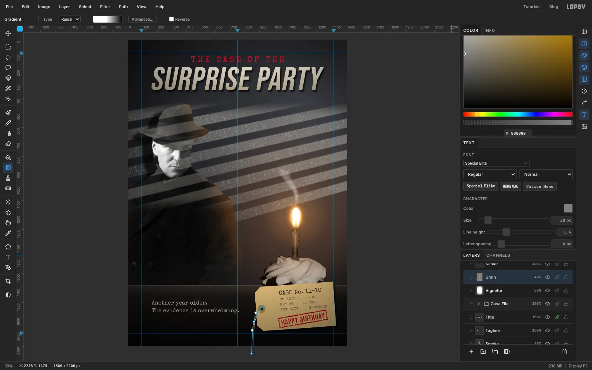

Click the collapsed *Case File* group and **Add Layer** twice, naming the layers *Vignette* and *Grain*. They land above the group but under the *Kicker*, which keeps the small red type crisp and grain-free.

1. On *Vignette*, make a **Radial** gradient with white `#FFFFFF` at the left, white again at about 45% and black at the right. Drag from just right of the middle of the card (about **x 820, y 1000**) out past the bottom-left corner. Set **Blend** to **Multiply**, where white does nothing, and the opacity to **80%**.
2. On *Grain*, fill with `#808080`, run **Add Noise** at **Amount 100** with **Mono**, set **Blend** to **Overlay** and the opacity to **40%**.

The grey grain disappears in Overlay except as a fine film texture. Save with **File → Save Project** and export with **File → Quick Export PNG**.
