Film noir is mostly a lighting style. A few habits do the work:

- **one hard light in a lot of dark**, so shapes read as silhouettes
- **weather you can see the light in**: fog, rain, wet pavement
- **shadows of things that aren't in the picture**, like the bars of a window blind
- **black and white with one colour**, used sparingly

You'll use all four on a **2400 × 1000 px** billboard for a made-up detective agency, Yardley & Lowe. The detective isn't drawn. He's cut out of a frame from *The Big Combo* (1955), a noir that is in the public domain. Download the frame from Wikimedia Commons before you start: [BigComboTrailer.jpg](https://commons.wikimedia.org/wiki/File:BigComboTrailer.jpg).

The tools you'll use:

- the **Gradient** tool, on layers and on **layer masks**
- the **Clouds**, **Gaussian Blur**, **Threshold**, **Add Noise** and **Motion Blur** filters
- the **Lasso**, **Elliptical Marquee** and **Magic Wand**, with **Feather** and [[Shift]] to add
- the **Pen** for the lamp post and the **Pencil** with [[Shift]]-click for straight lines
- the Move tool's handles: scale, **Flip Vertical**, **Distort**, **Skew** and rotating a group
- the **Text** tool with four Google fonts, one of them recoloured a single character at a time
- ruler **guides** and the **grid**
- **Stroke** and **Outer Glow** layer effects, the **Screen** and **Overlay** blend modes, and group **adjustments**

The palette is blue-black and fog grey with one red:

- Night `#2B3542` → `#111821` → `#040609`
- Pavement `#1A222B` → `#0A0E13` → `#030405`
- Lamp light `#E6EEF5`, fog light `#C9D6E2`, pool `#E3ECF4`
- Silhouette `#030405`, lamp post `#05070A`, rim light `#A9BDCE`, post highlight `#6E8496`
- Bulb `#F6FAFD`, bulb glow `#CFE0EE`, pool edge `#B9C8D6`, cold filter `#4F7FB0`
- Bone `#ECE6D8` (name, subtitle, tagline, phone number)
- Red `#E0263A`, neon edge `#FF2A3C`, neon core `#FFE4E0`
- Blind light `#C8D4E0`

The type is **Big Shoulders** for the name and the phone number, **Special Elite** for the tagline, and **Yellowtail** and **Tilt Neon** for the sign. All four are in the Text tool's font list, so there's nothing to install.

## Paint the night

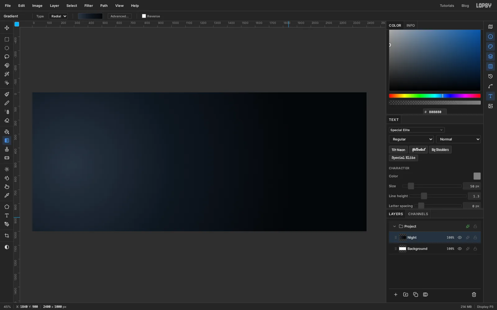

Choose **File → New** and make a document **2400 × 1000** pixels. Rename *Layer 1* to *Night*.

Pick the **Gradient** tool, set **Type** to **Radial** and click **Advanced…**. Give it three stops: `#2B3542` at the start, `#111821` a little before the middle and `#040609` at the end. Click **Done**.

Drag from the left side of the canvas, about halfway down, to the bottom right. The light part of the gradient is where the street lamp will go, so the scene already has a bright side and a dark side.

## Make fog with Clouds

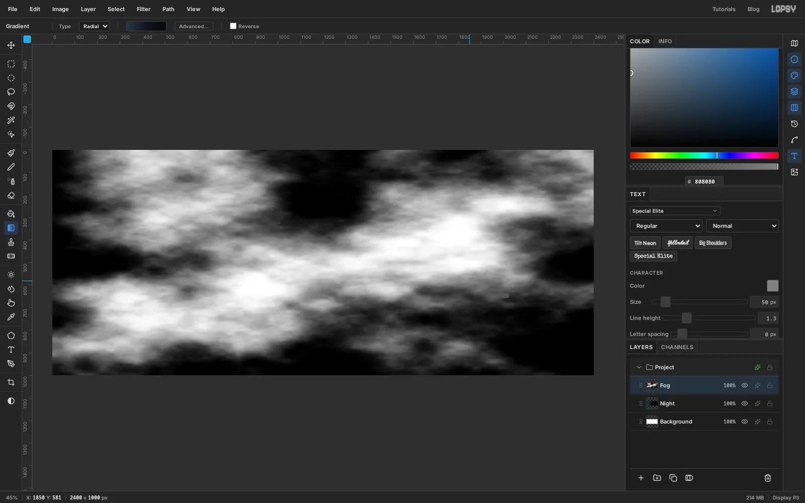

Add a layer and call it *Fog*. Choose **Filter → Clouds…**, set **Scale** to **4** and click **Apply**.

The pattern is random, so yours will look different from this one. If you get a pattern you don't like, press [[Cmd+Z]] and apply the filter again.

Now soften it. Choose **Filter → Gaussian Blur…** with **Radius 10**. Open the layer's effects (the sparkle icon on its row), set **Blend** to **Screen** and close the drawer. Click the layer's **100%** and drag the slider down to **30%**. Screen only lets the light parts of the layer through, so the black disappears and the white becomes mist.

## Keep the fog on the left

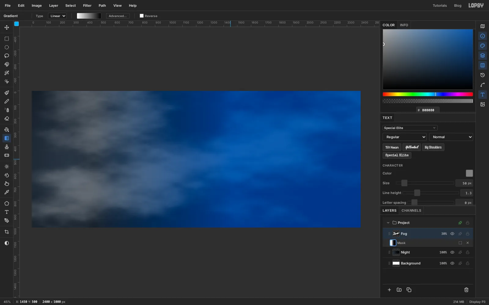

The right side of the billboard is for type, and it should stay dark.

With *Fog* active, click **Add Mask** at the bottom of the Layers panel. You're now painting on the mask instead of the layer. Take the **Gradient** tool, set **Type** to **Linear** and open **Advanced…**. Click the middle stop and delete it, then make the first stop white and the last one black. Drag from about a fifth of the way across the canvas to a little past the middle.

The blue tint shows what the mask hides. Click the *Fog* row to leave the mask, and the tint goes away.

## Lay the pavement

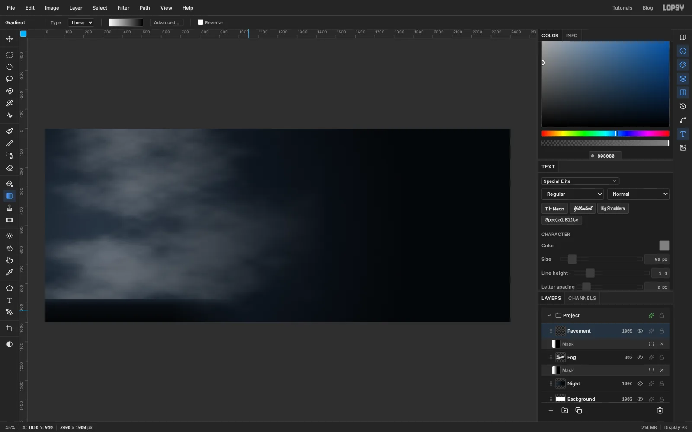

Add a layer called *Pavement*. With the **Rectangular Marquee**, select a strip across the bottom of the canvas about **120 px** tall.

Open the gradient editor and set three stops: `#1A222B` at the start, `#0A0E13` about a quarter of the way along (click the bar to add a stop), and `#030405` at the end. Drag from the top of the strip to the bottom, then press [[Cmd+D]] to deselect.

A hard horizon line running the full width would cut through the type later. So add a mask to this layer too. Set the gradient back to two stops, white → black, as you did for the fog, and drag from under where the lamp will be to just past the middle of the canvas. Click the *Pavement* row when you're done.

## Draw the cone of light

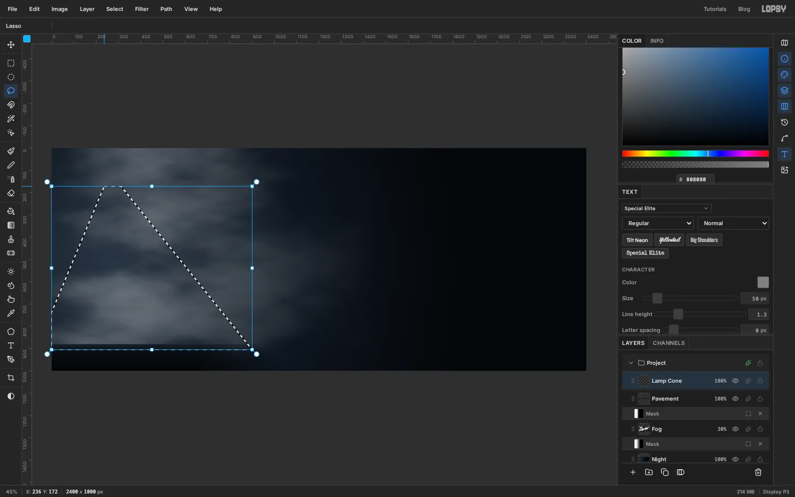

Add a layer called *Lamp Cone*. With the **Lasso**, draw a tall shape that is narrow at the top, about 80 px wide, and spreads out to the ground. Take the bottom-left corner all the way to the left edge of the canvas. It doesn't need to be neat, because the next step blurs the edge.

Choose **Select → Feather…**, enter **28** and click **Apply**. Feathering blurs the edge of the selection, so whatever you put in it will have soft sides.

## Fill the cone with a fading gradient

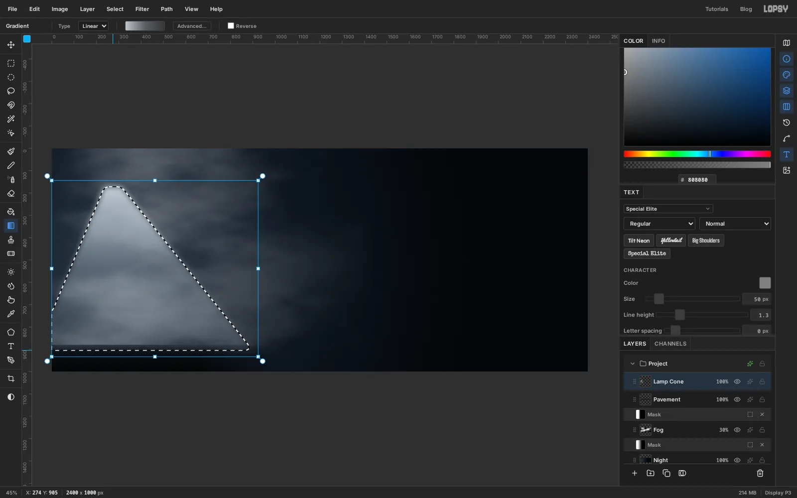

Open the gradient editor again. Set the first stop to `#E6EEF5` and drag its opacity down to about **80%**. Add a middle stop of `#C9D6E2` at about **32%** opacity, and make the last stop `#C9D6E2` at **10%**.

Drag straight down from the top of the selection to the bottom. Deselect, then set the layer's blend mode to **Screen**. The fog shows through the light now, which is what makes it look like a beam and not a grey triangle.

## Add a pool of light on the ground

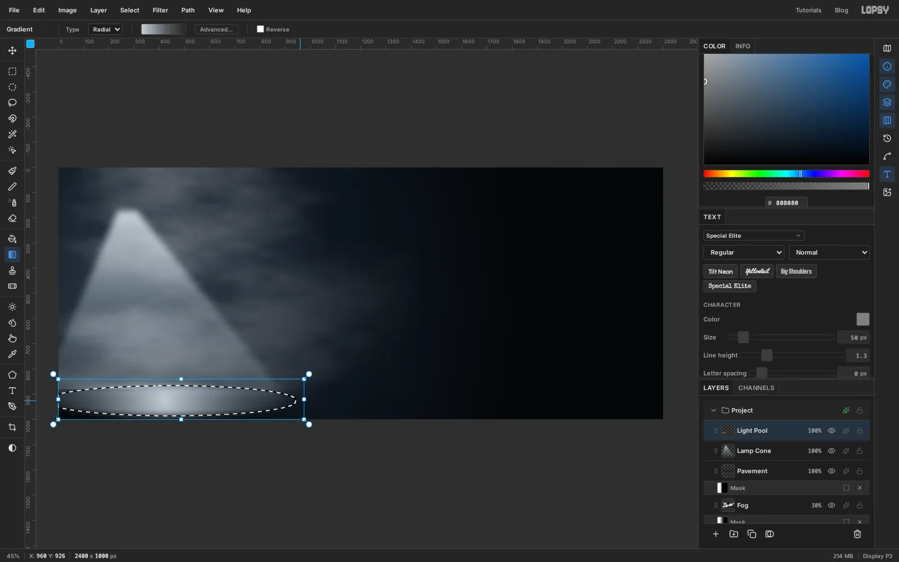

Add a layer called *Light Pool*. With the **Elliptical Marquee**, drag a wide, flat ellipse across the pavement under the cone. Feather it by **26**.

Switch the gradient to **Radial** with stops of `#E3ECF4` at **85%**, `#B9C8D6` at **35%** just past the middle, and `#B9C8D6` at **0%**. Drag from the centre of the ellipse out to its right edge. Deselect and set the layer to **Screen**.

## Draw the lamp post with the Pen

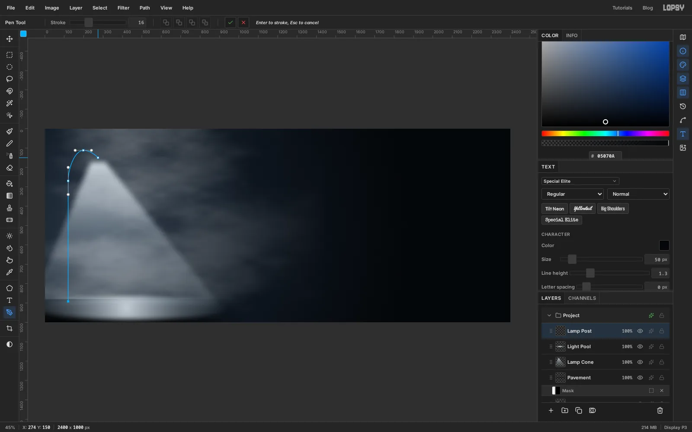

Add a layer called *Lamp Post* and set the foreground colour to `#05070A`. Pick the **Pen** tool and set **Stroke** to **16**.

The post takes four anchors:

1. Click on the pavement, well to the left of the cone.
2. Straight above it, about a quarter of the way down the canvas, click and drag **upward** a short way. Dragging pulls out handles, which turns the corner into a curve.
3. Up and to the right, click and drag **to the right**. This is the top of the arc.
4. Click once at the narrow top of the cone.

Press [[Enter]]. The path is stroked onto the layer in the foreground colour.

> **Tip:** The blue path stays on screen after you stroke it. Open the **Paths** panel and click the path's row to deselect it.

## Finish the lamp

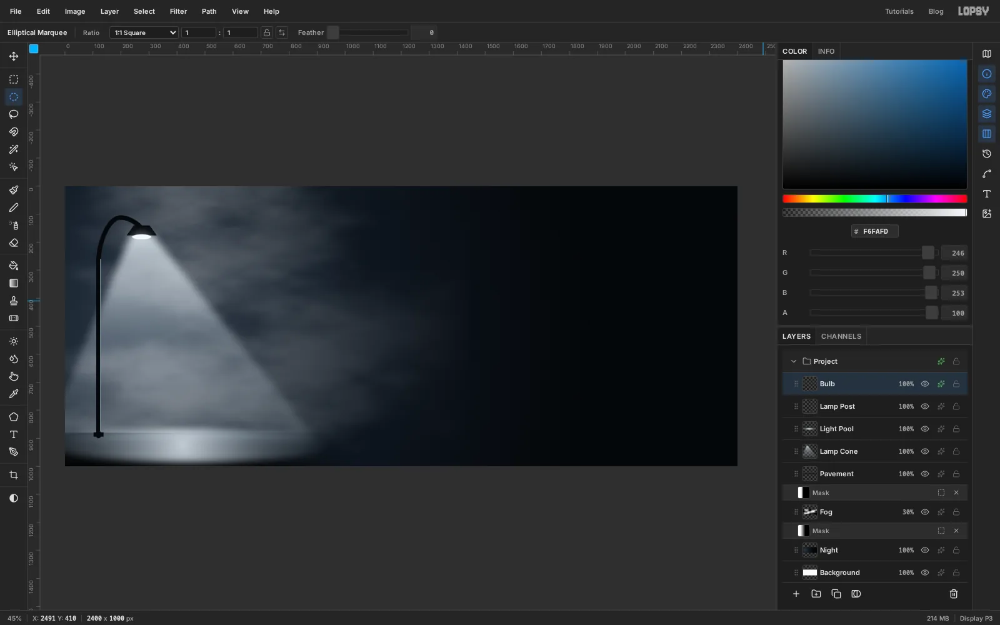

Still on *Lamp Post*, use the **Lasso** to draw a small shade over the end of the arm, wider at the bottom than the top. Choose **Edit → Fill**. Marquee a small foot at the base of the post and fill that too, then press [[Cmd+D]].

The post is lit from the right, so give it a highlight. Set the foreground colour to `#6E8496`, pick the **Pencil** and set **Size** to **3**. Click just inside the right edge of the post near the ground, then [[Shift]]-click near the top of the straight part. Shift-click draws a straight line from the last point.

For the bulb, add a layer called *Bulb*. Set the foreground colour to `#F6FAFD`, select a small flat ellipse under the shade with the **Elliptical Marquee**, choose **Edit → Fill** and deselect. Open the layer's effects, turn on **Outer Glow**, and set **Size 46**, **Opacity 85** and the colour `#CFE0EE`.

## Bring in the film still

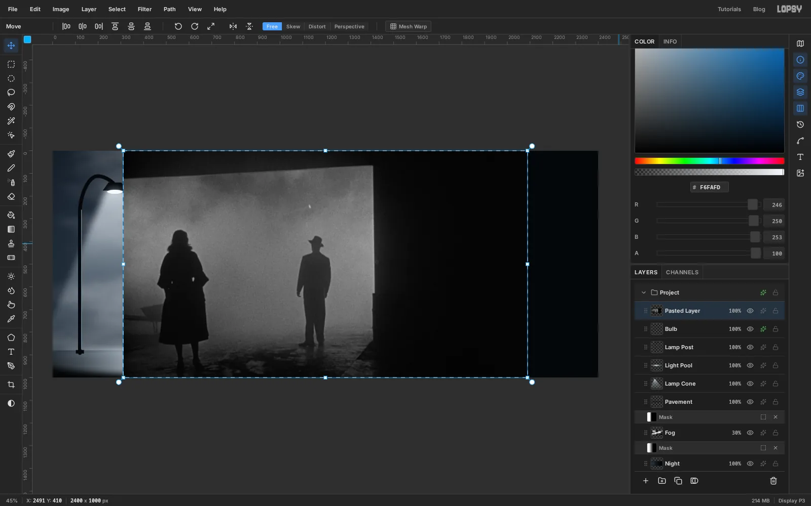

Drag *BigComboTrailer.jpg* from your computer onto the canvas. It arrives as a new layer, scaled down to fit the canvas and already selected. Press [[Cmd+D]] and rename the layer *Detective*.

You want the man on the right. He's standing with his back to the camera, which is ideal: there's no face to get wrong.

## Cut out the man

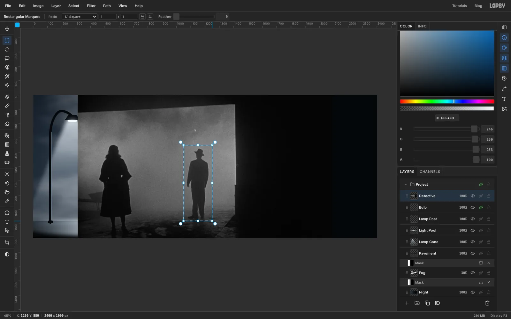

With the **Rectangular Marquee**, drag a box around the man. Leave some fog on every side, and take it a little below his shoes.

Choose **Select → Inverse** and press [[Delete]]. Everything but the box is gone. Deselect.

## Turn him into a silhouette with Threshold

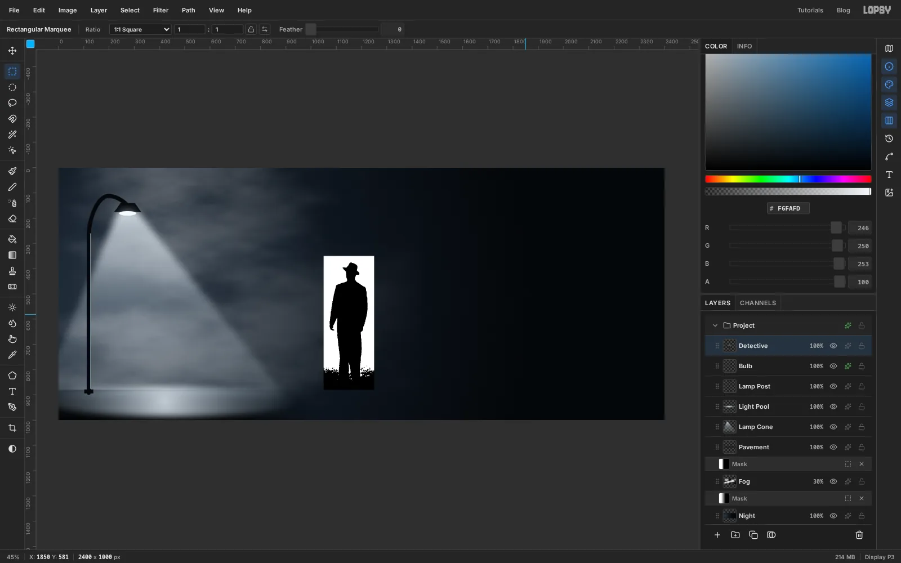

Film grain makes a ragged edge, so blur it away first: **Filter → Gaussian Blur…** with **Radius 2**.

Then choose **Filter → Threshold…**. Threshold turns every pixel black or white, depending on which side of the level it falls. Turn on **Preview** and set **Level** to about **84**, moving the slider until the man is solid black and the fog is solid white. If his shoulders start to break up, the level is too low.

## Delete the white with the Magic Wand

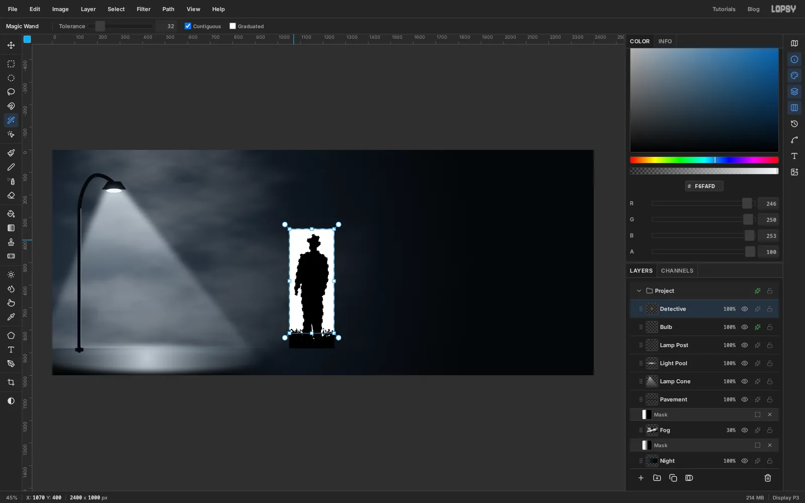

Pick the **Magic Wand** and click anywhere in the white. Press [[Delete]], then deselect. The man now stands on the fog you painted earlier.

## Trim the floor

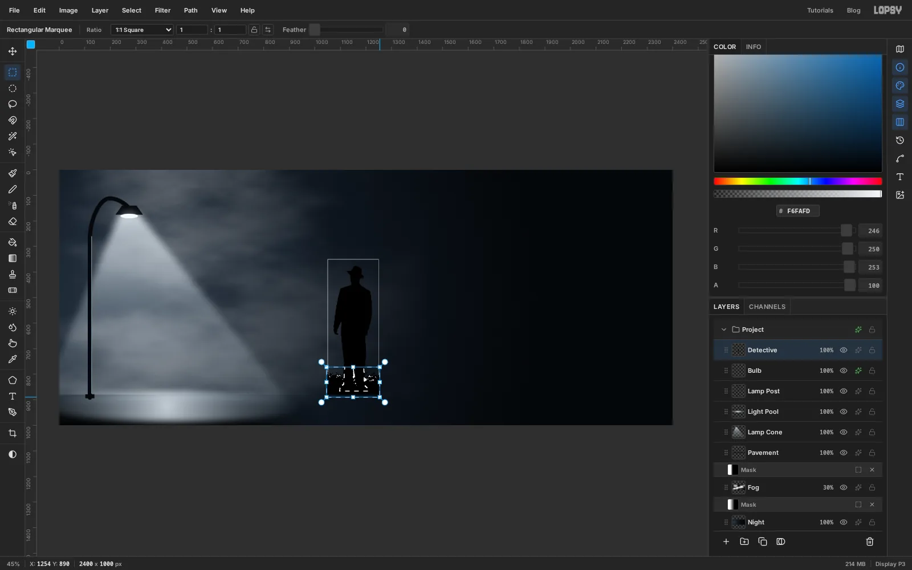

The dark floor in the photo came through Threshold as a black slab around his shoes.

With the **Lasso**, draw around the floor to the left of his legs, following the outside of the trouser leg and the shoe. Hold [[Shift]] and do the same on the right. Holding Shift adds to the selection. Switch to the **Rectangular Marquee**, hold [[Shift]] again and add a strip under his soles. Press [[Delete]] and deselect.

There's one more leftover: a faint line around where the box used to be, from the blur. Click the man's body with the **Magic Wand**, choose **Select → Inverse**, press [[Delete]] and deselect.

## Fill him solid

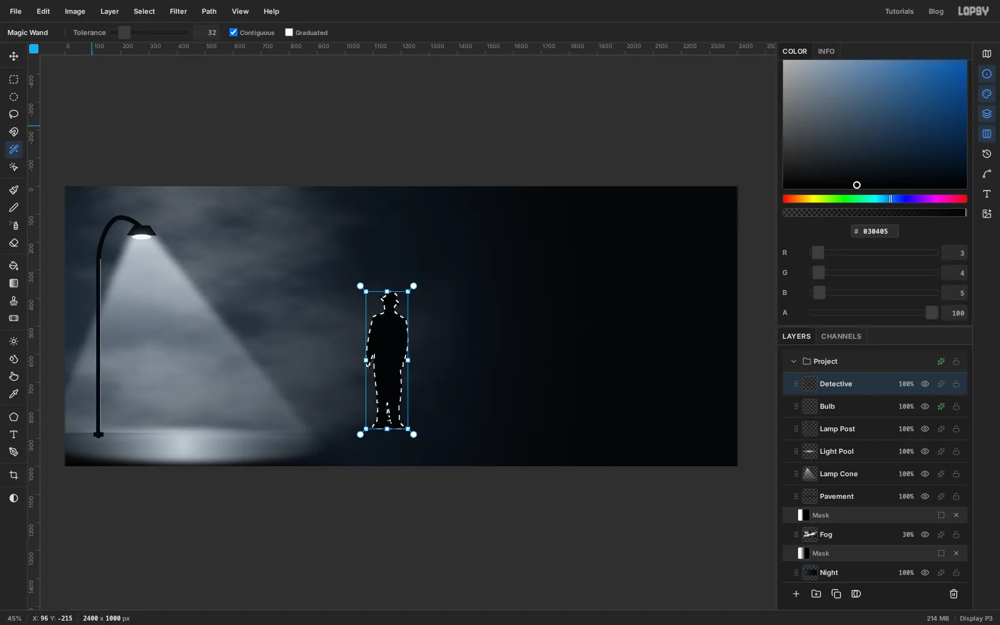

Hold [[Cmd]] and click the *Detective* layer's thumbnail. This selects everything on the layer that isn't transparent. Set the foreground colour to `#030405` and choose **Edit → Fill**. Any white specks inside the figure are covered.

Keep the selection for the next step.

## Scale him up

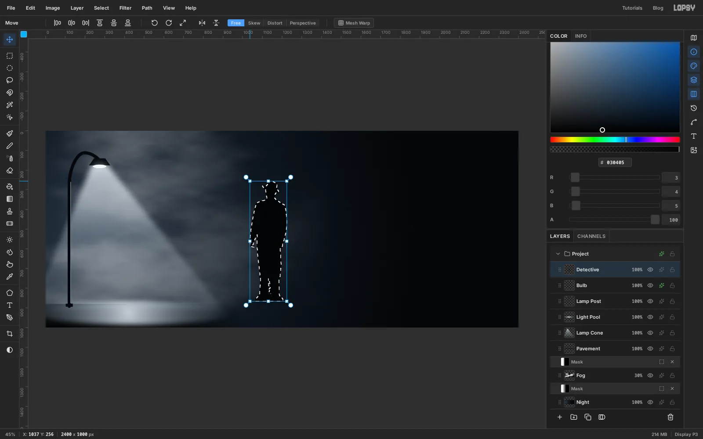

Pick the **Move** tool. Handles appear around the selection. Hold [[Cmd]], which keeps the proportions, and drag the top-left corner handle up and to the left until he's about a quarter taller. Press [[Cmd+D]] to commit.

Scaling a black and white cut-out leaves a stepped edge, so run **Filter → Gaussian Blur…** at **Radius 1** to smooth it.

## Stand him under the lamp

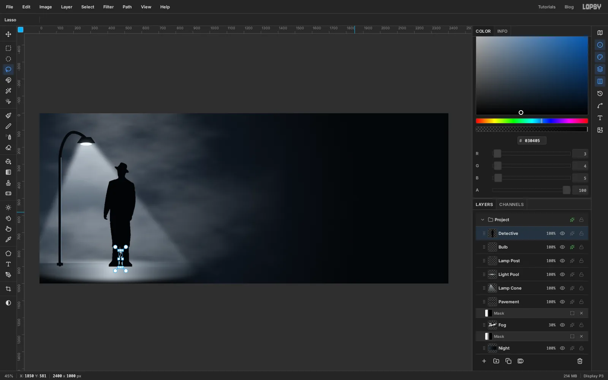

With the **Move** tool, drag him into the cone, a little to the right of its centre, with his soles on the top edge of the light pool.

His legs are still one block. With the **Lasso**, draw a thin wedge from the ground up between his shoes to about knee height. Feather it by **1**, press [[Delete]] and deselect. He has two legs now.

## Add a rim of light

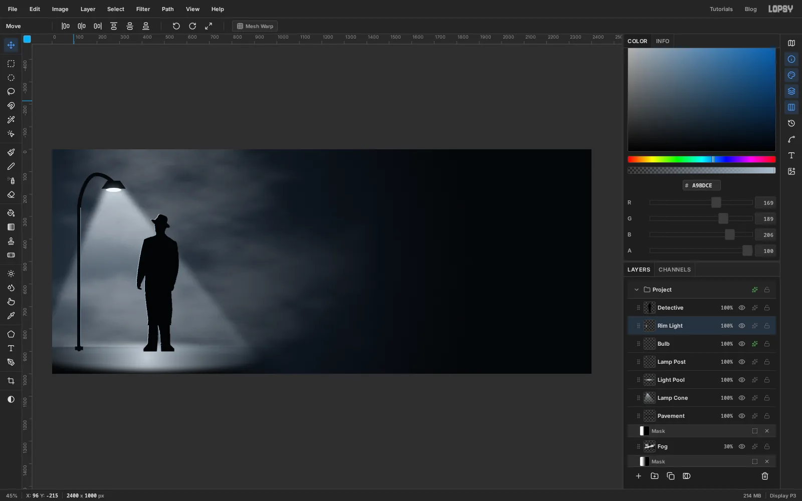

A black shape with no edge light looks pasted on. The lamp is up and to the left, so the left side of his hat, shoulder and arm should catch it.

Choose **Layer → Duplicate Layer**. The copy lands on top, named *Detective copy*. Rename the original underneath it to *Rim Light*, and rename *Detective copy* to *Detective*.

Click *Rim Light*, [[Cmd]]-click its thumbnail, set the foreground colour to `#A9BDCE`, choose **Edit → Fill** and deselect. Pick the **Move** tool and press [[←]] three times and [[↑]] twice. The pale copy now peeks out from behind the black one on the side that faces the lamp.

## Flip a copy for the shadow

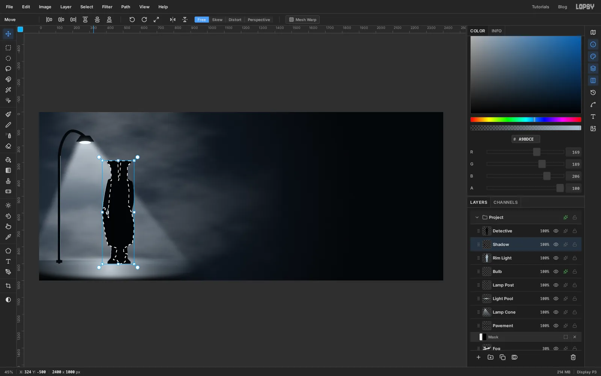

Click *Detective* and duplicate it again. As before, rename the original underneath to *Shadow* and the copy on top to *Detective*.

On *Shadow*, [[Cmd]]-click the thumbnail and pick the **Move** tool. Click **Flip Vertical** in the options bar. The copy is now standing on its head.

## Lay the shadow on the ground with Distort

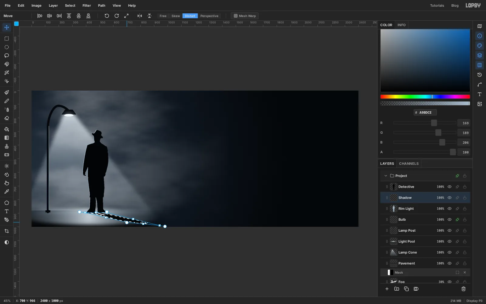

In the options bar, switch the transform mode from **Free** to **Distort**. In Distort, each corner handle moves on its own.

1. After the flip, the top of the box is his feet. Drag the two **top** corners straight down to his shoes, one to the outside of each shoe.
2. Drag the **bottom-right** corner down and far out to the right, stopping just inside the bottom edge of the canvas.
3. Drag the **bottom-left** corner out to the right as well, but not as far and not as low.

The shadow should start at both feet and run away from the lamp. Switch the mode back to **Free** and press [[Cmd+D]].

Then finish it:

1. Run **Gaussian Blur** at **Radius 4**.
2. Click **Add Mask**. Set the gradient to **Linear** with two stops, white and dark grey (`#303030`), both at full opacity.
3. Drag from his feet to the tip of the shadow, so it fades as it gets further from him.
4. Click the *Shadow* row and lower its opacity to **88%**.

## Group the scene

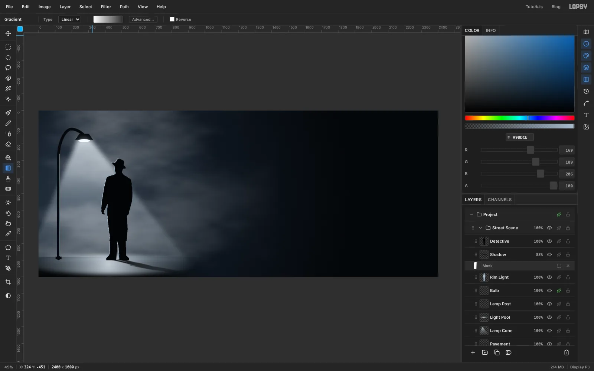

Click *Detective* in the Layers panel, then [[Shift]]-click *Pavement* to select every layer between them. Choose **Layer → Group Layers** and rename the group *Street Scene*.

Grouping keeps the Layers panel short, and it lets you hide or move the whole scene at once.

## Set the first line of the name

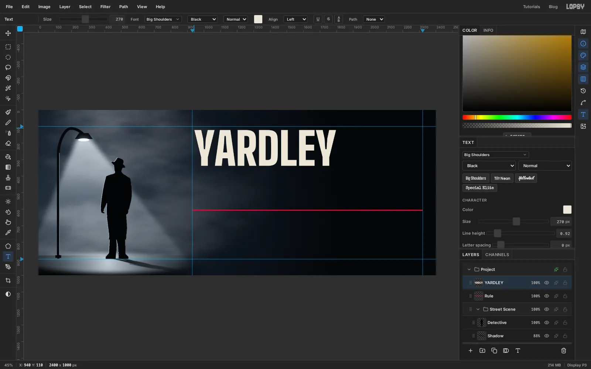

First set up guides. Click once in the **top ruler** at **930** and again at **2320**: those are the left and right edges of the type. Click in the **left ruler** at **100** and **902** for the top and bottom. The bottom guide lines up with the detective's feet.

Then draw the red rule, because everything else hangs off it. Click the *Street Scene* group and add a layer called *Rule*. A new layer lands inside the group, so drag its row up above *Street Scene*.

Set the foreground colour to `#E0263A`, pick the **Pencil** at **Size 6**, click on the left guide about 600 px down and [[Shift]]-click on the right guide at the same height.

Now the name. Set the foreground colour to `#ECE6D8` and pick the **Text** tool. In the options bar set **Size** to **270**, choose **Big Shoulders** from the font list and set the weight to **Black**. Click in the empty space near the top and type **YARDLEY**. In the **Text** panel, set **Line height** to **0.92** so the second line will sit close under the first.

> **Tip:** Set the size and font *before* you click. If a text layer is active, changing them restyles that layer.

## Add the second line and colour the ampersand

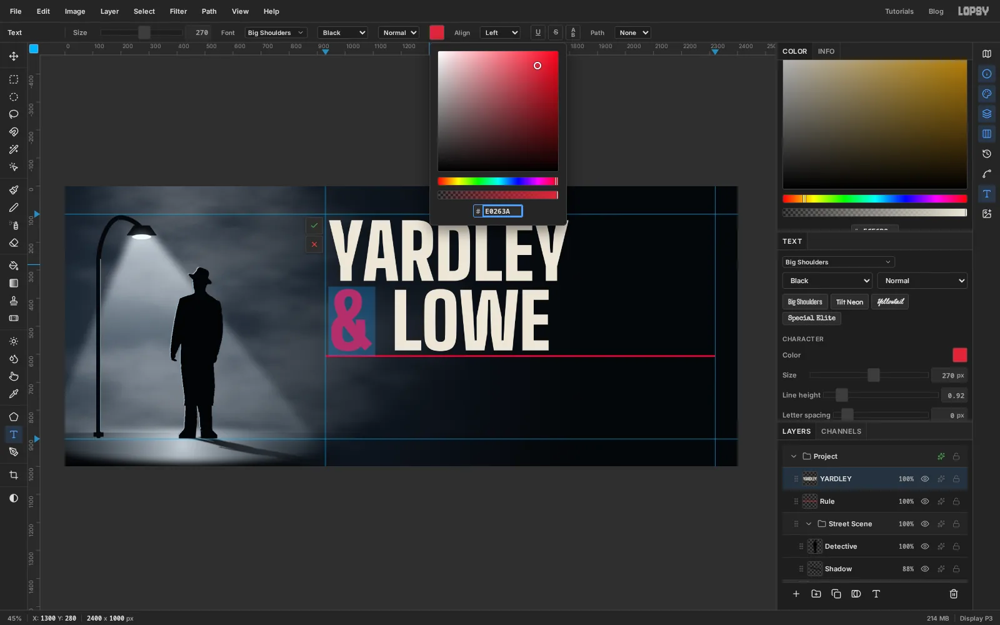

Still typing, press [[Enter]] and type **& LOWE**.

Press [[Home]] to jump to the start of the line, then [[Shift+→]] to select only the ampersand. Click the **Text color** swatch in the options bar, type `E0263A` into the hex field and press [[Enter]]. Only the selected character changes. Press [[Esc]] to close the picker and [[Tab]] to commit the text.

Pick the **Move** tool and use the arrow keys to seat the block: the left edge of the Y on the left guide and the tops of the letters on the top guide. Hold [[Shift]] to move 10 px at a time.

## Add the subtitle

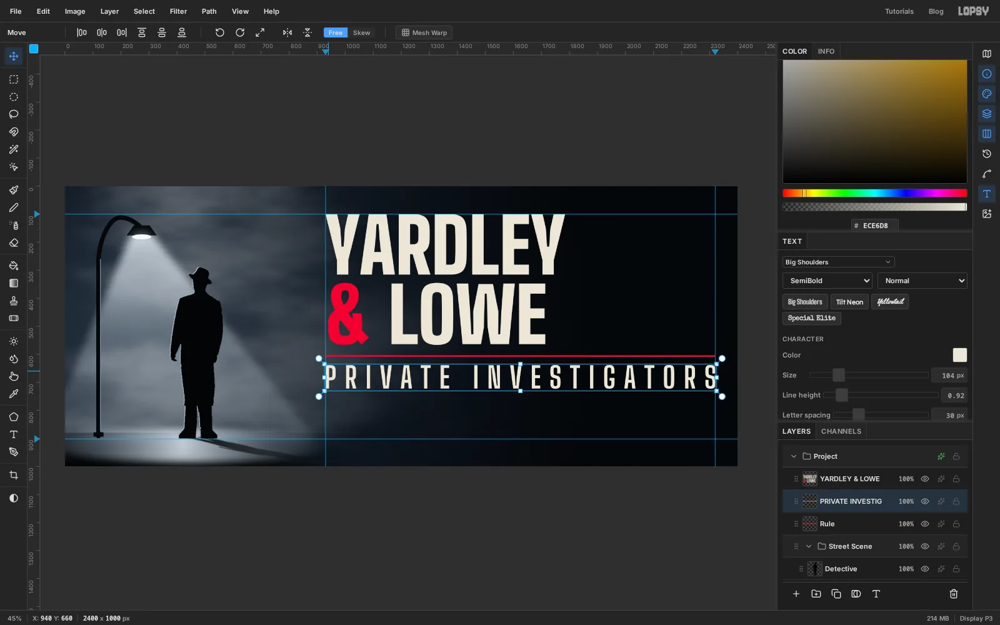

Click the *Rule* layer first, so you don't restyle the name. With the **Text** tool, keep **Big Shoulders**, set **Size** to **104** and the weight to **SemiBold**, then click in empty space below the rule and type **PRIVATE INVESTIGATORS**. Press [[Tab]].

In the Text panel, raise **Letter spacing** until the line is as wide as the rule. Here that's **30**. Nudge it with the Move tool so the P sits on the left guide and the line hangs about 30 px under the rule.

## Type the tagline

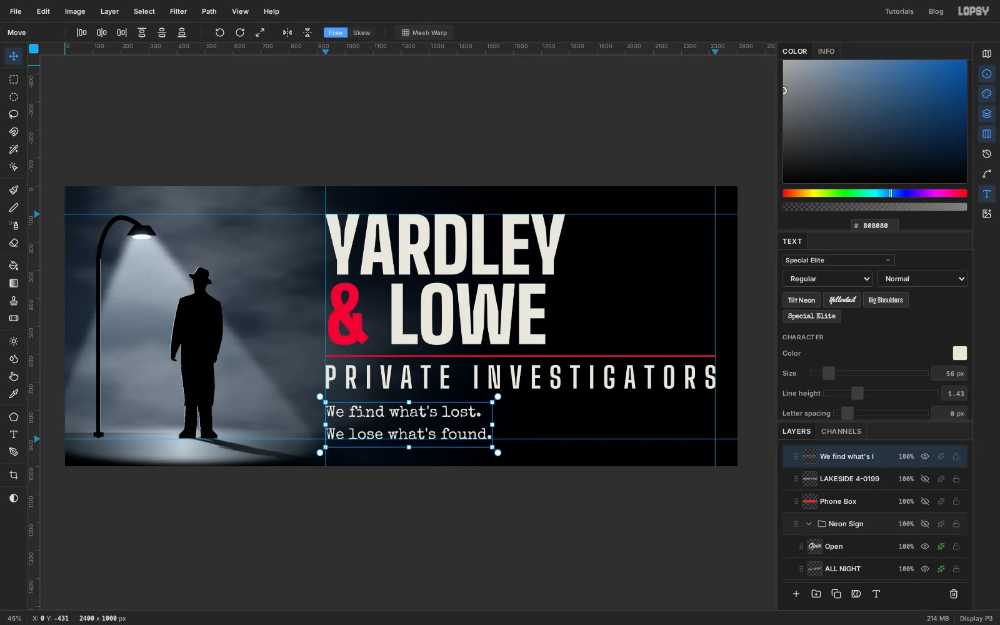

Click *Rule* again. With the **Text** tool, choose **Special Elite**, weight **Regular**, at **Size 56**. In the Text panel set **Letter spacing** back to **0** and **Line height** to **1.43**.

Click below the subtitle and type **We find what's lost.**, press [[Enter]], and type **We lose what's found.** Press [[Tab]].

Move it so the W sits on the left guide and the bottom of the second line rests on the bottom guide. The wide line height is what lets the two lines fill the same height as the phone panel you'll draw next.

## Draw the phone panel

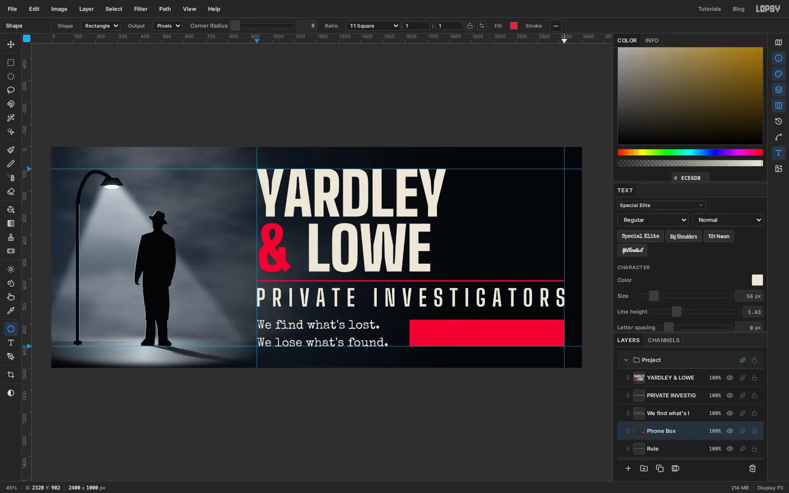

Click *Rule* and add a layer called *Phone Box*. Pick the **Shape** tool and set **Shape** to **Rectangle**. Click the **Fill** swatch and enter `#E0263A`. If the shape has a stroke, click its swatch and choose **Remove stroke**.

The Shape tool draws **from the centre outward**. Start the drag where the middle of the panel should be and pull out to the corner where the right guide and the bottom guide cross. The corner snaps to the guides. Aim for a panel about 700 px wide and as tall as the two lines of tagline.

## Seat the phone number

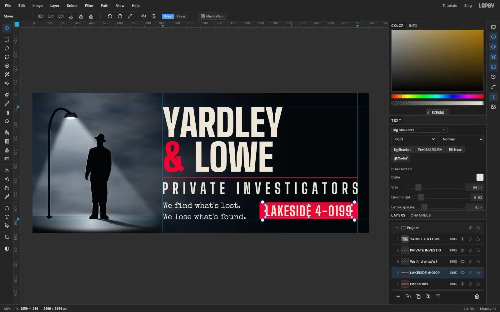

Click *Phone Box*, then pick the **Text** tool. Set **Big Shoulders**, **Bold**, **Size 96**, and in the Text panel **Letter spacing 4** and **Line height 0.92**. Click in the empty space in the top right, well away from the other text, and type **LAKESIDE 4-0199**. Press [[Tab]].

A click on existing text edits it, which is why you type somewhere empty and move it afterwards.

Drag the number into the panel with the **Move** tool and finish with the arrow keys. Check all four sides: the gap to the left of the L should match the gap to the right of the last 9, and the gap above the letters should match the gap below. There are no letters that drop below the line here, so the capitals can sit exactly in the middle.

## Paint the neon's spill on the wall

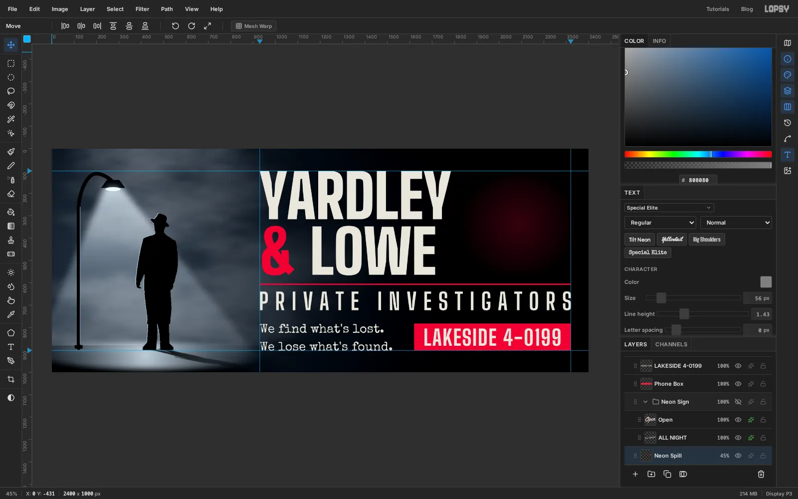

Neon lights up the wall behind it, so paint that first. Click *Rule* and add a layer called *Neon Spill*. With the **Elliptical Marquee**, drag an ellipse over the empty space to the right of the name and feather it by **60**. Set the gradient to **Radial** with two stops, `#E0263A` at **55%** opacity and `#E0263A` at **0%**, and drag from the centre of the ellipse to its edge. Deselect, set the layer to **Screen** and lower it to **45%**.

## Set the sign's two words

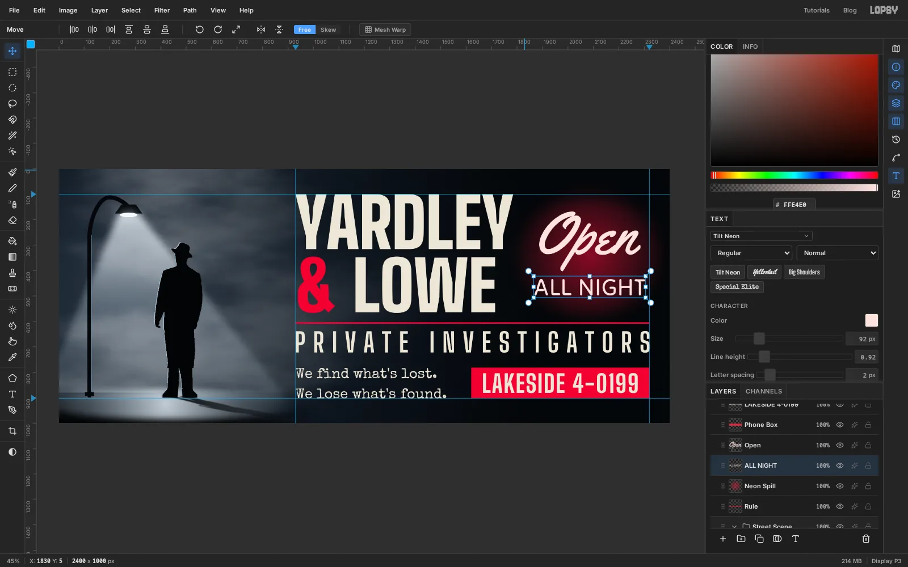

Set the foreground colour to `#FFE4E0`.

1. Click *Neon Spill*. With the **Text** tool choose **Yellowtail**, **Regular**, **Size 230**, and set **Letter spacing** to **0**. Click in empty space, type **Open** and press [[Tab]].
2. Click *Neon Spill* again. Choose **Tilt Neon** at **Size 92** with **Letter spacing 2**. Click in empty space, type **ALL NIGHT** and press [[Tab]].

Stack them with the Move tool: *Open* above, *ALL NIGHT* about 30 px below it and centred under it.

## Rotate the sign as a group

Click *ALL NIGHT* and [[Shift]]-click *Open*, choose **Layer → Group Layers** and name the group *Neon Sign*.

With the group selected and the **Move** tool active, one set of handles frames both words. Move the pointer just outside a corner until you can grab the round rotation handle, and drag it anticlockwise by about **6°**. Both layers turn together around their shared centre, and both stay editable as text. Press [[Cmd+D]].

## Light the neon

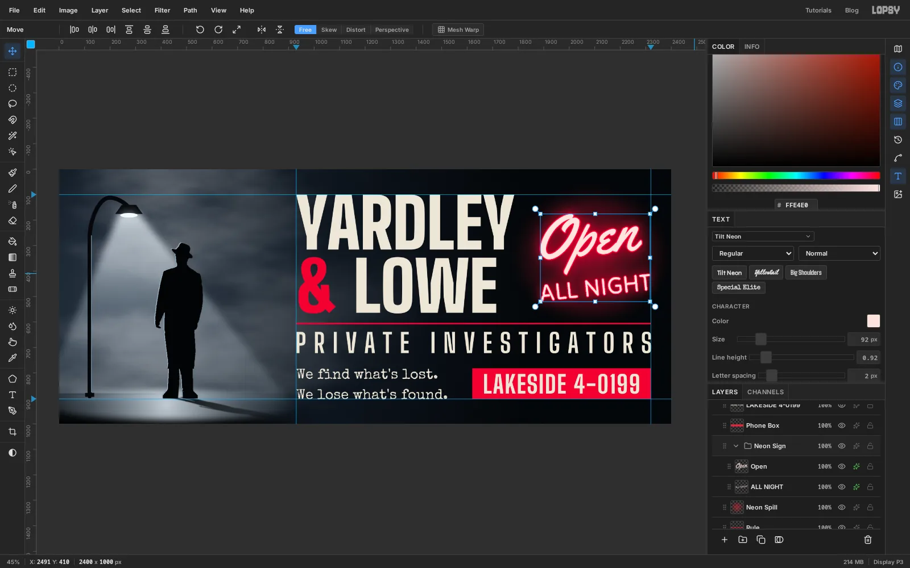

A real neon tube is almost white in the middle and coloured at the edge. Two effects on each word give you that.

Open the effects for *Open*. Turn on **Stroke** with the colour `#FF2A3C` and **Width 4**. Turn on **Outer Glow** with the colour `#E0263A`, **Size 70** and **Opacity 95**. Do the same for *ALL NIGHT* with **Width 3** and **Size 55**.

Select the *Neon Sign* group and nudge it with the arrow keys until the T of NIGHT touches the right guide.

## Mark out the blind with the grid

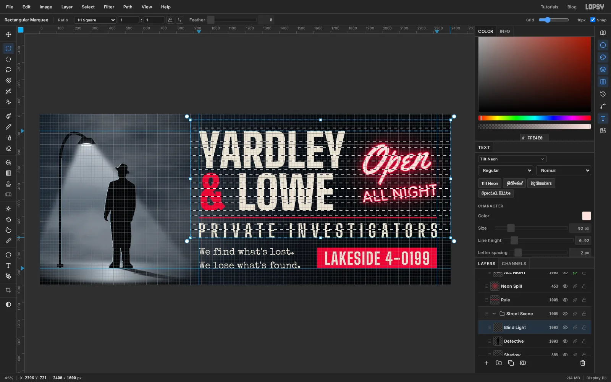

The last piece of light is the shadow of a window blind falling across the wall.

Click the *Street Scene* group and add a layer called *Blind Light*. Choose **View → Show Grid**. Pick the **Rectangular Marquee** and make sure **Snap** is ticked at the right of the options bar. Marquees now snap to the grid, which makes evenly spaced bars easy.

Drag a bar three grid squares tall from just left of the name to the right edge of the canvas. Hold [[Shift]] and drag another the same height, two squares below it. Keep going until you have nine. If you forget Shift, the new bar replaces all the others: press [[Cmd+Z]] and carry on.

Set the foreground colour to `#C8D4E0` and choose **Edit → Fill**, then choose **View → Show Grid** again to hide the grid.

## Slant the bars with Skew

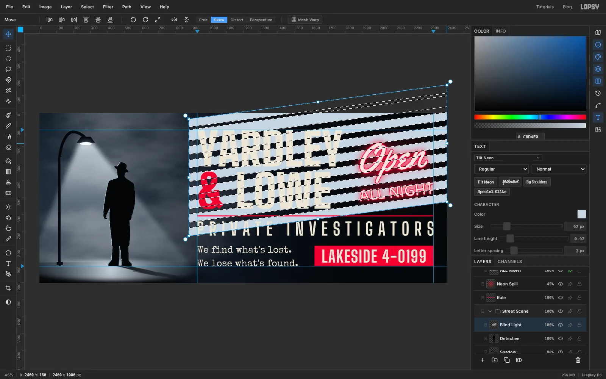

Keep the selection. Pick the **Move** tool and switch the transform mode to **Skew**. Drag the handle in the middle of the **right** side upward by about 200 px. The right ends of the bars rise and the left ends stay put.

Switch back to **Free** and press [[Cmd+D]].

## Fade the bars and clear the sign

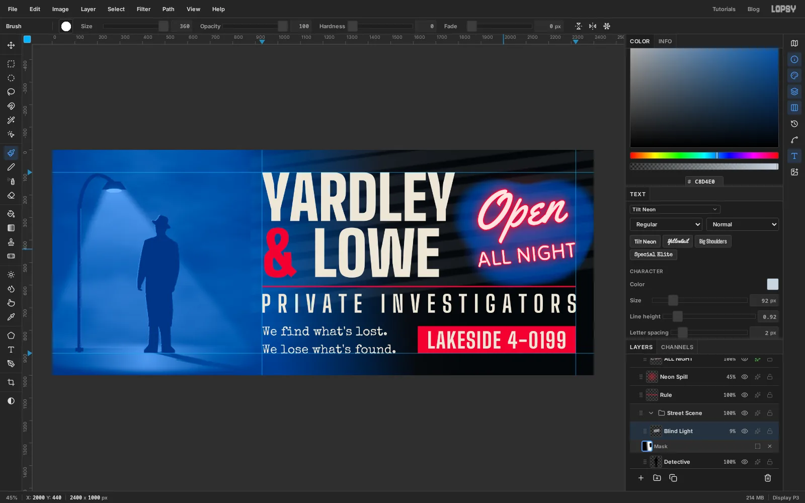

Blur the bars with **Gaussian Blur** at **Radius 7** and drop the layer to **9%**. They should be just visible.

Add a mask. Set the gradient to **Linear** with two stops, black then white, both at full opacity, and drag from the left ends of the bars to about a third of the way along them, so they fade in from the left.

The bars also cut through the neon. While you're still on the mask, pick the **Brush**, set **Size** to **360** and **Hardness** to **0**, and paint over the sign. On a mask the Brush always hides. Click the *Blind Light* row to finish.

## Start the rain as noise

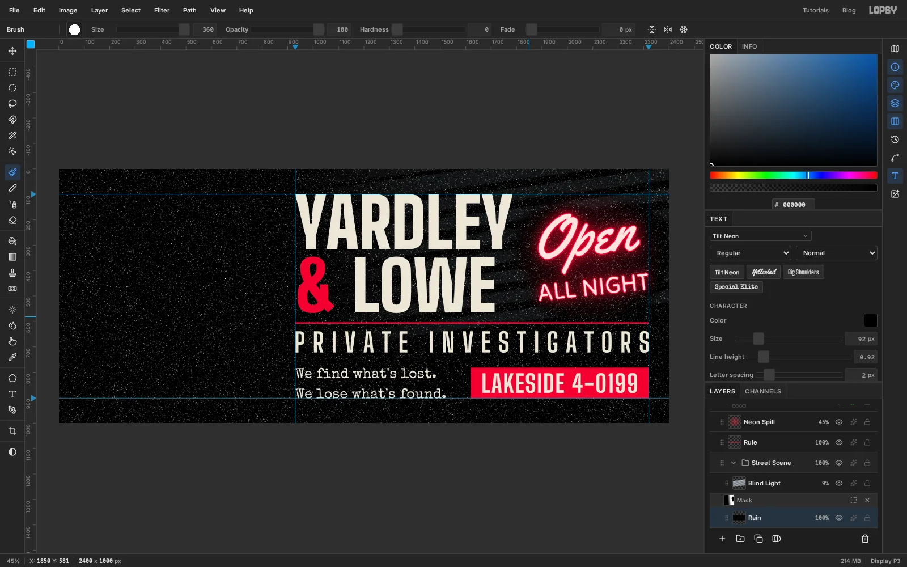

Click *Detective* and add a layer called *Rain*. Press [[Cmd+A]], fill it with black and deselect.

Choose **Filter → Add Noise…**, set **Amount** to **100** and choose **Mono**. Then **Filter → Threshold…** with **Level 48**. Most of the noise turns black and about one pixel in fifty turns white. If you get all black, lower the level by one or two. If the layer goes mostly white, raise it.

## Blur the noise into rain

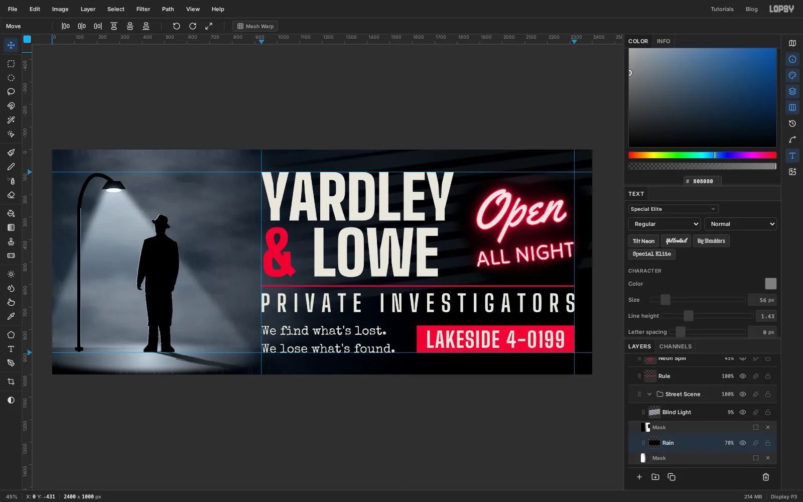

Choose **Filter → Motion Blur…** with **Angle 76** and **Distance 80**. Each dot is smeared into a slanted streak.

Set the layer to **Screen** and lower it to **70%**. Rain only shows where light hits it, so add a mask. Set the gradient to **Radial** with three stops, all at full opacity: white at the start, white again in the middle, and dark grey (`#2A2A2A`) at the end. Drag from the middle of the cone out past the left edge of the name, then click the *Rain* row.

## Add film grain

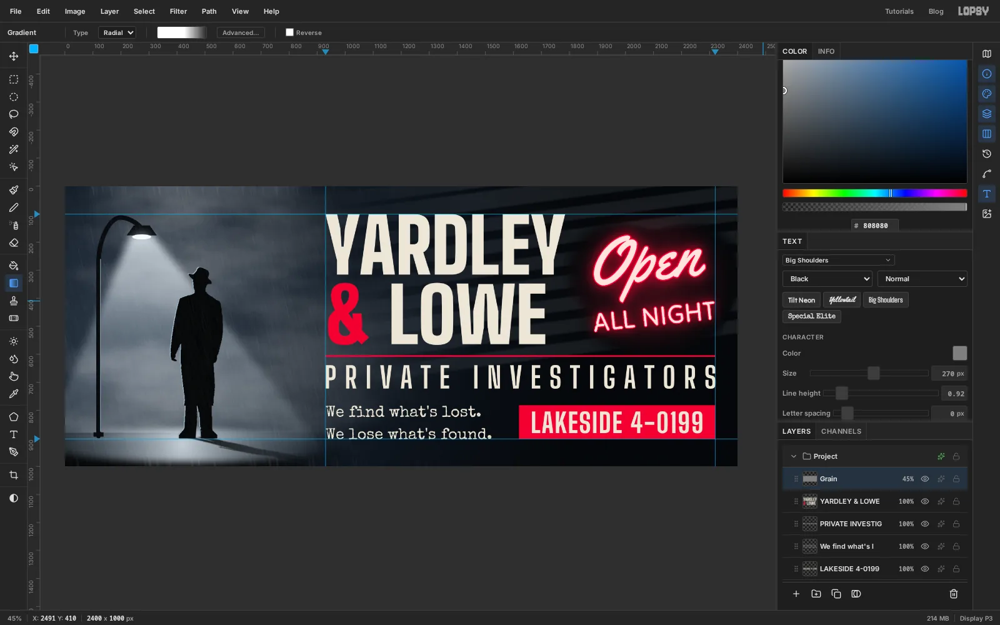

Click the top layer and add one called *Grain*. Press [[Cmd+A]], fill it with `#808080` and deselect. Choose **Filter → Add Noise…** with **Amount 30**, **Mono** and **Gaussian**. Set the layer to **Overlay** at **45%**.

Mid-grey disappears in Overlay, so only the speckle is left. It ties the photo-based figure and the clean type together.

## Cool the picture down

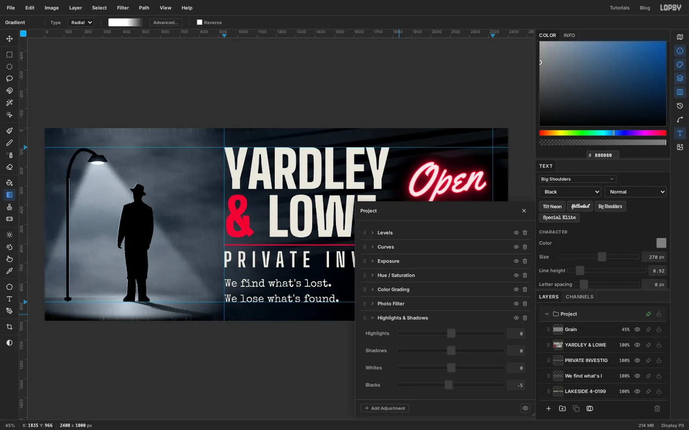

Click the sparkle icon on the *Project* group at the top of the Layers panel. Adjustments here apply to everything in the document without changing any pixels. The drawer already lists a few neutral adjustments. Leave them alone.

Click **Add Adjustment** and choose **Photo Filter**. Set the **Filter color** to `#4F7FB0` and **Density** to **9** for a slight cold cast. Add **Highlights & Shadows** and set **Blacks** to **-5** to deepen the darkest tones a touch. Go easy here: at -15 or lower the neon glow and the blind bars sink into black.

## Export the billboard

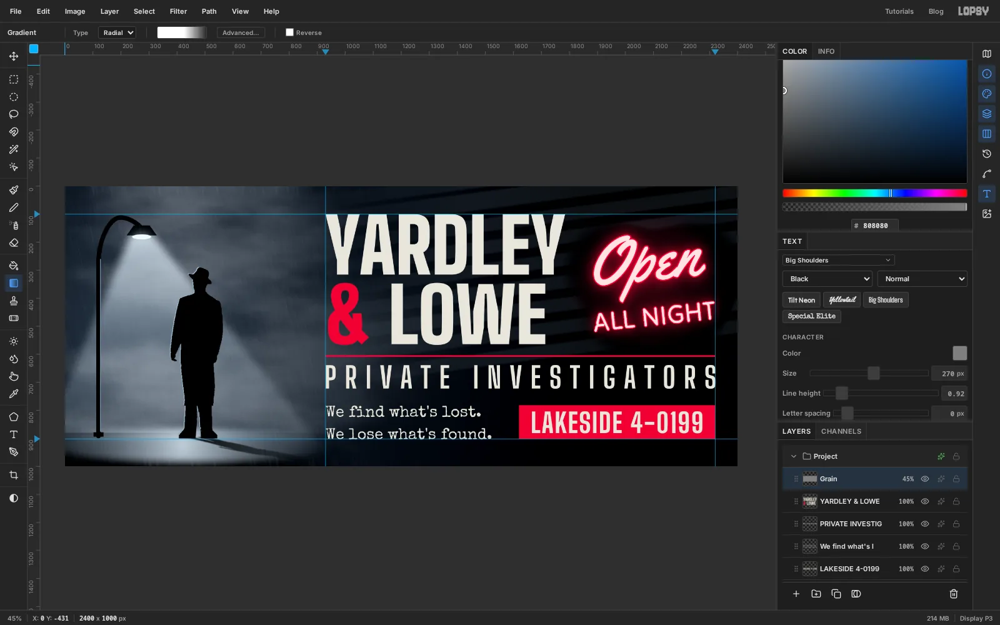

Close the drawer and look at the whole board. Read it the way a driver would, in two seconds: lamp, man, name, red.

Choose **File → Quick Export PNG**.

To make it your own, change the name and the tagline first, and keep the red to three or four places. If you swap the figure, pick a photo where the person is already a dark shape against something light. Threshold needs that contrast to work.
