Film noir posters sold black-and-white films with loud colour. They used a
night scene in hard light and shadow, a lone figure, one hot accent colour
and big type. The films were moody and grey; the posters were operatic.

In this tutorial you'll make **Yokohama Harbor**, a 1200 × 1800 px one-sheet
for an imaginary 1950s thriller. A man in a fedora waits under a lamp on a
rainy pier while searchlights sweep the sky over a crane and an ocean liner.
You'll build the harbour from lasso silhouettes and pencil lines, cut the man
out of an old photograph, light him with a rim of lamp light and a cast
shadow, then finish with rain, grain, a vignette and a red title sliced by
venetian-blind slats.

The man comes from a public-domain portrait, *Standing portrait of a young
man … wearing a trench coat and fedora hat* (H.F. Cooper, c.1920, Public
Record Office of Northern Ireland, on Wikimedia Commons with no known
copyright restrictions). Any full-length photo of a person in a coat and hat
will do. Everything else is drawn in Lopsy.

The palette:

- Night sky `#03050A` → `#0A1120` → `#22324A` → `#04070C`
- Harbour water `#0A111F` → `#020407`
- Silhouettes `#07090E`, crane `#0C111B`, liner `#090C13`
- Searchlight `#D9DCCB`
- Lamp light `#F2B33D`, lantern glass `#FFD98A`
- Pier deck `#2A2219` → `#17130F` → `#0B0907`
- Noir red `#B13836`, title shading `#C8433E` → `#A8302F` → `#6E1A1D`
- Extrusion shadow `#3A0B0E`, type `#ECE4D0`

## Set up the canvas and guides

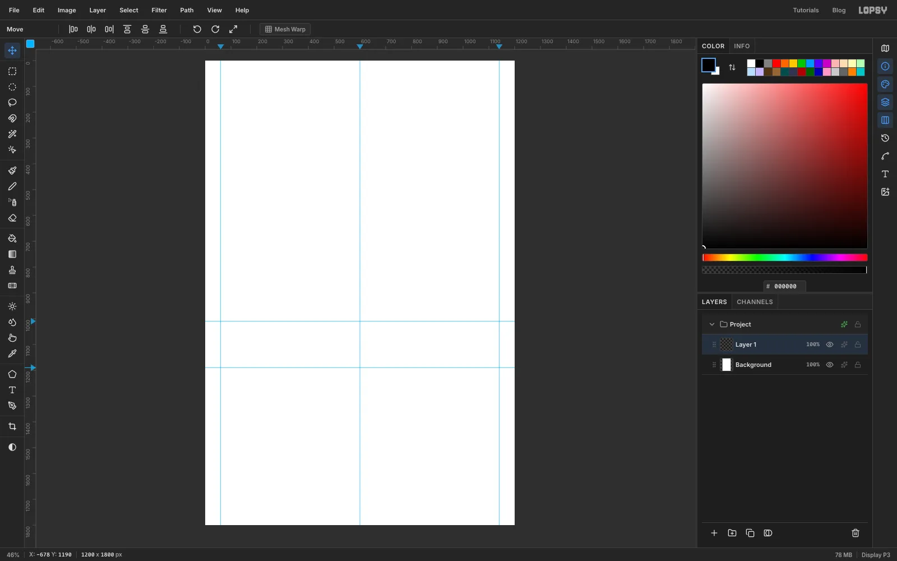

Choose **File → New**, make a **1200 × 1800** document with a white
background, and click **Create**.

Guides keep the type and the scene lined up. Click the top ruler at **60**,
**600** and **1140** for vertical guides: the two margins and the centre.
Click the left ruler at **1010** for the horizon, where the ship will float,
and at **1190** for the far edge of the pier. Turn on
**View → Snap to Guides** if it isn't already on.

## Paint the night sky

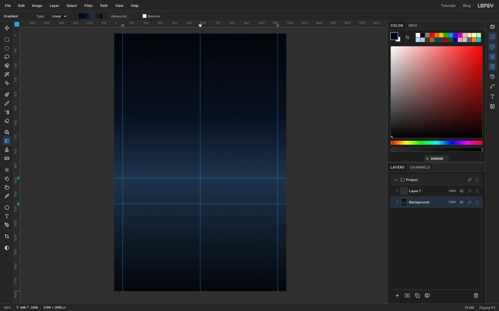

Select *Background* and pick the **Gradient** tool. Leave **Type** on
**Linear** and click **Advanced…** to set four stops:

- `#03050A` at 0%
- `#0A1120` at 32%
- `#22324A` at 56%
- `#04070C` at 100%

Drag from the top of the canvas straight down to the bottom. The lightest
band lands on the horizon guide. That glow behind the ships is what makes
black silhouettes readable.

## Roll in fog with Clouds and a mask

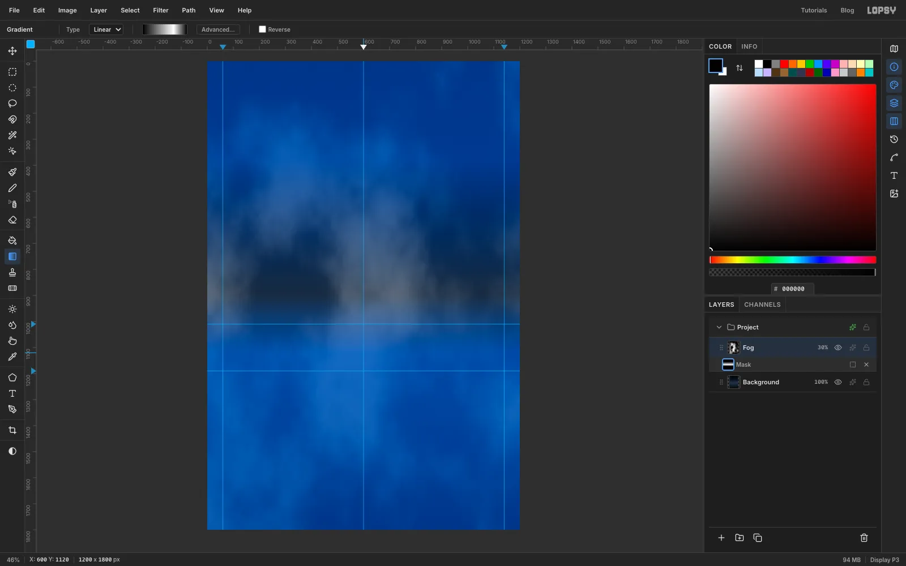

Rename *Layer 1* to *Fog* and run **Filter → Clouds…** with **Scale 4**.
Open the layer's effects drawer, set the blend mode to **Screen**, and lower
the layer opacity to **30%**.

The fog should hang on the water, not fill the sky. Click **Add Mask** at the
bottom of the Layers panel, then click the new mask thumbnail to edit the
mask. With the Gradient tool, set three stops: black at 0%, white at 70% and
black at 100%. Drag from about a fifth of the way down the canvas to just
below the pier guide. Click the *Fog* layer's name to leave mask editing.

## Cut a searchlight beam

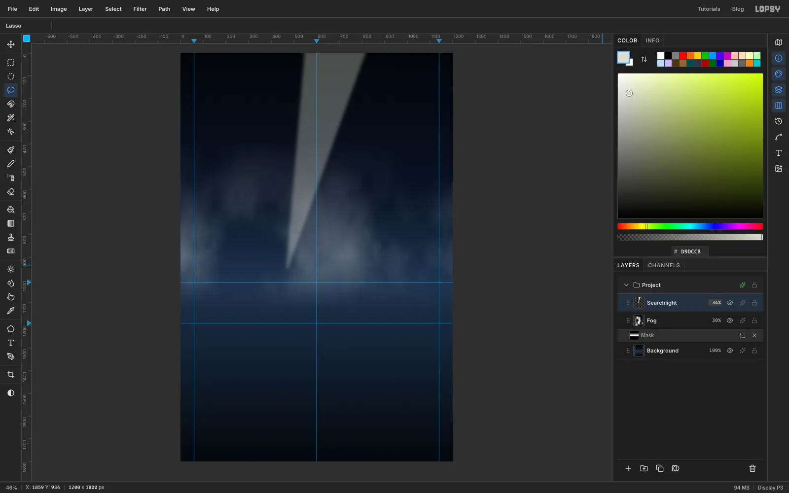

Click **Add Layer** and name it *Searchlight*. With the **Lasso**, draw a
long thin wedge: start at a point on the horizon a little left of centre
and widen it to about 280 px as it leaves the top of the
canvas, leaning slightly right. Fill it with `#D9DCCB` using **Edit → Fill**
and deselect with [[Cmd+D]].

Run **Filter → Gaussian Blur…** with **Radius 22**, set the layer to
**Screen**, and drop it to **34%** opacity.

> **Tip:** Judge the beam against the fog, not on its own. Toggle its eye
> icon on and off: it should read as light in damp air, not as a white
> shape. If it looks solid, lower the opacity a little more.

## Add a lighthouse on the breakwater

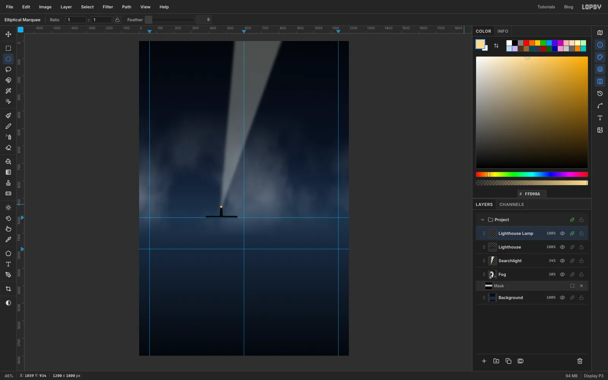

Add a layer called *Lighthouse*. Lasso a thin strip along the horizon, about
180 px long and 12 px tall, under the beam's point, and fill it with
`#07090E`. Lasso a narrow tapering tower from the strip up to the beam's
point and fill that too.

Put the bulb on its own layer, *Lighthouse Lamp*, so that only the bulb
glows. Click the **Elliptical Marquee** once on the canvas (no drag), enter
a 10 × 10 px circle at the top of the tower, and fill it with `#FFD98A`.
In the effects drawer, add an **Outer Glow** in `#F2B33D` with **Size 26**
and **Opacity 85**.

## Fade the far end of the beam

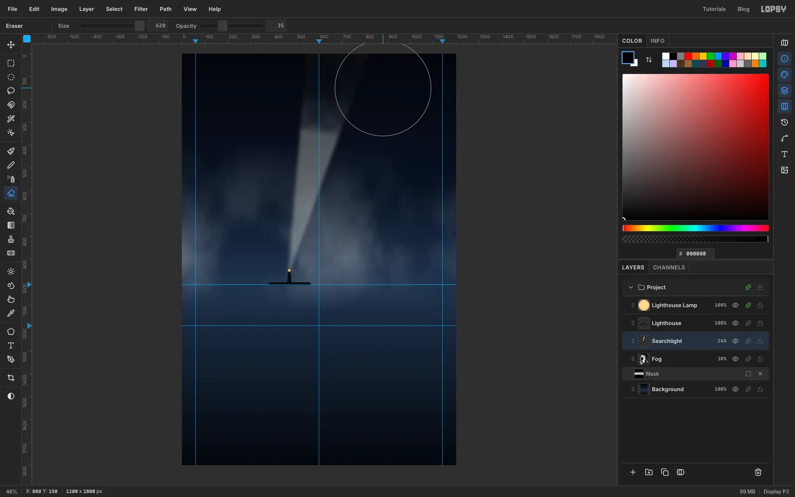

Real beams thin out with distance. Select *Searchlight*, pick the **Eraser**,
and set **Size 420** and **Opacity 35**. Drag two slow horizontal strokes
across the top of the beam, one along the very top edge and one about
150 px lower. The beam now dissolves into the dark instead of stopping at
the edge.

## Build the crane's body

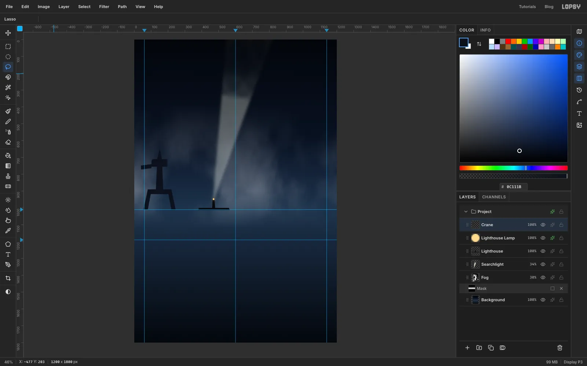

Select *Lighthouse Lamp* and add a layer called *Crane* above it. Set the
foreground to `#0C111B`. Each part of the crane is a lasso shape filled with
**Edit → Fill**:

1. A portal base about 190 px wide and 120 px tall, standing on the horizon at the left of the poster. Lasso it as an arch: two splayed legs joined by a beam at the top.
2. A tapering tower about 40 px wide, rising 135 px from the portal.
3. A cab, a box about 95 × 45 px, on top of the tower.
4. A small pointed A-frame, 60 px tall, on the cab.
5. A counterweight arm sticking out about 60 px to the left of the cab.

Deselect after each fill.

## Lattice the jib with the pencil

The jib is just lines, so pick the **Pencil**. At **Size 6**, click at the
front of the cab, then [[Shift]]-click at the jib tip, about 300 px right and
185 px up. That draws a straight line. Click just below the first point and
[[Shift]]-click the tip again for the second chord.

Drop to **Size 4** and zigzag between the two chords. Click on the top chord
near the cab, then [[Shift]]-click alternately on the bottom and top chords
as you move towards the tip. At **Size 3**, draw cables from the A-frame peak
to the jib tip and to the counterweight, and a short hook line hanging
110 px below the tip. Finish by marqueeing a tiny rectangle at the bottom
of that line and filling it for the hook block.

## Draw the ocean liner

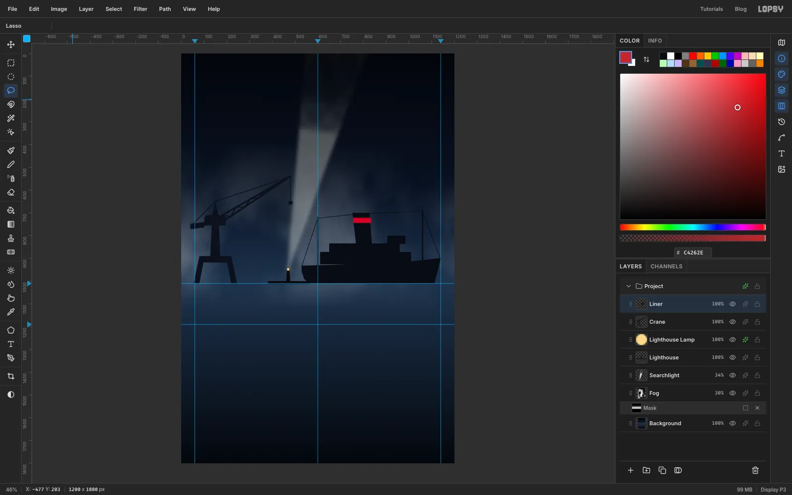

Add a layer called *Liner*. With the Lasso, draw the hull in `#090C13`: the
stern starts just right of centre, the deck line rises gently towards a raked
bow about 60 px from the right edge, and the bottom sits on the horizon.
Keep the bow clear of the canvas edge so the two don't touch.

For the superstructure, use the **Rectangular Marquee** and fill each box.
Make three tiers that step up and in from the stern: about 400 px wide and
55 px tall on the deck, 310 × 40 px on top of that, and a small 80 × 36 px
bridge near the front. Clicking the marquee once instead of dragging opens a
dialog where you can type the exact corners. Lasso a funnel that leans back slightly, and
fill a thin band across it with `#B13836`.

With the **Pencil** at **Size 6**, [[Shift]]-click a fore mast and an aft
mast. At **Size 2**, run one line of rigging from bow to fore mast, across to
the funnel, the aft mast and the stern.

## Light the portholes

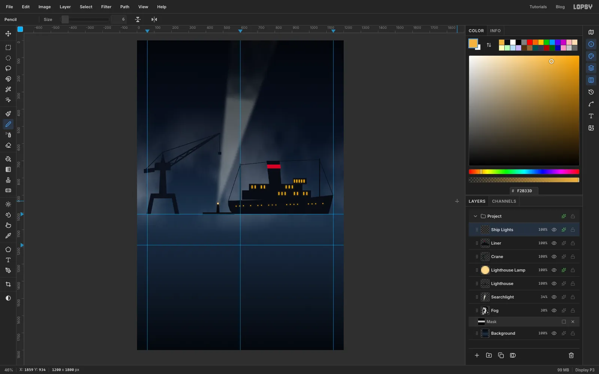

Add a layer called *Ship Lights* and set the foreground to `#F2B33D`. With
the **Pencil** at **Size 5**, click along the hull to dot a row of portholes
about 21 px apart. Skip a few here and there so the cabins look occupied, not
lit by a spreadsheet.

At **Size 6**, draw the cabin windows as short vertical strokes, a click and
a [[Shift]]-click 12 px apart, along each tier. Leave gaps behind the funnel,
and leave the left part of the lower tier dark: the man's hat will sit in
front of it, and lit windows touching his hat would fight it.
Then give the layer an **Outer Glow** in `#F2B33D`, **Size 12**,
**Opacity 70**.

## Lay down the water

Select *Background* and add a layer called *Water* above it. Marquee
everything from the horizon guide to the bottom of the canvas. With the
Gradient tool set to `#0A111F` → `#020407`, drag from the horizon down about
300 px. The water should be darker than the sky. Deselect.

For ripples, add a layer called *Ripples*. Marquee from the horizon down to
about y 1300, fill it with mid grey `#808080`, and run
**Filter → Add Noise…** at **Amount 90**, **Mono**. Then run
**Filter → Motion Blur…** with **Angle 0** and **Distance 80** to stretch
the speckle into streaks. Deselect and set the layer to **Overlay**.

## Mirror the lights into the water

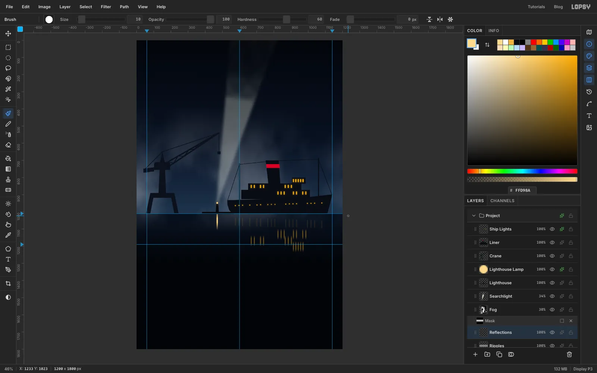

Select *Ship Lights*, choose **Select → All**, then **Edit → Copy** and
deselect. Click *Ripples* and choose **Edit → Paste**. The copy lands in
place on a new layer. Name it *Reflections* and deselect.

Choose **Image → Flip Vertical**. Lopsy flips the layer across the middle of
the whole canvas, so the lights land too high. With the **Move** tool, drag
the layer straight down 220 px so that the reflections hang from the
waterline.

Pick the **Brush** at **Size 10**, **Hardness 60**, set the foreground to
`#FFD98A`, click just below the lighthouse on the waterline, and
[[Shift]]-click about 60 px lower to draw a short vertical line.
Run **Filter → Motion Blur…** with **Angle 90** and **Distance 46** to drag
everything into vertical streaks.

## Break the reflections into ripples

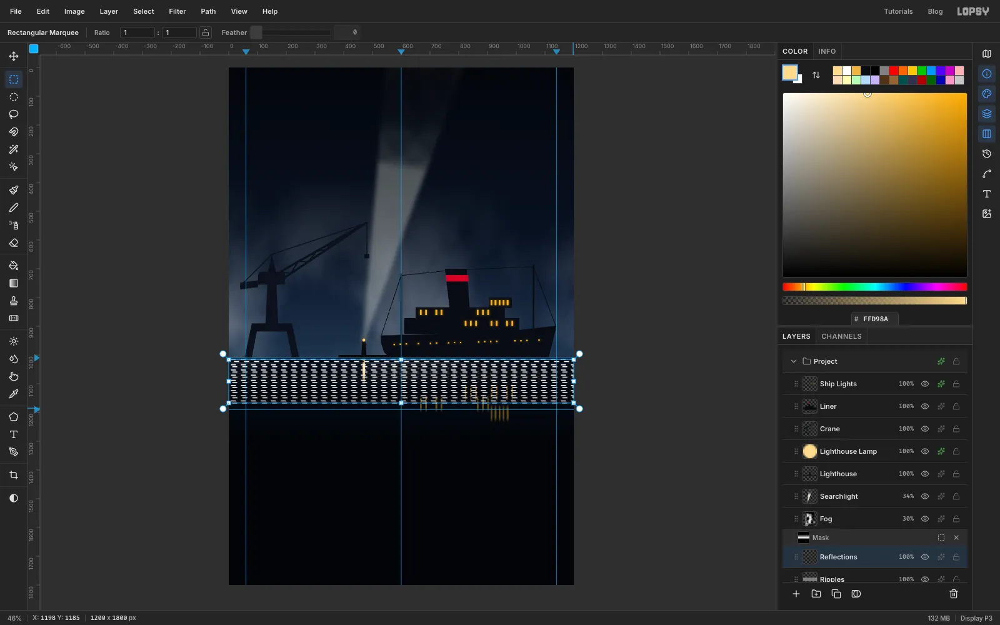

Straight streaks look like a picket fence. Water breaks them up. Zoom in to
200% or more first, because these slices are only a few pixels tall. With the
**Rectangular Marquee**, select a thin 7 px slice right under the horizon,
full width. Then hold [[Shift]] and drag more 7 px slices every 18 px down to
the pier. [[Shift]] adds each one to the selection.

Switch to the **Move** tool and press [[Right]] five times. Only the
selected slices shift, so every stripe of reflection jogs sideways.
Deselect, then do it once more with a second set of thinner 4 px slices,
every 27 px and starting a little lower, and press [[Left]] three times. Two
sets of slices on different spacings stop the pattern from repeating. Then
run **Motion Blur** again at **Angle 90**, **Distance 18** to melt the steps
into wobbles.

Finally take the **Eraser** at **Size 140**, **Opacity 60**, and drag along
the pier guide so the reflections fade before they reach the boards. Set
*Reflections* to **55%**.

## Group the harbour skyline

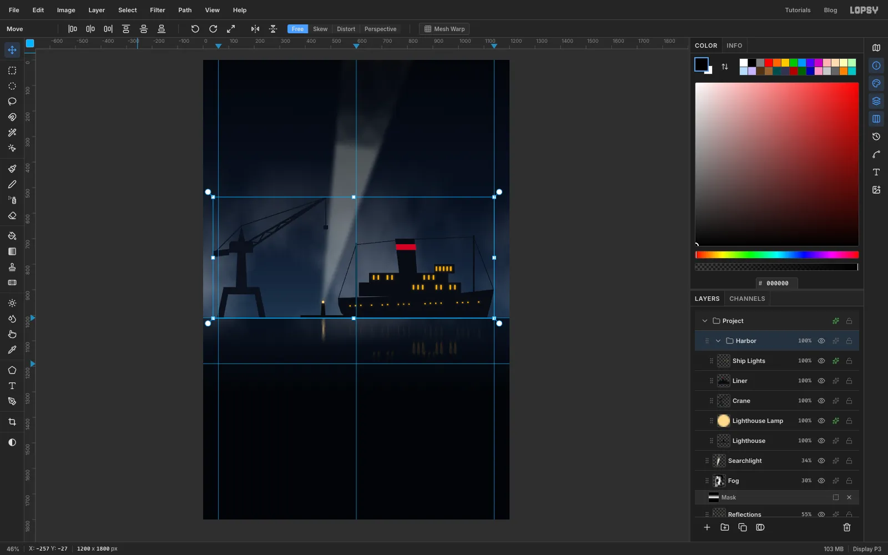

Click *Lighthouse* in the Layers panel, then [[Shift]]-click *Ship Lights* to
select the range. Choose **Layer → Group Layers** and name the group
*Harbor*, after the film.

With the group selected, the Move tool moves everything inside it at once.
Try dragging the skyline a little to see it, then press [[Cmd+Z]] to put it
back. Collapse the group with its arrow so new layers land beside it.

## Build the pier deck

With *Harbor* selected, add a layer called *Pier*. Marquee from the pier
guide to the bottom of the canvas. Fill it with a linear gradient,
`#2A2219` at 0%, `#17130F` at 12% and `#0B0907` at 100%, dragged from the
pier guide to the bottom. Run **Filter → Add Noise…** at **22** for a little
grain in the wood, then deselect.

Planks in perspective all point at one vanishing point on the horizon, here
where the centre guide crosses the horizon guide. With the **Pencil** at **Size 3** in `#060504`,
draw each plank line with a click at the pier guide and a [[Shift]]-click at
the bottom edge, aimed at that point. Space them about 35 px apart at the
pier's far edge, widening to about 150 px at the bottom. Add short
cross-cuts between neighbouring lines for the board ends, staggered so no two
line up.

Finish with a 4 px line in `#4A3D2E` along the pier guide: the edge of the
deck catching a little light.

## Add bollards and a mooring line

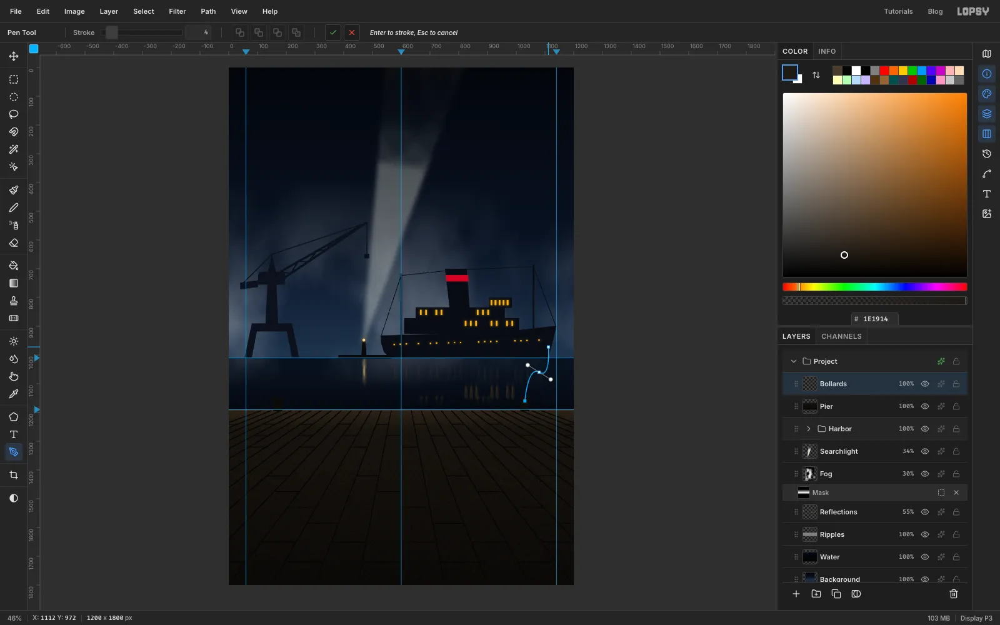

Add a layer called *Bollards*. For each bollard, lasso a squat post about
32 px wide on the pier edge in `#0D0B09`, then add an oval cap with the
Elliptical Marquee and fill it. Put one near the left margin and one under
the liner's bow.

Now pick the **Pen** tool, set the foreground to `#1E1914` and **Stroke 4**.
Click on top of the right bollard, then press and drag partway up towards the
bow to pull out a curve handle, so the rope sags. Click on the bow at the
waterline. Press [[Enter]] to stroke the path.

The stroked rope stays, but the path outline would sit on top of every
screenshot from now on. Open the **Paths** panel, click **Delete Path**,
and close the panel.

## Raise the lamp post and lantern

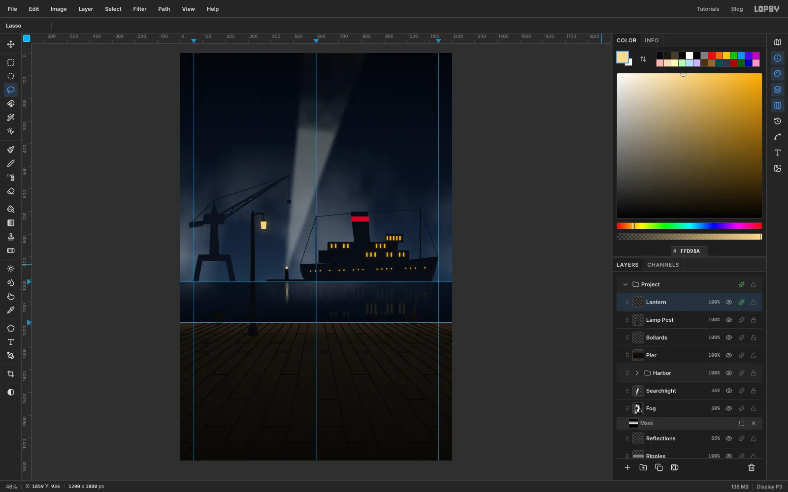

Add a layer called *Lamp Post* and build the lamp from lasso shapes in
`#07090E`:

1. A plinth about 44 px wide and 40 px tall standing on the deck, about 60 px in front of the pier edge and a quarter of the way in from the left.
2. A slim tapering post rising to about y 720.
3. A small point on top.

With the **Pencil** at **Size 6**, click near the top of the post, then
[[Shift]]-click two or three short segments that bend out to the right and
down to where the lantern hangs. Lasso a triangular cap for
the lantern.

Add a layer called *Lantern* and lasso the lantern glass, a small trapezoid
under the cap, in `#FFD98A`. Give it an **Outer Glow** in `#F2B33D`,
**Size 70**, **Opacity 80**.

## Pour light onto the wet boards

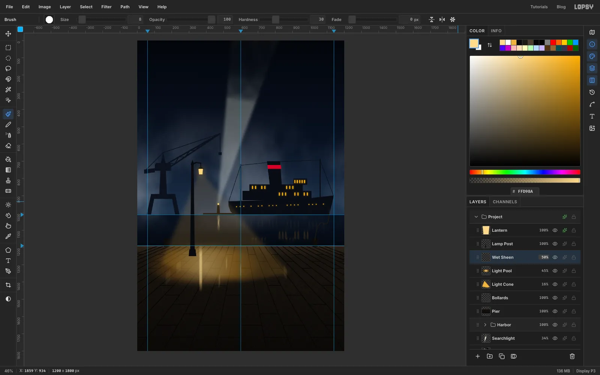

Select *Bollards* and add three layers above it.

1. *Light Cone*: lasso a wide wedge from the lantern down to the deck, about 750 px across where it lands. Fill it with `#F2B33D`, blur it with **Gaussian Blur 34**, set it to **Screen** and **16%**. It's barely there, like light in rain.
2. *Light Pool*: click the Elliptical Marquee and make an ellipse about 700 × 200 px centred under the lamp. Choose **Select → Feather…** at **40**. Fill it with a radial gradient, `#FFD98A` → `#8A5A1C` (55%) → black, dragged from the centre to the right edge of the ellipse. Deselect, then set **Screen** at **45%**.
3. *Wet Sheen*: with a soft **Brush** (Size 24, Hardness 30) in `#FFD98A`, [[Shift]]-click one vertical stroke straight down the deck under the lantern. At **Size 8**, add a few short glints along the planks. Run **Motion Blur** at **Angle 90**, **Distance 60**, and set the layer to **Screen**, **50%**. Wet boards reflect light as streaks, and that's what makes them read as wet.

## Paste in the photo and lasso the man

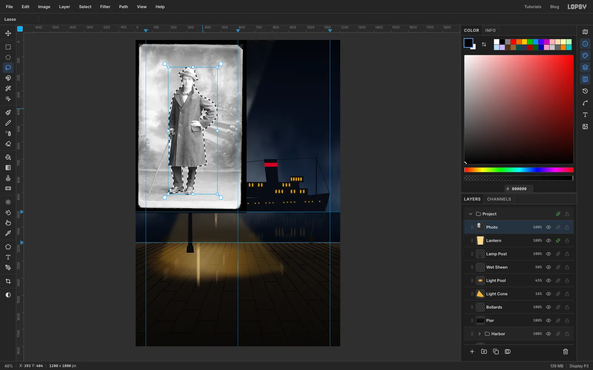

Open your reference photo in the browser, right-click it and choose
**Copy Image**. Back in Lopsy, select *Lantern* and press [[Cmd+V]]. Name
the new layer *Photo*. Its size doesn't matter yet; you'll scale the man
down later.

Pick the **Lasso** and trace the man slowly: up the hat, round the brim,
down the collar, the akimbo arm and the coat hem, between the legs and round
both shoes. Run straight down the coat's edge past his gloved hand, so the
walking stick and the glove's knuckles are left out. Where his arm makes
a loop on his hip, hold [[Alt]] and lasso the gap to subtract it from the
selection.

Choose **Edit → Copy**, then **Edit → Paste**. The man comes in on a new
layer in exactly the same place. Name it *Detective*, deselect, then select
*Photo* and click **Delete Layer**.

## Paint out the highlights and draw a fedora

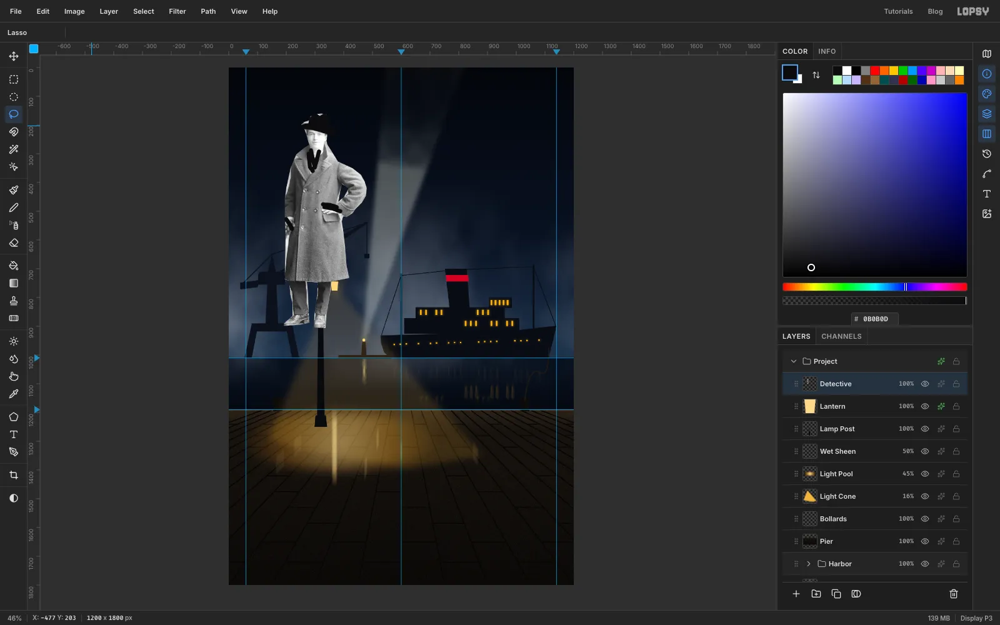

A silhouette with a white shirt front looks like a cut-out, not a shadow.
Select *Detective*, pick the **Brush** (Size 16, Hardness 80) in `#0B0B0D`,
and paint over the shirt front and bow tie, the hand on his hip and what's
left of the glove at his side.

The photo's hat is soft and light. Lasso a cleaner fedora over it: a brim
that slopes down slightly to his left, wider than the old one, and a crown
with a pinch in the top. Fill it with the same near-black. In silhouette,
the hat is what tells the viewer "noir".

## Push him into silhouette

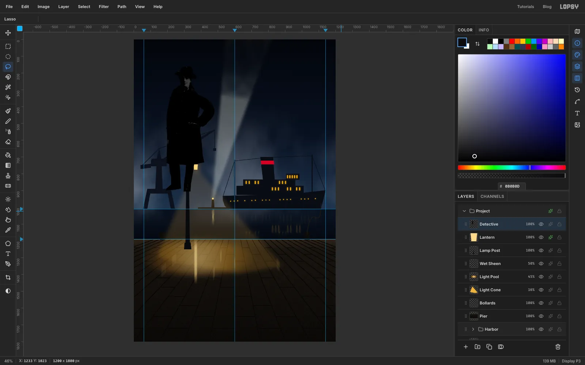

Run **Filter → Brightness/Contrast…** twice on *Detective*: first with
**Brightness −62** and **Contrast 45**, then with **Brightness −40** and
**Contrast 25**. Two moderate passes keep a trace of the coat's texture. One
huge pass crushes everything flat.

## Scale him to fit the scene

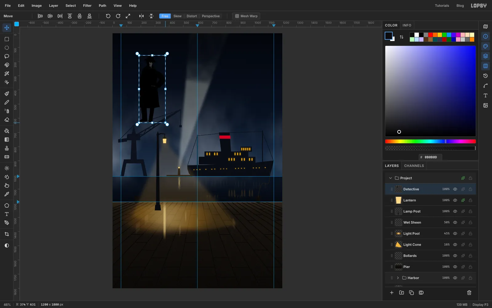

The man should be about 470 px tall, a little shorter than the lamp. Marquee
around him with a few pixels to spare and switch to the **Move** tool.
Hold [[Cmd]] and drag the bottom-right handle up and to the left until he's
about 470 px tall. [[Cmd]] keeps his proportions. Press [[Enter]], then
[[Cmd+D]].

Leave him where he is for now. He gets placed together with his rim light
and shadow in a moment.

## Add a rim of lamp light

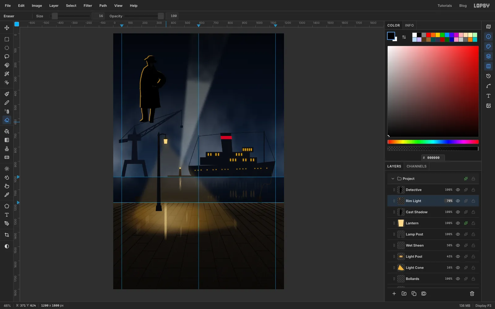

Rename *Detective* to *Cast Shadow*. Click **Duplicate Layer** and name the
copy *Rim Light*. Duplicate again and name that copy *Detective*. You now have
three identical men stacked up.

On the top *Detective*, pick **Dodge / Burn**, set the mode to **Burn**,
**Exposure 45**, **Size 70**, and stroke down the right side of the coat, the
side away from the lamp. At **Size 44**, **Exposure 70**, stroke twice across
his face under the brim, so no features show.

Select *Rim Light*. Add a **Color Overlay** in `#F2B33D` and click
**Rasterize Layer Style** so it becomes real amber pixels. Run
**Gaussian Blur** at **2**, then with the **Move** tool press [[Left]] five
times and [[Up]] three times. Lamp light can't reach the soles of his shoes,
so take the **Eraser** at **Size 16**, click at the toe of one shoe and
[[Shift]]-click at the heel of the other, along the bottom of the shoes. Set the layer to **70%**. A thin warm edge now shows
only on the side facing the lamp, not all the way around him.

## Lay his shadow across the deck

Select *Cast Shadow*. Add a black **Color Overlay**, click **Rasterize Layer
Style**, and choose **Image → Flip Vertical**. His feet are now at the top
of the shape and his head at the bottom. As with the reflections, the flip
also drops it into the lower half of the canvas.

Marquee around the flipped shape, switch to the **Move** tool and click
**Distort** in the options bar. Drag the bottom-left corner up and about
230 px right, and the bottom-right corner up and about 270 px right. Leave
the shadow only about 80 px tall. Light from a low lamp on the left throws a
long, flat shadow away to the right. Press [[Enter]] and deselect.

With the Move tool, drag the shadow so its foot end tucks under his shoes.
Blur it with **Gaussian Blur 4**, set it to **Multiply** at **70%**.

## Place the man in the light

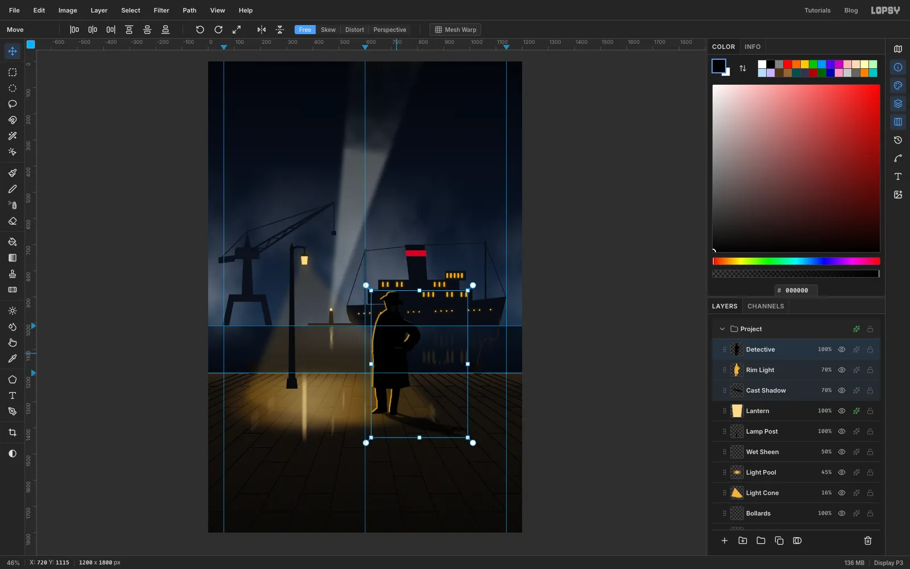

Click *Detective* in the Layers panel, then [[Cmd]]-click *Rim Light* and
*Cast Shadow* to add them to the selection. With the **Move** tool, drag all
three together until his feet stand on the boards about a third of the way
down the deck, just right of the lamp's pool. The arrow keys nudge all three
as well.

Select *Cast Shadow* and take the **Eraser** (Size 140, Opacity 45) over its
far tip, so the shadow softens as it leaves the light.

## Separate his hat from the ship

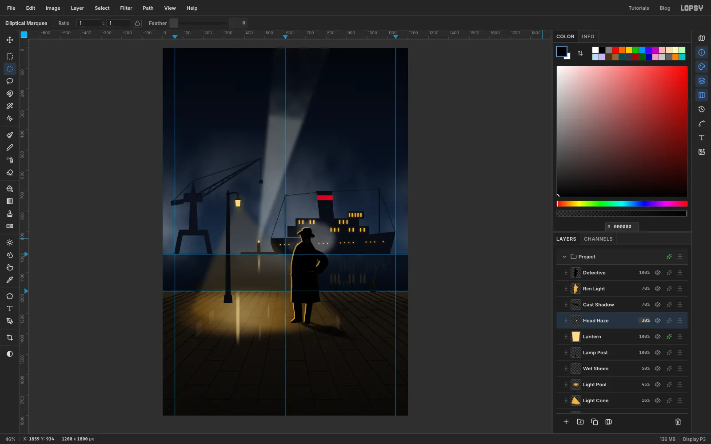

His hat now sits on the dark hull, and black on black disappears. Select
*Lantern* and add a layer called *Head Haze* above it. Make an ellipse
around his hat and shoulders with the Elliptical Marquee, choose
**Select → Feather…** at **30**, and run **Filter → Clouds…** at
**Scale 6**. Deselect, and set the layer to **Screen** at **30%**. A breath
of fog behind his head makes the fedora's outline readable again.

## Make it rain

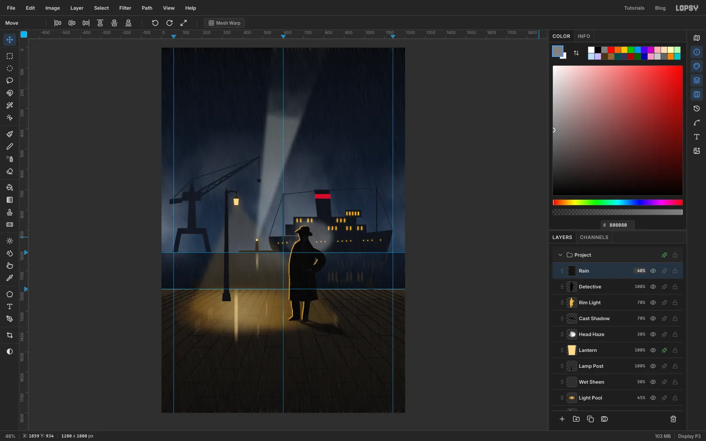

Select *Detective* and add a layer called *Rain*. Choose **Select → All**,
fill it with `#808080` and deselect. Run **Add Noise** at **Amount 100**,
**Mono**, then **Filter → Threshold…** at **170**. Only the brightest specks
survive as white dots on black.

Run **Motion Blur** with **Angle 78** and **Distance 55** to pull each speck
into a streak. Set the layer to **Screen** at **40%**. Screen drops the
black and keeps the rain.

## Add grain and a vignette

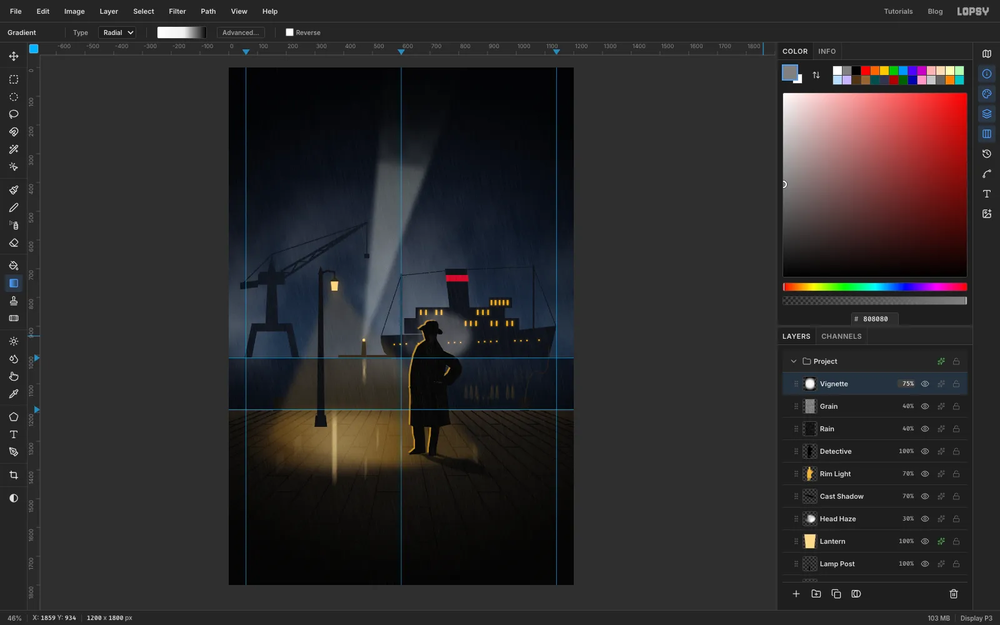

Add a *Grain* layer: select all, fill `#808080`, **Add Noise** at
**40, Mono**, and set it to **Overlay** at **40%**.

Add a *Vignette* layer. Select all and fill it with a radial gradient: white
at 0%, `#F0F0F0` at 55% and black at 100%. Drag from just above the man's
head down to the bottom edge. Set it to **Multiply** at **75%**. The corners
and the bottom go dark, which is where the title sits.

## Set the title

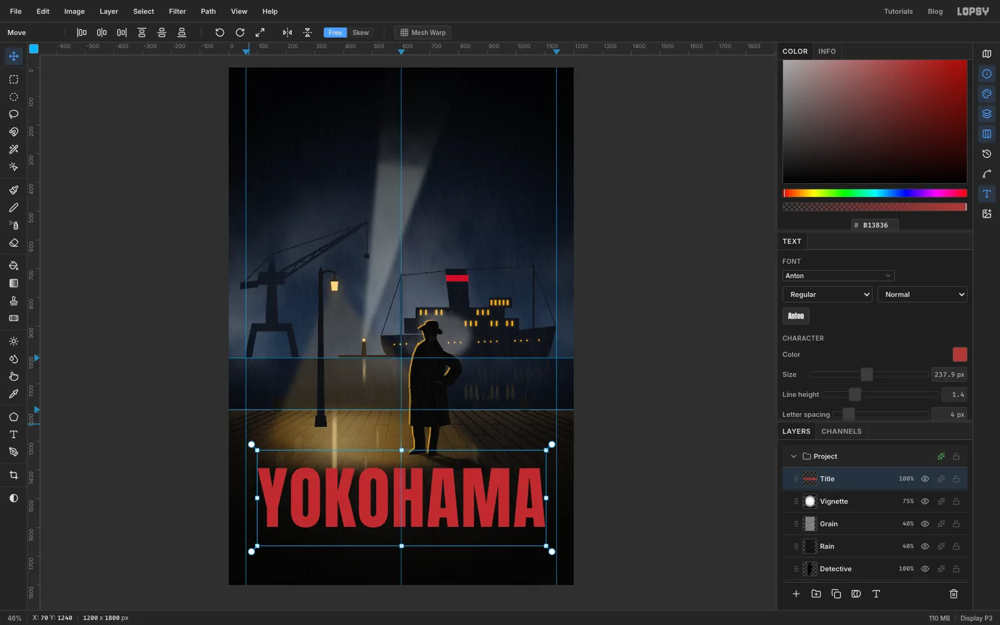

Select *Vignette*, then pick the **Text** tool. Choose **Anton**, set the foreground to
`#B13836`, and set **Letter spacing** in the Text panel to **4**.

Click in an empty area and type `YOKOHAMA`. Press [[Shift+Enter]] to commit.
Adjust **Size** until the word spans **1000 px**; about **238 px** does it.
Name the layer *Title*. With the **Move** tool and arrow keys, centre it on
the middle guide with its top about 40–50 px below his shoes.

## Set the rest of the type

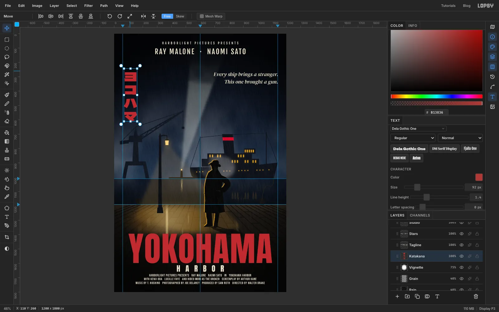

Before each new piece of type, click *Vignette* first. Otherwise the new
settings restyle the last text layer. All of it is `#ECE4D0` except the
katakana. Create each one in empty space, then
nudge it into place with the Move tool's arrow keys:

- *Harbor Word*: `HARBOR` in **Anton**, **52 px**, letter spacing **36**, `#ECE4D0`, centred about 14 px under the title.
- *Billing*: three lines of cast and crew names in **Bebas Neue** with **Line height 1.15** and letter spacing **1.5**, centred, about 18 px under HARBOR. Use [[Enter]] between lines, then change the font size until the block is as wide as the rules you'll draw later, 900 px. A size of about 23 px does it. Mine reads `HARBORLIGHT PICTURES PRESENTS  RAY MALONE  NAOMI SATO  IN  YOKOHAMA HARBOR`, then `WITH KENJI ODA  LUCILLE FAYE  AND HIDEO MORI AS THE BROKER  SCREENPLAY BY ARTHUR KANE`, then `MUSIC BY T. HOSHINO  PHOTOGRAPHED BY JOE DELANEY  PRODUCED BY SAM ROTH  DIRECTED BY WALTER DRAKE`.
- *Studio*: `HARBORLIGHT PICTURES PRESENTS` in **Fjalla One**, **22 px**, letter spacing **9**, centred near the top.
- *Stars*: `RAY MALONE  ·  NAOMI SATO` in **Fjalla One**, **48 px**, letter spacing **6**, centred under it.
- *Tagline*: `Every ship brings a stranger.` and, on a second line, `This one brought a gun.` in **DM Serif Display**, **Italic**, **37 px**, **Align Right**, right edge on the right margin guide.
- *Katakana*: switch on **Toggle vertical text**, choose **Dela Gothic One** at **92 px** in `#B13836`, and paste `ヨコハマ`. Seat it on the left margin with its top level with the tagline's first line. Switch vertical off again afterwards.

The bottom of the billing block should sit about 55 px above the bottom
edge, the same as the margin above the studio line. Leave the same breathing room everywhere.

## Cut venetian-blind slats through the title

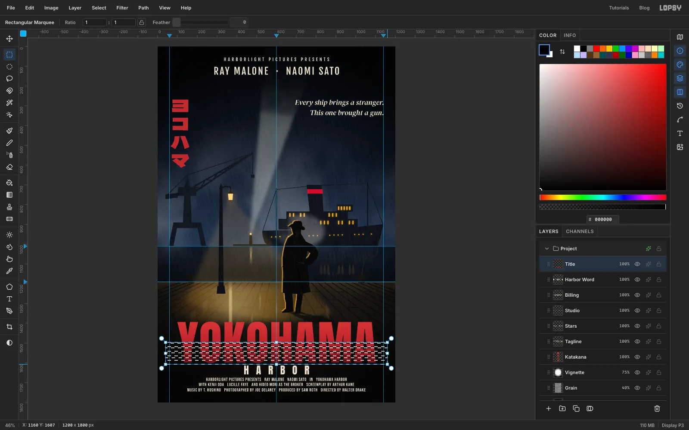

Shadow from venetian blinds is the most noir motif there is. Here it falls
across the title.

Select *Title* and click **Rasterize Layer**. [[Cmd]]-click its thumbnail
to select the letters, then drag a linear gradient down through them:
`#C8433E` → `#A8302F` (60%) → `#6E1A1D`. Deselect.

Zoom in on the title, click the Rectangular Marquee once and make a 4 px
slice across the full width, halfway down the letters. Then hold [[Shift]] and drag four more
slices below it, each one thicker: 6, 8, 10 and finally a 20 px slice along
the bottom of the letters. Press [[Delete]] and deselect.

## Give the title weight and frame HARBOR

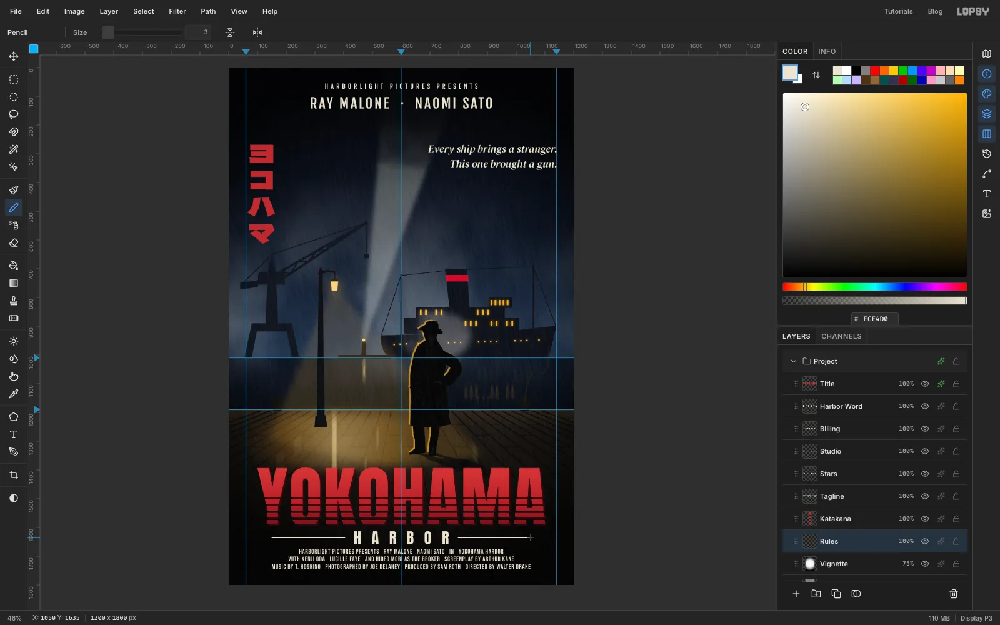

On *Title*, add a **Drop Shadow** in `#3A0B0E` with **Offset X 6**,
**Offset Y 6**, **Blur 1** and **Opacity 75**. A hard, unblurred shadow
reads as an extruded letter, the way 1950s title lettering was painted.

Select *Vignette* and add a layer called *Rules*. With the **Pencil** at
**Size 3** in `#ECE4D0`, click level with the middle of HARBOR, under the
billing block's left edge, and [[Shift]]-click just short of the H. Draw a
matching rule on the right, from just past the R to the billing block's
right edge.

## Swing a second searchlight

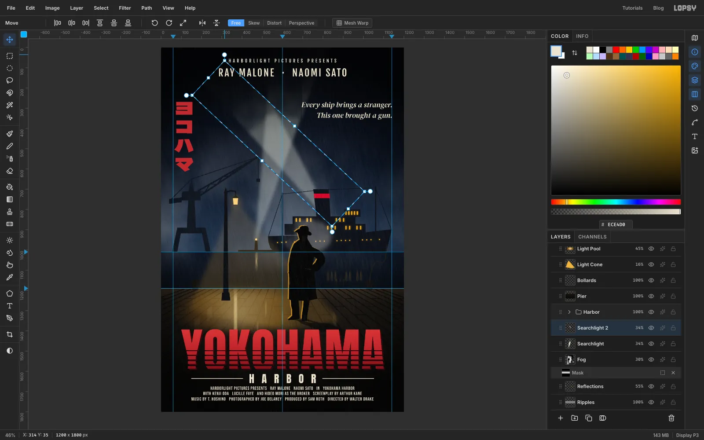

Two searchlights crossing in an X are a harbour-at-night shorthand. Select
*Searchlight*, click **Duplicate Layer**, and name the copy *Searchlight 2*.

Marquee around the beam, from the top of the canvas to just below its
point. With the **Move** tool, drag the rotation handle just outside the
top-right corner anticlockwise by about 47°, until the beam leans up and to
the left. Press [[Enter]] and deselect.

Then drag the layer so its point sits behind the liner's bridge, just under
the top tier. The two beams now cross high above the man's head, a little
above the crane's jib, and frame him.

## Knock back the funnel band

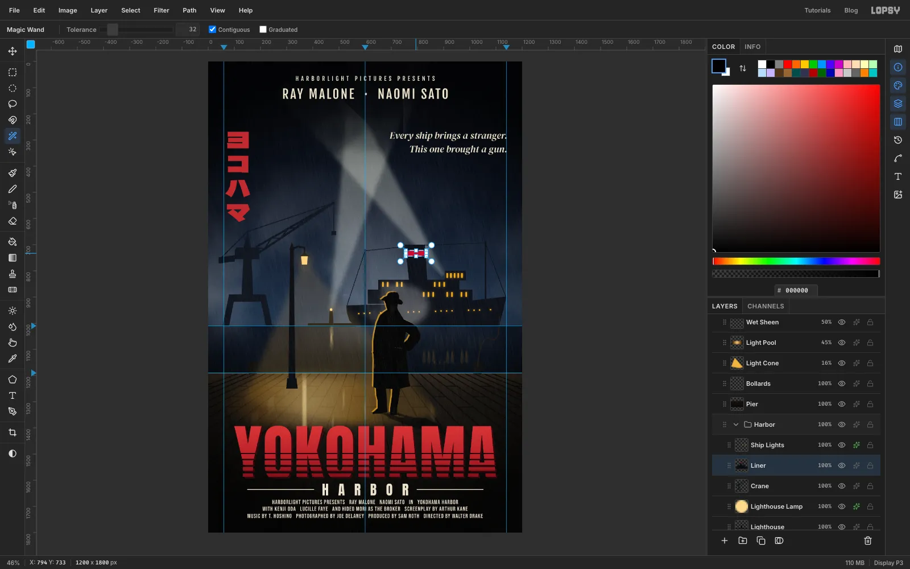

The funnel's red band is the brightest red in the scene, and it pulls the
eye away from the title. Expand *Harbor*, select *Liner*, pick the
**Magic Wand** and click the band. Run **Filter → Hue/Saturation…** with
**Saturation −30** and **Lightness −22**, then deselect. Now it echoes the
title instead of competing with it.

Save with **File → Save Project** and export with
**File → Quick Export PNG**.
