A tattoo flash sheet is a menu: a sheet of ready-to-tattoo designs, each with
a price, that clients pick off the wall. This one borrows from Mexican folk
art, especially **Tenango embroidery** from Hidalgo and Oaxacan painted
crafts. That means flat, saturated colour, bold ink outlines, rows of dots
and shapes simple enough to stitch.

*Xōchitl* is the Nahuatl word for "flower". The centrepiece is a hummingbird
drinking from one, traced from a photo so the pose is right, then simplified
into folk shapes. Around it go three smaller designs: a sacred heart, a sun
face and a name banner. You'll work on a **1500 × 2000 px** sheet and build
nearly everything the way a tattoo artist inks: draw a shape, fill the
colour, then outline it in ink.

You'll need a reference photo of a hummingbird in profile. This tutorial
uses the public-domain *Anna's hummingbird in Washington* by the U.S. Fish
and Wildlife Service, from Wikimedia Commons. Crop it to roughly
**900 × 660 px** around the bird and the flower it's feeding from before
you start, so it drops into the sheet at a workable size.

The palette:

- Manila paper `#EEE2C3`, ink `#1D1815`, cream `#FFF5DD`
- Magenta `#D2216B` / `#8C1447` (ribbon folds and prices)
- Turquoise `#15A29A`, cobalt `#2B4FAF`
- Marigold `#F3A01B`, yellow `#FFD447`
- Leaf green `#5C9C3A`, heart red `#D2392A`
- Stain tan `#B98E55`, tape `#D6C38A`

Fonts: **Sancreek** for the title, **Fondamento** for the subtitle,
**Shrikhand** for the banner name and **Kavoon** for the prices.

Almost every shape in this tutorial uses the same four moves, so learn them
once:

1. Draw the outline with the **Pen** ([[P]]). Click for a sharp corner, drag
   for a curve, and click the first anchor again to close the shape.
2. In the **Paths** panel, click **Path to Selection**, then **Edit → Fill**
   with the colour as the foreground.
3. Press [[Cmd+D]] to deselect, set the foreground to ink `#1D1815`, and
   click **Stroke Path** in the Paths panel. Type the width and press
   [[Enter]].
4. Click **Delete Path** so the path doesn't clutter the panel.

We'll call this **fill and ink**. Most of the circles are made with the
**Elliptical Marquee**'s exact-size dialog: press [[Cmd+D]] so nothing is
selected, then click once (without dragging) and type the **From** and
**To** corners. Deselecting first matters: a press inside a live selection
drags that outline instead of starting a new one.

## Fill the flash paper

Choose **File → New**, keep the unit on **Pixels** and create a
**1500 × 2000** document. Select the **Background** layer, set the
foreground to `#EEE2C3` and choose **Edit → Fill**. With no selection, Fill
covers the whole layer.

## Drop layout guides

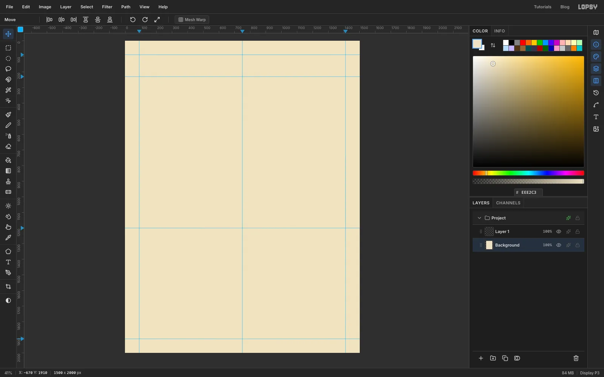

Click the rulers to drop guides; a click on the top ruler makes a vertical
guide. Add vertical guides at **90**, **750** (the centre) and **1410**, and
horizontal guides at **90**, **230** (under the title), **1200** (between
the two rows of designs) and **1910**. The hover readout on the ruler shows
the position before you click.

## Add paper fibres

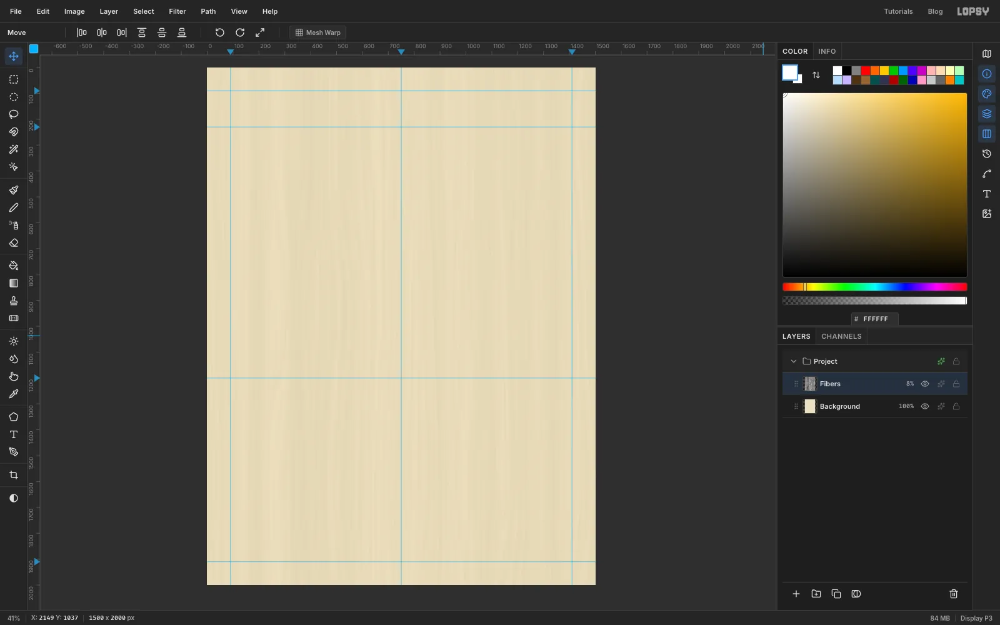

Rename **Layer 1** to **Fibers**, set the foreground to white and fill it
with **Edit → Fill**. Choose **Filter → Fibers…**, set Variance to **24**
and Strength to **40**, and click **Apply**. Then run **Filter → Gaussian
Blur…** at **1.5** to soften the streaks.

Open the layer's effects drawer (the ✦ button on its row), set the blend
mode to **Multiply**, and drag the layer's opacity down to **8%**. The
fibres should be barely there. Any stronger and the paper reads as wood.

## Set down a coffee ring

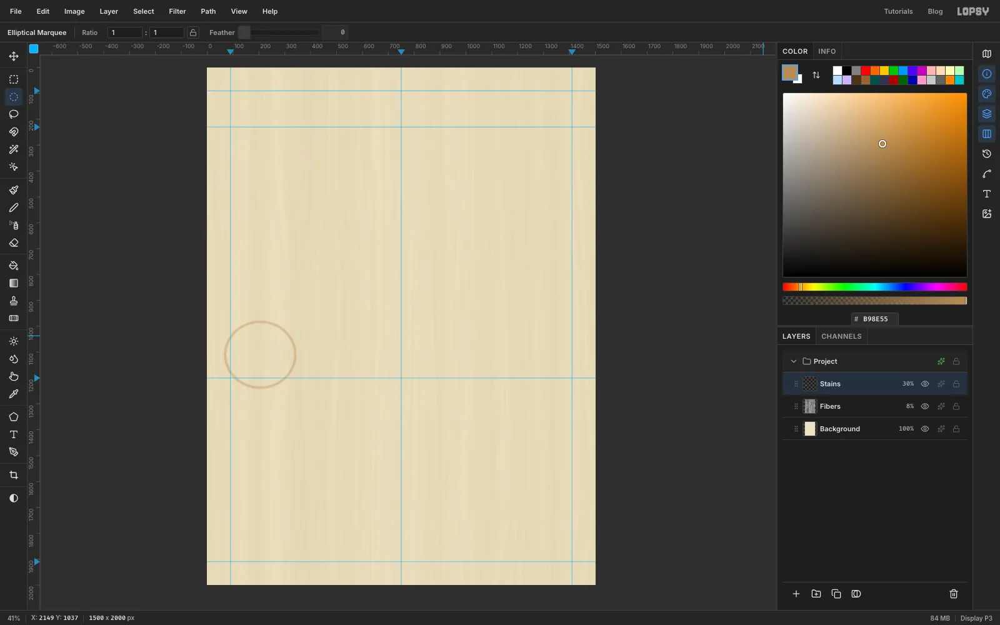

Add a layer named **Stains**. With the **Elliptical Marquee**, drag an
oval about **280 × 264 px** on the left side of the sheet, its left edge
just inside the 90 guide and its centre a little above the 1200 guide.
Fill it with tan `#B98E55`.

Choose **Select → Shrink…**, set it to **9** and click **Apply**. Then press
[[Delete]] to clear the middle, which leaves a ring. Press [[Cmd+D]], run **Filter → Gaussian Blur…** at **3**, and set
the layer to **Multiply** at **30%**.

## Drop in the reference photo

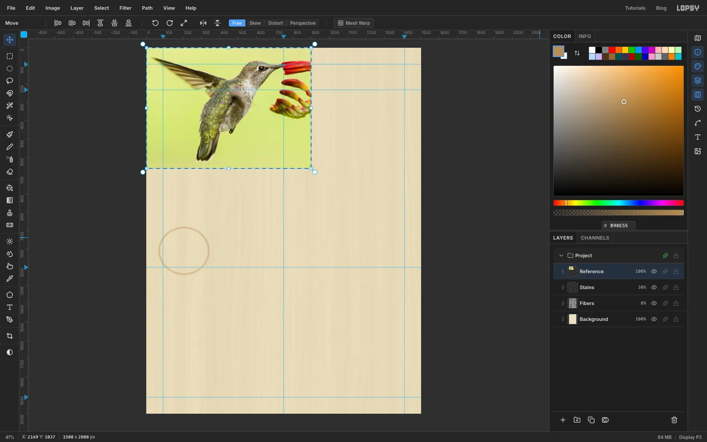

Select the **Stains** layer, then drag the hummingbird photo from your
computer onto the canvas. It lands at the top-left corner as a new layer,
already selected, with the Move tool active and transform handles around
it. Rename it **Reference**.

## Scale and place the reference

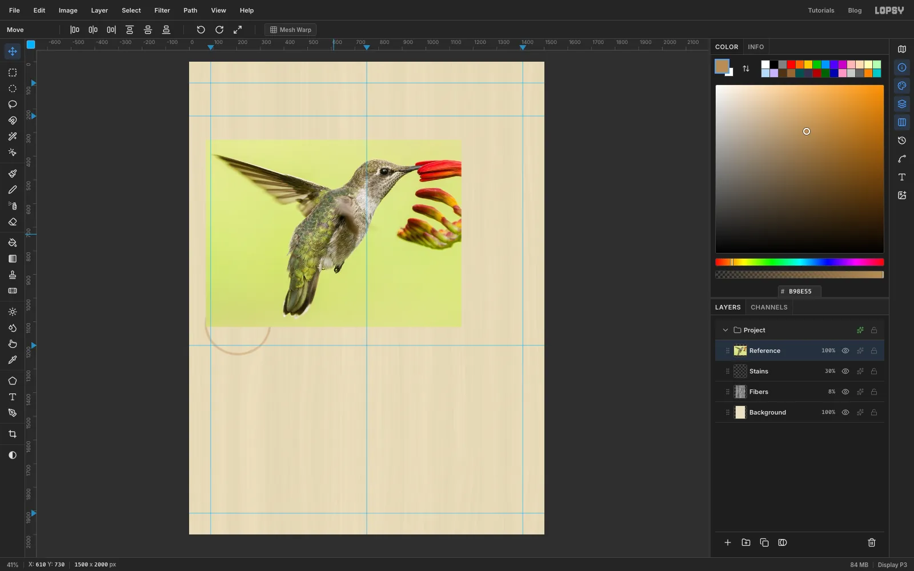

Hold [[Cmd]] (which keeps the proportions) and drag the photo's
bottom-right handle down and to the right until the photo is about a fifth
bigger, about **1080 px** wide. Press [[Enter]] to commit
and [[Cmd+D]] to deselect.

With the **Move** tool ([[V]]), drag the photo down so its top-left corner
sits near **(70, 330)**. That leaves the beak pointing at the right-hand
third of the sheet, where the flower will go. Then lower the layer's
opacity to **45%** so your ink shows clearly over it.

## Ink the tail feathers

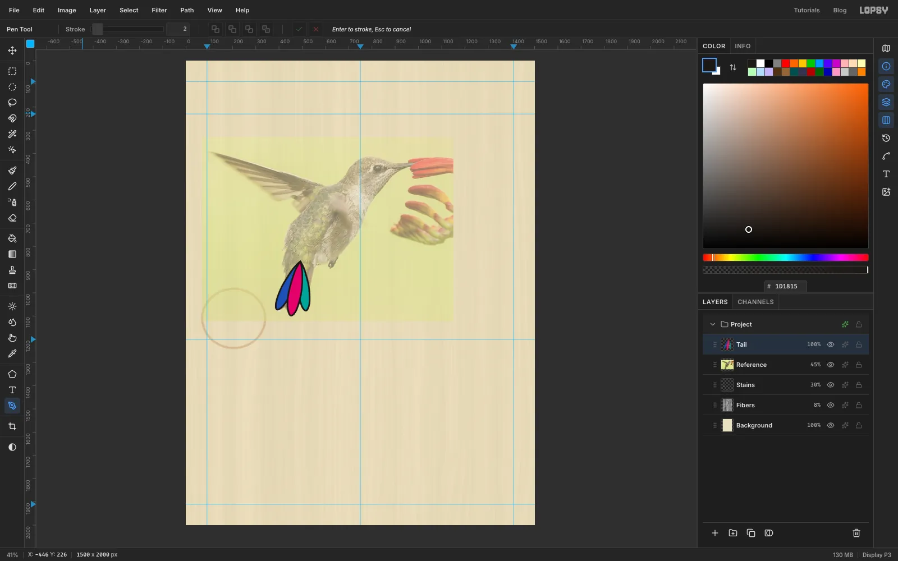

Add a layer named **Tail**. Each tail feather is a teardrop: pointed where
it joins the body, widest just past halfway and rounded at the tip. Trace
three of them fanning down from the base of the photo's tail. Drag the
middle one a little longer than the other two.

**Fill and ink** each one, using a **7 px** stroke: cobalt `#2B4FAF` on the
left, turquoise `#15A29A` on the right and magenta `#D2216B` in the middle.
Draw the middle feather last so it sits on top.

## Fan out the wing

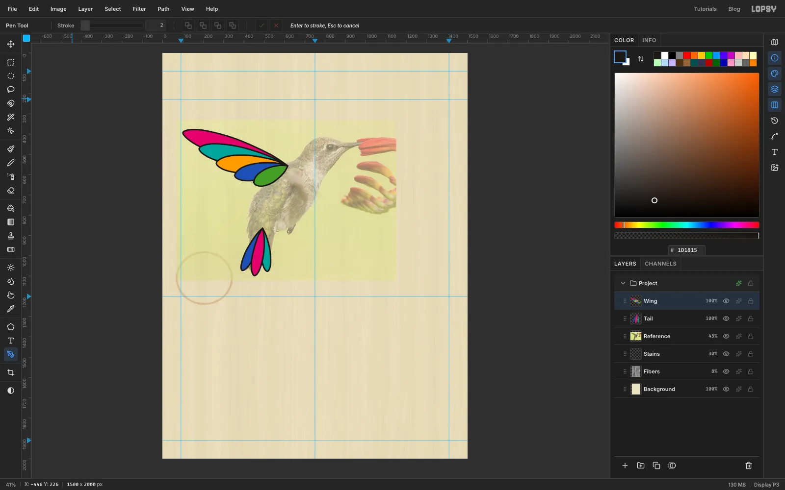

Add a layer named **Wing** above Tail. The wing is five long feathers
fanning out from one point on the bird's back. Make the top one reach the
photo's wingtip, and step each one below it shorter and a little lower.

Draw them **longest first**, so each shorter feather overlaps the one
before it. **Fill and ink** each with a **7 px** stroke, in this order:

1. Magenta `#D2216B`, the longest, to the wingtip
2. Turquoise `#15A29A`
3. Marigold `#F3A01B`
4. Cobalt `#2B4FAF`
5. Leaf green `#5C9C3A`, the shortest, on top

You end up with stacked bands of colour, like satin-stitched embroidery.

## Dot the feathers

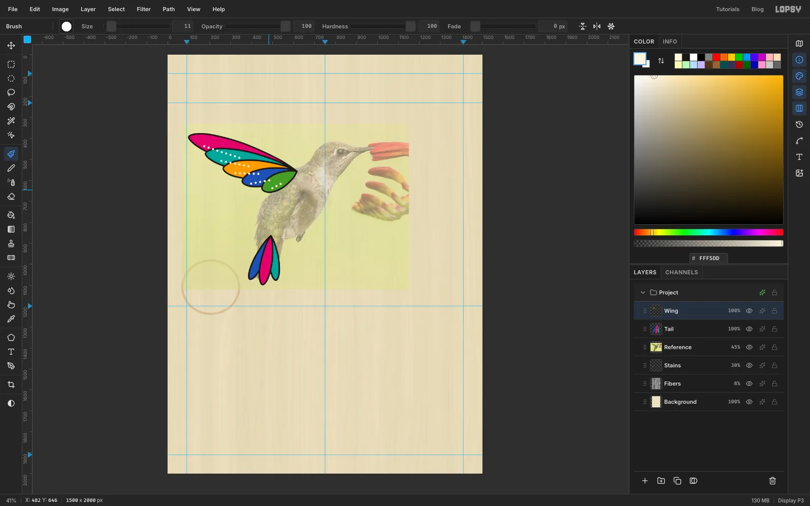

Stay on the **Wing** layer and pick the **Brush** ([[B]]). Click the brush
preview at the left of the options bar to open the Brushes panel, and on
the **Shape** tab set Size to **11**, Hardness **100**, Opacity **100** and
**Spacing 200%**, the maximum. At that spacing a stroke lays down separate
dots instead of a line.

Set the foreground to cream `#FFF5DD`. On each feather, click about halfway
along it, a little above its centre line, then [[Shift]]-click near the
tip. Shift-click paints a straight row of dots between the two points. Stop
short of the tip so no dot touches the outline.

## Fill the body

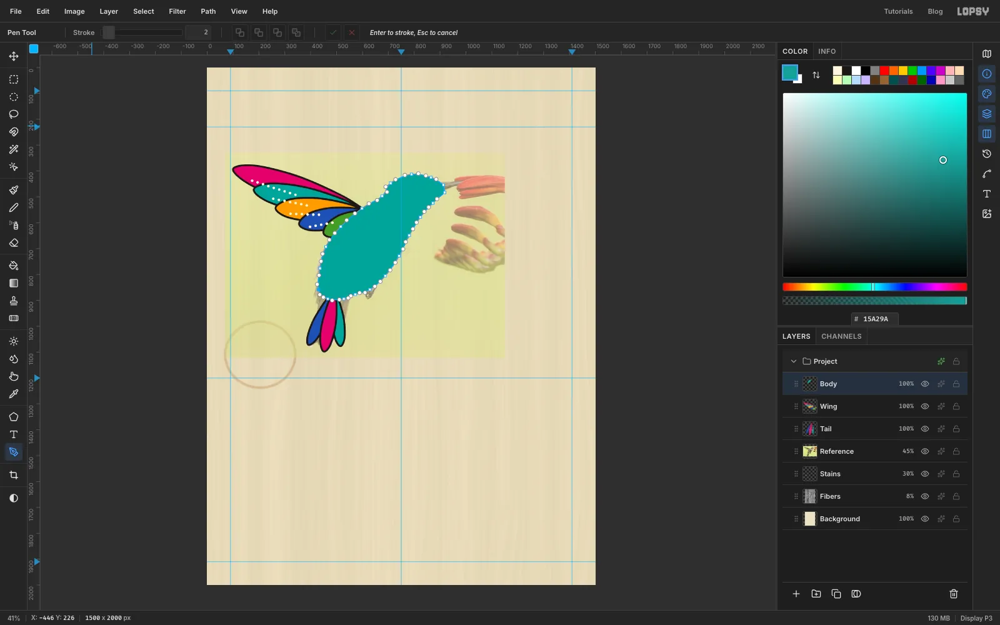

Add a layer named **Body** above Wing. With the Pen, trace the body as one
closed outline. Start at the crown and go over the forehead to the base of
the beak, using two sharp corner clicks there. Continue down the throat and
belly to the tail base, then back up the spine to the crown.

Click **Path to Selection** and fill with turquoise `#15A29A`, but
**don't** stroke or delete the path yet: you'll ink it later on its own
layer.

## Block in the colour bands

Add a layer named **Body Color**. With the **Lasso** ([[L]]), draw three
bands and fill each one:

- A cobalt `#2B4FAF` stripe down the back, from the nape to the tail.
- A marigold `#F3A01B` belly, from the throat to the vent.
- A magenta `#D2216B` gorget, the throat patch under the beak.

Let them spill over the body's outline. You'll trim them next.

## Trim the bands to the body

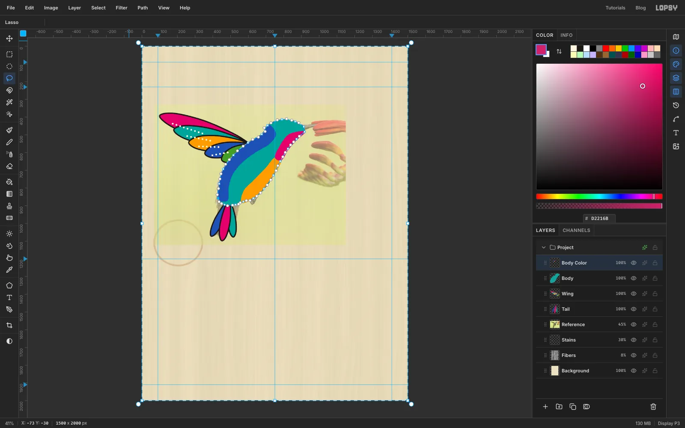

[[Cmd]]-click the **Body** layer's thumbnail to load its shape as a
selection, then choose **Select → Inverse**. With **Body Color** still
active, press **Delete** to clear everything outside the body, then
[[Cmd+D]].

## Add stitch seams and back dots

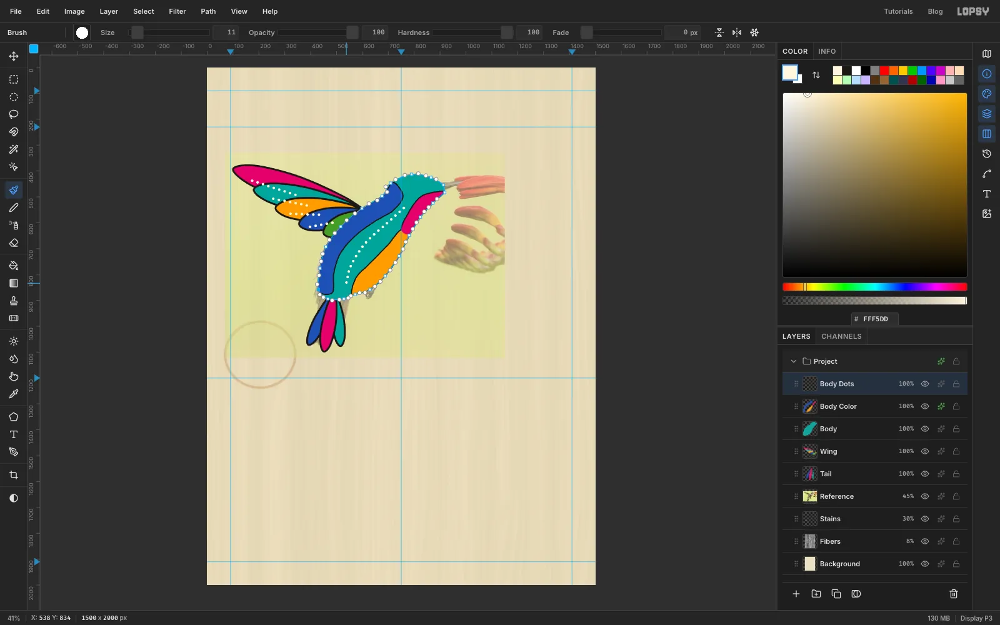

Open the **Body Color** effects drawer and turn on **Stroke**. Set Width to
**5**, colour ink `#1D1815` and position **Center**. A Stroke effect traces
the edge of everything on the layer, so each band gets a thin ink seam
where it meets the turquoise, like a line of stitching. That's why the
bands sit on their own layer with turquoise showing between them.

Add a layer named **Body Dots**. The brush still has the dotted settings
from the wing, so with cream `#FFF5DD` drag one gentle curve down the
middle of the back. On its own layer, the dots don't pick up the seam
outline.

## Ink the outline, beak and eye

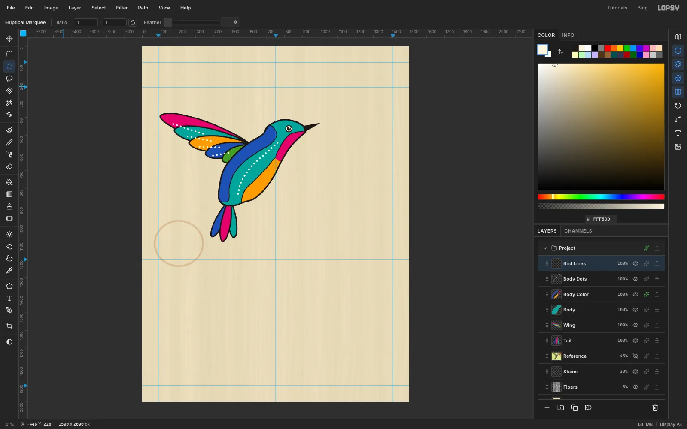

Add a layer named **Bird Lines**. The body path is still in the Paths
panel. Select it, set the foreground to ink and click **Stroke Path** with
a width of **8**. Then delete the path.

Pen a long thin triangle for the beak, from the two corners at its base out
to the photo's beak tip. Click **Path to Selection** and fill it with ink.

For the eye, centre four circles on the photo's eye with the Elliptical
Marquee's exact-size dialog, filling each in turn:

1. Ink, **40 px** across
2. Cream, **30 px**
3. Ink, **22 px**
4. A tiny cream highlight, **7 px**, a few pixels up and to the right

Finally, click the eye icon on **Reference** to hide it. The bird stands on
its own.

## Draw one petal stack

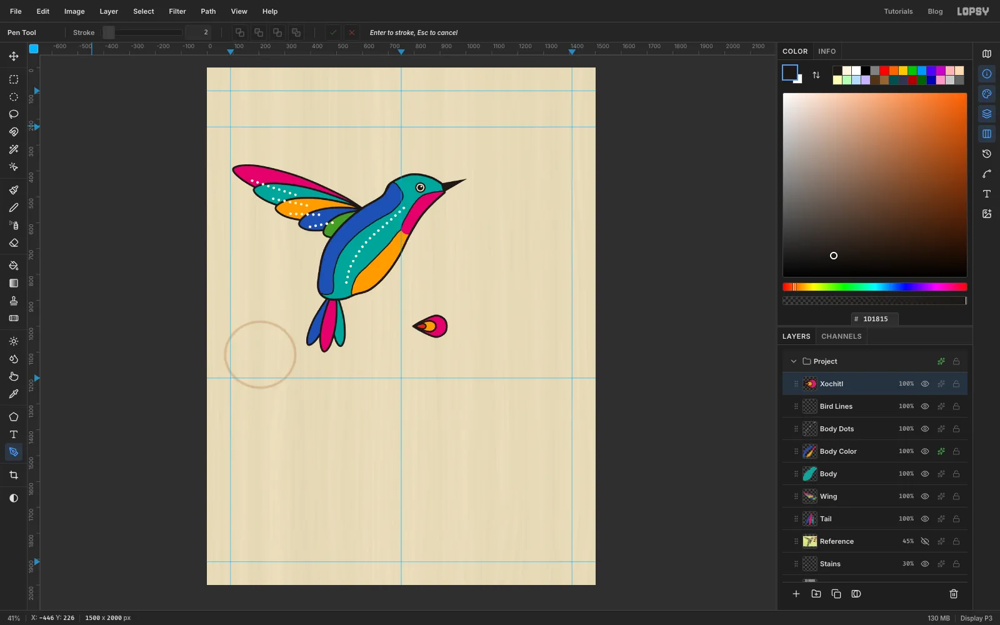

The flower is built with Kaleidoscope, which repeats one wedge around the
**centre of the canvas**. Select **Bird Lines** and add a layer named
**Xochitl** above it.

Starting about **46 px** to the right of the canvas centre (750, 1000),
draw one petal pointing straight right with the Pen, symmetrical about the
horizontal line through the centre. Make it a rounded almond about
**130 px** long and about **70 px** across at its widest. **Fill and ink**
it magenta with a **7 px** line.

Inside it, draw a shorter, narrower marigold petal (**6 px** line). Inside
that, draw a small red `#D2392A` one (**5 px** line).

Kaleidoscope keeps only the slice from three o'clock down to **22.5°**
below it and mirrors it, so a petal that's symmetrical about the horizontal
comes out whole. Keep its widest point inside that slice.

## Repeat it with Kaleidoscope

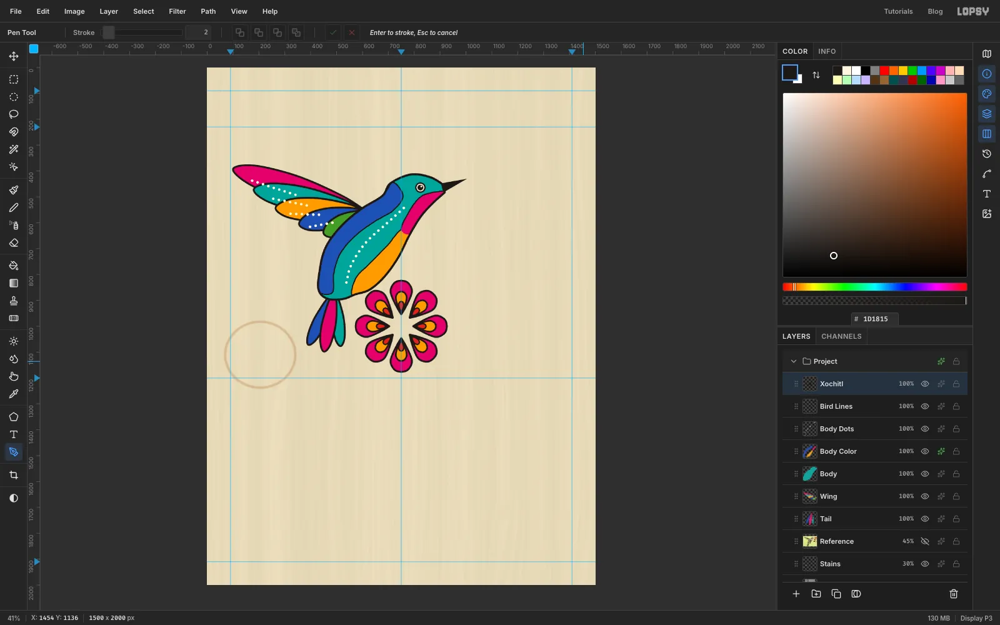

Choose **Filter → Kaleidoscope…**, set Segments to **8** and Rotation to
**0**, and click **Apply**. One petal becomes a full eight-petal flower,
outlines and all.

## Add the flower's centre

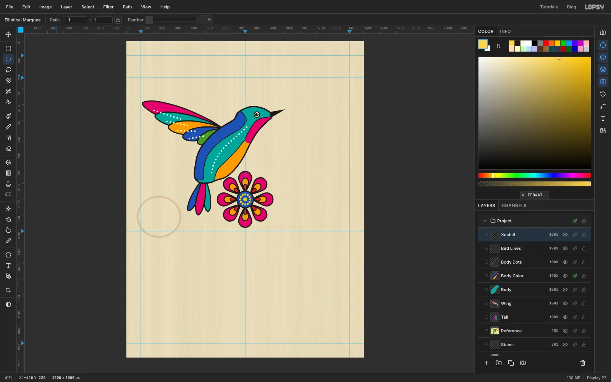

Make two circles on the canvas centre with the exact-size dialog and fill
them: ink, From **694, 944** To **806, 1056** (112 px), then cobalt, From
**701, 951** To **799, 1049** (98 px).

For the ring of dots, pick the **Brush**, reset Spacing to **10%**, set
Size to **14** and click **Radial Symmetry** in the options bar. Set
Segments to **12**. [[Cmd]]-click the exact centre of the flower to move
the symmetry centre there. Set the foreground to yellow `#FFD447` and click
once about **32 px** right of the centre, which stamps twelve dots.

Click **Radial Symmetry** again to switch it off, then add a **24 px**
yellow dot in the middle.

## Move the flower to the beak

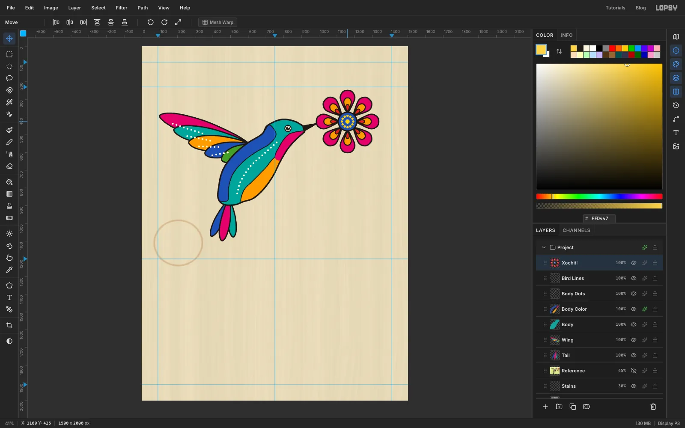

Press [[Cmd+D]], pick the **Move** tool and drag the flower up and to the
right until its centre is at about **(1160, 425)**. The beak tip should
just slip behind the left-hand petal, as if the bird is drinking.

## Ink the stem and bud

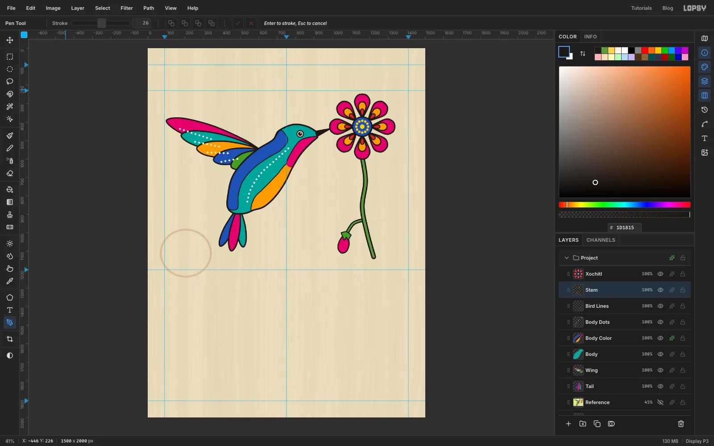

Select **Bird Lines** and add a layer named **Stem**. It lands under the
flower. Stems are two strokes on one path: a wide ink stroke, then a
narrower green stroke down the middle.

1. Draw the **bud stalk** first, curving down and left from the middle of
   where the stem will be. In the Pen options bar set Stroke to **20**,
   use ink, and press [[Enter]] to stroke the open path. Then switch to
   green `#5C9C3A`, click **Stroke Path** with width **8**, and delete the
   path.
2. Draw the **main stem** from under the flower down to about y 1130 with
   a gentle S-curve. It runs over the end of the bud stalk, which hides the
   join. Stroke it **26** in ink, then **12** in green.

Hang a magenta teardrop bud from the stalk (**fill and ink**, **6 px**
line) and cap it with a small green calyx (**5 px** line).

## Copy and flip the leaf

Add a layer named **Leaves**. Pen a leaf about **180 × 90 px** growing
up and right from the stem, **fill and ink** it green, then draw an open path down its middle and
stroke it **4 px** in ink for the vein.

Now duplicate it. Draw a rectangular marquee around the leaf, press
[[Cmd+C]] and [[Cmd+V]]. The paste lands in place with the transform
handles showing. Click **Flip Horizontal** in the options bar, press
[[Enter]] and rename the new layer **Leaf Left**. With the **Move** tool,
drag it left and about **110 px** down until its stalk end touches the
stem.

## Ring the heart with dots

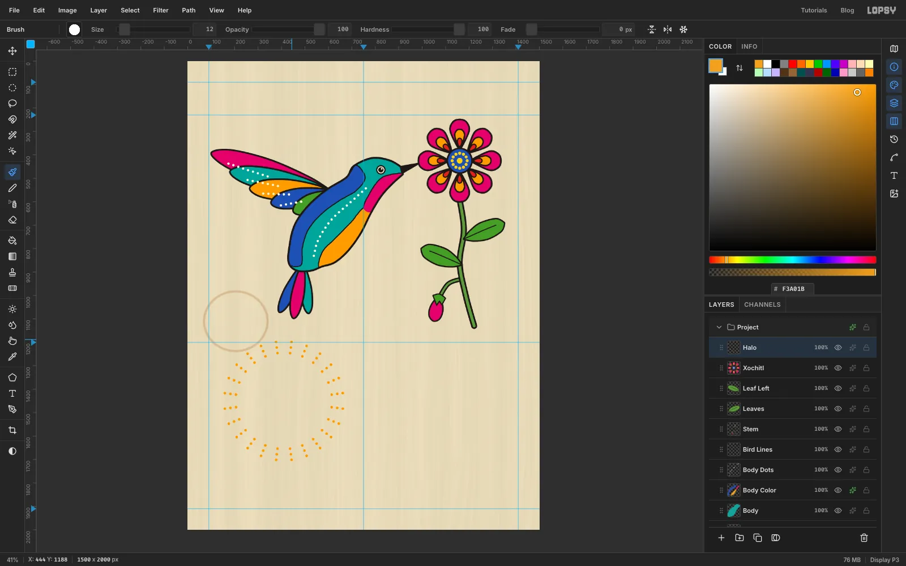

Select **Xochitl** and add a layer named **Halo**. The sacred heart sits in
the lower left, centred near **(410, 1450)**.

Pick the **Brush**: Size **12**, Hardness **100**, Spacing **200%**. Turn
on **Radial Symmetry** with **24** segments and [[Cmd]]-click the heart's
centre. With marigold `#F3A01B`, click about **206 px** above the centre and
[[Shift]]-click about **264 px** above it, leaning the line a few degrees
right of vertical so no ray runs straight up into the flame. You get 24
dotted rays at once. Switch Radial Symmetry off.

## Draw the flames and heart

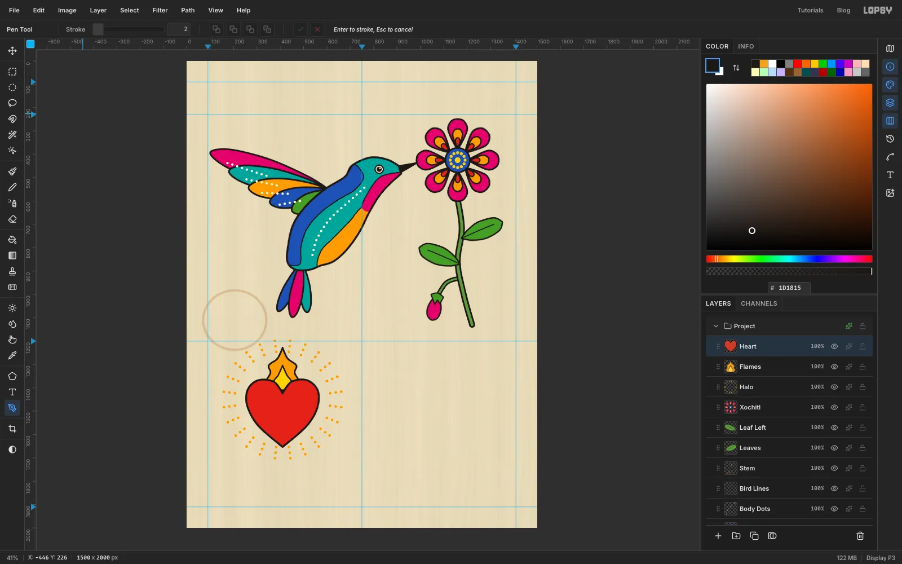

Add a layer named **Flames**. Pen a three-tongued flame about
**145 × 190 px**, rising from just below the top centre of where the heart
will be (around x 410, y 1400). Give it sharp corners at the base and the
tip, then **fill and ink** it marigold (**7 px**). Draw a smaller yellow
`#FFD447` flame, about **75 × 105 px**, inside it (**6 px**).

Add a layer named **Heart** and pen a heart about **300 px** wide and
**285 px** tall, its top dip meeting the base of the flame. Use
sharp corners at the top dip and the bottom point. **Fill and ink** it
heart red `#D2392A` with an **8 px** line, so it covers the flames' base.

## Add the thorn band and cross

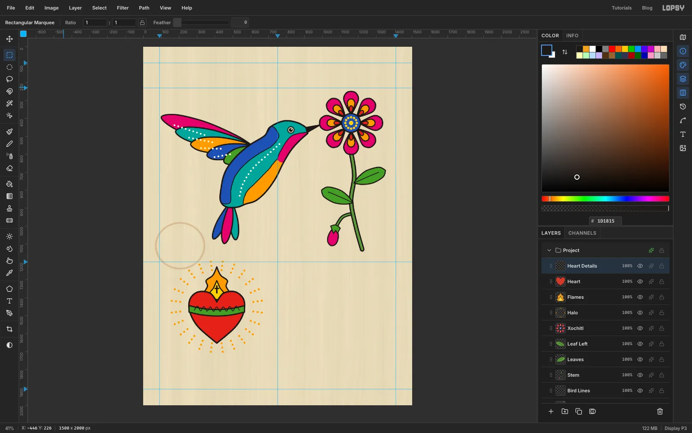

Add a layer named **Heart Details**. Pen a gently curved band across the
heart's upper third and **fill and ink** it leaf green (**7 px**). Draw
an open zig-zag path along the band, keeping it inside the band's ends.
Stroke it **4 px** in ink for the thorns.

For the cross, use two thin rectangular marquees filled with ink, sitting
wholly inside the yellow flame: a **7 × 45 px** upright and a
**25 × 7 px** crossbar.

## Cut the sun's rays

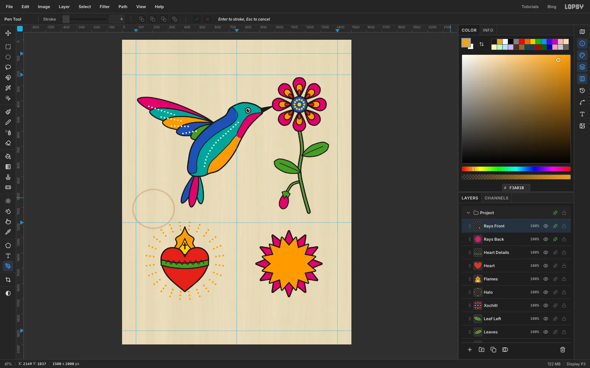

Add a layer named **Rays Back**. The sun is centred near **(1092, 1470)**;
drop a temporary vertical and horizontal guide through that point to help.
With the **Pen**, click the 24 corners of a twelve-point star and click the
first one again to close it. Plain clicks keep every corner sharp. Put a
point every 30° around the centre, about **214 px** out, starting straight
up. Put a valley halfway between each pair of points, about **132 px** out.
The pointer position in the status bar shows where you are.

Click **Path to Selection**, then **Delete Path**, and fill it magenta. In
its effects drawer turn on **Stroke**: Width **8**, ink, position
**Outside**.

Add **Rays Front** and do the same with a smaller star, points at
**178 px** and valleys at **118 px**, turned half a step so its points fall
between the magenta ones. Fill it marigold and give it a Stroke of Width
**7**, ink, **Outside**.

## Paint the sun's face

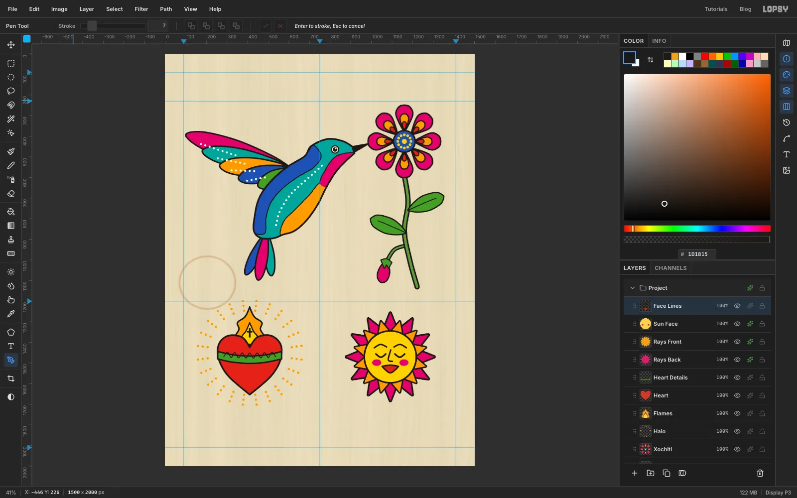

Press [[Cmd+D]] and add a layer named **Sun Face**. With the exact-size
dialog, make a circle From **970, 1348** To **1214, 1592** (244 px on the
sun's centre). Fill it with yellow `#FFD447` and give the layer a Stroke
effect: Width **8**, ink, **Outside**. Then add two magenta oval cheeks,
about **44 × 32 px**, centred **66 px** either side of the middle and
**28 px** below it, with the Elliptical Marquee and Fill.

Add a layer named **Face Lines**. With the Pen, draw each feature as a
three-anchor open path and press [[Enter]] to stroke it in ink:

- Closed eyes: two shallow U shapes, Stroke **8**.
- Eyebrows: two arches above them, Stroke **7**.
- Nose: a hooked line, Stroke **7**.

For the mouth, pen a closed shape that's flat on top and rounded below.
**Fill and ink** it red with a **7 px** line.

## Make the ribbon tails

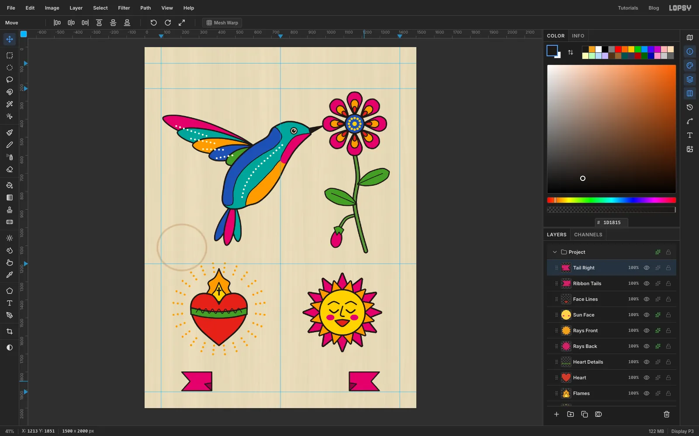

Select **Face Lines** and add a layer named **Ribbon Tails**. On the left,
pen a swallowtail end about **165 × 105 px**: a box with a V notch cut into
its outer side, its top edge at about y **1800**, its notched end about
**205 px** from the left edge of the sheet. **Fill and ink** it magenta
(**6 px**). The band will cover the tail's inner end later, so at that end
pen a small triangle along its top-inner corner, about **40 px** wide, for
the fold where the ribbon tucks under. **Fill and ink** it dark magenta
`#8C1447` (**5 px**).

To make the right tail, marquee the left tail and fold, then press
[[Cmd+C]] and [[Cmd+V]]. Click **Flip Horizontal**, press [[Enter]], and
drag the copy across to the right side, mirrored about the centre guide.
Choose **Layer → Merge Down** to merge it into Ribbon Tails.

## Letter the banner

Add a layer named **Ribbon**. Pen the band across both tails, centred on
the 750 guide: about **840 × 100 px**, from x **330** to **1170**, with
its middle at y **1794** and its ends dipping about **20 px** lower so it
arches gently. Corner-click its four corners and drag the anchors in
between for the curve. **Fill and ink**
it cream `#FFF5DD` (**7 px**).

Pick the **Text** tool ([[T]]). Choose **Shrikhand** at **80 px**, set
Letter spacing to **0** and set the foreground to cobalt `#2B4FAF`. Click
in an empty patch of paper and type `Xóchitl`, then press [[Tab]] to
commit.

With the **Move** tool, drag the word into the band and centre it on the
**750** guide, with equal space above the accent and below the baseline.

## Scatter four sparkles

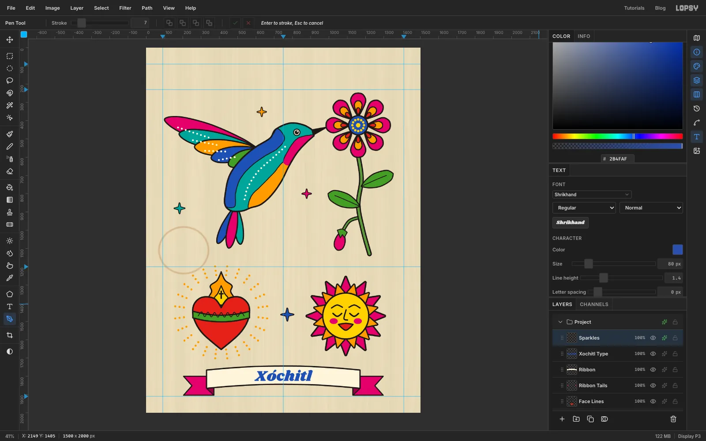

Select **Xochitl Type** and add a layer named **Sparkles**. That puts it
above the banner text. Put four four-point sparkles, each about **50 px**
across with the cobalt one about **70 px**, in the empty bays:

- Turquoise `#15A29A` under the wing
- Marigold above the bird's back
- Magenta between the belly and the leaves
- A larger cobalt one between the heart and the sun

Click each one's 8 corners with the Pen: four long points and four short
valleys about a quarter of the way out. Then **Path to Selection**,
**Delete Path** and **Edit → Fill**. When all four are done, give the layer
a Stroke effect: Width **4**, ink, **Outside**.

## Set the title and prices

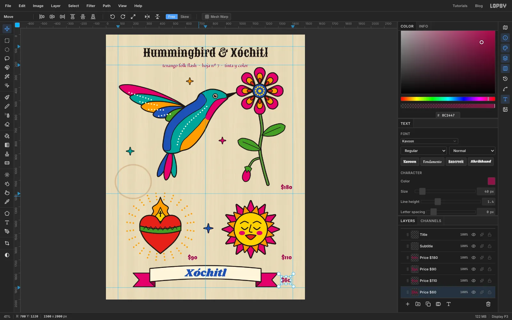

With the **Sparkles** layer selected, pick the **Text** tool. Before you
start, check that Letter spacing in the Text panel is still **0**, since
Lopsy keeps the last value you used. Make each text layer in an empty spot
and press [[Tab]] to commit it, then drag it into place with the Move
tool:

1. **Title**: *Hummingbird & Xóchitl* in **Sancreek**, **86 px**, ink,
   centred on the 750 guide with its cap tops about **105 px** from the
   top.
2. **Subtitle**: *tenango folk flash · hoja nº 7 · tinta y color* in
   **Fondamento**, **34 px**, dark magenta `#8C1447`, centred about
   **35 px** under the title.
3. **Prices** in **Kavoon**, **40 px**, dark magenta: **$180** at the
   bottom right of the bird's bay, **$90** right of the heart's lower
   edge, **$110** level with it beside the sun, and **$60** just past the
   right ribbon tail.

## Rule the border

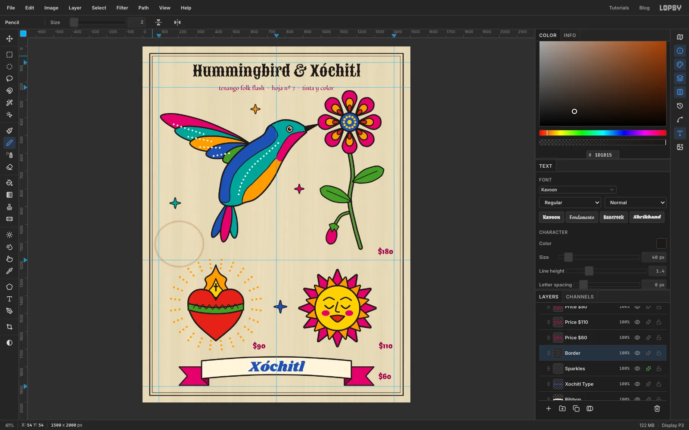

Select **Sparkles** and add a layer named **Border**. Pick the **Pencil**
([[N]]), set Size to
**5** and use ink. Click near the top-left corner, about **40 px** in from
each edge. Then hold [[Shift]] and click the other three corners in turn,
and finish back on the first one. Each Shift-click draws a straight line
from the last point.

Set Size to **2** and draw a second rectangle the same way, **54 px** in
from the edges.

## Tape down the corners

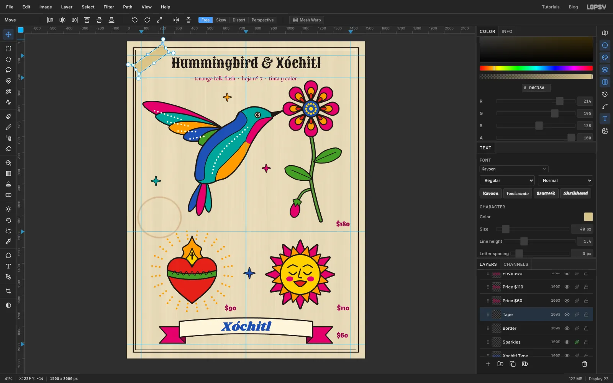

Add a layer named **Tape**. Drag a rectangular marquee about
**220 × 56 px** near the top-left corner and fill it with tape `#D6C38A`
at **90%** alpha (set A to 90 in the Color panel). Then set A back to
**100**. With the selection still active, run **Filter → Add Noise…**:
Amount **10**, **Mono**.

Press [[Cmd+D]], draw a marquee around the strip and, with the **Move**
tool, drag just outside the top-right corner handle to rotate it about
**−36°** across the corner. Press [[Enter]] and [[Cmd+D]]. Then marquee the
rotated strip again, press [[Cmd+C]] and [[Cmd+V]], click **Flip
Horizontal** and drag the copy to the top-right corner, the same way you
made the ribbon tail. Choose **Layer → Merge Down** to merge it into Tape.

## Group the designs and adjust the layout

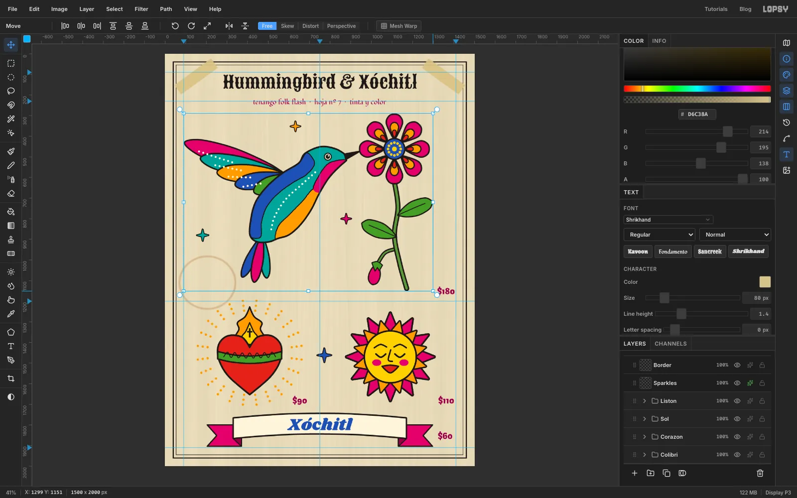

Group each design so it moves as one. Click its top layer, [[Shift]]-click
its bottom layer and choose **Layer → Group Layers**. Then double-click the
new group's name and rename it:

- **Colibri**: Xochitl down to Tail
- **Corazon**: Heart Details down to Halo
- **Sol**: Face Lines down to Rays Back
- **Liston**: Xochitl Type down to Ribbon Tails

Then select the **Colibri** group row, press [[Cmd+D]] and, with the
**Move** tool, drag the whole bird and flower down about **44 px**. That
opens up room under the subtitle. Next, hold [[Cmd]] and drag the group's
bottom-right handle up and left a little to shrink it to about **96%**. The
top-left corner stays put, and a clear gap opens above the heart's halo.
Press [[Enter]].

## Add print grain

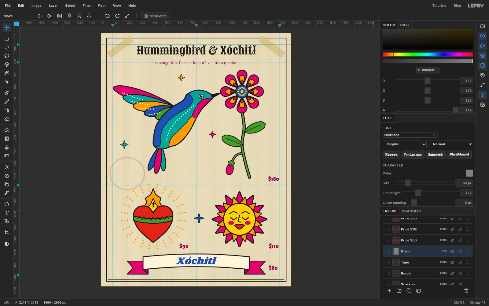

Select **Tape** and add a layer named **Grain** above it. It sits over all
the artwork but under the type, so the lettering stays crisp. Fill it with
mid-grey `#808080`, run **Filter → Add Noise…** at **28**, **Mono**, then
set it to **Overlay** at **22%**. It gives the flat colour the slightly
speckled look of ink on paper.

Hide the guides with [[Cmd+;]] to check the sheet, then choose **File →
Save Project** and **File → Export…** to save a PNG.
