In 1929 the Italian Futurists published a manifesto of **aeropittura**:
painting from inside an aeroplane. Tullio Crali's *Nose Dive on the City*
(1939) is the famous one. You look down past the plane's nose, and the
skyscrapers seem to rush up at you from every side. This tutorial borrows
that view for the cover of an imaginary flight magazine, *Iron Wings*.

The cover is 1200 × 1600 px. The city is drawn from flat shapes. The plane is a
real photograph, cut out and turned to silver. The type is set loud and on a
slant, the way the Futurists liked it.

For the plane you need **"Boeing Y1B-9A and P-26 in flight"**, a 1930s US Army
Air Corps photo. It's public domain, and you can download it from
Wikimedia Commons. It shows two planes in flight. You'll use the big bomber in
the front.

The tools you'll use:

- the **Pen** tool with **Path to Selection** for every straight-edged shape
- **Filter → Sunburst** for window columns and force lines
- **Radial Blur** on a merged copy with a **layer mask**, and **Halftone**
- the **Move** tool's scale, rotate and **Skew** handles
- **Duplicate Layer**, **Color Overlay**, **Stroke** and **Drop Shadow**
- a layer **group** with a **Gradient Map** adjustment
- **Bowlby One**, **Anton**, **Krona One** and **IBM Plex Mono**, with text
  bound to a curved path
- the **grid** with Snap, and the **Pencil** with [[Shift]]-click lines

Every colour below is the hex value you type into Lopsy:

- Paper `#ECE4CC`, ink `#17161B`
- Vermilion `#B8442C`, ochre `#DAA847`, haze yellow `#E8C878`
- Cobalt `#263E87`, navy `#172147`, steel blue `#727F97`
- Lit wall cream `#EEDDAB`, silver `#EFF1F4`

## Set up the page and the ground far below

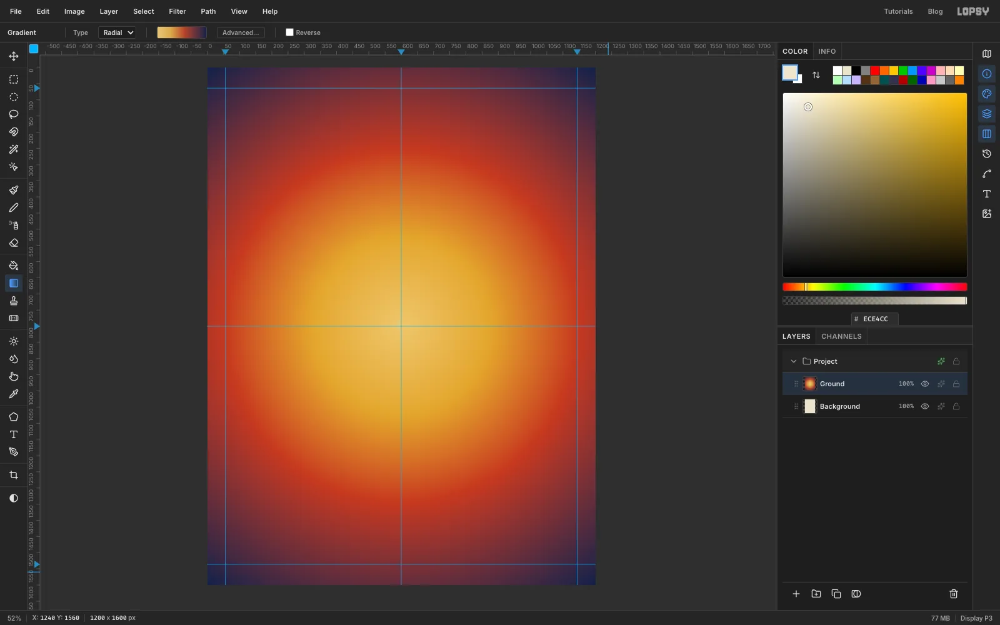

Choose **File → New**, set the units to **Pixels**, and make it **1200** ×
**1600**. Click the top ruler at 56, 600 and 1144 to drop three vertical
guides. Then click the left ruler at 64, 800 and 1536 for three horizontal
ones. The pointer position in the status bar tells you where you are, and
zooming in makes it easier to land on the exact number. The outer guides are your margins. The two middle ones cross at the
**vanishing point**: the spot in the middle of the page that everything dives
toward.

Select the **Background** layer, set the foreground to paper `#ECE4CC` and
choose **Edit → Fill**. Then rename **Layer 1** to *Ground*. This is the
street far below. Pick the **Gradient** tool, set **Type** to **Radial** and
open **Advanced…**. Make four stops: haze yellow `#E8C878` at the left end,
ochre `#DAA847` at about 28%, vermilion `#B8442C` at about 55% and navy
`#172147` at the right end. Drag from the vanishing point down and to the
right, nearly to the bottom-right corner.

## Draw the low blocks around the centre

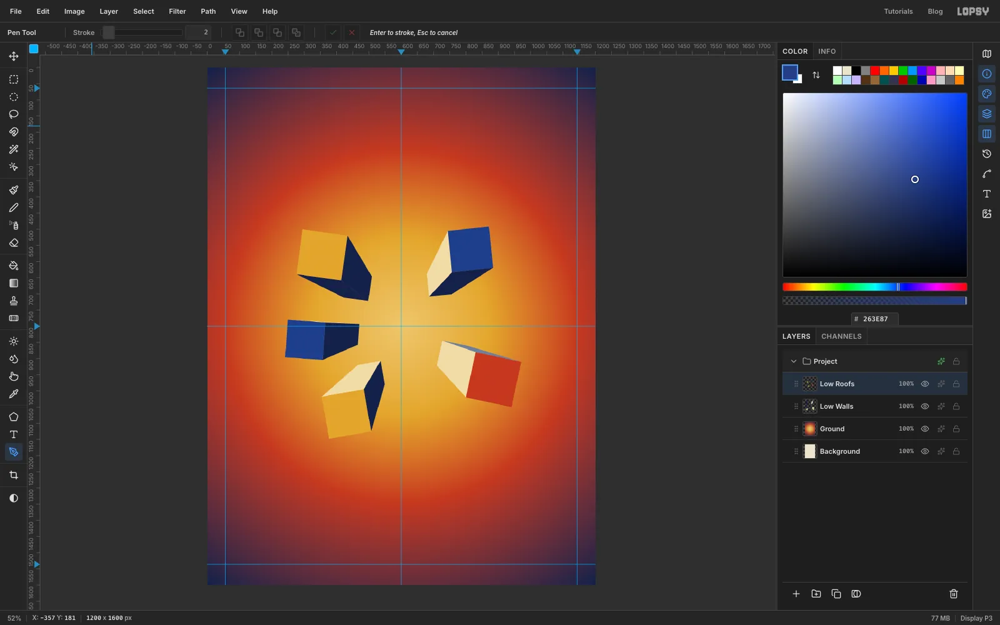

Every building on this cover follows the same rule. You're looking straight
down, so each roof is a square. Its walls run from the roof's inner edges back
toward the vanishing point. Only the walls that **face the centre** are
visible.

Add a layer called *Low Walls*. Pick the **Pen** tool (**P**) and click the
four corners of one wall. Click the first anchor again to close the shape.
Open the **Paths** panel from the right-hand toolbar and click **Path to
Selection**, then **Delete Path**. Set the foreground colour and choose
**Edit → Fill**, then press [[Cmd+D]]. Repeat for every wall.

Colour each wall by where it faces:

- toward the top left (the light): lit cream `#EEDDAB`
- side-on: steel `#727F97`
- away from the light: navy `#172147`

Five short blocks have their roofs about 300–330 px from the centre, at
roughly 10:30, 1:30, 4, 7 and 9 o'clock. The roofs are about 120–140 px
across and slightly turned. Decide where each roof square goes before you
draw: its visible walls give you two of its sides.

For each wall, click the two roof corners of an edge that faces the centre.
Imagine lines from those corners running toward the vanishing point, and
click where they stop. For these low blocks, stop a bit more than halfway in,
so each inner edge is about half as long as the roof edge.

Add a layer called *Low Roofs* and fill the five roof squares the same way.
Use ochre, cobalt and vermilion, mixed so that no two neighbours match.

## Raise the tall towers' walls

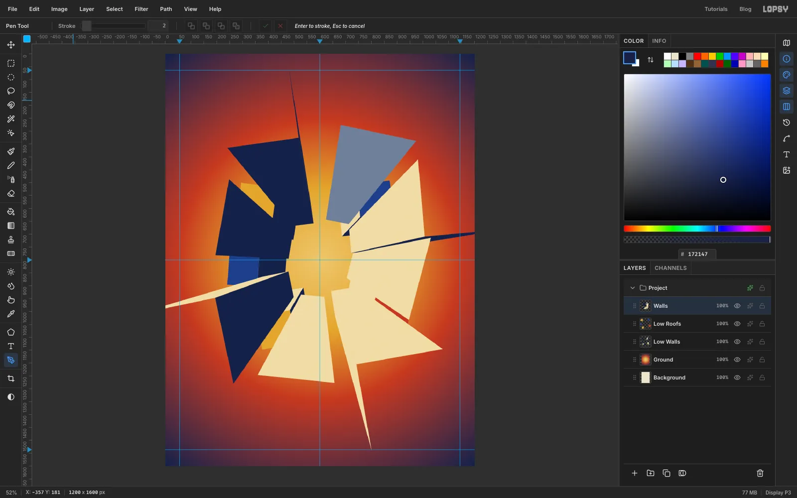

Add a layer called *Walls*. The eight tall towers' roofs sit near the edges of
the page. Their walls run almost all the way back to the centre, stopping
about 180 px short of it. That's what makes them look so tall. Use the same
method as for the low blocks, but this time each inner edge comes out only
about a third as long as the roof edge. Place the roofs
roughly:

- on the left edge and the lower-left edge
- at the upper left and the upper right, partly off the top of the page
- on the right edge, once above and once below the middle
- along the bottom, slightly left of centre and at the bottom right

Each roof is a square about 280–340 px across, turned a few degrees one way
or the other. Draw only the walls with the Pen, colouring them with the same
lit, side-on and away rule. Parts that hang off the page are fine. Close the
shape along the page edge.

## Cap the towers with roofs

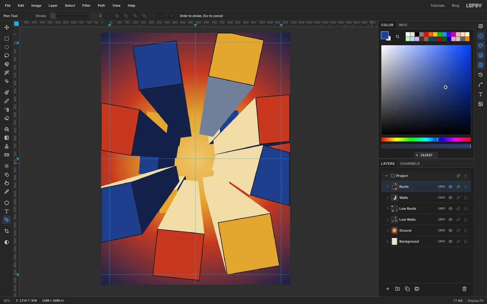

Add a layer called *Roofs* and fill the eight roof squares with the Pen,
alternating vermilion `#B8442C`, cobalt `#263E87` and ochre `#DAA847`.

Open the layer's effects (the ✦ button on its row), tick **Stroke**, set
**Width** to 4, set the colour to ink `#17161B` and choose **Inside**. The thin
dark edge reads as a parapet. It also stops the roofs melting into each other
once the blur goes on.

## Add rooftop blocks

Add a layer called *Roof Tops*. On each tall roof, use the Pen to draw a
square half its size in the middle, turned to match. Fill them all with ink
`#17161B`. Then set the layer's blend mode to **Multiply** and its opacity to
**25%**. The darker block turns a flat square into a rooftop.

## Cut window columns with Sunburst

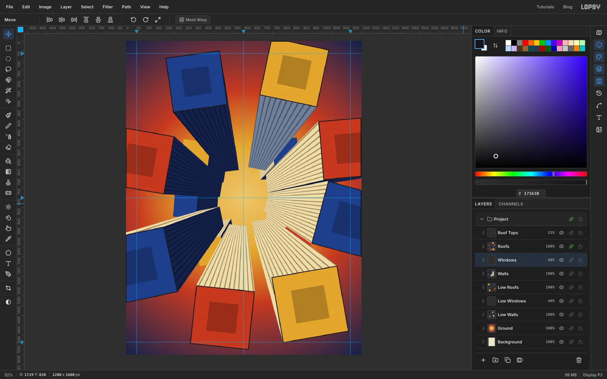

Windows on a tower seen from above line up with the vanishing point. A
Sunburst centred on the same spot draws them in the right perspective for
free.

Click the *Low Walls* row, then [[Cmd]]-click its thumbnail to select its
walls. Add a layer
called *Low Windows* and set the foreground to ink. Choose **Filter →
Sunburst**, then set **Rays** to 120, **Length** to 150, **Width** to 24, and
**Taper**, **Fade** and **Softness** to 0. Keep **Center X** and **Center Y**
at 50 and click **Apply**. Press [[Cmd+D]], then set the layer to **Multiply**
at **40%**.

Do the same for the tall towers: select the *Walls* row, [[Cmd]]-click its
thumbnail, add a *Windows* layer and run the same Sunburst. Finally open the
*Walls* layer's effects and add a **Drop Shadow** with both offsets at 0,
**Blur** 40 and **Opacity** 70. It darkens the ground around the foot of
each tower.

## Burst force lines out of the centre

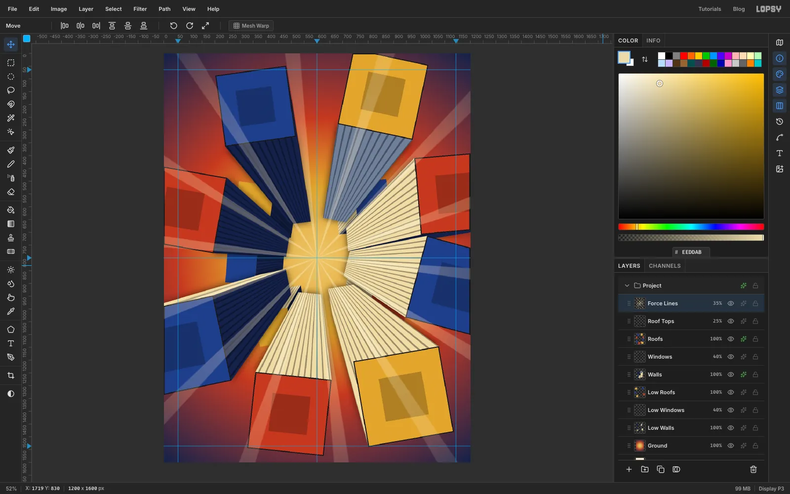

The Futurists drew **lines of force** to show speed. Select the *Roof Tops*
row and add a layer called *Force Lines*. Set the foreground to lit cream
`#EEDDAB`. Run **Filter → Sunburst** again with **Rays** 14, **Length** 120,
**Width** 16, **Taper** 0, **Fade** 75, **Softness** 10 and **Rotation** 6.
The filter dialog forgets the last run's values, so type every one.

Then choose **Filter → Radial Blur**, set **Amount** to 20 and apply it.
Set the layer to **Screen** at **35%**.

## Blur the edges with a masked copy

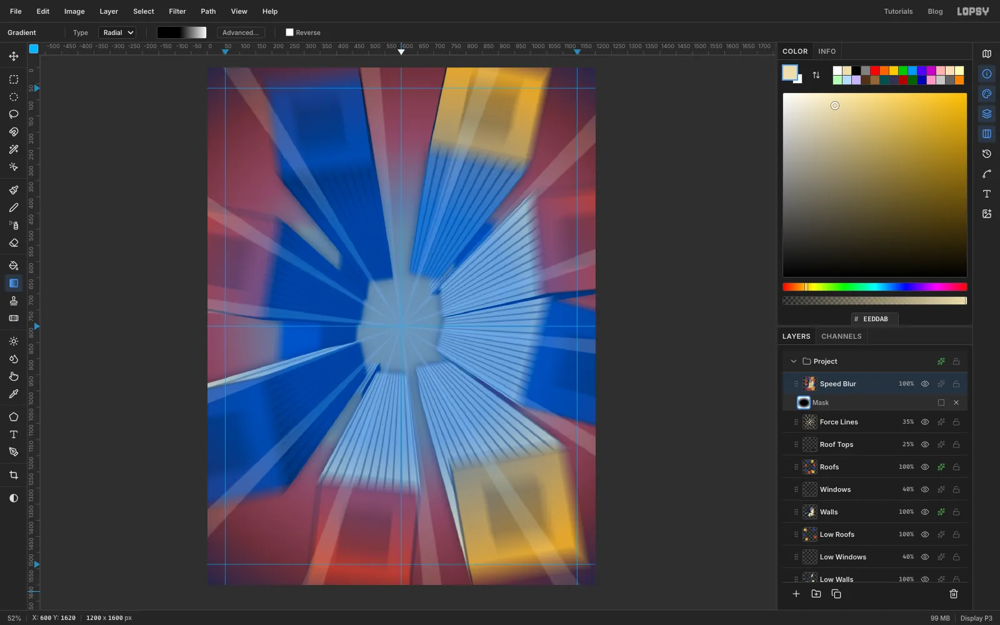

In a real dive, the buildings closest to you rush past and blur. Choose
**Select → All**, then **Edit → Copy Merged** and press [[Cmd+V]]. Rename the
pasted layer *Speed Blur* and press [[Cmd+D]]. Run **Filter → Radial Blur**
with **Amount** 45. Radial Blur always centres on the canvas, which is why the
vanishing point sits in the middle of the page.

Click the **Add Mask** button at the bottom of the Layers panel, then click
the mask row to edit the mask. Pick the Gradient tool (still **Radial**) and
open **Advanced…**. It still holds the four Ground stops, so delete one, then
set the remaining three to black at 0%, black at 45% and white at 100%. Drag from the
vanishing point straight down to the bottom edge. The centre is now masked
out and stays sharp. While you edit a mask, Lopsy tints the canvas blue. Click
the *Speed Blur* layer's name to go back to the layer.

## Lay one halftone pass over the city

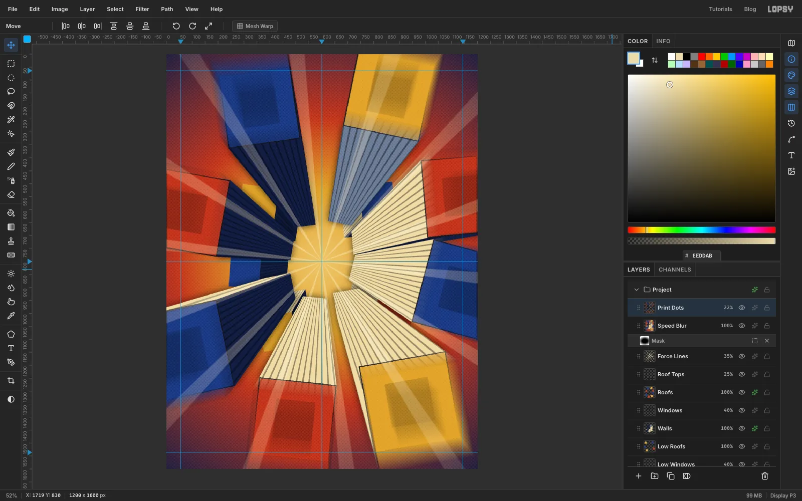

Choose **Select → All** and **Edit → Copy Merged** again, paste, rename the
copy *Print Dots* and press [[Cmd+D]]. Run **Filter → Halftone** with **Dot
Size** 9, **Density** 1, **Angle** 45 and **Softness** 0.5. Set the layer to
**Multiply** at **22%**. It's one even screen of dots, so the city looks
printed.

## Drop in the bomber photo

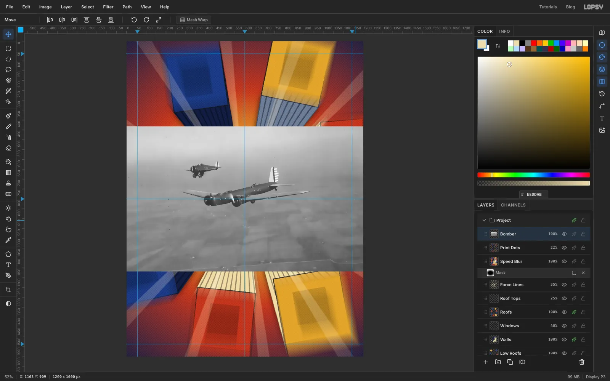

With *Print Dots* selected, drag the bomber photo from your folder onto the
canvas. Lopsy shrinks it to fit the page width, selects it and switches to
the Move tool. Rename the layer *Bomber* and press [[Cmd+D]].

Run **Filter → Surface Blur** with **Radius** 10 and **Threshold** 40. That
smooths the film grain but keeps the edges sharp, so the posterize step later
gives clean shapes instead of speckles.

## Trace the bomber with the Pen

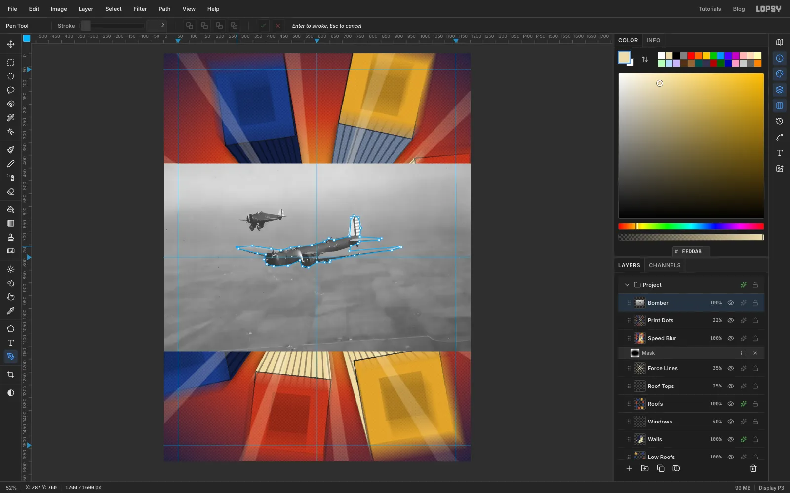

Zoom in and trace around the big bomber with the **Pen**. Single clicks give
straight corners. Go round the left wingtip, along the top of the nose and
the canopy, up the tail fin and out along the tailplane, then out along the
right wing. Come back under the engines and the wheel to the left wing. Around
40 clicks is plenty. Leave the small fighter outside the path. Click the first
anchor to close it.

## Cut it out and flatten the tones

Click **Path to Selection** in the Paths panel, then **Delete Path**. Choose
**Select → Inverse** and press [[Delete]], then [[Cmd+D]]. Now flatten the
photo into a few graphic tones. Run **Filter → Brightness/Contrast** with
**Brightness** 12 and **Contrast** 40, then **Filter → Posterize** with
**Levels** 6.

## Flip it and scale it up

Choose **Image → Flip Horizontal** so that the nose points right. Flip before
you scale or rotate.

Press **M** and draw a marquee just around the plane. Press **V** for the
**Move** tool. Hold [[Cmd]] and drag the bottom-right handle out until the
plane is a quarter bigger. [[Cmd]] keeps the proportions. Press
[[Enter]].

## Rotate it into the dive

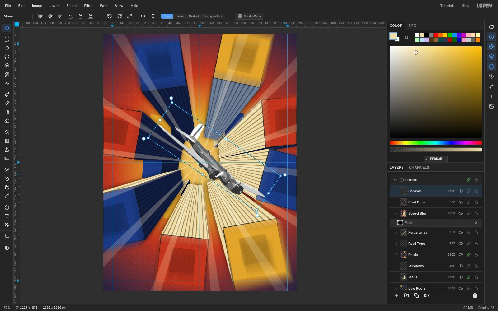

Press [[Cmd+D]], then draw a fresh marquee around the scaled plane. Switch to
the Move tool and drag the round **rotate** handle, just outside the box's
top-right corner, clockwise by about 34°. Press [[Enter]], then [[Cmd+D]].

## Point the nose at the vanishing point

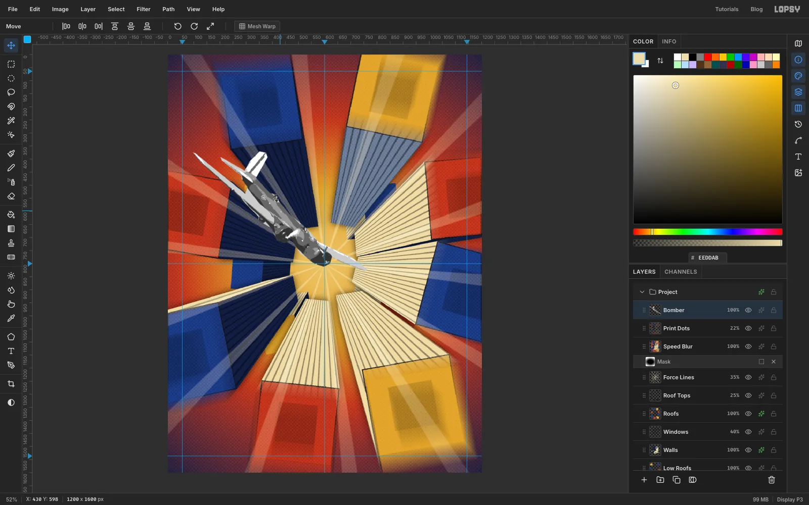

With the Move tool, drag the plane so that its nose sits just short of the
glowing centre. Its tail should stay well clear of the top of the page, where
the masthead will go.

## Trail coloured echoes behind it

Giacomo Balla painted moving things as a row of copies. Choose **Layer →
Duplicate Layer** three times. Each copy gets " copy" added to its name, so
rename the four layers from the bottom up: *Echo 3*, *Echo 2*, *Echo 1*, and
the top copy back to *Bomber*.

Then for each echo:

1. Click its row.
2. With the Move tool, drag it back up and to the left along the line of the
   dive: *Echo 1* about 60 px, *Echo 2* about 120 px, *Echo 3* about 180 px.
3. Add a **Color Overlay**: vermilion for *Echo 1*, ochre for *Echo 2* and
   paper for *Echo 3*.
4. Set its opacity: 65%, 45% and 30%.

## Turn the plane to silver with a Gradient Map

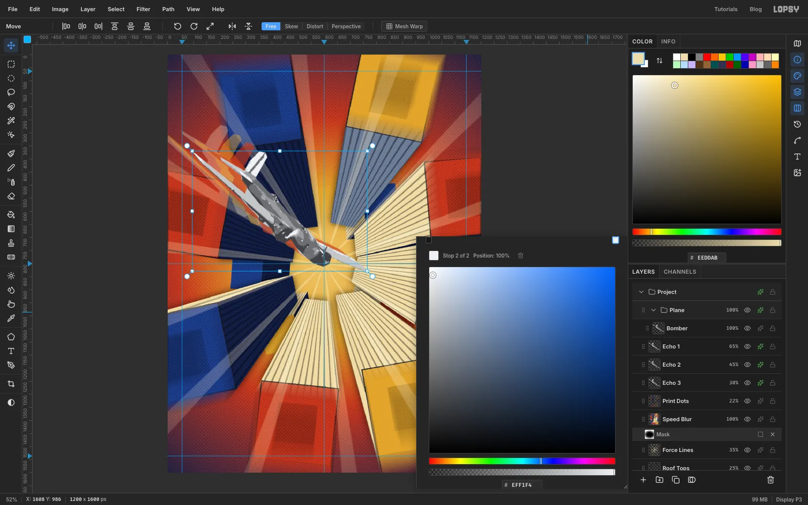

Click the top *Bomber* row and choose **Layer → Group Layers**. Rename the
group *Plane*. Open the group's effects with its ✦ button. On a group, the
drawer shows **adjustments**. Click **Add Adjustment → Gradient Map**. Click
the left stop and type ink `#17161B`. Click the right stop and type silver
`#EFF1F4`. Every grey in the photo now maps onto that ink-to-silver ramp. The
plane reads as polished metal, and the echoes outside the group keep their
colours.

## Outline the plane

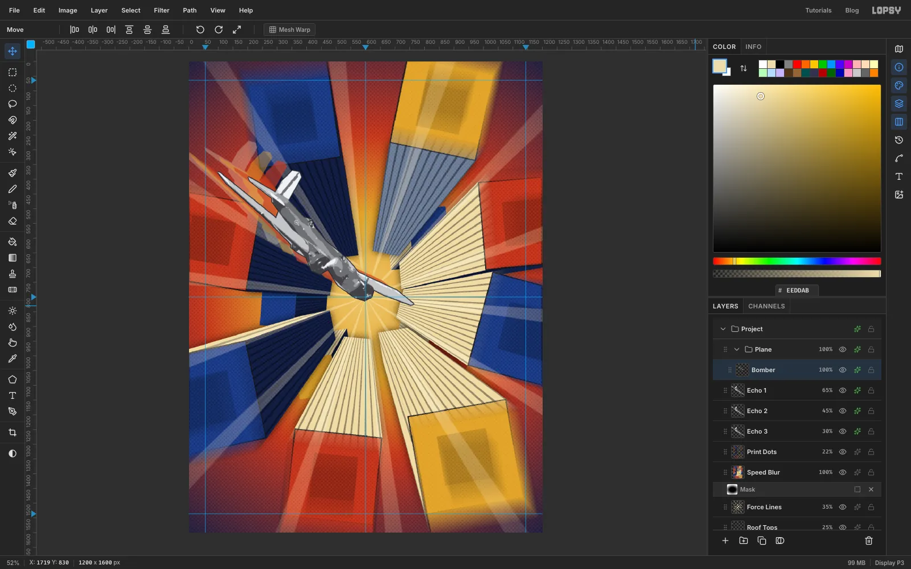

Click the *Bomber* row inside the group. In its effects, tick **Stroke**, set
**Width** to 3, the colour to ink and the position to **Outside**. Don't add a
drop shadow. The plane is in the air, not standing on the city.

## Add the masthead band

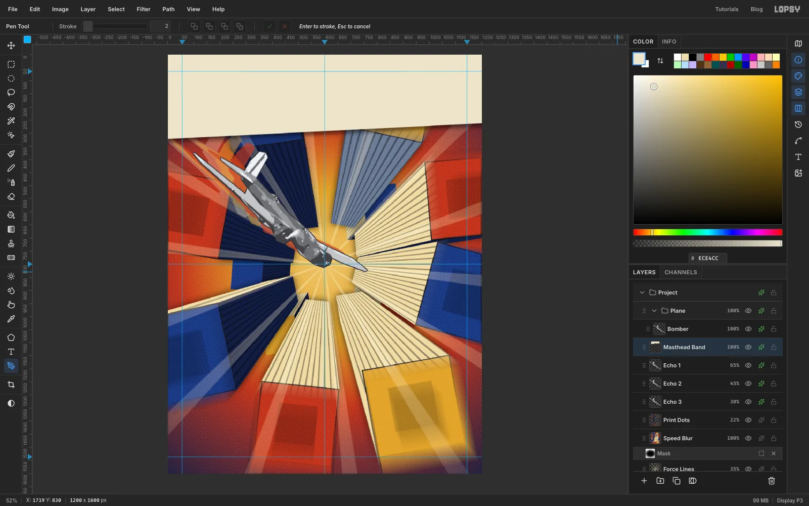

Select *Echo 1* and add a layer called *Masthead Band*. It lands above the
echoes and below the *Plane* group. With the Pen, click the top-left and
top-right corners of the page, then the right edge about 260 px down, then
the left edge about 320 px down. Close the shape, use **Path to Selection**
and fill it with paper `#ECE4CC`. Give the band a **Drop Shadow**: offset
X 0, Y 12, **Blur** 24, **Opacity** 55.

## Set the masthead

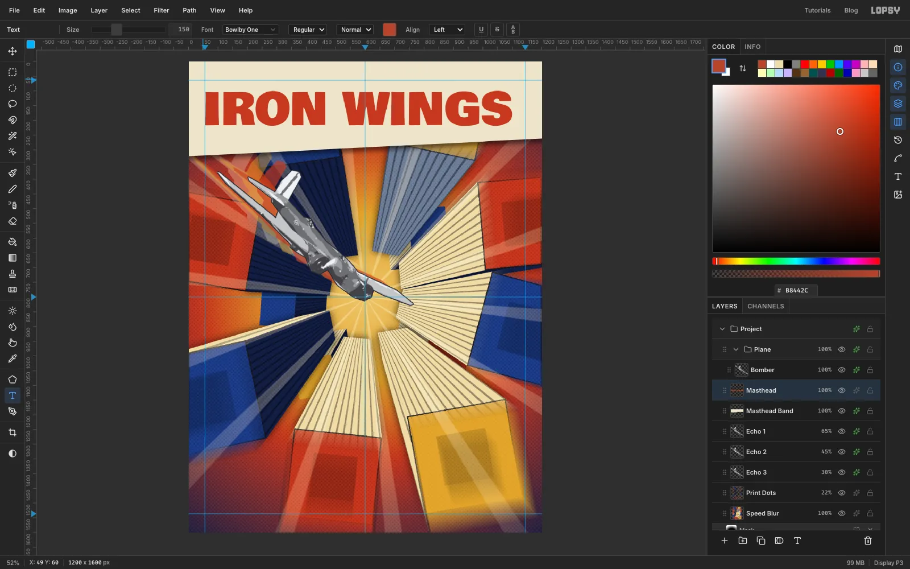

Pick the **Text** tool (**T**). Choose **Bowlby One**, set **Size** to 150 and
the colour to vermilion `#B8442C`. Click near the top left of the band, type
`IRON WINGS` and press [[Tab]] to commit. Click **Rasterize Layer** at the
bottom of the Layers panel. With the Move tool, nudge it so that the left
edge of the **I** sits on the 56 px guide and the tops of the letters sit at
about 104 px.

## Lean it forward with Skew

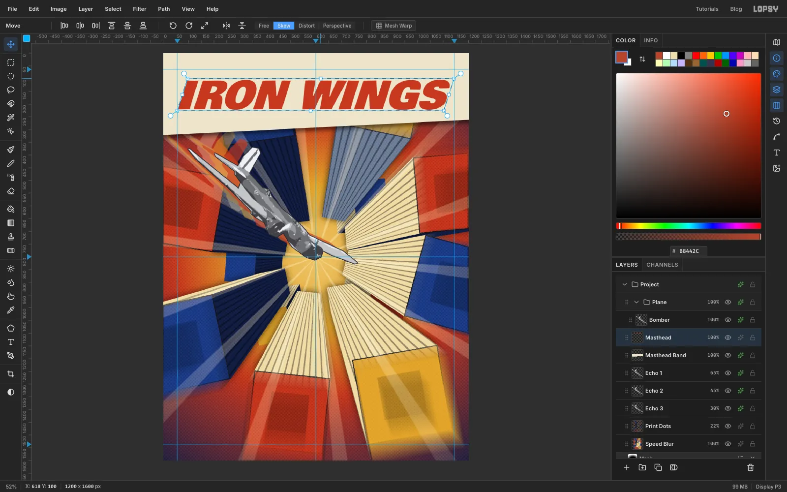

Press **M**, draw a marquee around the masthead and press **V**. Click
**Skew** in the options bar, then drag the **top-middle** handle about 40 px
to the right. The tops of the letters slide right and the bottoms stay put.
Press [[Enter]] and [[Cmd+D]], then nudge the bottom of the **I** back onto
the left margin.

## Give it a speed trail, then add the small print

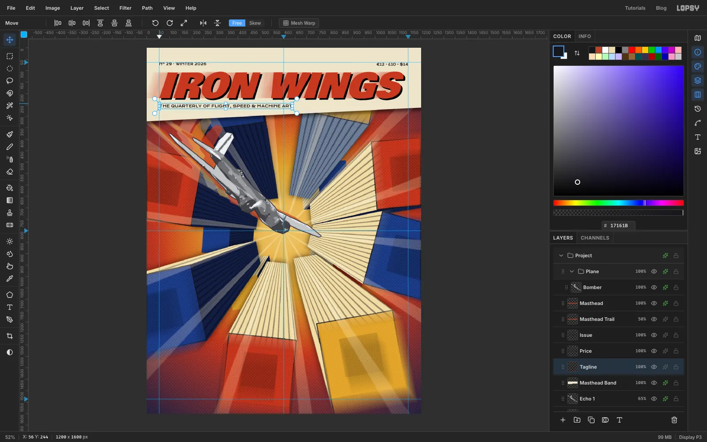

Choose **Layer → Duplicate Layer**. Click the lower copy, rename it *Masthead
Trail* and move it 36 px to the left: press [[Shift+Left]] three times and
[[Left]] six times. Run **Filter → Motion Blur** with
**Angle** 0 and **Distance** 70, and set the layer to 50% opacity. Click the
top copy, name it *Masthead* and give it a **Drop Shadow**: both offsets 7,
**Blur** 0 and **Opacity** 100.

For the small print, first click the *Masthead Band* row. A new text layer
always lands above the selected row, and starting from a raster layer means
you won't restyle an existing text layer by accident. Set **Krona One**, size
15, ink.

1. Click in the empty top-left corner and type `Nº 29 · WINTER 2026`. Move it
   so that it sits on the 56 px and 64 px guides.
2. Click the band row again. In the top-right corner, type
   `€12 · £10 · $14` and move it so that its right edge sits on the 1144 px
   guide.
3. Click the band row once more and set the size to 17. Type
   `THE QUARTERLY OF FLIGHT, SPEED & MACHINE ART` and place it on the left
   margin, about 26 px under the masthead.

A text layer is named after its first few words, so rename these three
*Issue*, *Price* and *Tagline* to keep the stack readable.

## Build the NOSE-DIVE coverline

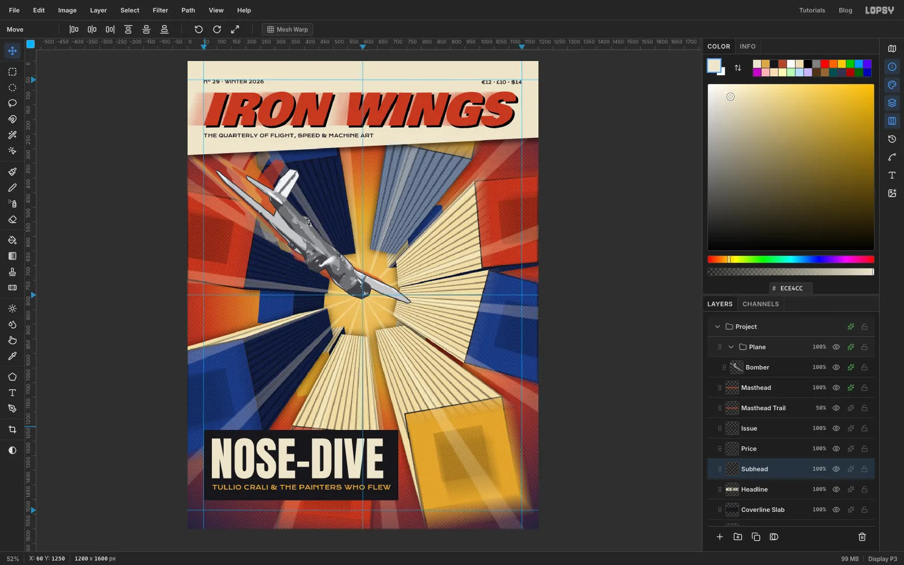

Click the *Tagline* row and add a layer called *Coverline Slab*. With the
**Rectangular Marquee** and nothing selected, click once on the canvas to
open the exact-corners dialog. Enter From 56, 1262 and To 722, 1502, then
fill the selection with ink and press [[Cmd+D]].

Type the small line first, because the big headline's text box would swallow
a click below it. Set **Krona One**, size 22, ochre `#DAA847`. Click inside
the slab near its bottom edge, type `TULLIO CRALI & THE PAINTERS WHO FLEW`,
press [[Tab]] and click **Rasterize Layer**. Click the slab row, then set
**Anton**, size 158, paper `#ECE4CC`. Click near the slab's top-left corner,
type `NOSE-DIVE`, press [[Tab]] and rasterize it too.

Move the headline 28 px in from the slab's left and top edges. Put the small
line 22 px under it, lined up on the same left edge.

## Merge the block and tilt it

Select the top of the three layers (the small ochre line) and choose
**Layer → Merge Down** twice. Rename the result *Coverline*. Draw a marquee
around it and use the rotate handle to turn it about 5° counter-clockwise.
Press [[Enter]] and [[Cmd+D]], then nudge the block so that its top-left
corner, which now sticks out furthest to the left, sits on the 56 px
margin. Give it a hard **Drop Shadow** in paper:
both offsets 10, **Blur** 0, **Opacity** 100. The cream edge lifts the slab
off the busy city.

## Run a coverline up the left margin

With *Coverline* selected, set **Anton** 58 in paper. In an empty spot near
the bottom, type `AEROPITTURA · 1929–1944`, rename the layer *Vertical* and
rasterize it. Switch to the Move tool and click the anticlockwise-arrow
button (**Rotate 90° CCW**) in the options bar. With no selection,
it turns the whole layer. Move the layer so that it sits on the left margin
with its lower end just above the slab. Add a **Drop Shadow** with both
offsets 6, **Blur** 0 and **Opacity** 100.

## Snap a barcode box to the grid

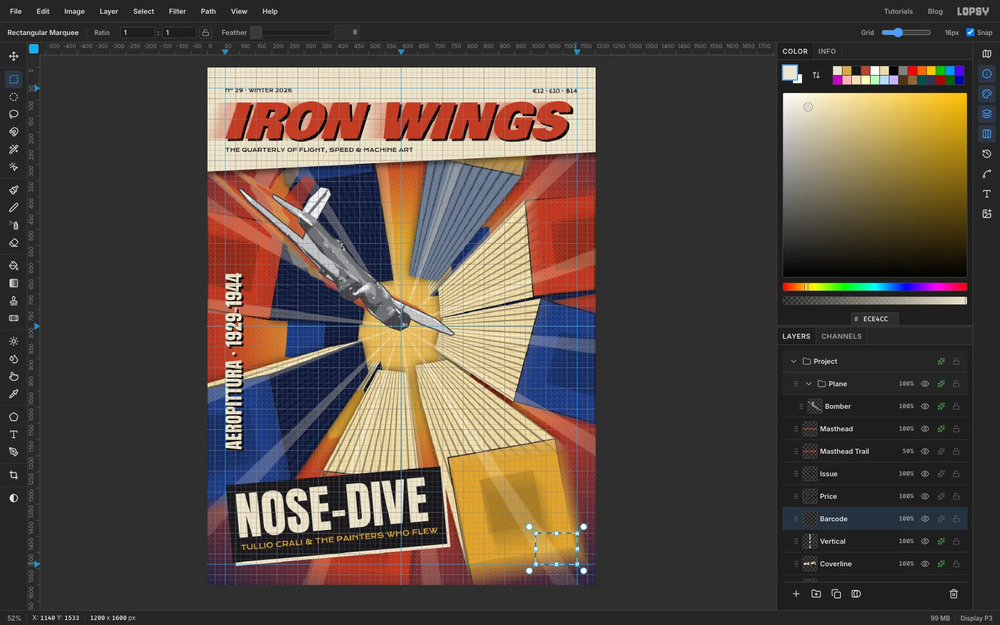

Add a layer called *Barcode*. Choose **View → Show Grid**. Showing the grid
also turns **Snap** on. Drag the **Grid** slider in the options bar to 16 px.
With the Rectangular Marquee, drag from about 128 px left of the right margin
and 96 px above the bottom margin, down to the corner where the margins meet.
The marquee snaps to the grid lines. Fill it with white and press
[[Cmd+D]]. Then choose **View → Show Grid** and **View → Snap to Grid** again
to turn both off before drawing the bars.

## Draw the bars with the Pencil

Pick the **Pencil** (**N**) with ink as the foreground. For each bar, click
near the top of the box, then [[Shift]]-click near the bottom. That draws a
straight vertical line. Draw about 20 bars, changing the **Size** between 2,
3 and 4 px and varying the gaps.

Under the bars, add the digits `9 771 2029 04007` in **IBM Plex Mono** at
size 11. Rasterize them and **Merge Down** into *Barcode*.

## Draw an arc around the dive

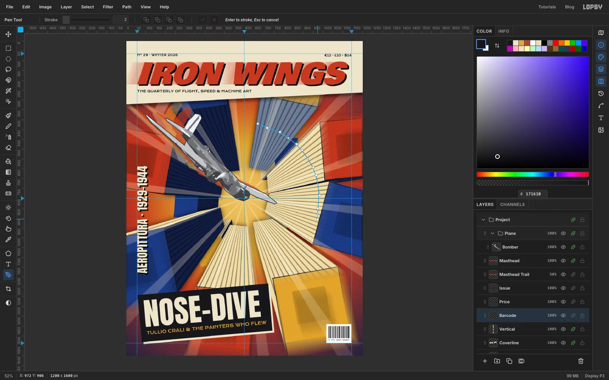

With *Barcode* selected, pick the Pen tool. Draw a quarter circle about 380 px
from the vanishing point. Start about 380 px above the centre and a little to
the right of it, sweep clockwise past the bright towers on the right, and end
a little below the centre's level. Press and drag at each of five points so
that the curve stays smooth. Then click the ✓ **Commit
path** button. Don't press [[Enter]], which would also stroke the path.

## Set the noise on the path

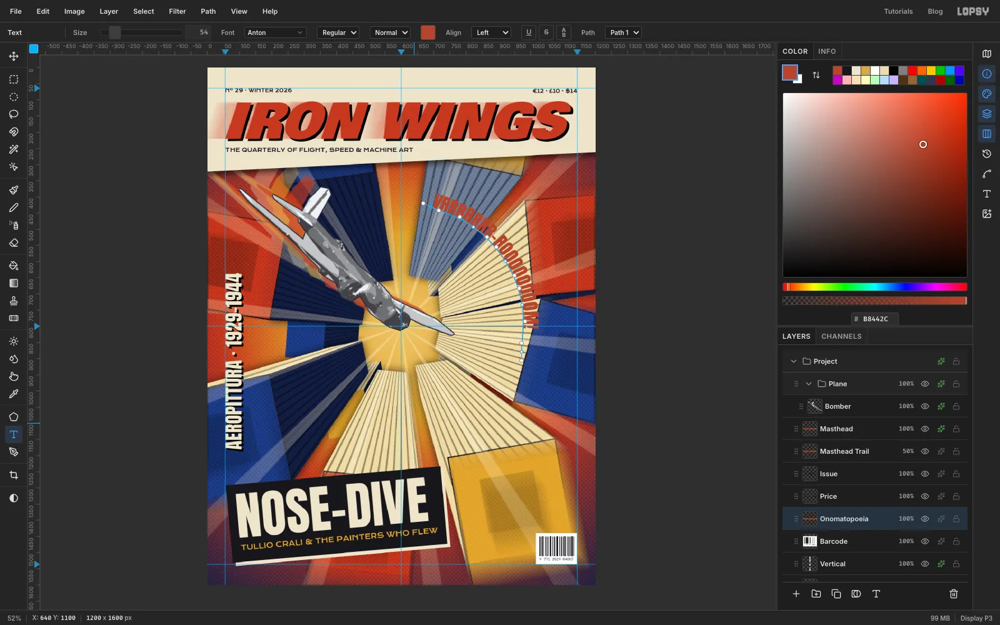

Pick the Text tool and set **Anton**, size 54, in vermilion. Click in an
empty area, type `VRRRRRRR-ROOOOOOOOM!`, press [[Tab]] and rename the layer
*Onomatopoeia*. In the options
bar, set **Path** to *Path 1*. The letters jump onto the arc and run along
it. If the end of the word is cut off, the arc is too short: drag its last
anchor further round.

Click the path's row in the Paths panel to deselect it and hide its outline.
Don't delete it, because that would unbind the text. Give the text a 4 px ink
**Stroke** and a hard **Drop Shadow**: both offsets 6, **Blur** 0,
**Opacity** 100.

## Add paper grain and finish

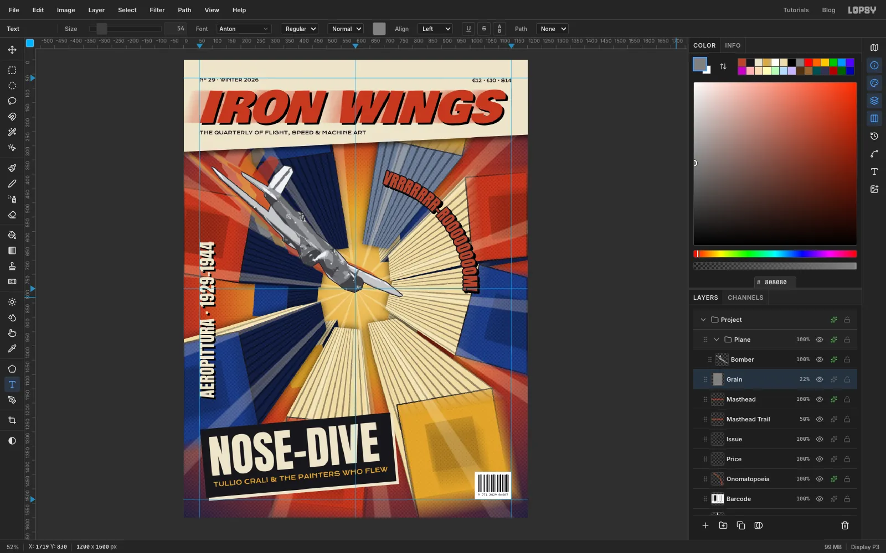

Click the *Masthead* row and add a layer called *Grain*. Choose
**Select → All**, set the foreground to 50% grey `#808080`, choose **Edit →
Fill** and press [[Cmd+D]]. Run **Filter → Add Noise** with **Amount** 28,
**Mono** and **Gaussian**, then set the layer to **Overlay** at **22%**.
The grain sits below the *Plane* group, so the metal stays clean and pops
off the printed page.

Save with **File → Save Project**, and export with **File → Quick Export
PNG**.
