Moths fly at lights, and these days the brightest light in the room is usually a screen. This invitation is for **TIGER MOTH**, a made-up private view of new work by a made-up artist, Ines Varga. The card treats the moth as if it got too close to an old CRT monitor. Its wings tear into slices, its colour channels slip apart, and the bottom of the photo melts into a pixel-sort drip that runs down into a terminal window holding the event details.

Glitch art is easy to overdo. If you pile every effect onto the photo, the moth turns to mud and nobody can tell what it was. The rules that keep this card readable are:

- **Leave the subject recognisable.** Use three slice tears, a small RGB split and one pixelated block, and leave most of each wing intact.
- **Keep the effects on their own layers.** The drip, the blocks, the scanlines and the grain are all separate, so you can tone any of them down later.
- **Use one screen colour.** Everything that belongs to the "computer", including the rule, the header, the terminal and the margin text, is the same phosphor green.

The document is **1500 × 2100 px**, a 5 × 7 inch card at 300 dpi.

The photo is [Arctia caja 2010](https://commons.wikimedia.org/wiki/File:Arctia_caja_2010.jpg) by Tlusťa on Wikimedia Commons, in the public domain. It's shot from straight above on a flat grey wall, which makes it easy to cut out. Download the 1920 px version.

The palette:

- Night `#050807` → `#0E5A32` (the glow)
- Phosphor `#39FF7A`
- Title cream `#F3E6C8`
- Subtitle cream `#F2EAD0`
- Glitch red `#FF2E4D`
- Glitch cyan `#19E3FF`
- Antennae `#D9CDB0`

Two habits save trouble throughout:

- **[[V]] then a handle.** Only the Move tool moves or transforms pixels. Draw a marquee with [[M]], press [[V]], then drag inside it to move what's selected, or drag a handle to scale. Press [[⌘D]] when you're done, which also commits the change. Enter doesn't.
- **Click a plain layer before you type.** If a text layer is active, changing the font or size in the options bar restyles *that* layer. Before each new piece of text, click a raster layer in the Layers panel (the step tells you which one).

## Paint the night and the glow

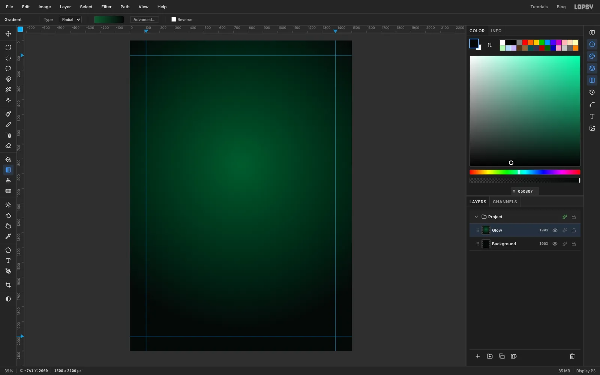

1. Create a **1500 × 2100** document with a **White** background.
2. Click **Background**, set the foreground colour to `#050807` and choose **Edit → Fill**.
3. A new document comes with an empty **Layer 1** above **Background**. Double-click its name and rename it **Glow**.
4. Pick the **Gradient** tool and set **Type** to **Radial**. Click **Advanced…**, set the left stop to `#0E5A32` and the right stop to `#050807`, and click **Done**.
5. Drag from the middle of the page, a little above centre, straight down to just above the bottom edge. The glow should be brightest where the moth's body will go.
6. Click the top ruler at **110** and **1390** to drop two vertical guides, and click the left ruler at **100** and **2000** for two horizontal ones. These are your margins.

## Drop in the moth

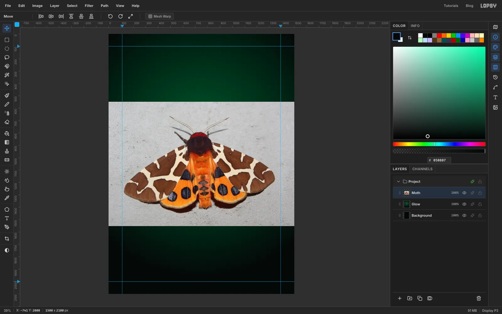

1. Drag the moth photo from your file browser onto the canvas. Lopsy shrinks it to the page's width, centres it, and names the layer **Pasted Layer**.
2. Rename the layer **Moth** and press [[⌘D]], because a paste leaves its pixels selected.

## Select the wall through a blurred copy

The wall has a rough plaster grain, and a Magic Wand click on the photo itself leaves hundreds of unselected specks. A blurred copy smooths the grain out, so the wand sees one even grey.

1. With **Moth** active, choose **Layer → Duplicate Layer** and rename the copy **Helper**.
2. Run **Filter → Gaussian Blur…** with **Radius** 5.
3. Press [[W]] for the **Magic Wand**. Set **Tolerance** to 30 and leave **Contiguous** ticked.
4. Click the wall in the top-left corner. The light falls off towards the bottom, so hold `Shift` and click about nine more spots around the moth: down the left side, along the bottom, up the right side and along the top.
5. Choose **Select → Grow…** with 4, then **Select → Shrink…** with 4. Growing and shrinking by the same amount fills the small holes the grain left in the selection without moving its edge.

## Cut out the moth

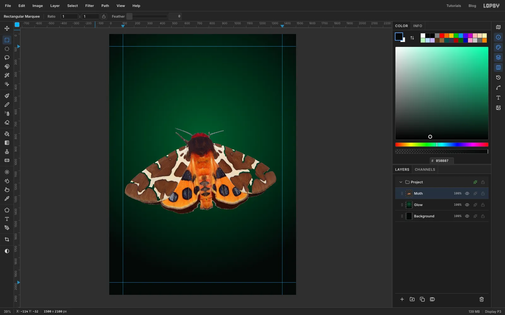

1. Click the **Moth** row and press [[Delete]].
2. Click the **Helper** row and click the bin icon at the bottom of the Layers panel to delete it. Press [[⌘D]].
3. Shrinking the selection pulled it a few pixels away from the photo's edge, so a thin grey frame is left around it. Press [[M]] and drag a marquee just inside the photo's edges, choose **Select → Inverse**, press [[Delete]], then [[⌘D]].
4. The wing edges still carry a dark rim of the wall's shadow. `⌘`-click the **Moth** thumbnail to select its outline, then choose **Select → Shrink…** with 2, then **Select → Inverse**. Press [[Delete]] and then [[⌘D]].

## Scale the moth to the margins

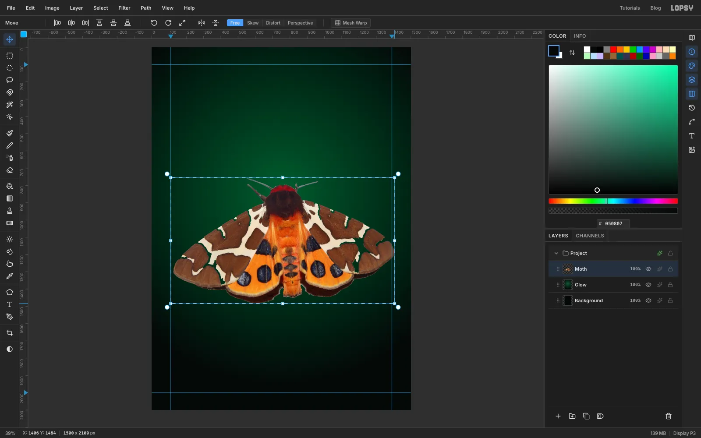

1. Press [[M]] and drag a marquee snugly around the whole moth, antennae included.
2. Press [[V]]. Hold `⌘` and drag the bottom-right corner handle outwards until the wing tips touch the guides on both sides. `⌘` keeps the proportions.
3. Press [[⌘D]] to commit the scale.
4. Drag the moth with the Move tool until the wings are centred between the guides and the body sits just below the middle of the page.

## Redraw the antennae

The wand couldn't separate the feathery antennae from the wall, so they came out as grey bars with plaster stuck to them. It's quicker to paint new ones.

1. With **Moth** active, press [[M]] and marquee from just above the antenna tips down to the top of the red collar on the moth's head, keeping clear of the wings. Press [[Delete]] and [[⌘D]].
2. Click the **+** at the bottom of the Layers panel to add a layer, and name it **Antennae**. Set the foreground to `#D9CDB0`.
3. Press [[P]] for the **Pen** and set **Stroke** to 5 in the options bar. Press at the left side of the collar and drag a short handle upwards. Then press about 200 px to the left and 150 px up, and drag that handle further out to the left, so the line curves outwards like a feeler. Press [[Enter]] to stroke the path.
4. Open the **Paths** panel from the panel buttons on the right edge of the window and click **Delete Path**. The stroke stays on the layer.
5. Draw the right antenna the same way: press at the right side of the collar and drag a short handle upwards, then press about 200 px to the right and 150 px up and drag that handle outwards to the right. Press [[Enter]], then delete this path too.

## Merge and warm the colours

1. With **Antennae** active, choose **Layer → Merge Down** so the antennae become part of **Moth**.
2. Run **Filter → Hue/Saturation…** with **Saturation** 15. The photo was shot under a flat white light, and the glitch effects later will dull it a little.

## Tear the wings into slices

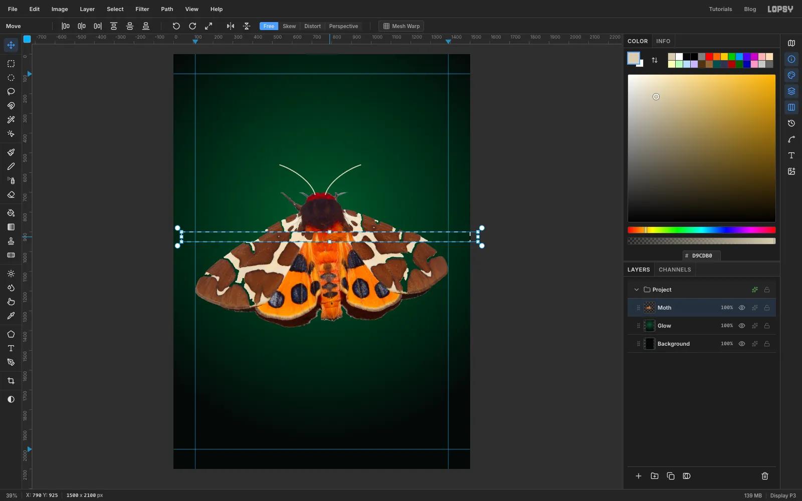

A slice tear is just a band of the image moved sideways. Each one is a full-width marquee, so the whole band moves and the edges of the cut stay perfectly straight.

1. Press [[M]] and drag a marquee across the full width of the page through the upper forewings, about 50 px tall.
2. Press [[V]], drag inside the marquee about 40 px to the right, and press [[⌘D]].
3. Repeat on a taller band, about 80 px, through the row of black spots on the hindwings, dragging it 30 px to the right.
4. Make a third band across the middle of the antennae and drag it about 22 px to the left, so the feelers kink.

Three tears are enough. More than that and the wing pattern stops reading as a tiger moth.

## Split the colour channels

1. With **Moth** active and nothing selected, run **Filter → Chromatic Aberration…** with **Amount** 6 and **Direction** 0.

The red channel slides one way and the blue the other, so every edge gets a red fringe on one side and a cyan fringe on the other. Keep the amount small. At 10 or more the whole moth goes soft.

## Stretch the lower edge

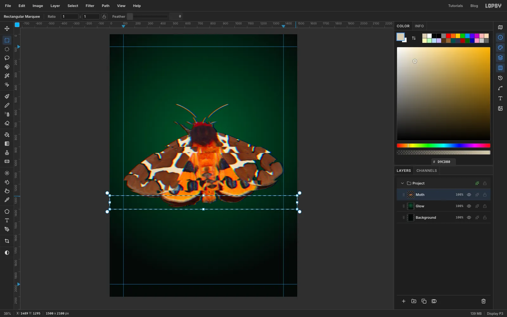

1. Press [[M]] and marquee a full-width band over the bottom edge of the hindwings, about 110 px tall.
2. Run **Filter → Pixel Stretch…** with **Amount** 90, **Bands** 40, **Seed** 7 and **RGB Split** 0.6. Only a few of the 40 bands land inside your marquee and get shifted, which gives you broken scan lines rather than a smear. If nothing visible happens, try a different **Seed**.
3. Press [[M]] and marquee a small block, about 96 × 64 px, on the left wing, between the two wing tears, and run **Filter → Pixelate…** with **Block Size** 16. This is the one "compression artefact" on the moth.
4. Press [[⌘D]].

## Pull a pixel-sort drip

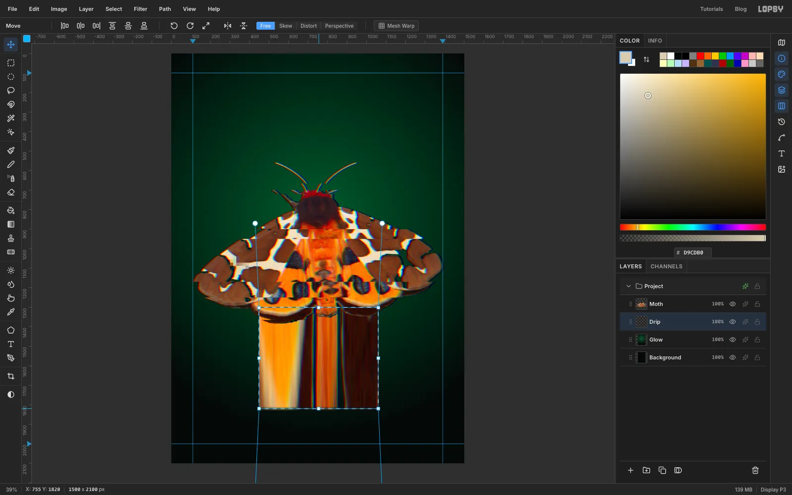

Real pixel sorting reorders pixels by brightness. You can fake its look by stretching a thin strip of the image a long way, so that each pixel becomes a vertical streak.

1. With **Moth** active, press [[M]] and marquee a strip about 24 px tall across the bottom of the hindwings, from below the inner edge of the left hindwing to below the right one, roughly the middle 600 px. Leave out the wing tips, because they're mostly transparent there and would leave smudgy stubs.
2. Press [[⌘C]]. Click the **Glow** row and press [[⌘V]]. The paste lands just above **Glow**, which puts it *under* the moth. Rename it **Drip** and press [[⌘D]].
3. `⌘`-click the **Drip** thumbnail to select exactly the strip, press [[V]], and drag the **bottom-middle** handle straight down to about **1820** (watch the Y readout in the status bar). The streaks start behind the moth and run down past where the terminal window will go, so the window hides their ends.
4. Press [[⌘D]].

## Set the title

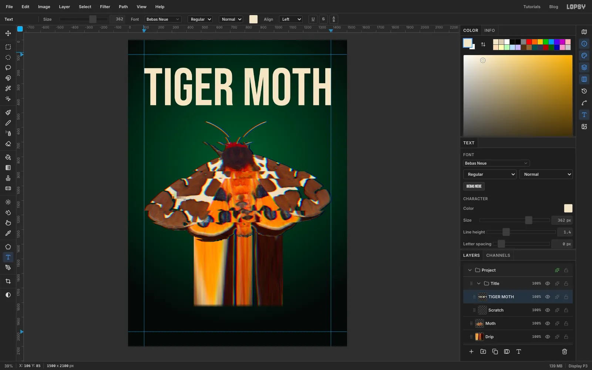

1. Click the **Moth** row and click the folder icon at the bottom of the Layers panel to add a **New Group**. Rename it **Title**.
2. With the group selected, click **+** to add a layer inside it, called **Scratch**. It's only there so the text tool has a plain layer to start from.
3. Press [[T]]. Set the font to **Bebas Neue**, **Size** to 362 and the colour to `#F3E6C8`. Click near the top-left guide, about 85 px from the top, type `TIGER MOTH` and press [[Tab]]. You click above where the letters should start because the text box includes the font's space above the capitals.
4. Bebas Neue at 362 px is almost exactly as wide as the margins. Press [[V]] and nudge with the arrow keys (`Shift` moves 10 px at a time) until the first letter sits on the left guide and the tops of the capitals are about 190 px from the top.
5. Click **Rasterize Layer** at the bottom of the Layers panel. The tears in the next step need pixels, not live text.

## Tear the title

Wide tears through a condensed face like Bebas make the letters look doubled, because a shifted band of stems reads as a second line of type. Use thin streaks instead.

1. Run **Filter → Chromatic Aberration…** on the title with **Amount** 6 and **Direction** 0.
2. Press [[M]] and marquee a full-width band only **6 px** tall through the upper third of the letters. Press [[V]] and drag it about 120 px to the left. Press [[⌘D]].
3. Press [[M]] again and marquee an 8 px band just below the middle of the letters. Press [[V]], drag it 60 px to the right, and press [[⌘D]].
4. Click the **Scratch** layer and delete it.

## Cross it with Difference bars

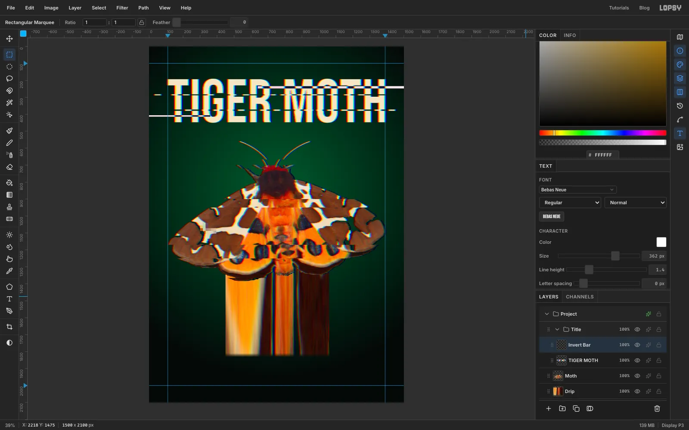

1. Click the **TIGER MOTH** row and add a layer above it called **Invert Bar**.
2. Set the foreground to white. Press [[M]] and marquee a 14 px bar from the gap between the two words to the right edge of the page, through the tops of the letters, and choose **Edit → Fill**.
3. Press [[⌘D]], then marquee an 8 px bar from the left edge of the page to just past the G, near the bottom of the letters, and fill it too. Press [[⌘D]].
4. Click the sparkle icon on the **Invert Bar** row and set **Blend** to **Difference**. Over the dark background the bars stay white, and where they cross the cream letters they turn dark. Close the effects drawer.

## Add the header and subtitle

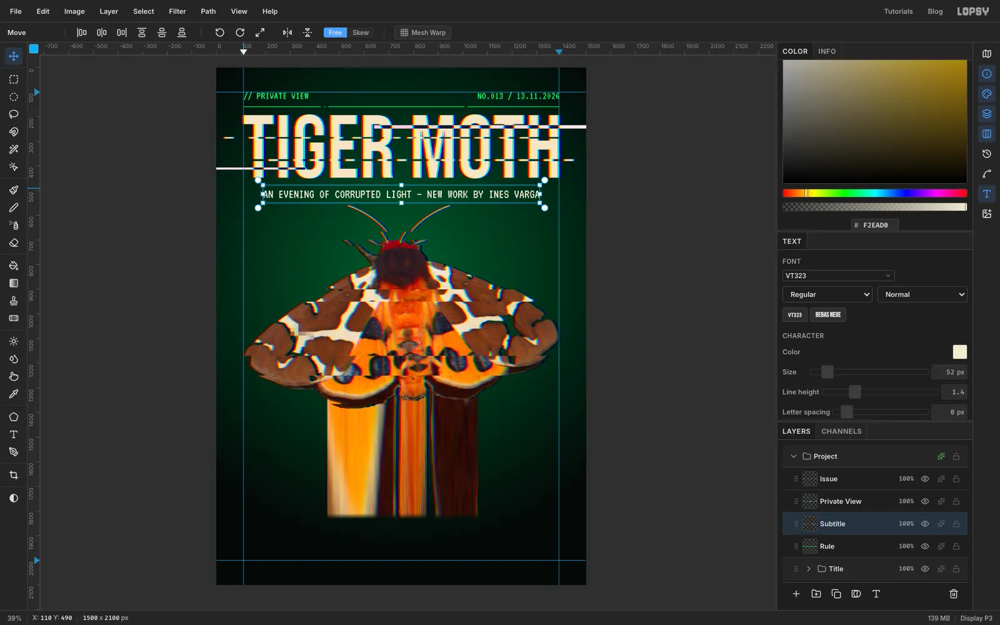

1. Click the arrow on the **Title** group to collapse it, then click its row and add a layer called **Rule**. With the group collapsed, the new layer goes above it rather than inside it.
2. Set the foreground to `#39FF7A`. Press [[N]] for the **Pencil** with **Size** 3. Click on the left guide 160 px from the top, then `Shift`-click on the right guide at the same height.
3. Press [[E]] for the **Eraser** with **Size** 14 and click three times on the rule: twice close together on the left and once on the right. The gaps look like signal dropouts.
4. With **Rule** active, press [[T]] and set **VT323**, **Size** 44, colour `#39FF7A`. Click in the empty space top right, type `NO.013 / 13.11.2026` and press [[Tab]]. Double-click the new layer's name and rename it **Issue**. Press [[V]] and nudge it until its right edge is on the right guide and its top is 100 px from the top of the page.
5. Click the **Rule** row again, press [[T]], click in empty space near the top left and type `// PRIVATE VIEW` in the same style. Press [[Tab]], rename the layer **Private View**, and line it up with the left guide at the same height.
6. Click **Rule** again and press [[T]]. Set **Size** to 52 and the colour to `#F2EAD0`, click in empty space and type `AN EVENING OF CORRUPTED LIGHT — NEW WORK BY INES VARGA` (VT323 draws the dash short, like a hyphen). Press [[Tab]] and rename the layer **Subtitle**. Centre it under the title, about 50 px below the bottom of the letters.

## Build the terminal window

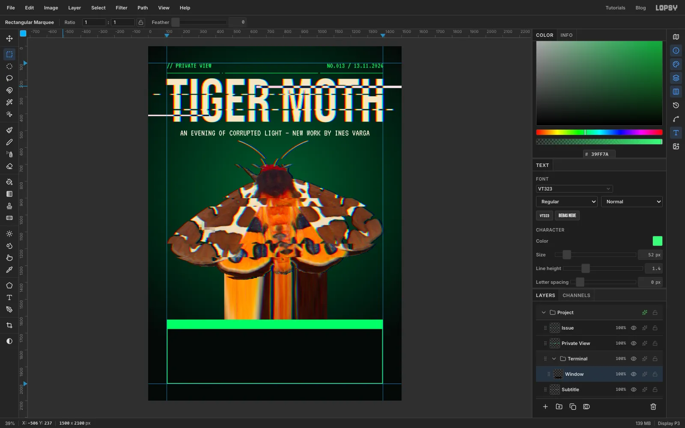

Draw the window a little low first, then move the finished group up into place once its text is in.

1. Click the **Subtitle** row and add a **New Group** called **Terminal**. Inside it, add a layer called **Window**.
2. Press [[M]] and, with nothing selected, click once on the canvas to open the exact-corners dialog. Enter X 110 to 1390 and Y 1620 to 2020. That's guide to guide, hanging 20 px past the bottom guide for now. Set the foreground to `#39FF7A` and choose **Edit → Fill**.
3. Choose **Select → Shrink…** with 4. Set the foreground to `#050807` and **Edit → Fill** again. That leaves a 4 px green frame. Press [[⌘D]].
4. Click once again for the dialog and enter X 110 to 1390 and Y 1620 to 1676: a 56 px bar across the top of the frame. Set the foreground to `#39FF7A`, choose **Edit → Fill** and press [[⌘D]].

## Make it glow

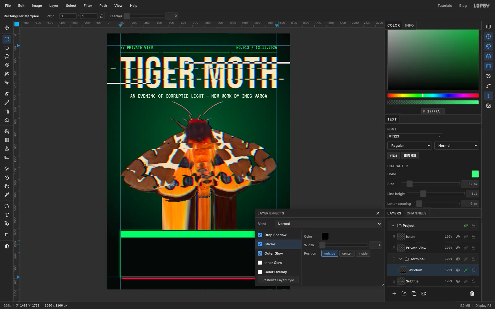

Open the effects drawer from the sparkle icon on the **Window** row, and turn on:

- **Outer Glow**: colour `#39FF7A`, **Size** 28, **Opacity** 55. This is the phosphor bloom.
- **Drop Shadow**: colour `#FF2E4D`, **Offset X** 14, **Offset Y** 14, **Blur** 0, **Spread** 0, **Opacity** 100. With no blur it reads as a red "ghost" of the window that has slipped out of register.
- **Stroke**: colour `#000000`, **Width** 4. It separates the window from the drip running behind it.

## Type the details

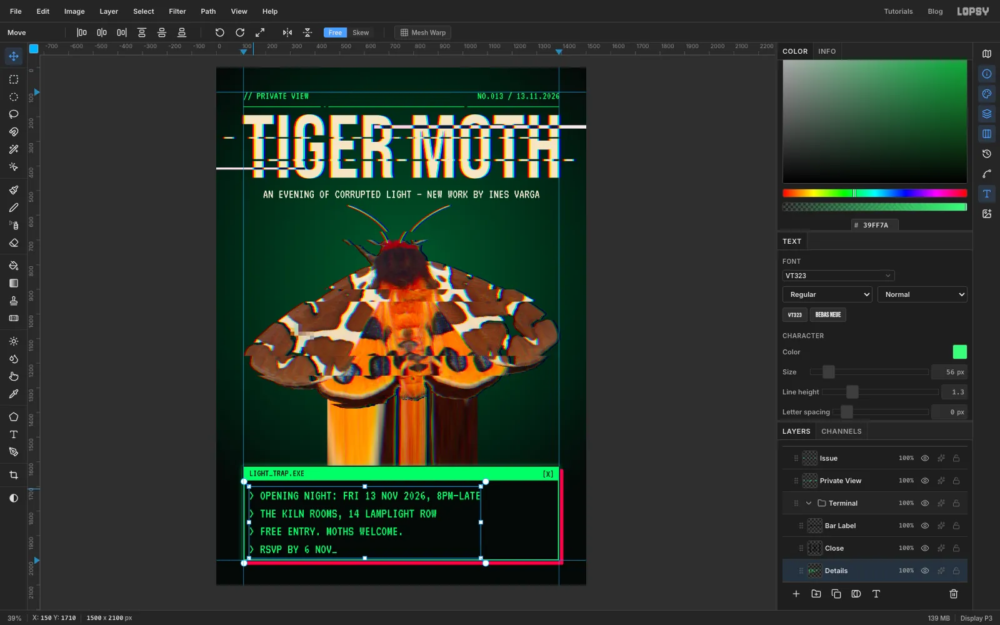

1. With **Window** active, press [[T]], set **VT323**, **Size** 40 and colour `#050807`. Click on the green bar near its left end, type `LIGHT_TRAP.EXE` and press [[Tab]]. Rename the layer **Bar Label**. Press [[V]] and nudge it so it starts 26 px in from the left edge of the frame and sits in the middle of the bar's height.
2. Click **Window**, press [[T]], click near the right end of the bar and type `[X]`. Press [[Tab]], rename it **Close**, and nudge it so its right edge is 26 px in from the frame's right edge.
3. Click **Window** again and press [[T]]. Set **Size** to 56 and the colour to `#39FF7A`, click inside the window below the bar, and type these four lines, pressing [[Enter]] between them:
   - `> OPENING NIGHT: FRI 13 NOV 2026, 8PM–LATE`
   - `> THE KILN ROOMS, 14 LAMPLIGHT ROW`
   - `> FREE ENTRY. MOTHS WELCOME.`
   - `> RSVP BY 6 NOV_`
4. Press [[Tab]] and rename the layer **Details**. In the **Text** panel set **Line height** to 1.3.
5. Press [[V]] and move the block so its left edge lines up with `LIGHT_TRAP.EXE`, with equal space above it (below the green bar) and below it (above the frame). Check the descenders on the commas: they should sit well inside the frame.

## Move the whole window up

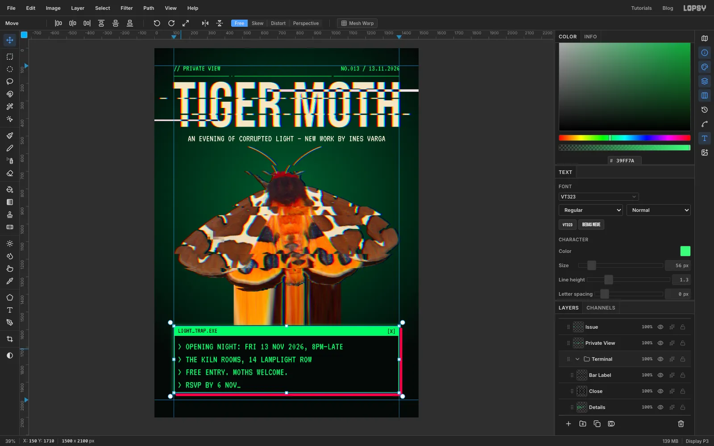

1. Click the **Terminal** group row so the whole group is active.
2. Press [[V]], then press `Shift`+[[↑]] four times. Each press moves the group 10 px, so the frame, the effects and all three pieces of text go up 40 px together.

The frame now ends 20 px above the bottom guide, which leaves room for the red shadow, and the space under the shadow matches the space above the header.

## Run text up the margins

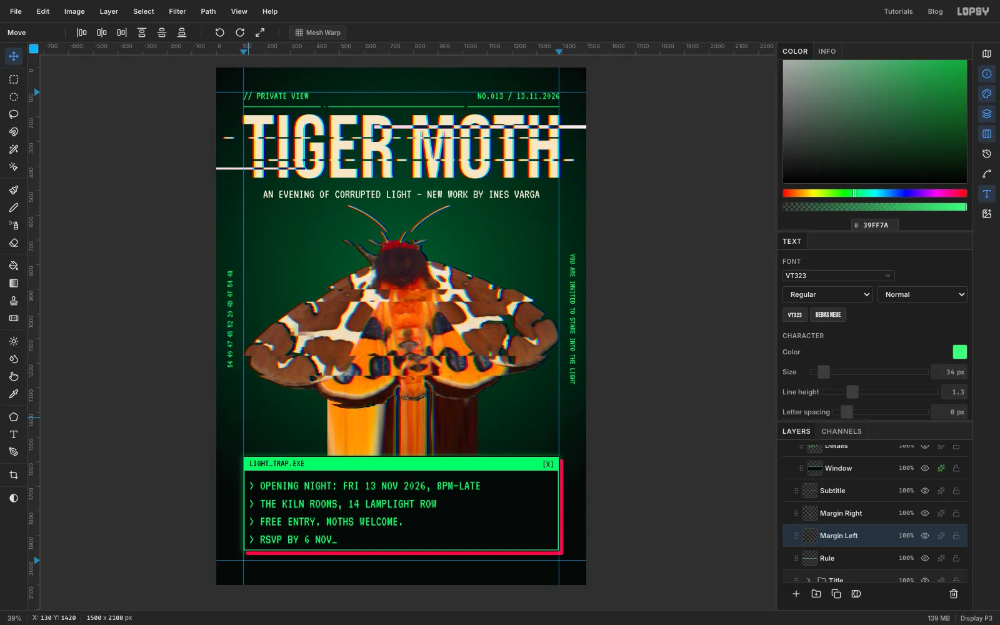

1. Click **Rule**. Press [[T]], set **VT323**, **Size** 34 and colour `#39FF7A`, click in an empty area and type `YOU ARE INVITED TO STARE INTO THE LIGHT`. Press [[Tab]], rename the layer **Margin Right** and click **Rasterize Layer**.
2. Press [[V]] and click **Rotate 90° CW** in the options bar. Move the line into the gap right of the right guide, centred on the moth.
3. Click **Rule** again and do the same with `54 49 47 45 52 20 4D 4F 54 48` on a layer named **Margin Left**, which is "TIGER MOTH" in hexadecimal. Rotate it with **Rotate 90° CCW** so it reads bottom to top, and centre it in the left margin.

## Scatter the glitch blocks

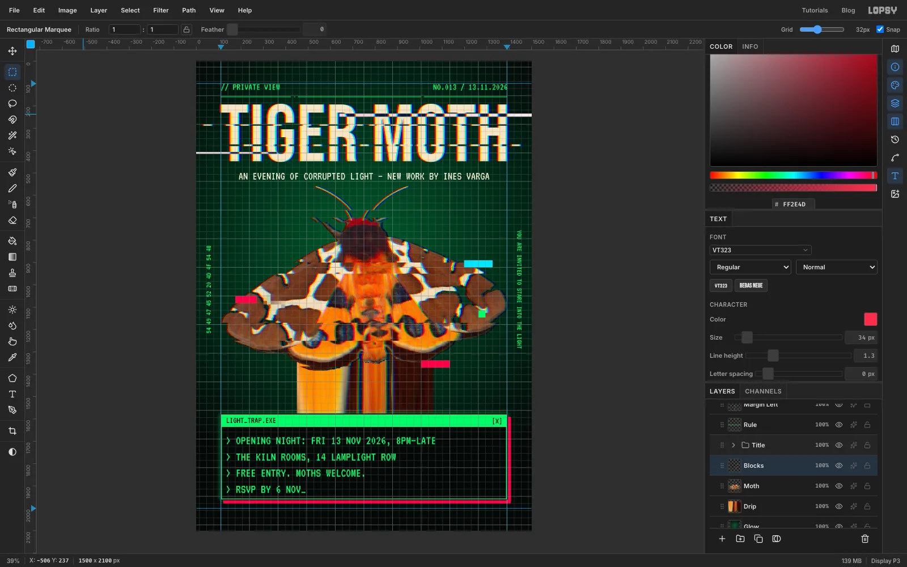

1. Click the **Moth** row and add a layer called **Blocks**.
2. Choose **View → Show Grid**, drag the **Grid** slider in the options bar to **32px**, and check that **Snap** is ticked. On this page the 32 px grid lines fall exactly on the side guides.
3. Make four blocks, each one cell tall and lined up with a tear so they look like they broke off it. For each one, press [[⌘D]], press [[M]], drag the marquee (it snaps to the grid), set the foreground colour and choose **Edit → Fill**:
   - cyan `#19E3FF`, four cells wide, just right of the top tear on the right wing
   - red `#FF2E4D`, three cells wide, on the left wing beside the pixelated block
   - phosphor `#39FF7A`, a single cell, on the right wing
   - red `#FF2E4D`, four cells wide, under the right hindwing over the drip
4. Press [[⌘D]] and choose **View → Show Grid** again to hide the grid.

## Make a scanline pattern

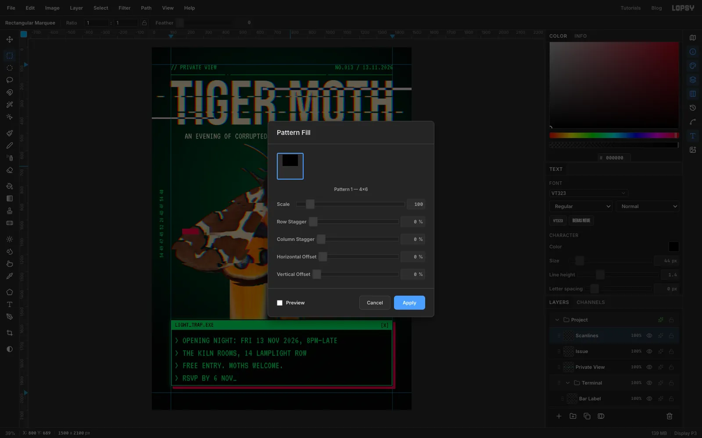

1. Click the top layer, **Issue**, and add a layer called **Scanlines**. Set the foreground to `#000000`.
2. Press [[M]] and, with nothing selected, click once on the canvas to open the exact-corners dialog. Enter X 0 to 4 and Y 0 to 3, and choose **Edit → Fill**.
3. Press [[⌘D]], click once on the canvas again, and enter X 0 to 4 and Y 0 to 6. Choose **Edit → Define Pattern**. That's one 3 px dark line and 3 px of clear space.
4. Press [[⌘D]], then [[⌘A]] and [[Delete]] to clear the tile off the layer, and [[⌘D]] again.
5. Choose **Edit → Fill with Pattern…**, click your 4 × 6 tile and click **Apply**.

## Finish with scanlines and grain

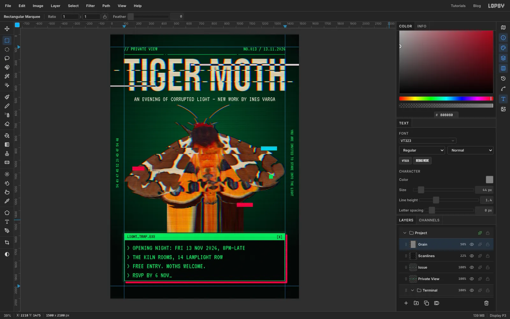

1. Set **Scanlines** to **Multiply** and drop its opacity to **22%**. Heavier than that and the thin subtitle starts to break up.
2. Add a layer called **Grain**. Set the foreground to `#808080` and choose **Edit → Fill**, then run **Filter → Add Noise…** with **Amount** 40 and **Mono** selected.
3. Set **Grain** to **Overlay** at **50%**. Mid-grey disappears in Overlay, so you only see the noise.
4. Export with **File → Quick Export PNG** and save the project with **File → Save Project**.

Try it with your own insect, or any small creature shot from above on a plain background. Just keep the glitches in a few bands, so it still reads as the animal at a glance.
