Gothic design borrows from the churches and cathedrals of the Middle Ages:
pointed arches, carved stone tracery, blackletter type, and a lot of night.
This tutorial uses that look for the cover of a made-up small-press zine,
**Yew & Owl**, "a zine of churchyard nocturnes", issue thirteen.

A barn owl sits on the sill of a stone *lancet* window (a tall, narrow window
with a pointed top). The head of the window is solid stone with a
four-lobed hole cut through it, called a *quatrefoil*. This early style of
window is known as *plate tracery*. A full moon behind the owl gives it a halo,
and a churchyard fades into mist beyond. Yew, the old churchyard tree, crosses
the front of the window.

The owl is a real photo, "Barn owl - Tyto alba" by caroline legg, via
[Wikimedia Commons](https://commons.wikimedia.org/wiki/File:Barn_owl_-_Tyto_alba_(53186834007).jpg),
used under CC BY 2.0. I used the 1280 px wide version. Any photo of a perched
owl against a dark background will work. You'll need to adjust the scale and
the lasso to fit your photo.

The canvas is 1400 × 1980 px, about the shape of an A5 zine. Positions are
document coordinates. Watch **X** and **Y** in the status bar at the bottom of
the window while you move the pointer. The window is centred on `x 700`.

Along the way you'll use:

- ruler **guides**, **Group Layers**, **Duplicate Layer**, **Merge Down** and **Rasterize Layer Style**
- the **Rectangular** and **Elliptical Marquee** with add, subtract and intersect, the **Lasso**, **Select → Grow**, **Shrink**, **Feather** and **Inverse**, and ⌘-clicking a thumbnail to select a layer's pixels
- the **Brush** with **Taper**, and Shift-click straight lines
- the **Gradient** tool and its **Gradient Editor**
- **Clouds**, **Add Noise**, **Emboss**, **Brightness/Contrast**, **Hue/Saturation**, **Unsharp Mask** and **Gaussian Blur**
- the **Overlay**, **Screen**, **Multiply** and **Color** blend modes, and the **Drop Shadow**, **Inner Glow**, **Outer Glow** and **Stroke** effects
- the **Move** tool to scale, rotate and flip pixels and to rotate live text, plus copy and paste
- type in **Grenze Gotisch**, **IM Fell English**, **IM Fell English SC**, **Cinzel** and **Cinzel Decorative**

The palette:

- Wall `#19151C`, mortar `#0B090D`, mortar highlight `#5A4A5E`
- Night sky `#070A22` → `#1C2852` → `#4A5878`
- Moon `#EFE7D0`, moon glow `#E9D9A6`, stars `#F4EEDC`
- Churchyard silhouettes `#080A18`
- Stone `#615F68`, tympanum `#3D3C44`, sill `#6E6C75`, sill lip `#8F8D96`, reveal `#706E79`
- Moonlight tint `#4E5F8C`, owl rim `#F2E6C2`
- Yew needles `#22301F`, needle midribs `#34472F`, twig `#3B2A1F`
- Aril `#B3202A`, aril mouth `#D2434C`, seed `#1E2216`
- Gilt `#F4D886` → `#D9AE4E` → `#B07A22` → `#E2BC62`
- Gold `#C9A24A`, side-line gold `#D4AE5A`, bone `#E3D6BB`, crimson `#A3182A`
- Wax `#8A1222`, wax ring `#6A0C19`, wax numeral `#4A0610`

Blend modes live in each layer's effects drawer. Click the ✦ button on the
layer's row and use the **Blend** dropdown at the top. A layer's opacity is
the percentage button on its row.

## Set up the canvas and guides

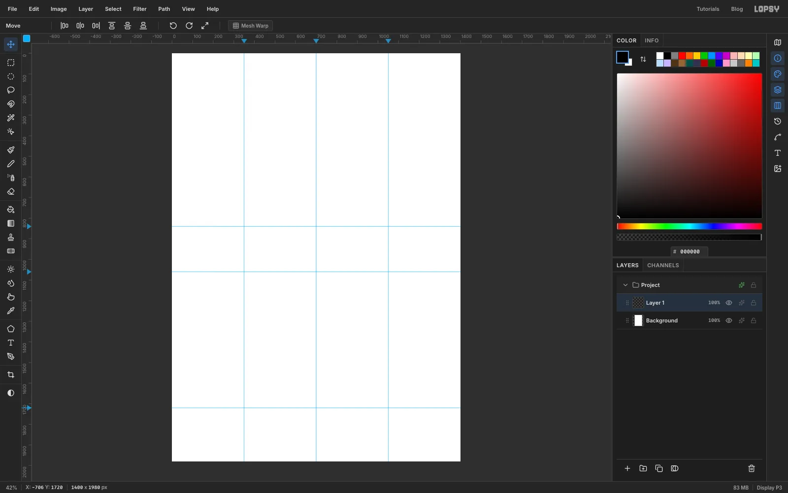

1. Choose **File → New**, set **Width** to `1400` and **Height** to `1980`, and click **Create**.
2. Click the top ruler at `x 350`, `x 700` and `x 1050` to drop three vertical guides. These are the left edge, the centre and the right edge of the window opening.
3. Click the left ruler at `y 840`, `y 1060` and `y 1720`. From the top, these mark the bottom of the stone window head, the point where the arch starts to curve (the *springline*), and the sill.

Marquee drags snap to guides, so these will keep the window square and centred.

## Fill the stone wall

1. Select the `Background` layer and rename it `Wall` (double-click its name).
2. Set the foreground colour to `#19151C`, press [[Cmd+A]] and choose **Edit → Fill**. Press [[Cmd+D]] to deselect.
3. Add a layer called `Wall Texture`. Choose **Filter → Clouds…**, set **Scale** to `7` and click **Apply**.
4. Set `Wall Texture` to **Overlay** at `30%`.

The clouds break up the flat colour so the wall looks like old, uneven stone.

## Draw the mortar joints

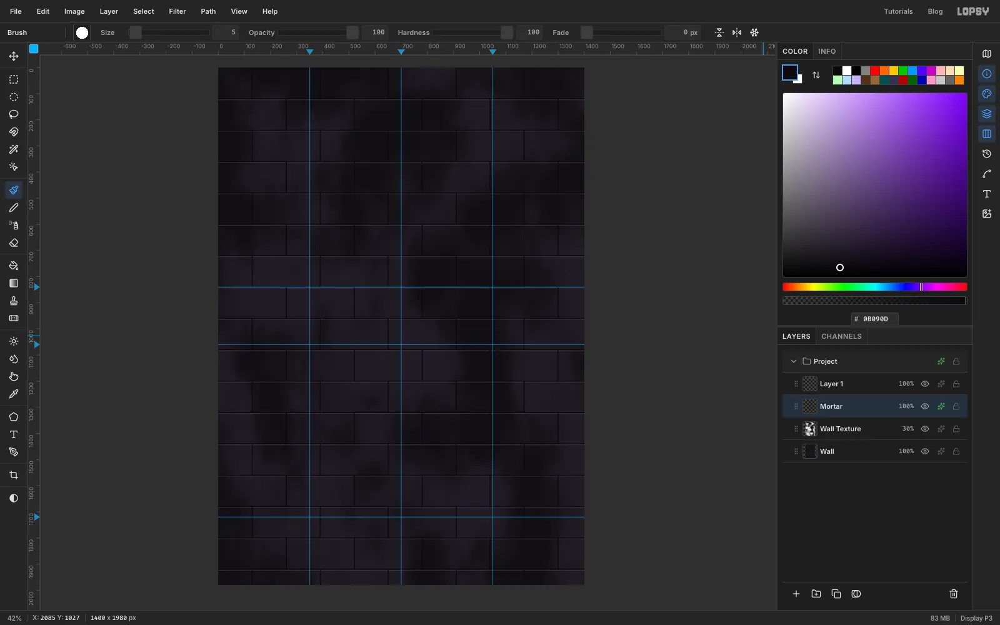

The wall is built from big blocks, 120 px tall and 260 px wide, laid in a
staggered pattern like brickwork.

1. Add a layer called `Mortar`.
2. Pick the **Brush**. Set **Size** to `5` and **Hardness** to `100`, and set the foreground colour to `#0B090D`.
3. For each horizontal joint, click at the left edge of the canvas, hold [[Shift]] and click at the right edge. That paints a straight line. Do this every 120 px down the canvas: `y 120`, `240`, `360` and so on to `1920`.
4. Now the vertical joints. In the top course (`y 0` to `120`), Shift-click short vertical lines at `x 130`, `390`, `650`, `910` and `1170`. In the next course down, move them along by half a block, to `x 260`, `520`, `780`, `1040` and `1300`. Keep alternating all the way down.
5. Open the effects drawer for `Mortar` and turn on **Drop Shadow**. Set the colour to `#5A4A5E`, **Offset X** to `0`, **Offset Y** to `3`, **Blur** to `1` and **Opacity** to `45`.

The light "shadow" sits just under each joint, so every block seems to have a
worn top edge catching the light.

## Select the window openings

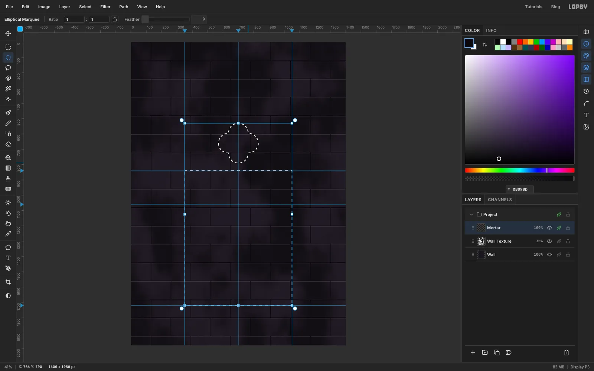

The window has two openings: a tall light at the bottom and the quatrefoil in
the head. You'll use this selection three times, so it's worth getting the
steps down.

1. Delete the empty `Layer 1` (select it and click the bin at the bottom of the Layers panel), and select `Mortar`.
2. Pick the **Rectangular Marquee** and drag from where the `x 350` and `y 840` guides cross down to where `x 1050` meets `y 1720`. The corners snap onto the guides.
3. Pick the **Elliptical Marquee**. Hold [[Shift]] to add, and drag a circle of radius `70` centred on `700, 660`. That's from `630, 590` to `770, 730`.
4. Still holding [[Shift]], add four circles of radius `64` around it, one on each side, centred `66` px away: at `634, 660`, `766, 660`, `700, 594` and `700, 726`.

The five circles merge into one quatrefoil with soft lobes.

## Paint the night sky

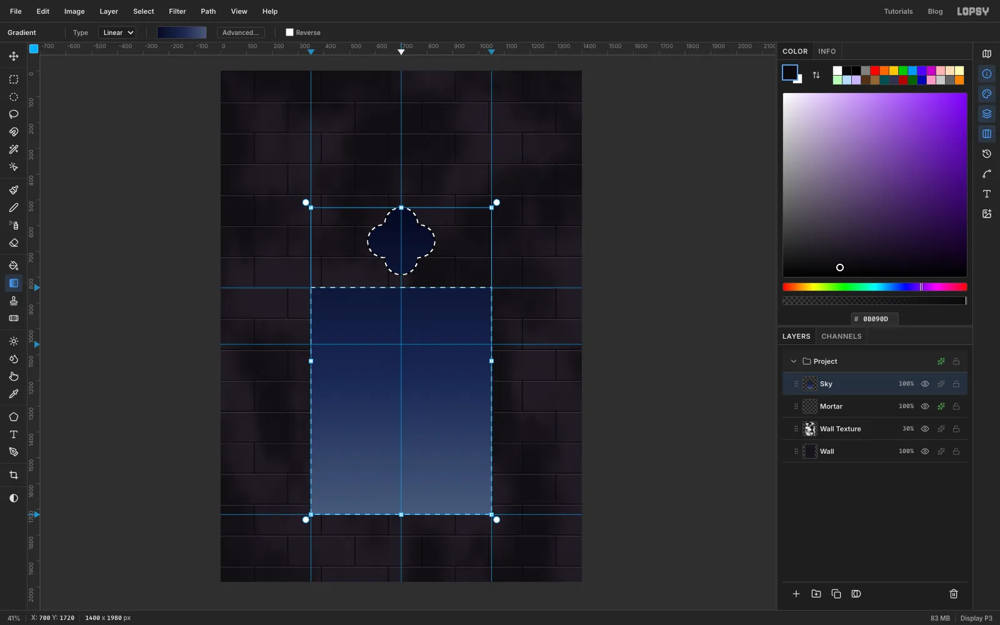

1. Add a layer called `Sky`.
2. Pick the **Gradient** tool, set **Type** to **Linear** and click **Advanced…** to open the Gradient Editor.
3. Make three stops: `#070A22` at the left end, `#1C2852` at `55%` and `#4A5878` at the right end. Click **Done**.
4. With the openings still selected, drag straight down the centre guide from `y 560` to the sill at `y 1720`.

The gradient only fills the selection, so the sky stays inside the window.

## Scatter the stars

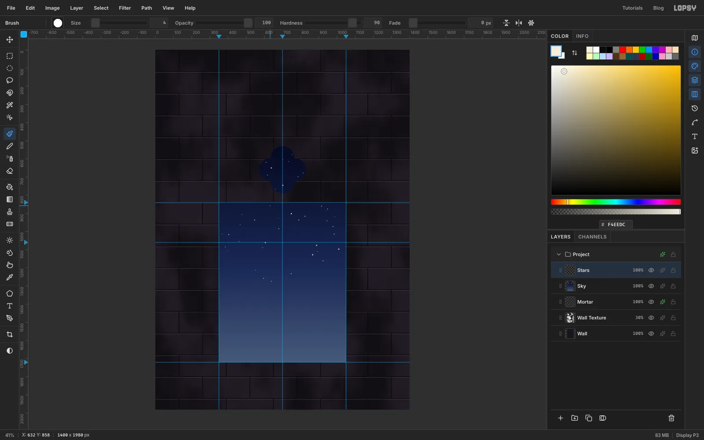

1. Add a layer called `Stars` and set the foreground colour to `#F4EEDC`.
2. Pick the **Brush** with **Hardness** `90`. Click about 45 times in the dark upper part of the sky and inside the quatrefoil. Change the **Size** between `3` and `5` as you go, and use `7` for every seventh star or so.
3. Press [[Cmd+D]].

Because the openings were still selected, any click that strays outside the
window paints nothing.

## Raise the moon

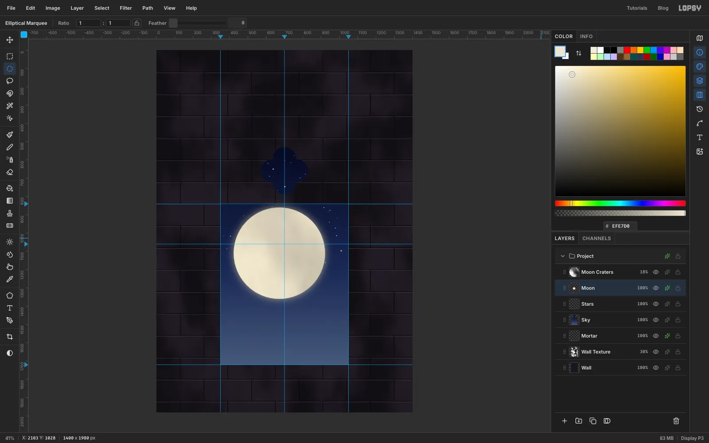

1. Add a layer called `Moon` and set the foreground colour to `#EFE7D0`.
2. With the **Elliptical Marquee**, drag a circle of radius `250` centred on `672, 1110`. That's from `422, 860` to `922, 1360`. Fill it.
3. Keep the circle selected and add a layer called `Moon Craters`. Run **Filter → Clouds…** with **Scale** `3`. Set the layer to **Multiply** at `18%`, then deselect.
4. Select `Moon` again and turn on **Outer Glow**. Set the colour to `#E9D9A6`, **Size** to `170` and **Opacity** to `65`.

The moon sits a little left of centre on purpose. The owl's face is to the left
of its body, and the moon needs to sit right behind the face.

## Silhouette the churchyard

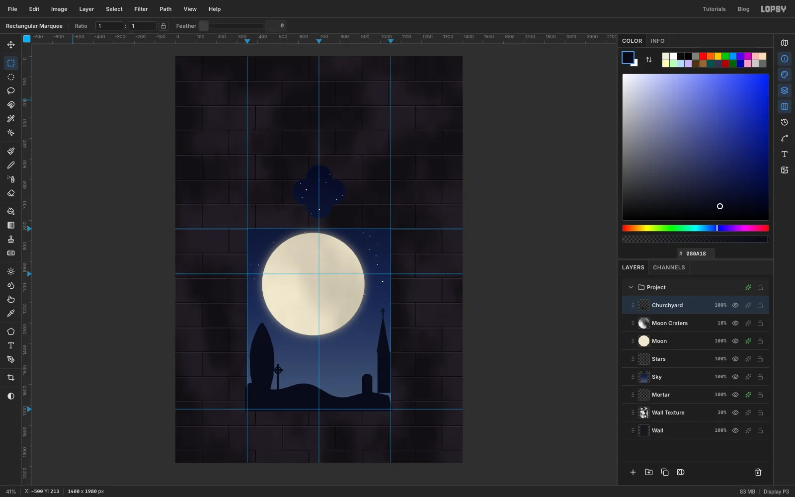

Everything in this step is filled with `#080A18` on a new layer called
`Churchyard`. Fill each shape as you finish it.

1. **Ground.** With the **Lasso**, draw a gently rolling line across the window just above `y 1630`, then come back along the bottom below the sill to close the shape.
2. **Clipped yew.** Draw a tall, narrow rounded column with the Lasso, about `120` px wide, from `y 1300` down to the ground, centred on `x 422`. Let it narrow towards a rounded tip like a candle flame. Old churchyard yews are often clipped into this shape.
3. **Tower and spire.** Select a rectangle from `985, 1440` to `1040, 1640`. Hold [[Shift]] and add a tall triangle with the Lasso, from just outside the tower's top corners up to a point at `1012, 1262`. On top of the point, [[Shift]]-add a thin upright `6 × 42` px rectangle and a `22 × 5` px crossbar about 10 px below its top, to make a small cross.
4. **Headstone.** Select a rectangle `51` px wide from `910, 1572` down to `961, 1652`. Hold [[Shift]] and add a circle of radius `25` centred on the middle of its top edge, `935, 1572`, to round it off.
5. **Wheel-head cross.** Select a circle of radius `18` centred on `500, 1530`. Hold [[Option]] and drag a circle of radius `12` from the same centre to cut out the middle. Then hold [[Shift]] and add a `10` px wide shaft from `500, 1500` down to `y 1625`, and a `48 × 10` px arm across it centred at `y 1530`.

Cut the ring first and add the shaft and arm after. Otherwise the hole would cut
through them too.

## Add the ground mist

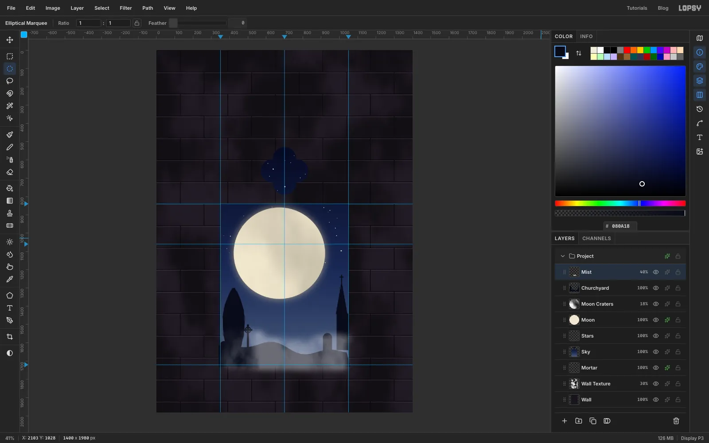

1. Add a layer called `Mist`.
2. Select a rectangle across the window from `y 1560` down to just below the sill. Hold [[Shift]] and add two flat ellipses that rise above it: one about `240 × 68` px centred on `960, 1575` and one about `260 × 60` px centred on `470, 1545`. These are the wisps.
3. Choose **Select → Feather…** `40`.
4. Run **Filter → Clouds…** with **Scale** `7`. Deselect, then set `Mist` to **Screen** at `40%`.

Screen only ever lightens, so the black parts of the clouds vanish and the grey
parts drift like fog over the silhouettes.

## Select the pointed arch

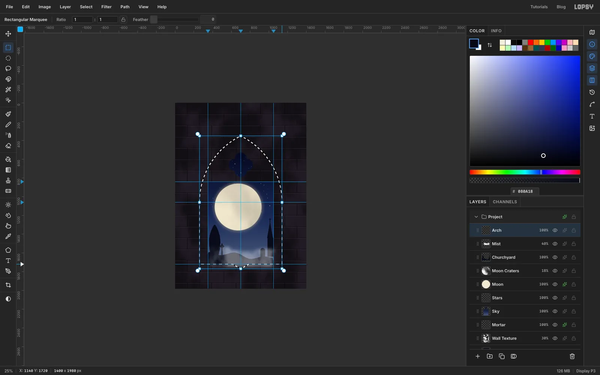

A pointed Gothic arch is the overlap of two circles. Each one is centred on
the opposite side of the window.

1. Choose **View → Zoom Out** twice. The circles are bigger than the canvas, so you need some room around it.
2. Add a layer called `Arch`.
3. With the **Elliptical Marquee**, drag a circle of radius `790` centred on the right edge of the opening, `1050, 1060`.
4. Hold [[Shift]] and [[Option]] together and drag a second circle of radius `790` centred on the left edge, `350, 1060`. Shift+Option keeps only the part where the two overlap, which is a pointed almond shape.
5. Hold [[Shift]] and add a rectangle from `260, 1060` to `1140, 1720` for the straight sides of the window.
6. Set the foreground colour to stone `#615F68` and fill.

## Cut the tympanum and openings

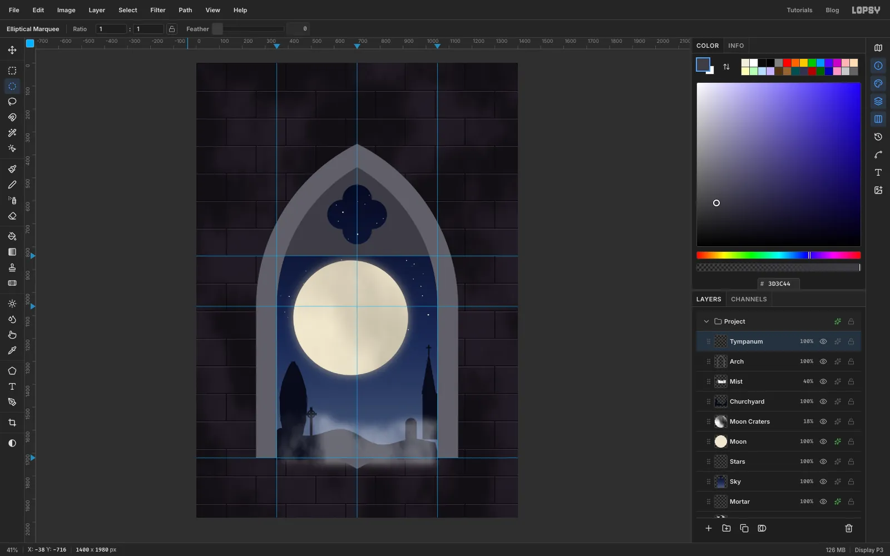

The window head (the *tympanum*) sits slightly back from the outer frame, so it
gets its own, darker layer.

1. Add a layer called `Tympanum`. Repeat the last step's selection with smaller circles: radius `700` from the same two centres, then add the rectangle from `350, 1060` to `1050, 1720`.
2. Fill it with `#3D3C44`.
3. Leave that selection active, select the `Arch` layer and press [[Delete]]. The frame is now a band about 90 px wide around the tympanum.
4. Select `Tympanum`, make the openings selection again (the rectangle plus the five circles), and press [[Delete]]. Deselect and choose **View → Fit to Screen**.

The sky, moon and stars show through both holes.

## Texture the stone and light the reveal

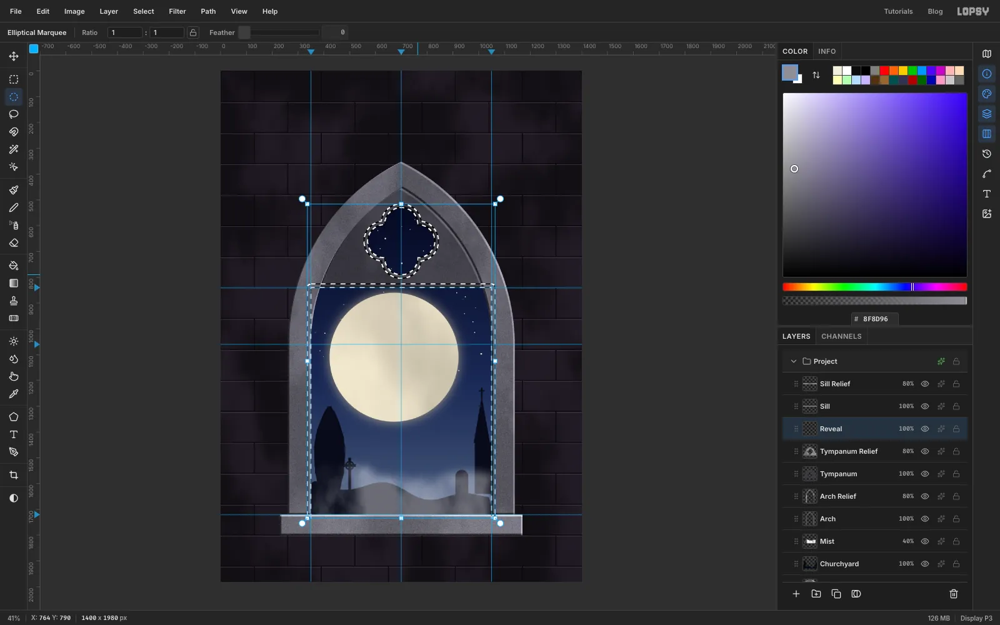

1. Add a layer called `Sill` above `Tympanum`. Select from `230, 1720` to `1170, 1800` and fill it with `#6E6C75`. Then select just the top 9 px of it and fill that with `#8F8D96`. This is the lip that catches the light.
2. Select `Arch` and choose **Layer → Duplicate Layer**. Name the copy `Arch Relief`.
3. ⌘-click the `Arch Relief` thumbnail to select its pixels. Run **Clouds…** (**Scale** `9`). Then run **Brightness/Contrast…** with **Contrast** at `-85` to flatten the clouds into faint blotches.
4. Run **Add Noise…** with **Amount** `45` and **Mono** (leave **Distribution** on **Uniform**), then **Emboss…** with **Angle** `135` and **Strength** `60`. Deselect and set the layer to **Overlay** at `80%`.
5. Do the same for `Tympanum` and `Sill`, making `Tympanum Relief` and `Sill Relief`.
6. Select `Tympanum Relief` and add a layer called `Reveal` above it. Make the openings selection again and choose **Select → Grow…** `14`. Then hold [[Option]] and draw the same rectangle and five circles again to cut the openings back out. Only a 14 px band around each opening is left.
7. Fill the band with `#706E79`. Deselect and give `Reveal` an **Inner Glow** in `#25232B` with **Size** `7` and **Opacity** `60`.

The *reveal* is the inner face of the stone around a window. Here it's lit by
the moon coming through, so it's a little lighter than the frame.

## Give the stone some depth

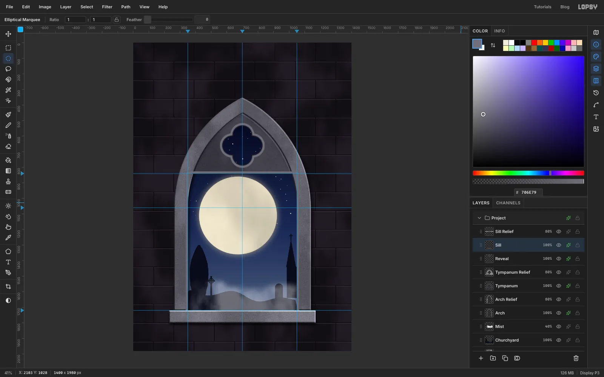

1. On `Arch`, turn on **Drop Shadow**: black, **Offset X** `10`, **Offset Y** `16`, **Blur** `30`, **Opacity** `70`. Then turn on **Inner Glow** in `#17141C` with **Size** `18` and **Opacity** `55`.
2. On `Tympanum`, turn on **Inner Glow** in `#15111C` with **Size** `26` and **Opacity** `70`, and **Stroke** in `#24212A` with **Width** `5`.
3. On `Sill`, turn on **Drop Shadow**: black, **Offset X** `0`, **Offset Y** `14`, **Blur** `22`, **Opacity** `75`.

The dark inner glows make the edges look chamfered. The stroke on the
tympanum makes a groove where it meets the frame.

> **Tip:** Not sure an effect is pulling its weight? Press [[Cmd+Z]] a few times to step back through the effects one at a time, then [[Cmd+Shift+Z]] to bring them all back.

## Bring in the owl photo

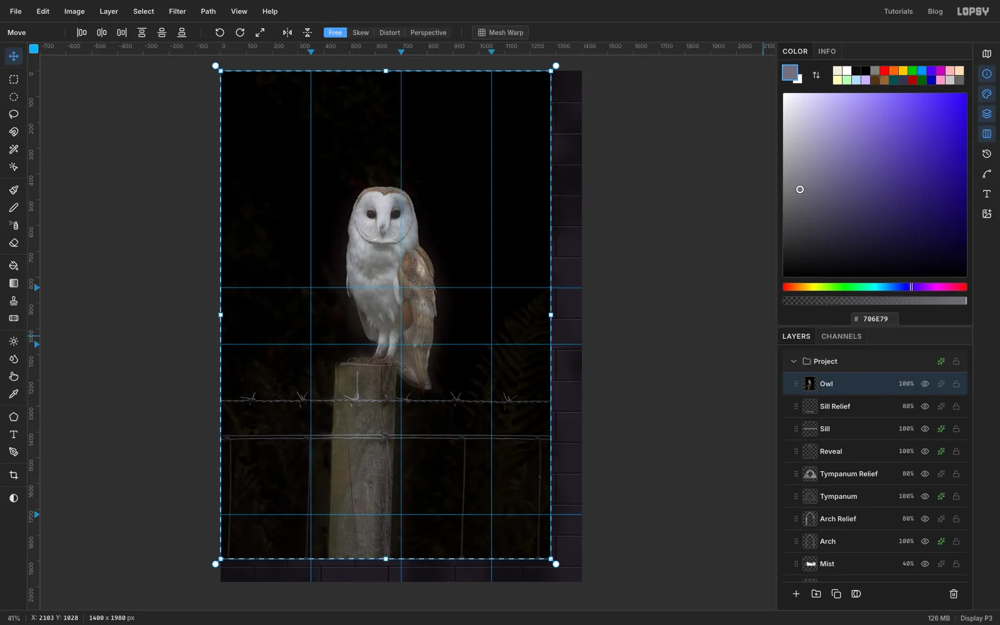

1. Select `Sill Relief` so the photo lands above everything you've built.
2. Drag the owl photo from your desktop onto the canvas. It lands at the top-left corner at its full size, 1280 × 1892 px.
3. Rename the new layer `Owl`.

## Trace the owl with the Lasso

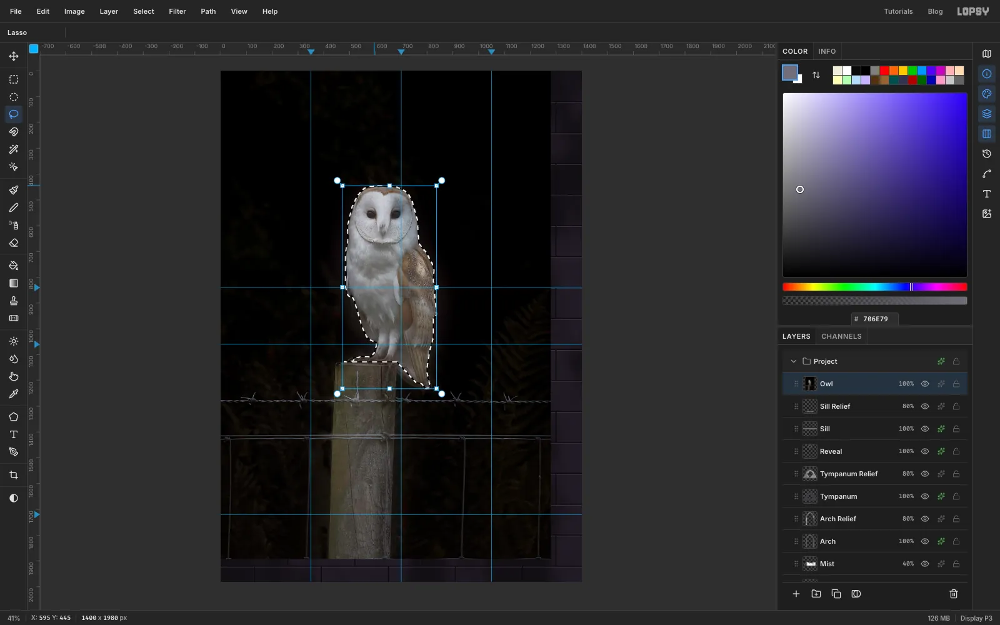

1. Pick the **Lasso** and trace slowly around the owl: over the top of the head, down the folded wing, along the tail, then back along the tops of the feet and up the white breast.
2. Leave out the fence post. Cut across just above the post, at the line where the toes grip it.
3. Where the tail drops past the post, follow the edge of the tail feathers diagonally rather than going straight down beside the post.

Take your time with the tail. It will hang over the front of the sill, where
any straight cut would show.

## Cut the owl out

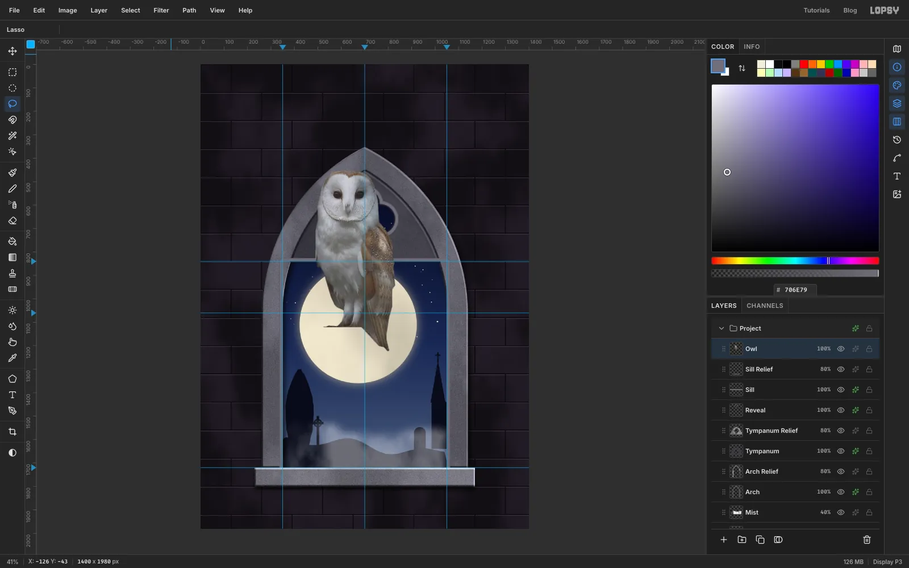

1. Choose **Select → Shrink…** `7`. The edge of the photo is darker than the owl, and shrinking leaves that dark fringe behind.
2. Choose **Select → Feather…** `2` to soften the edge.
3. Choose **Select → Inverse**, press [[Delete]] and deselect.

## Scale the owl

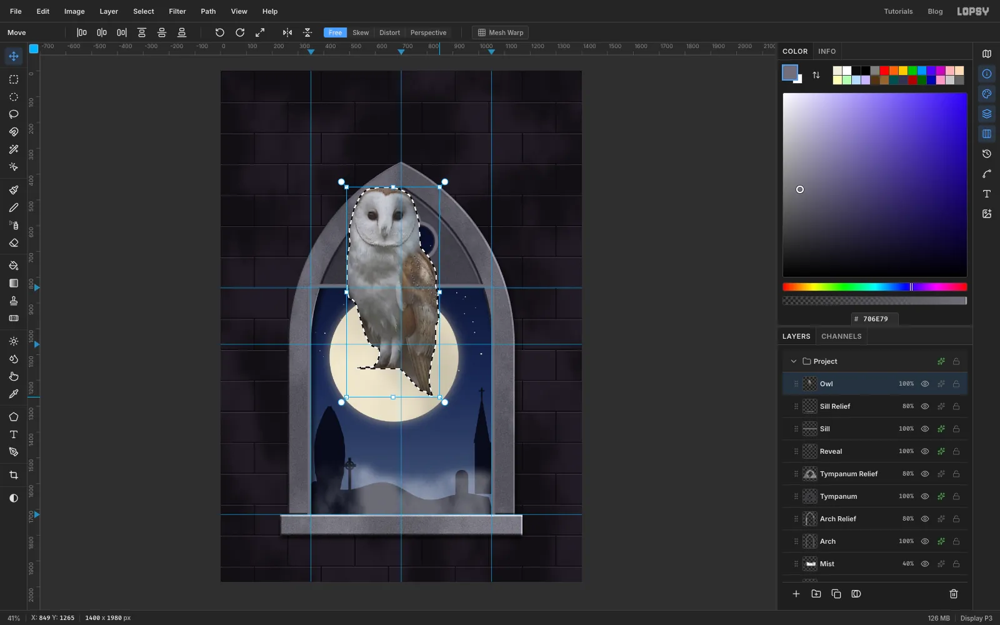

1. Pick the **Move** tool and ⌘-click the `Owl` thumbnail to select its pixels. Transform handles appear around it.
2. Hold [[Cmd]] and drag the bottom-right handle out a little, by about 20 px. That's roughly `105%`, judged by eye. Cmd keeps the proportions.
3. Press [[Cmd+D]] to commit the scale.

## Set the owl on the sill

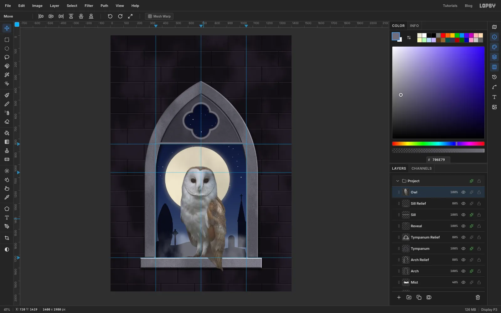

1. Pick the **Move** tool and drag the owl down into the window.
2. Use the arrow keys to fine-tune it. The toes should sit on the sill's light lip at `y 1720`, and the middle of the face should be on the moon's centre, `x 672`.

The tail should drape over the front of the sill. That small overlap makes the
owl look like it's really sitting there.

## Grade the owl to moonlight

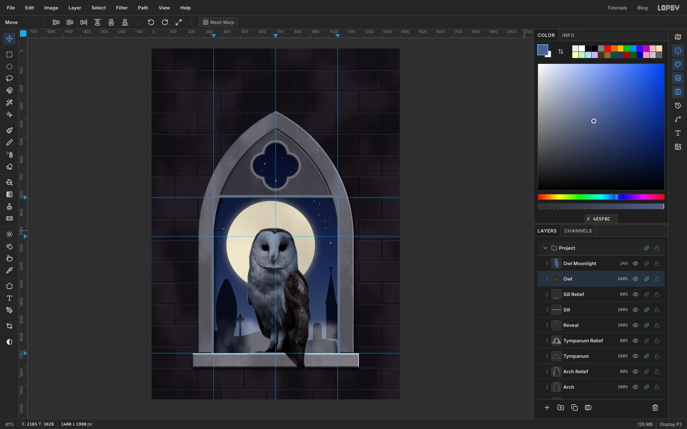

The photo was taken in daylight. These steps make it look lit by the moon
behind it.

1. With `Owl` selected, run **Unsharp Mask…** (**Radius** `2`, **Amount** `0.6`).
2. Run **Hue/Saturation…** with **Saturation** `-20`.
3. Run **Brightness/Contrast…** with **Brightness** `-24` and **Contrast** `12`.
4. Run **Add Noise…** with **Amount** `6`, **Mono** and **Gaussian**. This gives the photo the same grain as the rest of the scene.
5. Turn on **Inner Glow** in `#F2E6C2` with **Size** `5` and **Opacity** `45`. That's a thin warm rim where the moonlight wraps around the feathers.
6. Add a layer called `Owl Moonlight`. ⌘-click the `Owl` thumbnail, fill the selection with `#4E5F8C` and deselect. Set the layer to **Color** at `24%`.

The Color blend mode keeps the owl's light and shade and only borrows the
blue, so the white feathers turn a cool moonlit grey.

## Add a contact shadow

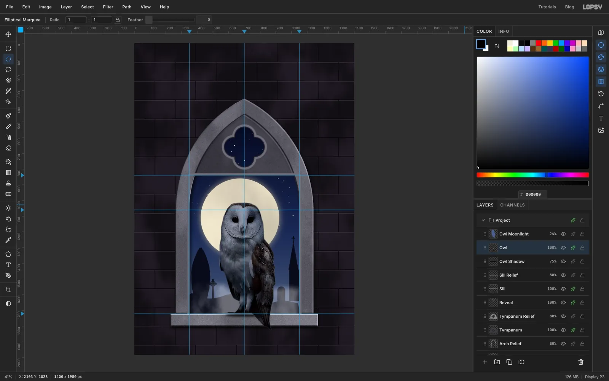

1. Select `Sill Relief` and add a layer called `Owl Shadow`. It lands between the sill and the owl.
2. Select an ellipse `240` px wide and `24` px tall centred on `700, 1728`, just under the feet, and fill it with black.
3. Deselect and run **Gaussian Blur…** with **Radius** `16`.
4. Set the layer to **Multiply** at `75%`.

## Paint a yew sprig

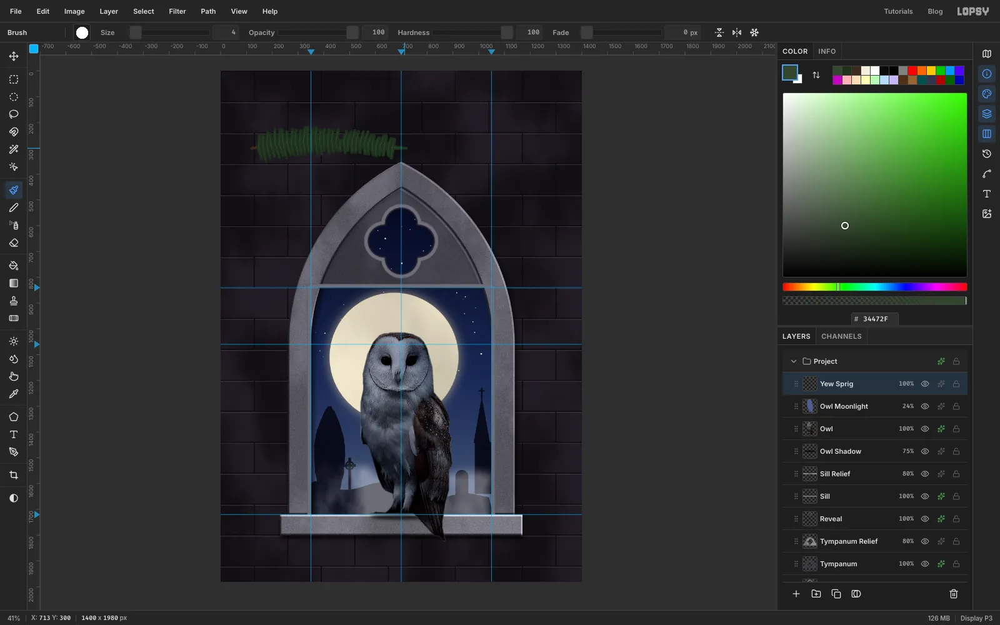

You'll paint one sprig on the empty wall at the top left, then copy it to make
the boughs.

1. Select `Owl Moonlight` and add a layer called `Yew Sprig`. It sits above the owl, under nothing else yet.
2. **Twig.** Pick the **Brush** with **Size** `11` and **Hardness** `100`, and set the colour to `#3B2A1F`. Drag a gently arched line about 560 px long from `120, 300` towards the right.
3. **Needles.** Click the brush-tip preview at the left of the options bar to open the Brushes panel. Set **Size** to `21`, **Hardness** to `85` and **Taper** to `100 px`. Set the colour to `#22301F`. Starting at the twig each time, drag short strokes outwards, one on each side, about every 16 px along the twig. Make them about 58 px long near the base and shorter towards the tip, and leave out the odd one.
4. **Midribs.** Set the brush to **Size** `4`, **Hardness** `100`, **Taper** `70 px` and colour `#34472F`. Drag a thin line down the middle of each needle, starting at the twig.

Taper shrinks the brush as the stroke goes on. Starting each stroke at the twig
gives every needle a broad base and a narrow tip. Yew needles grow in two flat
rows, so keep them nearly at right angles to the twig.

## Paint one aril and copy it

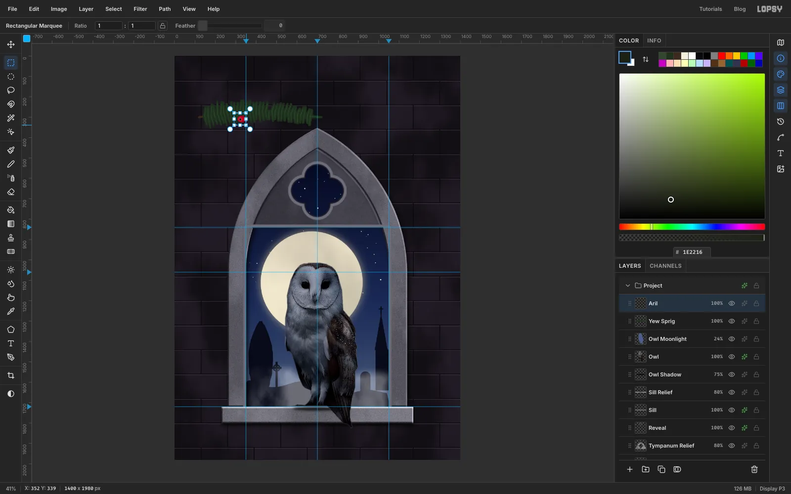

Yew "berries" are really *arils*: soft red cups with a dark seed showing in the
open end.

1. Add a layer called `Aril`. Select an ellipse `28 × 32` px just below the twig, about a third of the way along. Fill it with `#B3202A`.
2. Turn on **Inner Glow** in `#4A0710` with **Size** `8` and **Opacity** `65`. Then click **Rasterize Layer Style** in the effects drawer so the shading becomes pixels.
3. Paint the open end facing you: a `16 × 18` px ellipse of `#D2434C` in the middle, then a `10 × 12` px ellipse of `#1E2216` inside it for the seed.
4. Draw a rectangular marquee around the aril and press [[Cmd+C]].

## Paste a second aril and merge

1. Press [[Cmd+V]]. The copy pastes onto a new layer in the same place.
2. Use the arrow keys to nudge it along to about two thirds of the way down the twig, just under the needles.
3. Deselect and choose **Layer → Merge Down** to merge it into `Aril`.
4. Choose **Layer → Merge Down** again to merge `Aril` into the sprig. Rename the result `Yew Sprig`.

## Turn the sprig into a bough

1. With `Yew Sprig` selected, choose **Layer → Group Layers** and name the group `Yew Boughs`.
2. Choose **Layer → Duplicate Layer** and name the copy `Yew Low`.
3. Pick the **Move** tool and ⌘-click the copy's thumbnail. Drag the round rotation handle outside the top-right corner up and around to turn the sprig counter-clockwise, by eye about a third of a right angle, until its tip points up and to the right at roughly `34°`.
4. Press [[Cmd+D]], then drag the bough down so its base runs off the left edge of the canvas at about `y 1690`. Its tip should cross the left side of the window frame at about `x 460, y 1350`.
5. Select `Yew Sprig` again, duplicate it and name the copy `Yew Sill`. ⌘-click its thumbnail, [[Cmd]]-drag a corner handle inwards until it's about four-fifths of its length, then tip it a few degrees counter-clockwise (about `7°`). Press [[Cmd+D]] and lay it along the left end of the sill, with its base off the left edge at about `y 1800` and its tip near `x 450`.

## Flip a bough for the other side

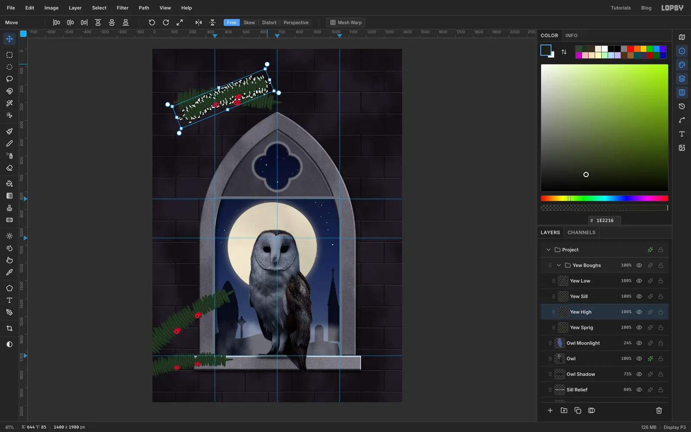

1. Select `Yew Sprig`, duplicate it once more and name the copy `Yew High`.
2. ⌘-click its thumbnail. In the Move tool's options bar, click **Flip Horizontal**. The sprig now points left.
3. [[Cmd]]-drag a corner handle in slightly (to about `92%`), then rotate it counter-clockwise about `22°` by eye, so it slopes down to the left.
4. Press [[Cmd+D]] and drag it to the right edge, with its base off the canvas at about `y 600`. Its tip should cross the upper right of the arch at about `x 925, y 820`.

Flip first, then scale and rotate.

## Hide the original sprig

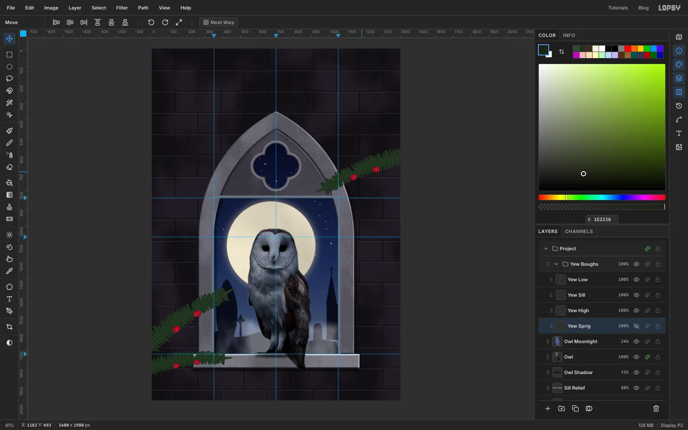

1. Click the eye on the `Yew Sprig` row to hide it. It stays in the group as your master copy.
2. Because the boughs share a group, you can shift them all at once later: click the `Yew Boughs` row and use the **Move** tool or the arrow keys. Each arrow tap is its own undo step if you change your mind.

## Set the masthead

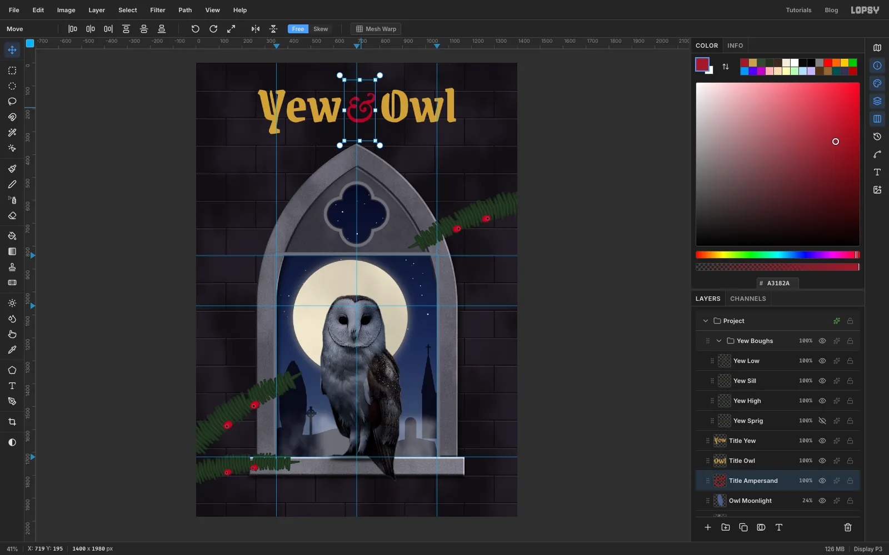

1. Select `Owl Moonlight` so the type isn't created inside the yew group.
2. Pick the **Text** tool. Set the font to **Grenze Gotisch**, the weight to **Bold**, **Size** `226` and colour `#C9A24A`. Click on the empty wall and type `Yew`, then press [[Tab]] to commit. Rename the layer `Title Yew`.
3. Select `Owl Moonlight` again and make a second layer with `Owl` in the same style. Rename it `Title Owl`, so it can't be confused with the photo layer.
4. Select `Owl Moonlight` again. Set the font to **IM Fell English**, the style to **Italic**, **Size** `190` and colour `#A3182A`. Type `&` and rename the layer `Title Ampersand`.
5. With the **Move** tool, line them up across the top: `Yew`, then `&`, then `Owl`, with about 26 px between each. The tops of the Y and the O sit at about `y 117`. The bottom of the ampersand sits on the same baseline as the bottoms of the e, w, O and l.

Check that the whole row is centred on the `x 700` guide. The tail of the y
should end well clear of the top of the arch.

## Gild the title

1. Select `Title Yew` and choose **Layer → Merge Down** to merge it into `Title Owl`, which sits just below it. Rename the result `Masthead Gilt`.
2. ⌘-click its thumbnail to select the letters.
3. Pick the **Gradient** tool (**Linear**) and open **Advanced…**. Set four stops: `#F4D886` at the left end, `#D9AE4E` at `45%`, `#B07A22` at `70%` and `#E2BC62` at the right end. Click **Done**.
4. Drag from the tops of the capitals (`y 117`) straight down to the baseline, around `y 262`. Then deselect.

The dark band near the bottom with a lighter edge under it is what makes flat
yellow read as polished metal.

## Finish the masthead

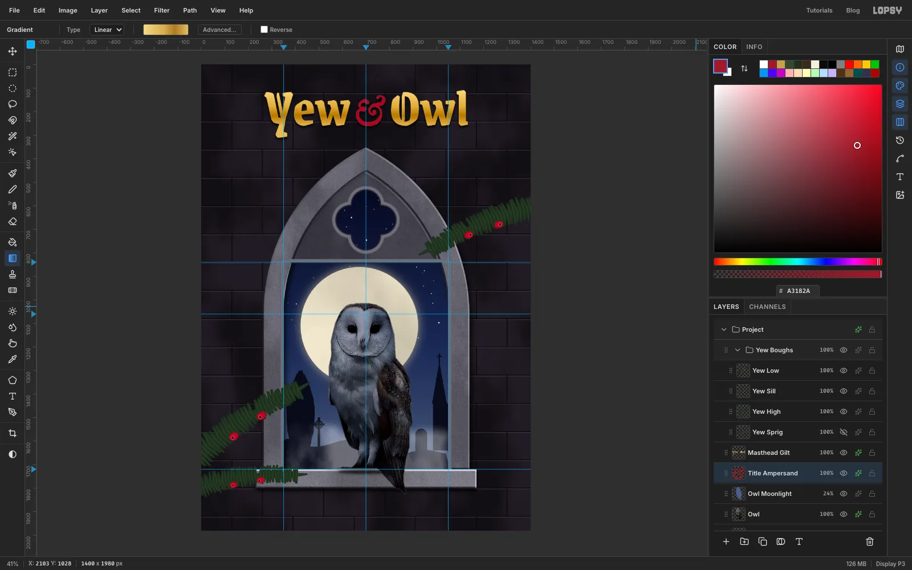

1. On `Masthead Gilt`, turn on **Drop Shadow** (black, **Offset Y** `7`, **Blur** `12`, **Opacity** `85`), **Stroke** (`#3A2A0E`, **Width** `2`) and **Inner Glow** (`#FFF3C8`, **Size** `5`, **Opacity** `55`).
2. Give `Title Ampersand` the same Drop Shadow and Stroke, with its Inner Glow in `#E86070`.

## Add the tagline and side lines

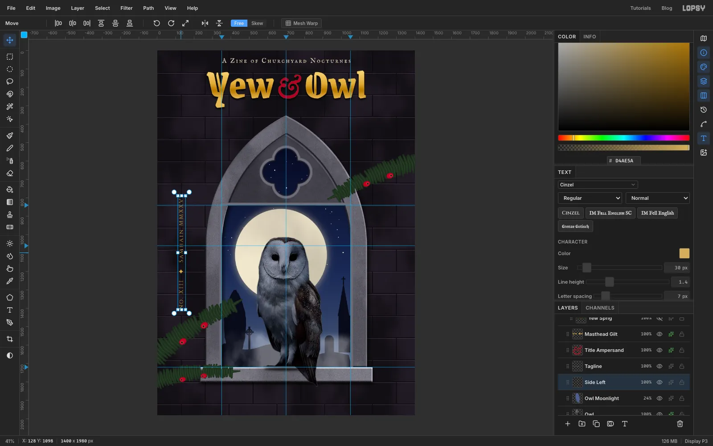

1. Select `Owl Moonlight`, pick the **Text** tool and set the style back to **Normal**. Add the tagline first: **IM Fell English SC**, **Size** `36`, colour `#E3D6BB`, reading `A Zine of Churchyard Nocturnes`. Commit, rename it `Tagline`, set **Letter spacing** in the Text panel to `6 px`, and centre it on `x 700` with its top about `40` px from the top edge.
2. Select `Owl Moonlight` again. Make a text layer in **Cinzel**, **Size** `30`, colour `#D4AE5A`, reading `No. XIII  ✦  Samhain MMXXVI` (copy the ✦ from this page). Rename it `Side Left` and set **Letter spacing** to `7 px`.
3. Pick the **Move** tool. Text gets its own handles without a selection. Hold [[Cmd]] and drag the top-right rotation handle up and around to `-90°`. Cmd snaps the angle to steps of 15°.
4. Move the line so it's centred at `x 128`, `y 1098`, halfway between the canvas edge and the window, and reading upwards.
5. Make a second line, `Side Right`, reading `One Shilling  ✦  By Moonlight`. Rotate it to `+90°` and centre it at `x 1272`, `y 1098`. Rotated this way it reads downwards, which mirrors the left side.

The rotated text stays live, so you can still fix a typo with the Text tool.
Leave at least 40 px between each line and the nearest bough.

## Add the cover lines

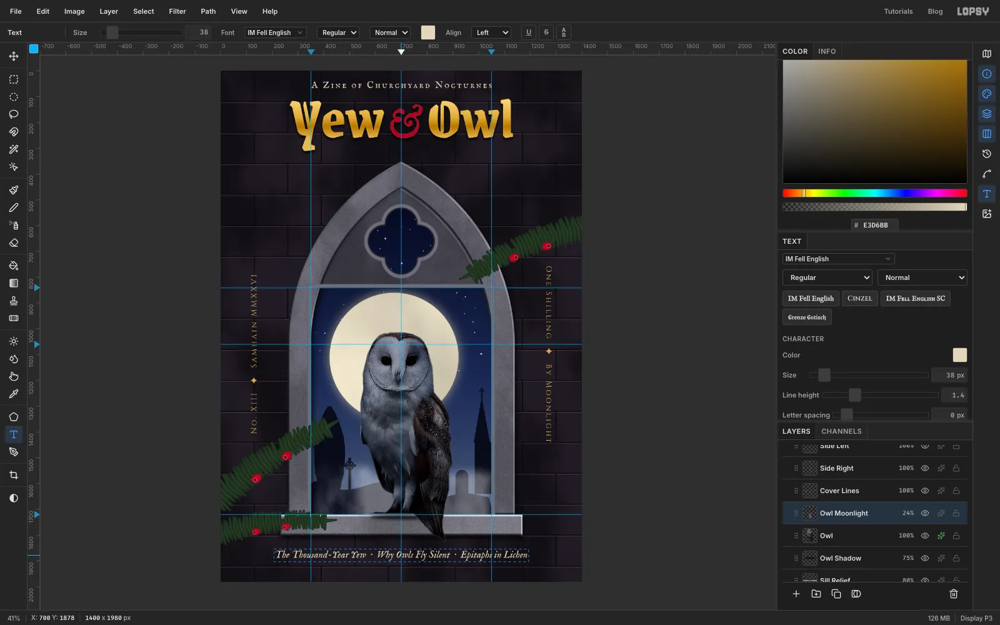

1. Select `Owl Moonlight`, then pick the **Text** tool. Choose **IM Fell English**, **Italic**, **Size** `38`, colour `#E3D6BB`, and set **Letter spacing** back to `0`.
2. Type `The Thousand-Year Yew  ·  Why Owls Fly Silent  ·  Epitaphs in Lichen`, commit, and rename the layer `Cover Lines`.
3. Centre it on `x 700` with the top of the capitals at about `y 1858`. That leaves room below the sill's shadow and about 80 px of margin at the bottom.

## Make the wax seal

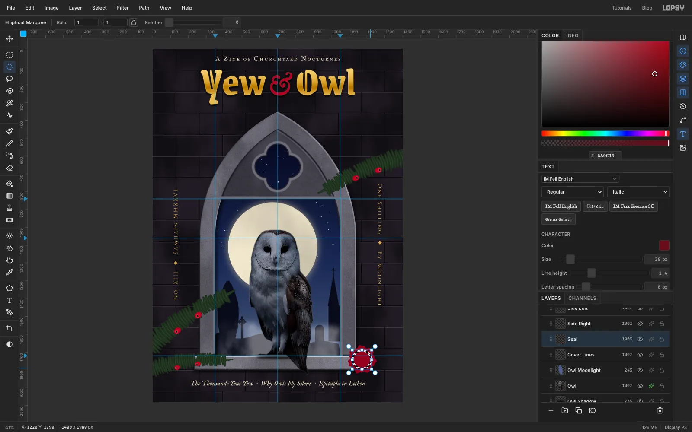

1. Select `Cover Lines` and add a layer called `Seal`.
2. With the **Lasso**, draw a rough circle about 150 px across centred on `1172, 1742`, at the right end of the sill. Let the edge wobble in and out a little, like wax spreading under a stamp. Fill it with `#8A1222`.
3. Select a circle of radius `54` from the same centre, hold [[Option]] and cut out a circle of radius `48`. Fill the thin ring with `#6A0C19` and deselect.
4. Turn on **Inner Glow** in `#2E040B` with **Size** `22` and **Opacity** `75`, then click **Rasterize Layer Style**.

## Stamp and tilt the seal

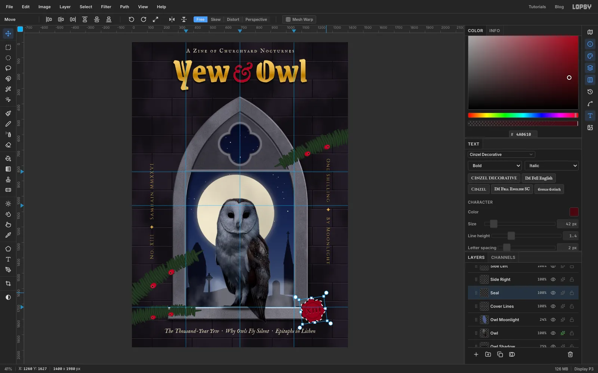

1. Make a text layer reading `XIII` in **Cinzel Decorative**, **Bold**, style **Italic** (the slant suits a hand-pressed stamp), **Size** `42`, colour `#4A0610`, with **Letter spacing** `2 px`. Centre it on the seal with the **Move** tool.
2. Turn on **Drop Shadow** with colour `#E06070`, **Offset Y** `2`, **Blur** `0` and **Opacity** `90`. A pale edge under dark letters makes them look pressed into the wax.
3. Choose **Layer → Merge Down** to stamp it into the seal, and rename the result `Seal`.
4. With the **Move** tool, ⌘-click the thumbnail and drag a rotation handle to turn the seal a little counter-clockwise, about `8°` by eye. Press [[Cmd+D]].
5. Give `Seal` a **Drop Shadow**: black, **Offset X** `4`, **Offset Y** `9`, **Blur** `14`, **Opacity** `70`.

## Darken the corners

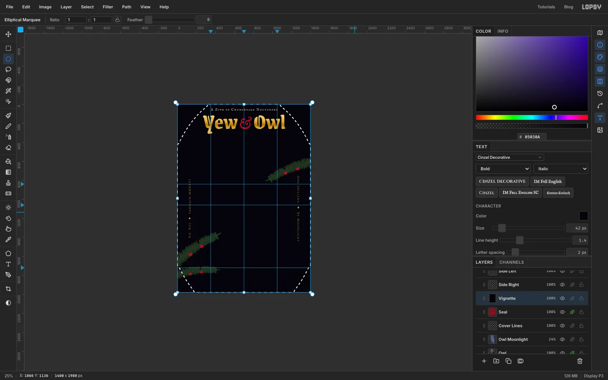

1. Select `Seal` and add a layer called `Vignette` above it. It sits under the type and the yew, so they stay crisp. Fill the whole canvas with `#05030A`.
2. Zoom out twice. With the **Elliptical Marquee**, drag a tall oval centred on `700, 1060`, about `1640` px wide and `2360` px tall, so it runs just past the canvas on every side.
3. Choose **Select → Feather…** `260`, press [[Delete]] and deselect.
4. Set `Vignette` to **Multiply** at `70%` and fit the canvas to the screen again.

## Add a printed grain

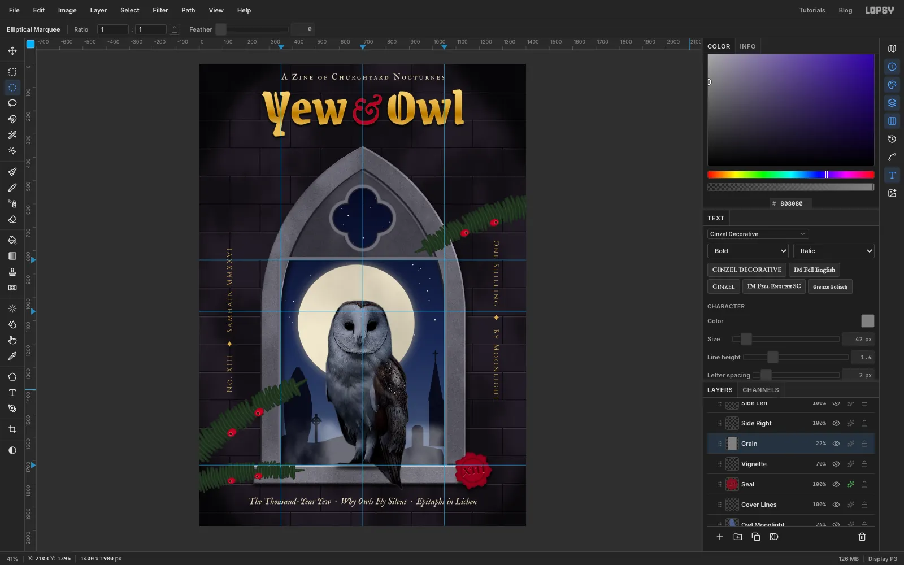

1. Add a layer called `Grain` just above `Vignette` and fill the whole canvas with `#808080`.
2. Run **Add Noise…** with **Amount** `40`, **Mono** and **Gaussian**.
3. Set `Grain` to **Overlay** at `22%`.

Mid-grey disappears in Overlay, so only the noise is left. It ties the photo
owl and the drawn stone together, and gives the cover the slightly rough look
of a printed zine. Choose **View → Show Guides** to toggle the guides off, and export
with **File → Quick Export PNG**.
