Gothic posters run on a simple contrast: a black silhouette against a bright
moon, warm lantern light against cold violet night, and heavy blackletter
against small, quiet capitals. In this tutorial you'll make **Belfry at
Midnight**, a 1500 × 2250 px poster for an imaginary Halloween carillon vigil.
A crocketed bell tower stands in front of a full moon, and bats pour out of
its glowing belfry.

The bat flock comes from a real photo:
[Mexican free-tailed bats exiting Bracken Bat Cave](https://commons.wikimedia.org/wiki/File:Mexican_free-tailed_bats_exiting_Bracken_Bat_Cave_(8006845825).jpg)
by Ann Froschauer of the U.S. Fish and Wildlife Service, on Wikimedia
Commons. It's in the **public domain**. Download the 1280 px wide version.
Any photo of bats against a clear evening sky works the same way.

Along the way you'll use:

- the **Gradient** tool (radial and linear), **Clouds**, **Sunburst**, **Smoke**, **Emboss**, **Motion Blur**, **Gaussian Blur**, **Color LUT** and **Add Noise**
- the **Spray** tool, **Inner Glow** to shade the moon's rim, and the **Clone Stamp**
- **New Group**, **Add Layer**, **Duplicate Layer**, **Merge Down** and moving a whole group
- the **Elliptical Marquee** (including its exact-size dialog), **Rectangular Marquee** and **Lasso**, with [[Shift]] to add and [[Alt]] to subtract, plus **Grow**, **Shrink**, **Feather** and **Select → Inverse**
- [[Cmd]]-clicking layer thumbnails to select a layer's shape
- a **layer mask** painted with a gradient
- the **Brush** with **Radial Symmetry**, and with **Taper** for branches
- dropping in a photo, **Desaturate**, **Threshold** and the **Magic Wand**
- copy and paste, **Flip Horizontal**, and scaling and rotating with the **Move** tool
- ruler **guides**, the **grid** with snapping, and **Snap to Guides**
- **Text** in UnifrakturCook and Spectral SC, the **Text** panel's letter spacing, **Rasterize Layer**, and rotating live text
- layer effects (**Outer Glow**, **Inner Glow**, **Stroke**, **Drop Shadow**, **Color Overlay**) and the **Screen**, **Soft Light**, **Multiply**, **Overlay** and **Color** blend modes
- **Contrast** and **Saturation & Vibrance** adjustments on the whole poster
- undo and redo

The palette:

- Night sky `#4B3B74` → `#2C2152` → `#161130` → `#07050D`
- Moon `#F2ECDC`, moon edge `#8C7F6A`, halo `#6E5BA6`
- Tower `#0E0B1A`, moonlit stone `#2A2347`, hood moulds `#3A3160`
- Lantern light `#FFF2C8` → `#F7B54A` → `#C8641C` → `#6E2A0E`
- Gilt `#E9CF86` / `#A9813E` / `#F1DA9A` / `#8E6A2F`, gold type `#D9B868`
- Bone type `#EFE6CF`, lilac small print `#C3B8E6`, fog tint `#6A4FA6`

## Set up the document and guides

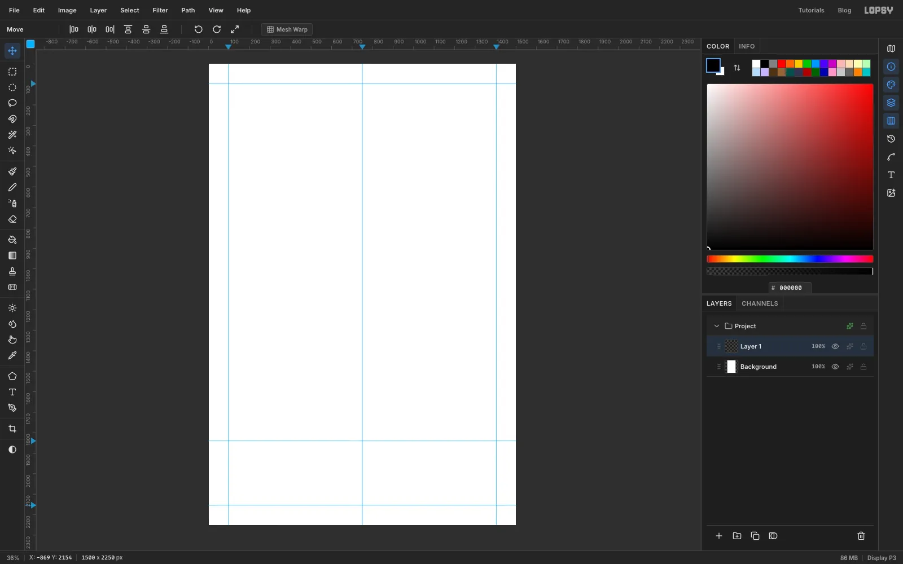

Create a new document **1500 × 2250 px** with a **White** background.

Click the rulers to drop guides. Click the top ruler at **750** for the centre
line, then at about **96** and **1404** for the side margins. Click the left
ruler at about **96** for the top margin, **1840** for the ground line and
**2154** for the bottom margin. A single click on a ruler makes a guide, so
you don't need to drag.

Two points come up again and again, so note them now. The moon's centre is
at **790, 900**, just right of the centre line. The bells' centre is at
**610, 1190**, which is also the tower's axis. The status bar shows the
cursor's X and Y, so you can always find them.

## Paint the night sky

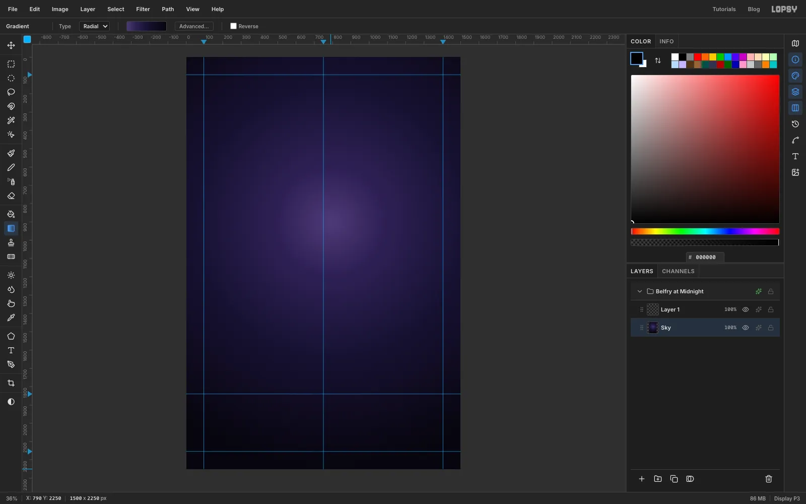

In the Layers panel, double-click the **Project** group's name and rename it
**Belfry at Midnight**. Rename the **Background** layer **Sky**.

Choose the **Gradient** tool, set **Type** to **Radial** and click
**Advanced…**. Make four stops: `#4B3B74` at the left end, `#2C2152` a little
less than a quarter of the way along, `#161130` just past halfway and
`#07050D` at the right end. Click **Done**, then drag from the moon's centre
straight down to the bottom edge.

## Add night clouds

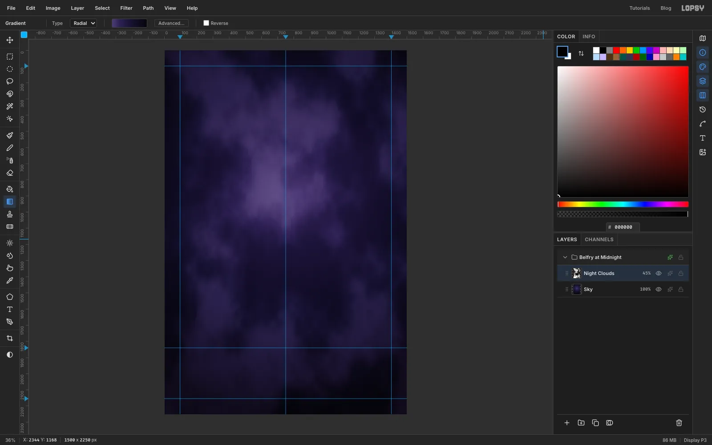

Rename **Layer 1** to **Night Clouds**. Choose **Filter → Clouds…**, set
**Scale** to **5** and click **Apply**.

Open the layer's effects (the sparkle button on its row), set the blend mode
to **Soft Light** and close the drawer. Lower the layer's opacity to **45%**.

## Fan out moon rays with Sunburst

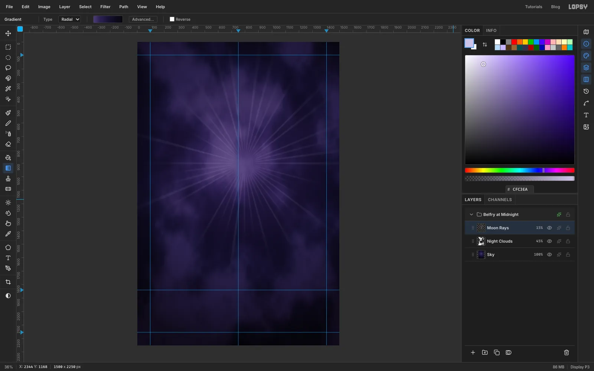

Click **Add Layer** and name it **Moon Rays**. Set the foreground colour to
`#CFC3EA` and choose **Filter → Sunburst…**:

- **Rays** 48, **Length** 75, **Width** 22
- **Fade** 100, **Softness** 70, **Jitter** 85
- **Center X** 53, **Center Y** 40, which puts the burst on the moon's centre

Apply it, then run **Filter → Gaussian Blur…** with a **Radius** of **6**.
Set the layer to **Screen** at **15%**. The jitter breaks up the rays so they
don't look like a stock starburst.

## Scatter stars with the Spray tool

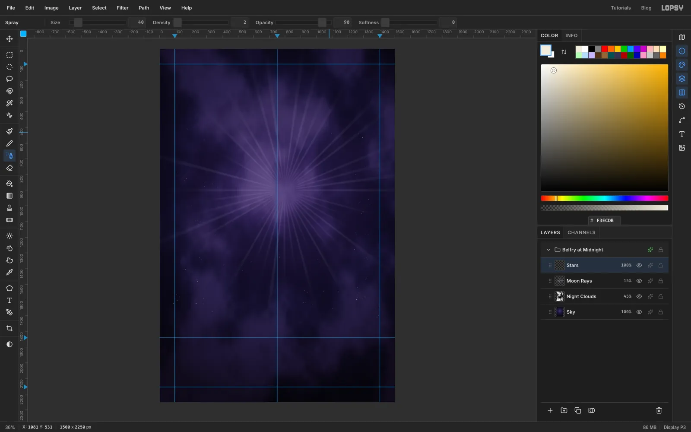

Add a layer called **Stars** and set the foreground to `#F3ECDB`. Choose the
**Spray** tool and set **Size** 40, **Density** 2, **Softness** 0 and
**Opacity** 90.

Dab single clicks across the sky until it feels starry, keeping the area
around the moon clear. Each click drops a couple of tiny dots. Clicking,
rather than dragging, keeps the stars sharp and sparse.

## Set up the group stack

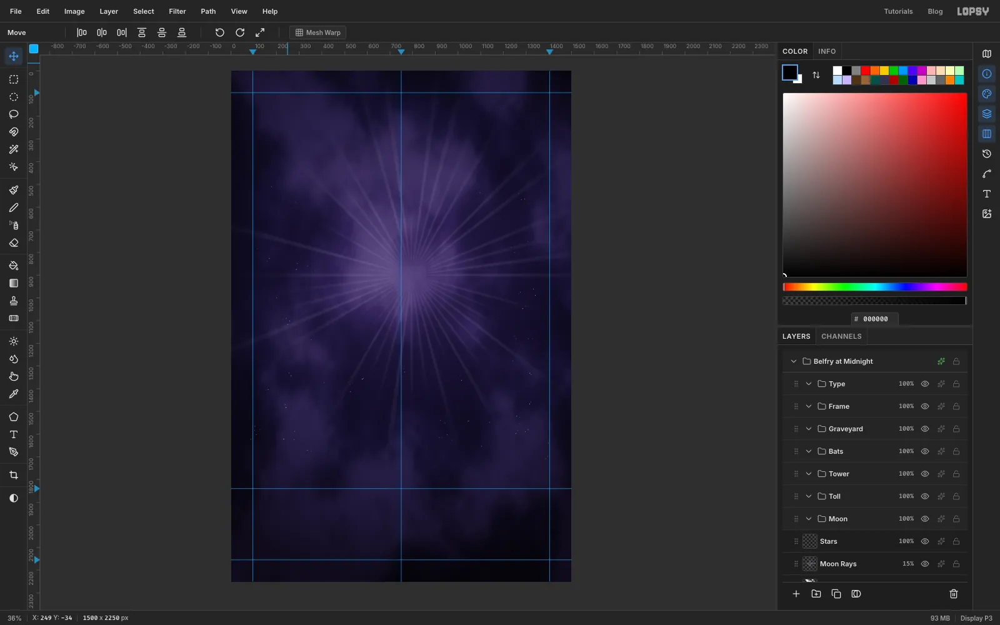

Set up the groups now, so every later layer has a home. Click the **Stars**
layer and press **New Group**. Name the group **Type**.

Click **Stars** again before each new group, so each one lands directly above
Stars and pushes the earlier ones up. Make **Frame**, **Graveyard**,
**Bats**, **Tower**, **Toll** and **Moon**, in that order. You end up with
Moon at the bottom of the stack and Type at the top.

## Give the moon a halo

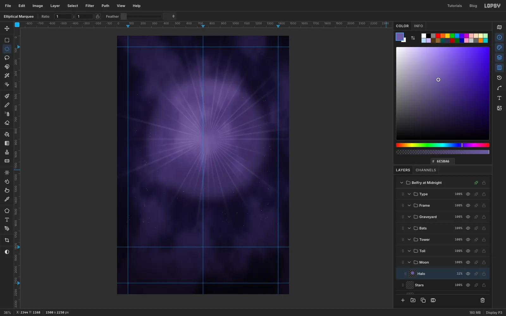

Click the **Moon** group and **Add Layer**. Name the layer **Halo**; it goes
inside the group.

For circles that sit exactly where you want them, use the Elliptical
Marquee's dialog. With nothing selected, choose the **Elliptical Marquee**
and click once on the canvas without dragging. The **Elliptical Selection**
dialog opens. Enter **From** 270, 380 and **To** 1310, 1420, then click
**Select**. That's a circle 1040 px across around the moon's centre.

Choose **Select → Feather…**, enter **63** and click **Apply**. Set the
foreground to `#6E5BA6`, choose **Edit → Fill** and deselect with
[[Cmd+D]]. Blur the layer with **Gaussian Blur** at **60**, then set it to
**Screen** at **32%**.

## Select the moon

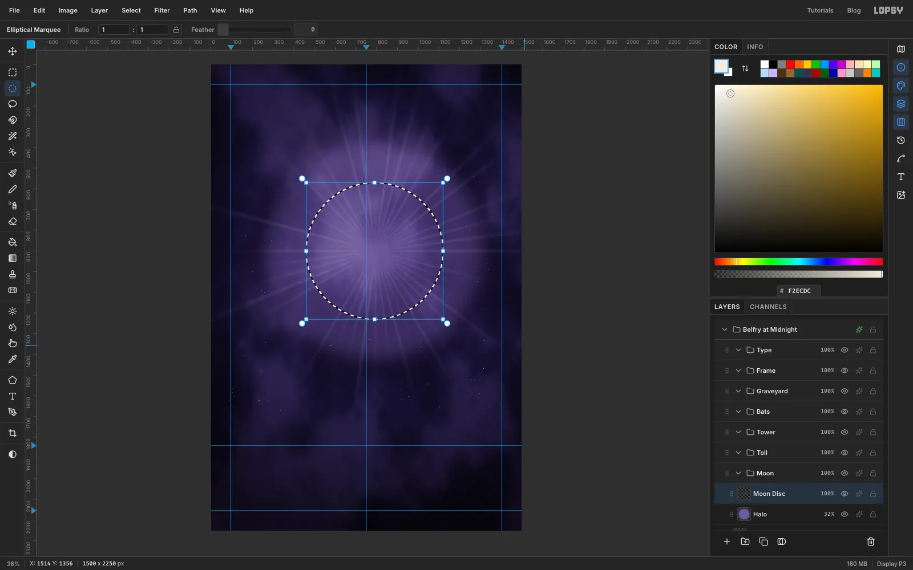

Add a layer named **Moon Disc**. Click once with the Elliptical Marquee again
and enter **From** 460, 570, **To** 1120, 1230: a circle 660 px across.

## Fill and glow

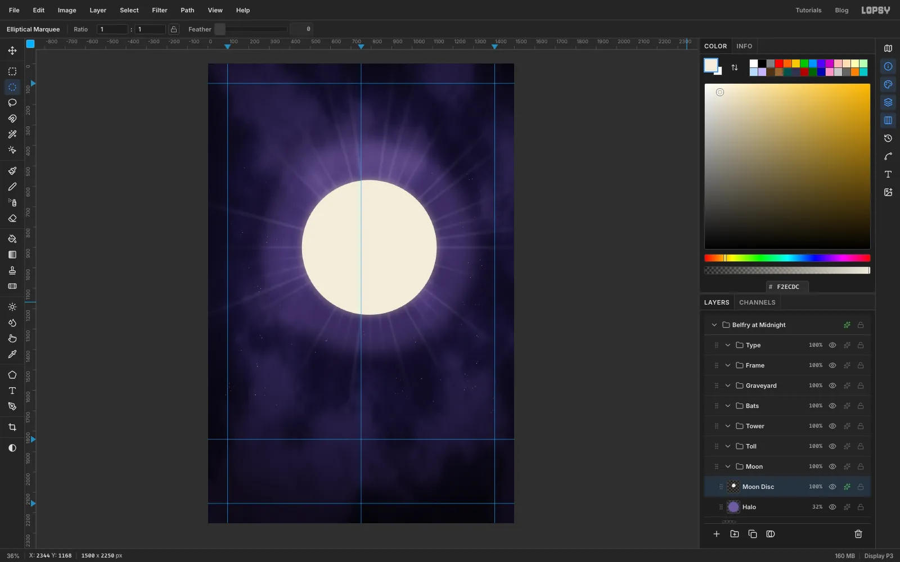

Set the foreground to `#F2ECDC`, choose **Edit → Fill** and deselect. In the
layer's effects, turn on **Outer Glow** with **Size** 110, **Opacity** 55 and
the colour `#E8D9B0`.

## Paint the lunar seas with Clouds

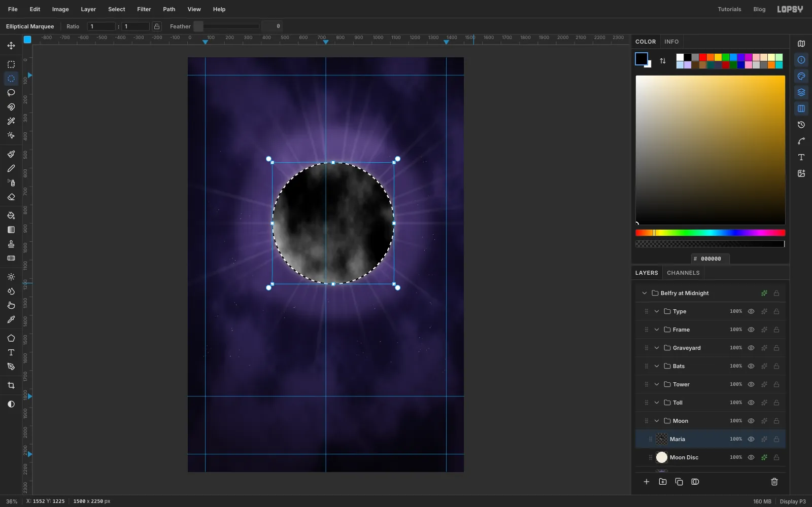

[[Cmd]]-click the **Moon Disc** thumbnail to select its circle. Add a layer
named **Maria**, set the foreground to black and run **Filter → Clouds…** at
**Scale 4**. The filter only fills the selection.

Lighten the clouds with **Filter → Brightness/Contrast…**: **Brightness** 42,
**Contrast** 22. Deselect, then set the layer to **Multiply** at **40%**.
Clouds is random, so if the seas come out too dark, undo and run it again.

## Add relief and darken the edge

Choose **Layer → Duplicate Layer** and rename the copy **Relief**. Run
**Filter → Emboss…** with **Angle** 135 and **Strength** 40, then set it to
**Overlay** at **35%**.

To round the moon, open the effects on **Moon Disc** and add an **Inner
Glow** in `#8C7F6A`, **Size** 70, **Opacity** 45. The glow darkens the rim
the way a real moon's edge falls off.

## Draw the ringing sound waves

Click the **Toll** group, add a layer named **Toll Rings** and set the
foreground to `#E2BE72`. The rings centre on the bells' point, **610, 1190**.

Start with the **biggest** ring. With the Elliptical Selection dialog, enter
**From** 45, 625 and **To** 1175, 1755. Choose **Edit → Fill**, then
**Select → Shrink…** by **3**, and press [[Delete]] to hollow it out.

Repeat for three smaller rings, shrinking each by **4**:

- **From** 160, 740, **To** 1060, 1640
- **From** 265, 845, **To** 955, 1535
- **From** 360, 940, **To** 860, 1440

Go from largest to smallest. Each fill covers everything inside its circle,
so a large ring drawn after a small one would wipe the small one out. Set the
layer to **Screen** at **35%**.

## Fade the rings with a mask

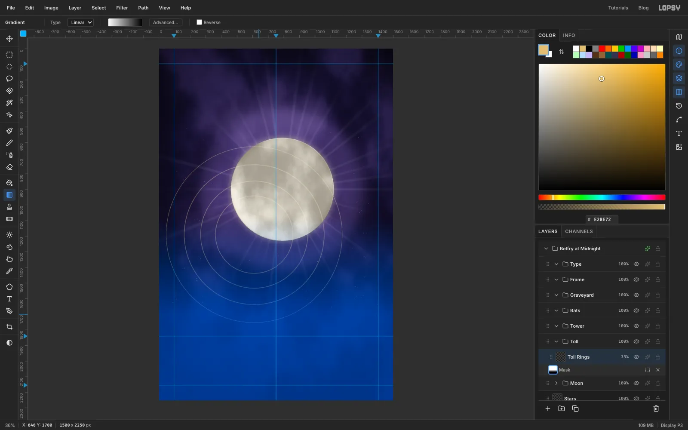

With **Toll Rings** selected, click **Add Mask** at the bottom of the Layers
panel. Then click the new mask thumbnail to edit the mask; the canvas turns
blue while you're in mask editing.

Choose the **Gradient** tool, set it to **Linear** and set the stops to white
then black in **Advanced…**. Drag from just above the bells' point straight
down about 600 px. The rings now fade out toward the ground.

## Tuck the rings behind the moon

Click the **Toll Rings** name to leave mask editing; the blue tint
disappears. Expand the **Moon** group, [[Cmd]]-click the **Moon Disc**
thumbnail, click **Toll Rings** again and press [[Delete]]. The rings now pass
behind the moon.

To keep the outer ring from running into the margins, make a circle with
**From** 90, 670 and **To** 1130, 1710. **Feather** it by **63**, choose
**Select → Inverse** and press [[Delete]]. The rings fade softly instead of
stopping on a hard edge.

## Light the belfry windows

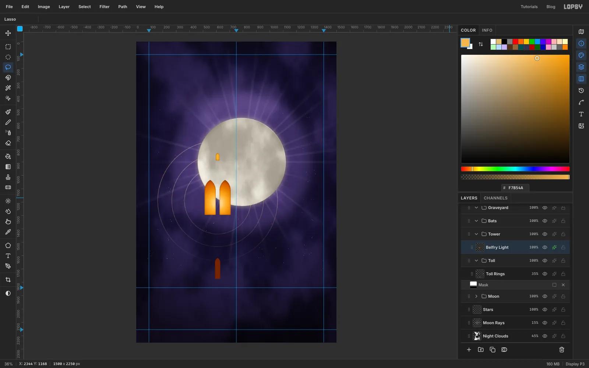

Click the **Tower** group and add a layer named **Belfry Light**. These are
the openings in the tower, drawn before the tower itself. Use the **Lasso**:

1. Draw two tall **pointed lancet windows**, each about 75 px wide, side by
   side on the tower's axis. Their arched tops reach up to about y 1060 and
   their bottoms sit at about y 1290.
2. Hold [[Shift]] and add a narrow **door slit** lower down, about 30 px wide,
   from about y 1650 to 1770.
3. Hold [[Shift]] and add a tiny window high above, around y 860. It will sit
   in the spire.

Choose **Select → Grow…** by **4**. Set a **Radial** gradient with
`#FFF2C8`, `#F7B54A`, `#C8641C` and `#6E2A0E`, and drag from the bells' point
downward about 215 px. Then lasso the tiny window again, grow it by 4 and
fill it with `#F7B54A` so it glows too.

Add an **Inner Glow** in `#5A2408`, **Size** 16, **Opacity** 70. It shades
the window edges like stone reveals.

## Hang the bells

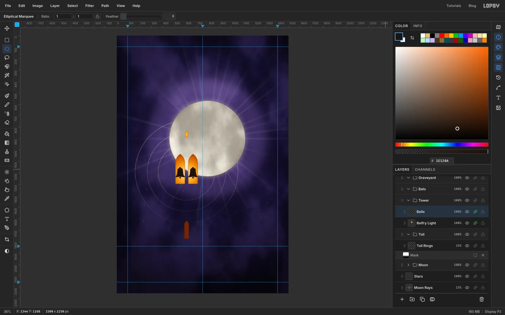

Add a layer named **Bells**. With the Lasso, draw a bell in each window: a
small crown, sides that swell out, and a flared lip with a slightly curved
mouth. Make both bells the same height, about 86 px. Hold [[Shift]] and add a
small circle under each mouth for the clapper.

Fill with `#1E120A`, then add an **Inner Glow** in `#F7C46A` at **Size** 4,
**Opacity** 85. The bells now catch a rim of lantern light.

Zoom in (for example to 200%) for this kind of small work. Return with
**View → Fit to Screen** afterwards.

## Draw the spire and pinnacles

Add a layer named **Tower Body**. The tower is one big selection built from
simple shapes. Start with the top:

- **Lasso** a tall spire on the tower's axis. Its tip is at about y 600, and
  it's about 180 px wide at its base at about y 990. Add little hooked bumps,
  called *crockets*, every 60 px or so up both edges.
- Hold [[Shift]] and lasso a thin pinnacle, about 35 px wide and 140 px tall,
  at each corner, standing on the same base line.

Zoom in while you draw the crockets.

## Add the stages, shaft and buttresses

Keep holding [[Shift]] to add each piece with the **Rectangular Marquee**:

- a parapet about 290 px wide just under the spire base, with a row of small
  square merlons on top
- the belfry stage, about 250 px wide, from the parapet down to just below
  the windows
- a slightly wider band (a *string course*) under it
- the clock stage, about 230 px wide and 200 px tall
- another band, then the shaft, about 250 px wide, running down past the
  ground guide

Then [[Shift]]-lasso a stepped buttress on each side of the shaft. Add a
small circle with the Elliptical Marquee at the spire tip. Be careful not to
click without [[Shift]] here: a plain click would drop the whole selection.

## Fill the tower and cut the windows

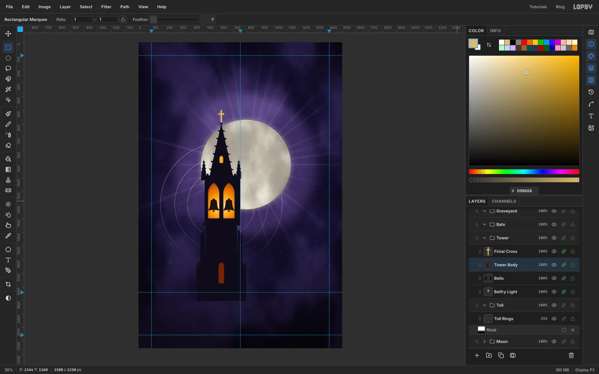

Set the foreground to `#0E0B1A` and fill. To cut the windows, [[Cmd]]-click
the **Belfry Light** thumbnail, click **Tower Body** and press [[Delete]]. The
openings match the light exactly.

Add an **Inner Glow** in `#7566A8`, **Size** 4, **Opacity** 50, for a hint of
moonlight on the stone edges.

For the finial, add a layer named **Finial Cross**. Marquee a thin upright
bar about 10 px wide on the spire tip, then [[Shift]]-add a crossbar about
40 px wide. Fill with `#D9B868` and add an **Outer Glow** in `#F0D58C`,
**Size** 14, **Opacity** 45.

## Light the moon-facing side

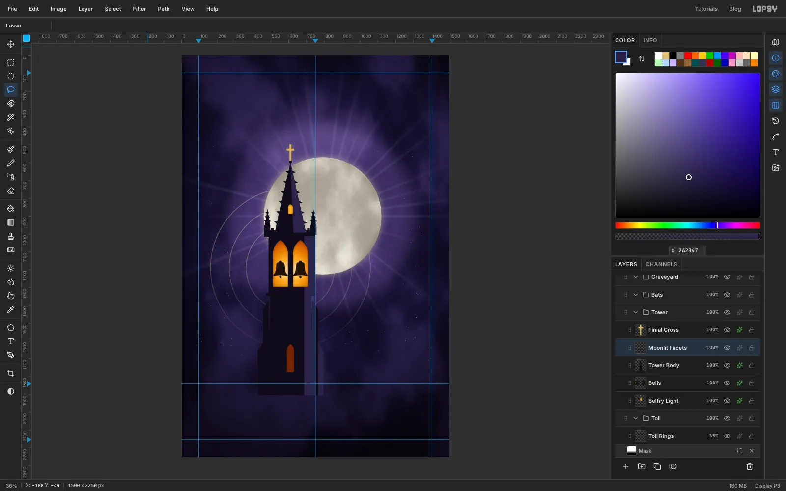

The moon is to the right of the tower, so its right faces catch the light.
Click **Tower Body**, add a layer named **Moonlit Facets** and lasso the
right half of the spire. [[Shift]]-add a narrow strip down the right edge of
the tower and the right buttress, then fill with `#2A2347`.

To trim anything that spills past the stone, [[Cmd]]-click the **Tower Body**
thumbnail, choose **Select → Inverse** and press [[Delete]].

## Frame the windows with hood moulds

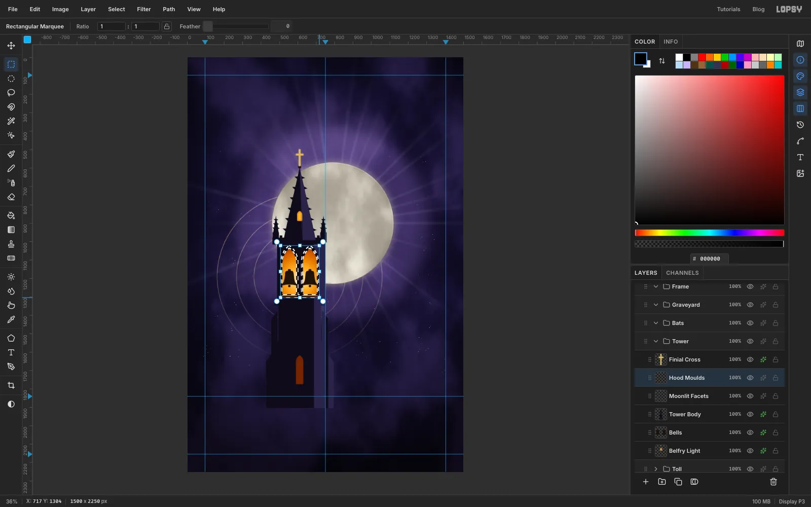

Add a layer named **Hood Moulds**. Trace a pointed arch about 10 px larger
than each window all round ([[Shift]] for the second). Then hold [[Alt]] and
trace an arch just 2 px larger than each window to subtract it, which leaves
a ring of stone. [[Shift]]-add a thin sill under both windows with the
marquee.

Fill with `#3A3160`.

## Make the clock face

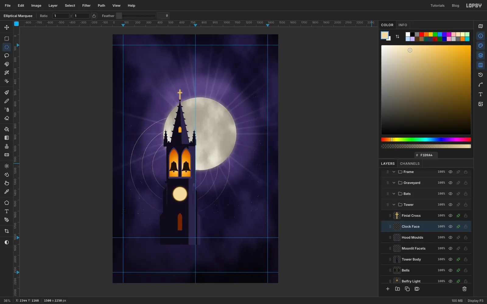

Add a layer named **Clock Face**. Use the Elliptical Selection dialog with
**From** 550, 1384 and **To** 670, 1504: a 120 px circle in the middle of the
clock stage. Fill it with `#F1D9A4` and deselect. Add a **Stroke** of
**Width** 5 in `#B8934A` and an **Outer Glow** in `#F2A23A`, **Size** 26,
**Opacity** 55.

## Paint the hour marks with Radial Symmetry

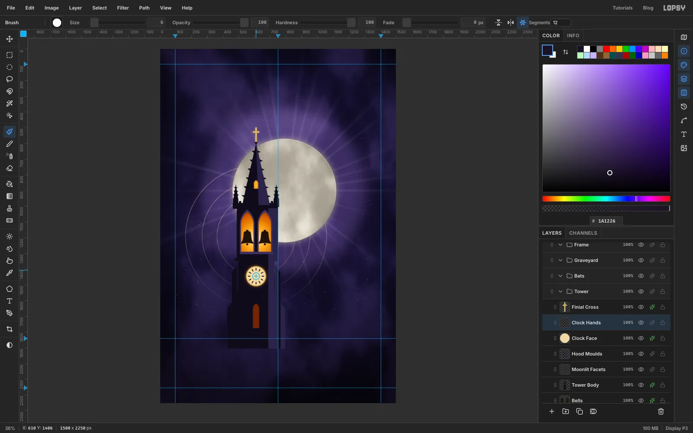

Zoom in to about 200% on the clock. Add a layer named **Clock Hands**,
choose the **Brush**, pick **Hard Round** in the brush presets, set **Size**
6 and **Hardness** 100, and set the foreground to `#1A1226`.

Click **Radial Symmetry** in the options bar and set **Segments** to **12**.
Hold [[Cmd]] and click the centre of the clock to move the symmetry centre
there. Now paint one short stroke just inside the rim at 12 o'clock. Lopsy
repeats it twelve times around the face. Turn **Radial Symmetry** off again.

## Set the hands to two minutes to midnight

Set the brush **Size** to 7, click the clock centre, then [[Shift]]-click
just short of the 12 to draw the hour hand. At **Size** 4, click the centre
and [[Shift]]-click a little left of 12, near the rim, for the minute hand.
Finish with one click at **Size** 12 in the centre, then fit the view to
the screen again.

## Let the light spill out

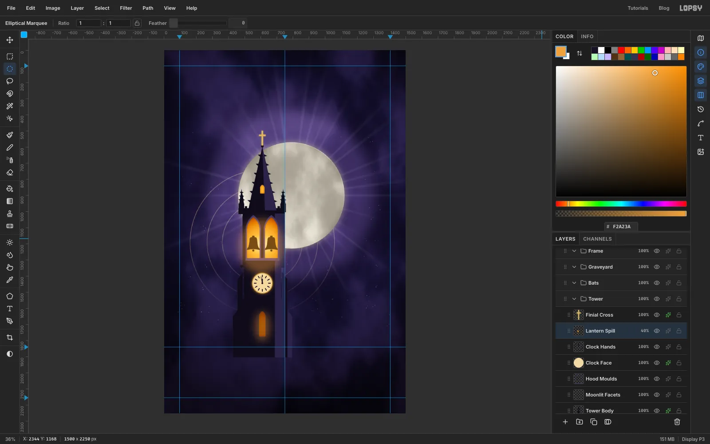

Add a layer named **Lantern Spill**. Drag an ellipse around the belfry, and
[[Shift]]-add a tall narrow ellipse around the door slit. **Feather** it by
**50**, fill with `#F2A23A` and deselect. Set the layer to **Screen** at
**40%**.

## Drop in the bat photo

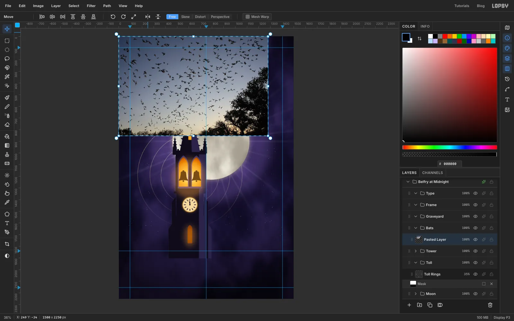

Click the **Bats** group, then drag the bat photo from your desktop onto the
canvas. It lands at the top-left as a new layer. Rename it **Bat Photo**.

## Turn the bats into silhouettes

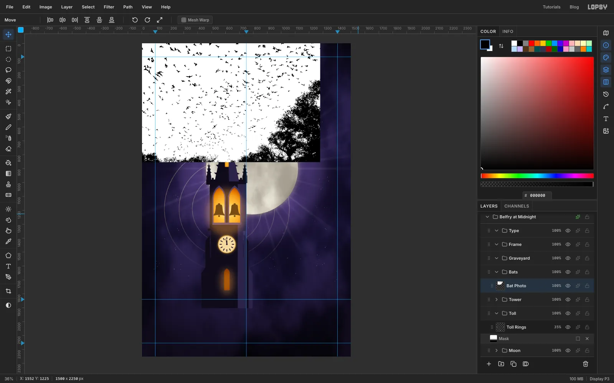

Choose **Filter → Desaturate**, then **Filter → Threshold…** with a
**Level** of **44**. The low level keeps the darker top corner of the sky
white while the bats stay black.

## Remove the sky with the Magic Wand

Choose the **Magic Wand**, set **Tolerance** to **20** and untick
**Contiguous**. Click the white sky; every white pixel is selected, even
between the bats. Press [[Delete]] and deselect.

Removing the sky first matters. Any edge you cut afterwards runs through
empty pixels, so it can't leave a faint white fringe.

## Cut away the trees

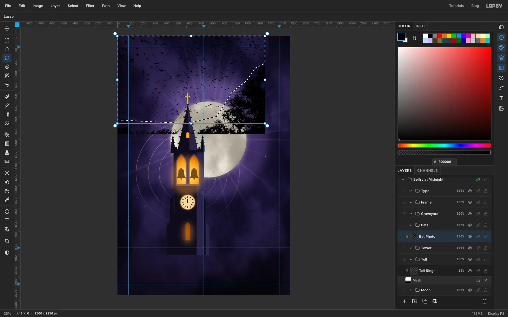

With the **Lasso**, draw around the bat-filled sky, keeping clear of the
trees at the bottom and right. Choose **Select → Inverse** and press
[[Delete]] to remove the trees.

## Scale and place the swarm

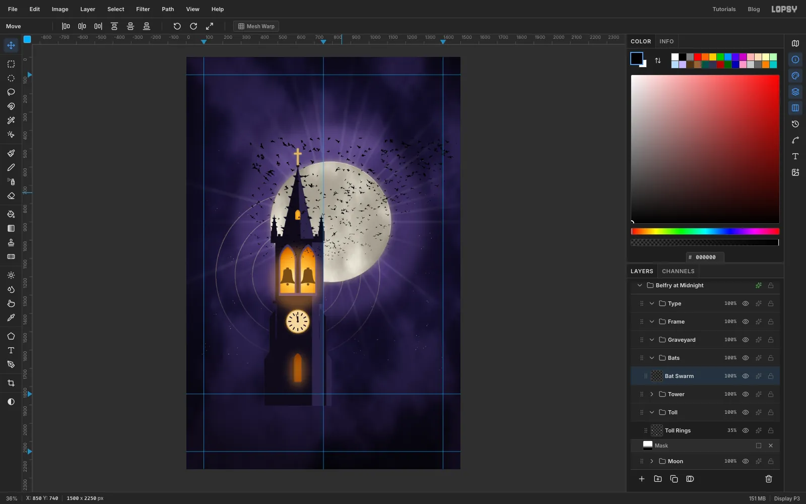

Marquee around the whole photo layer. With the **Move** tool, hold [[Cmd]]
and drag the bottom-right corner handle inward until the photo is about
1,130 px wide on the ruler (it started at 1,280). Press [[Cmd+D]] to commit.

Then drag the layer down and right so the bats cover the moon and the sky
beside it. Rename the layer **Bat Swarm**.

## Shape the flock into a stream

You want the bats to pour out of the belfry and rise to the upper right.
**Lasso** a ribbon that starts at the belfry, sweeps up across the moon and
widens toward the top-right corner. Choose **Select → Inverse**, **Feather**
by **45** and press [[Delete]].

Clean up with the **Eraser** (**Size** 160). Sweep across the bottom right
and just left of the spire, so the stream thins out naturally.

## Add a burst of bats at the belfry

Marquee a dense patch of bats over the moon, about 260 × 160 px. Copy with
[[Cmd+C]] and paste with [[Cmd+V]]; the copy lands in place on a new layer.
Rename it **Bat Burst** and marquee the same patch again.

With the **Move** tool:

1. Click **Flip Horizontal** in the options bar.
2. Hold [[Cmd]] and drag a corner handle inward to about 70%.
3. Drag the round **rotate handle** just outside a corner about 38°
   counter-clockwise.
4. Press [[Cmd+D]], then drag the patch to sit just above and right of the
   belfry windows.

Press [[Cmd+E]] (**Merge Down**) to merge it into **Bat Swarm**. Then give
the swarm a **Color Overlay** in `#0B0814` and an **Outer Glow** in
`#8A79C9`, **Size** 4, **Opacity** 40. The glow keeps the bats readable over
the dark sky.

## Draw a big foreground bat

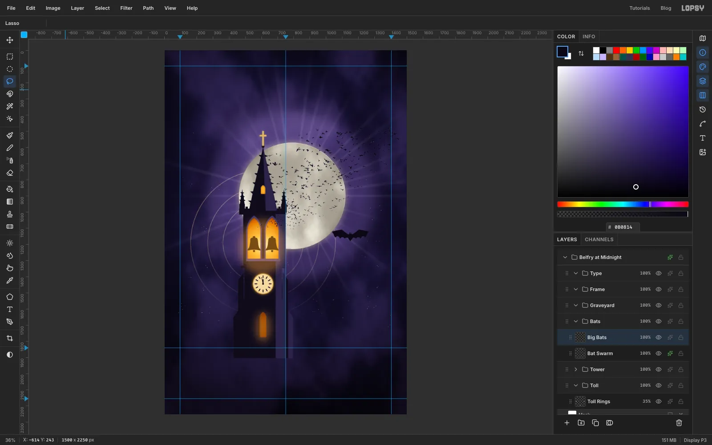

The photo bats are motion-blurred, so they turn into smudges if you scale
them up. Draw a crisp one instead: zoom in on one of the photo bats as a
reference for the wing shape.

Add a layer named **Big Bats**. With the **Lasso**, draw a bat about 230 px
across, just right of the moon: two pointed ears, a small body, wings that
rise to sharp tips, and a trailing edge scalloped between the finger bones.
Fill with `#0B0814`.

## Copy, flip, scale and rotate two more bats

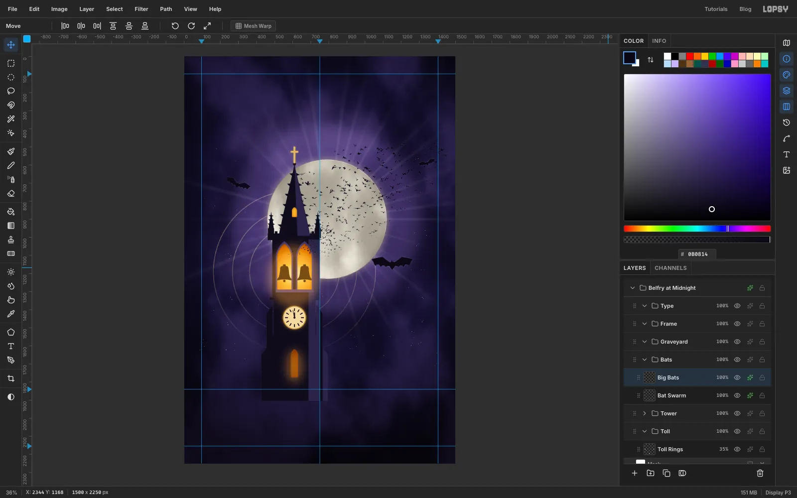

Marquee around the bat, copy, paste, and marquee the same spot again. With
the **Move** tool, click **Flip Horizontal**. After a flip, Lopsy re-selects
the flipped pixels, so the handles now hug the bat itself.

[[Cmd]]-drag a corner until the copy is about 140 px across. Rotate it about
22° clockwise with the round handle, press [[Cmd+D]] and drag it to the left
of the tower. Press [[Cmd+E]] to merge it into **Big Bats**.

Make one more copy about 100 px across, tilted 16° the other way, for the top
right of the sky, and merge it down too. Give **Big Bats** an **Outer Glow**
in `#8A79C9`, **Size** 8, **Opacity** 55.

## Raise the churchyard hill

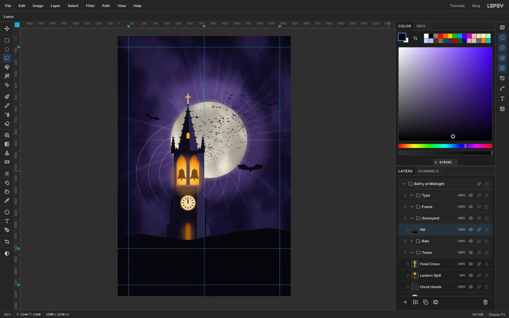

Click the **Graveyard** group and add a layer named **Hill**. Lasso from the
left edge along a gently rolling crest, about 100–170 px above the ground
guide. Dip slightly where it meets the foot of the tower and rise a little
toward the right. Carry on down to the bottom corners and fill with
`#07050C`.

Add an **Inner Glow** in `#5E4F8C`, **Size** 6, **Opacity** 60, so the crest
catches a little light.

## Set out headstones and crosses

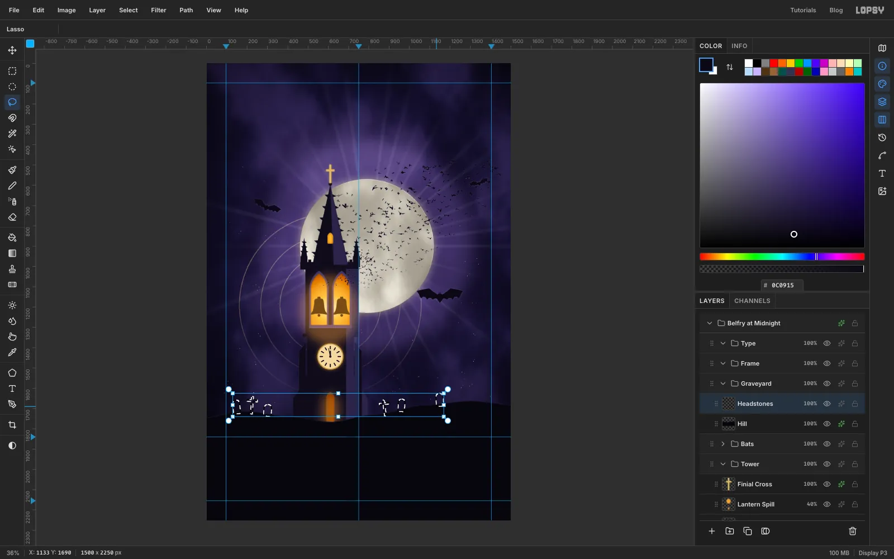

Add a layer named **Headstones**. Lasso a handful of small round-topped
stones (about 35 px wide and 50 px tall) and two plain crosses along the
crest, each leaning slightly. Hold [[Shift]] to add each one. Keep them well
away from the tower, or they'll make it look small. Fill with `#0C0915`.

## Clone more stones

The Clone Stamp copies from the active layer only, so keep **Headstones**
selected. Choose the **Clone Stamp** and set **Size** to **80**.

[[Alt]]-click the middle of the left-most headstone to set the source, then
paint a short vertical stroke on an empty spot of the crest. [[Alt]]-click
the same stone again before the second copy. Otherwise the source keeps its
offset and samples empty sky.

## Grow a dead tree with a tapered brush

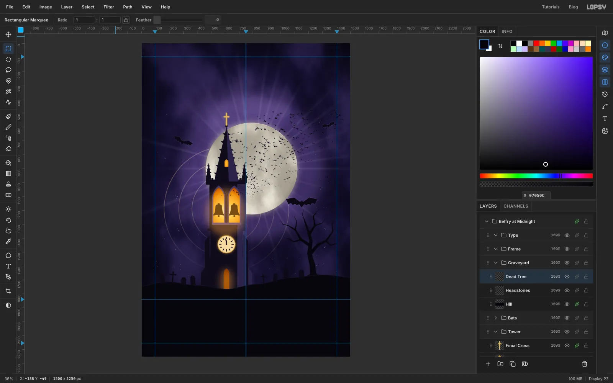

Add a layer named **Dead Tree** and set the foreground to `#07050C`. Choose
the **Brush** with **Hard Round** and open the brush settings. **Taper**
shrinks each stroke to a point over a set distance, which is exactly how
branches thin out.

- Trunk: **Size** 46, **Taper** 520. Drag from inside the hill up and slightly
  to the left, about 450 px.
- Boughs: **Size** 24–26, **Taper** 300. Drag outward from the trunk.
- Twigs: **Size** 7–18, **Taper** 90–220. Drag from the ends of the boughs.

Keep the branches inside the side margin. Set Taper back to 0 when you're
done. To sink the trunk into the ground, [[Cmd]]-click the **Hill**
thumbnail, click **Dead Tree** and press [[Delete]].

## Render the fog

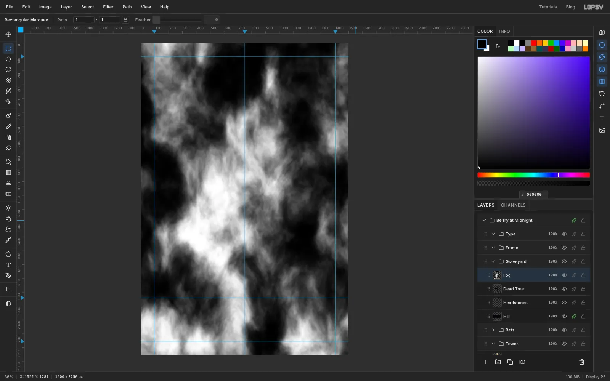

Add a layer named **Fog**. Choose **Filter → Smoke…** with **Scale** 6 and
**Turbulence** 55. Then run **Motion Blur** with **Angle** 0 and **Distance**
70 to stretch the smoke into drifting bands.

## Colour and trim the fog

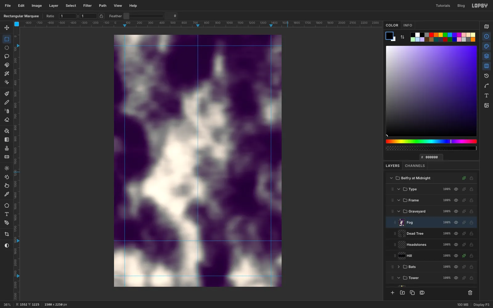

Choose **Filter → Color LUT…**, pick **Cyberpunk** and set **Intensity** to
**100**. Smoke is grey, and this preset pushes its shadows toward purple.
Soften it with **Gaussian Blur** at **22**.

Marquee a wide band from just below the clock to a little above the bottom
guide. **Feather** it by **63**, invert the selection and press [[Delete]].
Set the layer to **Screen** at **40%**.

## Tint the mist violet

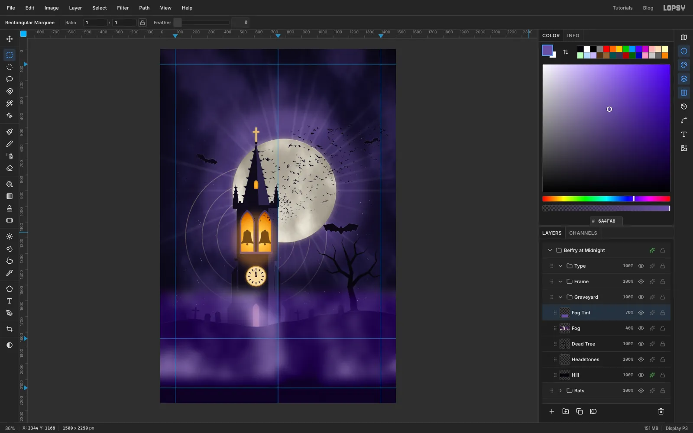

The fog still reads greyish. Add a layer named **Fog Tint**, marquee from
just above the hill to the bottom edge, feather it by **63** and fill with
`#6A4FA6`. Set it to the **Color** blend mode at **70%**. Color mode turns
everything under it violet without making it brighter.

That includes the glowing door slit, which you'll fix next.

## Relight the door and add haze

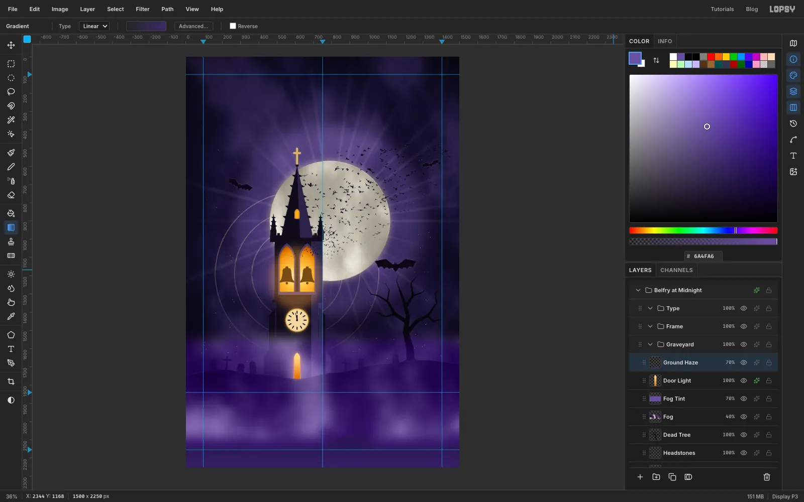

Add a layer named **Door Light**. Lasso the door slit, then [[Alt]]-lasso the
hill to subtract it. Fill the selection with a **Linear** gradient from
`#FFD98A` at the top to `#D2701F`, and add an **Outer Glow** in `#F2A23A`,
**Size** 30, **Opacity** 60.

Then add a layer named **Ground Haze**. Drag a **Linear** gradient from a
transparent `#3B2B66` at the hill crest to a solid `#3B2B66` at the bottom
edge. Set it to **Screen** at **70%** so the lettering will sit in mist
rather than pure black.

## Snap the gilt frame to the grid

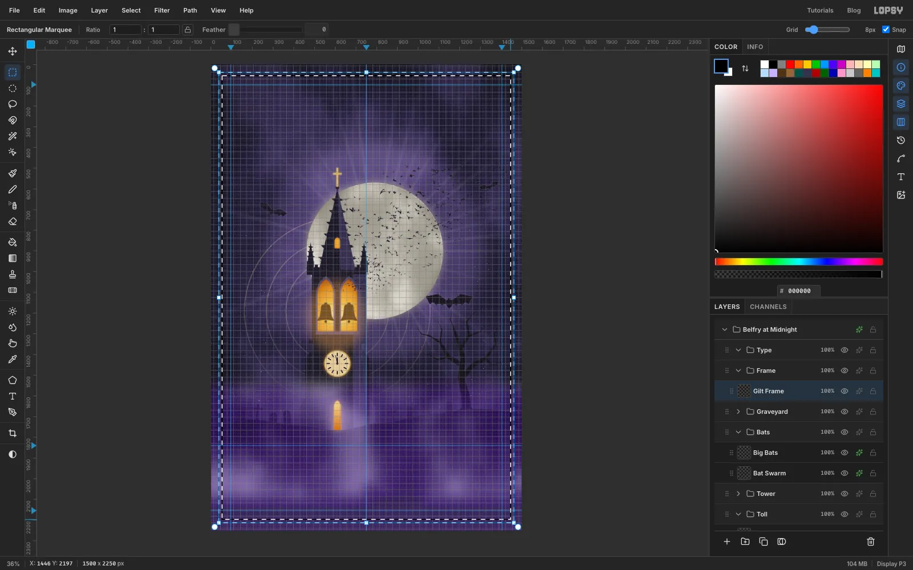

Click the **Frame** group and add a layer named **Gilt Frame**. Choose **View
→ Show Grid** and set the **Grid** slider in the options bar to **8 px**;
snapping turns on with the grid.

With the **Rectangular Marquee**, drag from the grid line about 40 px inside
the top-left corner to the matching line inside the bottom-right. Then hold
[[Alt]] and drag a second rectangle two grid squares (16 px) further in to
subtract it, which leaves a band. Fill with `#C9A55C` and deselect.

Turn the grid off with **View → Show Grid** before the next part. The
hairline needs finer steps than an 8 px grid allows. Drag a rectangle about
8 px inside the band, fill it, then **Select → Shrink…** by **2** and press
[[Delete]]. That's the same trick you used for the rings.

## Add quatrefoil corners

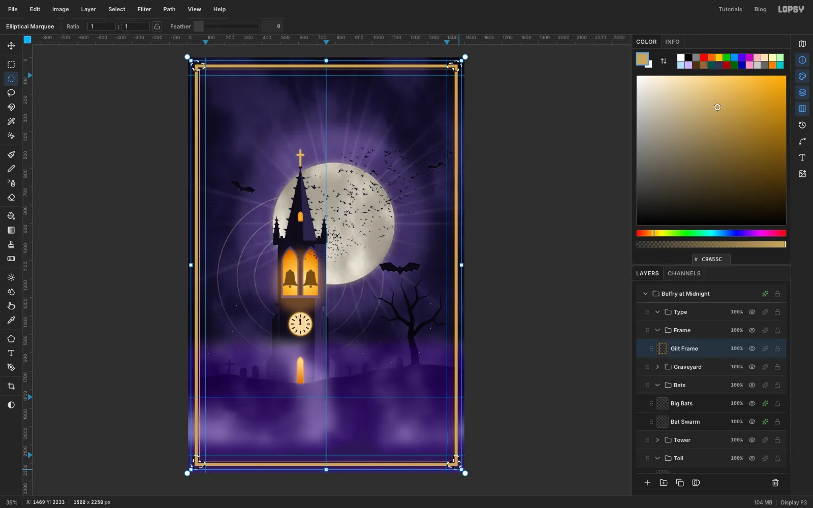

At each corner of the frame, make a quatrefoil from four overlapping circles,
each about 30 px across, using the Elliptical Marquee with [[Shift]] to add.
Do all four corners in one selection, then fill and deselect.

## Gild the frame

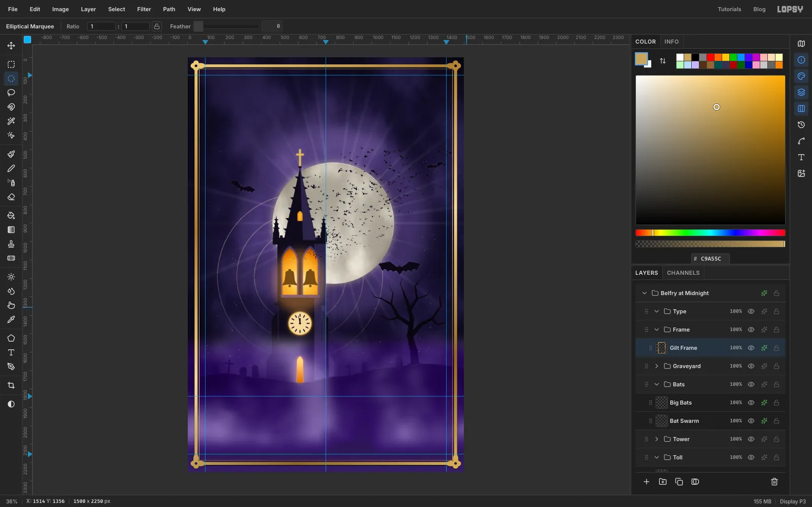

[[Cmd]]-click the **Gilt Frame** thumbnail. Set a **Linear** gradient with
five stops: `#E9CF86`, `#A9813E`, `#F1DA9A`, `#8E6A2F` and `#D9B868`. Drag
from the top-left corner of the canvas to the bottom-right. Because the
selection is the frame, only the frame gets the metallic sheen.

Deselect and add a **Drop Shadow** in black: **Offset X** 0, **Offset Y** 3,
**Blur** 6, **Opacity** 70.

Now pierce each corner. Use the Elliptical Selection dialog to make a 14 px
circle in the middle of a quatrefoil, then press [[Delete]]. Repeat for the
other three corners.

## Draw the divider

Add a layer named **Divider**. Its ornament sits on the ground guide, where
the hill hides the tower's foot, right on the centre line. Marquees snap to
guides, which would squash such small shapes flat, so turn off **View → Snap
to Guides** first.

Build a small quatrefoil on the centre line as before, and [[Shift]]-lasso a
tall diamond through it. Set the foreground to `#C9A55C` and fill. Then
select a tiny circle in the middle and press [[Delete]].

Choose the **Pencil** at **Size** 2. Draw a rule about 390 px long on each
side, starting about 40 px from the centre, with a click and a
[[Shift]]-click. Add a shorter **Size** 1 rule just below each one. Lasso a
small diamond at each outer end and fill. Turn **Snap to Guides** back on.

## Set the overline

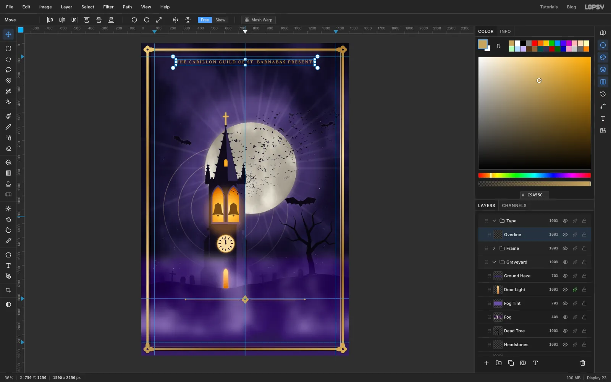

Click the **Type** group. Set the foreground to `#C9A55C`, choose the
**Text** tool, pick **Spectral SC**, **SemiBold**, **Size** 30 and **Align
Center**.

Click in an empty part of the canvas, such as the middle of the moon, type
**THE CARILLON GUILD OF ST. BARNABAS PRESENTS** and press [[Tab]] to commit.
Always start new text in empty canvas, because clicking inside an existing
text box edits that text instead. Rename the layer **Overline**.

In the **Text** panel, set **Letter spacing** to **5**. Then, with the
**Move** tool, drag it up and nudge it with the arrow keys until it's centred
on the centre guide, about 60 px under the frame.

## Set the title

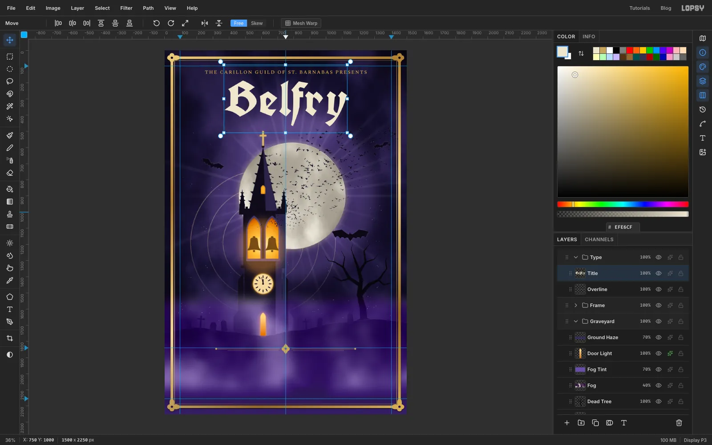

Click the **Type** group again so the next text doesn't restyle the
overline. Set the foreground to `#EFE6CF`. In the Text tool, pick
**UnifrakturCook** at **Size** 300.

Click in empty canvas, type **Belfry** and press [[Tab]]. Rename the layer
**Title** and move it up under the overline. Leave clear air between its
baseline and the cross on the spire.

## Select the letters

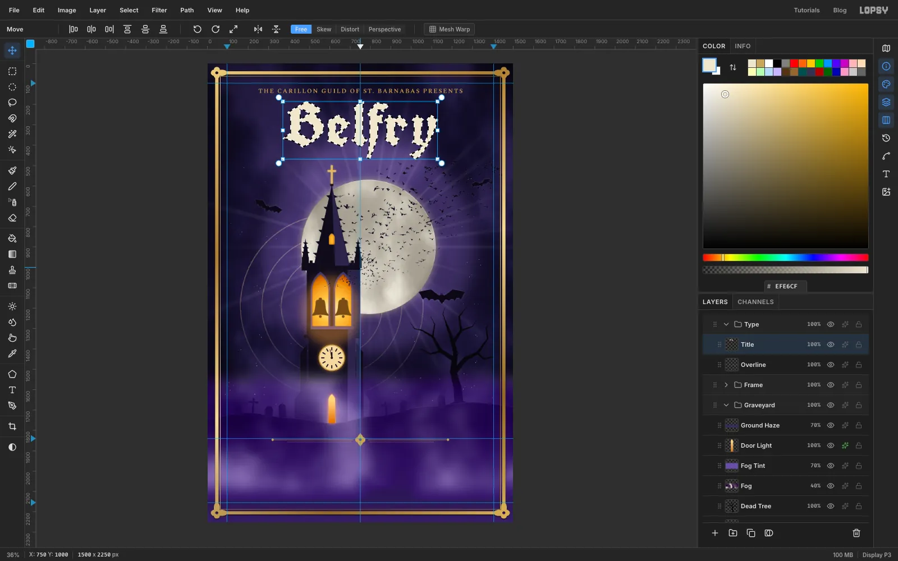

With **Title** selected, click **Rasterize Layer** at the bottom of the
Layers panel. Then [[Cmd]]-click its thumbnail. The selection now traces
every letter.

## Gild the title

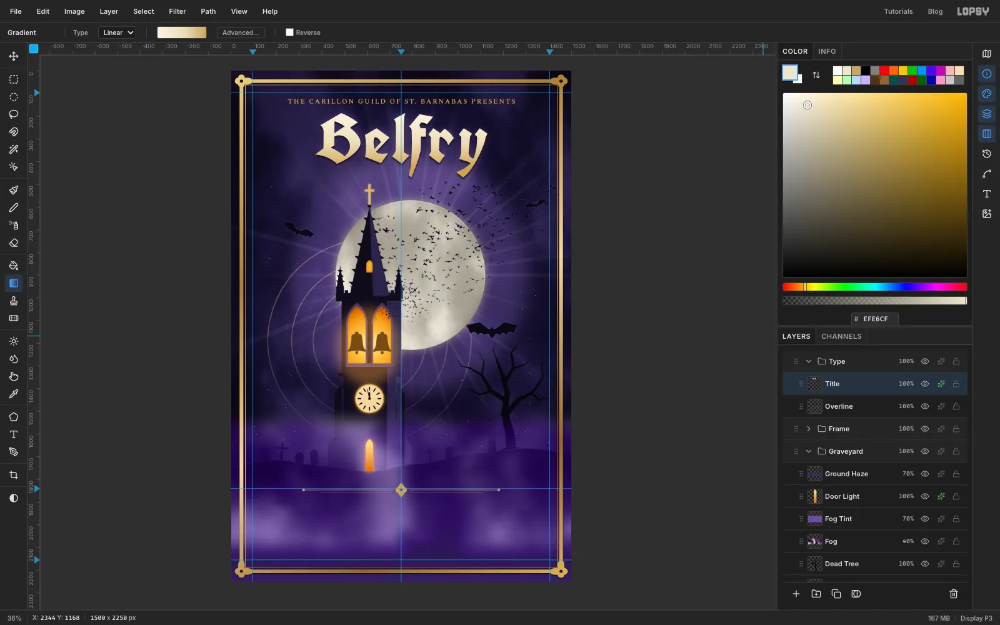

Set a **Linear** gradient: `#FBF4E2`, `#EBDDBA` just past halfway, and
`#C9A55C`. Drag from the top of the letters down to just above the bottom of
the **y**. The selection keeps the gradient inside the letters.

Deselect, then add a **Drop Shadow** in `#05030A` (**Offset Y** 8, **Blur**
14, **Opacity** 75). Add an **Outer Glow** in `#8C7AC8`, **Size** 40,
**Opacity** 30.

## Close the scene with "at Midnight"

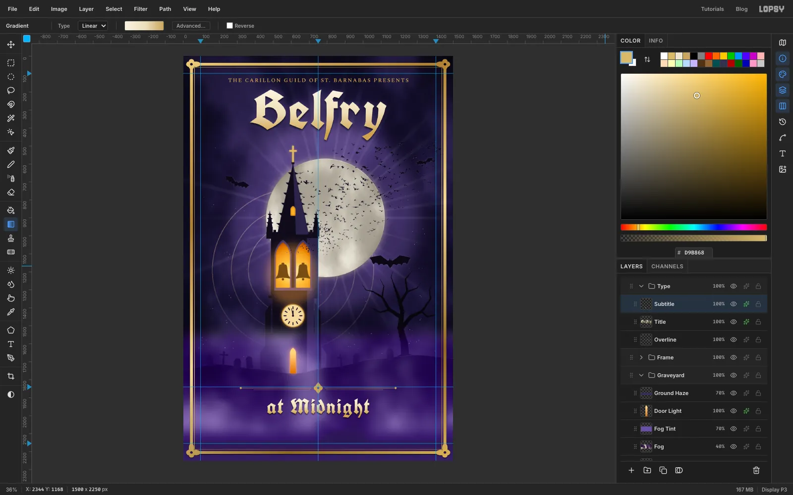

The title reads in two halves: **Belfry** above the scene and **at
Midnight** below it.

Click the **Type** group, set the foreground to `#D9B868` and make
**UnifrakturCook** text at **Size** 118 reading **at Midnight**. Rename it
**Subtitle** and move it so its top sits about 25 px below the divider
ornament. Rasterize it and fill it with the same gradient as the title, but
skip the outer glow. Give it a **Drop Shadow** with **Offset Y** 5, **Blur**
10, **Opacity** 75.

## Add the event details

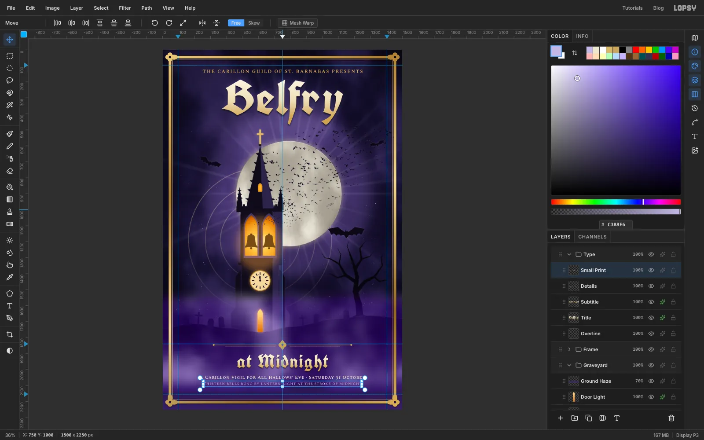

Make two more **Spectral SC** lines. Type each one in empty canvas and move
it into place before you type the next:

1. **SemiBold**, **Size** 28, `#EFE6CF`, letter spacing **2**:
   **A Carillon Vigil for All Hallows' Eve · Saturday 31 October**. Rename it
   **Details** and place it about 30 px under **at Midnight**.
2. **Regular**, **Size** 25, `#C3B8E6`, letter spacing **2**:
   **Thirteen bells rung by lantern-light at the stroke of midnight**. Rename
   it **Small Print** and place it about 18 px under the first line.

Check that the bottom line still has about 80 px of space above the frame.

## Run mottos up the margins

Make **Memento Mori** in **Spectral SC SemiBold**, **Size** 28, `#E0C27A`,
with letter spacing **14**.

Choose the **Move** tool. Live text gets its own handles without any
selection. Hover just outside the top-right corner until the cursor turns
into a crosshair. Then hold [[Cmd]] and drag counter-clockwise; [[Cmd]] snaps
the angle to 15° steps, so stop at **−90°**. Nudge it into the left margin,
centred a little above the middle of the poster.

Do the same with **Tempus Fugit**, turned **+90°**, in the right margin at
the same height. Both stay editable text.

## Lift the flock toward the title

Now that the title is in, the stream reads better rising toward it. Click
the **Bats** group row, choose the **Move** tool and drag the flock about
30 px left and 40 px up. Every layer in the group moves together.

If you're unsure, [[Cmd+Z]] and [[Cmd+Shift+Z]] flip between the two
positions.

## Keep the bats off the tower

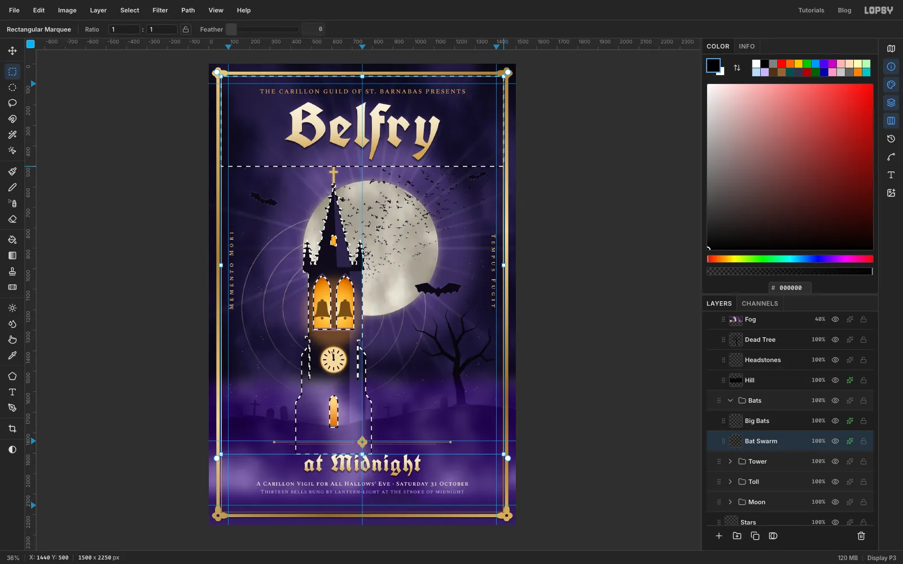

The move left a few bats on the tower and under the title. Expand the
**Tower** group and [[Cmd]]-click **Tower Body** to select the tower. Then
[[Shift]]-drag a marquee across the whole title band.

Click **Bat Swarm** and press [[Delete]], then click **Big Bats** and press
[[Delete]]. Deselect. The flock now flies only over sky and moon.

## Add film grain

Click **Fog** in the Graveyard group and add a layer named **Grain**. Choose
**Select → All**, fill with `#808080` and deselect. Run **Filter → Add
Noise…** with **Amount** 22, **Mono** and **Gaussian**. Set the layer to
**Overlay** at **45%**. The grain takes the digital smoothness off the
gradients.

## Shade the edges by hand

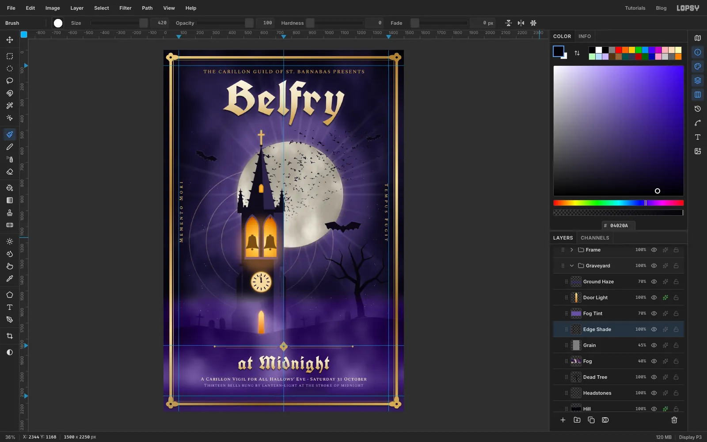

Still in the Graveyard group, add a layer named **Edge Shade** and set the
foreground to `#04020A`. Use the **Brush** with **Size** 420, **Hardness** 0
and **Opacity** 45%. Paint one long, slightly wavering stroke down each side
and one across the top. Hand-painted shading looks less mechanical than a
perfect radial vignette. Set the layer to **Multiply** and the brush opacity
back to 100%.

## Finish with adjustments

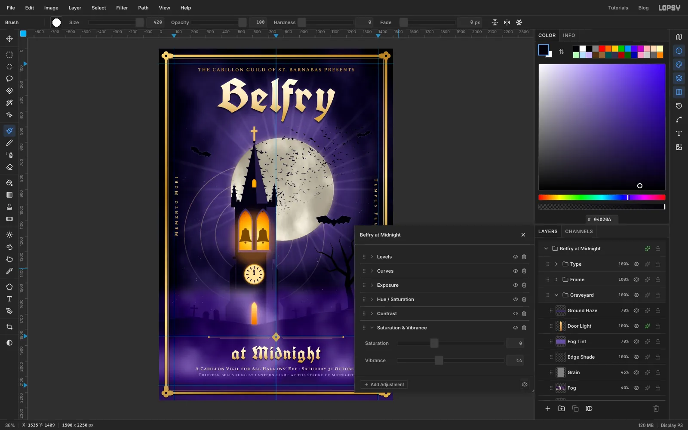

Click the effects button on the **Belfry at Midnight** group at the top of
the Layers panel. Its adjustment list opens. Click **Add Adjustment**,
choose **Contrast** and set it to **10**. Then add **Saturation &
Vibrance** with **Vibrance** at **14**. These grade the whole poster without
changing any pixels.

Export with **File → Quick Export PNG**, and save the layered file with
**File → Save Project**.
