Before the Christmas tree reached England, the centrepiece of the house was the **kissing bough**: a ball of evergreens on a frame of hoops, hung from the ceiling with candles, apples and a bunch of mistletoe underneath. It's a good subject for a gothic card because it already hangs in the middle of things, the way a lamp hangs in a chapel.

This tutorial puts one in front of a stained-glass window on a **1500 × 2100 px** card. The gothic part comes from four habits:

- **a pointed arch**, built from two overlapping circles the way a mason would set it out
- **tracery**, the stonework that divides the head of the window into lobes
- **cold glass against warm candlelight**, with everything else kept dark
- **blackletter** for the greeting

The tools you'll use:

- the **Gradient** tool, **Texture** and the **Pencil** with [[Shift]]-click lines for the wall
- the **Voronoi** filter for stained glass
- the two **Marquee** tools with [[Shift]] to add, [[Alt]] to subtract and [[Shift+Alt]] to intersect
- **Select → Grow**, **Shrink**, **Feather** and **Inverse**
- the **Brush** with **Radial Symmetry**, then a **layer mask**
- the **Shape** tool, the **Pen**, **Spray**, **Smudge** and the **Lasso**
- the **Move** tool for rotating, scaling, flipping and nudging layers and whole groups
- **layer effects**, the **Overlay**, **Multiply** and **Screen** blend modes, and group **adjustments**
- two Google fonts and a gradient run through the letters

The palette is cold stone and blue glass with a few warm things in front of it:

- Stone `#3A3348` → `#262033` → `#0C0912`
- Dressed stone `#4B4160`, stone highlight `#8A80A0`, mortar `#08060C`
- Night glass `#050819` → `#122463` → `#1B4F92` → `#3F8FB8`
- Snow hills `#3F58A8` / `#6F86CF`, moon `#D3DEF8`
- Ruby glass `#D8582C` → `#93182A` → `#3A0810`
- Fir `#0F2A1C`, `#143D26`, `#1F5A35`, `#4E9A52`, `#8CC27A`
- Ribbon `#C8273B`, berry `#A8182B`, wine `#5E0E1A`
- Candle `#FFF8E6` → `#B9A277`, flame `#FFE9A8` → `#F7C45A` → `#E8842A`
- Gold `#D9A93F`, title gold `#F0C566`, subtitle `#EAD6A2`

The type is **UnifrakturMaguntia** for the greeting and **Cormorant SC** SemiBold for the line under it.

> **Note:** Shortcuts are written for a Mac. On Windows use [[Ctrl]] wherever it says [[Cmd]].

> **Tip:** Several pieces of stone get the same finish. When a step says "the stone finish", it means **Filter → Texture…** with **Rough**, **Amount 20**, **Size 30**, **Detail 60**, then a **Drop Shadow** (black, Offset Y **10**, Blur **26**, Opacity **85**) and an **Inner Glow** (`#8A80A0`, Size **9**, Opacity **55**) from the sparkle button on the layer's row.

## Lay down the stone

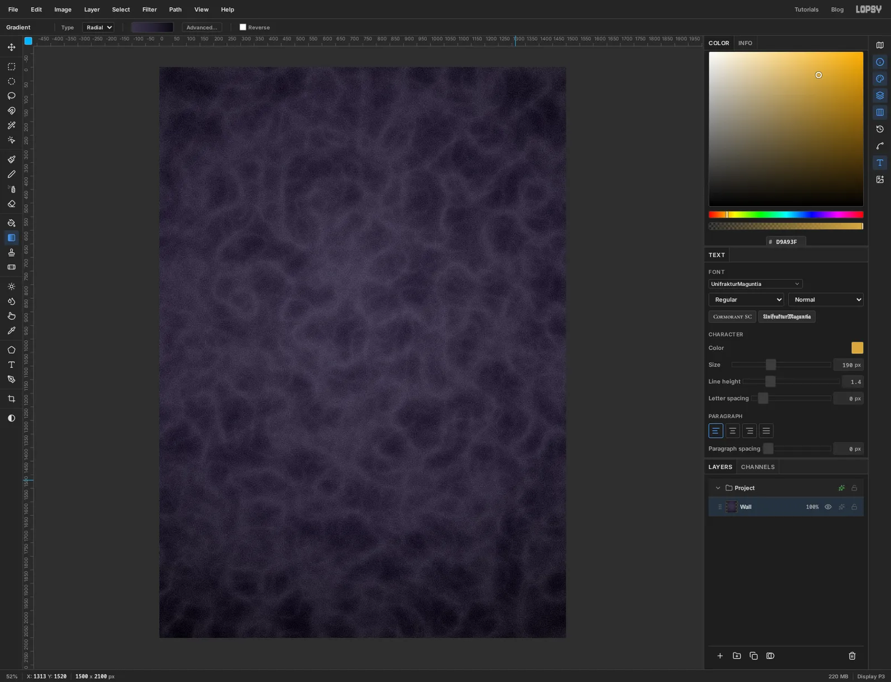

Choose **File → New** and make a document **1500** wide and **2100** high with a **Transparent** background. Rename the layer *Wall*.

Pick the **Gradient** tool, set **Type** to **Radial** and click **Advanced…** to open the **Gradient Editor**. Give it three stops: `#3A3348` at the left, `#262033` just past the middle and `#0C0912` at the right. Click **Done**, then drag from a little above the centre of the canvas straight down, well past the bottom edge.

Choose **Filter → Texture…**. Click **Rough**, set **Amount** to **10**, **Size** to **150** and **Detail** to **55**, and apply. That gives the big, slow veins. Run **Texture…** again with **Grain**, **Amount 13**, **Size 2.5** and **Detail 30** for the fine tooth.

## Rule the masonry with the Pencil

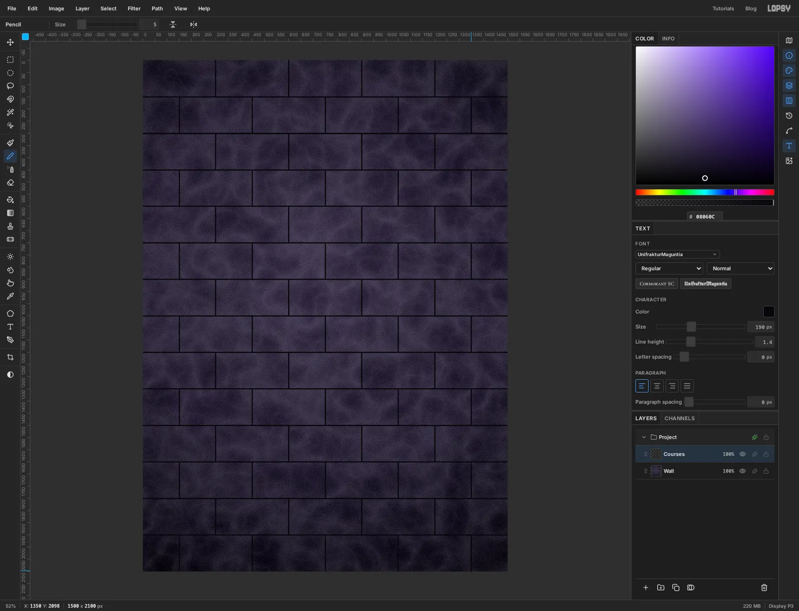

Add a layer called *Courses*. Take the **Pencil**, set **Size** to **5** and the foreground to `#08060C`.

Click just outside the left edge of the canvas, then [[Shift]]-click just outside the right edge at the same height. That draws one straight joint. Do it thirteen times, every 150 px down the canvas, using the left ruler to space them.

Then add the upright joints the same way, with a click at the top of a course and a [[Shift]]-click at the bottom. Put one every 300 px, and shift every second row sideways by half a block so no two joints line up. That's four or five short lines in each of fourteen courses, so allow ten minutes for it.

## Bevel the joints and drop two guides

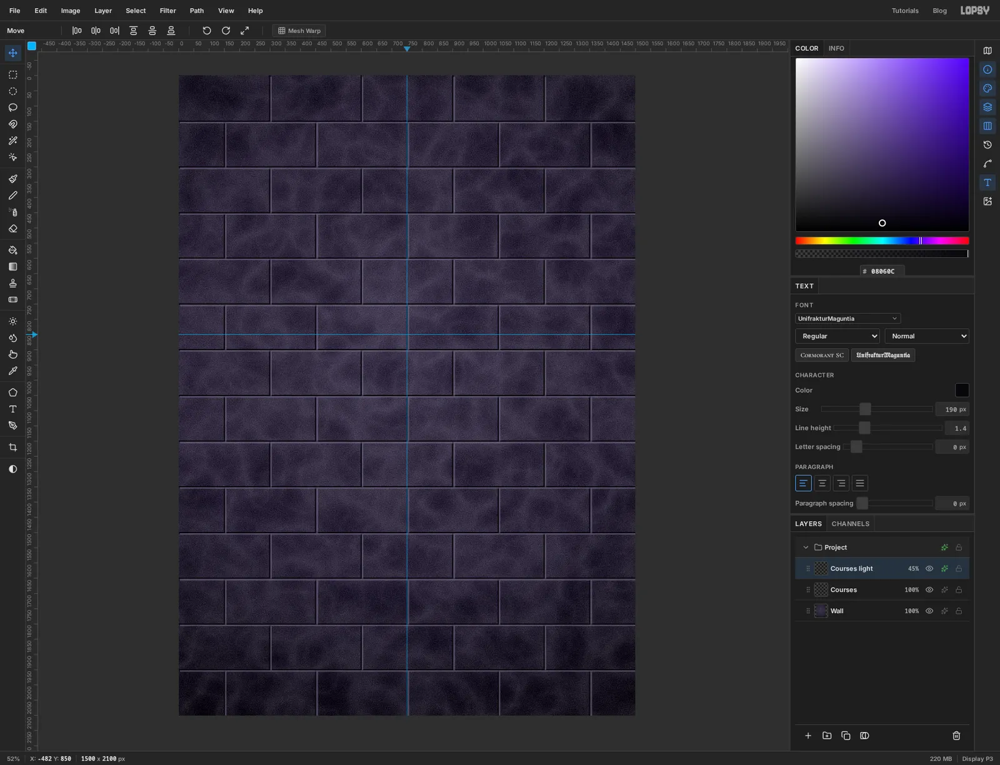

Choose **Layer → Duplicate Layer** and rename the copy *Courses light*. With the **Move** tool active, press the [[↓]] and [[→]] arrow keys four times each. Open the layer's effects with the sparkle button on its row, tick **Color Overlay** and set its colour to `#8A80A0`. Close the drawer and lower the layer to **45%**. The pale copy sits just down and to the right of each dark joint, like light catching the edge of the block below.

Now the guides. Hold [[Cmd]] and click the top ruler near the middle: the guide snaps to the exact centre. Then click the left ruler at **850**. That horizontal line is the *springing line*, the height where the window's straight sides end and its arch begins.

## Paint the night behind the glass

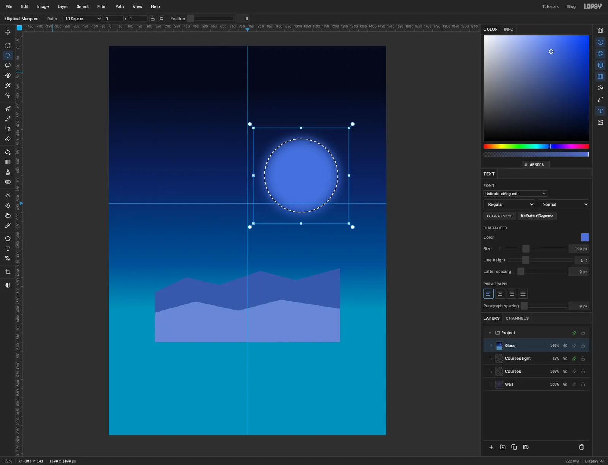

Add a layer called *Glass*. It gets cut to shape later, so paint across the whole canvas for now.

Open the **Gradient Editor** again, switch **Type** to **Linear** and set four stops: `#050819`, `#122463` at about 45%, `#1B4F92` at about 80% and `#3F8FB8`. Drag from near the top of the canvas to about two-thirds of the way down.

Take the **Lasso** and draw a low range of hills across the lower third, closing the shape along the bottom. Fill it with `#3F58A8` using **Edit → Fill**. Draw a second, nearer range a little lower and fill it with `#6F86CF`. Keep both fairly dark. The mistletoe will hang in front of them and needs something to stand out against.

For the moon's halo, drag an **Elliptical Marquee** about 400 px across, to the right of centre and just above the horizontal guide. Choose **Select → Feather…**, enter **60**, and fill with `#4E6FD8`. Press [[Cmd+D]].

## Break it into stained glass

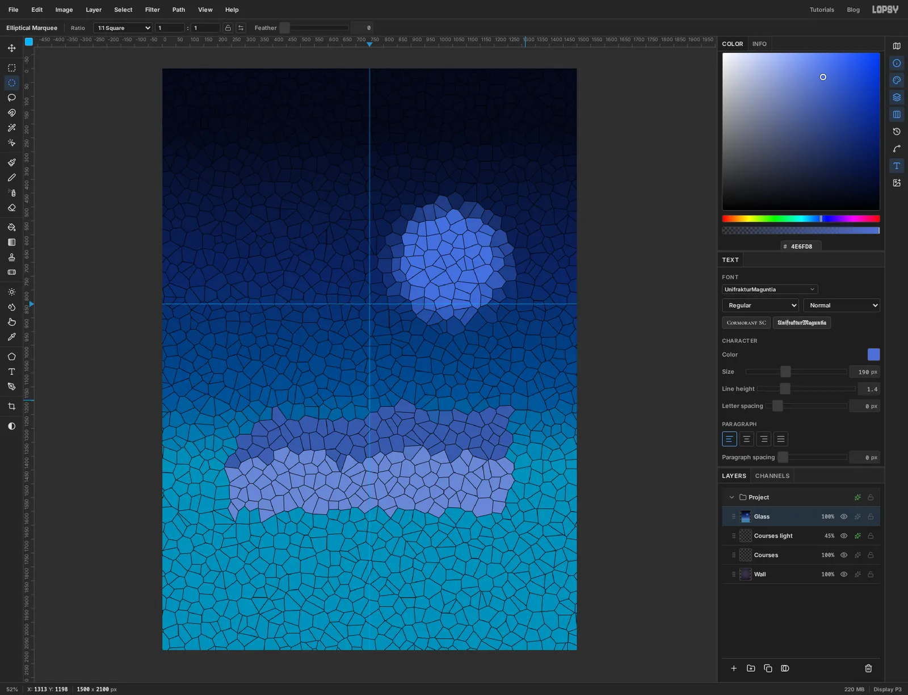

Choose **Filter → Voronoi…**. Set **Cells** to **46**, **Edge Width** to **3.5** and **Seed** to **7**, and apply. Every cell takes the colour under its middle, and the dark edges become the leading.

Voronoi is why the halo was feathered. A soft blob breaks into rings of cells that step down in brightness, which looks like a glazier chose them.

## Cut a clean moon

A moon put through that filter comes out with a ragged edge, so it gets its own layer. Add one called *Moon*. Drag a **Rectangular Marquee** a bit bigger than the moon you want, in the middle of the halo, and fill it with `#D3DEF8`. Deselect and run **Voronoi…** with **Cells 70**, **Edge Width 2** and **Seed 3**.

Now drag an **Elliptical Marquee** inside the crackled square, about 175 px across. Hold [[Cmd]] while you drag to keep it a circle. Choose **Select → Inverse**, press [[Delete]] and deselect. The cells stay but the outline is a true circle.

In the layer's effects, tick **Outer Glow** (`#9DB6FF`, Size **46**, Opacity **70**) and **Stroke** (`#060A1E`, Width **3**).

## Start the arch with two circles

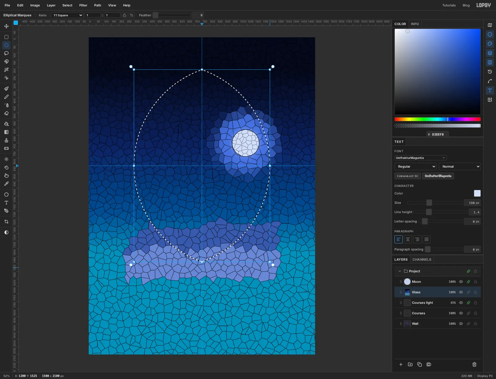

A pointed arch is the overlap of two circles whose centres sit on the springing line. Click the *Glass* layer first.

Take the **Elliptical Marquee**. The status bar shows where the pointer is, which makes this easy to place. Put the pointer at **300** across and **175** down, hold [[Cmd]] to keep the shape a circle, and drag down and to the right until the pointer reaches **1525** on the left ruler. The circle is 1350 px across, its centre is on the horizontal guide, and it runs off the right side of the canvas, which is fine.

For the second circle, start at **1200** across and **175** down, hold [[Shift+Alt]] and [[Cmd]], and drag down and to the left to **1525** again. [[Shift+Alt]] keeps only the overlap, so you're left with a pointed almond 900 px wide, from 300 to 1200.

> **Tip:** If a circle lands in the wrong place, press [[Cmd+Z]] and drag it again. Each change to a selection is its own undo step.

## Finish the window opening

Switch to the **Rectangular Marquee**. Hold [[Shift+Alt]] and drag a box that starts above the tip of the almond and ends on the horizontal guide, wider than the almond on both sides. The bottom edge snaps to the guide, and only the top half of the almond survives.

Now hold [[Shift]] on its own and drag a rectangle from the guide down to **1560** on the left ruler, running from **300** to **1200** on the top ruler so it's exactly as wide as the arch. [[Shift]] adds, and you have a lancet window.

Choose **Select → Inverse** and press [[Delete]] to cut the glass to shape. Click the *Moon* layer and press [[Delete]] there too, in case any of it pokes outside. Then choose **Select → Inverse** again so the arch is selected once more.

## Add a hood mould

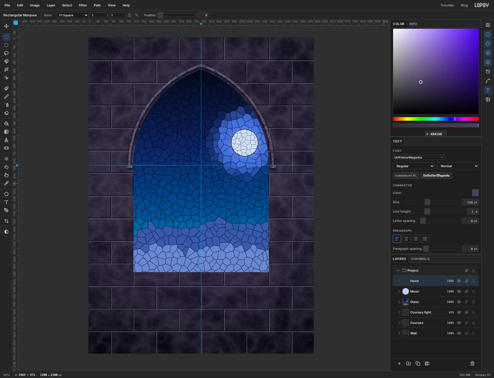

A hood mould is the thin outer rib that throws rain clear of a window. Add a layer called *Hood*. Choose **Select → Grow…** and enter **34**. Fill with `#4B4160`, then choose **Select → Shrink…**, enter **14** and press [[Delete]]. That leaves a ring 14 px thick, standing a little way off the opening.

It should only cover the arch. Drag a **Rectangular Marquee** over everything below the horizontal guide and press [[Delete]]. Then marquee a block about 40 px wide and 30 px tall at each cut end, sitting on the guide, and fill both with the same stone. Deselect and give the layer the stone finish from the tip at the top of the page.

## Build the frame

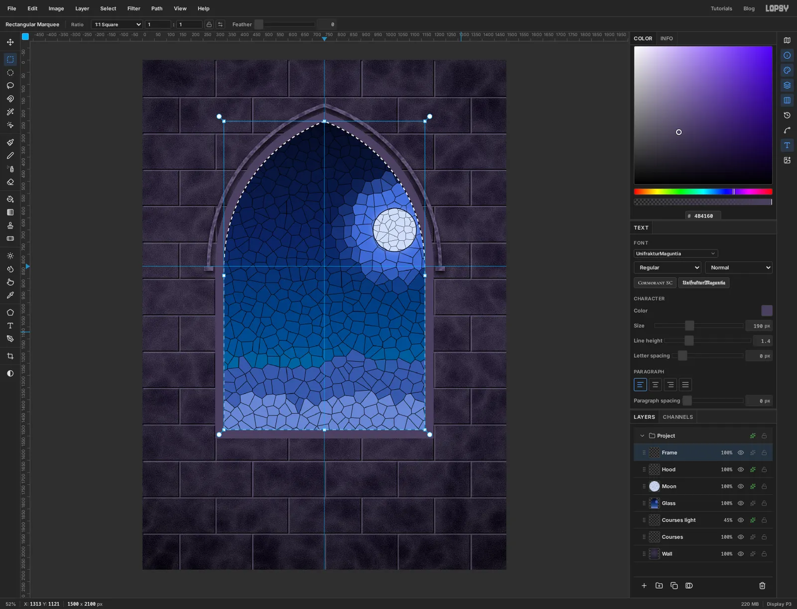

Hold [[Cmd]] and click the *Glass* layer's thumbnail to load the arch as a selection again. Add a layer called *Frame*, fill with `#4B4160`, choose **Select → Shrink…** with **36** and press [[Delete]].

Don't deselect. Add a layer called *Rebate*, fill the shrunken selection with `#0E0A14`, shrink by **10** and delete again. That leaves a thin dark step between stone and glass. Now press [[Cmd+D]].

Click *Frame* and give it the stone finish. Then open the *Glass* layer's effects and tick **Inner Glow** with `#03040F`, Size **60** and Opacity **70**, so the glass darkens toward its edges and sits back in the wall.

## Carve the trefoil out of a selection

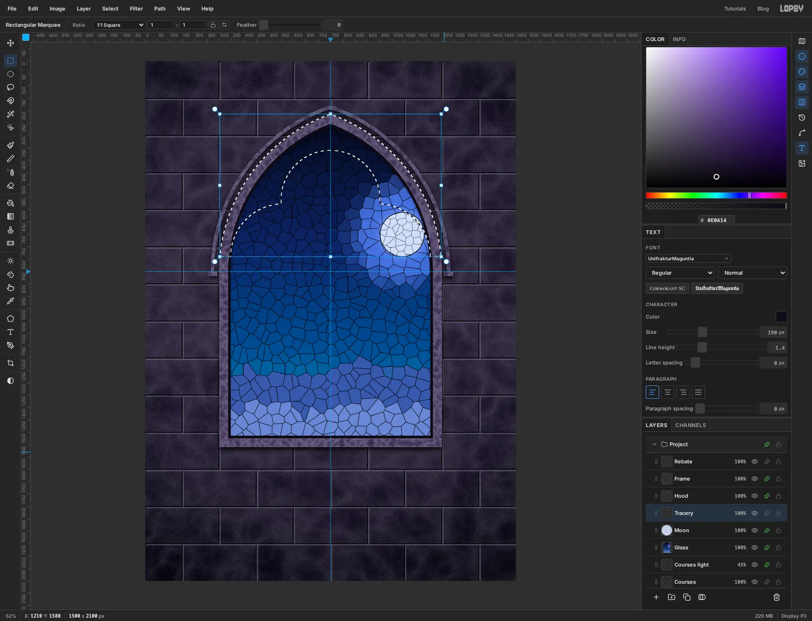

Click *Moon* and add a layer called *Tracery* above it. It lands under the frame.

[[Cmd]]-click the *Glass* thumbnail to select the whole opening. The plan is to subtract the part that stays open and fill what's left.

Take the **Elliptical Marquee**, hold [[Alt]] and drag a circle about 400 px across, centred on the vertical guide, in the upper part of the arch. Then [[Alt]]-drag two more, each about 430 px across, side by side below it. Their outer edges should touch the sides of the glass and their centres should sit a little above the horizontal guide. All three need to overlap.

Switch to the **Rectangular Marquee** and [[Alt]]-drag a box from the widest part of the two lower circles down past the bottom of the window. What's left is a stone shoulder on each side, where the lobes meet, and the stone above the top lobe.

## Fill the tracery

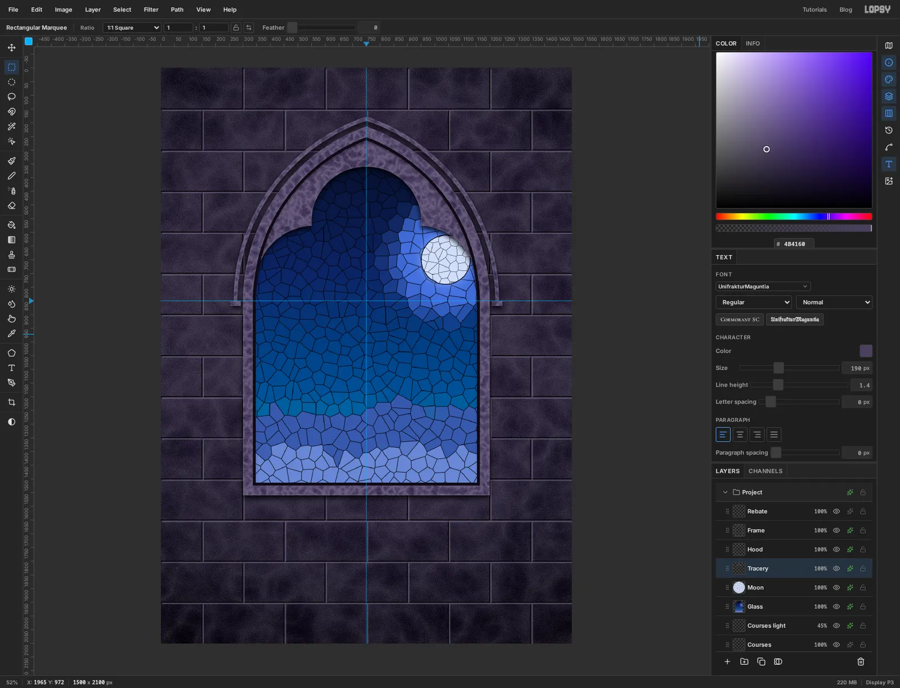

Fill the selection with `#4B4160`, deselect and apply the stone finish. The drop shadow falls onto the glass, which is what makes the cusps look carved.

## Spray snow behind the stone

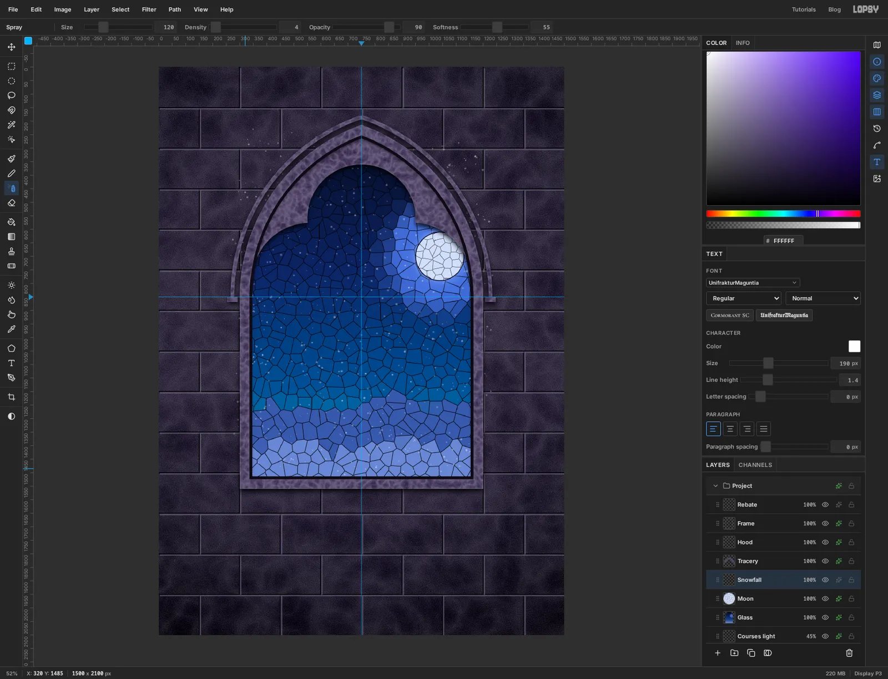

Click *Moon* and add a layer called *Snowfall*. Take the **Spray** tool and set **Size** to **120**, **Density** to **4**, **Opacity** to **90** and **Softness** to **55**. With white as the foreground, drag a slow zigzag from the top of the window to the bottom in one stroke.

Some flakes land on the wall. [[Cmd]]-click the *Glass* thumbnail, choose **Select → Inverse**, press [[Delete]] and deselect. Lower the layer to **70%** for now.

## Set a sill under the window

Click *Rebate* and add a layer called *Sill*. Take the **Shape** tool and set **Shape** to **Rectangle**. Click the fill swatch and enter `#4B4160`, leave the stroke off and set **Corner Radius** to **6**.

A shape grows outward from where you press. Press on the vertical guide about 35 px below the frame, since that point becomes the middle of the ledge, and drag out and down until the ledge is about 70 px tall and overhangs the frame by 70 px on each side.

Drag a thin **Rectangular Marquee**, about 7 px tall, along the top edge of the ledge and fill it with `#8A80A0`. Deselect and apply the stone finish.

## Make two patches of ruby glass

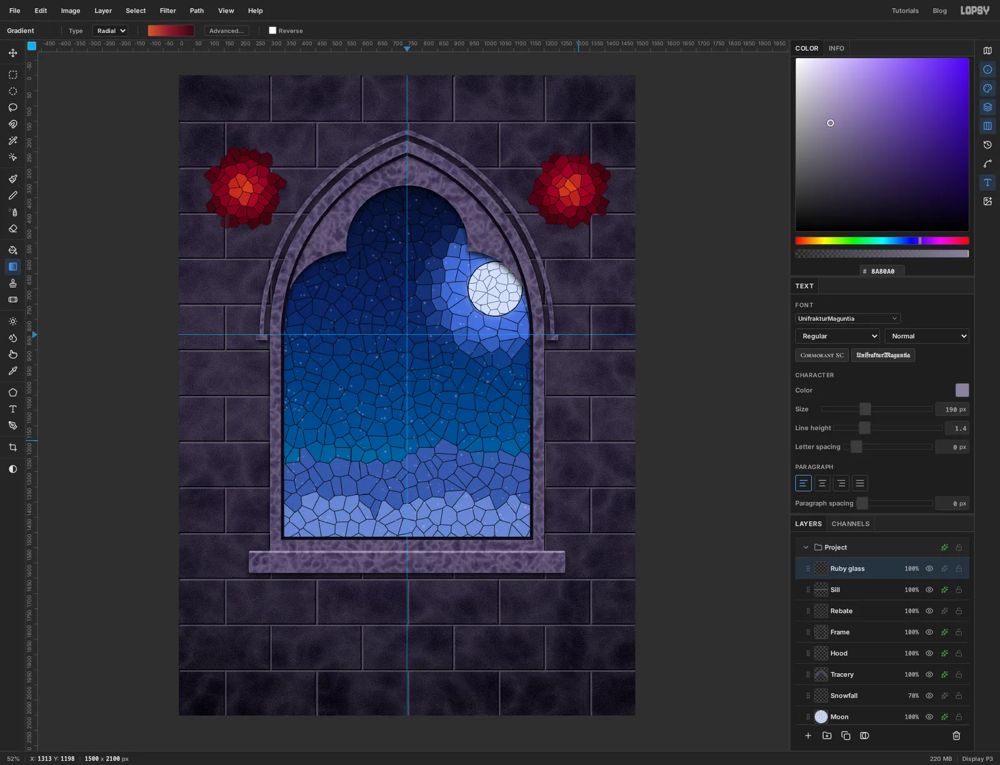

The upper corners get small quatrefoil windows. The glass comes first and the stone cuts it to shape afterwards.

Add a layer called *Ruby glass*. Drag a square marquee about 250 px across in the upper left of the wall, level with the shoulder of the arch. In the **Gradient Editor** set **Type** to **Radial** and make four stops: `#D8582C` at the left, `#93182A` at about 45%, `#3A0810` at about 97%, and `#3A0810` again at the far right with its opacity pulled down to **0**. Drag from the middle of the square to its edge.

Do the same in the upper right. The transparent last stop matters here: a radial gradient paints its end colour over everything beyond the drag, and with an opaque end it would flood the first patch.

Deselect and run **Voronoi…** with **Cells 64**, **Edge Width 3** and **Seed 21**.

## Draw the quatrefoils

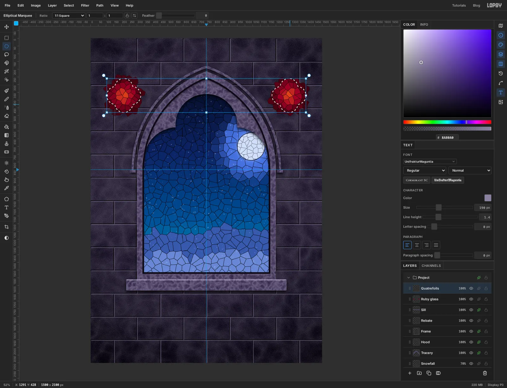

Add a layer called *Quatrefoils*. With the **Elliptical Marquee**, drag a circle about 115 px across over the top of the left patch. Hold [[Shift]] and add three more the same size, to the right, below and left, so the four overlap in the middle like a clover. Keep holding [[Shift]] and build the same clover over the right patch.

## Cut the ruby glass to fit

Fill the selection with `#4B4160`. Choose **Select → Shrink…** with **15** and press [[Delete]], which leaves a stone ring.

The selection is now the opening. Click the *Ruby glass* layer, choose **Select → Inverse**, press [[Delete]] and deselect.

Give *Ruby glass* an **Inner Glow** of `#12020A`, Size **20**, Opacity **80**. Give *Quatrefoils* the stone finish.

## Hang a hook and a ribbon

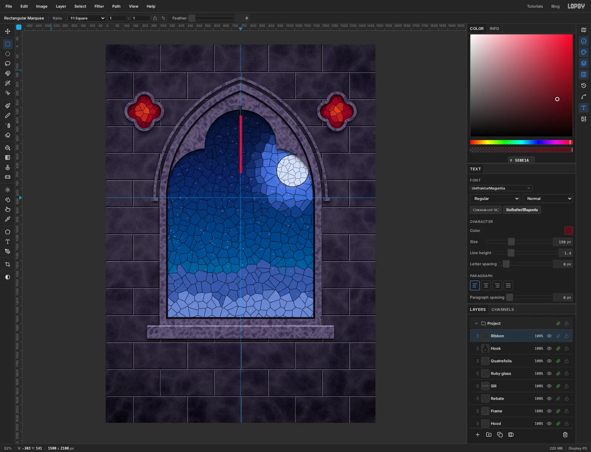

Add a layer called *Hook*. On the vertical guide, where the stone meets the top lobe, drag a marquee about 10 px wide and 30 px tall and fill it with `#141016`.

Take the **Shape** tool and switch **Shape** to **Ellipse**. Open the fill swatch and click **Remove fill**, then add a stroke of `#141016` with **Width 7**. Drag a ring about 34 px across so it hangs from the stub. Add an **Inner Glow** (`#6A6474`, Size **3**, Opacity **60**) and a **Drop Shadow** (Offset X **2**, Y **4**, Blur **6**, Opacity **80**).

Add a layer called *Ribbon*. Drag a marquee 18 px wide from the ring straight down to about **710** on the left ruler, well short of the horizontal guide, and fill it with `#C8273B`. Select the left 5 px of it and fill that with `#5E0E1A` for a fold.

## Paint the needles with radial symmetry

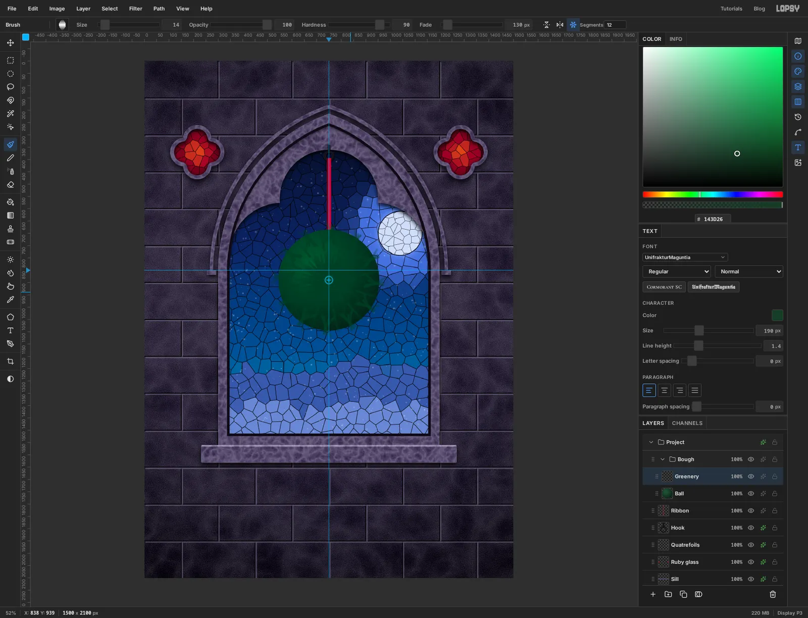

With *Ribbon* active, click **New Group** under the Layers panel and name the group *Bough*. Everything that hangs from the ribbon goes inside it.

Add a layer called *Ball*. Drag an **Elliptical Marquee** about 410 px across, centred on the vertical guide, with its top just covering the end of the ribbon. Make a **Radial** gradient of `#1F5A35`, `#0F2A1C` at 70% and `#07160E`, and drag from the upper left of the circle to past its lower right edge. Deselect.

Add a layer called *Greenery* and take the **Brush**. In the options bar click **Radial Symmetry** and set **Segments** to **12**. Hold [[Cmd]] and click the centre of the ball to put the symmetry centre there. Set **Hardness** to **90** and **Fade** to **130**.

With `#143D26` and **Size 14**, make about a dozen short, slightly curved strokes, each 60 to 100 px long. Start them anywhere inside the ball, including right at the centre, and point them every which way. Each stroke is repeated twelve times around the centre, and Fade lets it die away to nothing, which reads as the tip of a needle.

Go round again with `#1F5A35` at **Size 12**, then with `#4E9A52` at **Size 9**. Let some strokes run past the edge of the ball so the outline turns bristly.

## Bind it with gold hoops

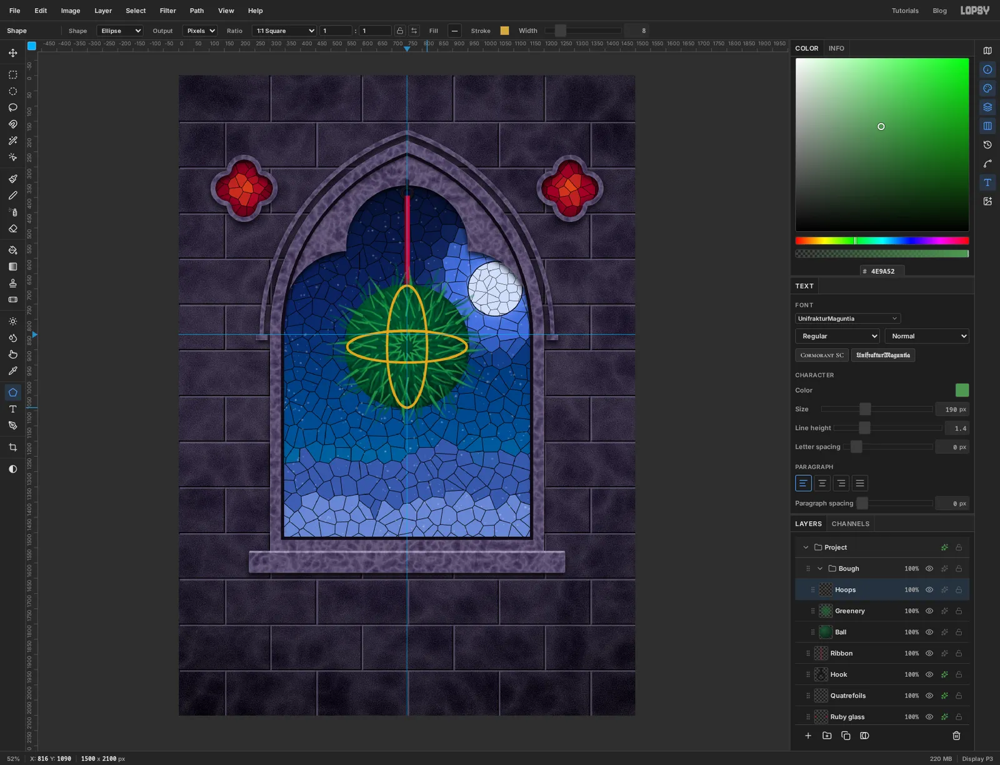

A real bough is built on crossed hoops. Add a layer called *Hoops*. Take the **Shape** tool, still on **Ellipse** with no fill, and change the stroke to `#D9A93F` with **Width 8**.

Press on the centre of the ball and drag out a wide, flat ellipse that stops just inside the ball's edge. Then, from the same centre, drag a tall narrow one. Keep both inside the green, or the wide one ends up looking like the rings of Saturn.

## Weave the hoops with a layer mask

With *Hoops* active, click **Add Mask** under the Layers panel. You're now painting on the mask. Take the **Brush**, click **Radial Symmetry** again to turn it off, and set **Fade** back to **0**, **Size** to **46** and **Hardness** to **40**.

Dab a short stroke over the hoops in ten or so places. The canvas tints each hidden patch blue while you're in the mask. Skip the crossings and hide the stretches between them, so the gold seems to dip under the needles and come back up.

Click the *Hoops* row to leave the mask.

## Add lighter sprigs on top

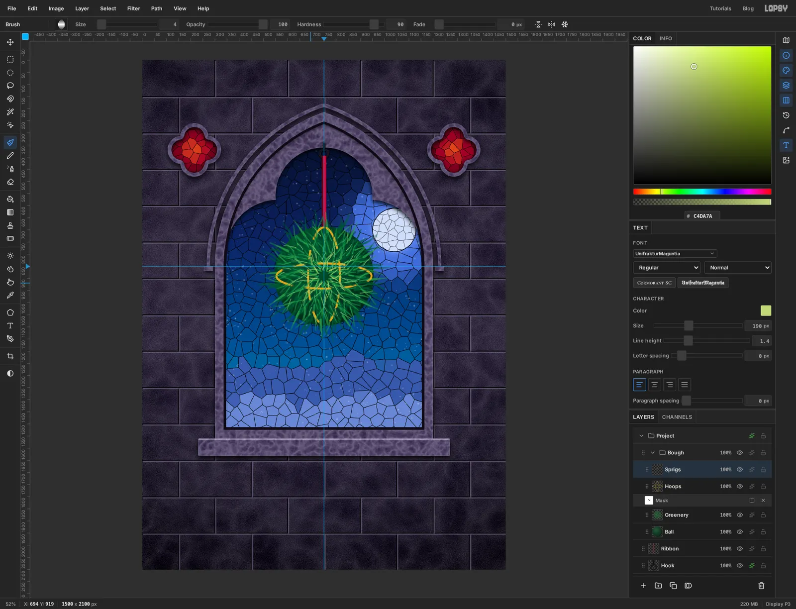

Add a layer called *Sprigs*, above *Hoops*. Turn **Radial Symmetry** back on and set **Segments** to **9**. An odd number that doesn't divide into twelve stops the two layers of needles from lining up. Set **Hardness** to **90** and **Fade** to **120**.

Paint nine or so strokes each of `#1F5A35` at **Size 9**, `#4E9A52` at **Size 7** and `#8CC27A` at **Size 5**, shorter than before. Then change **Segments** to **7** and add a few fine strokes of `#C4DA7A` at **Size 4** near the middle, where the candlelight will fall.

Turn **Radial Symmetry** off and set **Fade** to **0** before you move on. Both settings stick, and they also apply to the Pencil and Eraser.

## Shade the ball

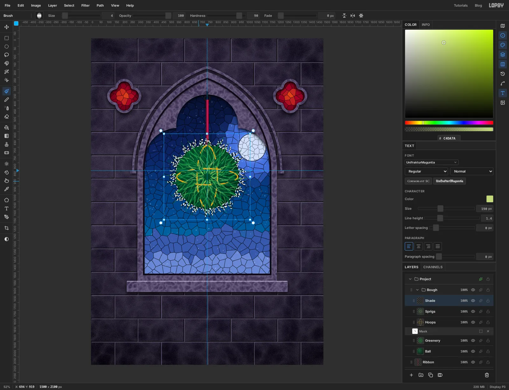

Add a layer called *Shade*. Hold [[Cmd]] and click the *Ball* thumbnail, then hold [[Cmd+Shift]] and click the *Greenery* and *Sprigs* thumbnails to add their shapes. The selection follows every needle.

Make a **Radial** gradient with three stops: black at **0%** opacity, black at **10%** opacity near the middle, and `#020806` at **80%** opacity. Drag from the upper left of the ball to its lower right edge, then deselect. In the layer's effects set the blend mode to **Multiply**, and the flat disc of needles turns into a ball lit from the upper left.

## Hang the apples

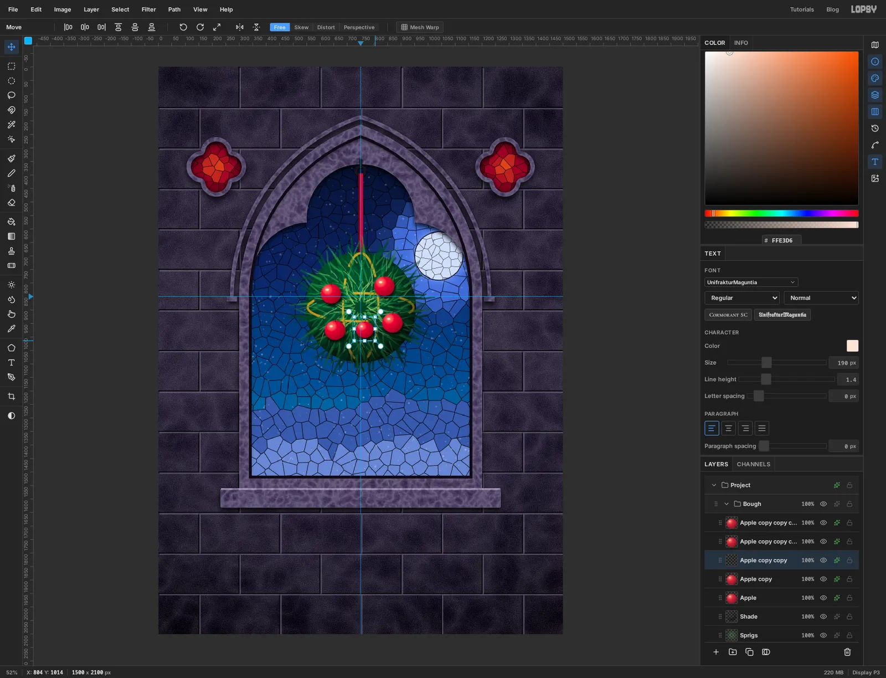

Add a layer called *Apple*. Drag an **Elliptical Marquee** about 76 px wide and a touch less tall on the upper left of the ball. Fill it with a **Radial** gradient of `#FF9A78`, `#D9283C` at 30%, `#8E1022` at 80% and `#4A0712`, dragged from the upper left of the apple to its lower right edge. Deselect.

With the **Brush** at **Size 5** and **Hardness 100**, flick a short stalk in `#3A2414` out of the top. Add a tiny ellipse of `#FFE3D6` as a highlight. Then give the layer a **Drop Shadow** with Offset X **5**, Y **10**, Blur **14** and Opacity **80**.

Choose **Layer → Duplicate Layer** and drag the copy somewhere else on the ball with the **Move** tool. Do that four times, for five apples.

Identical apples give the trick away. Click one of the copies, drag a **Rectangular Marquee** round it, and with the **Move** tool hold [[Cmd]] and drag a corner handle inward to shrink it by about a sixth. Press [[Cmd+D]].

## Flip one for variety

Click another copy and choose **Image → Flip Horizontal**. Its highlight swaps sides, which is enough to stop the eye pairing them up.

## Make a candle flame

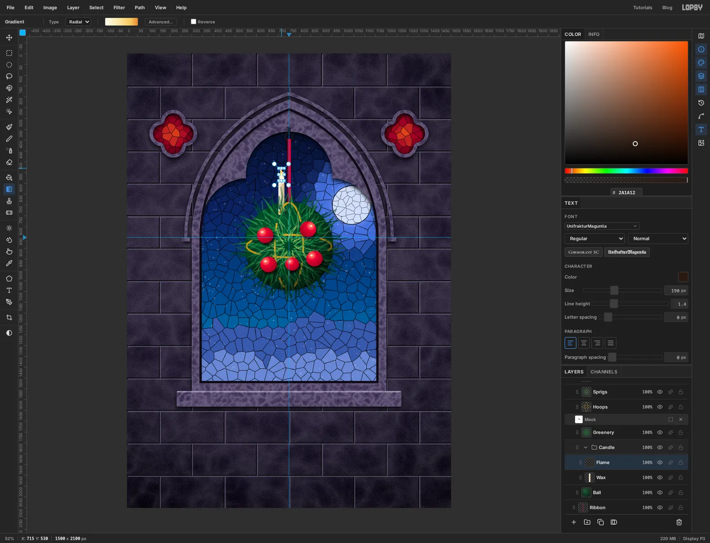

Click *Ball*, then click **New Group** and name it *Candle*. The group lands just above *Ball* and under the needles, so the candle's foot is buried in the greenery.

Add a layer called *Wax*. Drag a marquee about 28 px wide and 150 px tall, standing on top of the ball to the left of the ribbon. Fill it with a **Linear** gradient from `#FFF8E6` to `#B9A277`, dragged left to right across it. Deselect, add a flat ellipse of `#FFF9EA` across the top for the melted rim, and use the **Pencil** at **Size 3** with `#2A1A12` to draw a 15 px wick with a click and a [[Shift]]-click.

Add a layer called *Flame*. With the **Lasso**, draw a teardrop about 26 px wide and 60 px tall above the wick. Fill it with a **Radial** gradient of `#FFFDF0`, `#FFE9A8` at 40%, `#F7C45A` at 80% and `#E8842A`, dragged from the base of the flame up to its tip. Deselect.

Take the **Smudge** tool with **Size 22** and **Strength 60** and drag once from the middle of the flame up through the tip. The point stretches into a wisp. Add an **Outer Glow** of `#FF9A2E`, Size **44**, Opacity **90**.

## Copy the candle group three times

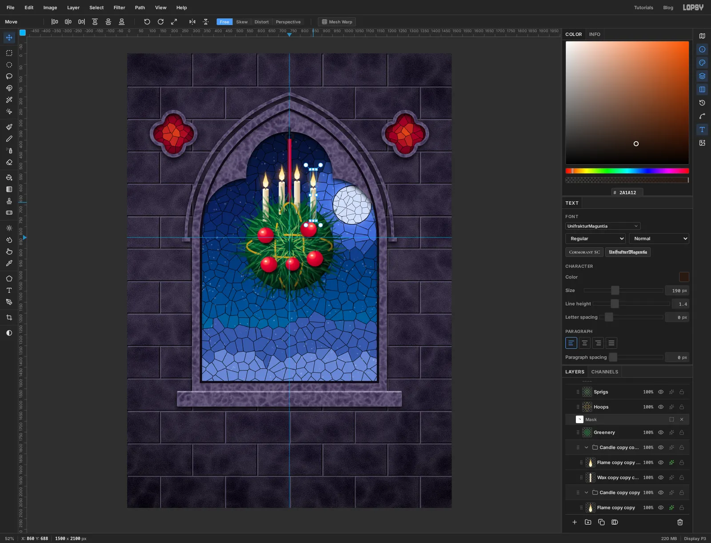

Click the *Candle* group's row and choose **Layer → Duplicate Layer**. The whole group is copied, wax and flame together. With the **Move** tool, drag the copy to the far left of the ball and a little lower.

Duplicate twice more, putting one candle just right of the ribbon and one at the far right, level with the first copy.

## Draw mistletoe stems with the Pen

Click the topmost *Apple* layer and add a layer called *Stems* above it. Take the **Pen**, set **Stroke** to **7** and the foreground to `#8FA85A`.

Click at the bottom of the ball on the vertical guide. About 130 px lower, press and drag down a short way before letting go, which bends the stem. Click once more, lower and to the left. Press [[Enter]] and the path is stroked onto the layer.

Draw a wide upside-down **V** with three clicks, its point on the stem and its arms reaching down to either side, and press [[Enter]]. Then a short branch from the stem down to the right, and [[Enter]] again. You should have four tips to hang leaves from.

## Rotate a leaf

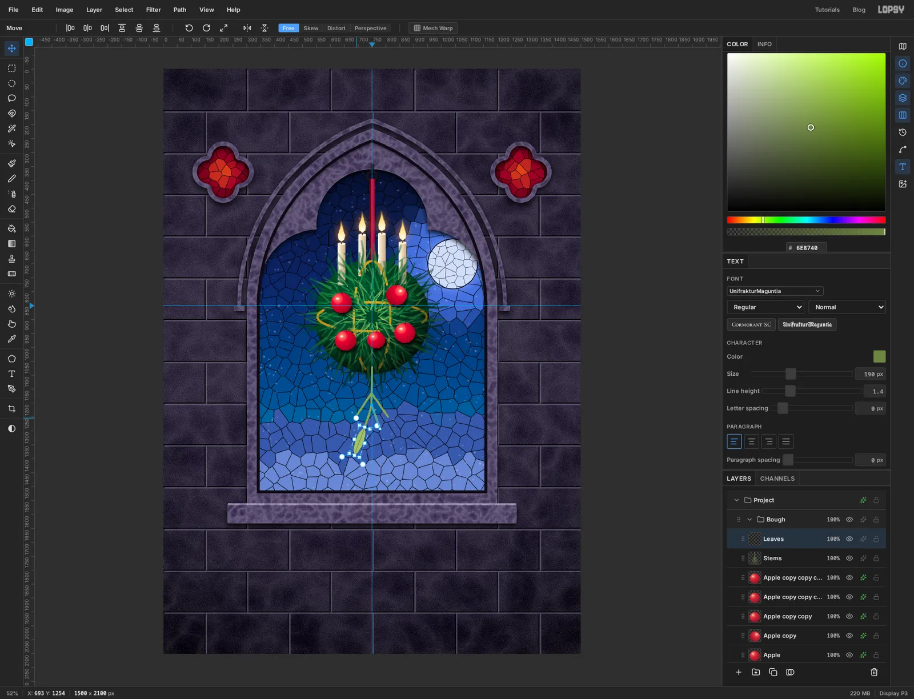

Add a layer called *Leaves*. Drag an **Elliptical Marquee** about 28 px wide and 96 px tall below the lower left tip and fill it with `#A9C274`. Deselect, and draw a midrib down it with the **Pencil** at **Size 2** in `#6E8740`.

Drag a **Rectangular Marquee** round the leaf with room to spare. Switch to the **Move** tool, press just outside a corner of the box and drag in an arc to turn the leaf about 20° clockwise, so it hangs down and to the left. Press [[Cmd+D]].

Now make its partner. Choose **Layer → Duplicate Layer**, then **Image → Flip Horizontal**, and tap [[→]] until the two leaves meet at the top in an upside-down V. [[Shift+→]] moves 10 px at a time. Press [[Cmd+E]] to merge the copy back down into *Leaves*.

## Put a pair on every tip

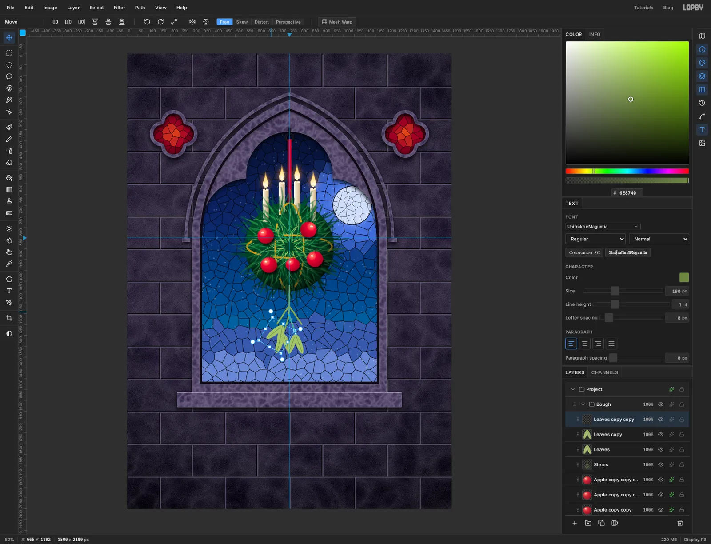

Duplicate *Leaves* and drag the copy across to the lower right tip.

Duplicate again and drag that copy up to the end of the left arm of the upside-down V. Marquee it, rotate it about 30° clockwise so it swings outward, and press [[Cmd+D]]. Duplicate once more, choose **Image → Flip Horizontal**, and drag the mirrored pair to the right arm.

## Add the berries

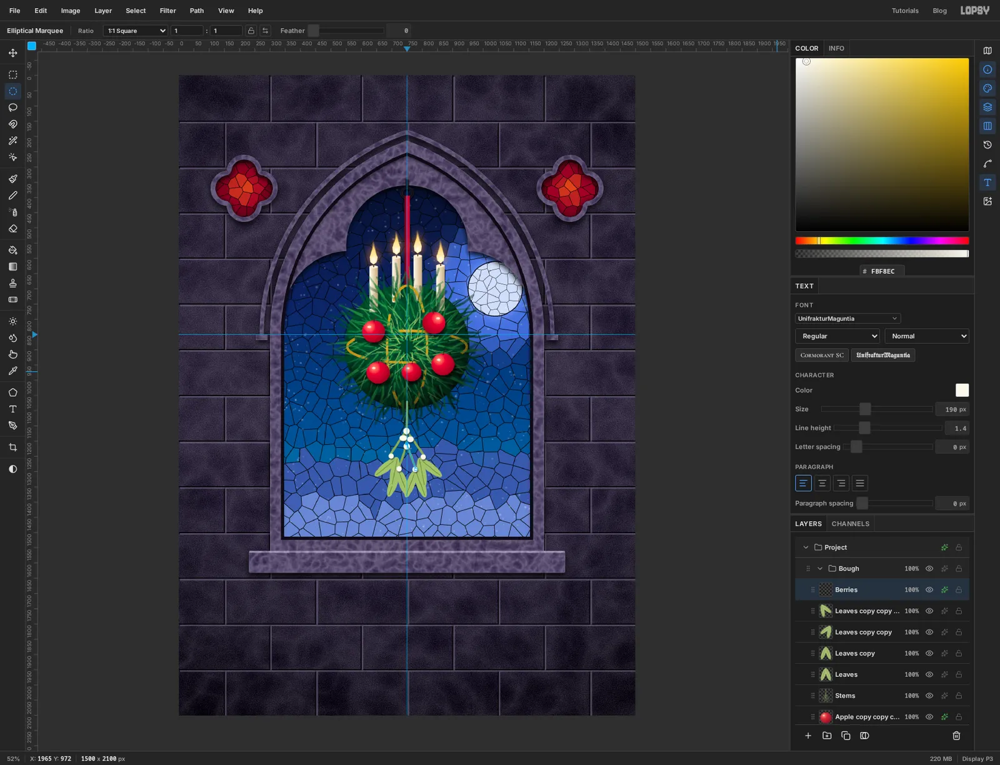

Add a layer called *Berries*. With the **Elliptical Marquee**, drag eight small circles, 18 to 22 px across, where the stems fork and where each pair of leaves joins on. Hold [[Shift]] from the second one onward so they all join one selection, then fill once with `#FBF8EC` and deselect. Add an **Inner Glow** (`#9FB08A`, Size **6**, Opacity **55**) and a **Drop Shadow** (`#0A1430`, Offset X **2**, Y **3**, Blur **5**, Opacity **60**), and they turn into pearls.

## Tie a bow

Add a layer called *Bow*. With the **Lasso**, draw one loop to the left of the ribbon at the top of the ball, a fat leaf shape about 70 px long, and fill it with `#C8273B`. Draw its twin on the right.

Inside each loop draw a smaller diamond and fill it with `#5E0E1A` for the shadowed inside. Draw two tails hanging from the middle, each with a notch cut in its end, in `#A8182B`. Finish with a small oval knot of `#E0364A` where they meet.

Add an **Inner Glow** (`#4A0712`, Size **7**, Opacity **60**) and a **Drop Shadow** (Offset X **2**, Y **7**, Blur **10**, Opacity **75**).

## Scale the whole bough at once

The bough is a little small for its window, and this is where the group pays off. Press [[Cmd+D]] to make sure nothing is selected and click the *Bough* group's row. With the **Move** tool, one set of handles surrounds everything in the group: candles, apples, mistletoe and all.

Hold [[Cmd]] and drag the bottom right handle outward until the box is about an eighth bigger. Press [[Cmd+D]] to commit. The nested candle groups and every layer's effects come along.

## Centre it and nudge it up

Scaling from a corner pushes the bough off to the right. With the group still active, click **Align center horizontally** in the Move tool's options bar. Then press [[Shift+↑]] four times, until the ball's top meets the ribbon again and the mistletoe hangs well clear of the bottom of the glass.

## Move the moon out from behind the candles

The bigger bough has run into the moon. Click the *Moon* layer and drag it down with the **Move** tool until it clears the right-hand candle and tucks in beside the ball. It moves off its halo, and that's fine: the brightest glass now sits above the moon like thin cloud.

## Draw one holly leaf

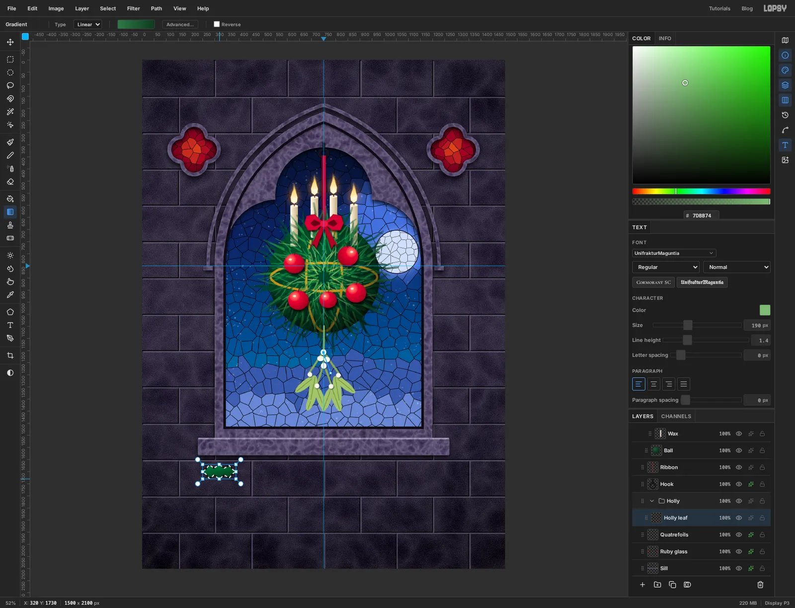

Click *Quatrefoils*, click **New Group** and name it *Holly*. Add a layer inside called *Holly leaf*.

Draw the leaf somewhere roomy, like the bare wall under the sill. With the **Lasso**, trace a lying-down leaf about 140 px long: a point at each end and three spikes along each side with shallow scoops between them. Straight, slightly clumsy edges suit holly.

Fill it with a **Linear** gradient from `#2E7A45` to `#0E3A20`, dragged from the top of the leaf to the bottom. Deselect, and rule a midrib with the **Pencil** at **Size 2** in `#7DBB74`. Add a **Drop Shadow** (Offset X **2**, Y **6**, Blur **8**, Opacity **80**) and an **Inner Glow** (`#062012`, Size **5**, Opacity **55**).

## Lay leaves along the sill

Drag the leaf up onto the left end of the sill with the **Move** tool. Draw a marquee round it that's generous on every side, turn it a little anticlockwise and press [[Cmd+D]].

Duplicate the layer, drag the copy about 70 px to the right, marquee it and turn it the other way so it leans against the first. Carry on like that, one leaf at a time, alternating the lean and nudging each one a few pixels up or down, until the seventh leaf reaches the vertical guide.

> **Tip:** Make each marquee comfortably bigger than the leaf before you rotate. Anything left outside the box stays where it was, and you get stray green crumbs.

## Add holly berries

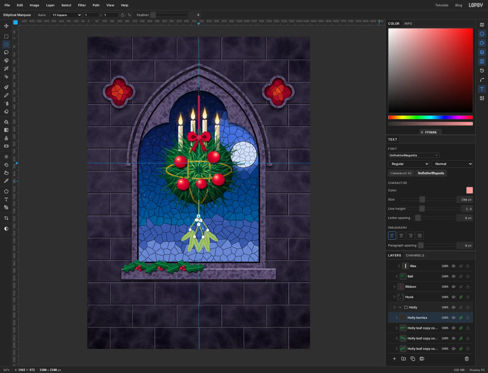

Add a layer called *Holly berries* inside the group. Put three clusters of two or three red circles, about 18 px across, where leaves overlap. As with the mistletoe, [[Shift]]-drag them into one selection and fill once, with `#C8273B`. Give each berry a speck of `#FF9A9A` at its upper left. Add an **Inner Glow** (`#5E0E1A`, Size **5**, Opacity **60**) and a **Drop Shadow** (Offset X **2**, Y **3**, Blur **4**, Opacity **75**).

## Mirror the garland

Click the *Holly* group's row and choose **Layer → Duplicate Layer**, then **Image → Flip Horizontal**. The copy flips in place, on top of the original. With the **Move** tool, drag it to the right until its last leaf reaches the right end of the sill and the two halves overlap at the guide.

## Warm the wall

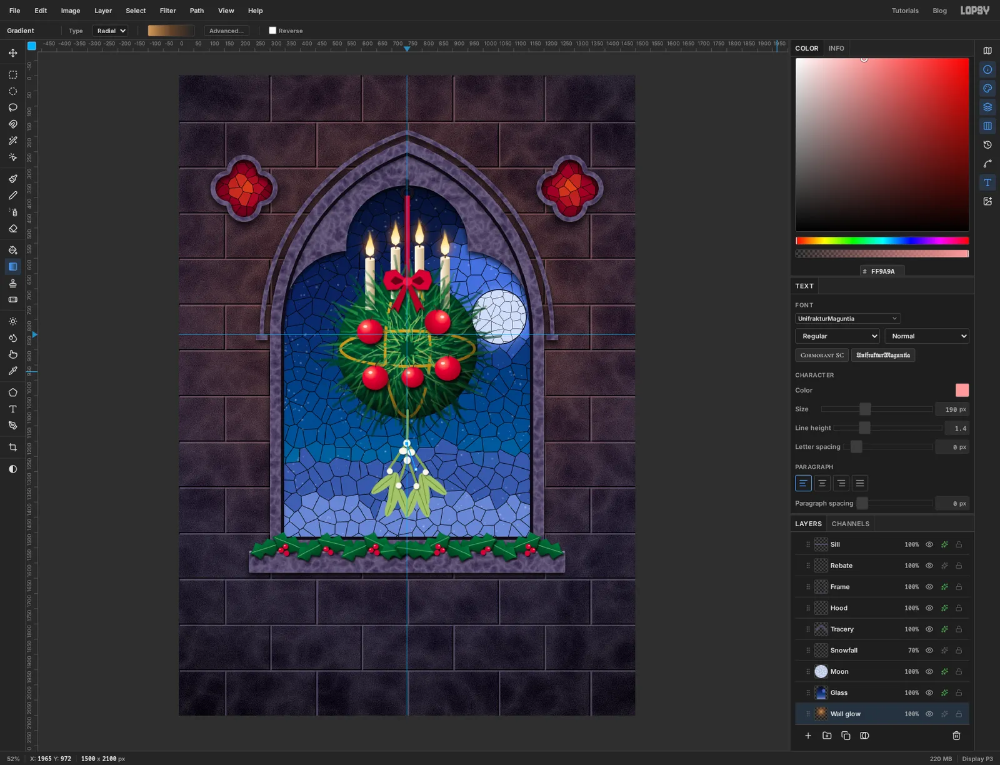

Click *Courses light* and add a layer called *Wall glow*, so it sits on the masonry and under the window. Make a **Radial** gradient of `#FFB460` at **80%** opacity, `#E07A30` at **32%** opacity in the middle, and `#E07A30` at **0%**. Drag from the middle of the window, near the flames, down to a little below the sill. Set the layer's blend mode to **Overlay**. The stone nearest the candles picks up their colour and the corners stay cold.

## Add the candlelight and a shadow for the type

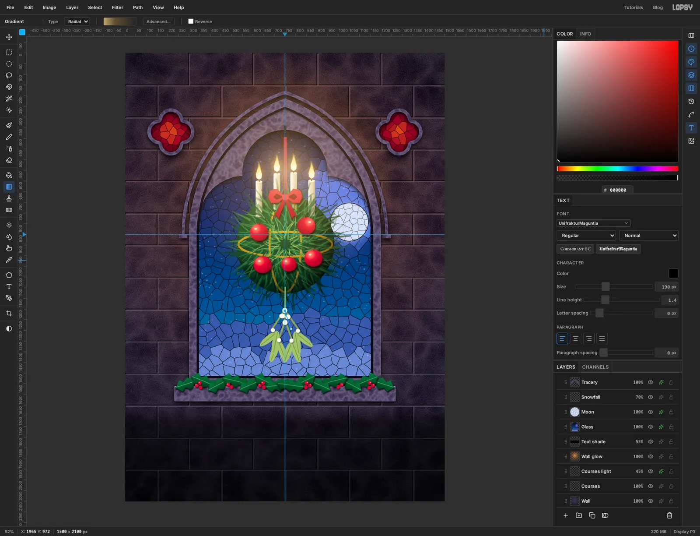

Add another layer above *Wall glow* called *Text shade*. Drag a marquee across the whole width of the canvas from just below the sill to the bottom edge. Choose **Select → Feather…** with **60**, fill with black, deselect and lower the layer to **55%**. Gold letters need a quiet, dark ground, and this also fades the mortar lines that would run behind them.

Now click the *Project* group at the top of the Layers panel and add a layer. With the root group active, a new layer lands above everything else. Call it *Candlelight*. Make a **Radial** gradient of `#FFD98A` at **72%** opacity, `#FFB44A` at **28%** about a third of the way along, and `#FF9A2E` at **0%**. Drag from between the two middle flames down to the bottom of the ball, and set the blend mode to **Screen**.

## Set the greeting

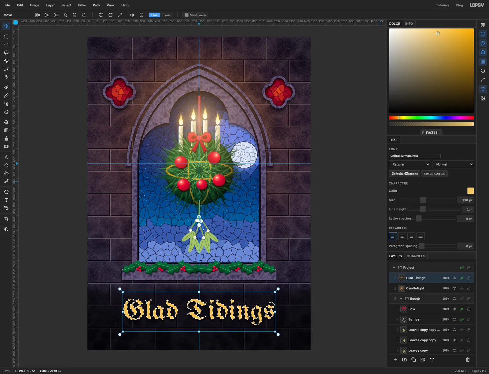

Click *Project* again so the text lands at the top of the stack. Take the **Text** tool, set **Size** to **190**, choose **UnifrakturMaguntia** from the font list and set the foreground to `#F0C566`. Click on the left of the wall under the sill, type `Glad Tidings` and press [[Tab]].

Switch to the **Move** tool and click **Align center horizontally**. In the layer's effects add a **Stroke** (`#2A1406`, Width **3**) and a **Drop Shadow** (Offset Y **8**, Blur **14**, Opacity **90**).

Then hold [[Cmd]] and click the text layer's thumbnail. The letters load as a selection.

## Run gold foil through the letters

Add a layer called *Foil*. Make a **Linear** gradient of `#FFF6CF`, `#F0C566` at 38%, `#B07A22` at 70% and `#F7DC94`. Drag from the top of the capital G to the bottom of the letters, then press [[Cmd+D]]. The text underneath stays editable and keeps supplying the outline and shadow.

## Add the second line

Click *Project* first, so the new line lands on top. It matters for another reason too: while a text layer is active, changing the font or size restyles that layer.

Set the foreground to `#EAD6A2`. With the **Text** tool, set **Size** to **52**, choose **Cormorant SC** and set the weight to **SemiBold**. Click below the greeting, type `AND A KISS BENEATH THE BOUGH` and press [[Tab]]. Open the **Text** panel from the icons at the far right and set **Letter spacing** to **4**. Then switch to the **Move** tool and click **Align center horizontally**.

Now settle the spacing. Click the title, [[Shift]]-click *Foil* so both are selected, and tap [[Shift+↑]] or [[Shift+↓]] until the greeting sits comfortably below the sill without crowding it. Then nudge the second line until the tail of the **g** hangs clear of its capitals and there's about 100 px of wall left under it.

## Finish the line with gold diamonds

Add a layer called *Ornament*. With the **Shape** tool set to **Polygon**, **Sides 4**, **Corner Radius 0**, a fill of `#D9A93F` and no stroke, drag out a square about 20 px across just beyond each end of the second line, level with the middle of the capitals. A shape grows from its centre, so that's a drag of only 10 px.

Take the **Pencil** at **Size 3** in the same gold. Click a little outside the left square and [[Shift]]-click about 115 px further left for a rule. Do the same on the right, keeping the two rules the same length.

Marquee each square in turn and turn it 45° with the **Move** tool, holding [[Cmd]] so the rotation snaps in 15° steps, and press [[Cmd+D]] after each.

## Close in the corners

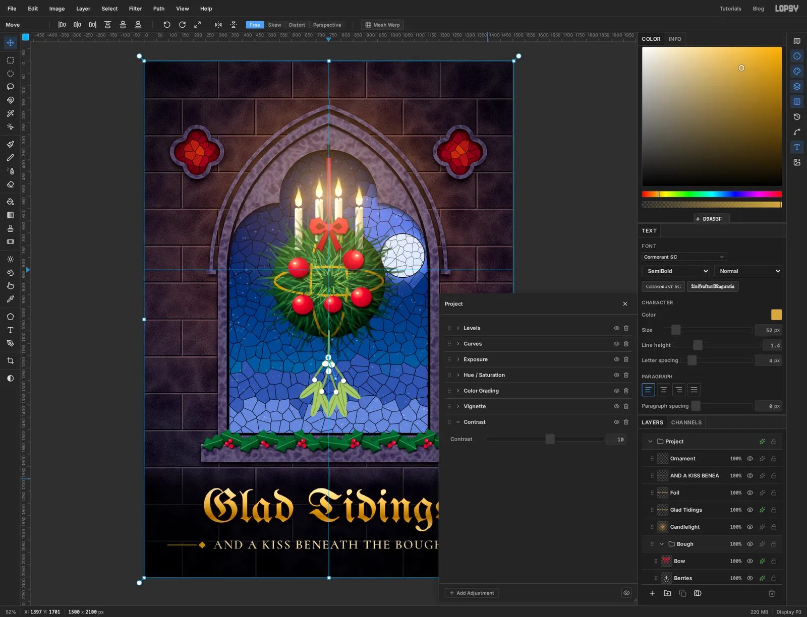

Choose **Layer → Adjustment Layer…**. Lopsy keeps adjustments on a group, and this opens the drawer for the whole document, with a short note explaining that the first time. Dismiss the note, click **Add Adjustment**, choose **Vignette** and set it to **55**. Add **Contrast** and set it to **10**. Close the drawer.

The vignette sinks the corners into the dark and leaves the window lit.

## Export the card

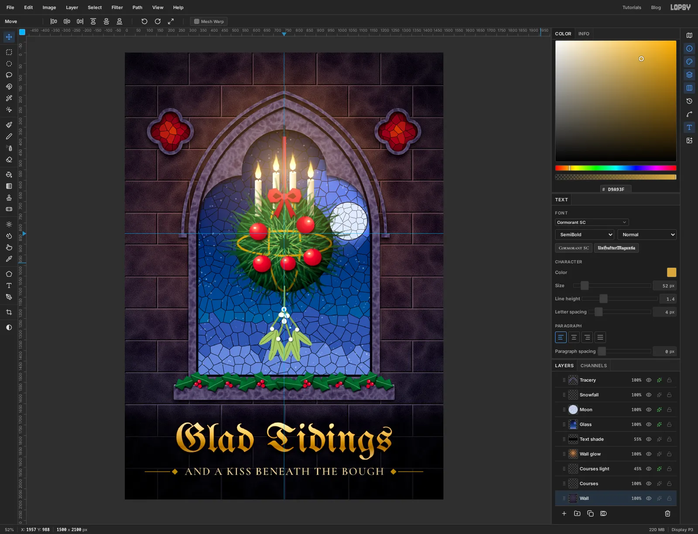

Look the whole card over at **View → Fit to Screen**. If the snow looks thin now that the bough is in front of it, put *Snowfall* back up to **100%**, as the finished card has it. The two guides are still showing, but guides never export, so go straight to **File → Quick Export PNG**.

To make the card your own, start with the words. The second line is live text. To change the greeting, delete *Foil*, edit the title, then repeat the [[Cmd]]-click and the gradient. For a different mood, change the four stops of the night sky. A deep green and gold window with the same bough reads as a much older, warmer card.
