Gothic painters loved a ruin by moonlight. Caspar David Friedrich put broken abbeys in winter fog, and Atkinson Grimshaw painted wet, moonlit lanes where every puddle held a little of the sky. The mood comes from very few things: one strong light, deep blue shadows, a reflection, and a small warm light against all that cold.

In this tutorial you'll paint **Swan Wake**, a 1600 × 2000 px night scene. A lone black swan crosses a moat in front of the ruined east end of Whitby Abbey, the clifftop ruin that inspired *Dracula*. Votive candles drift across the water, the "wake" of the title in both senses. You'll start from two ordinary daylight photos and turn them into night. Most of the work is choosing what to darken, what to light and what to blur.

Along the way you'll use:

- the **Gradient** tool (linear and radial), **Smoke**, **Clouds**, **Add Noise**, **Motion Blur**, **Gaussian Blur** and **Oil Paint**
- the **Magic Wand** with Shift-click to add, the **Lasso**, **Select → Inverse** and **Shrink**
- the **Move** tool's flip buttons, scale handles and rotation handles
- **layer masks** painted with gradients and the **Eraser**, and **Copy Merged** for the reflection
- **groups** with **Hue / Saturation**, **Exposure**, **Color Balance**, **Photo Filter** and **Vignette** adjustments
- **Dodge / Burn**, brush **Taper**, the **Outer Glow** and **Inner Glow** effects, and the **Screen**, **Multiply** and **Overlay** blend modes

You need two public domain photos from Wikimedia Commons:

- [Whitby Abbey landscape by Mdbeckwith](https://commons.wikimedia.org/wiki/File:Whitby_Abbey_landscape.jpg) (CC0). On the file page, download the 1,920 × 1,280 size, because the steps below assume that size.
- [The black swan by Bernard Spragg](https://commons.wikimedia.org/wiki/File:The_black_swan_(Cygnus_atratus)_(33064803230).jpg) (CC0). Download the 1,280 × 843 size.

The palette:

- Night sky `#04060D` → `#0E1729` → `#24344A` → `#46586B`
- Moon `#ECE6D0`, moon glow `#C9D4E2`, lunar seas `#9C9684`
- Halo `#9AA8BC` → `#3B4961` → `#000000`
- Banks `#0A0E16` / `#0E1726`, distant cliffs `#2A3A50`
- Water `#1A2637` → `#0B1220`, glitter `#E8E3C6`
- Night tint `#1F3F86`, moonlit rim `#E8F0FF`
- Candle pools `#C88A4A`, flames `#FFE7B0`, flame glow `#FFCF80`, lily pads `#1F3526`

> **Tip:** Lopsy keeps a layer's blend mode in its effects drawer. Click the **✦** button on the layer's row, choose the mode from the **Blend** list, then close the drawer. The percentage on the row is the layer's opacity. Under the Layers panel, **+** is Add Layer, the folder is New Group and the circled rectangle is Add Mask. Double-click a layer's name to rename it.

> **Tip:** Every gradient in this tutorial is set up in the **Gradient** tool's **Advanced…** editor. Click the handle row to add a stop, select a stop and click **Delete** to remove one, and type each stop's colour in the **Hex** field. The editor remembers the last gradient, so check how many stops it has before you start a new one.

## Set up the canvas and guides

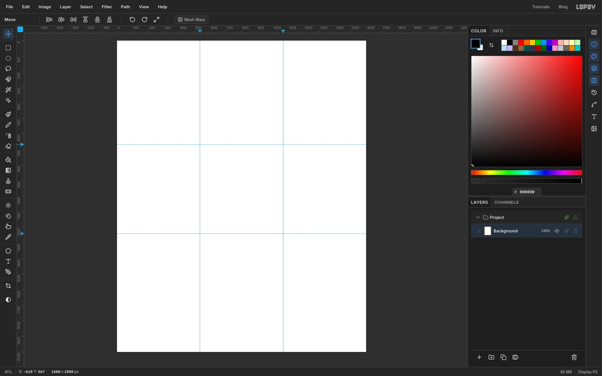

Choose **File → New**, set the size to 1600 × 2000 and pick a White background. Select the empty **Layer 1** and delete it with the trash button, so only **Background** is left.

Click the rulers to drop four guides, watching the status bar's X and Y readout as you hover:

- the top ruler at 533 and at 1067, which split the width into thirds
- the left ruler at 667, a third of the way down
- the left ruler at 1240. This is the far shore, where the water will meet the land.

The moon will sit near the top-left crossing and the abbey on the right-hand third.

## Paint the night sky

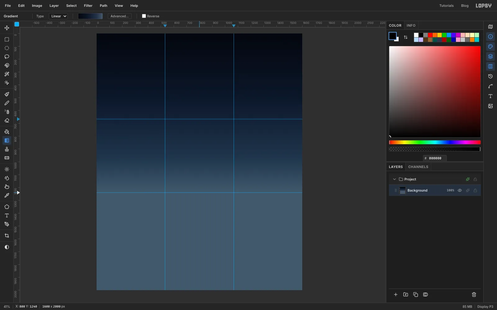

With **Background** selected, pick the **Gradient** tool, set the type to **Linear** and click **Advanced…**. Set four stops, clicking the handle row to add a stop and typing its colour in the **Hex** field:

1. `#04060D` at the far left
2. `#0E1729` at about 40%
3. `#24344A` at about 78%
4. `#46586B` at the far right

Click **Done**, then drag from the top edge straight down to the horizon guide at 1240. The sky is darkest overhead and paler near the horizon, where moonlight scatters in the haze.

## Add the moon's halo

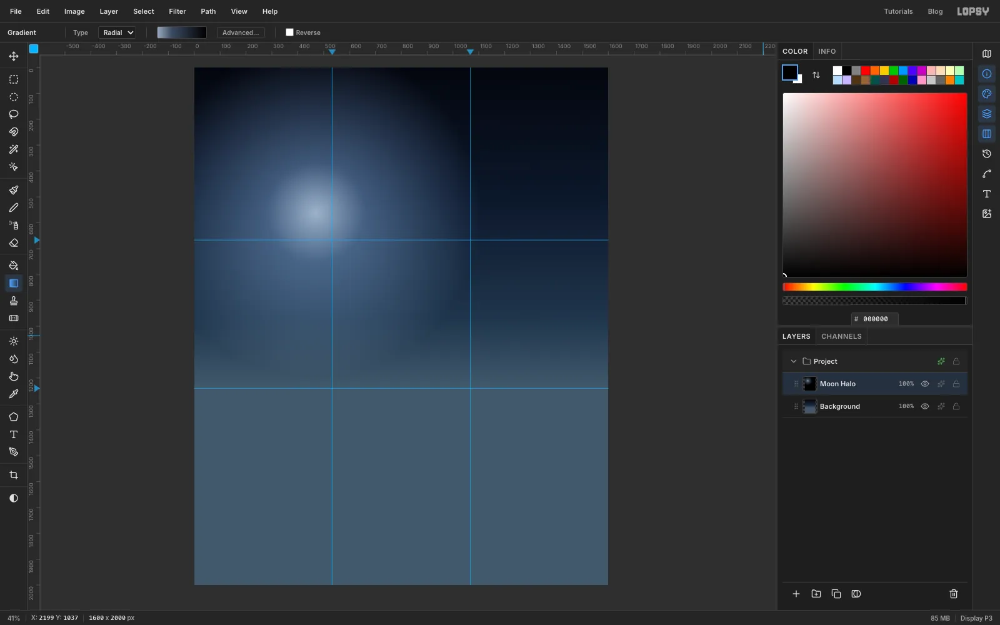

Click **+** to add a layer and name it **Moon Halo**. Set the **Gradient** tool to **Radial**, open **Advanced…** and delete one of the four stops, leaving three: `#9AA8BC` at the far left, `#3B4961` at about 30%, and black at the far right.

Drag from the point where the moon will go, about 470 across and 560 down, out to just past the right-hand guide. Set the layer to **Screen**. Screen ignores black, so the outer part disappears and only the glow remains.

## Draw the moon

Add a layer named **Moon**. Pick the **Elliptical Marquee**, hold [[Cmd]] so the shape stays a perfect circle, and drag a circle about 265 px across, centred on the halo. Mine went from 338, 428 to 602, 692, so its bottom edge just dips below the horizontal guide.

Set the foreground colour to `#ECE6D0` and choose **Edit → Fill**. Leave the selection active for the next step.

## Paint the lunar seas

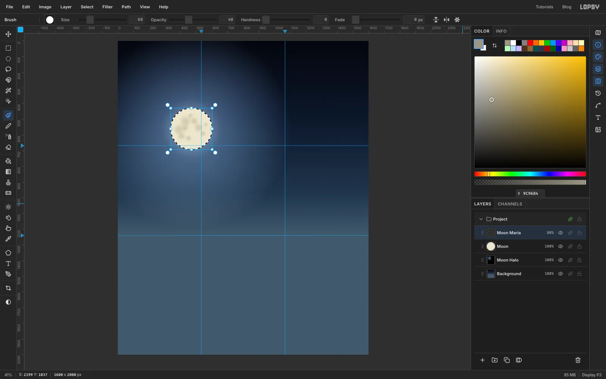

Add a layer named **Moon Maria**. The circle selection is still there, so anything you paint stays inside the moon.

Pick the **Brush** with **Hardness** 0 and **Opacity** 40, and set the colour to `#9C9684`. Don't drag. Click once for each sea, changing the **Size** for each one:

- a big patch at the upper left of centre (about 95 px)
- smaller ones to its right and along the top edge (45 to 65 px)
- a large one on the left edge (about 90 px), with two more below it (55 to 70 px)
- one or two at the lower right (about 50 px)

Then run **Gaussian Blur…** with **Radius** 9 and **Add Noise…** with **Amount** 14 in **Mono** mode. Set the layer to **Multiply** at 80%, then press [[Cmd+D]] to deselect.

## Make the moon glow

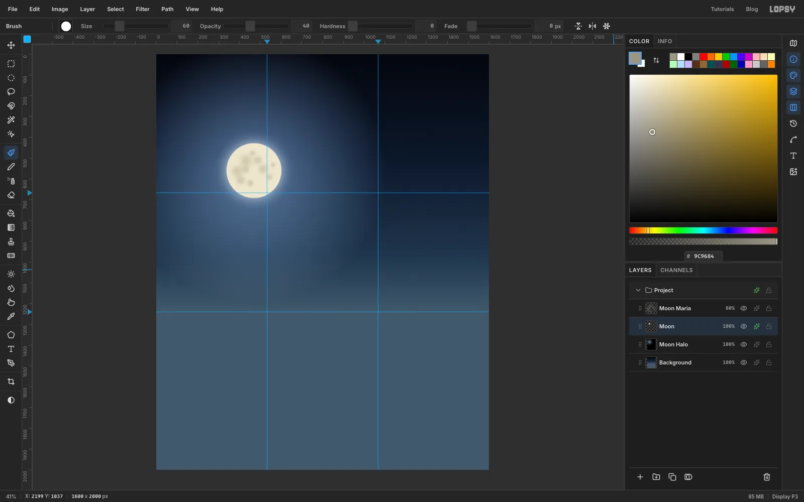

Select the **Moon** layer and open its **✦** drawer. Turn on **Outer Glow** and set **Size** 60, **Spread** 8 and **Opacity** 70, with the colour `#C9D4E2`. Close the drawer.

## Grow some clouds

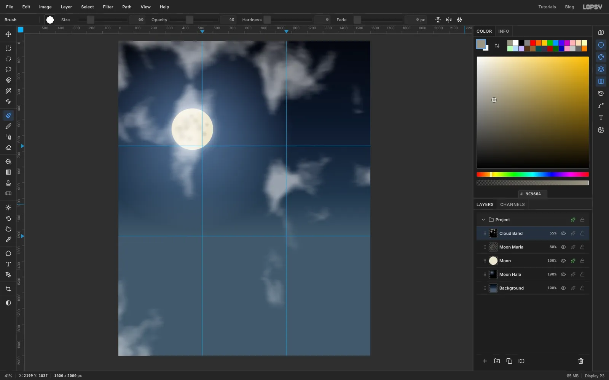

Add a layer named **Cloud Band** above Moon Maria and run these filters in order:

1. **Smoke…** with **Scale** 6 and **Turbulence** 70
2. **Brightness/Contrast…** with **Brightness** -40 and **Contrast** 90
3. **Gaussian Blur…** with **Radius** 4
4. **Motion Blur…** with **Angle** 0 and **Distance** 40

Set the layer to **Screen** at 55%. Smoke is random, so yours will look different from mine, and that's fine.

## Keep only a band of cloud across the moon

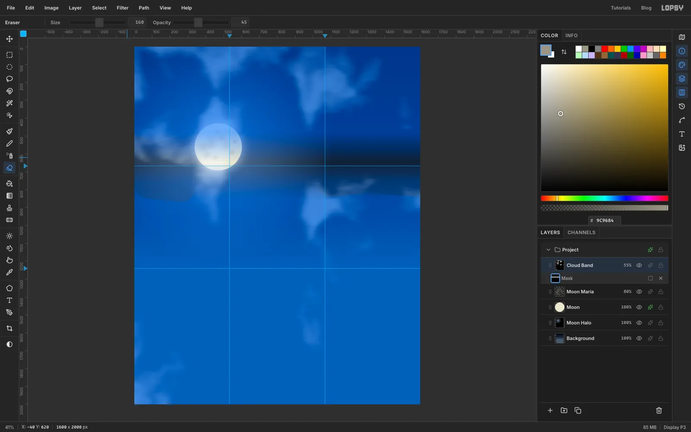

Clouds all over the sky would hide the stars of the show, so keep just a drifting band across the bottom of the moon.

Click **Add Mask**, then click the mask thumbnail on the Cloud Band row to paint on the mask. Lopsy tints the canvas blue while you do. Set the **Gradient** tool to **Linear** and, in **Advanced…**, make three stops: black at the far left, white at about 45%, and black at the far right. Drag it from about 480 down to about 850. Clouds now show only along a soft band through the bottom of the moon.

Pick the **Eraser** at **Size** 160 and **Opacity** 45, and make four or five short sweeps along the band to tear it into rags. Click the layer's name to leave mask editing.

## Bring in the abbey photo

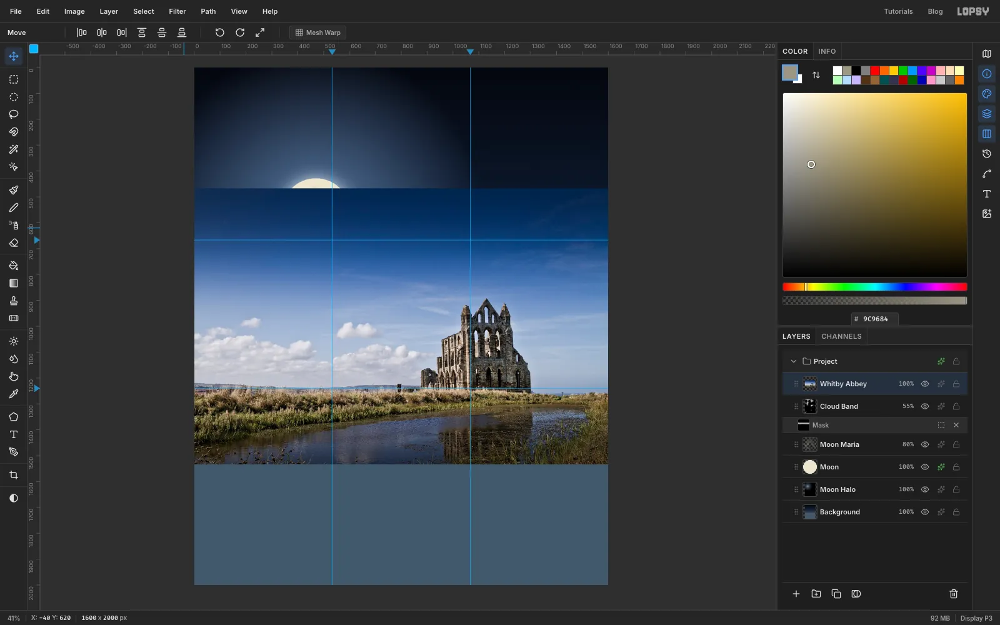

Select **Cloud Band**, then drag the Whitby Abbey photo from your desktop onto the canvas. Lopsy shrinks an oversized image to fit, so it lands 1600 px wide and centred on the canvas. Rename the new layer **Whitby Abbey** and press [[Cmd+D]].

## Keep just the abbey

Pick the **Rectangular Marquee** and drag around the abbey and the strip of grass in front of it. Start a little above and to the left of the low ruined wall on the left, and finish just below the grass on the right. Mine ran from 867, 879 to 1313, 1293.

Choose **Select → Inverse**, press [[Delete]], then [[Cmd+D]]. Only the abbey, its sky and the grass are left.

## Select the sky with the Magic Wand

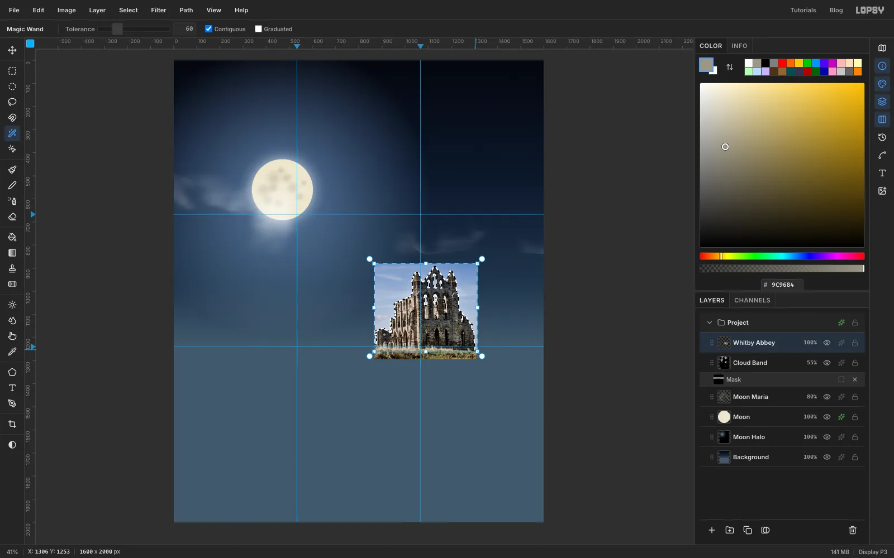

Pick the **Magic Wand**, set **Tolerance** to 60 and keep **Contiguous** ticked. Click the open sky to the left of the abbey.

The stone is much darker than the sky, so the selection stops at the walls. The sky seen through the windows isn't connected to the rest, though. Hold [[Shift]] and click inside each window opening where sky shows: three at the top of the gable, two in the tier below, and the small one on the right-hand wall. Shift-click any pale wisps near the top right that the first click missed too.

## Delete the sky

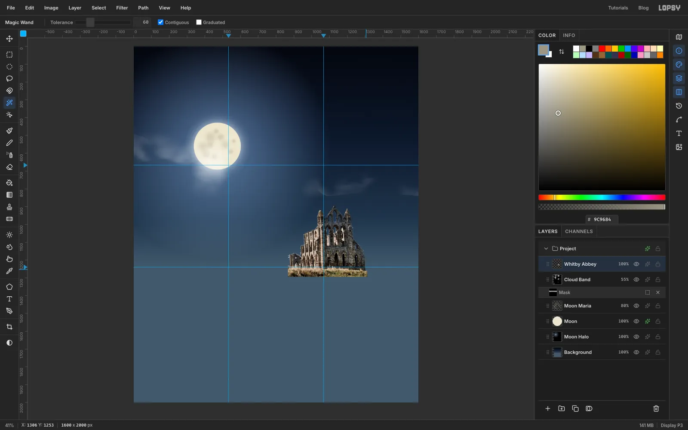

Press [[Delete]], then [[Cmd+D]]. The night sky now shows around the ruin and through its windows.

## Scale the abbey up

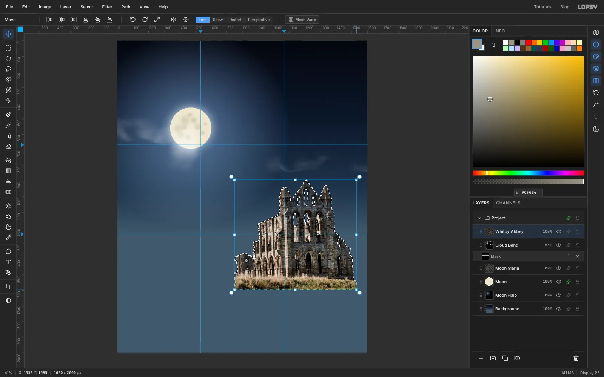

The abbey is too small to carry the picture, so make it bigger. Scaled pixels that cross the canvas edge are cut off when you commit, so make room first: pick the **Move** tool and drag the abbey about 120 px to the left.

Hold [[Cmd]] and click the layer's thumbnail to select its pixels. With the **Move** tool, hold [[Cmd]] and drag the bottom-right corner handle down and to the right until the abbey is about 780 px wide, roughly 175%. Cmd keeps the proportions. Press [[Cmd+D]] to commit.

## Set the abbey on the shore

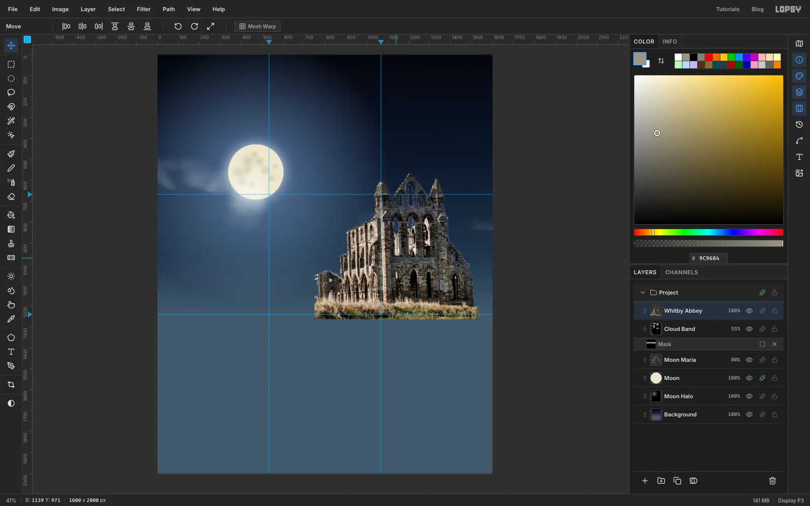

Drag the abbey straight up until the bottom of the grass sits just below the horizon guide, at about 1262. It now fills most of the right half, with the top of its gable level with the moon.

## Build the far shore

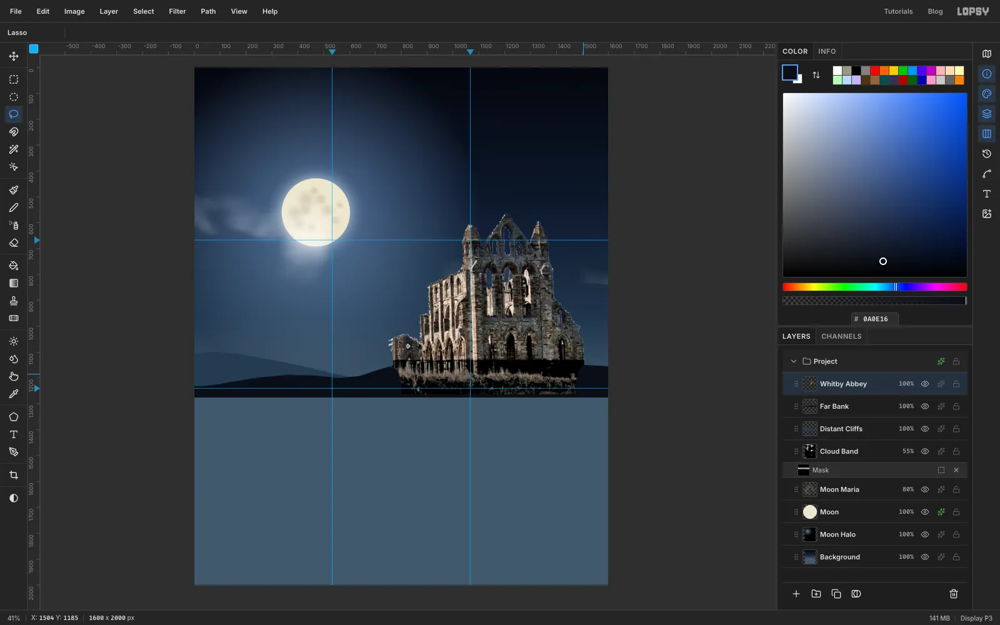

Select **Cloud Band** and add a layer named **Distant Cliffs**. With the **Lasso**, draw a low headland: start off the left edge at about 1100, slope it gently down to about 1210 at x 700, and close the shape below the horizon. Fill it with `#2A3A50` and run **Gaussian Blur…** with **Radius** 2. It's paler than everything in front, which pushes it far away.

Add a layer named **Far Bank**. Lasso the near shore: a low, rounded knoll on the left that peaks a little left of the first vertical guide, dips just past it, then rises again behind the abbey's low left wall and runs flat across to the right edge, a little higher than the knoll. Close it below the horizon and fill with `#0A0E16`. This is where the churchyard will stand.

Now select **Whitby Abbey**. The photo's grass ends in straight vertical cuts, a giveaway that it's pasted. Pick the **Eraser** at **Size** 90 and **Opacity** 100, and drag down each end of the grass to round them off. Then lasso around the whole grass strip and run **Hue/Saturation…** with **Saturation** -60 and **Lightness** -30, so the grass loses its daylight gold. Press [[Cmd+D]].

## Light the stone and lay the water

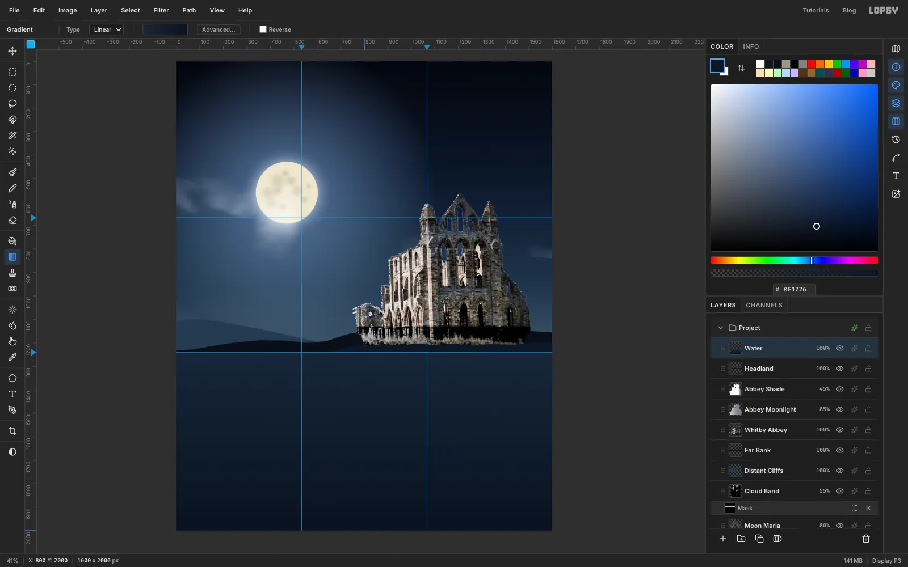

The moon is to the left, so the abbey's left faces should catch more light than its right.

1. Add a layer named **Abbey Moonlight**. Cmd-click the Whitby Abbey thumbnail to select the stone. Set up a two-stop linear gradient, `#C8D8F0` at the far left and `#808080` at the far right, and drag it from the abbey's left edge to about two thirds of the way across the building. Set the layer to **Overlay** at 85%. In Overlay, mid-grey `#808080` changes nothing, so the light fades out across the building.
2. Add a layer named **Abbey Shade**. With the selection still active, set the two stops to white and `#1A2236`, and drag from the middle of the abbey's right half to just past its right edge. Press [[Cmd+D]] and set it to **Multiply** at 45%. White does nothing in Multiply, so only the far side darkens.
3. Add a layer named **Headland**. Lasso a dark strip along the abbey's foot, from the dip after the churchyard knoll to the right edge. Give it a bumpy top edge a little above the horizon guide, so it covers the straight bottom of the photo's grass, and fill it with `#0E1726`.
4. Add a layer named **Water**. Drag a rectangular marquee across the full width, from just below the horizon guide (about 1252) to the bottom edge. Drag a two-stop linear gradient from `#1A2637` at the top to `#0B1220` at the bottom, and press [[Cmd+D]].

## Turn the daylight abbey into night

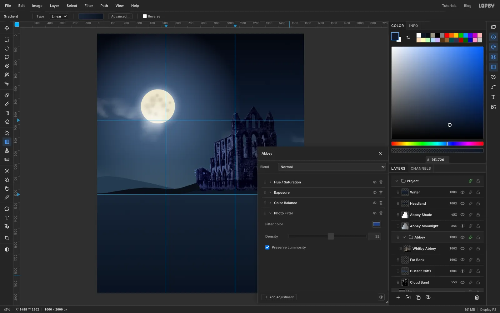

Select **Whitby Abbey** and choose **Layer → Group Layers**. Rename the group **Abbey**, and click its **✦** button to open the adjustments drawer. Use **Add Adjustment** four times:

1. **Hue / Saturation**: **Saturation** -65, **Lightness** -5
2. **Exposure**: -1.35
3. **Color Balance**: click the **Shadows** tab and set **Yellow — Blue** to 6
4. **Photo Filter**: click the colour swatch and choose `#1F3F86`, then set **Density** to 55

This is the old film trick called "day for night": take the colour out, darken it, push it blue. Go easy on Color Balance. It adds straight to the blue channel, so on stone this dark even +18 turns violet. Close the drawer.

## Dodge the moonlit stone

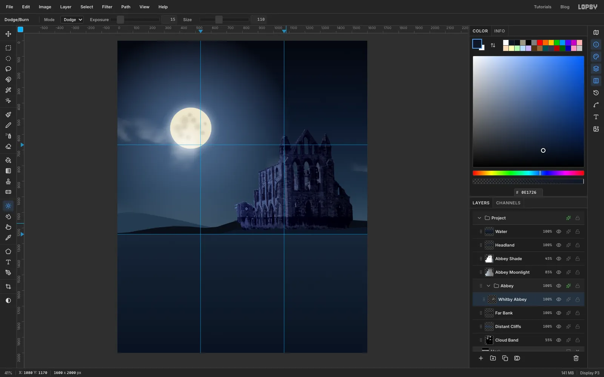

Select the **Whitby Abbey** layer inside the group and pick **Dodge / Burn** with **Mode** set to Dodge. At **Size** 30 and **Exposure** 22, paint down the left-hand edges of both towers, the big buttresses and the left slope of the gable. These are the surfaces that face the moon.

Then set **Size** 110 and **Exposure** 15, and make three slow vertical passes over the piers on the left half of the building. The dodge works under the group's adjustments, so the brightening stays blue.

## Copy the scene for a reflection

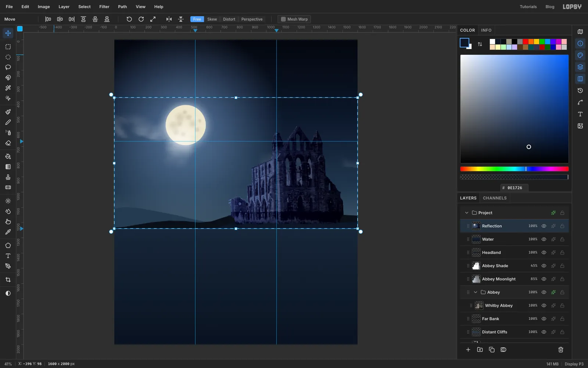

Select **Water**. Drag a rectangular marquee across the full width, from about 380 down to the top of the water, just below the horizon guide. Choose **Edit → Copy Merged**, which copies what you see rather than one layer. Press [[Cmd+D]], then [[Cmd+V]]. The copy is pasted in place on a new layer. Rename it **Reflection**.

## Flip it upside down

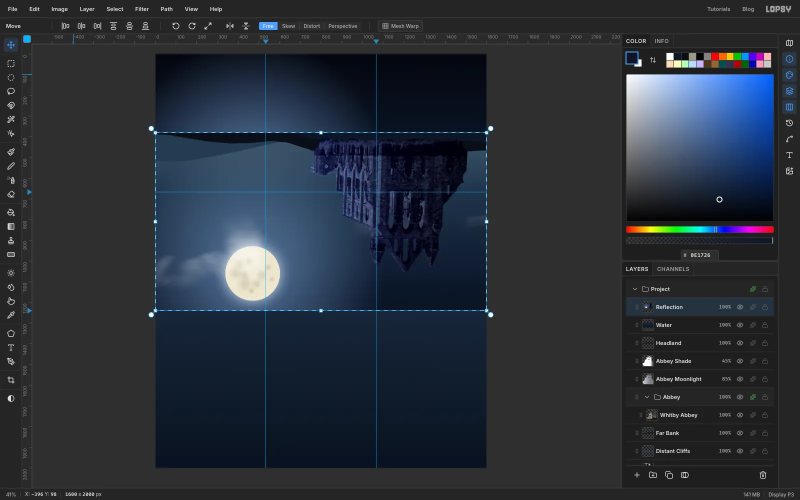

Pasting switches to the **Move** tool and selects the pasted pixels. Click **Flip Vertical** in the options bar. The strip turns upside down in place.

## Drop it into the water

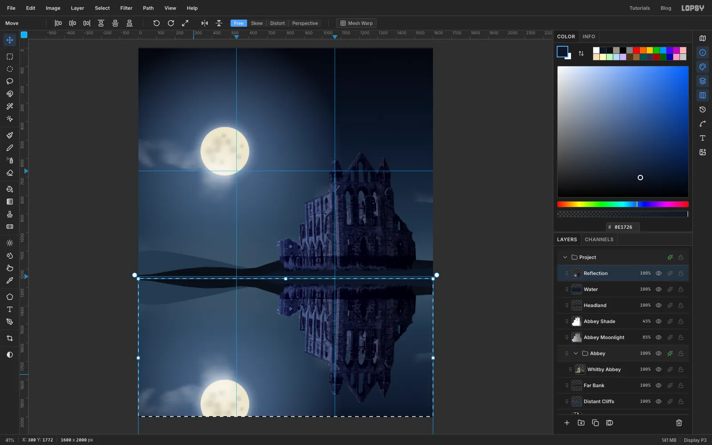

Drag the strip straight down until its top edge meets the waterline at 1252, about 870 px. The bottom runs off the canvas, which is fine. Press [[Cmd+D]].

Run **Motion Blur…** with **Angle** 90 and **Distance** 18, which smears it vertically like light on moving water. Set the layer's opacity to 62%.

## Fade the reflection toward you

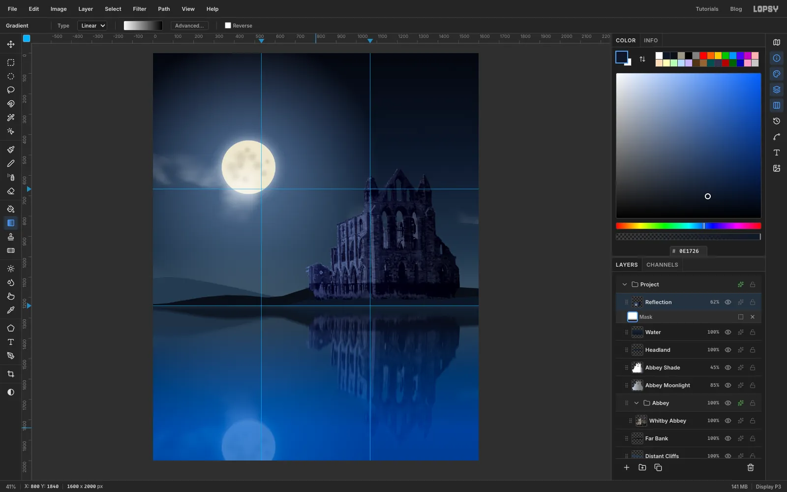

Real reflections weaken as the water nears you. Click **Add Mask**, then click the Reflection row's mask thumbnail. Set up a two-stop linear gradient, white at the far left and black at the far right, and drag it from about 1330 down to about 1840. The mirrored moon at the bottom disappears, which is good, because the glitter path will do that job. Click the layer's name to leave mask editing.

## Add ripples

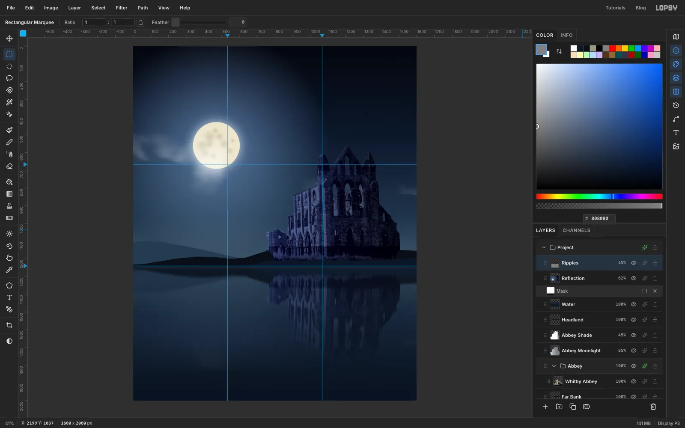

Add a layer named **Ripples**. Marquee the water from 1252 to the bottom, fill it with `#808080`, then run:

1. **Add Noise…** with **Amount** 70 in **Mono** mode
2. **Motion Blur…** with **Angle** 0 and **Distance** 90
3. **Brightness/Contrast…** with **Brightness** 0 and **Contrast** 80

Press [[Cmd+D]] and set the layer to **Overlay** at 45%. Mid-grey disappears in Overlay, so only the light and dark streaks remain.

## Paint the moon's path on the water

Add a layer named **Moon Path**. Pick the **Brush** with **Hardness** 30 and the colour `#E8E3C6`. Paint short horizontal dashes under the moon, in a column that starts about 80 px wide at the waterline and widens to about 450 px at the bottom edge. Change the brush as you come down the page:

- near the horizon: **Size** 3, **Opacity** 60, dashes 20 to 40 px long, close together
- halfway down: **Size** 5, **Opacity** 78, dashes up to 80 px
- near the bottom: **Size** 7 or 8, **Opacity** 90, dashes up to 120 px, further apart

Skip places at random so it doesn't become a ladder. Set the layer to **Screen**, run **Motion Blur…** with **Angle** 0 and **Distance** 14 and **Gaussian Blur…** with **Radius** 1, then give it an **Outer Glow** of `#CFD6E0` at **Size** 10 and **Opacity** 25.

## Bring in the swan photo

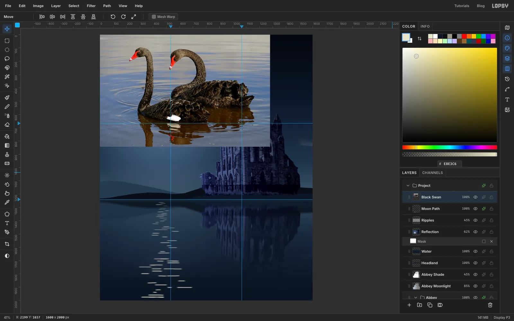

Select **Moon Path** and drag the black swan photo onto the canvas. It's smaller than the canvas, so it lands at the top-left at full size. Rename the layer **Black Swan** and press [[Cmd+D]].

## Trace the swan with the Lasso

Use the front swan, the one on the left. Pick the **Lasso** and trace around it, staying a hair inside its edge: the red bill, round the head, down the back of the neck and along the top of the wing feathers to the tail. Then come back along the waterline and up the front of the neck.

Where its back meets the second swan's body, follow the curl of the front swan's feathers. Along the bottom, stop at the waterline and don't include the brown reflection.

## Cut it out

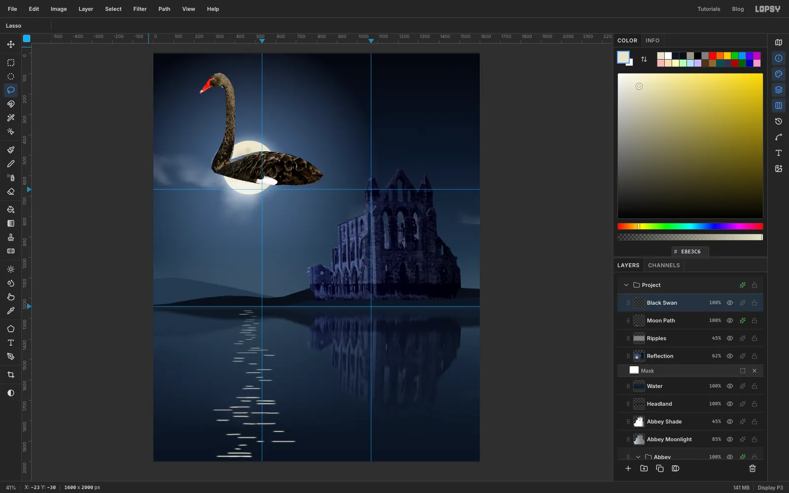

Choose **Select → Inverse**, press [[Delete]] and then [[Cmd+D]]. Only the front swan is left.

## Flip and scale the swan

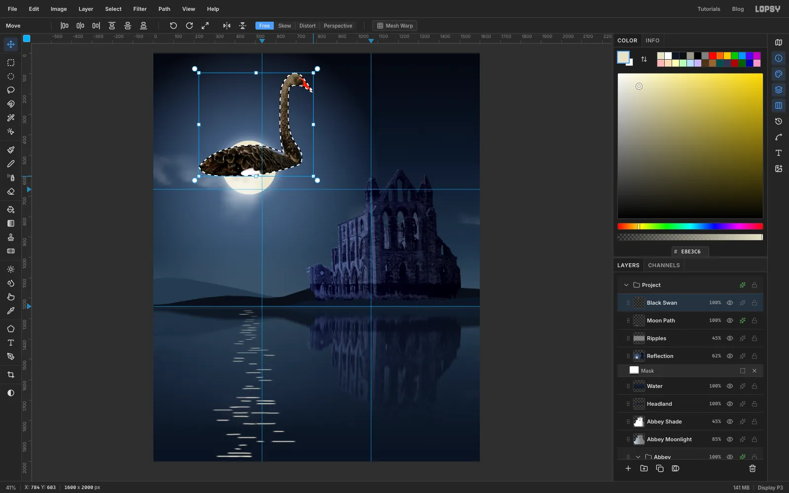

The swan faces left. It should swim toward the abbey, so turn it around before you scale it. Cmd-click the layer's thumbnail, and with the **Move** tool click **Flip Horizontal** in the options bar. Press [[Cmd+D]].

Cmd-click the thumbnail again. Hold [[Cmd]] and drag the bottom-right corner handle in a little, to about 92%. Press [[Cmd+D]].

## Set the swan in the moonlight

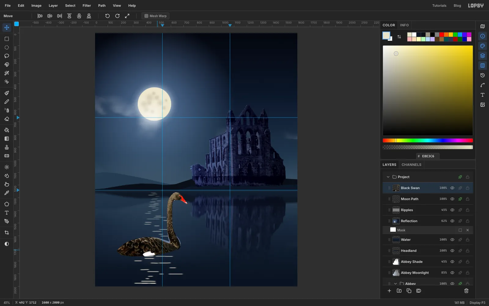

Drag the swan down and to the left so it sits in the glitter path. Its tail should be about a tenth of the way in from the left edge, and its hull should rest about a quarter of the way up from the bottom, with glitter dashes running behind its body and below it.

Keep its head below the horizon. If the bill touches the shoreline or the abbey's edge, those two shapes pile up into a single knot, so nudge the swan until there's clear water around its head.

## Grade the swan and calm its bill

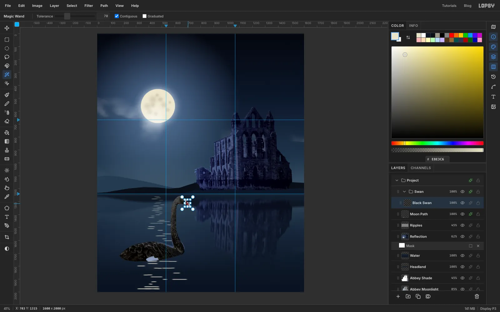

Choose **Layer → Group Layers** and rename the group **Swan**. Open the group's **✦** drawer and use **Add Adjustment** three times: **Exposure** -0.7, **Hue / Saturation** with **Saturation** -25, and **Photo Filter** in `#1F3F86` with **Density** 45. Close the drawer.

The bill is still daylight red. Select the **Black Swan** layer, pick the **Magic Wand** with **Tolerance** 70, and click the bill. Run **Hue/Saturation…** with **Saturation** -50 and **Lightness** -30, then press [[Cmd+D]]. It stays a dull brick red, which is just enough of an accent against all the blue.

Its white flight feathers glow as if lit by the sun, too. Pick **Dodge / Burn**, set **Mode** to Burn with **Size** 34 and **Exposure** 45, and paint over the white patch twice. Then make one more pass at **Size** 40 and **Exposure** 30.

## Clean the edge and add a moonlit rim

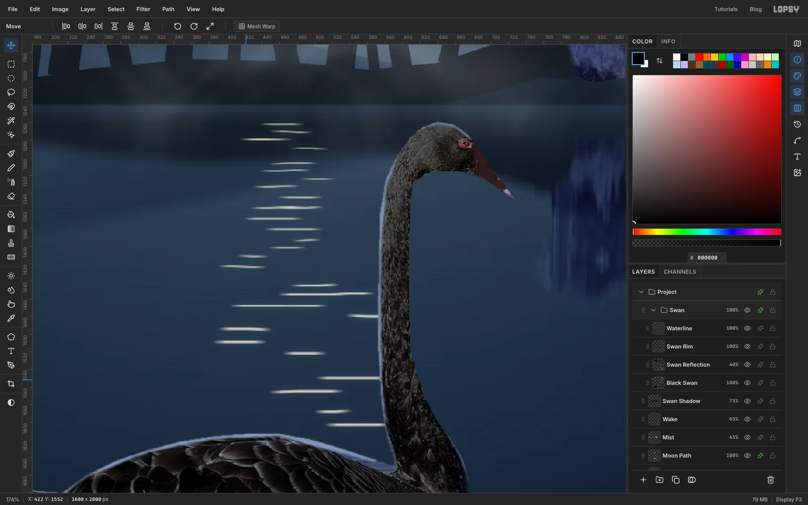

A photo cut-out carries a thin fringe of its old background. Cmd-click the Black Swan thumbnail, choose **Select → Shrink…** and enter 3. Choose **Select → Inverse** and press [[Delete]], which shaves 3 px off the whole outline. With that thin band still selected, run **Gaussian Blur…** with **Radius** 1. Only the new edge softens and the feathers inside stay sharp. Press [[Cmd+D]].

With **Black Swan** still selected, click **+**. The new layer lands just above it, inside the Swan group. Name it **Swan Rim** and Cmd-click the Black Swan thumbnail. Pick the **Brush** at **Size** 16, **Hardness** 50 and **Opacity** 100 in `#E8F0FF`, and paint along the very edge of the top of the head, the back of the neck (now on the left) and the top of the back. Only the inside half of the brush lands, because the selection clips it. Press [[Cmd+D]] and run **Gaussian Blur…** with **Radius** 2.

## Reflect the swan and seat it in the water

Select **Black Swan** and choose **Layer → Duplicate Layer**. Rename the copy **Swan Reflection**, click its row, and choose **Image → Flip Vertical**. Drag it down until its top meets the swan's waterline. Run **Motion Blur…** with **Angle** 90 and **Distance** 14, and set it to 40%.

Select **Swan Rim** and add a layer named **Waterline**. With a **Size** 6 brush, **Hardness** 80 and **Opacity** 70 in `#0B1018`, paint one stroke along the bottom of the hull where it meets the water. That thin dark line is what makes the swan sit in the water rather than on it.

## Leave a wake

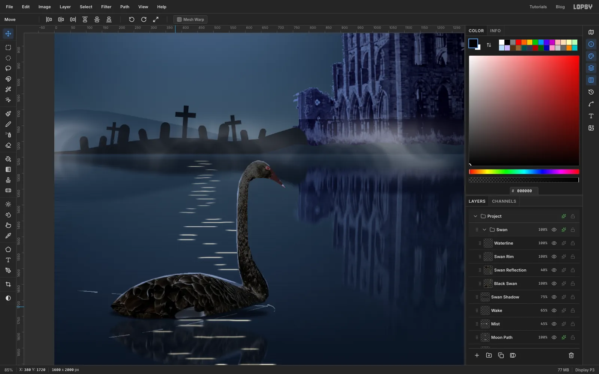

Select **Moon Path** and add a layer named **Wake**, so it sits under the swan. Pick the **Brush** at **Size** 5, **Hardness** 40, in `#9FB0C6`. Open the **Brushes** modal and, on the **Shape** tab, set **Taper** to 110 px. Taper is a distance, so every stroke now thins to nothing about 110 px after you start it.

A wake is a V that spreads out behind the bird, so draw two arms trailing left from the swan's chest. One runs back almost level behind the body and one angles down toward you, out past the tail. Lay each arm as five dashes, each about 100 px long with short gaps between them. Then add a small curl of ripple just in front of the chest.

Run **Gaussian Blur…** with **Radius** 1 and set the layer to 65%. Keep it subtle: a wake that shines brighter than the glitter path pulls the eye away from the swan.

Add a layer named **Swan Shadow** above Wake. Draw an elliptical marquee about 500 × 36 px under the hull, fill it with `#03050A`, press [[Cmd+D]] and run **Gaussian Blur…** with **Radius** 12. Then, on the same layer, paint one soft stroke (**Size** 12, **Hardness** 0, **Opacity** 70, `#0B1320`) along the hull's waterline, and set the layer to 75%.

## Let the mist roll in

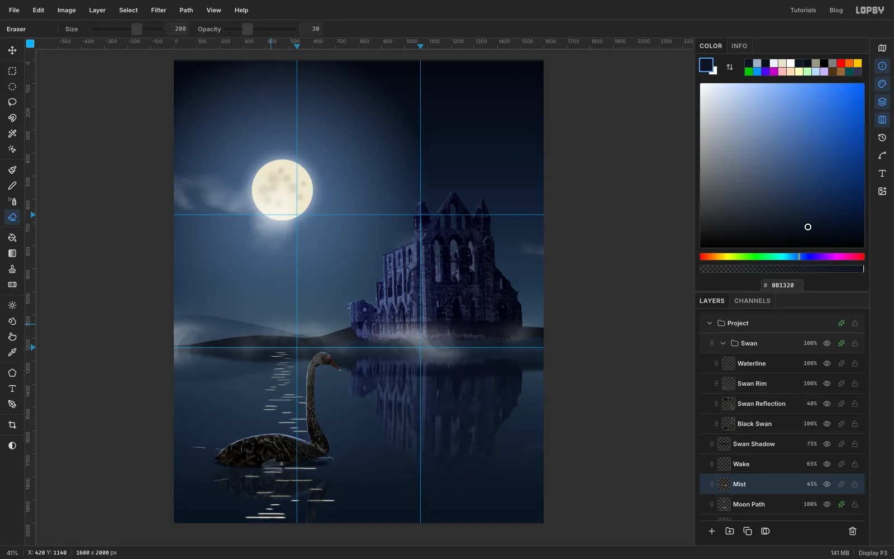

Select **Moon Path** and add a layer named **Mist**. Drag a rectangular marquee across the full width from 1130 to 1320, choose **Select → Feather…** with 63, and run **Clouds…** with **Scale** 6. Press [[Cmd+D]], then run **Motion Blur…** with **Angle** 0 and **Distance** 60, and **Gaussian Blur…** with **Radius** 20.

Set the layer to **Screen** at 45%. Pick the **Eraser** at **Size** 200 and **Opacity** 30, and make six short sweeps through the mist so it drifts in patches rather than lying in a ribbon.

## Raise the churchyard

Whitby Abbey shares its headland with a famous churchyard. Select **Far Bank** and set the foreground to `#0A0E16`.

With the **Lasso**, draw a headstone standing on the knoll: a narrow upright with a rounded top, 35 to 60 px tall, leaning a few degrees. Hold [[Shift]] and draw the next one, and keep going until you have nine across the knoll. Lean each one a different way, and vary the heights.

Add three crosses the same way. Each cross is two Shift-added rectangles, an upright 75 to 105 px tall and a short crossbar a quarter of the way down. Choose **Edit → Fill** and press [[Cmd+D]]. The stones join the knoll, and the mist from the last step drifts across their feet.

## Light pools for the candles

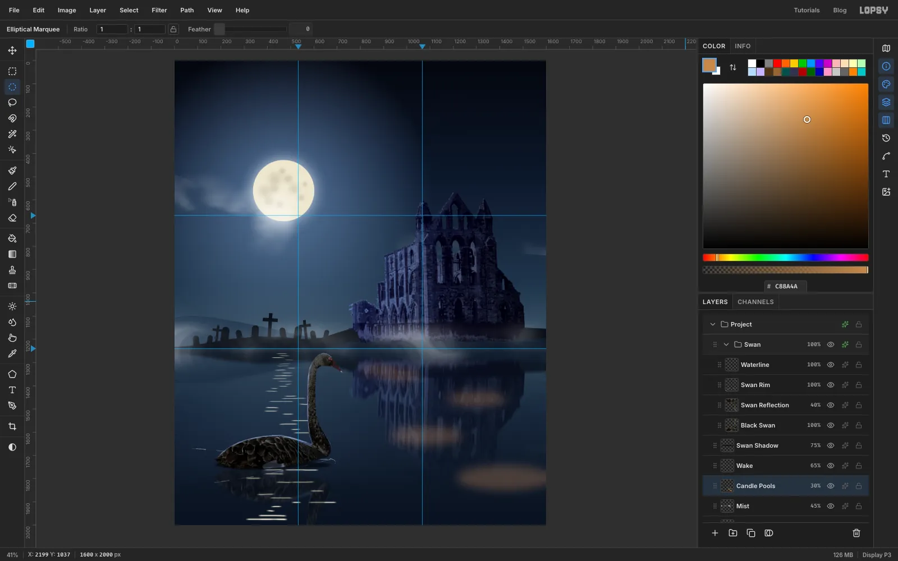

The candles come next, built from the water up on five layers. Decide where they float first: five spots in an uneven drift across the abbey's reflection. Mine were two close together just below the shore near the abbey's left wall (about 880, 1330 and 975, 1350), one further right (1300, 1450), one back toward the middle (1085, 1610) and the nearest one at the lower right (1420, 1790). They get bigger as they come toward you.

Select **Mist** and add a layer named **Candle Pools**. With the **Elliptical Marquee**, drag a flat oval centred on each spot, holding [[Shift]] from the second one on to add it. Make the farthest about 170 × 45 px and the nearest about 410 × 110. Choose **Select → Feather…** with 40, fill with `#C88A4A`, press [[Cmd+D]], and set the layer to **Screen** at 30%.

## Add reflections and lily pads

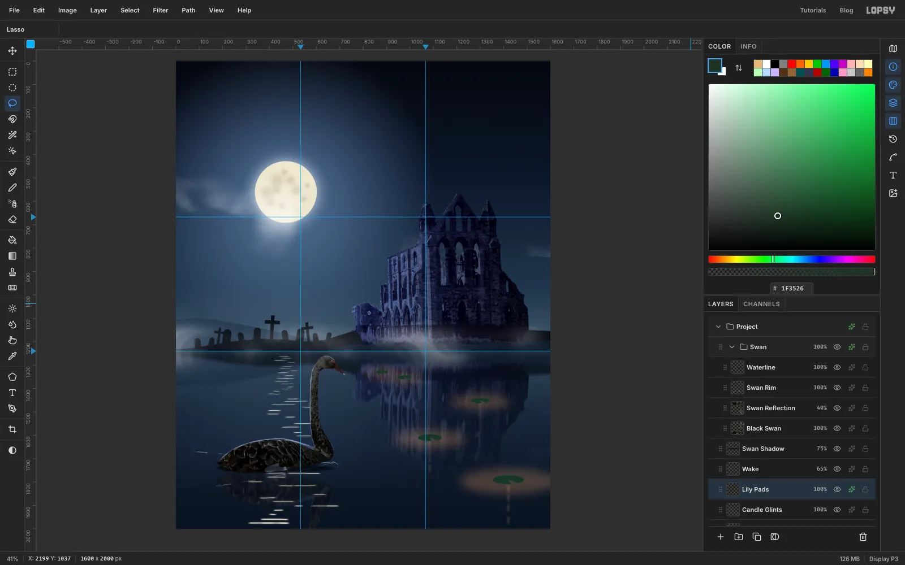

Add a layer named **Candle Glints**. Pick a soft **Brush** (**Hardness** 0, **Opacity** 35) in `#E8B878`. Under each spot, click four dabs in a short column going down, about 10 px wide for the far candles and 25 px for the near one. Run **Motion Blur…** with **Angle** 90 and **Distance** 30, and set the layer to **Screen**. One soft streak per candle reads as reflected flame. Two hard lines would read as legs.

Add a layer named **Lily Pads**. With the **Lasso**, draw a flat oval on each spot with a narrow wedge cut into its front edge, like a slice taken out of a pie. Hold [[Shift]] to add each one. The farthest pad is about 55 × 16 px and the nearest about 135 × 40. Fill with `#1F3526`, press [[Cmd+D]], and add an **Inner Glow** in `#4C6B50` (**Size** 4, **Opacity** 85) so the rims catch the light.

## Set the candles and light them

Add a layer named **Candles**. With the **Rectangular Marquee**, Shift-add a small upright rectangle standing on the middle of each pad. The farthest is about 9 × 18 px and the nearest about 22 × 43. Fill with `#E6D9BC` and press [[Cmd+D]].

Add a layer named **Flames**. With the **Elliptical Marquee**, Shift-add a tiny upright oval just above each candle, from about 7 × 15 px to 16 × 36. Fill with `#FFE7B0`, press [[Cmd+D]], and add an **Outer Glow** in `#FFCF80` (**Size** 50, **Spread** 20, **Opacity** 85).

These are the only warm colours in the picture, so they catch the eye immediately against all the blue.

## Draw a branch across the moon

Select **Flames** and add a layer named **Branches**. Pick the **Brush** with **Hardness** 90 and **Opacity** 100 in `#06080E`. Before each stroke, set **Taper** in the Brushes modal to roughly the length you're about to paint, so every branch thins to a point at its tip.

1. The main limb: **Size** 18, **Taper** about 500. Start just off the left edge, a little below the moon's top, and wander right and gently down until you reach the moon's upper-left edge.
2. A thinner limb higher up: **Size** 12, **Taper** about 350, from the left edge near the top, rising slightly.
3. Twigs: **Size** 3 to 8, **Taper** 100 to 250. Start each one a little way back along its parent, not at the parent's thin tip, so the joint doesn't bulge. Send two or three across the face of the moon, ending near its lower-right edge, and let a couple hang down.

Add an **Inner Glow** in `#8C9AB0` (**Size** 4, **Opacity** 55). A dark silhouette against a dark sky disappears, and the faint rim keeps it visible.

## Frame the bottom with reeds

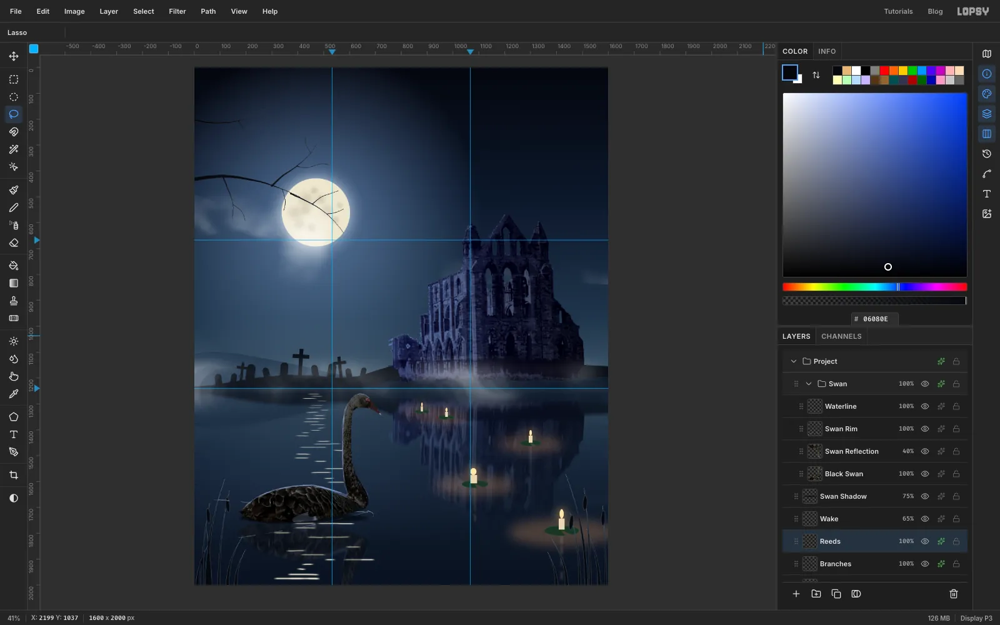

Add a layer named **Reeds**. With the same dark colour, paint seven reeds up from the bottom-left corner and seven from the bottom-right, at **Size** 12 to 16. Start each one off the bottom edge and curve it slightly toward the middle. Use **Taper** 200 for the short reeds (150 to 250 px tall) and 400 for the tall ones (up to 440 px).

Lasso a narrow upright oval near the top of every second or third reed for a cattail head, Shift-adding each one, and fill. Give the layer an **Inner Glow** in `#8FA3BE` (**Size** 5, **Opacity** 90).

## Send out the bats

Add a layer named **Bats** and set the foreground to `#06080E`. With the **Lasso**, draw six bats around the abbey's towers, holding [[Shift]] to add each one. A bat is a small oval body with two pointed ears, and each wing is a long point with three shallow scallops cut into its trailing edge. Make them 40 to 80 px across, some with wings raised and some with wings swept down, so they look like a flock in flight. Choose **Edit → Fill** and press [[Cmd+D]].

To make more without redrawing, drag a **Rectangular Marquee** around one bat and press [[Cmd+C]], then [[Cmd+V]]. The copy is pasted in place on its own layer.

## Rotate, shrink and move the copies

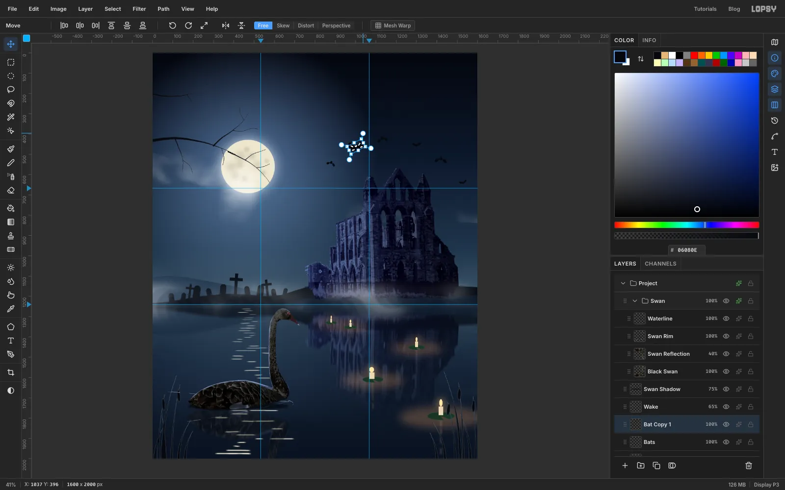

Cmd-click the copy's thumbnail. With the **Move** tool, drag one of the round handles just outside a corner to tilt the bat about 28° anticlockwise. Press [[Cmd+D]].

Cmd-click the thumbnail again and Cmd-drag a corner handle inward to about 70%. Press [[Cmd+D]], drag the bat off to the left of the abbey, and choose **Layer → Merge Down**.

Select **Bats**, marquee the same bat again, copy and paste it, and repeat: this time tilt it about 22° clockwise, shrink it to about 55%, and put it above the gable before merging it down.

## Group the candles and let them drift

Click the **Candle Pools** row, then [[Shift]]-click **Flames** to select all five candle layers. Choose **Layer → Group Layers** and name the group **Candles Group**.

With the group selected, use the **Move** tool to drag the whole flotilla about 40 px left, so the nearest candle clears the reeds. Every layer moves together, and one [[Cmd+Z]] would undo the whole move.

## Blend it all with a painterly pass

Two photos and a lot of crisp shapes still look like three different kinds of picture. One painterly pass pulls them together.

Select **Bats**, press [[Cmd+A]], choose **Edit → Copy Merged**, press [[Cmd+D]] and then [[Cmd+V]]. Rename the new layer **Paint Pass** and press [[Cmd+D]]. Run **Oil Paint…** with **Radius** 3 and **Sharpness** 1.2, and set the layer to 55%. The abbey, sky and water soften toward brushwork while the shapes underneath still show through.

The new layer lands just above Bats, which is below the Wake, Swan Shadow and Swan layers. So the swan stays crisp on top of the painted scene, and the eye goes straight to it.

## Add grain and a vignette, then export

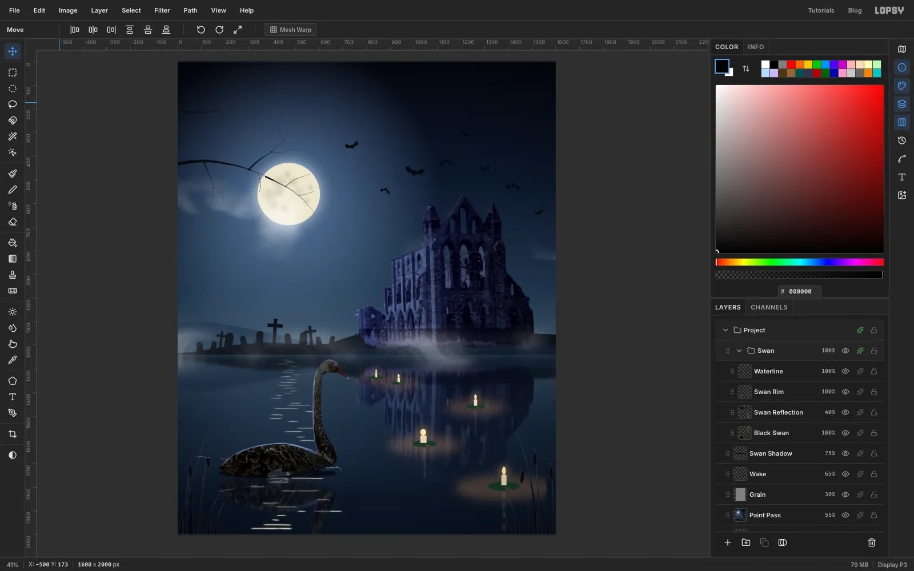

Add a layer named **Grain**. Press [[Cmd+A]], fill with `#808080`, press [[Cmd+D]], and run **Add Noise…** with **Amount** 22 in **Mono** mode with **Gaussian** distribution. Set it to **Overlay** at 30%.

Finally, click the **Project** row at the top of the Layers panel, open its **✦** drawer, add a **Vignette** adjustment and set it to 35. Close the drawer, untick **View → Show Guides** to hide the guides, then **File → Save Project** and **File → Quick Export PNG**.

The method carries over to any night scene: grade the daylight out of your photos, light everything from one direction, and put the only warm colour where you want the eye to land.
