A graffiti *piece* (short for masterpiece) is built in layers, the way a
writer paints it on a wall. First comes the **fill**, often a fade from one
colour to another. Then a **3D block** that makes the letters look thick, a
hard **outline**, white **shines** and a **cloud** or backdrop that holds it
all together. Stencil artists work the opposite way. They cut a photo into
two or three flat tones and spray one stencil plate over another, slightly
out of register.

This tutorial puts both on the same alley wall. The result is a menu for
**Holy Cluck**, an imaginary Nashville hot chicken joint: a graffiti title, a
stencilled rooster with a halo, a painted menu board and a row of heat-level
stickers. The canvas is **1200 × 1600 px**. You'll need two photos: a close-up
of a rooster's head and a fried drumstick on a white background. Both photos
used here are public domain from Wikimedia Commons ("Rooster in Filipino.JPG"
and "Fried-Chicken-Leg.jpg").

Along the way you'll use:

- **Define Pattern** and **Fill with Pattern** (with **Row Stagger**) for the bricks
- **Add Noise**, **Clouds**, **Emboss** and **Smoke** for a worn wall
- **Quick Mask** and Shift-added marquees for painted-over "buff" patches
- text in **Knewave**, **Sedgwick Ave Display**, **Permanent Marker**, **Gochi Hand** and **Bowlby One**
- **Rasterize Layer**, a gradient through a selection, and **Duplicate Layer** + **Merge Down** for a 3D block
- **Select → Grow / Shrink / Feather**, Lasso drips and sparkles, and the rotation handles
- the **Pen** tool with **Path to Selection**, **Desaturate**, **Gaussian Blur** and **Threshold** for stencil plates
- the **Magic Wand**, with and without **Contiguous**, and intersecting a selection with a layer thumbnail
- guides, **Show Grid** and snapping for the menu board and stickers
- **Stroke**, **Drop Shadow** and **Outer Glow** effects, plus **Overlay** and **Multiply** blend modes
- group adjustments (**Vignette**, **Hue / Saturation**), **Clone Stamp**, **Sponge**, **Dodge** and **Smudge**

The palette:

- Mortar `#7A6F66`, brick `#86402F`, dark brick `#5E2519`
- Buff paint `#6A3B33` / `#7C756D`
- Title fade `#FFE14D` → `#FF8A1F` → `#E8261C`
- Title block `#3F0B0B`, outline `#111111`, drips `#D21E16`
- Cloud lime `#A6E22E`, halo gold `#F2B630`
- Stencil cream `#F3E2B0`, red `#E8261C`, crimson `#8E1020`, black `#111111`
- Under-plate teal `#1FA59A`
- Halo disc `#FFE27A` → `#E0A000`, rays `#FFD54A`
- Board `#151312`, notes `#CFC6B8`, rule `#E9E2D6`
- Sticker cream `#F4E9D0`, yellow `#FFE14D`, orange `#FF8A1F`, red `#E8261C`, ink `#2A1A12`
- Flames `#FF4A1C`, tag cyan `#4FD8E8`, shadow brown `#1A0D08`, grain grey `#808080`

> **Tip:** Positions are in document pixels, written `x, y`. The status bar at
> the bottom shows where the pointer is. **Edit → Fill** fills the selection
> with the foreground colour and [[Cmd+D]] deselects. New layers appear just
> above the layer you have selected. If that layer sits inside a group, the
> new layer goes into the group too, so click the right row first.

> **Tip:** For an exact rectangle or circle, pick the **Rectangular** or
> **Elliptical Marquee**, make sure nothing is selected and click the canvas
> once without dragging. A dialog asks for the **From X / Y** and **To X / Y**
> corners. Layer effects and the **Blend** dropdown live in each layer's
> effects drawer: click the sparkle icon on the layer's row.

> **Tip:** With a text layer selected, the Text tool's font, size and colour
> restyle *that* layer. So before you start each new piece of text, click a
> plain raster layer (the step tells you which), then set up the tool and
> click on an empty patch of wall. A new text layer is named after what you
> typed; rename it as the step says. For small shapes such as drips, halos
> and sparkles, zoom in to 200% with [[Cmd+=]] first.

## Fill the mortar

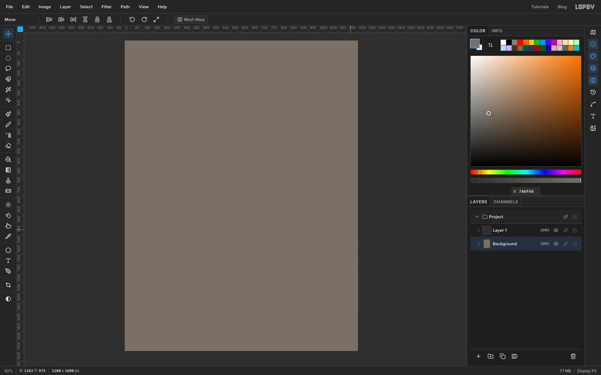

Choose **File → New**, enter **1200 × 1600** and click **Create**. Click the
*Background* row, set the foreground to mortar `#7A6F66` and choose
**Edit → Fill**.

Real mortar is gritty, so choose **Filter → Add Noise…**, set **Amount** to
`18`, click **Mono** and **Gaussian**, and click **Apply**.

## Draw one brick and define it as a pattern

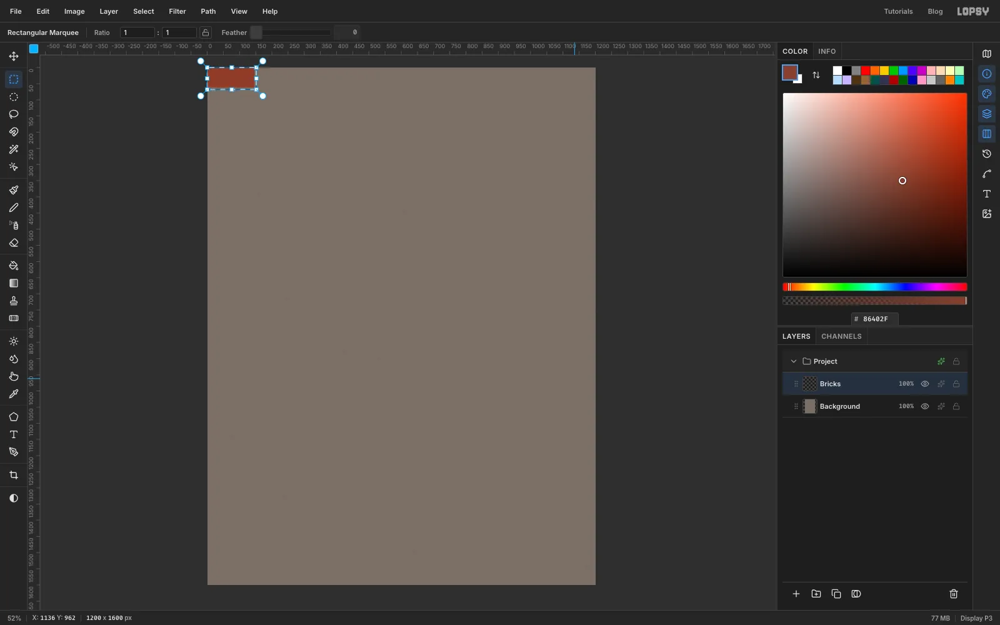

Click *Layer 1* and rename it *Bricks* (double-click the name). The pattern
will tile from the top-left corner of the document, so draw the tile there.

Set the foreground to brick `#86402F`. With the **Rectangular Marquee**,
click once on the canvas and enter **From** `0, 0` **To** `146, 62`, then
**Edit → Fill**. Now select a slightly larger box, **From** `0, 0` **To**
`152, 68`, which takes in the brick plus a 6 px gap on its right and bottom.
That gap becomes the mortar line.

Choose **Edit → Define Pattern**. Press [[Delete]] to clear the tile, then
[[Cmd+D]].

## Fill the wall with staggered bricks

With *Bricks* still selected, choose **Edit → Fill with Pattern…**. Set
**Row Stagger** to `50` and click **Apply**. Each row shifts half a brick
sideways, like a real stretcher-bond wall.

Choose **Filter → Add Noise…** again, this time **Amount** `22` with
**Color** and **Gaussian**. That gives every brick a slightly speckled,
fired-clay surface.

## Pick out some darker bricks with the Magic Wand

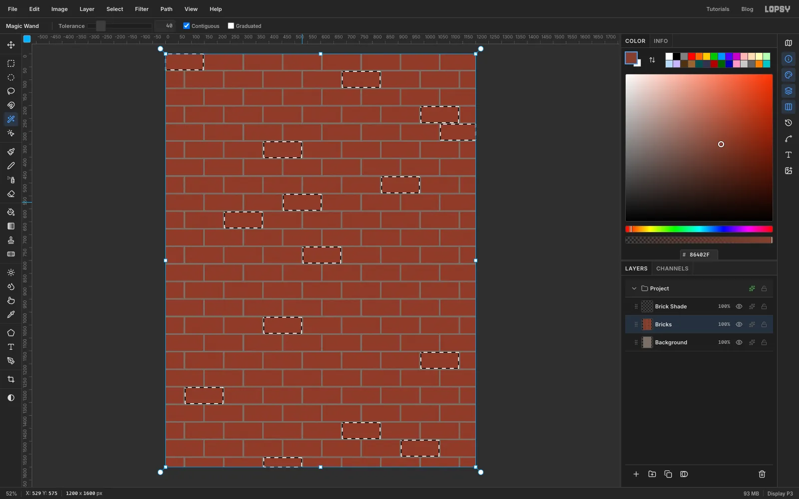

Click **Add Layer** and name the new layer *Brick Shade*. Then click the
*Bricks* row again, because the wand reads the layer you have selected.

Pick the **Magic Wand**, set **Tolerance** to `40` and tick **Contiguous**.
Click the middle of one brick. Hold [[Shift]] and click about fifteen more,
scattered across the wall so no two are neighbours. Click right in the middle
of each brick: a click on a mortar line selects the whole mortar network.

Click the *Brick Shade* row, set the foreground to dark brick `#5E2519` and
fill. Deselect, then click the opacity number on the row and set it to
`70%`.

## Mottle the wall with Clouds

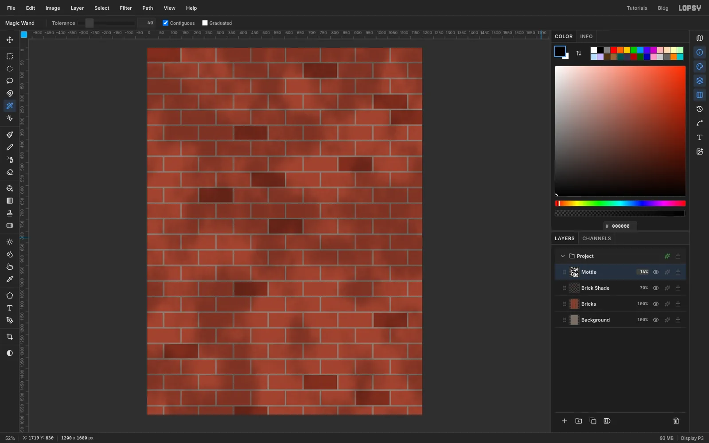

Add a layer called *Mottle*. Choose **Filter → Clouds…**, set **Scale** to
`9` and click **Apply**. You get a soft black-and-white cloud texture.

Open the layer's effects drawer, set **Blend** to **Overlay** and close the
drawer. Set the layer opacity to `14%`, so the clouds only nudge the bricks
lighter and darker.

## Emboss the brick edges

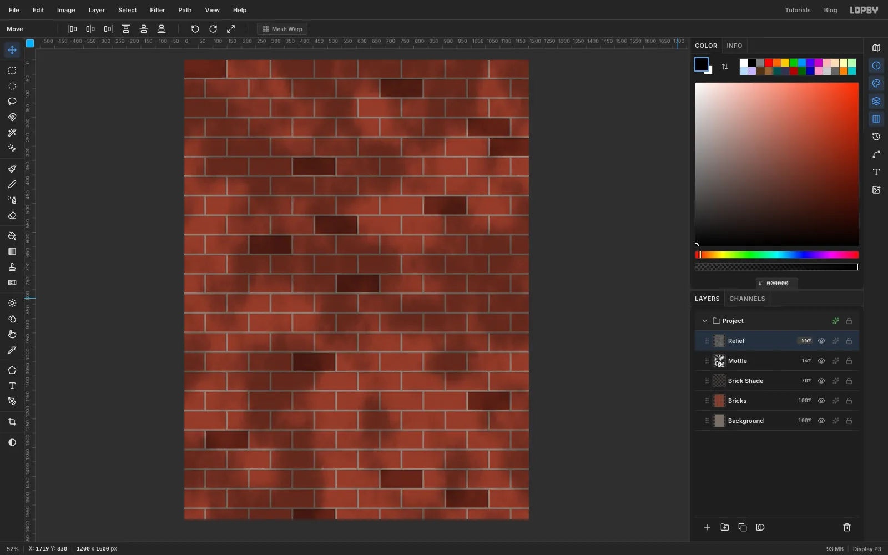

Brick edges catch the light, and the mortar sits back in shadow. To fake
that, press [[Cmd+A]], choose **Edit → Copy Merged** and then
**Edit → Paste**. Deselect and rename the pasted layer *Relief*.

Choose **Filter → Desaturate**. Then choose **Filter → Emboss…**, set
**Angle** to `135` and **Strength** to `35`, and keep the type on **Emboss**.
Click **Apply**. Set the layer's **Blend** to **Overlay** and its opacity to
`55%`.

## Paint a buffed-out patch with Quick Mask

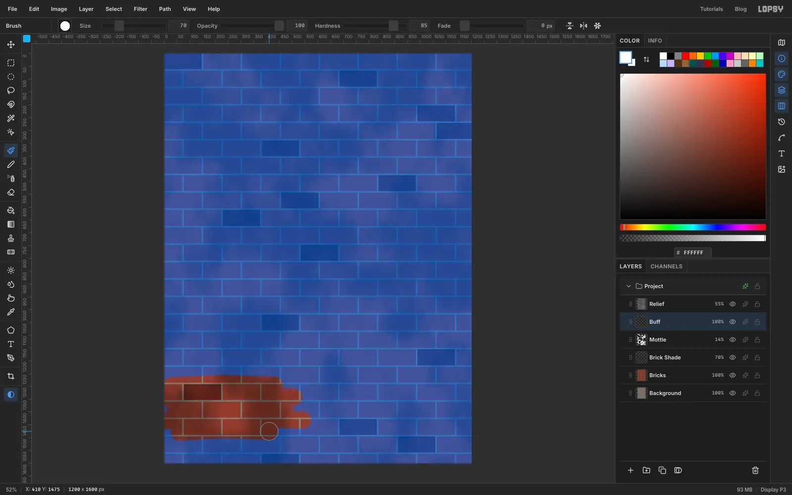

Cities paint over graffiti with whatever paint is to hand, leaving
mismatched patches. Click the *Mottle* row and add a layer called *Buff*,
so the relief still shows through the paint.

Press [[Q]] to enter **Quick Mask**. Everything turns blue except what you
paint. Pick the **Brush**: **Size** `70`, **Hardness** `85`, **Opacity**
`100`, with white as the foreground colour. Paint five overlapping horizontal
passes in the lower left, from about `x 10–60` across to `x 410–540`, between
`y 1290` and `1470`. Make each pass a different length so the end is ragged,
like a roller.

Press [[Q]] again to turn the painted area into a selection. Fill it with
`#6A3B33` and deselect.

## Roll a grey patch from marquee strips

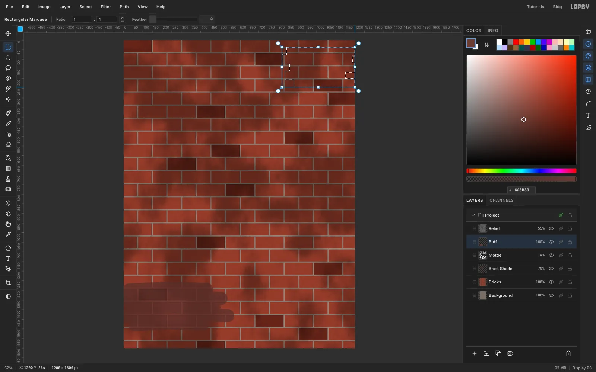

The second patch was rolled in grey. Stay on *Buff*, pick the
**Rectangular Marquee** and
drag a strip about 45 px tall from `846, 36` to the right edge. Then hold
[[Shift]] and drag four more strips below it. Overlap them a little and start
each one at a different x, between `820` and `885`. Stop the lowest strip
around `y 244`.

Fill with `#7C756D` and deselect. To dry out the roller ends, pick **Spray**
(**Size** `34`, **Density** `45`, **Opacity** `85`) with the same grey. Spray
once down the ragged left ends, then once along the top edge and once along
the bottom.

## Add street grime with Smoke

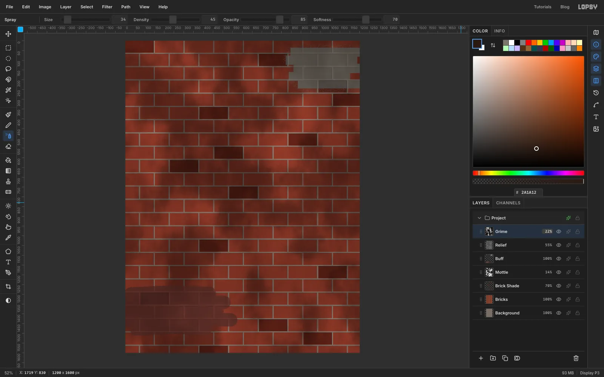

Click *Relief* and add a layer called *Grime*. Choose **Filter → Smoke…**,
set **Scale** to `5` and **Turbulence** to `55`, and click **Apply**. Set
the blend to **Multiply** and the opacity to `22%`. The wall is finished.

## Type the title in Knewave

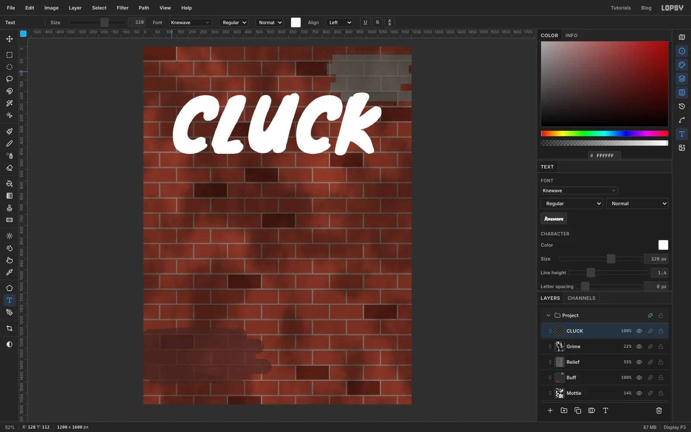

With *Grime* selected, pick the **Text** tool. Choose the font **Knewave**,
**Size** `320` and white. In the **Text** panel, check that **Letter spacing**
is `0`. Click near `128, 112`, type `CLUCK` and press [[Tab]] to commit.

The letters should run from about `x 132` to `x 1066`. Click the
**Rasterize Layer** button at the bottom of the Layers panel to turn the
text into pixels, then rename the layer *Cluck Face*.

## Fade the fill from yellow to red

[[Cmd]]-click the *Cluck Face* thumbnail to load the letters as a selection.
Pick the **Gradient** tool, set it to **Linear** and click **Advanced…**.
Make three stops: `#FFE14D` at the left, `#FF8A1F` in the middle and
`#E8261C` at the right. Click **Done**.

Drag straight down from just inside the top of the letters to just above
their bottom. The gradient stays inside the selection. Deselect.

## Build the 3D block

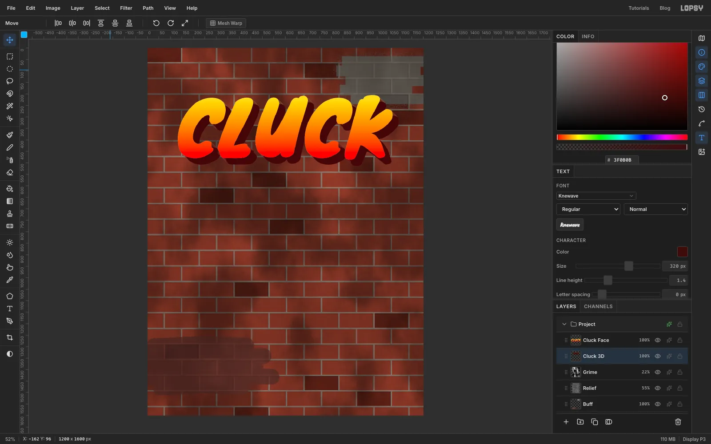

Choose **Layer → Duplicate Layer**. The copy lands on top and is selected.
Click the original underneath and rename it *Cluck 3D*. [[Cmd]]-click its
thumbnail, fill with maroon `#3F0B0B` and deselect. Rename the copy on top
back to *Cluck Face*.

Now make the block deep. With *Cluck 3D* selected:

1. Choose **Layer → Duplicate Layer**.
2. Pick the **Move** tool and press [[→]] and [[↓]] once each, to nudge the copy 1 px right and down.
3. Choose **Layer → Merge Down**.

Repeat with nudges of 2, 4, 8, 8 and 5 px. Each round adds its nudge to the
depth, so the six rounds give a solid 1 + 2 + 4 + 8 + 8 + 5 = 28 px block.

## Outline the letters

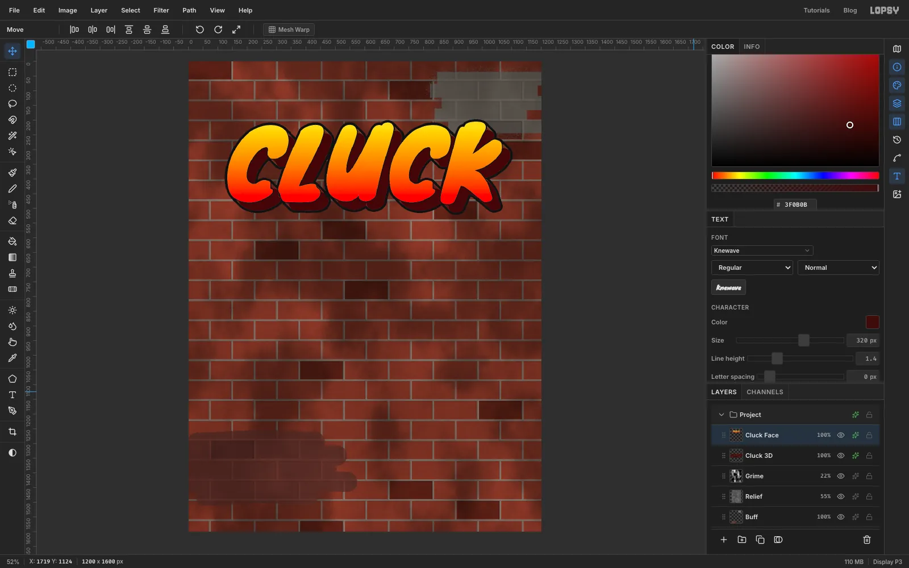

On *Cluck 3D*, open the effects drawer and turn on **Stroke**: **Width**
`8`, colour `#111111`. On *Cluck Face*, add a **Stroke** of **Width** `3` in
the same black. The thin line separates the face from the block, and the
thick one wraps the whole word.

## Grow a cloud selection

[[Cmd]]-click the *Cluck 3D* thumbnail, then choose **Select → Grow…** and
grow by `34`. That gives a smooth outline around the word.

Graffiti clouds are lumpy, so pick the **Elliptical Marquee**, hold
[[Shift]] and drag ellipses about 110–150 px wide along the top and bottom
edges. Let each overlap the outline by about half. Add one big ellipse at
each end of the word.

## Fill the lime cloud

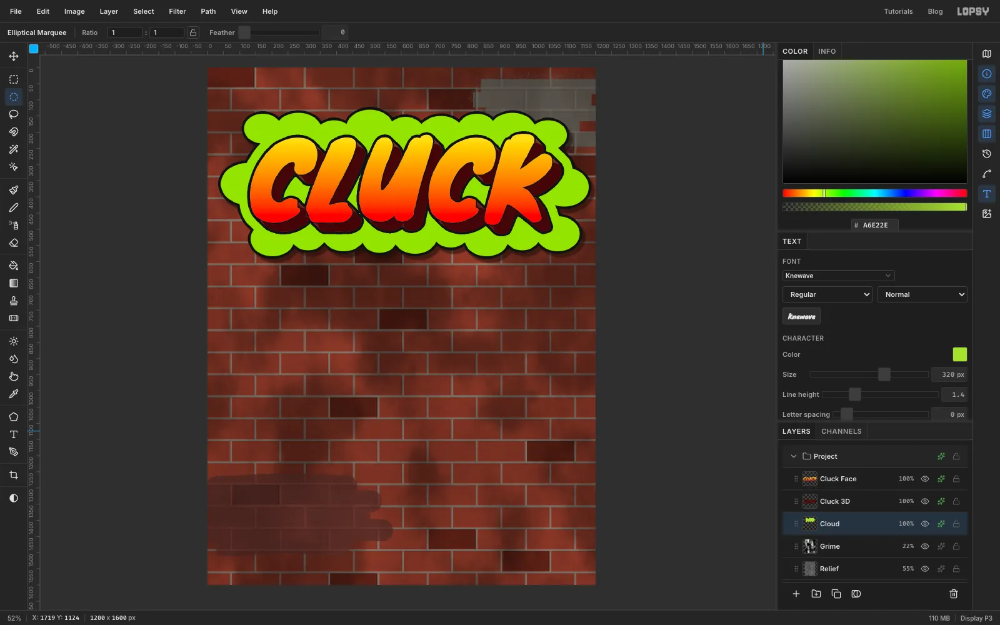

Click *Grime* so the new layer sits under the lettering, and add a layer
called *Cloud*. Fill with lime `#A6E22E` and deselect.

Give *Cloud* a **Stroke** of **Width** `8` in `#111111`. Then add a
**Drop Shadow**: **Offset X** `10`, **Offset Y** `12`, **Blur** `6`,
**Opacity** `55`, colour `#1A0D08`. The shadow lifts the piece off the
bricks.

## Paint the shines

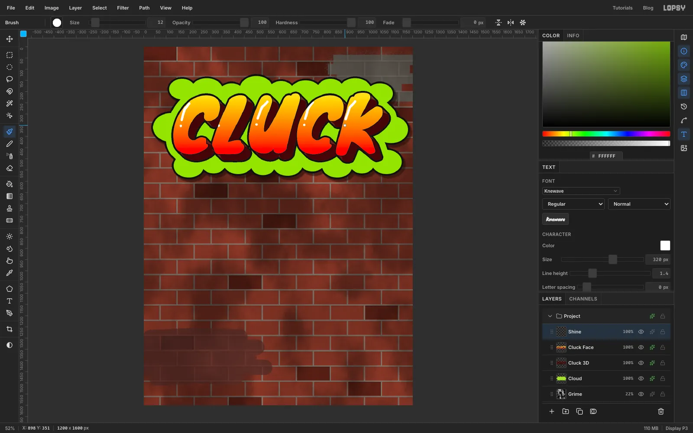

Click *Cluck Face* and add a layer called *Shine*. [[Cmd]]-click the
*Cluck Face* thumbnail so the strokes can't leave the letters.

Pick the **Brush**: **Size** `12`, **Hardness** `100`, white. In each
letter, paint a short curved stroke near the top left, following the
letter's curve. Then click once just below it for a dot. Deselect.

## Add paint drips

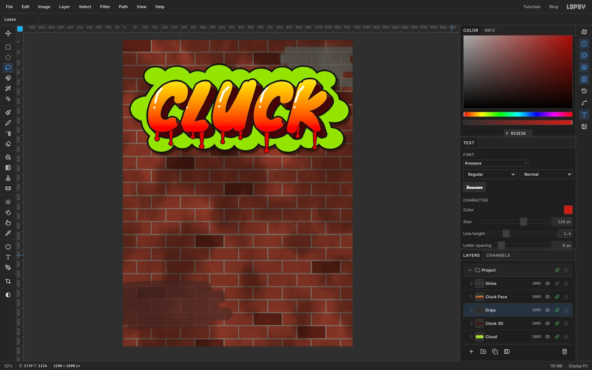

Click *Cluck 3D* and add a layer called *Drips*, so the runs sit over the
block but under the faces. Set the foreground to `#D21E16`.

Each drip is one shape traced with the **Lasso**. Start about 20 px wide at
the bottom of a letter. Narrow to about 40% of that width as you go down,
then loop round a bead slightly wider than the start, and come back up the
other side. Fill each one, then deselect.

Make nine drips of different lengths, between about 40 and 110 px. Keep the
ones under the first C, the L and the U shorter (under 90 px), because the
rooster's halo goes right below them. Finish with a **Stroke** of **Width**
`3` in `#111111`.

## Tag "Holy" and tilt it

Click *Shine* first: if a text layer is selected, the Text tool's options
restyle that layer instead. Pick the **Text** tool with **Sedgwick Ave
Display**, **Size** `160`, white. Click in an empty spot of wall, type `Holy`
and press [[Tab]].

With the **Move** tool, drag it over the top left of CLUCK, centred around
`290, 128`, so its last letter dips into the cloud. Then drag the round
rotation handle just outside a corner of its box anticlockwise, about 9°,
until the y rises by about 40 px compared with the H. Press [[Cmd+D]].

Rename the layer *Holy* if it isn't already. Give it a **Stroke** of
**Width** `10` in `#111111` and a hard **Drop Shadow**: **Offset X** `12`,
**Offset Y** `14`, **Blur** `0`, **Opacity** `100`, colour `#3F0B0B`.

## Float a halo over the H

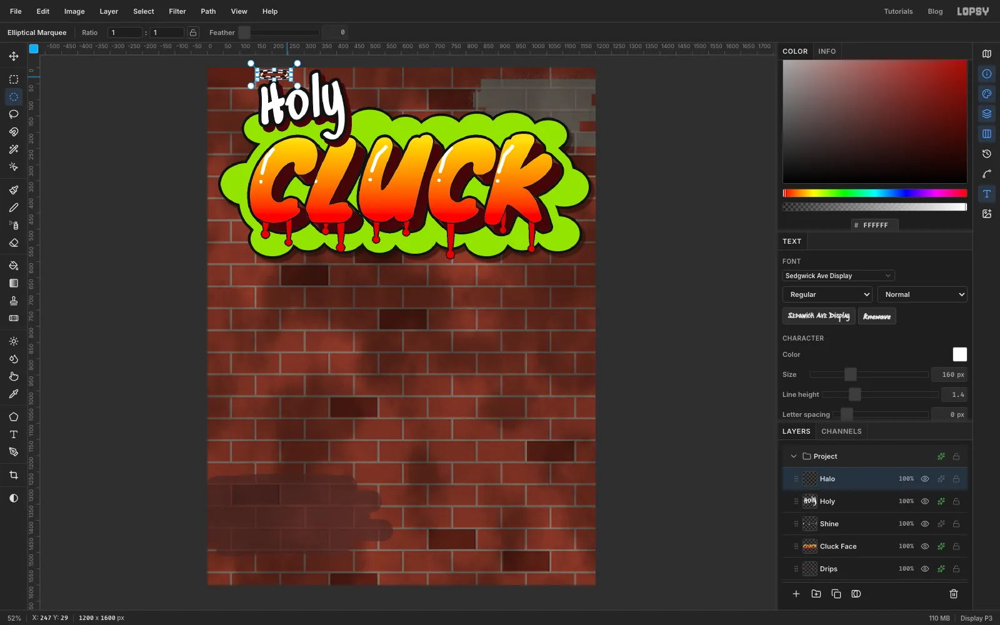

Add a layer called *Halo* and zoom in on the H. With the **Elliptical
Marquee**, drag a flat ellipse about 104 × 30 px just above the H. Hold
[[Alt]] and drag a smaller ellipse, about 80 × 14, in its middle to subtract
it, which leaves a ring.

Fill with gold `#F2B630` and deselect. Add a **Stroke** of **Width** `4` in
`#111111` and an **Outer Glow** with **Size** `22`, **Opacity** `80` and
colour `#FFE680`.

## Add sparkles

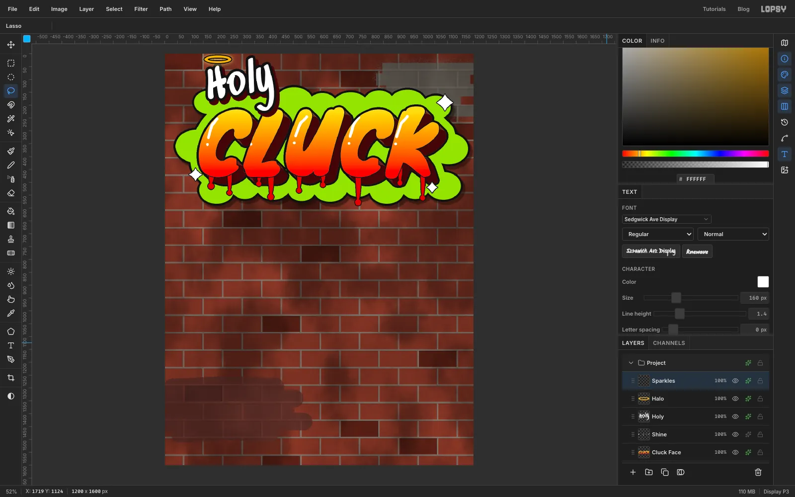

Add a layer called *Sparkles*. With the **Lasso**, trace a four-point star
whose sides curve inwards. Fill it white. Make one large sparkle, about
70 px tall, at the top right of the cloud, and two smaller ones, about 50 px
tall, at the left and right ends of the word. Add a **Stroke** of **Width** `3` in `#111111`.

## Group the piece, move it and tilt it

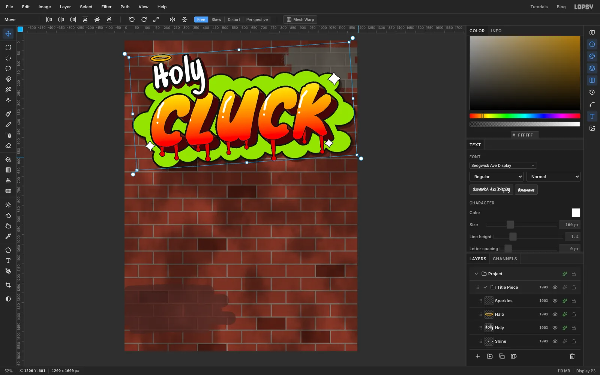

Click the *Cloud* row, then [[Shift]]-click *Sparkles* to select everything
in between. Choose **Layer → Group Layers** and rename the group *Title
Piece*.

With the group row selected, pick the **Move** tool and drag the piece down
about 40 px to give *Holy* some headroom. Then drag the rotation handle at a
corner of the group's box anticlockwise, about 4°, until the right end of
the cloud sits about 40 px higher than the left. Press [[Cmd+D]] to commit.

## Drop in the rooster photo, flip it and scale it

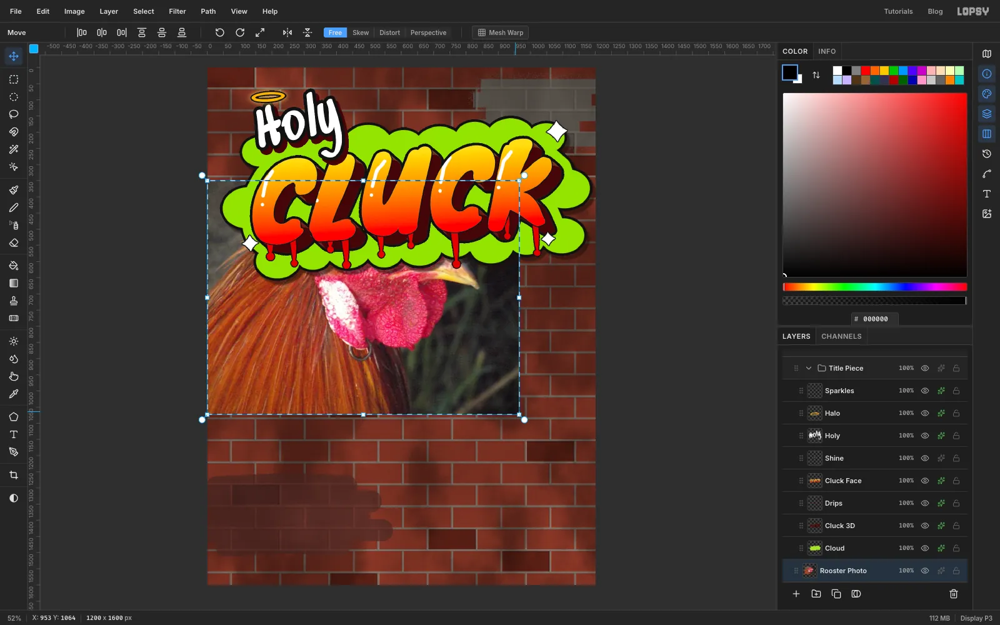

Click *Grime* again so the photo lands under the title group. Drag the
rooster close-up from your desktop onto the canvas. It is scaled to the
canvas width and arrives with a marquee around it. Rename it *Rooster
Photo*.

The head should look towards the menu on the right. Pick the **Move** tool
and click **Flip Horizontal** in the options bar. Then hold [[Cmd]], which
keeps the proportions, and drag the bottom-right corner handle in until the
photo is about 960 px wide (80% of the canvas width). Press [[Cmd+D]].

Drag the photo down and left until its top edge is at about `y 718` and its
left edge is about 200 px off the canvas. The beak now points into the gap
left of the future menu, at about `x 640`.

## Trace the head with the Pen

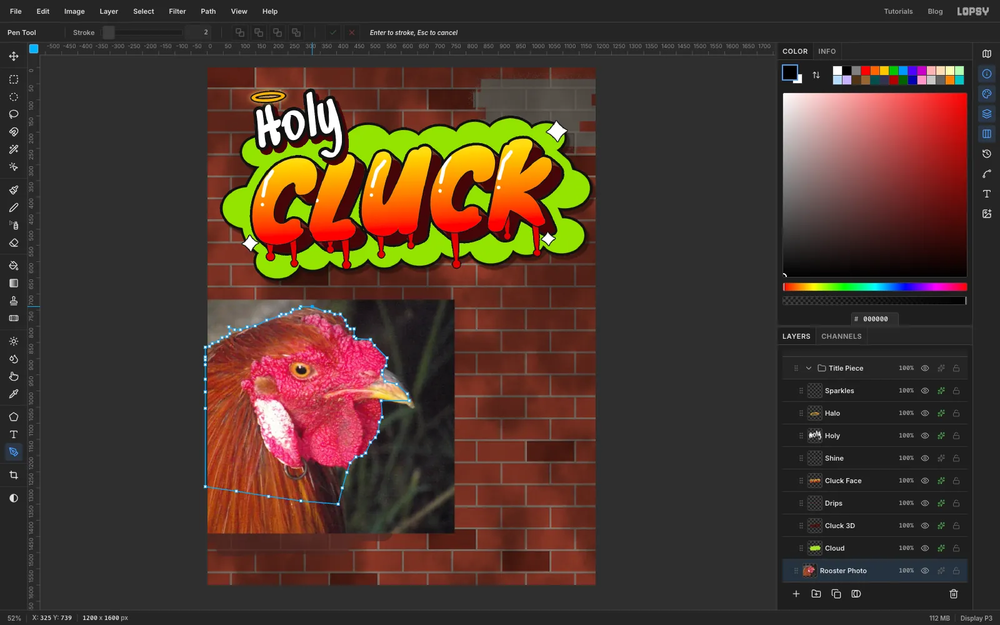

Pick the **Pen** tool. Start just off the left edge of the canvas behind the
comb, at about `y 860`. Click your way around the head with short straight
segments: over the bumps of the comb, out to the beak tip, under the beak,
round the wattles and down the front of the neck. About 60 clicks is plenty.

Leave the bottom as a bust cut: a shallow line that rises from about `y 1350`
under the neck to about `y 1296` at the left edge of the canvas. Click
slightly off the left edge so the shape reaches the border. Then click the
first point to close the path. Don't press [[Return]], which would stroke
the path.

Open the **Paths** panel (the curve icon in the right-hand strip) and click
**Path to Selection**, then **Delete Path**.

## Fill the base plate

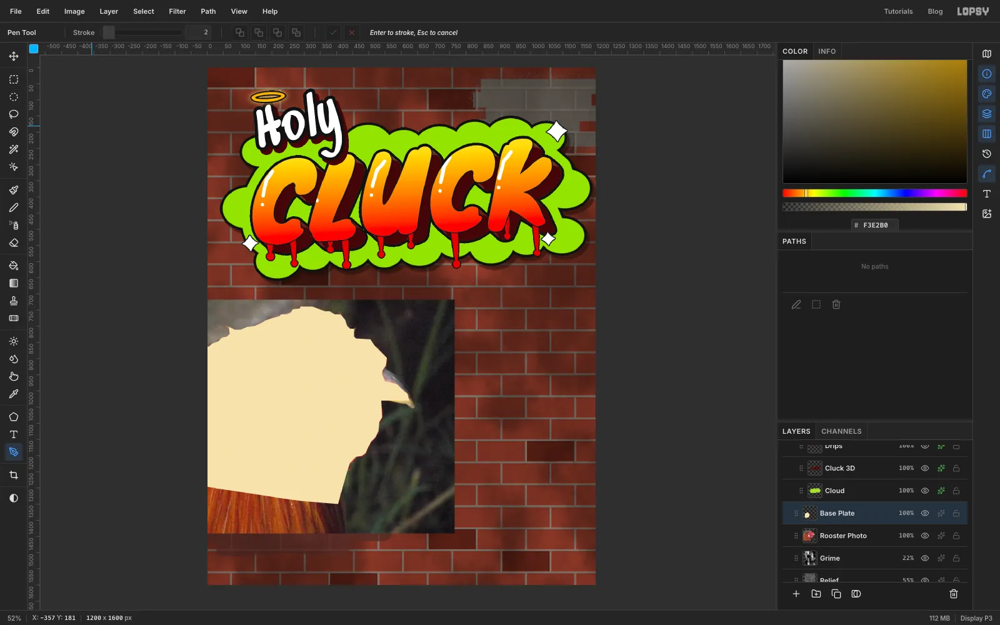

Click *Rooster Photo* and add a layer called *Base Plate*. Fill it with
cream `#F3E2B0` and deselect. This is the lightest stencil plate. It shows
through wherever the darker plates leave gaps: the beak, the earlobe and the
eye.

## Make a two-level tone study

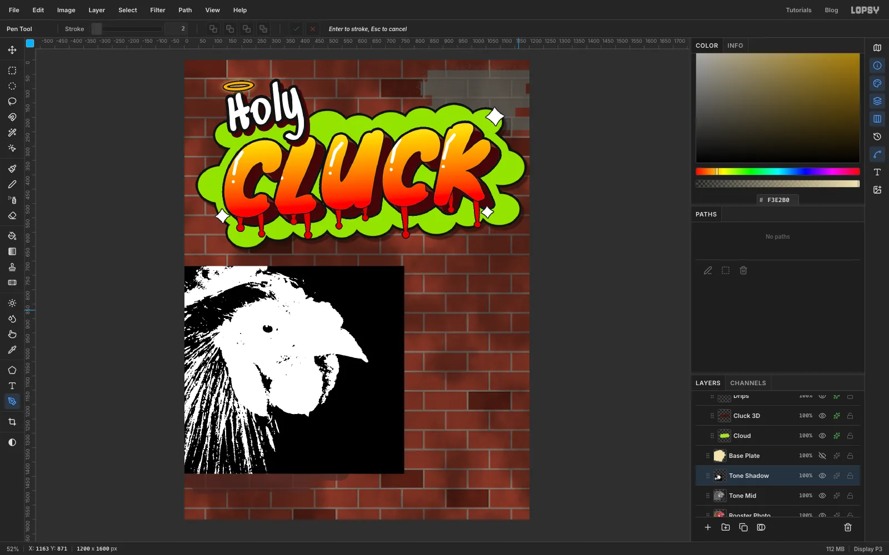

Hide *Base Plate* (the eye icon) so you can see the photo while you work.
Click *Rooster Photo* and choose **Layer → Duplicate Layer**. Rename the copy
*Tone Mid*.

Choose **Filter → Desaturate** and then **Filter → Gaussian Blur…** with
**Radius** `2`. The blur rounds off speckles, so the plates get smooth,
cuttable shapes.

Duplicate *Tone Mid* and name the copy *Tone Shadow*. Apply
**Filter → Threshold…** with **Level** `100`. Then select *Tone Mid* and
apply **Threshold** with **Level** `131`. Aim for roughly a third of the head
black in *Tone Shadow* and two thirds in *Tone Mid*. If your photo is
lighter or darker, adjust the levels until you get there.

Show *Base Plate* again.

## Wand the comb and wattles

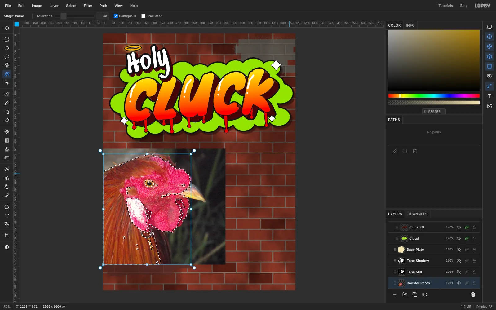

Hide *Base Plate*, *Tone Mid* and *Tone Shadow* so the photo shows, and
click *Rooster Photo*. Pick the **Magic Wand** with **Tolerance** `48` and
**Contiguous** on. Click the comb. [[Shift]]-click the wattles, the bare
skin around the eye and the back of the comb.

Smooth the speckled edge with **Select → Grow…** `4` and then
**Select → Shrink…** `4`. Show *Base Plate* again, then
[[Cmd+Shift+Alt]]-click its thumbnail to keep only the part inside the
silhouette.

Click *Base Plate*, add a layer called *Comb Plate* and fill it with red
`#E8261C`.

## Cut the crimson and black plates

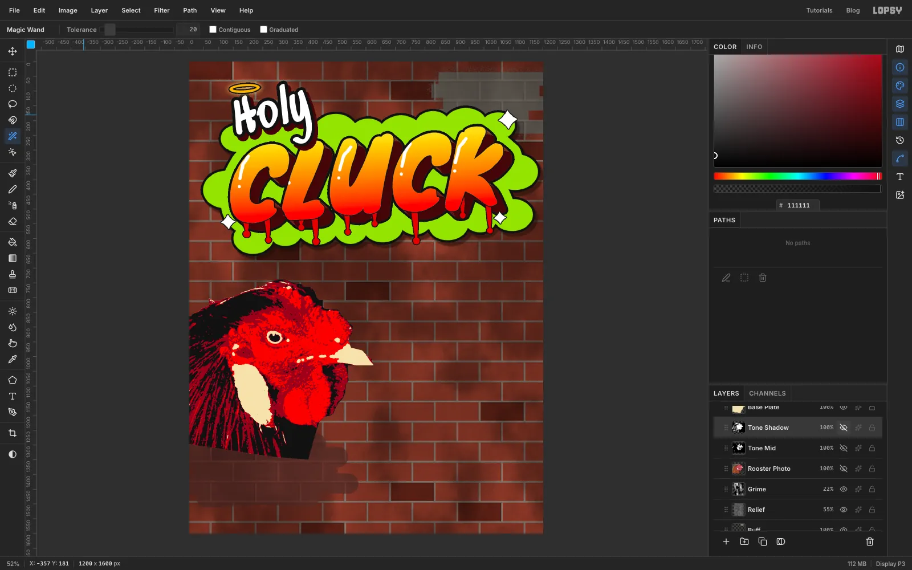

Show *Tone Mid* and *Tone Shadow* again and click *Tone Mid*. Pick the
**Magic Wand**, set **Tolerance** to `20` and
untick **Contiguous**. Click any black pixel, such as the background beside
the head. Every black pixel in the layer is selected.
[[Cmd+Shift+Alt]]-click the *Base Plate* thumbnail to intersect.

Click *Comb Plate*, add a layer called *Mid Plate* and fill it with crimson
`#8E1020`.

Do the same with *Tone Shadow*: wand the black, intersect with *Base Plate*,
then click *Mid Plate* and add a layer called *Shadow Plate*. Fill it with
`#111111`. Hide *Rooster Photo*, *Tone Mid* and *Tone Shadow*.

## Paint a gold halo behind the head

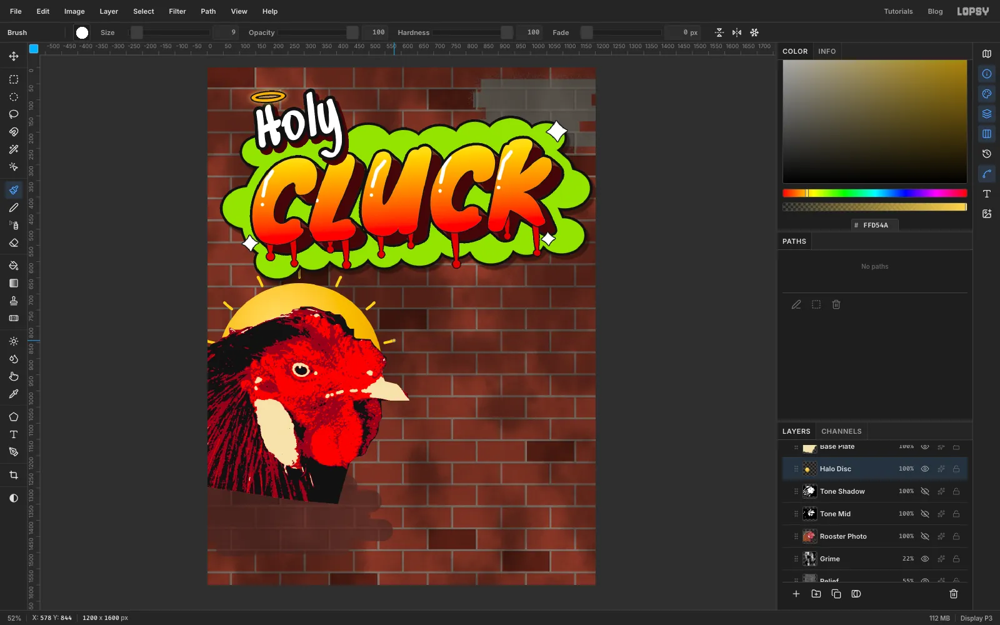

Click *Tone Shadow* and add a layer called *Halo Disc*, so it sits under the
plates. With the **Elliptical Marquee**, click once and enter **From**
`30, 667` **To** `540, 1177`.

Pick the **Gradient** tool, set it to **Radial** and make two stops,
`#FFE27A` and `#E0A000`. Drag from up and left of the centre to the lower
right edge, then deselect.

For rays, pick the **Brush** (**Size** `9`, **Hardness** `100`, `#FFD54A`).
Click about 18 px outside the rim and [[Shift]]-click about 30 px further
out. Repeat every 25° or so round the top half.

Spray a little gold `#F2B630` haze round the rim with **Spray** (**Size**
`70`, **Density** `40`, **Opacity** `35`). Finally, add a **Stroke** of
**Width** `5` in pale yellow `#FFF2A8` and an **Outer Glow** with **Size**
`25`, **Opacity** `50` and colour `#FFD54A`.

## Spray a soft shadow and a teal under-plate

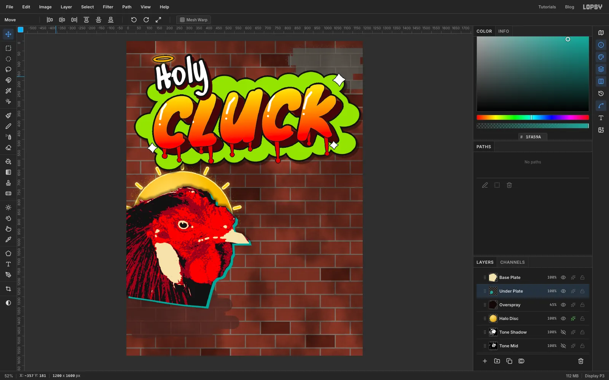

Click *Halo Disc* and add a layer called *Overspray*.
[[Cmd]]-click the *Base Plate* thumbnail, then use **Select → Grow…** `10`
and **Select → Feather…** `9`. Fill with `#140806`, deselect and set the
layer opacity to `45%`.

Click *Overspray* and add a layer called *Under Plate*. [[Cmd]]-click the
*Base Plate* thumbnail again, fill with teal `#1FA59A` and deselect. Pick the
**Move** tool and nudge the layer 12 px right and 10 px down with the arrow
keys ([[Shift]]+arrow moves 10 px). The cool edge lifts the red head off the
brick wall.

Hand-cut stencils never line up exactly, so click *Mid Plate* and nudge it
3 px right and 2 px up as well.

## Cut back the cheek

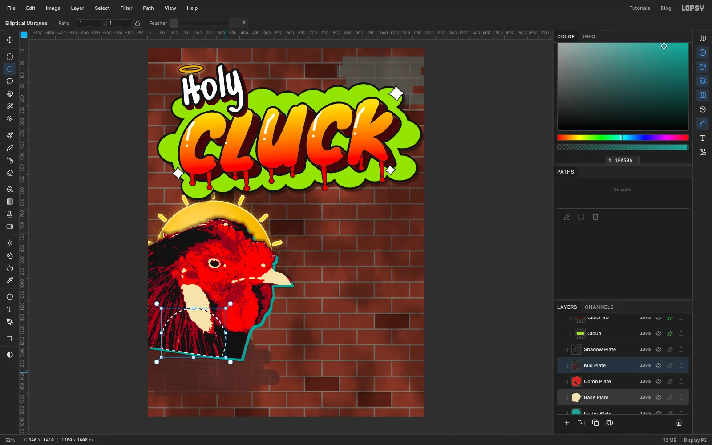

The cream earlobe reads as one big flat patch, so shrink it. Stay on *Mid
Plate*. With the **Elliptical Marquee**, drag from `60, 1130` to `340, 1410`.
Then [[Cmd+Shift+Alt]]-click the *Base Plate* thumbnail to keep only the
part inside the head. Fill with crimson `#8E1020` and deselect.

## Outline the stencil

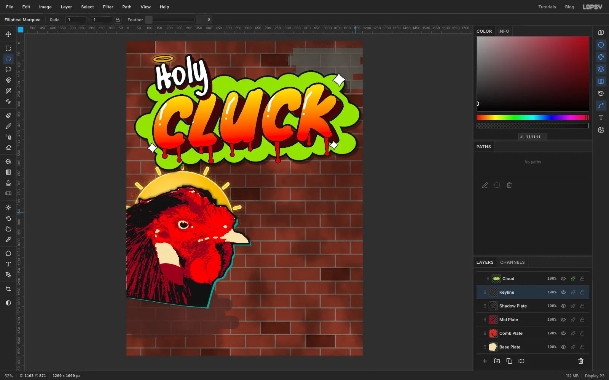

Click *Shadow Plate* and add a layer called *Keyline*.

1. [[Cmd]]-click the *Base Plate* thumbnail.
2. Choose **Select → Grow…** `5` and fill with `#111111`.
3. [[Cmd]]-click the *Base Plate* thumbnail again.
4. Choose **Select → Shrink…** `2` and press [[Delete]].

What's left is a ring from 2 px inside the edge to 5 px outside it. It sits
above all the plates, so it also hides the faint, half-transparent pixels
where the plates' edges overlap.

## Add stencil drips and group the rooster

Add a layer called *Stencil Drips*. Trace five short runs along the bust
edge with the **Lasso**, the same way as the title drips but about 13 px wide
and 18–42 px long. Fill them in black, crimson and red.

Click *Halo Disc*, [[Shift]]-click *Stencil Drips*, choose
**Layer → Group Layers** and name the group *Rooster Stencil*. Click the
group's arrow to collapse it.

## Set guides for the menu board

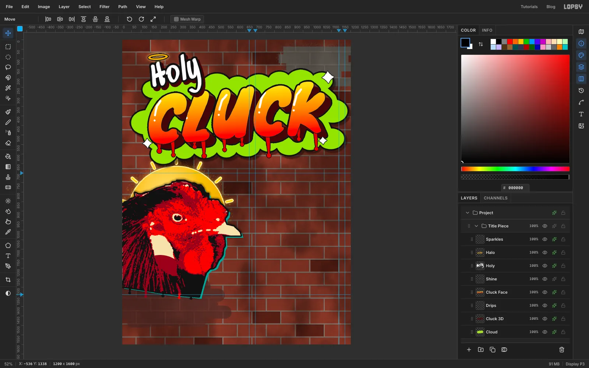

Click the top ruler at `668`, `700`, `1138` and `1170` to drop four vertical
guides: the board's sides and its text margins. Click the left ruler at `700`
and `1338` for its top and bottom.

## Paint the board

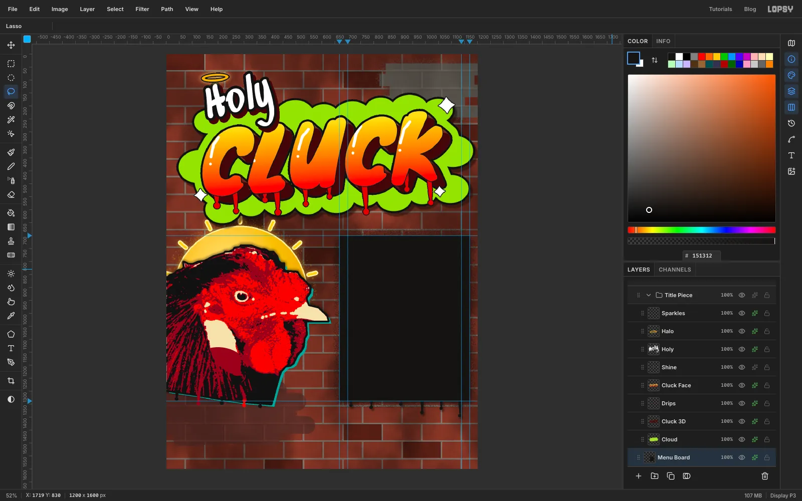

Click the collapsed *Rooster Stencil* group and add a layer called *Menu
Board*. With the **Rectangular Marquee**, drag from near where the `668`
guide meets the `700` guide to near where `1170` meets `1338`. Both corners
snap onto the guides.

Fill with `#151312`. Apply **Add Noise** **Amount** `10` with **Mono** and
**Uniform** for a rolled-paint texture, then deselect.

Pick **Spray** (**Size** `40`, **Density** `60`, **Opacity** `80`) and spray
once along each edge, just outside it, to rough it up. Then trace a few short
Lasso drips (about 12 px wide, 18–62 px long) off the bottom edge and fill
them. Add a **Drop Shadow**: **Offset X** `6`, **Offset Y** `8`, **Blur**
`10`, **Opacity** `45`, black.

## Letter the board's header

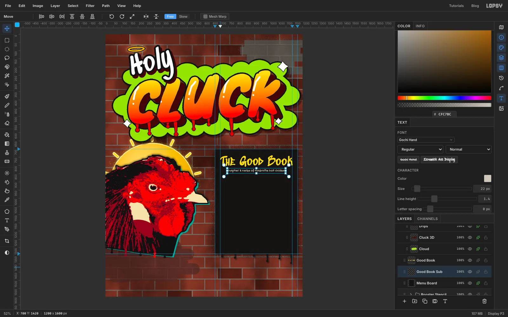

With *Menu Board* selected, set up the **Text** tool: **Sedgwick Ave
Display**, **Size** `74`, `#FFE14D`. Click on empty wall, type `The Good
Book` and press [[Tab]]. Rename the layer *Good Book* and move it so it's
centred on the board with its top at about `y 738`.

Click *Menu Board* again and add the subtitle the same way: **Gochi Hand** at
`22` in `#CFC6B8`, reading `chapter & verse of Nashville hot chicken`. Name
it *Good Book Sub* and centre it about 14 px under the heading.

Add a layer called *Board Rules*. Pick the **Brush** at **Size** `4` with
`#E9E2D6`. Click on the `700` guide about 22 px below the subtitle and
[[Shift]]-click on the `1138` guide at the same height.

## Set the menu in three columns

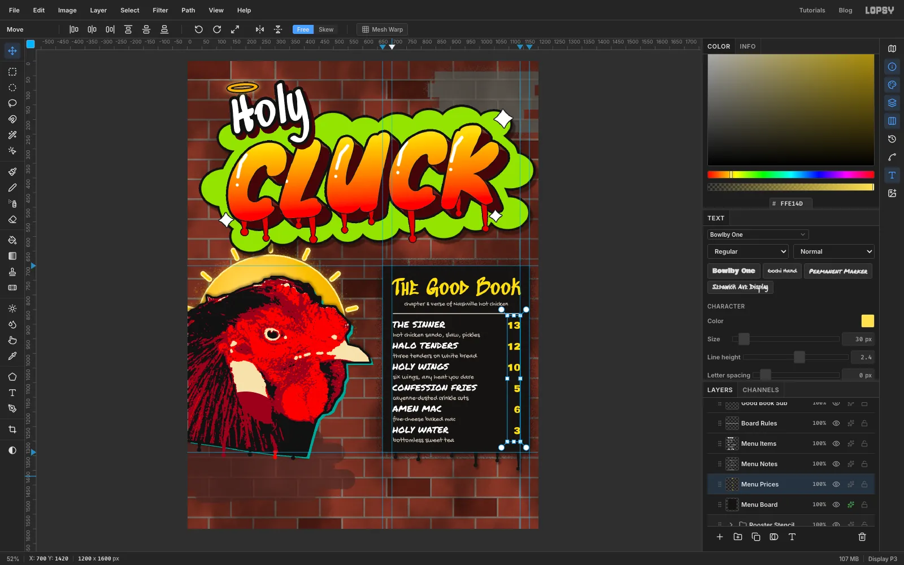

All three columns use the same 72 px line pitch, so the rows line up. In the
Text panel, **Line height** is a multiple of the font size, so each column
gets its own value. Click *Menu Board* again before each block.

- **Names:** **Permanent Marker** at `30`, white, **Line height** `2.4`. Type
  `THE SINNER`, `HALO TENDERS`, `HOLY WINGS`, `CONFESSION FRIES`,
  `AMEN MAC` and `HOLY WATER`, pressing [[Return]] between them. Name the
  layer *Menu Items* and move it so its left edge sits on the `700` guide,
  about 48 px under the rule.
- **Notes:** **Gochi Hand** at `23`, `#CFC6B8`, **Line height** `3.13`, one
  note per line:
  - `hot chicken sando, slaw, pickles`
  - `three tenders on white bread`
  - `six wings, any heat you dare`
  - `cayenne-dusted crinkle cuts`
  - `five-cheese baked mac`
  - `bottomless sweet tea`

  Name it *Menu Notes* and place it 2 px right of the names and 38 px lower,
  so each note sits under its dish.
- **Prices:** **Bowlby One** at `30`, `#FFE14D`, **Line height** `2.4`, and
  **Align** set to **Right**. Type `13`, `12`, `10`, `5`, `6` and `3`. Name
  it *Menu Prices* and move it so its right edge sits on the `1138` guide and
  its first line lines up with *THE SINNER*.

## Snap the sticker discs to the grid

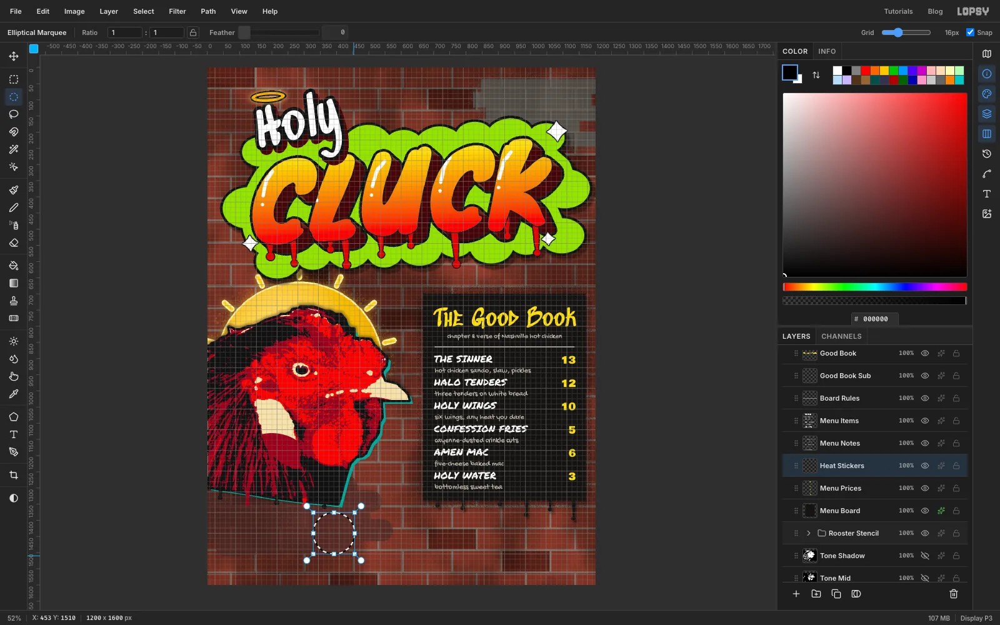

Click *Menu Prices* and add a layer called *Heat Stickers*. Choose
**Edit → Clear Guides** so the
guides don't pull your marquees, then **View → Show Grid**. The grid is
16 px and centred on the page, and showing it also turns on snapping.

The discs are 128 px circles in a row, 160 px apart. For each one:

1. With the **Elliptical Marquee**, drag from the grid intersection at the top-left corner of the disc to the one at its bottom-right. The first runs from `328, 1376` to `456, 1504`, and each next one starts 160 px further right.
2. Set the foreground and fill: cream `#F4E9D0`, then yellow `#FFE14D`, orange `#FF8A1F` and red `#E8261C`.
3. Deselect before the next disc.

Turn **Show Grid** off. Give the layer a white **Stroke** of **Width** `7`
for a die-cut edge, and a **Drop Shadow** with **Offset X** `4`, **Offset
Y** `6`, **Blur** `6`, **Opacity** `55` and colour `#120806`.

## Light some flames

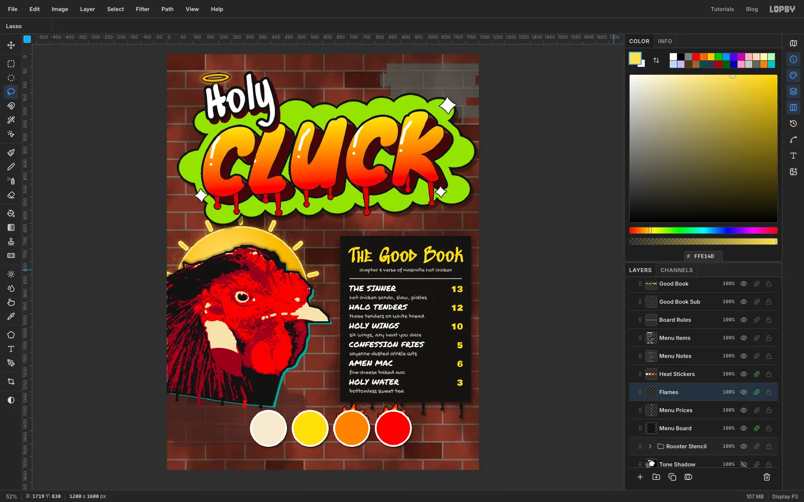

Click *Menu Prices* again and add a layer called *Flames*, so it sits just
under the stickers. Zoom in on the HOT and HOLY HELL discs. With the
**Lasso**, trace a crown of seven flame tongues round the top half of each
disc, starting and ending inside the disc so the sticker hides the base.
Make the middle tongue the tallest, about 30 px above the rim, and the outer
ones 10–15 px. No tip may go higher than `y 1345`, just under the board's
bottom edge.

Fill with `#FF4A1C`. [[Cmd]]-click the *Flames* thumbnail, **Shrink** the
selection by `6` and fill with yellow `#FFE14D` for the hot core. Deselect
and add a **Stroke** of **Width** `4` in `#111111`.

## Label the stickers

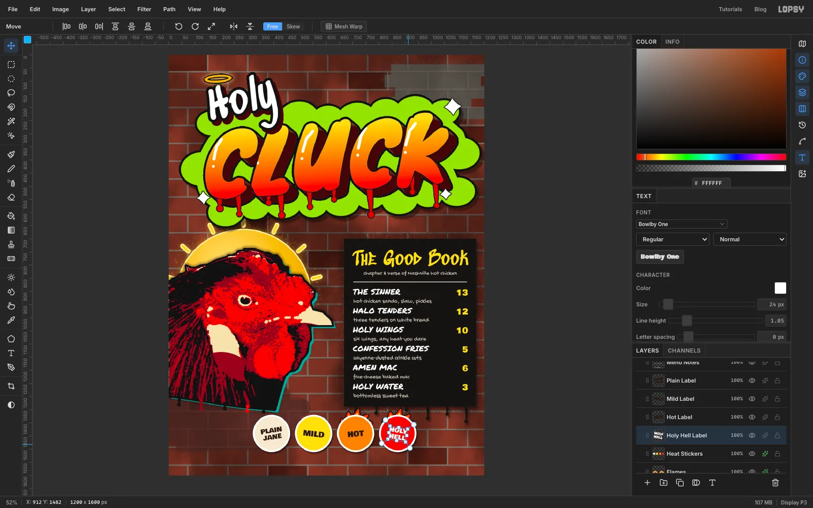

Make one label per sticker. Before each one, click *Heat Stickers*, then set
the **Text** tool to **Bowlby One** with **Align** **Center** and **Line
height** `1.05`. Use dark `#2A1A12` text, but white for HOLY HELL:

- one-line labels at size `28`: `MILD` and `HOT`
- two-line labels at size `24`: `PLAIN` / `JANE` and `HOLY` / `HELL`

Name them *Plain Label*, *Mild Label*, *Hot Label* and *Holy Hell Label*.
Centre each one on its disc, then tilt it with its rotation handle, by about
−8°, 6°, −5° and 9°, and press [[Cmd+D]] after each.

## Cut out the drumstick

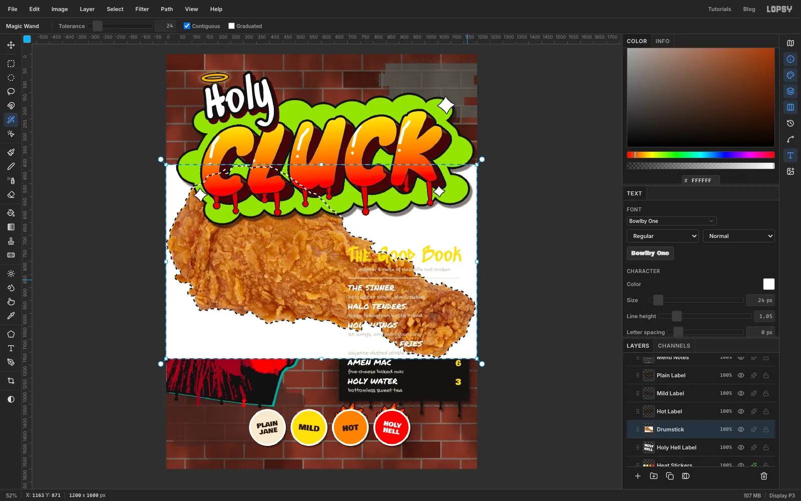

Click *Holy Hell Label* and drag the drumstick photo onto the canvas. Rename
it *Drumstick* and deselect.

Pick the **Magic Wand** with **Tolerance** `24` and **Contiguous** on, and
click the white backdrop near a corner. **Grow** the selection by `1` to
catch the soft edge, press [[Delete]] and deselect.

Nashville hot chicken is cayenne red, not golden brown. Choose
**Filter → Hue/Saturation…** and set **Hue** `-16`, **Saturation** `30` and
**Lightness** `-6`.

## Shrink and tilt the drumstick

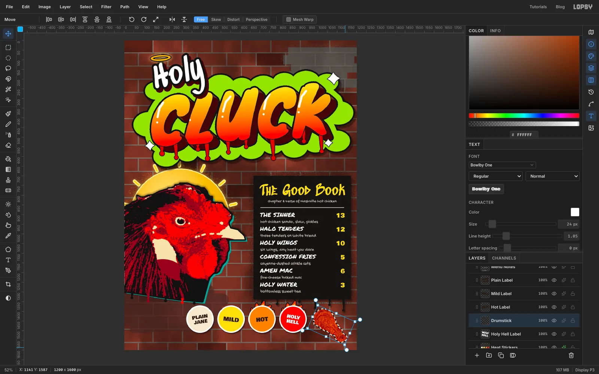

[[Cmd]]-click the *Drumstick* thumbnail so the transform box hugs the
drumstick. With the **Move** tool, hold [[Cmd]] and drag a corner handle in
until the drumstick is about 190 px wide, then press [[Cmd+D]].

Drag it to the right of the HOLY HELL sticker, centred around `1068, 1470`.
[[Cmd]]-click the thumbnail again. Drag the rotation handle about 24°
clockwise so the bone points down to the right, then press [[Cmd+D]].

## Make it a sticker and give it a halo

Give *Drumstick* a white **Stroke** of **Width** `9`. Add a **Drop Shadow**
with **Offset X** `6`, **Offset Y** `8`, **Blur** `4`, **Opacity** `70`,
black.

Saints need halos. Expand the *Title Piece* group, click its *Halo* layer and
choose **Layer → Duplicate Layer**. Rename the copy *Drumstick Halo* and drag
it just above the top of the drumstick.

## Add the label and the footer

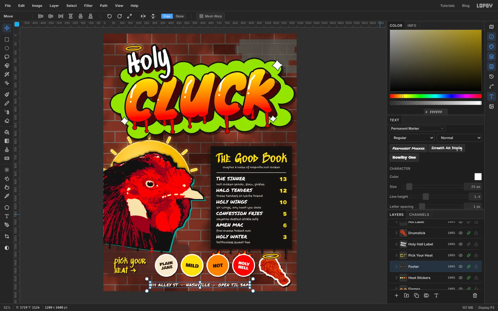

Click *Heat Stickers*. With **Sedgwick Ave Display** at `52`, **Line
height** `1.1` and `#FFE14D`, type `pick your`, press [[Return]] and type
`heat →`. On a Mac, the arrow is in the Character Viewer ([[Ctrl+Cmd+Space]]);
you can also paste it. Name the layer *Pick Your Heat* and place it with its
left edge at `x 66`, level with the stickers. Give it a hard **Drop Shadow**:
**Offset X** `4`, **Offset Y** `5`, **Blur** `0`, **Opacity** `100`,
`#111111`.

Click *Heat Stickers* again. For the footer, use **Permanent Marker** at
`25`, white, **Letter spacing** `1`. Type
`414 ALLEY ST  •  NASHVILLE  •  OPEN TIL 3AM`, with two spaces either side of
each bullet ([[Alt+8]] types • on a Mac). Name it *Footer*, centre it on
`x 600` with its top at about `y 1552`, and add a **Drop Shadow** with
**Offset X** `3`, **Offset Y** `3`, **Blur** `0`, **Opacity** `100`.

## Knock the wall back with group adjustments

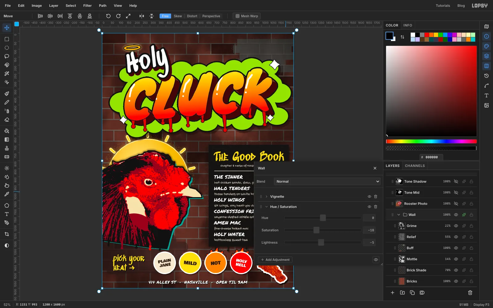

Click the *Background* row and [[Shift]]-click *Grime*, choose
**Layer → Group Layers** and name the group *Wall*. Open the group's effects
drawer and click **Add Adjustment**.

Choose **Vignette** and set its **Vignette** slider to `38`. Then add
**Hue / Saturation** with
**Saturation** `-18` and **Lightness** `-5`. The darker, duller wall pushes
the bright title, rooster and stickers forward.

> **Tip:** Add Vignette first. On an empty group the drawer is short, and
> the first entries of the Add Adjustment menu can be hidden off its top.

## Leave some older tags on the wall

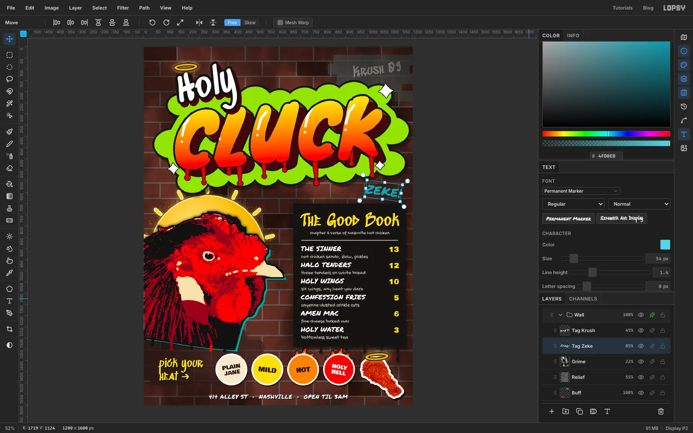

Make two tags inside the *Wall* group, so they're toned down along with the
wall. Click *Grime* before each one:

- **Sedgwick Ave Display** `58` in `#F4F0E8`: type `Krush 09` and name it
  *Tag Krush*. Centre it on the grey buff patch at about `1040, 92`, rotate it
  about −7° and set its opacity to `45%`.
- **Permanent Marker** `54` in cyan `#4FD8E8`: type `ZEKE!` and name it
  *Tag Zeke*. Place it right of the cloud at about `1070, 646`, rotate it
  about 8° and set its opacity to `85%`.

## Clone a dark brick

The bottom-left corner has no dark bricks. Click *Brick Shade* and pick the
**Clone Stamp** at **Size** `60`. [[Alt]]-click the middle of the dark brick
at about `301, 643`. Then paint one short stroke across the plain brick at
`73, 1527`, under the label, to stamp a copy there.

## Saturate the crust and dodge the halo

Click *Drumstick*, pick the **Sponge**, set **Mode** to **Saturate**,
**Size** `120` and **Strength** `35`, and drag once along the drumstick.

Expand *Rooster Stencil* and click *Halo Disc*. Pick **Dodge** with **Size**
`140` and **Exposure** `35`, and drag across the upper left of the disc to
brighten it where the light hits.

## Curl the flame tips

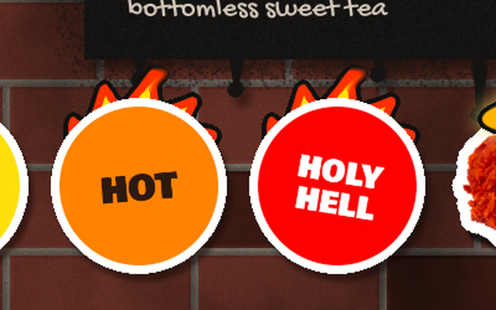

Click *Flames* and zoom in. Pick the **Smudge** tool: **Size** `18`,
**Strength** `60`. On each sticker, start just inside the tallest flame
tongue and drag a short way up and to the right. The tip bends over like a
real flame.

## Finish with grain

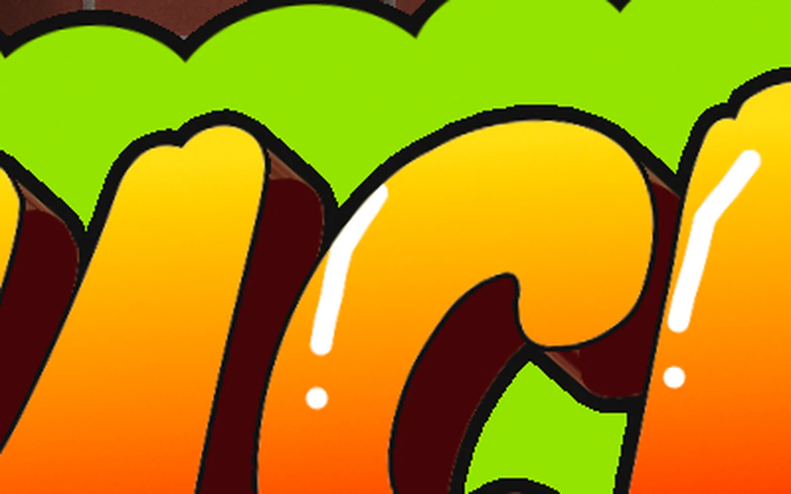

Collapse the *Title Piece* group and click it, so the new layer goes above
it rather than inside. Add a layer called *Grain*, fill it with `#808080` and
apply **Add Noise** with **Amount** `35`, **Mono** and **Gaussian**. Set the
blend to **Overlay** and the opacity to `22%`. Grey is neutral in Overlay, so
only the noise shows, as a fine speckle over the flat paint.

Export with **File → Quick Export PNG**, and save the project with
**File → Save Project**.
