Grunge design came out of 90s music magazines and gig flyers. Pages were
photocopied until the type broke up, pictures were crushed to one ink, and
layouts were held together with tape. It's a good fit for anything
rock-and-roll, including an app.

In this tutorial you'll build a presentation board for **Woodshed**, an
imaginary guitar-practice app ("woodshedding" is musician slang for practising
alone until you get it right). Three phone mockups, a tuner, a chord book and a
riff of the day, are taped onto a torn mustard photocopy poster. Next to them
sit a photocopied Stratocaster, a distressed headline and a rubber stamp.

You'll crush a guitar photo to a single ink with **Threshold**, tear paper with
the **Lasso**, and build rounded phone shells with **Shrink** and **Grow**. You'll draw
gauge ticks with **Sunburst**, copy and paste UI between screens, and set
stamp text on a **circular path**. You'll also tilt whole groups with the
Move tool's rotate handle.

The canvas is 2400 × 1600. The guitar is *Fender Stratocaster 004-2.jpg*, a
public-domain photo on Wikimedia Commons. Any guitar shot on a plain light
background will do. You'll make about 90 layers in five groups, so name each
layer as you go. Fonts are **Rubik Dirt**, **Special Elite** and
**Courier Prime**, all in the font browser.

The palette:

- Wall `#211F1B`, grime grey `#808080`
- Bone `#E4DBC3`, ink `#141210`
- Rust `#A9572F`, stamp oxblood `#5E1F12`
- Poster mustard `#B08A3C`, poster print `#6B4A12`
- Gaffer tape `#6E6B64` / `#8A877F`, tape chips `#1E1C19`
- Masking tape `#CDBB8C`, phone edge `#3A3631`
- Toner base white `#FFFFFF`

## Set up the wall and guides

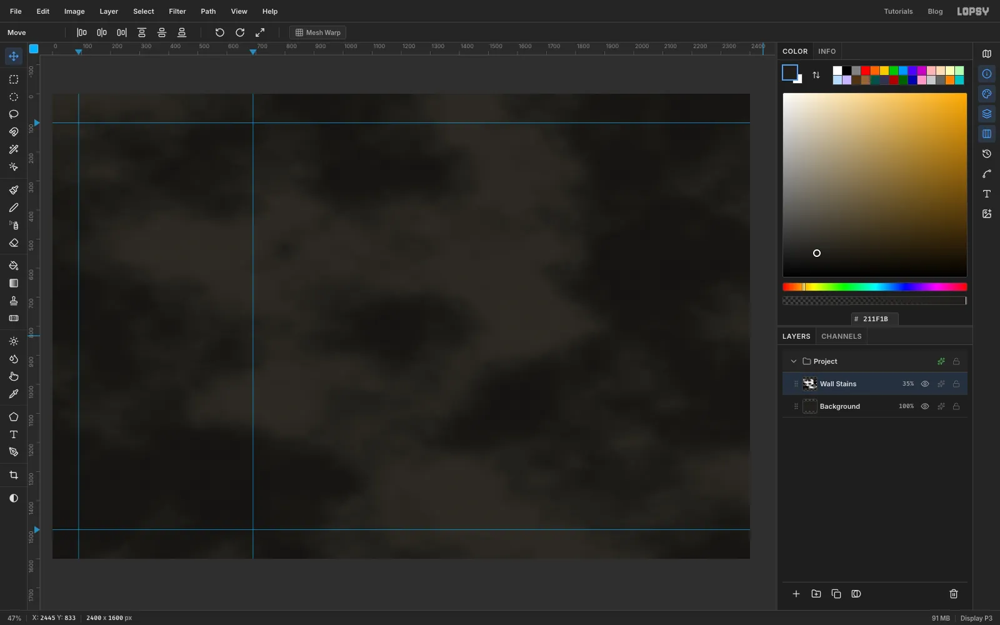

Choose **File → New**, make a **2400 × 1600** document and click **Create**.

Click the top ruler at **90** and **690** to drop two vertical guides. They
mark the left column, where the headline will go. Click the left ruler at
**100** and **1500** for top and bottom margins.

Click **Background**, set the foreground colour to `#211F1B` and choose
**Edit → Fill**. Click **Layer 1** and rename it **Wall Stains**. Run
**Filter → Clouds…** with **Scale 6**. Clouds is greyscale whatever your
colours are. In the layer's effects drawer, set the blend mode to
**Overlay**, then click the percentage on the layer's row and set it to
**35%**. The wall now
has soft damp patches.

## Drop in the guitar photo

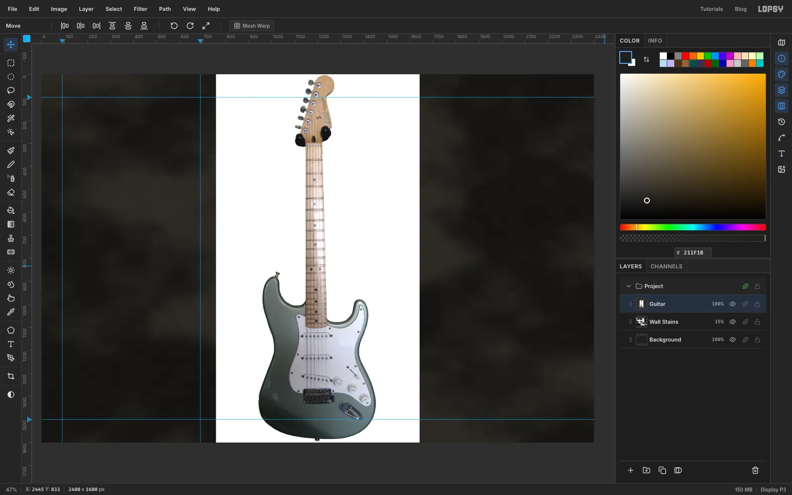

Drag the guitar photo from your computer onto the canvas. It lands as a new
layer, sized to fit the canvas height. Press [[Cmd+D]] to drop the
selection, then rename the layer **Guitar**.

## Select the white backdrop


Pick the **Magic Wand**. Set **Tolerance** to **24** and untick
**Contiguous**, so every white area is caught in one click. Click the white
backdrop near a corner of the photo. Press [[Delete]] to clear it, then
[[Cmd+D]]. The pickguard is off-white, so at this tolerance it survives. If
your photo's pickguard is pure white, lower the Tolerance until it stays.

## Photocopy it to one ink

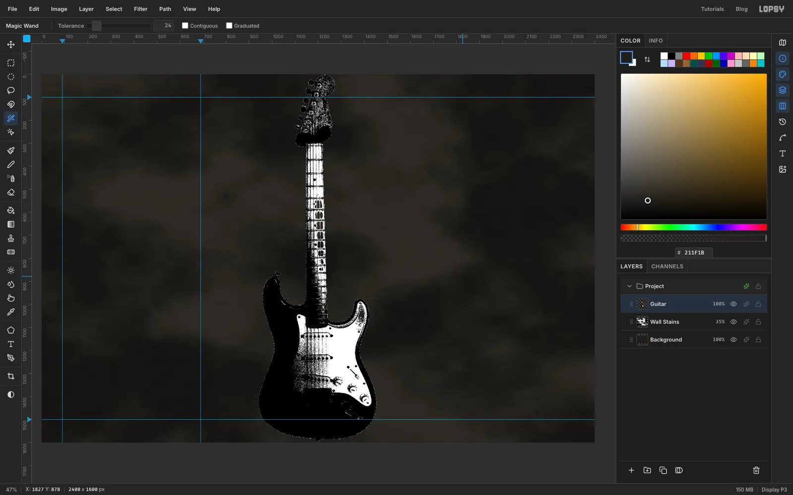

Now make it look photocopied. Choose **Filter → Desaturate**. Run
**Filter → Add Noise…** with **Amount 40** and **Mono**, which roughens the
edges the way a copier does. Finish with **Filter → Threshold…** at
**Level 175**. Everything is now pure black or pure white.

## Turn the ink bone-coloured

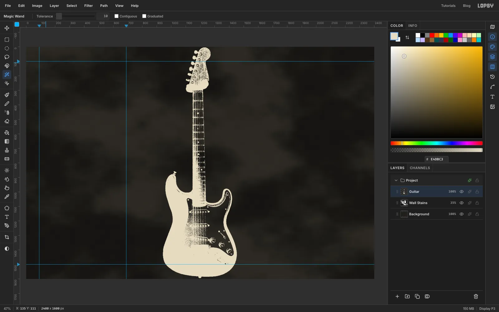

On a dark wall the guitar should print in pale ink, so keep the black and
lose the white. With the Magic Wand still at **Contiguous** off, set
**Tolerance 10** and click the white pickguard. Press [[Delete]], then
[[Cmd+D]].

[[Cmd]]-click the Guitar layer's thumbnail to select what's left. Set the
foreground to bone `#E4DBC3`, choose **Edit → Fill** and press [[Cmd+D]].

## Rotate the guitar

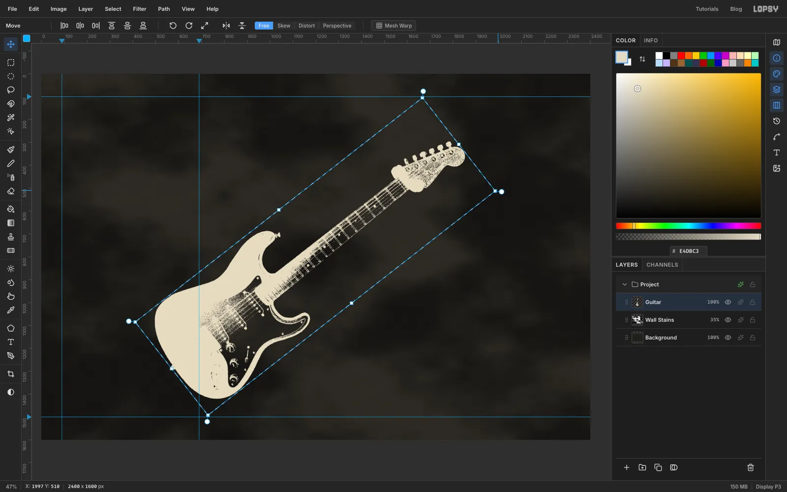

Draw a **Rectangular Marquee** just around the guitar. Pick the **Move** tool
and drag the round rotate handle beyond the top-right corner clockwise, until
the headstock points up and to the right (about **52°**). Press [[Cmd+D]] to
commit.

## Scale it up a little

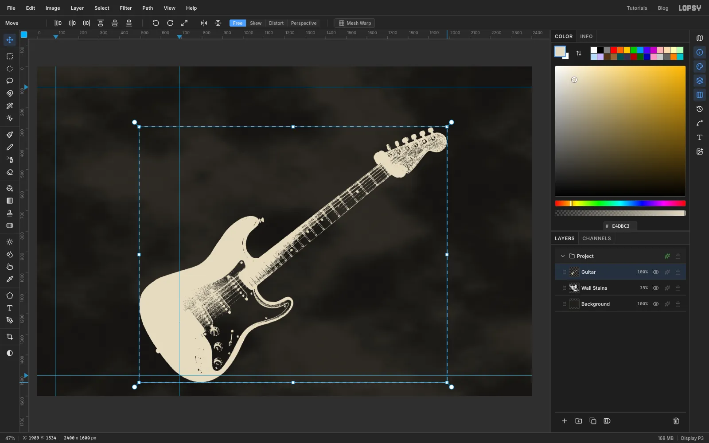

Draw a new marquee around the tilted guitar. Hold [[Cmd]] and drag the
bottom-right corner handle out about **10%**. [[Cmd]] keeps the proportions.
Press [[Cmd+D]] again.

## Slide it into the corner

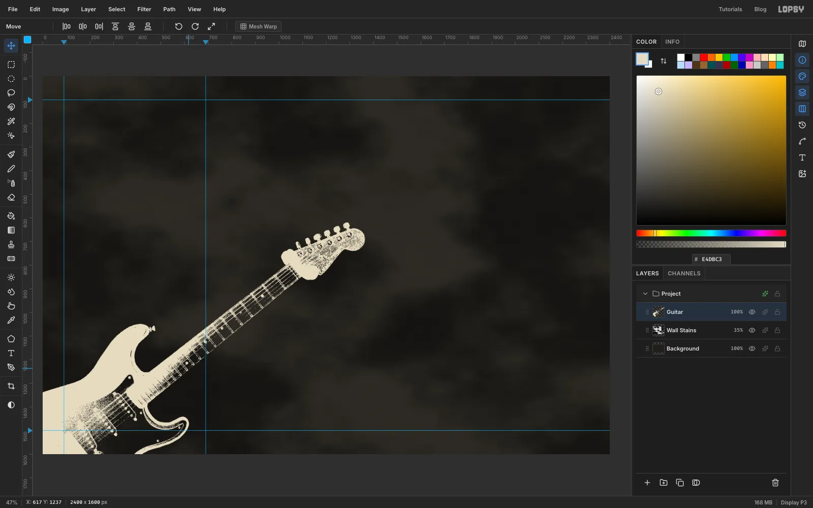

With the Move tool, drag the guitar down and left until the body hangs off
the bottom-left corner and the headstock sits near the middle of the canvas.
The poster will cover most of the neck, so only the body and the start of the
neck stay visible.

## Tear the poster

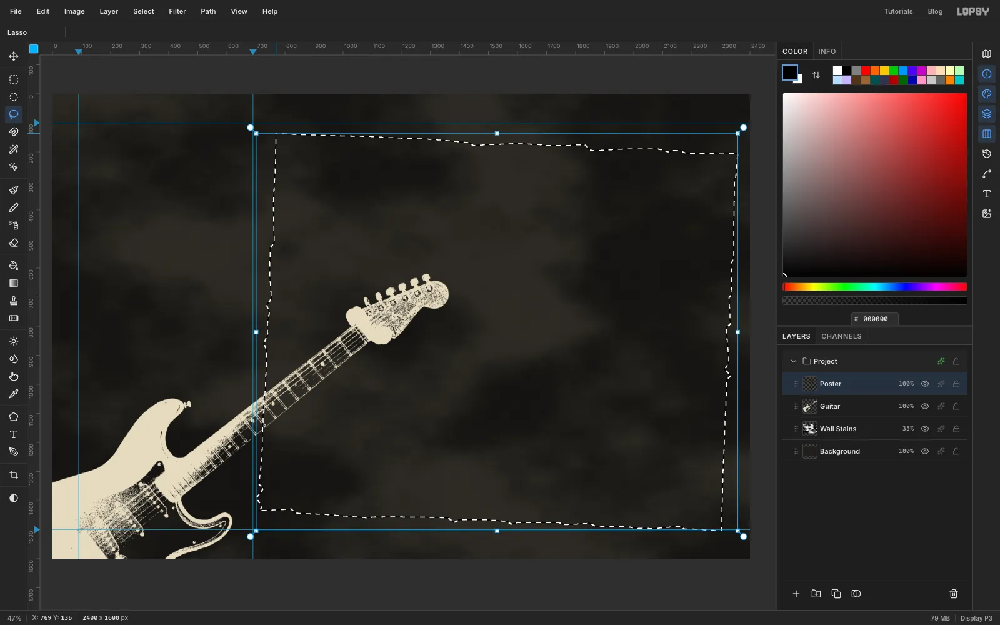

Click **Add Layer** and name it **Poster**. It sits above the guitar. With
the **Lasso**, trace a big, slightly tilted sheet from about **740** across
to **2330**, and from the top margin down to the bottom one.

To make the edge look torn, mix long calm stretches with short jagged
bursts. An even zigzag all the way round looks fake.

## Age the paper

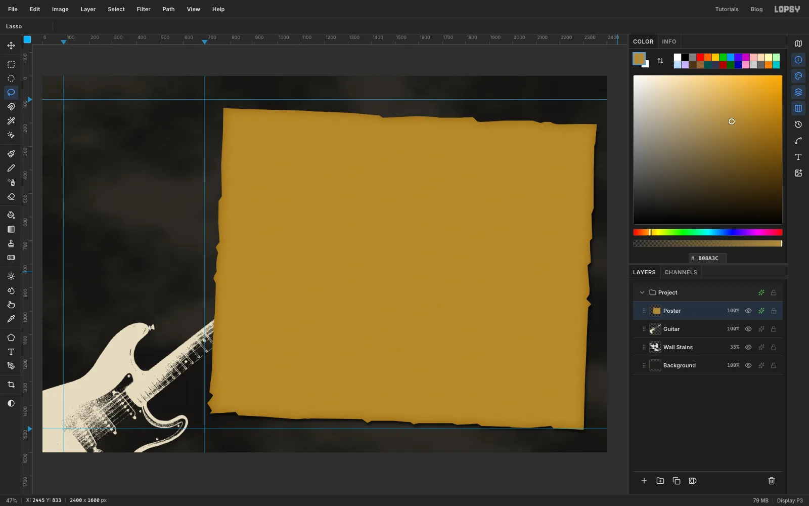

Set the foreground to mustard `#B08A3C` and choose **Edit → Fill**. While the
selection is live, run **Add Noise** at **16**, **Mono**. Press [[Cmd+D]].

Open the Poster's effects drawer:

- **Inner Glow**: colour `#6B4A12`, **Size 70**, **Opacity 55**. This browns
  the edges like old paper.
- **Drop Shadow**: **Offset X 6**, **Offset Y 10**, **Blur 18**,
  **Opacity 70**. This lifts the sheet off the wall.

## Add a ghost print and toner streaks


Copied posters always show something that was printed before. With Poster
selected, pick the **Text** tool. Set **Rubik Dirt** at **400** px in
`#6B4A12`, click near the top-left of the poster and type `PRACTICE`. Press
[[Tab]]. Move it so it starts just inside the poster's left edge, near the
top.

Click **Rasterize Layer** in the Layers footer, then rename the layer
**Poster Print**. [[Cmd]]-click the Poster thumbnail, choose
**Select → Inverse**, click Poster Print again and press [[Delete]]. The word
is now cut to the paper. Press [[Cmd+D]], set the layer to **Multiply** and
its opacity to **30%**.

For copier streaks, add a layer called **Toner Streaks**. [[Cmd]]-click the
Poster thumbnail, fill the selection with white and run
**Filter → Fibers…** with **Variance 40** and **Strength 64**. Higher
Strength gives straighter strands. Press [[Cmd+D]], then set the layer to
**Multiply** at **35%**.

## Speckle the wall and poster

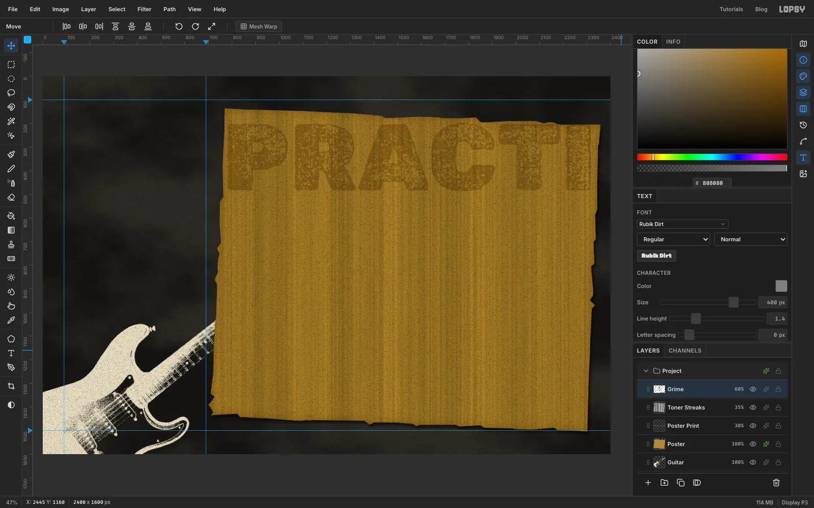

Add a layer called **Grime**. Fill it with mid-grey `#808080`, run
**Add Noise** at **100** **Mono**, then **Threshold** at **84**. Add Noise
moves pixels about 50 levels either side of grey. Only the darkest few
percent fall below 84, so you get scattered black specks on white.

Set Grime to **Multiply** at **60%**. The white disappears and the specks
stay. The phones go above this layer, so their screens stay clean.

## Build the first phone body

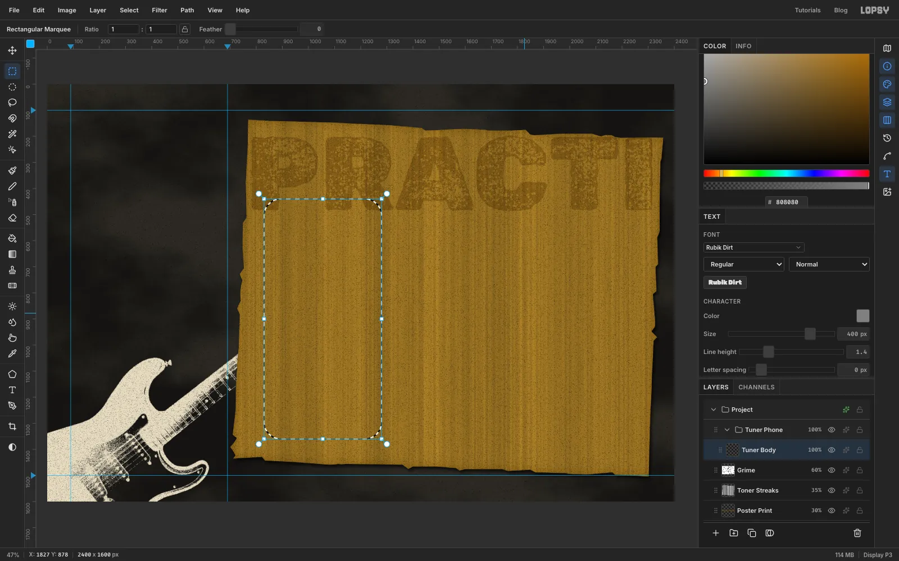

Click **New Group** and name it **Tuner Phone**, then add a layer inside it
called **Tuner Body**.

With the **Rectangular Marquee**, click once on the canvas without dragging.
That opens the exact-corners dialog. Enter **From 830, 440** and
**To 1280, 1360**, then press [[Enter]]. To round the corners, choose
**Select → Shrink…** **64**, then **Select → Grow…** **64**. Growing back
rounds the corners off.

Fill with ink `#141210` and press [[Cmd+D]]. In the effects drawer, add a
**Drop Shadow** (**Offset X 16**, **Offset Y 24**, **Blur 30**,
**Opacity 75**) and a **Stroke** (**Width 3**, colour `#3A3631`). The stroke
catches a little light on the bezel.

## Add the screen, notch and status bar

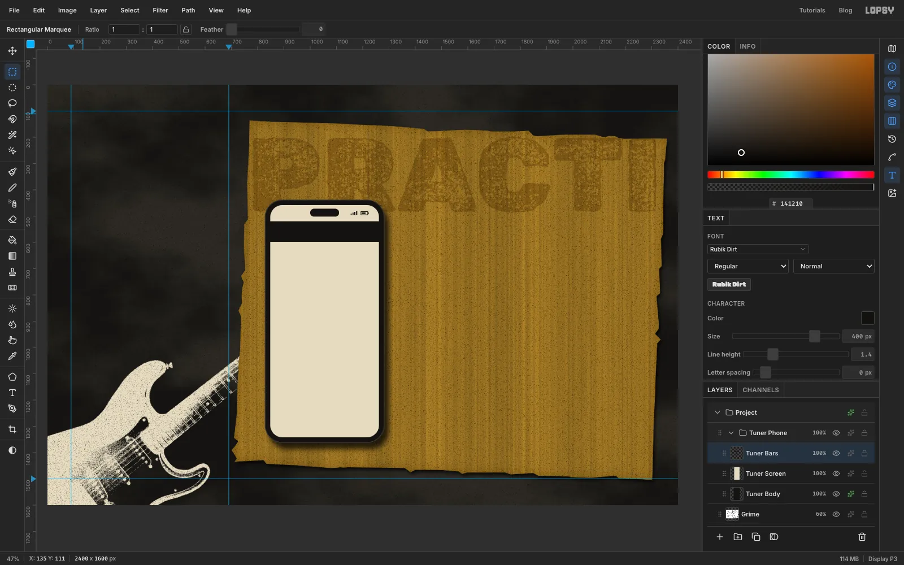

Add a layer called **Tuner Screen**. Use the exact-corners dialog again for
**848, 458 → 1262, 1342**. That is 18 px inside the body on every side. Then
**Shrink 46**, **Grow 46**, fill with bone `#E4DBC3` and run **Add Noise**
at just **4** **Mono**. Screens should look like glass, so keep their texture
light. Press [[Cmd+D]].

Add a layer called **Tuner Bars** and fill these shapes in ink, entering
each one's corners in the exact-corners dialog:

- **Notch:** **1000, 472 → 1110, 502**, rounded with Shrink 14 and Grow 14.
- **App bar:** **848, 520 → 1262, 598**, the full width of the screen.
- **Signal:** four bars 4 px wide, starting at x **1154, 1161, 1168** and
  **1175**. All end at y **496**, and they are **6, 9, 12** and **15** px tall.
- **Battery:** fill **1192, 482 → 1220, 496**, then delete
  **1194, 484 → 1218, 494** to leave an outline. Fill a charge level at
  **1196, 486 → 1211, 492** and a nub at **1220, 486 → 1223, 492**.

## Repeat for the other two phones

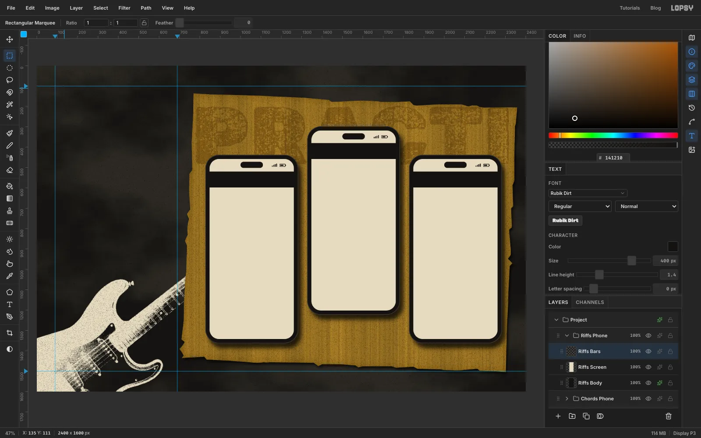

Collapse **Tuner Phone** and click its row, so the next group lands beside
it, not inside it. Click **New Group**, name it **Chords Phone**, and repeat
the last two steps with layers named **Chords Body**, **Chords Screen** and
**Chords Bars**. Add **500** to every x and subtract **140** from every y.
For example, the body is **1330, 300 → 1780, 1220** and the screen is
**1348, 318 → 1762, 1202**.

Collapse Chords Phone, click its row and do it once more for
**Riffs Phone** (**Riffs Body**, **Riffs Screen**, **Riffs Bars**). This
time add **1000** to every x and keep the y values, so the body is
**1830, 440 → 2280, 1360**. Raising the middle phone 140 px makes a gentle
triangle.

## Lay down the tab bar


Expand **Tuner Phone**, click **Tuner Bars** and add a layer called
**Tuner Tabs**. [[Cmd]]-click the **Tuner Screen** thumbnail. Then hold
[[Shift+Alt]] and drag a rectangle over the bottom **84 px** of the screen.
Shift+Alt **intersects**, so only the bottom of the rounded screen stays
selected. Fill it with ink and press [[Cmd+D]].

With the Text tool, set **Special Elite** at **22** px in bone and type
`TUNE   CHORDS   RIFFS   LOG` (three spaces between words). In the
**Text** panel, set **Letter spacing** to **1**. Centre the labels in the bar,
then choose **Layer → Merge Down** to bake them into Tuner Tabs.

## Draw gauge ticks with Sunburst

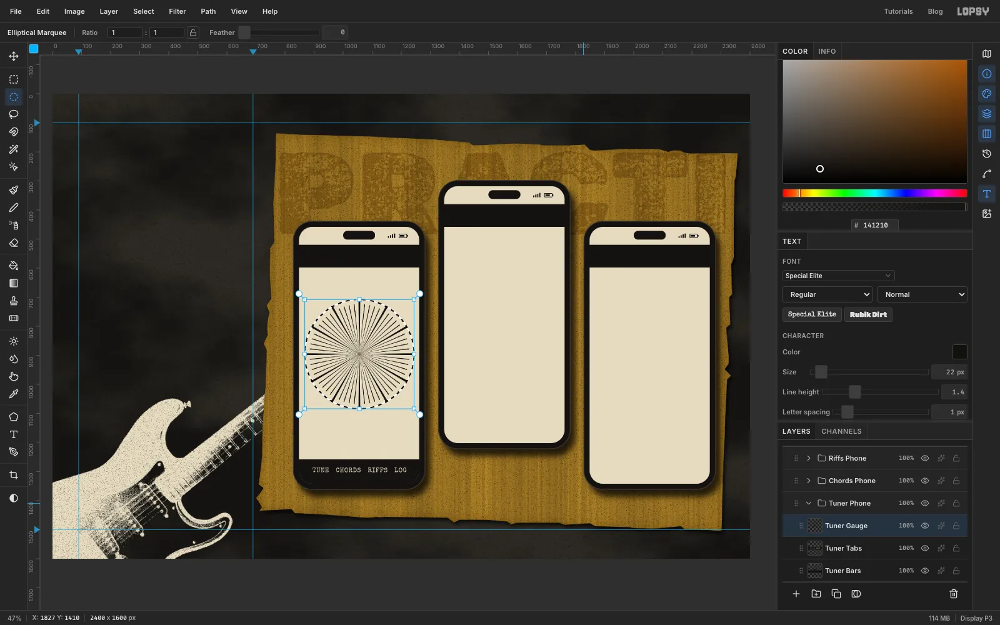

Add a layer called **Tuner Gauge** and set the foreground to ink. The
gauge's centre is at **1056, 896**. That's exactly **44%** across and
**56%** down the canvas, which matters because Sunburst's centre moves in 1%
steps.

Make an **Elliptical Marquee** circle with the exact-corners dialog:
**884, 724 → 1228, 1068** (radius 172). Run **Filter → Sunburst…** with
**Rays 60**, **Width 16**, **Taper 0**, **Center X 44** and
**Center Y 56**. The selection keeps the rays inside the circle.

For bolder major ticks, make a slightly bigger circle (radius 188:
**868, 708 → 1244, 1084**). Run Sunburst again with **Rays 12** and
**Width 7**.

## Knock the rays back to a ring


Select a circle of radius **148** on the same centre
(**908, 748 → 1204, 1044**) and press [[Delete]]. Only the tips of the rays
are left, as tick marks.

Then marquee everything below the centre line, from just under **y 899**
down past the ring, and press [[Delete]]. Press [[Cmd+D]]. You now have a
classic half-moon tuner scale.

## Add the needle

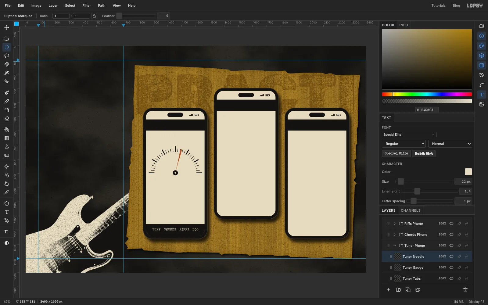

Add a layer called **Tuner Needle**. Set the foreground to rust `#A9572F`.
Pick the **Brush**, open the Brushes panel and set **Size 12**,
**Hardness 100**, **Spacing 2** and **Taper 140**. Taper shrinks the start of
a stroke, so draw from the **tip** back to the centre. Press at the tip,
about **1096, 735** (watch the X/Y readout in the status bar), and drag in
one steady straight line to the centre at **1056, 896**. That leans the
needle **14°** right, slightly sharp. Shift-click lines put a full-size dab at
the start, so drag this one.

Set Taper back to **0**. For the pivot, fill an ink circle of radius **18**
and a bone circle of radius **6** on the centre.

## Make the string selector

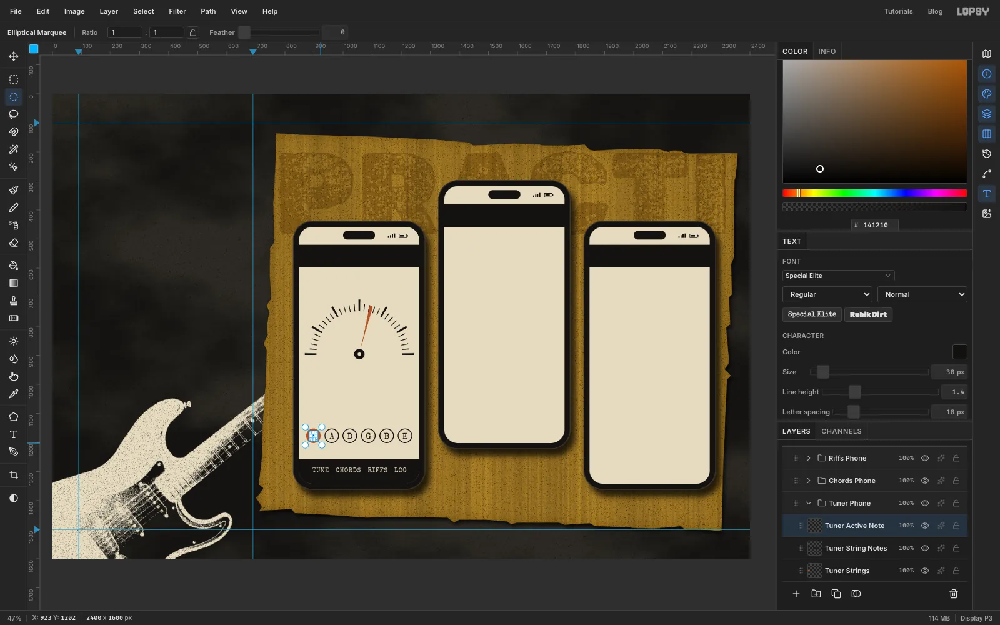

Add a layer called **Tuner Strings**. With the Text tool, set
**Special Elite** at **30** px in ink, type `E A D G B E`, and set
**Letter spacing 18**, and rename the layer **Tuner String Notes**. Centre
it across the screen, about 80 px above the tab bar.

Click **Tuner Strings** and draw a ring around each letter. The letters
sit about **62 px** apart, centred at x **898, 960, 1023, 1085, 1148** and
**1210**, all on y **1177**. For each one, fill a circle 25 px either side
of its centre (the first is **873, 1152 → 923, 1202**). Then delete a
circle 22 px either side. For the first E (the active low string), fill a
solid rust disc instead.

The black letter now disappears into the rust disc. Click the
**Tuner String Notes** row and add a layer called **Tuner Active Note**.
[[Cmd]]-click the text layer's thumbnail. Then [[Shift+Alt]]-drag an
ellipse over the rust disc, so only that one letter stays selected. Fill
with bone and press [[Cmd+D]].

## Type the tuner screen


Add the rest of the type. Create each piece **from the bottom of the screen
upward**. A Text-tool click near an existing text layer edits that layer, so
you never want to click just below one.

Before each new text, click a raster row such as Tuner Strings. That way
the font and size you set don't restyle the text you just made. Also set
**Letter spacing** back to **0** in the Text panel: it keeps the last value
you typed (18 from the string letters).

- `82.4 Hz  ·  +3 cents`: Courier Prime 24, ink, centred above the string buttons.
- `E`: Rubik Dirt 170, rust, centred under the gauge.
- `FLAT` and `SHARP`: Courier Prime 18, under the two ends of the scale.
- `STANDARD  ·  E A D G B E`: Courier Prime 20, under the app bar.
- `TUNER`: Special Elite 40, bone, in the app bar.
- `9:41`: Courier Prime 20, ink, at the top left of the screen.

## Copy the tab bar to the other phones

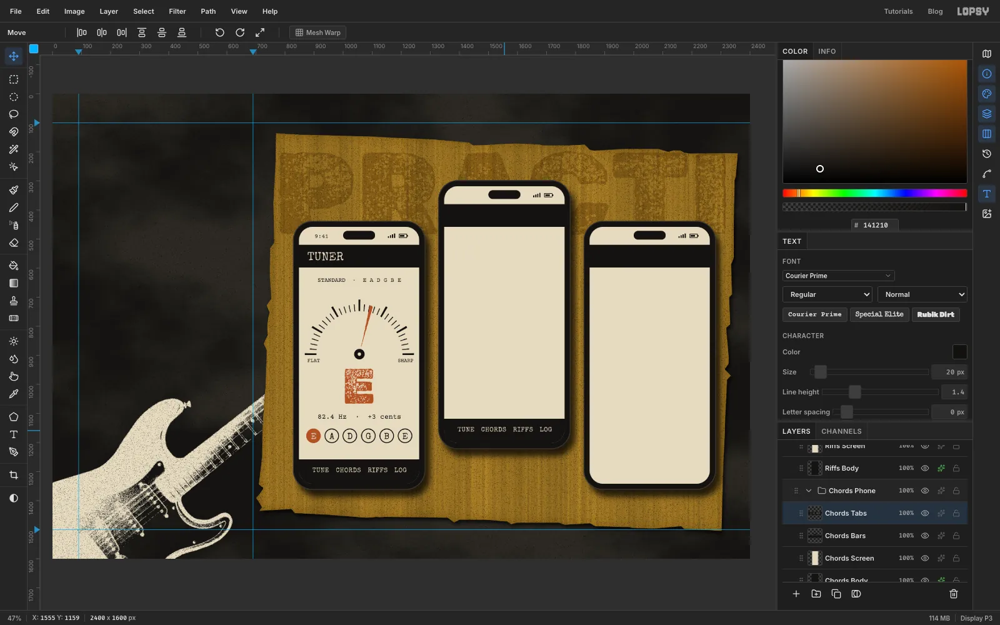

There's no need to build the tab bar twice. Click **Tuner Tabs**, marquee
the bar and press [[Cmd+C]]. Expand **Chords Phone**, click **Chords Bars**
and press [[Cmd+V]]. The copy pastes in place as a new layer above Chords
Bars. Rename it **Chords Tabs** and press [[Cmd+D]].

With the Move tool, drag it onto the bottom of the chord book's screen. Line
it up exactly with the arrow keys ([[Shift]] moves 10 px). Do the same for
**Riffs Tabs** on the right phone.

## Rule the chord grid with the Pencil


Click the top ruler at **1430** and **1680**, and the left ruler at **648**
and **978**, to frame the diagram with guides.

Add a layer called **Chord Grid**. Pick the **Pencil** at **Size 3** in ink.
To draw each line, click its start, then [[Shift]]-click its end:

- **Strings:** six vertical lines, 50 px apart, from the top guide to the
  bottom one.
- **Frets:** five horizontal lines, 66 px apart, below the top guide, from
  the left guide to the right one. The last one lands on the bottom guide.

For the nut, marquee a 12 px strip along the top guide
(**1428, 636 → 1682, 649**) and fill it.

## Place the finger dots

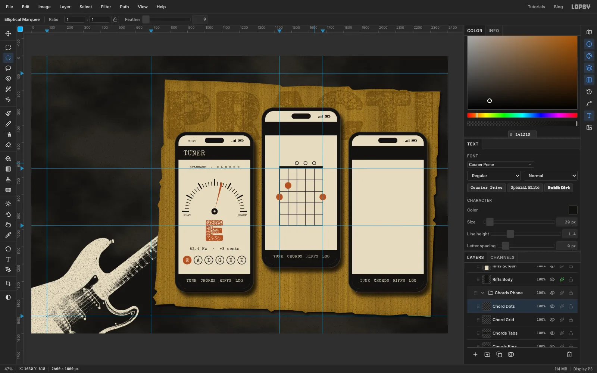

Add a layer called **Chord Dots**. This is **G major** in open position
(3-2-0-0-0-3). Fill rust circles (radius 19) halfway between frets:

- low E string (left), 3rd fret: **1411, 794 → 1449, 832**
- A string, 2nd fret: **1461, 728 → 1499, 766**
- high E string (right), 3rd fret: **1661, 794 → 1699, 832**

The D, G and B strings ring open. Draw a small ink ring above the nut on
each of them, centred at x **1530, 1580** and **1630**, y **618**. Fill a
circle 11 px either side of the centre, then delete one 8 px either side.

## Cut tape chips and paste copies

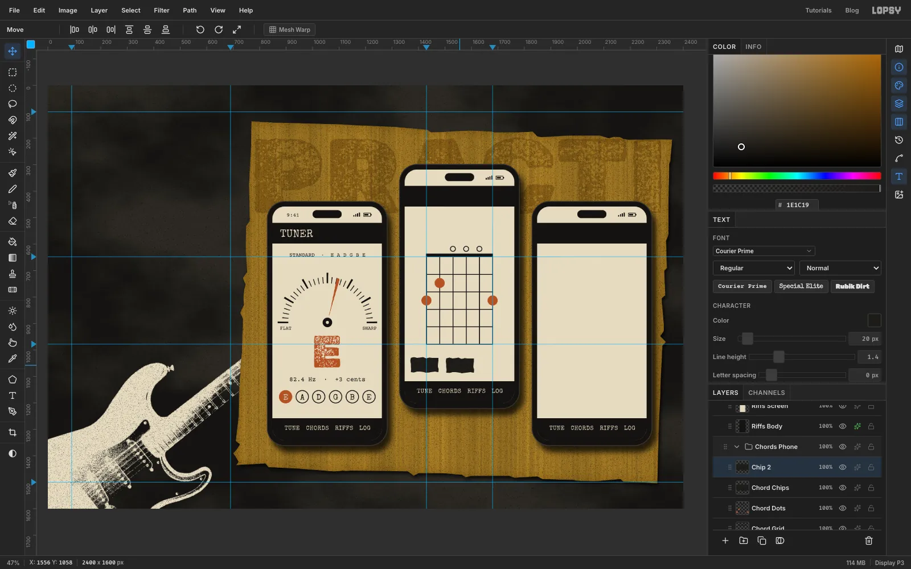

Add a layer called **Chord Chips**. With the **Lasso**, trace a small torn
chip about **104 × 54** px near the bottom left of the screen, above the
tab bar. Fill it with `#1E1C19` and run **Add Noise** at **22** **Mono**.

Keep the selection, then press [[Cmd+C]] and [[Cmd+V]]. Rename the new layer
**Chip 2** and press [[Cmd+D]]. With the Move tool, nudge it **132 px** to the
right: press [[Shift+Right]] 13 times and [[Right]] twice. Paste a third copy
from Chord Chips, call it **Chip 3** and nudge it **264 px** from the first.
That leaves an even 28 px gap between chips.

## Tilt the chips

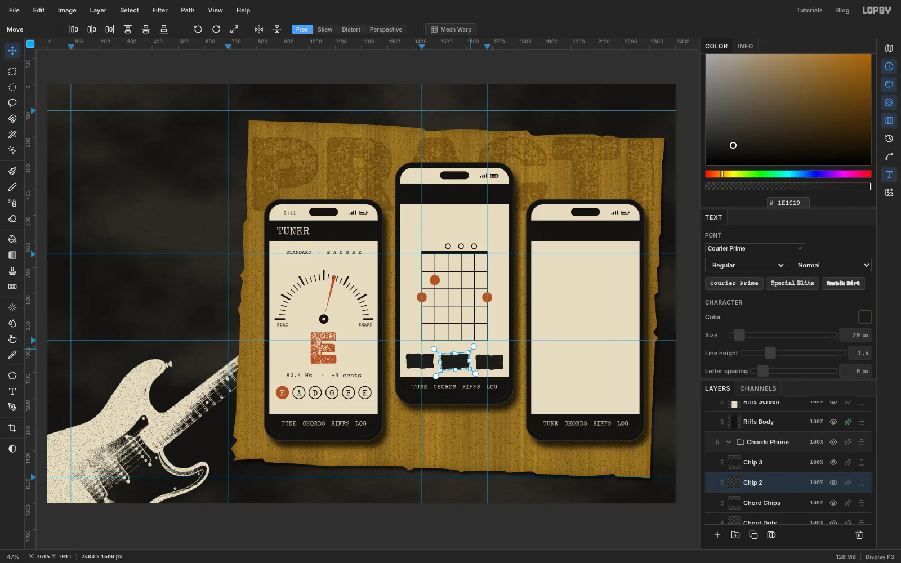

Taped chips never sit perfectly straight. On Chip 2, draw a marquee just
around the chip and drag the rotate handle about **4°** counter-clockwise.
Press [[Cmd+D]]. Tilt Chip 3 about **3°** the other way.

Then click Chip 3 and choose **Layer → Merge Down** twice, so all three chips
end up on Chord Chips.

## Type the chord book


Working from the bottom up again:

- `Em`, `C`, `D`: Special Elite 34, bone, each centred on its chip.
- `NEXT UP`: Courier Prime 20, ink, just above the chips.
- `open position`: Courier Prime 22, ink, and above it `major` in Special
  Elite 40, ink. Both sit right of the G's position.
- `G`: Rubik Dirt 150, rust, top left of the screen.
- `CHORD BOOK`: Special Elite 40, bone, in the app bar.
- `9:41`: Courier Prime 20, ink.

## Add the active-tab markers, play button and tally

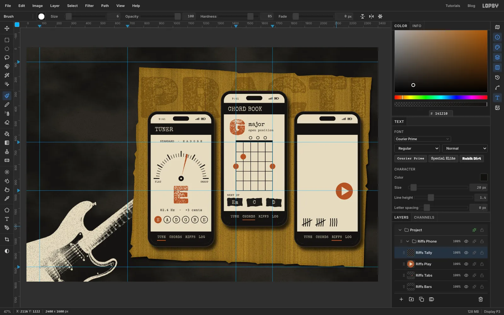

Mark the active tab on each phone with a short rust bar, about **5 px**
tall, just under its label. Draw it on that phone's Tabs layer: under
**TUNE** on the tuner, **CHORDS** on the chord book and **RIFFS** on the
right phone.

On the right phone, add a layer called **Riffs Play**:

- Fill a rust circle at **2112, 924 → 2228, 1040**.
- Lasso a right-pointing triangle inside it, roughly
  **2152, 952 / 2202, 982 / 2152, 1012**, and fill it with bone.

Add a layer called **Riffs Tally**. Pick the Brush at **Size 6**,
**Hardness 85**, in ink. Draw fourteen days of streak by hand as two gates of
five and one group of four. A gate of five is four short downstrokes plus one
diagonal across them.

## Type the riff screen

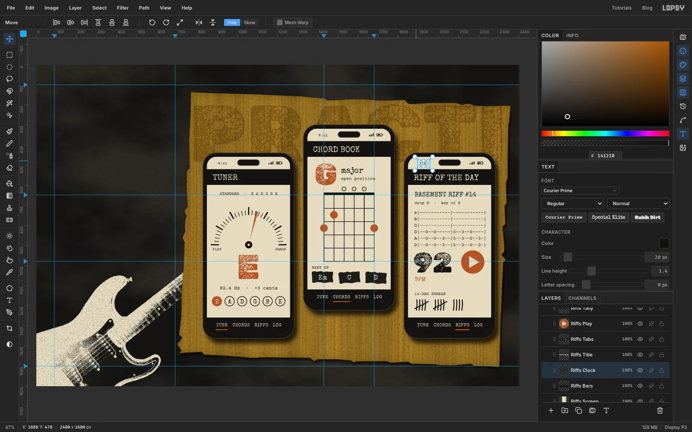

Bottom up:

- `14-DAY STREAK`: Courier Prime 20, above the tally.
- `BPM`: Special Elite 30, rust, under where the 92 will go.
- `92`: Rubik Dirt 140, ink, left of the play button.
- The tab: Courier Prime 23. It's monospaced, so the dashes line up. Paste
  it as one six-line text:

  ```
  e|-----------|-----------|
  B|-----------|-----------|
  G|-----------|-----------|
  D|--0--0-----|5--3--0----|
  A|--0--0--3--|5--3--0--3-|
  D|--0--0--3--|5--3--0--3-|
  ```

- `drop D  ·  key of D`: Courier Prime 20, ink.
- `BASEMENT RIFF #14`: Special Elite 32, ink.
- `RIFF OF THE DAY`: Special Elite 40, bone, in the app bar, and the
  `9:41` clock in Courier Prime 20.

## Set the headline

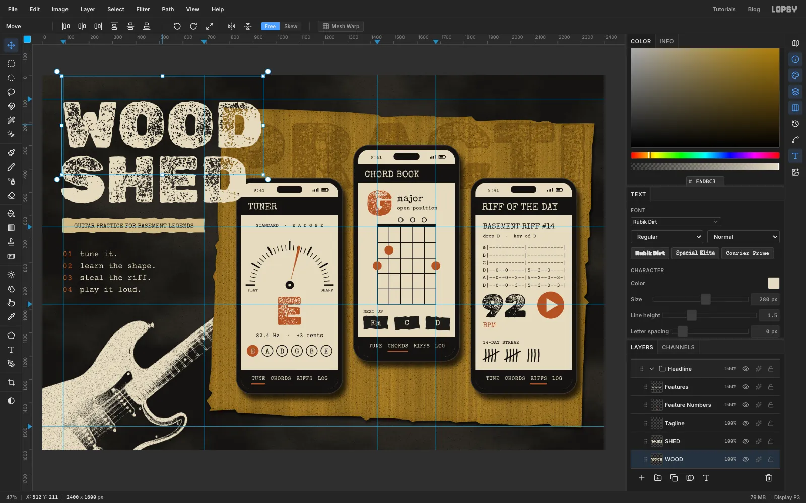

Collapse all three phones, click **Riffs Phone** and click **New Group**.
Name the group **Headline**.

Add a layer called **Tagline Tape**. Lasso a torn strip from the left guide
to just past the right guide, roughly **60 px** tall, starting at
**y 612**. Fill it with
masking-tape `#CDBB8C` and run **Add Noise** at **14** **Mono**.

The feature list is two text layers, a column of rust numbers and a column of
bone lines. Make the **right column first**: a multi-line text layer has a
wide click area, and a click inside it would edit it.

1. Click at **x 160**, **y 740** (watch the X/Y readout in the status bar) and type in **Courier Prime 34**, bone, one item per line:
   `tune it.`, `learn the shape.`, `steal the riff.`, `play it loud.`
2. In the Text panel, set **Line height 1.5**.
3. At **x 90**, same baseline, type `01` to `04`, one per line, in rust, also at
   line height 1.5.

Set `GUITAR PRACTICE FOR BASEMENT LEGENDS` in **Special Elite 25**, ink,
centred on the tape.

Then set `SHED` and `WOOD` in **Rubik Dirt 280**, bone, as two separate
layers, SHED first. Align WOOD's left edge with the left guide, with SHED
just under it. At this size both words run well onto the poster. Make that
overlap obvious; a near-miss looks like a mistake.

## Misregister a rust echo


Two-colour copies never line up. Click **WOOD** and click **Duplicate Layer**.
The copy lands on top. Click the **original** (the lower row) and rename it
**WOOD Echo**. Give it a **Color Overlay** in rust `#A9572F`.

With the Move tool, press [[Shift+Right]] and [[Shift+Down]] to push it
10 px each way. Do the same for **SHED**.

## Close up the speckle

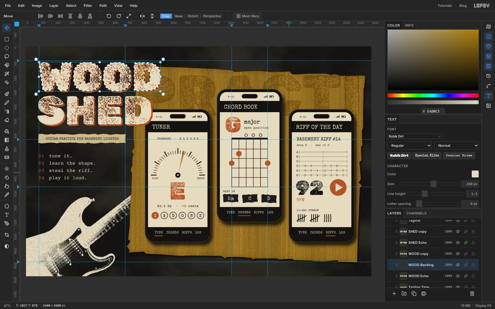

Rubik Dirt is heavily speckled. At this size the holes show the dark wall
and read as dirt. Fill them with rust, so they read as a second ink.

1. Click **WOOD Echo** and add a layer called **WOOD Backing**. It sits
   between the echo and the cream word.
2. [[Cmd]]-click the cream **WOOD copy** thumbnail.
3. Choose **Select → Grow… 9**, then **Select → Shrink… 9**. Growing closes
   the small holes, and shrinking brings the outline back, so the letter
   shapes stay the same.
4. Fill with rust and press [[Cmd+D]].

Repeat for SHED.

## Tilt the whole headline


Collapse **Headline** and click its row. Press [[Cmd+D]] so there's no
selection. With the **Move** tool, a box appears around everything in the
group. Drag its rotate handle about **3°** counter-clockwise and press
[[Escape]] to commit.

Rotating a group or a whole text layer commits with [[Escape]]. Rotating
pixels inside a marquee, as you did with the guitar, commits with
[[Cmd+D]].

The text layers stay live: they're rotated, not rasterized, so you can still
edit them.

## Tilt the outer phones


Click the **Tuner Phone** group row, press [[Cmd+D]] and rotate it about
**4°** counter-clockwise with the Move tool's handle, then press
[[Escape]]. The whole phone, live text included, turns as one piece.

Tilt **Riffs Phone** **4°** clockwise. The straight middle phone holds the
three together.

## Cut a strip of gaffer tape


Click the **Headline** group and add a layer called **Gaffer Tape** so it
sits on top of everything. Lasso a torn strip about **300 × 66** px in empty
space at the bottom of the poster. Fill it with `#6E6B64` and run
**Add Noise** at **20** **Mono**.

Marquee a thin **6 px** band along its top third, keeping it just inside
the torn ends, and fill it with `#8A877F`.
That's the sheen on real gaffer tape. Press [[Cmd+D]].

## Copy, rotate and place the tape


Lasso the strip, press [[Cmd+C]] and [[Cmd+V]], and rename the copy
**Gaffer A**. Marquee it and rotate it about **40°** counter-clockwise. Press
[[Cmd+D]], then drag it across the tuner's top-left corner.

Paste two more copies:

- **Gaffer B**, tilted **6°** clockwise, along the top edge of the chord book.
  Keep it on the bezel so the status icons stay visible.
- **Gaffer C**, about **38°** counter-clockwise, across the riff phone's
  bottom-right corner.

Finally, rotate the original strip about **32°** clockwise and drag it over
the poster's bottom-left corner. Merge the three copies down into Gaffer Tape.

## Number the tape by hand

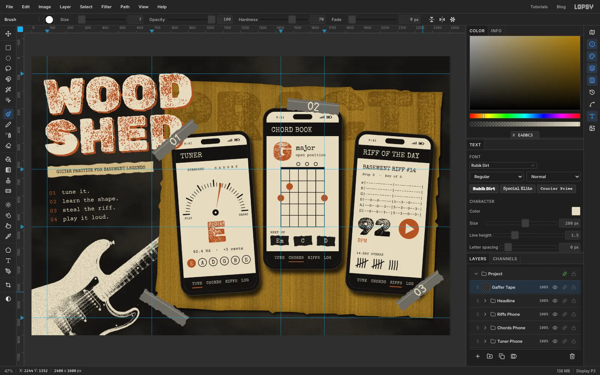

Stay on **Gaffer Tape** and write a step number on each phone's tape. Use the Brush
at **Size 7**, **Hardness 70**, in bone. Draw `01`, `02` and `03` as quick
strokes along each strip's angle; a little wobble helps.

Then give Gaffer Tape a **Drop Shadow** (**4**, **6**, **Blur 8**,
**Opacity 55**) and set the layer to **88%** opacity, so a hint of the
poster shows through.

## Draw the stamp rings

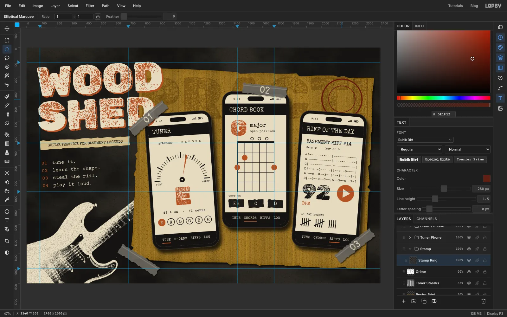

The stamp is printed on the poster, so it belongs under the phones. Collapse
the groups, click **Grime** and click **New Group**. Name the group
**Stamp**.

Add a layer called **Stamp Ring** and set the foreground to oxblood
`#5E1F12`. Use the exact-corners dialog with the Elliptical Marquee, around
the centre **2140, 350**:

1. Fill **2000, 210 → 2280, 490** (radius 140), then delete
   **2008, 218 → 2272, 482**.
2. Fill **2048, 258 → 2232, 442** (radius 92), then delete
   **2052, 262 → 2228, 438**.

That gives a thick outer ring and a thin inner one.

## Draw a circle path for the ring text


Pick the **Pen** tool. The ring text runs on a circle of radius **104**
around the same centre. Its four anchors are left **2036, 350**, top
**2140, 246**, right **2244, 350** and bottom **2140, 454**.

Press at the left anchor and drag straight **up** about **57 px** to pull out a
handle. Then press at the top anchor and drag **right** 57 px, at the right
anchor drag **down**, and at the bottom anchor drag **left**. Each handle
points clockwise along the circle.

Click the first anchor again to close the circle. Those 57 px handles
(0.55 × the radius) make a near-perfect circle.

## Set the text on the path


Click **Stamp Ring**. Pick the **Text** tool and set **Special Elite 22** in
oxblood. Click inside the inner ring and type
`DOWNLOAD IT • iOS + ANDROID • PRACTICE LOUD • `, then press [[Tab]].
Rename the layer **Stamp Ring Text** and set **Letter spacing** to **0.5**.
The words run about three-quarters of the way round, and the riff phone
covers the end.

With the Text tool still active, choose **Path 1** from the options bar's
**Path** dropdown. The letters now follow the circle.

In the **Paths** panel, click the path's row to deselect it and hide the
outline.

> **Tip:** Keep the path in the document. Text that is still bound to a
> deleted path stops updating.

## Stamp FREE and wear the ink


Click **Stamp Ring** first, so the Text tool doesn't pick up the ring text.
Then click in the middle of the ring and set `FREE` in **Rubik Dirt 50**,
oxblood, and name the layer **Stamp Free**. Centre it,
then rotate it about **12°** counter-clockwise with the Move tool's handle,
and press [[Escape]].

Real rubber stamps never print evenly:

1. On **Stamp Ring**, lasso three narrow wedges across the outer ring and
   press [[Delete]] to leave small gaps.
2. Pick the **Eraser** at **Size 120** and **Opacity 40**, and click once on
   three spots around the ring to fade the ink unevenly.
3. Set the Eraser's opacity back to **100**.

Choose **View → Show Guides** to hide the guides. Save the project and
export your PNG.
