A spray stencil for more than one colour is cut as a set of *plates*, one
per colour. You spray the lightest colour first, lay the next plate on top
in the same place, and spray again. The test sheets you spray along the way
are *proofs*. Pin the plates and proofs up side by side and you have a
*contact sheet*, the page a stencil artist keeps to remember how a design was
built.

In this tutorial you'll make **Hornet Swarm**, an 1800 × 1200 px grunge
contact sheet for an imaginary three-plate stencil kit. The top row holds
three cut chipboard plates: the hornet's smoky wings, its mustard body and a
black *key* plate with the lettering. The bottom row holds three newsprint
proofs that build up one pass at a time. Everything sits on a grimy
workbench, with masking tape, paint drips, overspray, a coffee ring and
grease-pencil notes.

The hornet comes from a photo:
[Murder hornet back](https://commons.wikimedia.org/wiki/File:Murder_hornet_back_2020-10-02-09.36.37_ZS_PMax_UDR_(50409006658).jpg),
a top-down shot of an Asian giant hornet by the USGS Bee Inventory and
Monitoring Lab, on Wikimedia Commons. It is in the **public domain**.
Download the 3288 × 3684 px original. A specimen shot on black works best,
because the backdrop lifts off in one click.

Two ideas make the kit easy to build:

- **All the art is designed once, in the third proof.** Every plate and
  proof is a copy of it, moved by whole cells.
- **Cells repeat every 512 px**, across and down. With a 512 px grid snapped
  on, one arrow-key press moves a selection or a layer exactly one cell. That
  keeps every plate in register with its proof.

Along the way you'll use:

- ruler **guides**, **Snap to Guides**, and a 512 px **grid** with arrow-key nudges
- **Clouds**, **Add Noise**, **Gaussian Blur** and **Threshold**
- the **Magic Wand** with Contiguous off, the **Lasso** and **Elliptical Marquee** with [[Shift]] and [[Alt]], **Grow**, **Shrink**, **Feather** and **Select → Inverse**
- [[Cmd]]-clicking layer thumbnails, with [[Shift]] to add and [[Alt]] to subtract
- the **Move** tool's **Rotate 90° CCW** button, plus corner scaling and rotation handles
- **Duplicate Layer**, copy and paste, **Merge Down** and **Rasterize Layer**
- the **Eraser**, **Brush** with **Taper**, **Pencil** and **Spray** tools
- layer effects (**Inner Glow**, **Drop Shadow**, **Stroke**), the **Overlay**, **Screen** and **Multiply** blend modes, and a **layer mask**
- **Text** in Stardos Stencil, Special Elite, Permanent Marker, Covered By Your Grace and Rock Salt
- undo and redo

The palette:

- Bench `#2B2925`, chipboard `#8E7B5B`, newsprint `#D9D1BD`
- Smoke grey `#6E7671`, mustard `#D69B1D`, key black `#191714`
- Plate overspray: smoke `#5A625E`, black `#3A352E`, cut-edge glow `#2A1D10`
- Bone `#DCD2B8`, paint marker `#EAE2CC`, tape `#D8C99C`, cut wall `#C2A57A`
- Grease red `#CF3A2B`, pencil notes `#3B3832`, graphite crosses `#55514A`, coffee `#5A3A1E`

## Set up the sheet and the guides

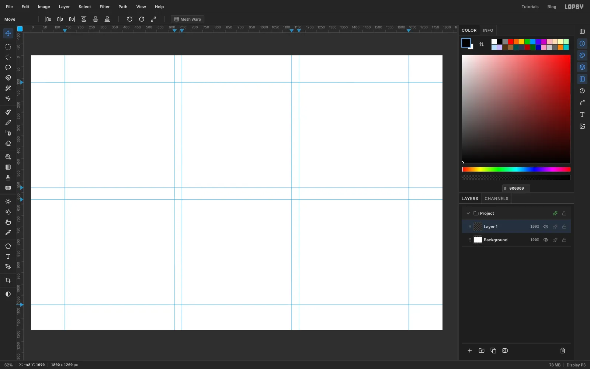

1. Choose **File → New**, set **Width** `1800`, **Height** `1200`, **Pixels**, **White** background, and click **Create**.
2. Click the top ruler at `148`, `628`, `660`, `1140`, `1172` and `1652` to drop six vertical guides.
3. Click the left ruler at `118`, `578`, `630` and `1090` to drop four horizontal guides.
4. Make sure **View → Snap to Guides** is ticked, so marquees lock onto the guides.

That gives three 480 px columns with 32 px gutters, and two 460 px rows: plates on top, proofs below. Each cell starts exactly 512 px after the one before it, across and down.

## Make a grimy workbench

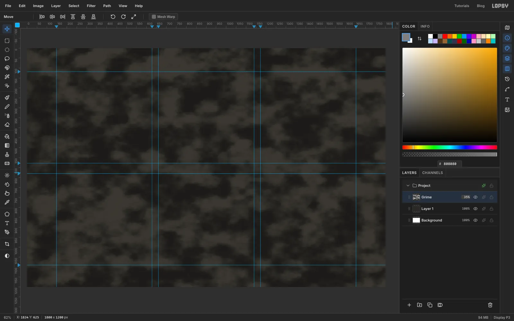

1. Click **Layer 1**, set the foreground colour to `#2B2925`, press [[Cmd+A]] and choose **Edit → Fill**. Press [[Cmd+D]].
2. Click **Add Layer** and rename the new layer `Grime`. Fill it with `#808080` the same way.
3. Choose **Filter → Clouds…**, set **Scale** to `20` and click **Apply**.
4. Choose **Filter → Add Noise…**, pick **Mono** and **Gaussian**, set **Amount** to `30` and apply.
5. Open the layer's effects (the sparkle button on its row) and set the blend mode to **Overlay**. Close the drawer, click the row's opacity and set it to `35%`.

## Rough out the three plates

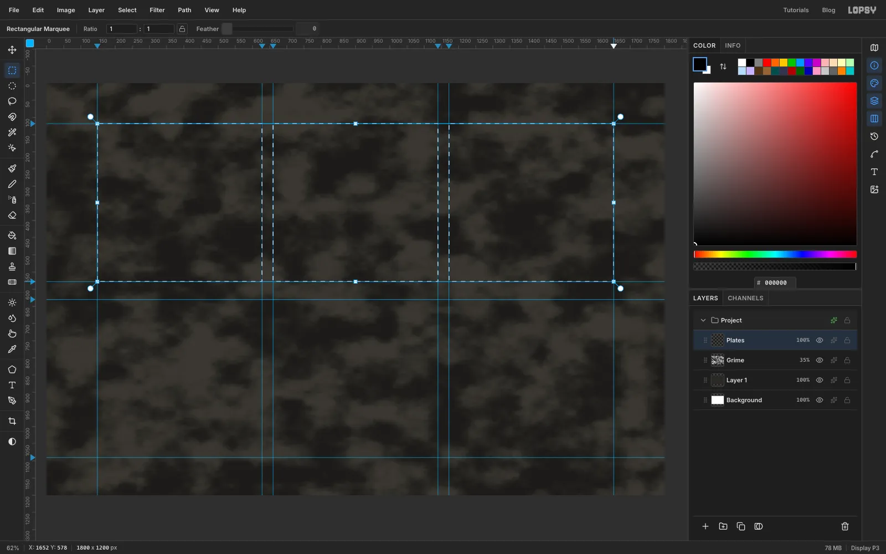

1. Click **Add Layer** and name it `Plates`.
2. Pick the **Rectangular Marquee** and drag the first plate from the top-left corner of the first cell to its bottom-right corner. The edges snap to the guides.
3. Hold [[Shift]] and drag the second and third plates in the other two top cells. Shift adds each one to the selection.

## Fill chipboard and newsprint

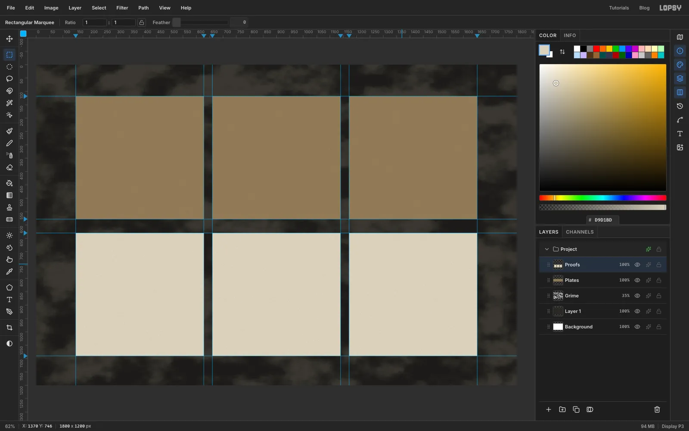

1. Fill the selection with chipboard `#8E7B5B`.
2. Give it some fibre: **Filter → Add Noise…**, **Mono**, **Gaussian**, Amount `14`. Press [[Cmd+D]].
3. Add a layer called `Proofs`. Marquee the three bottom cells the same way, using [[Shift]] for the second and third.
4. Fill them with newsprint `#D9D1BD`, add Mono Gaussian noise at `16`, and deselect.

## Drop in the hornet

Drag the downloaded photo from your desktop onto the canvas. Lopsy puts it on a new layer and shrinks it to fit the canvas. Double-click the layer's name and rename it `Photo`.

The photo shows the hornet on its side, head to the right. You'll turn it in a moment.

## Knock out the black backdrop

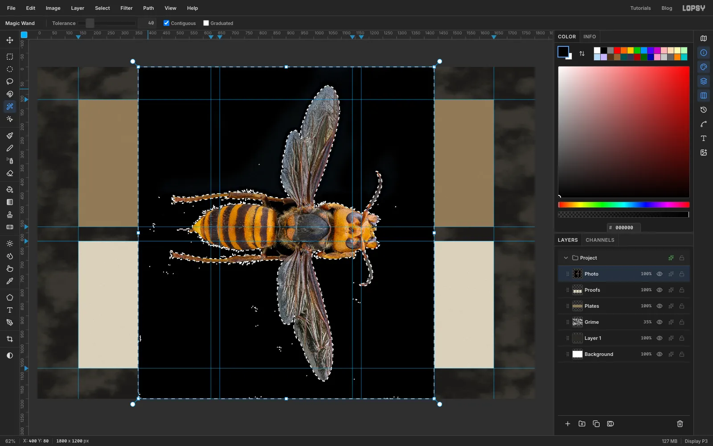

1. Press [[Cmd+D]] to clear the selection the drop made.
2. Pick the **Magic Wand**. In the options bar set **Tolerance** to `40` and tick **Contiguous**.
3. Click the black near the top-left corner of the photo. The ants run around the whole insect.
4. Press [[Backspace]] to delete the backdrop, then [[Cmd+D]].

## Turn it head-up and sweep away the dust

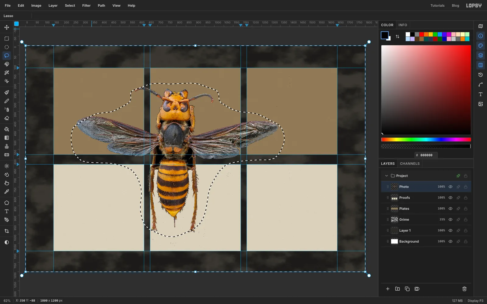

1. Pick the **Move** tool and, with nothing selected, click **Rotate 90° CCW** in the options bar. The hornet now faces up, wings spread left and right.
2. A few specks of backdrop dust are still floating around it. Pick the **Lasso** and drag a loose loop around the hornet, legs and antennae included, staying well clear of its edges.
3. Choose **Select → Inverse** and press [[Backspace]]. Only the hornet is left. Press [[Cmd+D]].

## Scale the hornet into the third proof

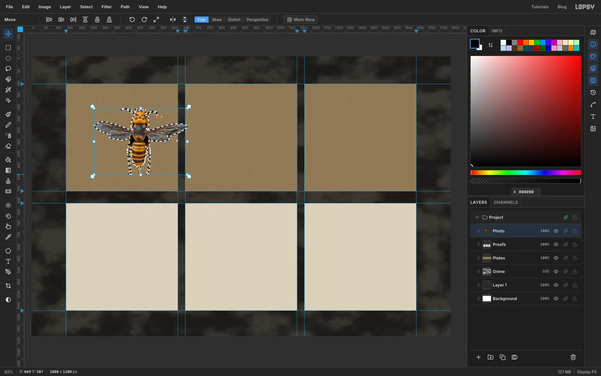

1. [[Cmd]]-click the **Photo** thumbnail in the Layers panel to select the hornet's pixels.
2. With the **Move** tool, hold [[Cmd]] and drag the bottom-right corner handle up and to the left until the wings span about 400 px, a little less than a card is wide. [[Cmd]] keeps the proportions.
3. Drag the hornet into the third proof (bottom right). Centre it across the proof, with the antennae about 30 px below the paper's top edge. Arrow keys nudge it 1 px at a time. Press [[Cmd+D]].

## Pick out the yellow body

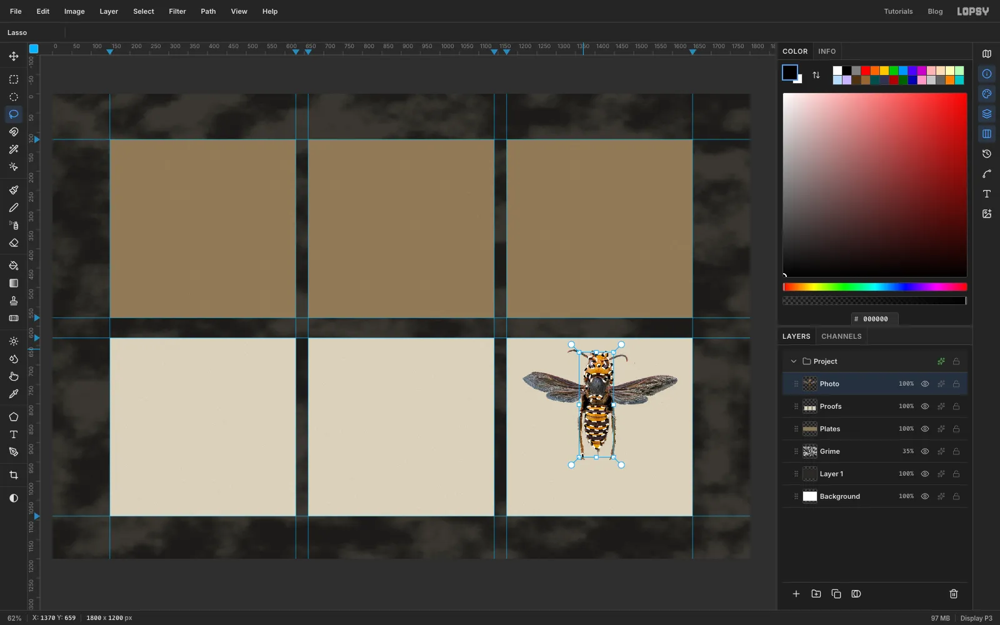

The **Body** plate sprays everything mustard.

1. Click the **Photo** row. Pick the **Magic Wand**, set **Tolerance** to `90` and untick **Contiguous**.
2. Click a flat patch of yellow on the forehead, between the eyes. Every warm yellow in the photo is selected at once, along with a few specks on the wings.
3. With the **Lasso**, hold [[Alt]] and drag a loop around each wing to subtract the specks.
4. Clean up the edges: **Select → Shrink…** `1`, then **Grow…** `1`, which removes stray pixels. Then **Grow…** `3` and **Shrink…** `3`, which closes the pinholes.
5. Click **Add Layer**, name it `Body`, fill with mustard `#D69B1D` and deselect.

## Pick out the smoky wings

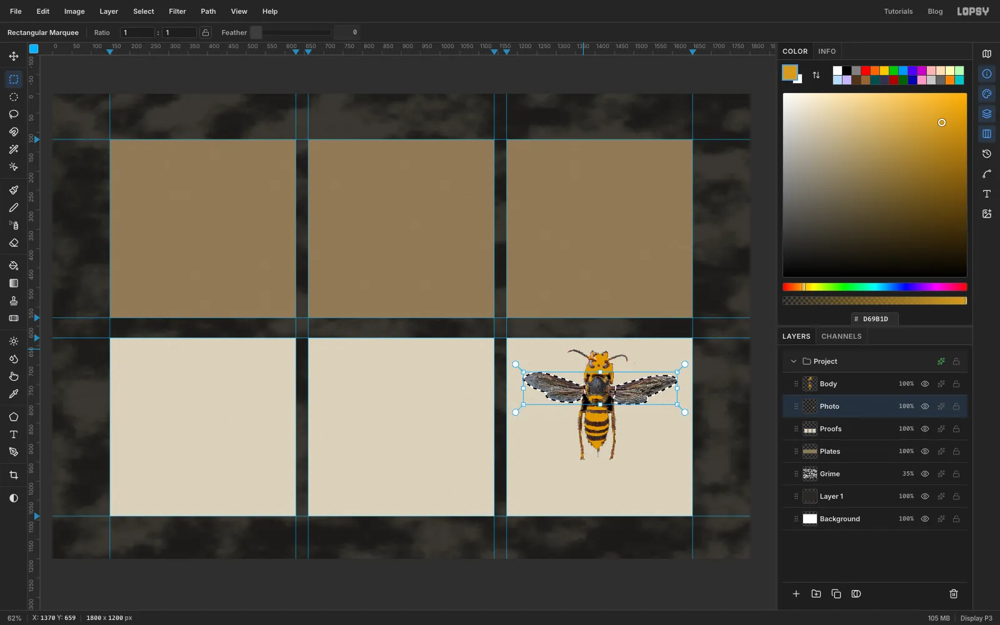

1. Click the **Photo** row again. Keep the Magic Wand at **Contiguous** off, set **Tolerance** to `70` and click the grey middle of the left forewing.
2. With the **Lasso**, [[Alt]]-drag around the body: an oval around the thorax, then down around the abdomen and the legs. Then, with the **Rectangular Marquee**, [[Alt]]-drag across the top of the hornet to subtract the antennae.
3. Smooth the wings: **Grow** `4`, **Shrink** `4`, then **Shrink** `5` and **Grow** `5`. The last pair rounds off the wing roots.
4. Add a layer called `Wings`, fill it with smoke grey `#6E7671` and deselect. Because **Photo** was active, Wings lands below Body, which is also the order you'd spray them.

## Make the key plate from what's left

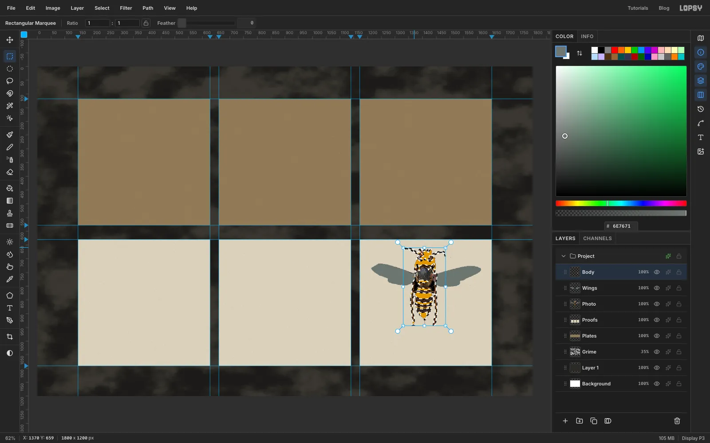

The black *key* plate is everything that isn't yellow or wing.

1. Click the **Body** row so the new layer will land on top.
2. [[Cmd]]-click the **Photo** thumbnail to select the whole silhouette.
3. [[Alt+Cmd]]-click the **Body** thumbnail, then the **Wings** thumbnail. Each one is subtracted.
4. **Shrink** `1` and **Grow** `1` to drop the slivers between colours.
5. Add a layer called `Key`, fill it with key black `#191714` and deselect.

## Round off the thorax

The key's thorax came out square at the shoulders. Trim it into an oval.

1. With the **Rectangular Marquee**, draw a box across the thorax, from one wing root to the other.
2. Switch to the **Elliptical Marquee**, hold [[Alt]] and drag an oval that just fits the thorax. Only the four corners stay selected.
3. With **Key** active, press [[Backspace]] and deselect.
4. Click the eye on the **Photo** row to hide it. You now have the three plates' artwork stacked as a finished hornet.

## Fill in the islands

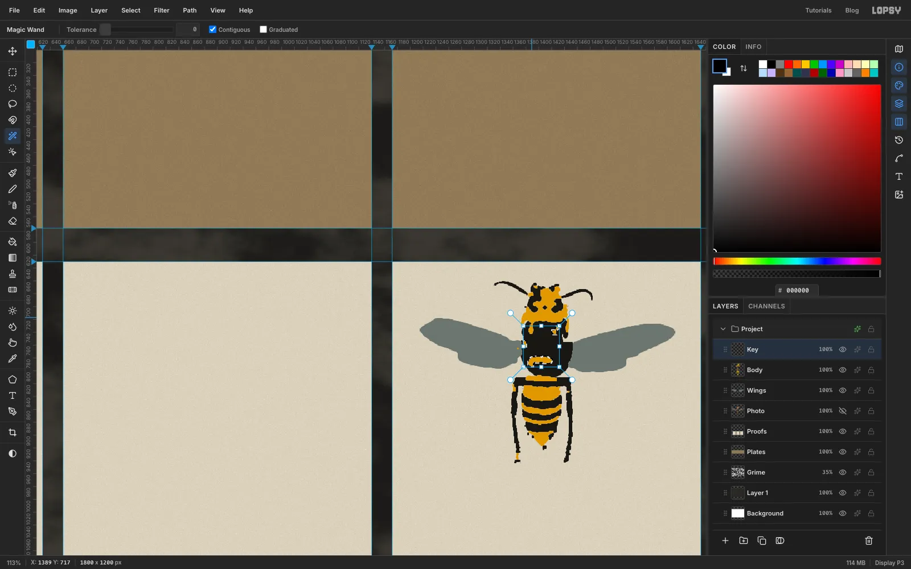

On a real plate the black areas are holes. Any yellow speck completely surrounded by black would be a loose scrap of card, an *island*, and it falls out as soon as you cut around it. You can bridge an island back to the plate, or fill it in. These are tiny, so fill them.

1. Click the **Key** row and zoom in on the thorax.
2. Pick the **Magic Wand**, set **Tolerance** `0`, tick **Contiguous** and click inside the first yellow speck. [[Shift]]-click any others you find. I had six.
3. **Grow** `1`, fill with `#191714` and deselect.
4. So no mustard hides under the black, [[Cmd]]-click the **Key** thumbnail, click the **Body** row, press [[Backspace]] and deselect.

## Cut the wing veins as bridges

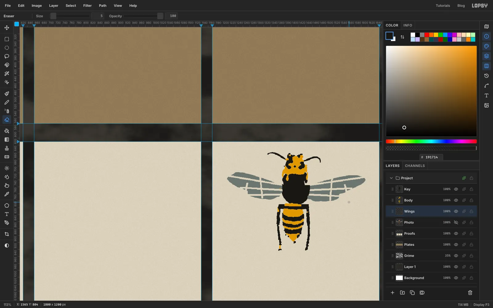

1. Click the **Wings** row. A few loose crumbs of wing sit next to the thorax. Pick the **Eraser**, set **Size** to `18` and click each one away.
2. Set the Eraser's **Size** to `5`. For each vein, click at the wing root and [[Shift]]-click past the wing tip to erase a straight line. Draw three long veins per wing and a short cross vein or two.

Each erased line is a *bridge*, a strip of card that holds the plate together. Here they double as the veins.

## Set the stencil lettering

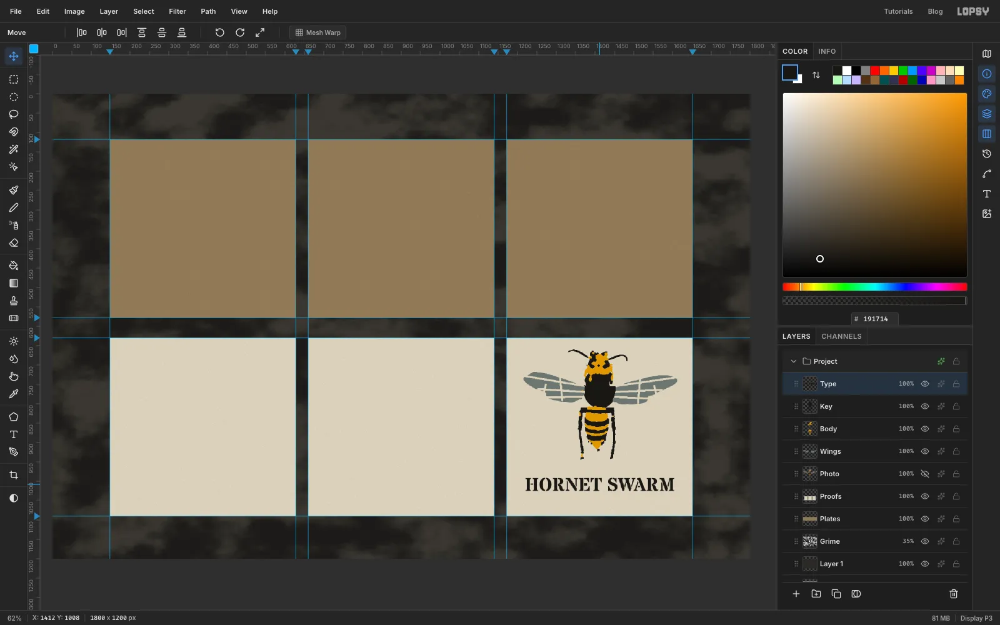

1. Keep **Key** active and pick the **Text** tool. Choose **Stardos Stencil**, weight **Bold**, size `58`, colour `#191714`.
2. Click in the empty paper below the hornet, type `HORNET SWARM` and press [[Tab]] to commit.
3. That's too wide for the plate. With the text layer still selected, change the size to `48` in the options bar, and the text shrinks in place.
4. Rename the layer `Type`. Drag it with the **Move** tool so it is centred under the hornet, about 40 px below the legs, and nudge it with the arrow keys to finish.
5. Click **Rasterize Layer** at the bottom of the Layers panel.

## Copy the art along the proof row

1. Choose **View → Show Grid**. In the options bar, drag **Grid** to `512px` and make sure **Snap** is ticked.
2. Click the **Wings** row and choose **Layer → Duplicate Layer**. Rename the copy `Wings 2`.
3. With the **Move** tool, press [[Left]] once. Snapped to the grid, one press moves the layer exactly one cell, into the second proof.
4. Duplicate again, rename it `Wings 1` and press [[Left]] once more.
5. Duplicate **Body**, rename it `Body 2` and press [[Left]] once.

The proofs now read 1, 1+2 and 1+2+3.

## Cut plate 1

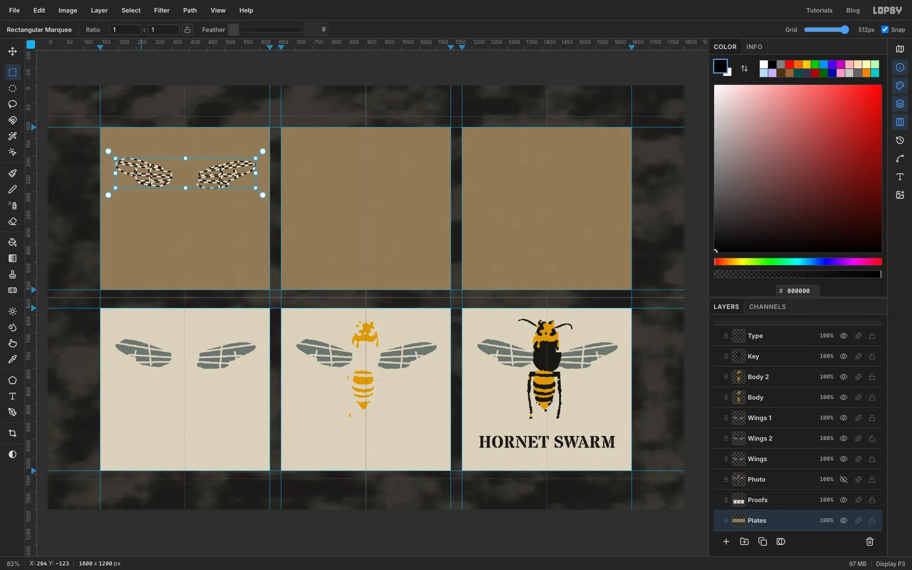

1. [[Cmd]]-click the **Wings 1** thumbnail to load the first proof's wings as a selection.
2. Pick the **Rectangular Marquee** and press [[Up]] once. With the grid snapped, the ants jump exactly one cell up into plate 1.
3. Click the **Plates** row and press [[Backspace]]. The wings are cut out of the chipboard, and the dark bench shows through the holes.

## Cut plates 2 and 3

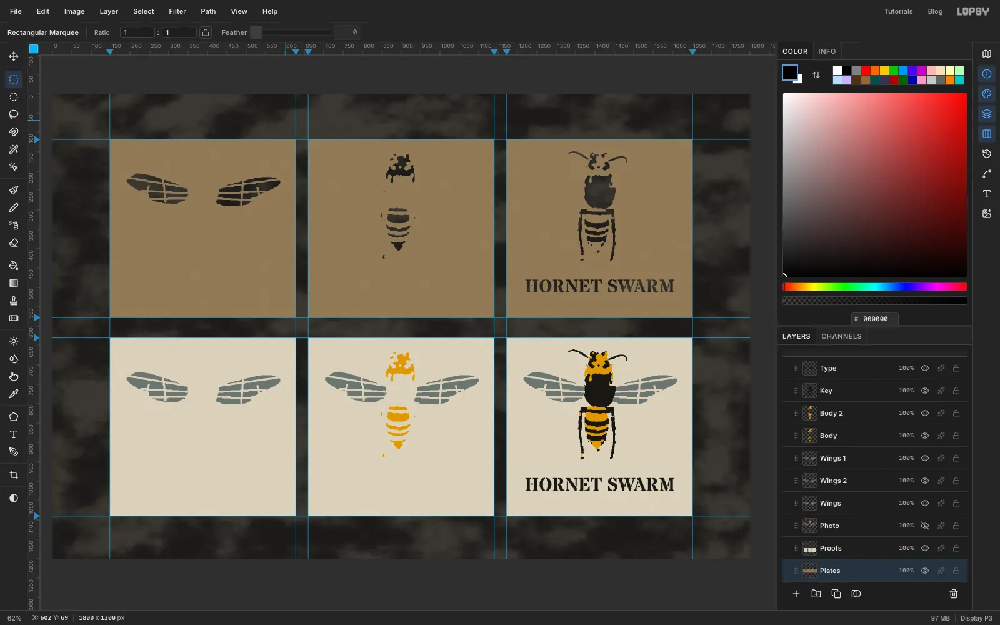

1. [[Cmd]]-click **Body 2**, press [[Up]] with the marquee tool, click **Plates** and press [[Backspace]].
2. [[Cmd]]-click **Key**, then [[Shift+Cmd]]-click **Type** to add the lettering. Press [[Up]], click **Plates** and press [[Backspace]].
3. Deselect and choose **View → Show Grid** again to hide it.

If you want to compare, undo back through the cuts to see the whole boards, then redo them.

## Give the paint some grain

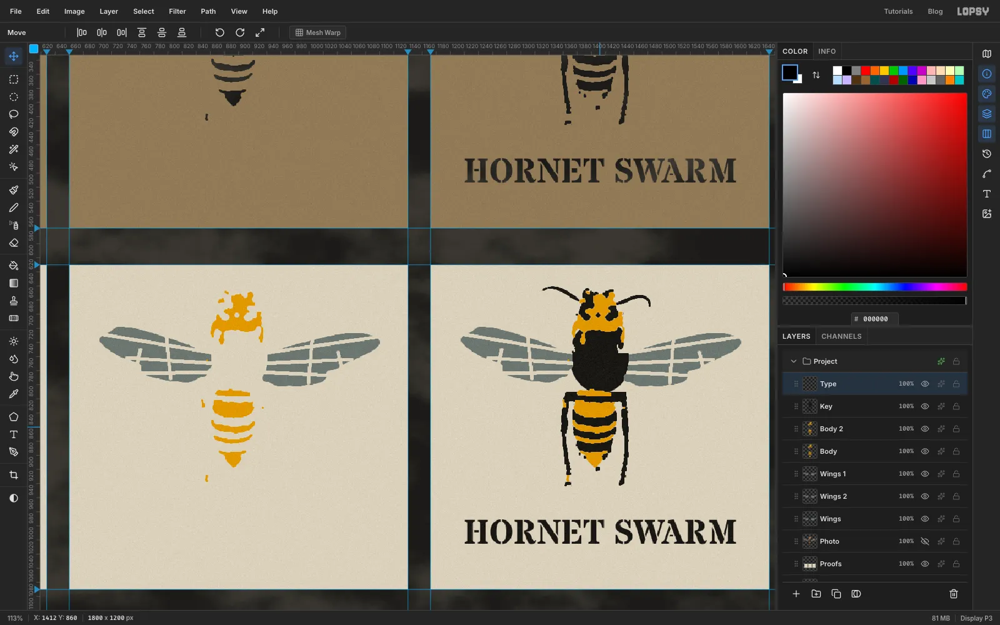

Sprayed paint is never flat. Click each art layer in turn (**Wings 1**, **Wings 2**, **Wings**, **Body 2**, **Body**, **Key** and **Type**) and apply **Filter → Add Noise…**, **Mono**, **Gaussian**, Amount `22`.

## Let the black run

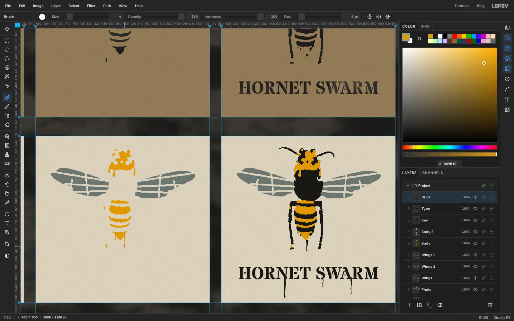

Drips go on their own layer, so they never get cut into a plate.

1. Click the **Type** row and add a layer called `Drips`.
2. Pick the **Brush**, set **Hardness** `100` and colour `#191714`. Open the brush presets (the tip button in the options bar). In the **Shape** tab set **Size** to about `5` and **Taper** to around `60` for a long run, or `25` for a short one, so the paint thins as it falls.
3. Drag straight down from the foot of a letter, wobbling a pixel or two as you go. Do five or six, all different lengths, plus one from the tip of the sting.
4. Set **Taper** back to `0` and click once at the bottom of each run to leave a bead.
5. Do two short mustard drips from the tip of the abdomen in the second proof.

## Add test chips and fuzz the paint edges

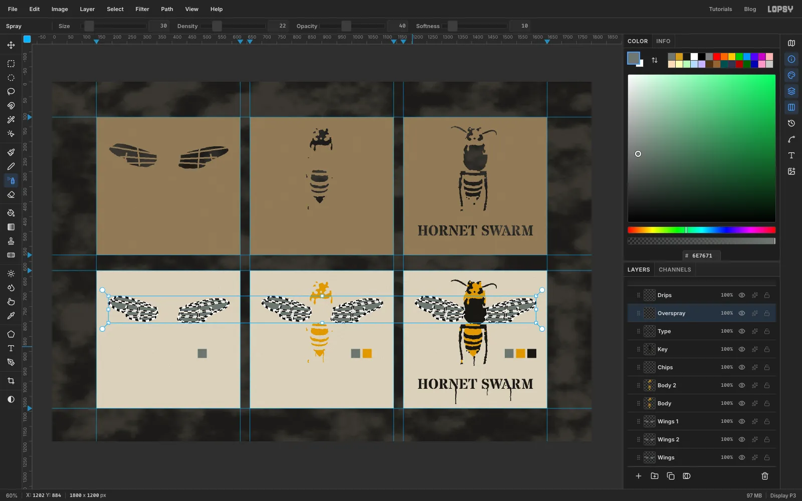

1. Click the **Body 2** row and add a layer called `Chips`. With the **Rectangular Marquee**, draw 30 px squares to the right of each hornet's legs: smoke on all three proofs, mustard on the second and third, and black on the third only. Fill each colour, then add Mono Gaussian noise at `22`.
2. Click the **Type** row and add a layer called `Overspray`.
3. [[Cmd]]-click **Wings 1**, then [[Shift+Cmd]]-click **Wings 2** and **Wings**. Choose **Select → Grow…** `3`, then [[Alt+Cmd]]-click each of the three wing thumbnails. You're left with a thin ring just outside the paint.
4. Pick the **Spray** tool: **Size** `30`, **Density** `22`, **Opacity** `40`, **Softness** `10`. Set the colour to smoke grey and spray back and forth over the wings. Only the ring takes paint.
5. Do the same for mustard (**Body 2** and **Body**) and black (**Key** and **Type**).

## Mist and spit

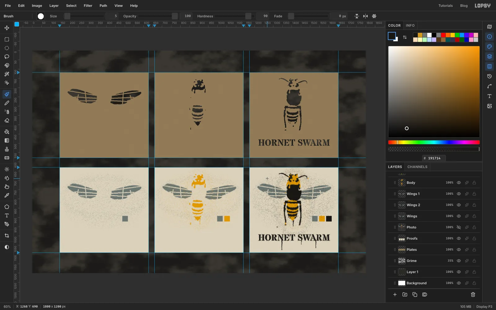

1. Stay on the **Overspray** layer. Deselect, then [[Cmd]]-click the **Proofs** thumbnail so the mist stays on the paper.
2. With the Spray at **Size** `40`, **Density** `30`, **Opacity** `24`, trace loose loops: smoke around all three hornets, mustard around the second and third, and black around the third.
3. For the finest mist, draw an elliptical marquee around each hornet and **Feather** it by `60`. Spray it at **Size** `20`, **Density** `2`, **Opacity** `35`, **Softness** `0`, in close back-and-forth passes. The feather fades the mist out at the edges.
4. Pick the **Brush** at **Hardness** `90` and click a few single droplets between 5 and 10 px across, as if the can spat. Use smoke, mustard and black, matching what each proof has been sprayed with.

## Spray overspray onto the plates

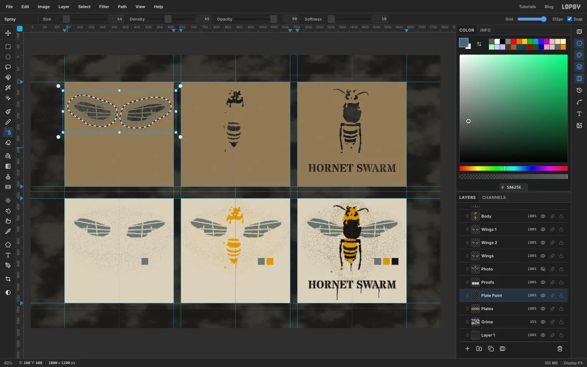

A used plate wears the paint that went through it.

1. Turn the 512 px grid back on. Click the **Plates** row and add a layer called `Plate Paint`.
2. [[Cmd]]-click **Wings 1**. With the marquee tool, press [[Up]] once. Then **Grow** `30` and **Feather** `20`.
3. Spray it with the Spray at **Size** `44`, **Density** `45`, **Opacity** `90` in a darker smoke, `#5A625E`, back and forth over the plate.
4. Repeat for plate 2 (**Body 2**, mustard, Opacity `60`) and plate 3 (**Key** and **Type**, `#3A352E`, Opacity `60`). Deselect and hide the grid.

## Keep the paint on the board

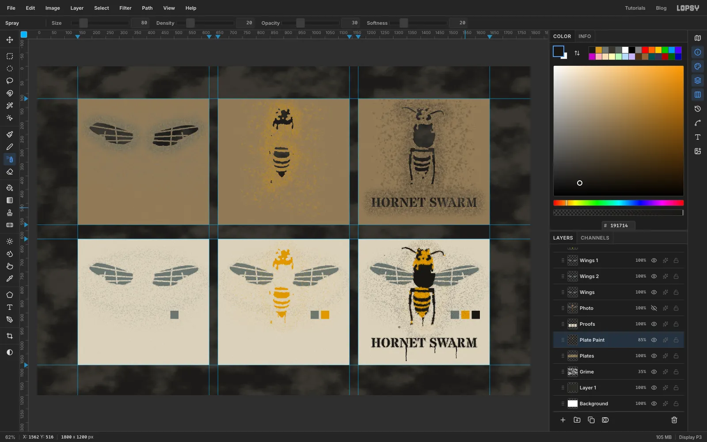

1. [[Cmd]]-click the **Plates** thumbnail, choose **Select → Inverse** and press [[Backspace]]. That clears any paint that landed in the holes or on the bench. Set the layer's opacity to `85%`.
2. [[Cmd]]-click **Plates** again. Spray a few loose, wider passes over each plate in its colour, at **Size** about `85`, **Density** `20`, **Opacity** `30`.
3. Deselect and choose **Layer → Merge Down** so the paint becomes part of the chipboard.

## Punch the registration holes

1. Pick the **Elliptical Marquee** and drag a 14 px circle 24 px in from the top-left corner of plate 1. [[Shift]]-drag another 24 px in from its bottom-right corner.
2. Add the same two circles on plates 2 and 3, holding [[Shift]] each time.
3. Click the **Plates** row, press [[Backspace]] and deselect.

## Add cut walls, shadows and pencil crosses

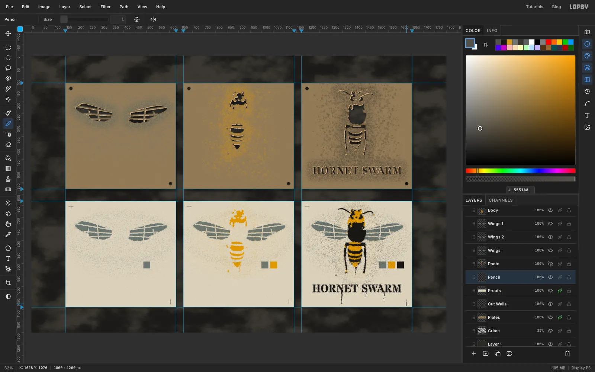

1. On **Plates**, open the effects. Turn on **Inner Glow** with colour `#2A1D10`, **Size** `6`, **Opacity** `55`. Turn on **Drop Shadow** with `#0B0A08`, **Offset** `4` / `8`, **Blur** `14`, **Opacity** `60`.
2. Add a layer called `Cut Walls`. Show the 512 px grid, [[Cmd]]-click **Wings 1** and [[Shift+Cmd]]-click **Body 2**, **Key** and **Type**. Press [[Up]] with the marquee tool, and fill with `#C2A57A`.
3. Hide the grid. Press [[Right]] three times and [[Down]] three times to slide the selection, then press [[Backspace]]. A 3 px sliver of raw board is left along the top and left edge of every hole.
4. Deselect. On **Proofs**, add a **Drop Shadow** in `#0B0A08`: Offset `3` / `5`, Blur `10`, Opacity `45`.
5. Add a layer called `Pencil`. With the **Pencil** at **Size** `1` in graphite `#55514A`, draw a small cross on each proof where the plate's registration holes would land. For each line, click and then [[Shift]]-click.

## Tape the first corner

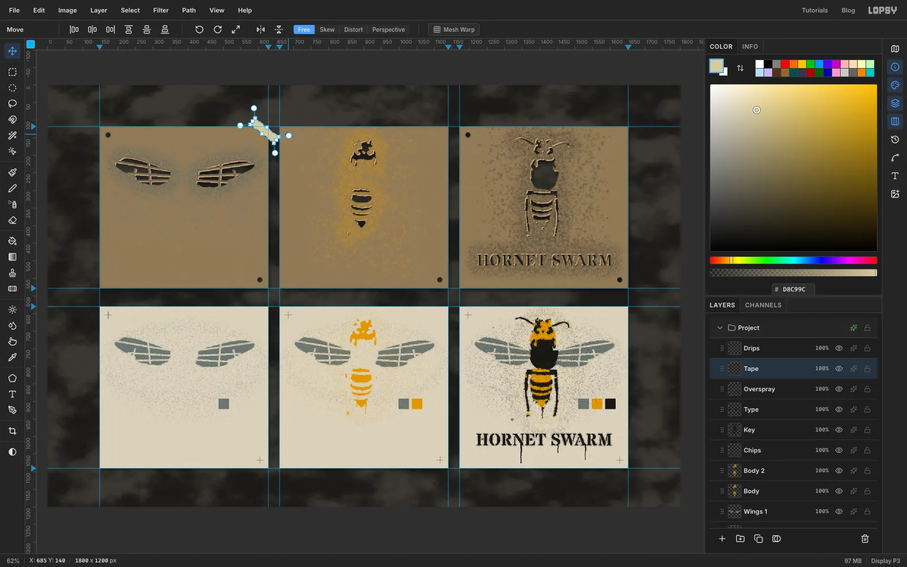

1. Click the **Overspray** row, just below **Drips**, and add a layer called `Tape`.
2. Marquee an 84 × 26 px strip across plate 1's top-right corner. Fill it with `#D8C99C` and add a little Mono noise (`10`).
3. Pick the **Move** tool and drag the round rotation handle outside the box's corner until the strip tilts about 38°, running down to the right across the corner.

## Copy the tape

1. Press [[Cmd+D]], marquee around the strip, then press [[Cmd+C]] and [[Cmd+V]]. Drag the copy down to plate 1's bottom-left corner and choose **Layer → Merge Down**.
2. Select both strips: marquee one, then [[Shift]]-marquee the other. Copy, paste and drag them one plate to the right.
3. Give each copied strip its own small tilt with the rotation handle so they don't match, then merge down. Repeat for plate 3.

## Tape the proofs

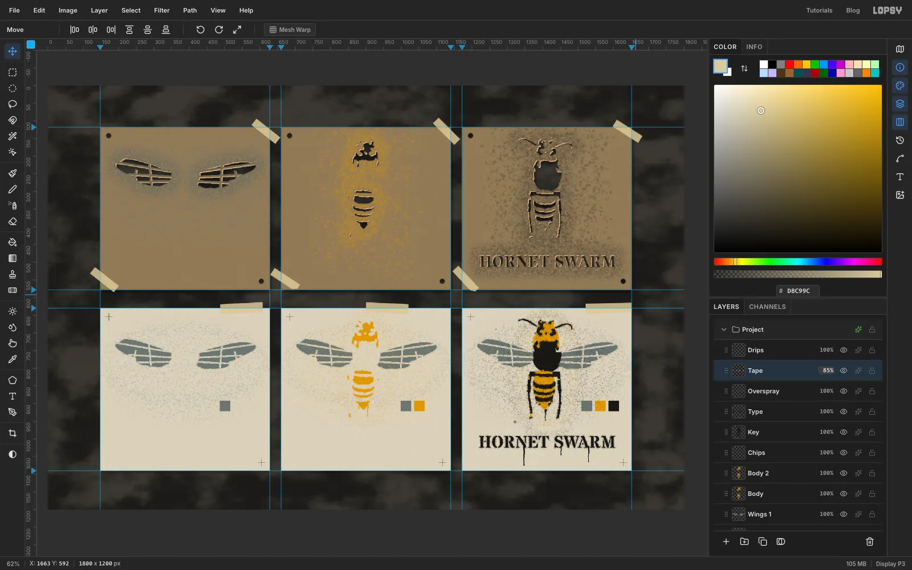

1. Marquee three 120 × 28 px strips across the top edges of the proofs, off to the right of centre and at different spots on each. Hold [[Shift]] for the second and third.
2. Fill, add Mono noise at `10`, and deselect. Then marquee each strip on its own and rotate it a degree or two, a different way each time.
3. Set the **Tape** layer's opacity to `85%`.

## Set the title

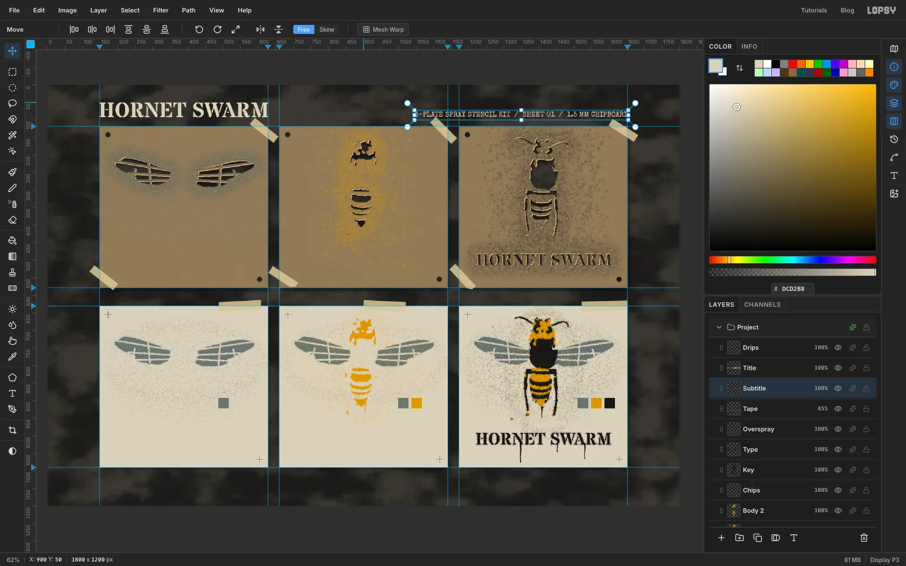

1. Click the **Tape** row so new text doesn't restyle anything. Pick the **Text** tool: **Stardos Stencil**, **Bold**, `60`, colour bone `#DCD2B8`. Click above the plates, type `HORNET SWARM`, press [[Tab]] and rename the layer `Title`.
2. Move it so its left edge sits on the first guide and its baseline sits 26 px above the plates.
3. Click **Tape** again. Switch to **Special Elite** at `20` and type `3-PLATE SPRAY STENCIL KIT  /  SHEET 01  /  1.5 MM CHIPBOARD`. Line its right edge up with the last guide and its baseline with the title's.

## Add captions and plate numbers

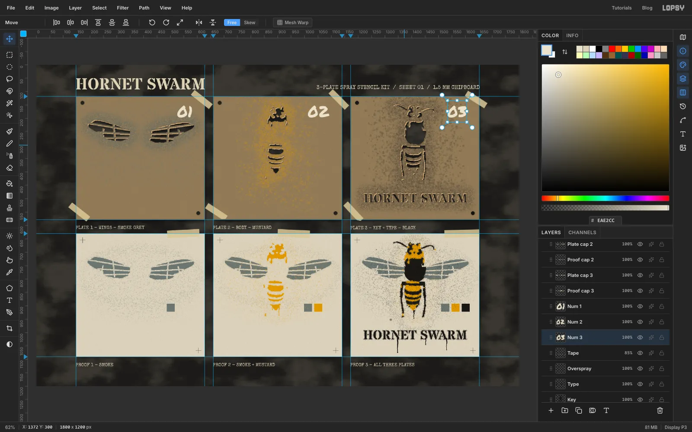

1. In **Special Elite** at `17`, type a caption for each card:
   - Under the plates, in the gutter between the rows: `PLATE 1 - WINGS - SMOKE GREY`, `PLATE 2 - BODY - MUSTARD`, `PLATE 3 - KEY + TYPE - BLACK`
   - Under the proofs: `PROOF 1 - SMOKE`, `PROOF 2 - SMOKE + MUSTARD`, `PROOF 3 - ALL THREE PLATES`
   - Line each caption's left edge up with its card. Click the **Tape** row before each new one.
2. In **Permanent Marker** at `58`, colour `#EAE2CC`, type `01`, `02` and `03`. Place each in its plate's top-right corner, 48 px in from the edge.

## Write the notes and the grease-pencil verdict

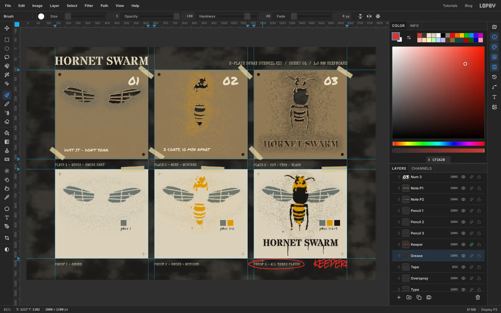

1. In **Permanent Marker** at `20`, write `DUST IT - DON'T SOAK` on plate 1 and `2 COATS, 10 MIN APART` on plate 2, near their bottom-left corners.
2. In **Covered By Your Grace** at `24`, colour `#3B3832`, write `pass 1`, `pass 1+2` and `pass 1+2+3` under the chips on each proof.
3. In **Rock Salt** at `30`, colour `#CF3A2B`, type `KEEPER!` and rename the layer `Keeper`. Give it a 1 px **Stroke** in the same red to thicken it. Set it on the proof 3 caption line, with its right edge on the last guide.
4. Add a layer called `Grease`. With the **Brush** at **Size** `5`, **Hardness** `80`, in grease red `#CF3A2B`, drag a quick, slightly lopsided loop around the proof 3 caption that overshoots where it closes.

## Wear the title

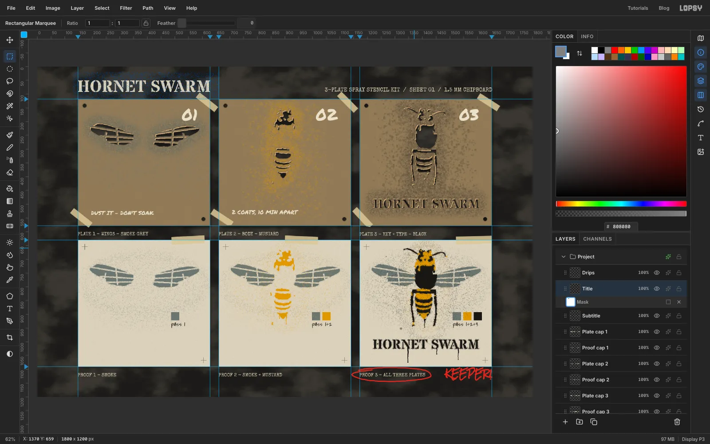

1. Click the **Title** row and **Rasterize Layer**. Add Mono Gaussian noise at `26`.
2. Click **Add Mask** at the bottom of the Layers panel, then click the new mask thumbnail to edit the mask.
3. Marquee around the title and fill it with `#808080`. Apply **Add Noise…** at `100` (**Mono**, **Uniform**), **Gaussian Blur…** at `1` and **Threshold…** at `92`. The dark specks in the mask hide the paint, so the title looks sprayed and chipped.
4. Click the layer's name to leave mask editing.

## Splatter the bench and leave a coffee ring

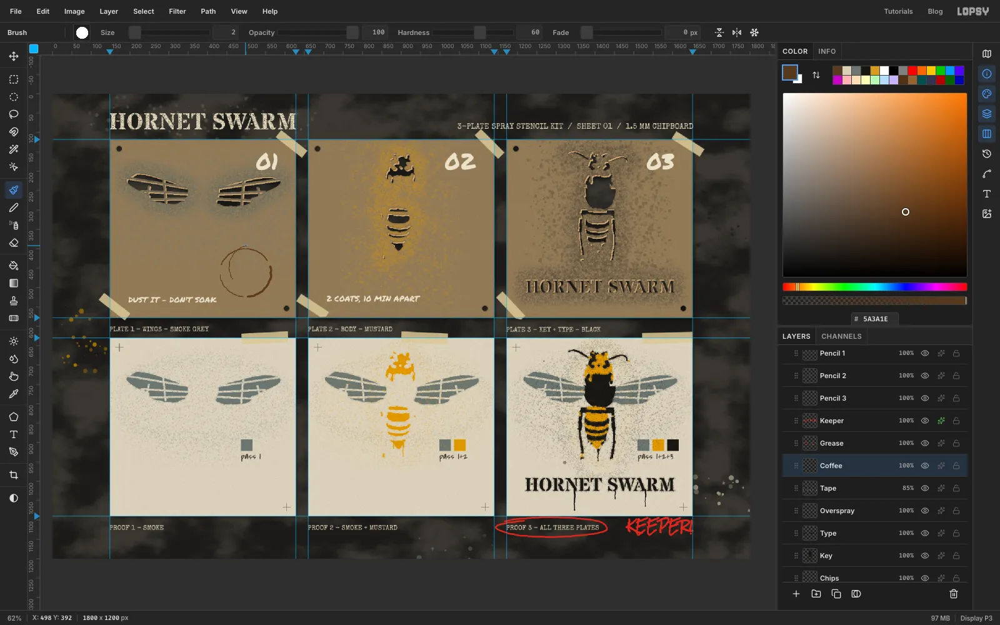

1. Click **Grime** and add a layer called `Bench Paint`. With the Spray at **Size** `110`, **Density** `12`, **Opacity** `22`, **Softness** `50`, mist a little bone around the title. Then, at **Size** `120`, **Density** `6`, **Opacity** `80`, **Softness** `0`, flick a few short splatters of mustard, black, smoke and bone into the margins.
2. Click **Tape** and add a layer called `Coffee`.
3. Pick the **Brush** with **Hardness** `60` and colour `#5A3A1E`. Draw a ring about 130 px across on the lower right of plate 1, in three separate arcs with gaps between them. Make the lower-right arc the heaviest (Size `7`) where the coffee pooled, and the others thinner (`4` and `3`).
4. At Size `2`, drag a faint partial second ring offset up and to the right.
5. Apply **Gaussian Blur…** at `1`, set the blend mode to **Multiply** and the opacity to `60%`.

## Finish with dust and a vignette

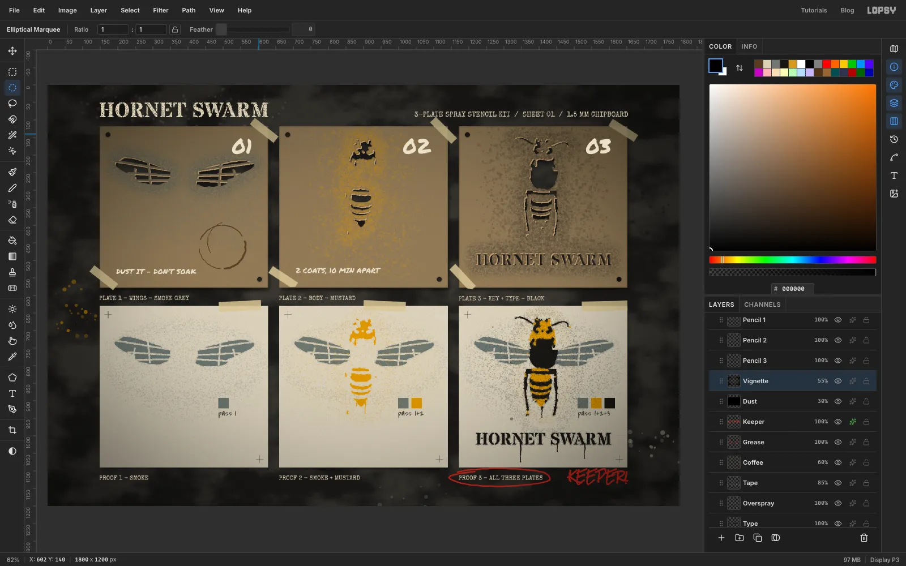

1. Click **Keeper** and add a layer called `Dust`. Fill it with `#808080`, apply **Add Noise…** at `100` (**Mono**, **Uniform**), then **Threshold…** at `236`. Set the blend mode to **Screen** and the opacity to `30%`. Only the white specks show.
2. Add a layer called `Vignette`. Draw an elliptical marquee from just inside the top-left corner to just inside the bottom-right. Choose **Select → Inverse**, fill with black and deselect.
3. Apply **Gaussian Blur…** at `180`, set the blend mode to **Multiply** and the opacity to `55%`.
4. Choose **View → Show Guides** to hide the guides, then **File → Quick Export PNG** and **File → Save Project**.
