*Grunge* design is what happened to print in the early 90s, when designers like David Carson at *Ray Gun* and Art Chantry in Seattle let the photocopier, the scalpel and the marker pen show. Type is distressed, photos are xeroxed until they turn into dots, paper is torn and taped, and everything has a little dirt on it. It suits subjects that are a bit damp and overlooked, so this tutorial uses it for a lichen app.

You'll make a presentation shot for *Lichen Finder*, a made-up field guide for the lichens of the Pacific Northwest. The canvas is 1600 × 1200 px, the shape of a portfolio shot. It holds three phone screens, each in its own layer group:

- **Phone A**, a lime "scan" screen with a circular viewfinder, tilted to the left
- **Phone B**, a cream "result" screen showing the lichen it found, in front
- **Phone C**, a black "My Finds" log with photo thumbnails, tilted to the right

Behind them is a photocopied paper wall with a taped-up halftone poster. In front are a title lockup, a sticker, a coffee ring, a handwritten aside and a layer of photocopier grit.

You'll use:

- **guides**, the **Rectangular** and **Elliptical Marquee**, the **Lasso**, **Select → Inverse**, and [[Option]]-drag to subtract from a selection
- the **Shape** tool's click-to-create **Shape Size** dialog, for exact rounded rectangles and circles
- **Add Noise**, **Clouds**, **Fibers**, **Threshold**, **Brightness/Contrast**, **Desaturate**, **Halftone**, **Hue/Saturation**, **Unsharp Mask** and **Gaussian Blur**
- dropped photos, scaled with the Move tool's handles, cropped and clipped to a screen shape
- **Copy** and **Paste**, **Duplicate Layer**, **New Group**, and rotating a **whole group** (live text and all) with one handle drag
- **Multiply** and **Overlay** layers, a **layer mask**, and the document's **Vignette** and **Contrast** adjustments
- the layer effects **Drop Shadow**, **Inner Glow** and **Stroke**
- the **Brush**, **Pencil**, **Eraser** and **Spray** tools
- live text in **Rubik Dirt**, **Special Elite**, **IBM Plex Mono**, **Reenie Beanie**, **Covered By Your Grace**, **Bebas Neue** and **Big Shoulders Stencil**

The five lichen photos are CC0 images from Wikimedia Commons: *Lichen genus Usnea, Old man's beard, British Columbia* by Commons user ImagePerson, *Lobaria pulmonaria* by Vesa Oikonen, *Xanthoria parietina* by sofiemeeus, *Rhizocarpon geographicum* by Randal, and *Cladonia asahinae (pixie cup lichen)* by Bernard Spragg. I downloaded each one at 960 px wide. Any close-up lichen photos will work. If you use different ones, draw your own crop boxes around the subject instead of typing the numbers below.

The palette:

- Xerox paper `#D8D0B8`, poster paper `#E6DFC8`, tape `#ECE4C8`
- Ink `#171512`, phone body `#121110`, night screen `#1B1A17`
- Lichen lime `#C8D43C`
- Cream screen `#EEE8D6`, grey `#A8A397`, divider `#3A3832`
- Marker red `#A3271B`, coffee `#6B4A2B`

> **Tip:** Many steps place things by their centre. The status bar at the bottom left shows the pointer's X and Y in document pixels, so hover until it reads the number you want, then click.

> **Tip:** New layers and new text land directly **above the active layer**. When a step says "select *X* first", that decides where the new layer goes in the stack.

> **Tip:** Press [[Cmd]]+[[D]] to deselect before you rotate or scale something with the **Move** tool. With a selection active, the handles frame the selection instead of the layer or group you meant.

> **Tip:** Lopsy names a text layer after its text. A few steps below give a text layer a different name in *italics*. Double-click the layer name to rename it. **Letter spacing** keeps whatever value you last typed, so set it back to **0** for any text where no spacing is given.

> **Note:** Shortcuts are written for a Mac. On Windows use [[Ctrl]] wherever it says [[Cmd]], and [[Alt]] for [[Option]].

## Lay down the paper

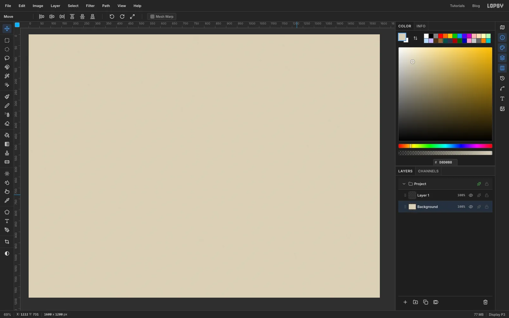

Choose **File → New**, keep the units on **Pixels**, and make the document **1600** wide and **1200** high.

Select the *Background* layer, set the foreground colour to xerox paper `#D8D0B8` and choose **Edit → Fill**. Then choose **Filter → Add Noise**: Amount **14**, Mode **Mono**, Distribution **Gaussian**. That gives the paper a fine tooth.

Click the top ruler to drop vertical guides at **60** and **520**, and the left ruler for horizontal guides at **60** and **1140**. The guides at 60 and 1140 are the outer margins, and 520 marks the right edge of the title column.

Select the empty *Layer 1* and click **Delete Layer** at the bottom of the Layers panel. You won't need it.

## Add soft stains

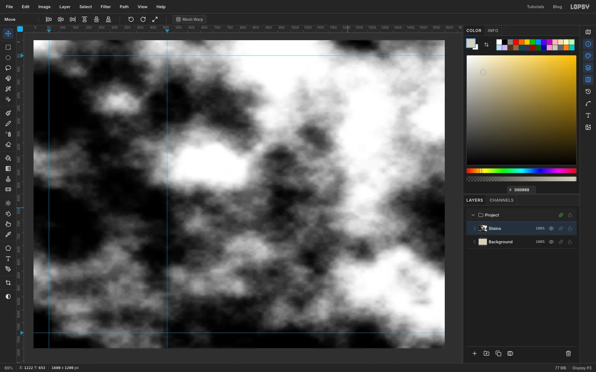

Photocopies are never evenly grey. Select *Background* and click **Add Layer** at the bottom of the Layers panel, then double-click the new layer's name and call it *Stains*.

Choose **Filter → Clouds** with Scale **5**. The layer fills with grey cloud shapes. Then choose **Filter → Brightness/Contrast** with Brightness **10** and Contrast **30** to give the clouds a little more shape.

## Speckle it with toner

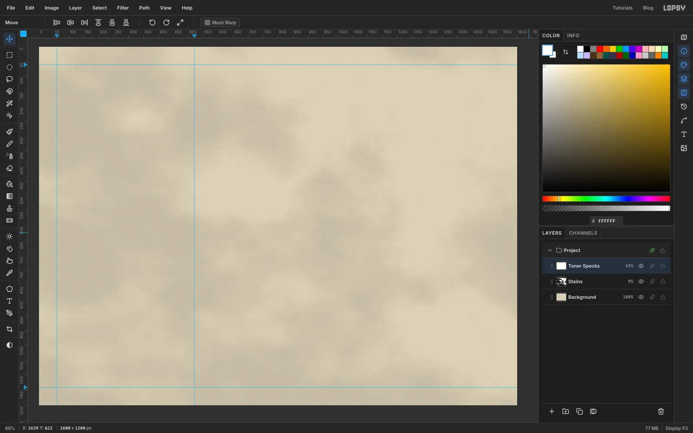

Open the layer effects for *Stains* (the effects button on its row). Set the blend mode to **Multiply** and close the drawer. Then click the opacity number on the layer row and drag it down to **9%**. Now the stains just darken the paper unevenly.

A cheap photocopier also leaves specks of toner. Click **Add Layer** and name it *Toner Specks*. Set the foreground to white `#FFFFFF` and choose **Edit → Fill**. Then:

1. **Filter → Add Noise**, Amount **100**, Mode **Mono**. The white turns into dense salt and pepper.
2. **Filter → Threshold**, Level **40**. Only the very darkest noise pixels stay black. Everything else turns white.

Set *Toner Specks* to **Multiply** at **45%**. The white disappears and only the specks remain. They're tiny, so zoom in to 100% to see them. At full size they give the sheet a gritty, photocopied feel.

## Tear a sheet and crop the photo

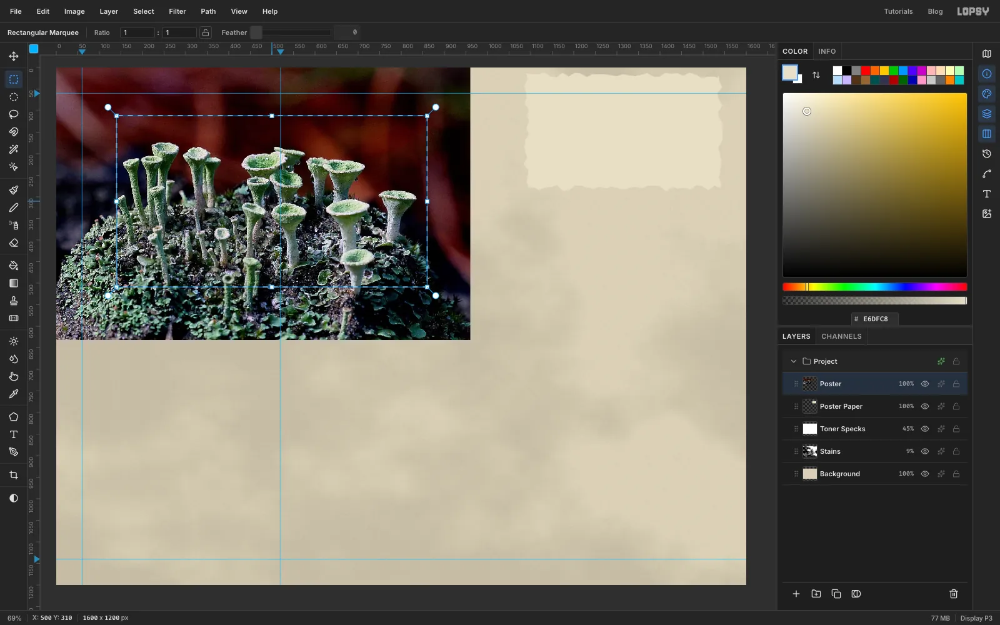

With *Toner Specks* selected, click **Add Layer** and name it *Poster Paper*.

Take the **Lasso** ([[L]]) and draw a rough rectangle in the top-right corner, from about X 1090, Y 18 to X 1540, Y 280. Wobble your hand a little along each edge so it looks torn rather than cut. Set the foreground to poster paper `#E6DFC8`, choose **Edit → Fill**, and press [[Cmd]]+[[D]].

Now drag the pixie-cup lichen photo from your desktop onto the canvas. It lands full size as a new layer in the top-left corner. Rename it *Poster* and press [[Cmd]]+[[D]].

A poster this small only reads if the subject fills it, so crop first. Click once with the **Rectangular Marquee** ([[M]]) to open its dialog and type the corners **140, 112** and **860, 509**. That's a box around the cluster of goblets, the same shape as the print area. Choose **Select → Inverse**, press [[Delete]], and keep going.

## Scale the crop down

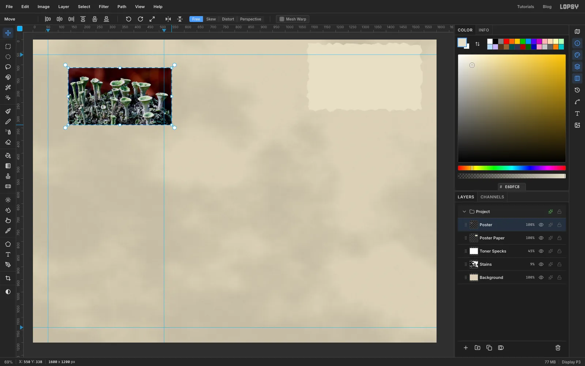

Open the marquee dialog again with the same corners, **140, 112** and **860, 509**, so the crop is selected. Take the **Move** tool ([[V]]), hold [[Cmd]] and drag the bottom-right corner handle inwards until the crop is **410 px** wide. [[Cmd]] keeps the proportions. Press [[Enter]] and then [[Cmd]]+[[D]].

## Place the photo on the poster

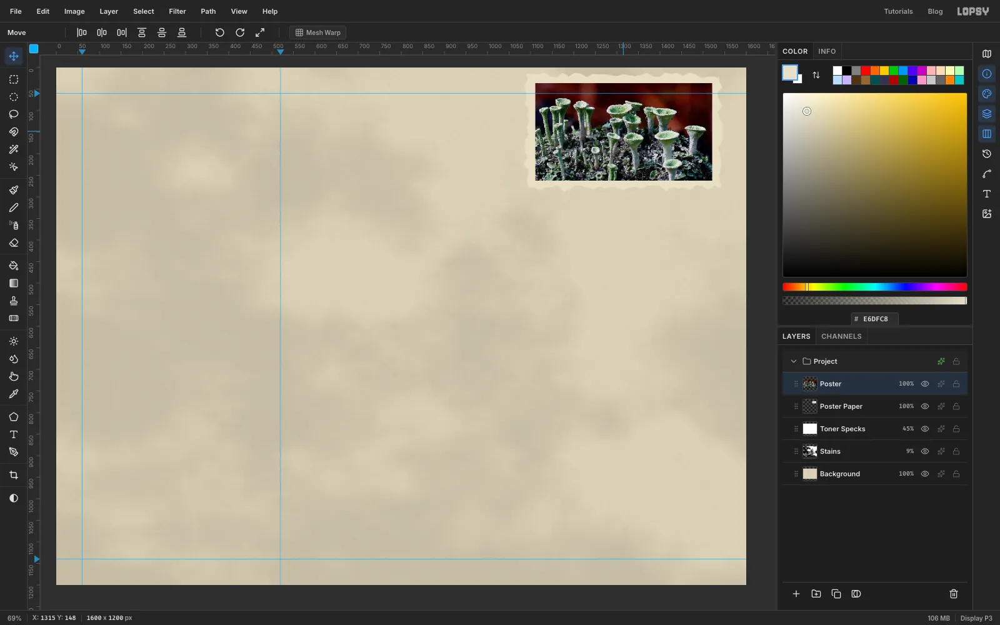

Drag the photo with the **Move** tool until its top-left corner sits at **X 1110, Y 36**. That leaves a 20 px margin of paper on the left and right, like a print on a sheet.

## Photocopy it into dots

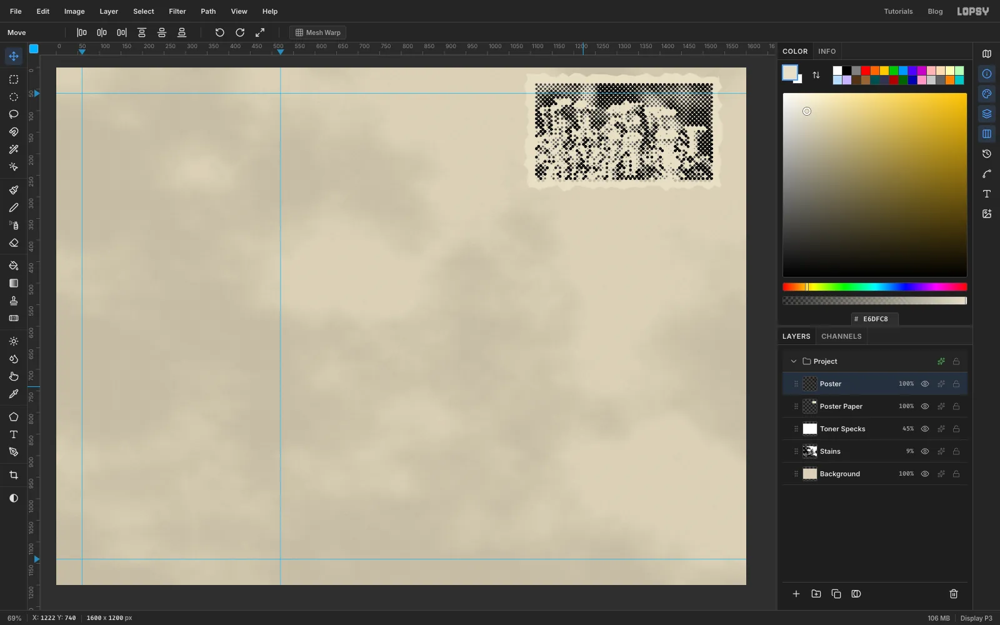

With *Poster* still selected:

1. **Filter → Desaturate**, to drop the colour.
2. **Filter → Brightness/Contrast**, Brightness **28**, Contrast **80**. Push it hard. A photocopy has no subtle midtones, and you want the pale cups to separate from the dark soil.
3. **Filter → Halftone**, Dot Size **7**, Angle **45**, Softness **0.6**.

Halftone turns the photo into black dots and leaves the white parts transparent, so the paper underneath shows through as the "white" of the print.

## Blend the print into the paper

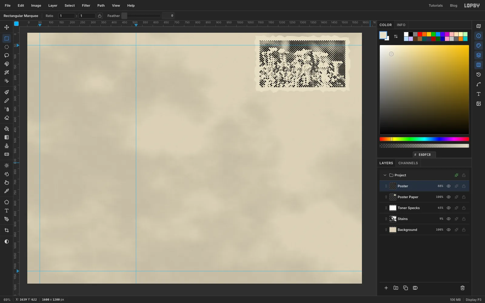

Set *Poster* to **Multiply** at **88%**. Now the dots sit *in* the paper instead of on top of it, and the paper's colour shows through as the white of the print.

## Build the first phone body

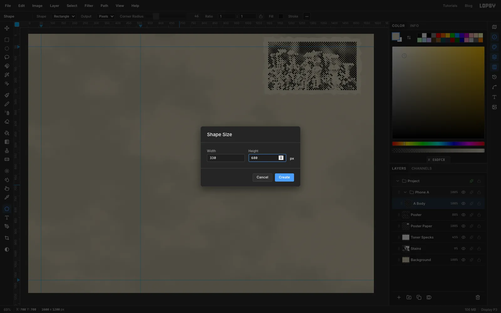

Each phone gets its own group. Select *Poster* and click **New Group** at the bottom of the Layers panel. Name the group *Phone A*, then click **Add Layer** to put a layer inside it and name the layer *A Body*.

Take the **Shape** tool ([[U]]). In the options bar choose Shape **Rectangle**, Output **Pixels** and Corner Radius **46**. Click the **Fill** swatch and type `#121110`. If a **Stroke** colour is set, click its swatch and choose **Remove stroke**.

Click once (don't drag) at **X 700, Y 700**. The **Shape Size** dialog opens. Type Width **330** and Height **680** and click **Create**. The rounded phone body is centred on your click.

Open the effects for *A Body*, turn on **Drop Shadow** and set Offset X **12**, Offset Y **18**, Blur **24** and Opacity **50**.

## Add a lime screen

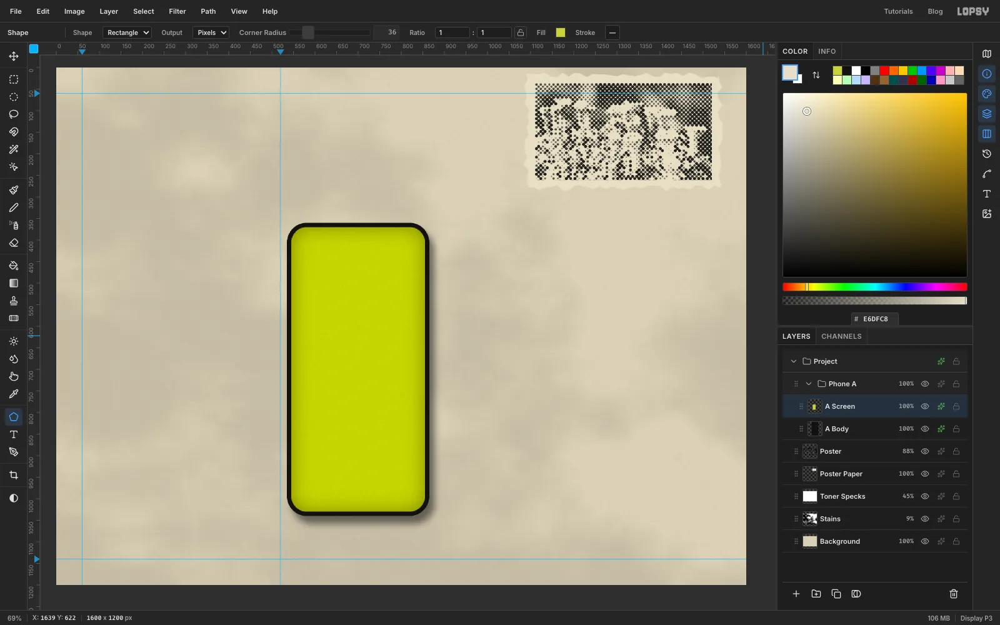

Click **Add Layer** and name it *A Screen*. With the Shape tool, set Corner Radius to **36** and the Fill to lichen lime `#C8D43C`. Click once at **X 700, Y 700** again and create a **310 × 660** rectangle. That leaves a 10 px black bezel all round.

Give the screen some grit with **Filter → Add Noise**: Amount **12**, Mode **Mono**. Then open its effects and turn on **Inner Glow**: Size **70**, Opacity **40**, colour ink `#171512`. The darkened edges make the screen look printed rather than lit.

## Cut a round viewfinder

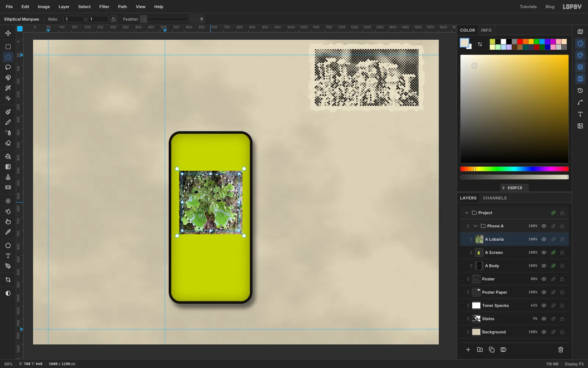

Drop the lungwort (*Lobaria*) photo onto the canvas and rename it *A Lobaria*. It lands above *A Screen*, inside the group. [[Cmd]]-drag its bottom-right handle until it's **250 px** wide, press [[Enter]] and [[Cmd]]+[[D]]. Then drag it with the Move tool until it's centred at about **X 700, Y 640**, in the upper half of the screen.

Take the **Elliptical Marquee** and click once to open its dialog. Type the corners **588, 528** and **812, 752**. That's a circle 224 px across, centred on the photo.

## Duotone the viewfinder and draw the camera chrome

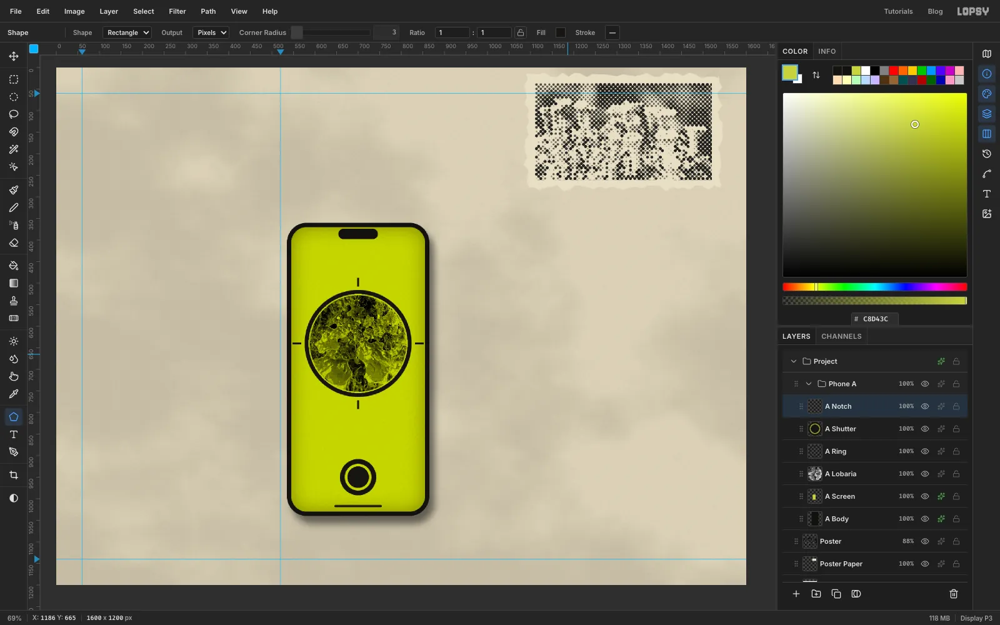

Choose **Select → Inverse**, press [[Delete]] and then [[Cmd]]+[[D]]. Now make it duotone:

1. **Filter → Desaturate**.
2. **Filter → Brightness/Contrast**, Brightness **5**, Contrast **40**.
3. Set the layer's blend mode to **Multiply**. The grey photo takes on the lime of the screen beneath it.

**The ring.** Click **Add Layer** and name it *A Ring*. Use the Elliptical Marquee dialog for a circle from **576, 516** to **824, 764**, and fill it with ink `#171512`. Then choose **Select → Shrink**, enter **9**, press [[Delete]] and [[Cmd]]+[[D]]. You're left with a 9 px ring.

**The tick marks.** Take the **Pencil** ([[N]]) at Size **4**, in ink. Click just outside the ring at the top (X 700, Y 506), then hold [[Shift]] and click at Y 490. That draws a short straight line. Release [[Shift]] and do the same at the bottom, left and right, starting each tick with a plain click.

**The shutter.** Click **Add Layer** and name it *A Shutter*. With the Shape tool set to **Ellipse** and ink fill, click once at **X 700, Y 950** and create an **84 × 84** circle. Marquee a circle from **669, 919** to **731, 981**, fill it with lime, Shrink by **4** and press [[Delete]]. That cuts a thin lime ring into the button. Finish with a **50 × 50** ink ellipse at the same centre.

**The notch and home bar.** Last, add a layer called *A Notch*. With the Shape tool set to **Rectangle**, draw a **92 × 24** ink rectangle with Corner Radius **12** at **X 700, Y 386** for the camera notch. Then set Corner Radius to **3** and draw a **110 × 5** one at **X 700, Y 1017** for the home bar.

## Type the scan screen

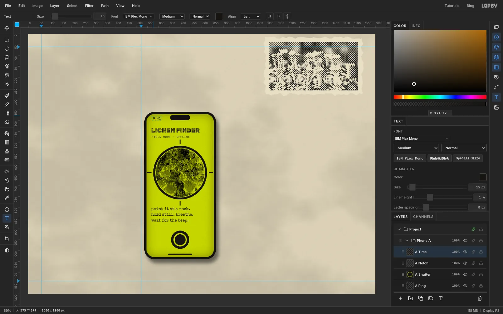

Before each new piece of text, **select a non-text layer** (here, *A Screen*). With a text layer active, changing the font or size in the options bar would restyle that layer instead. Also work **from the bottom up**: a click inside an existing text box edits that text instead of starting a new one.

Take the **Text** tool ([[T]]). Then for each line, set the font, size and colour, click at the given point (it becomes the top-left of the text), type, and press [[Tab]] to finish:

Everything on this screen lines up on a left edge at **X 567**, 22 px inside the screen.

1. **Special Elite**, 19 px, ink, at **Y 796**: `point it at a rock.`, [[Enter]], `hold still. breathe.`, [[Enter]], `wait for the beep.`
2. **IBM Plex Mono**, 13 px, ink, at **Y 466**: `FIELD MODE · OFFLINE`. In the **Text** panel, set Letter spacing to **1**.
3. **Rubik Dirt**, 28 px, ink, Letter spacing **0**, at **Y 426**: `LICHEN FINDER`.
4. Select *A Notch* first. Then **IBM Plex Mono** Medium, 15 px, ink, at **Y 379**, but a little further in at **X 575** so it clears the rounded corner: `9:41`.

Rubik Dirt is already distressed, so the header looks worn without any extra work.

## Start the field log phone

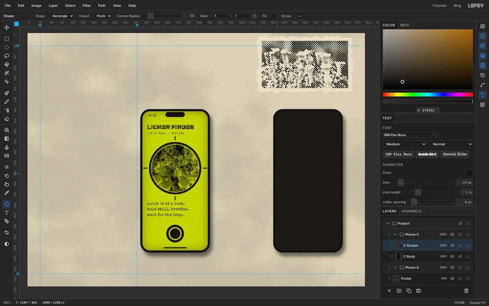

Click the arrow on the *Phone A* group to collapse it, then click its row and click **New Group**. Because the collapsed group was selected, the new group lands next to it rather than inside it. Name it *Phone C*.

Inside it, build the body and screen exactly as before, but centred at **X 1330, Y 700**: *C Body* (330 × 680, radius 46, `#121110`, with the same Drop Shadow) and *C Screen* (310 × 660, radius 36, night `#1B1A17`).

## Crop square thumbnails

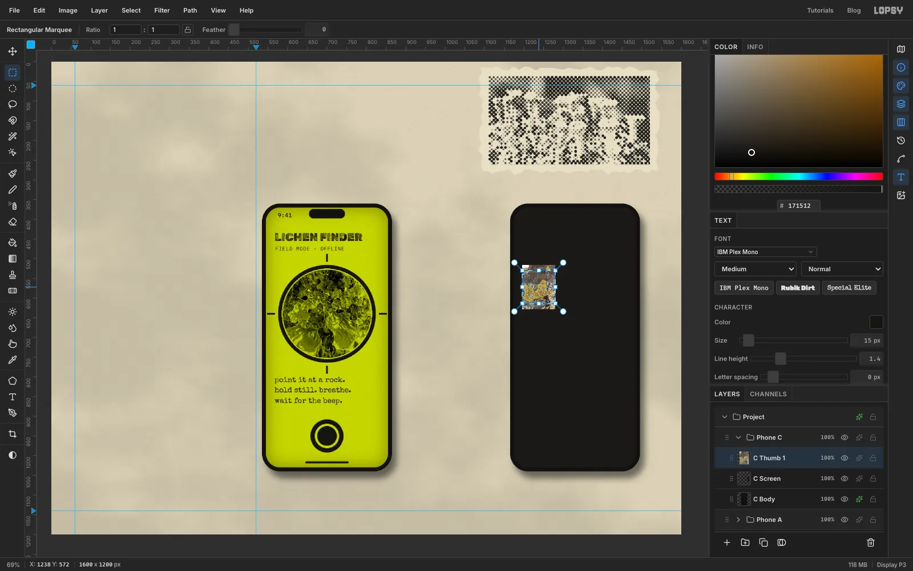

The log lists four finds, one row every 112 px starting at Y 530. Each row has an 84 px square photo whose left edge is at X 1196.

Select *C Screen*, drop the sunburst lichen (*Xanthoria*) photo, and rename it *C Thumb 1*. [[Cmd]]-drag its corner handle until it's **84 px** wide. It's a portrait photo, so it's taller than that. Press [[Enter]] and [[Cmd]]+[[D]], then move it so its top-left corner is at **X 1196, Y 516**.

Click once with the Rectangular Marquee and type the corners **1196, 530** and **1280, 614**. Choose **Select → Inverse**, press [[Delete]] and then [[Cmd]]+[[D]]. Open its effects and add a **Stroke**, Width **2**, colour cream `#EEE8D6`. That's a little photo border.

Do the same for two more photos. Select *C Screen* before each drop so it lands in the group:

- **Map lichen** (*Rhizocarpon*), named *C Thumb 2*. It's a landscape photo, so scale it to **112 px** wide so that it's 84 px tall. Put its top-left at **X 1182, Y 642**, crop to **1196, 642 – 1280, 726**, and add the same Stroke.
- **Lungwort** (*Lobaria*), named *C Thumb 4*. It's square, so scale it to **84 px**. Place it at **X 1196, Y 866**, crop to **1196, 866 – 1280, 950**, and add the same Stroke.

Leave the third row empty for now.

## Add dividers and a plus button

Select *C Screen* and add a layer called *C Dividers*. With the **Pencil** at Size **1** and colour `#3A3832`, click at **X 1196, Y 628** and [[Shift]]-click at **X 1463, Y 628**. Repeat at Y **740** and **852**.

Add a layer called *C Fab*. Draw a **64 × 64** lime ellipse at **X 1431, Y 968**. Then switch the Pencil to Size **5** and ink. Click at **X 1419, Y 968** and [[Shift]]-click at **X 1443, Y 968**. Release [[Shift]], then click at **X 1431, Y 956** and [[Shift]]-click at **X 1431, Y 980**. That's the plus sign.

Add *C Notch* with the notch (**92 × 24**, Corner Radius **12**, ink, at **X 1330, Y 386**) and the home bar (**110 × 5**, Corner Radius **3**, at **X 1330, Y 1017**). Make the home bar cream this time so it shows on the dark screen.

## Type the field log

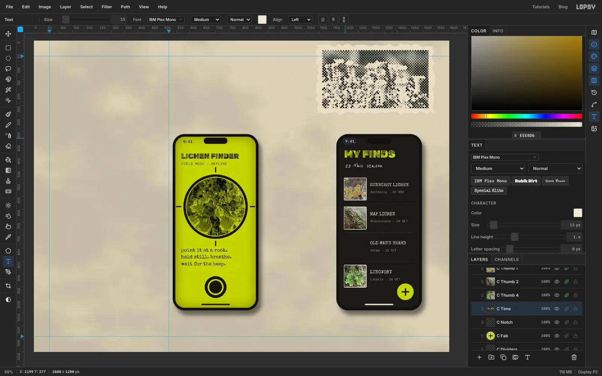

Select *C Screen* before each new text and work from the bottom row up. For each row, type the small line first and then the name above it:

All of them start at **X 1295**, just right of the thumbnails. The names are **Special Elite**, 17 px, cream `#EEE8D6`. The small lines are **IBM Plex Mono**, 12 px, grey `#A8A397`.

- Row 4: `Lobaria · 14 OCT` at Y 912, then `LUNGWORT` at Y 882.
- Row 3: `Usnea · 21 OCT` at Y 800, then `OLD MAN'S BEARD` at Y 770.
- Row 2: `Rhizocarpon · 29 OCT` at Y 688, then `MAP LICHEN` at Y 658.
- Row 1: `Xanthoria · 03 NOV` at Y 576, then `SUNBURST LICHEN` at Y 546.

Then the header, still from the bottom up:

- **Reenie Beanie**, 30 px, cream, at **X 1199, Y 462**: `23 this season`.
- **Rubik Dirt**, 40 px, lime, at **X 1195, Y 410**: `MY FINDS`.
- Select *C Notch*, then **IBM Plex Mono** Medium, 15 px, cream, at **X 1199, Y 377**: `9:41`.

## Start the result phone

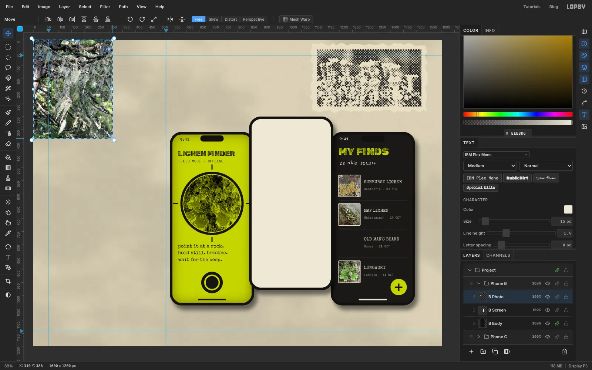

Collapse *Phone C*, select its row and click **New Group**. Name the group *Phone B*. It's the top group, so it sits in front of the other two phones.

Build *B Body* and *B Screen* centred at **X 1010, Y 640**, with the screen in cream `#EEE8D6`. Give the screen **Add Noise**, Amount **8**, Mode **Mono**.

Drop the old man's beard (*Usnea*) photo, rename it *B Photo*, and [[Cmd]]-drag its corner handle until it's **310 px** wide, the full width of the screen. Press [[Enter]] and [[Cmd]]+[[D]], then move it so its top-left corner sits at **X 855, Y 270**.

## Clip the photo to the screen

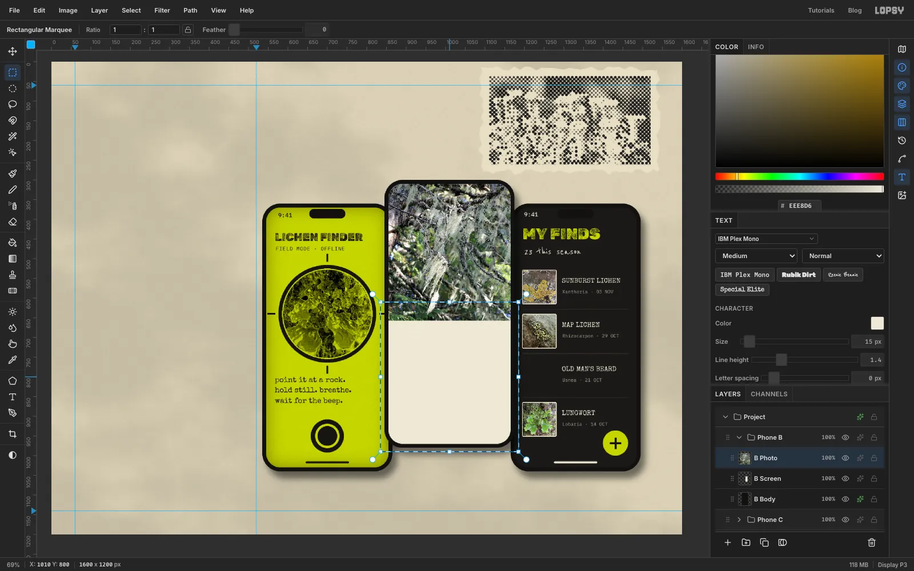

The photo's square corners poke out past the rounded screen. To trim them, [[Cmd]]-click the thumbnail of *B Screen* in the Layers panel. That loads the screen's shape as a selection. Click the *B Photo* row so you're editing the photo, choose **Select → Inverse** and press [[Delete]], then [[Cmd]]+[[D]].

Now cut the photo off at Y 610. Use the Rectangular Marquee dialog with corners **835, 610** and **1185, 990**, press [[Delete]] and [[Cmd]]+[[D]].

Tone it down so it looks printed rather than glossy:

1. **Filter → Hue/Saturation**, Saturation **−30**.
2. **Filter → Brightness/Contrast**, Brightness **−4**, Contrast **18**.
3. **Filter → Unsharp Mask**, Radius **2**, Amount **0.8**.

## Scrim, scan brackets, sticker and button

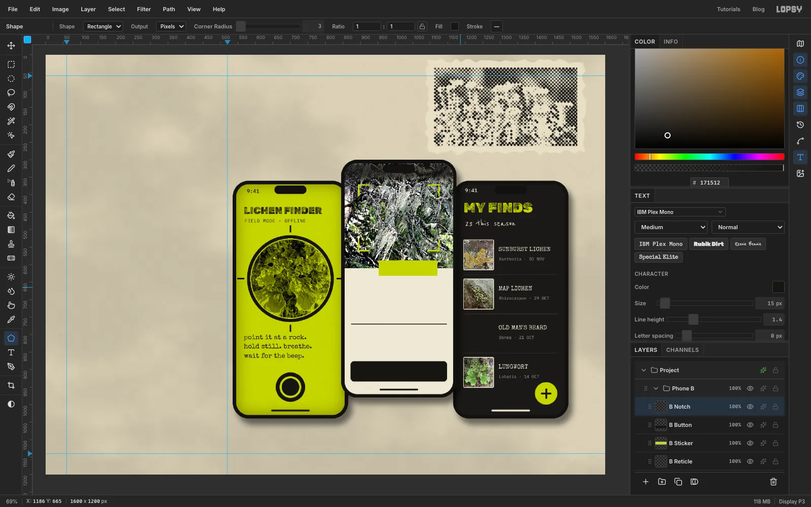

Several small pieces go on this screen. Click **Add Layer** for each one and name it as given:

1. **Scrim.** The time in the status bar won't read over a busy photo, so add *B Scrim*. Marquee from **855, 310** to **1165, 356**, fill it with ink, and deselect. Run **Filter → Gaussian Blur** with Radius **18**. Clip it to the screen the same way as the photo ([[Cmd]]-click *B Screen*'s thumbnail, select *B Scrim*, **Select → Inverse**, [[Delete]], [[Cmd]]+[[D]]). Then drop its opacity to **75%**.
2. **Scan brackets.** Add *B Reticle* and take the **Pencil** at Size **4** in lime. The brackets mark the corners of the box **895, 372 – 1125, 560**. For each corner, click the end of one arm (30 px from the corner), [[Shift]]-click the corner, then [[Shift]]-click the end of the other arm. Release [[Shift]] before you start the next corner.
3. **Match sticker.** Add *B Sticker*. With the Shape tool (Rectangle, Corner Radius **3**, lime fill), click at **X 1036, Y 610** and create a **168 × 44** rectangle. It sits on the photo's bottom edge.
4. **Button and divider.** Add *B Button* and create a **276 × 58** ink rectangle with Corner Radius **10** at **X 1010, Y 905**. On the same layer, use the Pencil at Size **2** in ink: click at **X 874, Y 770** and [[Shift]]-click at **X 1146, Y 770** for a divider.
5. **Notch and home bar.** Add *B Notch*. Create a **92 × 24** ink rectangle with Corner Radius **12** at **X 1010, Y 326**, then a **110 × 5** one with Corner Radius **3** at **X 1010, Y 957**.

## Type the result screen

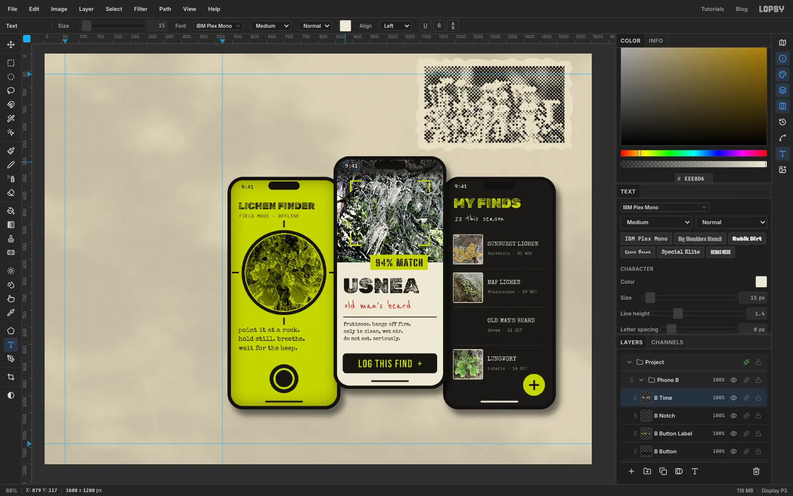

From the bottom up again:

1. Select *B Button*. Type **Bebas Neue**, 32 px, lime, `LOG THIS FIND  +` (two spaces before the plus), with Letter spacing **2**, clicking at about **X 930, Y 886**. Then centre it on the button with the **Move** tool's arrow keys. Each press moves 1 px, and [[Shift]] moves 10 px. Aim for equal space on the left and right and above and below the capitals.
2. Select *B Screen*. The body text lines up on a left edge at about **X 873**. **Special Elite**, 15 px, ink, Letter spacing **0**, at **Y 782**: `fruticose. hangs off firs.` / `only in clean, wet air.` / `do not eat. seriously.`
3. **Reenie Beanie**, 36 px, marker red `#A3271B`, at **Y 712**: `old man's beard`.
4. **Rubik Dirt**, 62 px, ink, at **Y 636**: `USNEA`.
5. Select *B Sticker*. **Big Shoulders Stencil** ExtraBold (800), 28 px, ink, Letter spacing **2**, clicked at about **X 980, Y 594**: `94% MATCH`. Centre it on the sticker with the arrow keys.
6. Select *B Notch*. **IBM Plex Mono** Medium, 15 px, cream, Letter spacing **0**, at **X 879, Y 317**: `9:41`.

## Copy a thumbnail from the photo

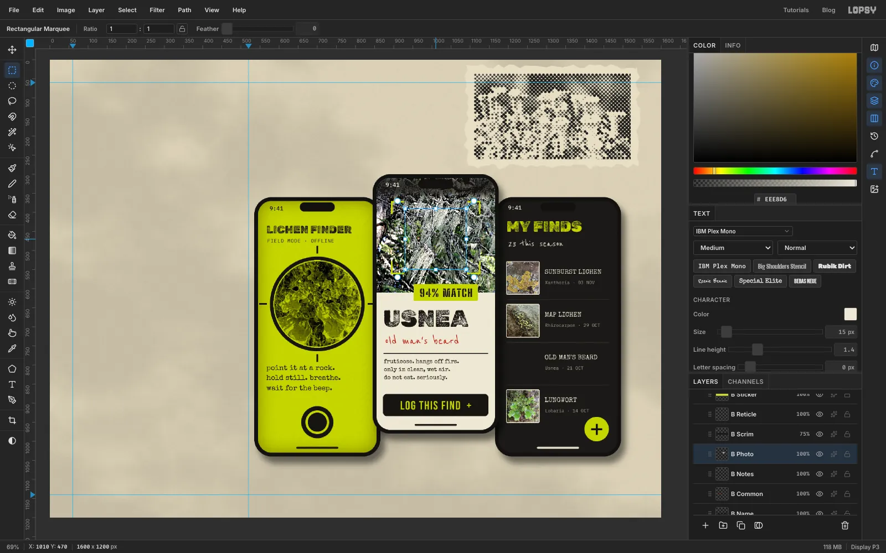

The log's third row is old man's beard too, so borrow it from the big photo. Select *B Photo* and use the Rectangular Marquee dialog to select **930, 390 – 1090, 550**, a 160 px square of hanging strands. Press [[Cmd]]+[[C]].

## Paste it into the field log

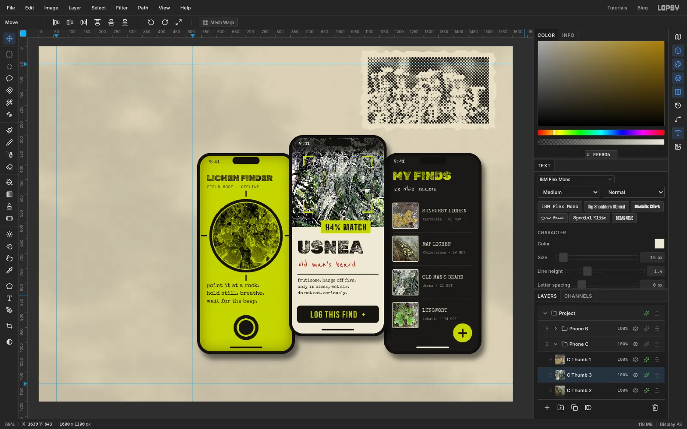

Collapse *Phone B*, expand *Phone C*, and select *C Thumb 2*. Press [[Cmd]]+[[V]]. The square pastes as a new layer just above *C Thumb 2*, in the same spot it came from. That spot is behind Phone B, so click the eye on the *Phone B* row to hide that group while you work. Press [[Cmd]]+[[D]] and rename the layer *C Thumb 3*.

Select the pasted square again with the marquee dialog (**930, 390 – 1090, 550**), then [[Cmd]]-drag its bottom-right handle in until it's **84 px** wide. Press [[Enter]] and [[Cmd]]+[[D]]. Move it to **X 1196, Y 754**, the empty third row, and give it the same cream **Stroke**, Width **2**. Click the eye on *Phone B* again to bring it back.

## Fan out the phones

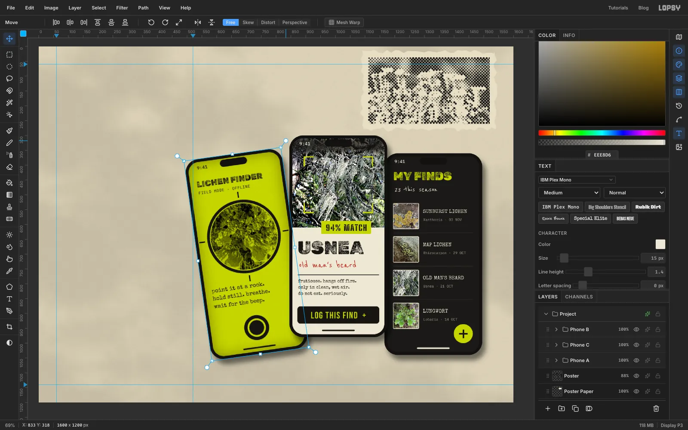

Here's where groups pay off. Collapse the groups, click the *Phone A* group's row, and press [[Cmd]]+[[D]] so nothing is selected. Take the **Move** tool. Handles appear around everything in the group.

Drag the top-right **rotation handle** (the round one just outside the corner) counter-clockwise, about **8°**, so the phone leans left. Lopsy doesn't show the angle while you drag. As a guide, 8° moves the phone's top-left corner about 45 px to the left. Hold [[Cmd]] while dragging if you'd rather snap to 15° steps. Everything turns together, and the text stays live and editable. Press [[Enter]] to finish.

Do the same with *Phone C*, turning it about **7°** clockwise, so its top-right corner moves about 40 px right.

## Tilt the poster

The poster has two layers, the paper and the print, so turn them together. Click *Poster Paper*, then [[Shift]]-click *Poster* so both are selected. Press [[Cmd]]+[[D]], and with the Move tool drag a rotation handle about **2.5°** clockwise, just enough that the poster's top edge visibly runs downhill. Press [[Enter]].

## Type the title and draw the swash

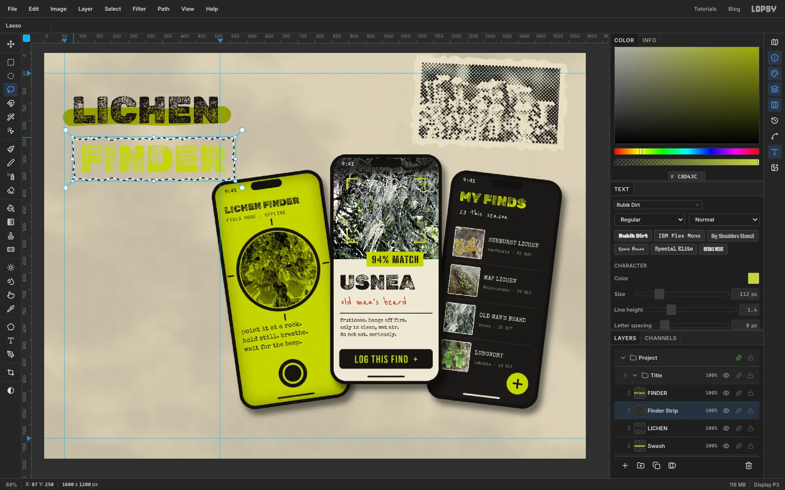

Collapse *Phone B*, select it, and click **New Group**. Name it *Title*. Inside it, click **Add Layer** twice and name the layers *Swash* (lower) and *Finder Strip* (upper).

Rough the title in by eye first, a little right of the margin, and line the whole group up with the guide at the end. That's easier than placing each piece exactly.

Select *Finder Strip* and type **Rubik Dirt**, 112 px, lime, Letter spacing **0**: `FINDER` at about **X 104, Y 236**. Then select *Swash* and type `LICHEN` in the same font and size in ink at about **X 82, Y 92**.

Select *Swash*. Take the **Brush** ([[B]]) with Size **54**, Hardness **88** and Opacity **100**, in lime. Drag one slightly wavy stroke along the lower half of LICHEN, from just before the L to just past the N, like a highlighter pen. Set *Swash* to **Multiply** so the paper grain shows through the marker.

Select *Finder Strip*. With the **Lasso**, draw a rough rectangle about 20 px larger than FINDER on every side. Keep your hand moving in little zigzags along each edge so it looks ripped off a page.

## Fill the torn strip

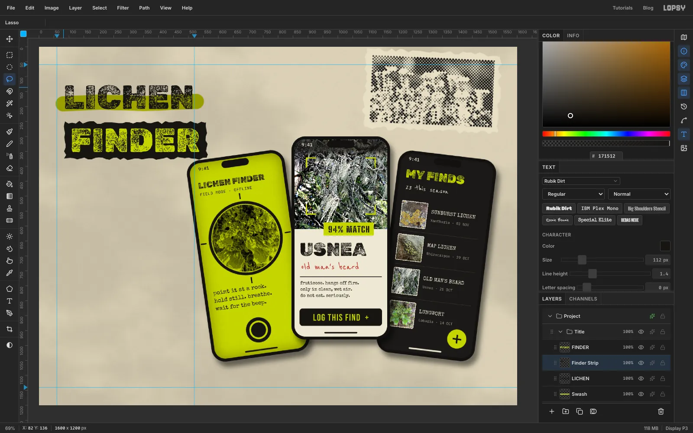

Fill the selection with ink and press [[Cmd]]+[[D]]. The FINDER text is above the strip, so the lime letters now sit on black paper.

## Tilt the strip and its word

Tilt the strip and its word together. With *Finder Strip* selected, [[Shift]]-click the *FINDER* text row so both are selected. Press [[Cmd]]+[[D]], take the **Move** tool, and drag a rotation handle about **3°** counter-clockwise, so the strip's right end rises about 20 px. Press [[Enter]]. The text stays live.

## Add the tagline

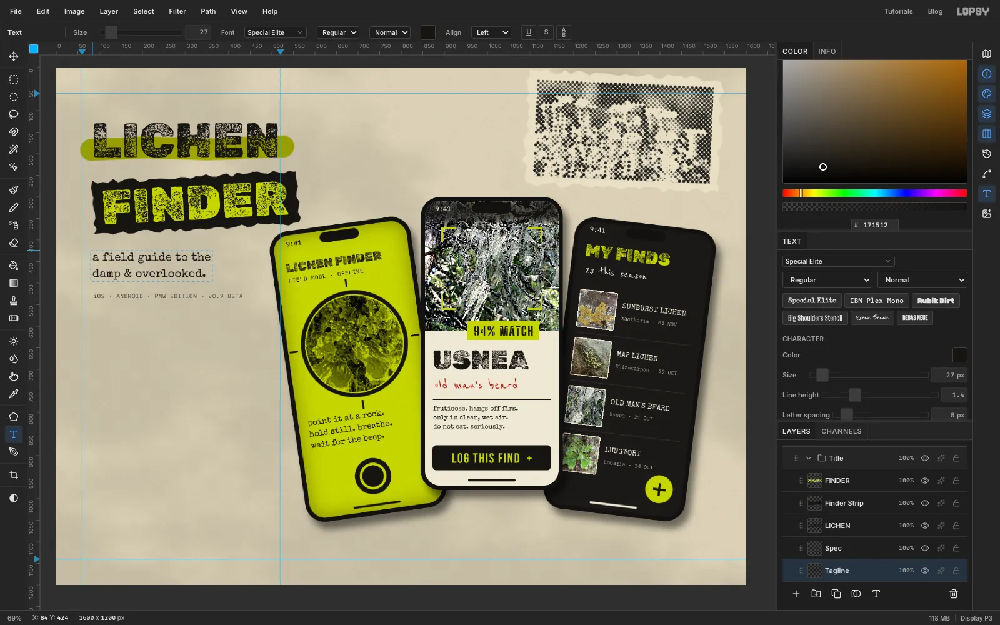

Select *Swash* (a raster layer) and add two more texts, the lower one first:

- **IBM Plex Mono**, 14 px, `#4A463E`, Letter spacing **0.5**, at **X 86, Y 520**: `iOS · ANDROID · PNW EDITION · v0.9 BETA`.
- **Special Elite**, 27 px, ink, Letter spacing **0**, at **X 84, Y 424**: `a field guide to the`, [[Enter]], `damp & overlooked.`

## Line the title up with the margin

Collapse *Title* and click its row. Press [[Cmd]]+[[D]] and take the **Move** tool. Drag the whole group left, or nudge it with the arrow keys, until the left edge of the L in LICHEN sits on the guide at X 60. That's about 24 px: [[Shift]]+[[Left]] twice, then [[Left]] four times. Every layer in the group moves together.

## Stain it with coffee

Select the *Title* group and click **New Group**. Call it *Notes*. Inside it, add a layer called *Coffee Ring*.

With the Elliptical Marquee dialog, select **84, 892 – 268, 1076**. Fill it with coffee `#6B4A2B`, choose **Select → Shrink** by **10**, press [[Delete]] and deselect. Mugs leave doubled rings, so do it once more, slightly offset, from **99, 888 – 277, 1066**, with Shrink **3**.

Run **Filter → Gaussian Blur**, Radius **2**. Then take the **Eraser** ([[E]]) at Size **46** and drag one short stroke across the lower left of the ring to break it. Set the Eraser's Opacity to **45%** and drag a second stroke down the right side of the ring, so that side of the rim comes out thinner and paler, the way a real stain dries. Set the Opacity back to **100%** and set the layer to **Multiply** at **60%**.

## Make a sticker

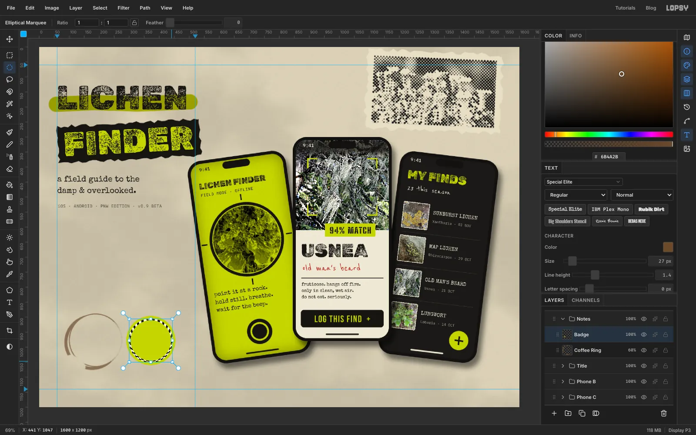

Add a layer called *Badge*. With the Shape tool, create a **164 × 164** lime **Ellipse** at **X 372, Y 978**.

For the thin inner ring, open the Elliptical Marquee dialog and select **300, 906 – 444, 1050**. Then hold [[Option]] and drag a second circle from **303, 909** to **441, 1047**. Zoom in to 200% or more for this and watch the X and Y in the status bar, since you're aiming for a ring only 3 px wide. [[Option]] subtracts the second circle, so only the ring is left selected. Fill it with ink and deselect. Unlike Shrink-and-Delete, this leaves the lime inside the ring alone.

## Letter and turn the sticker

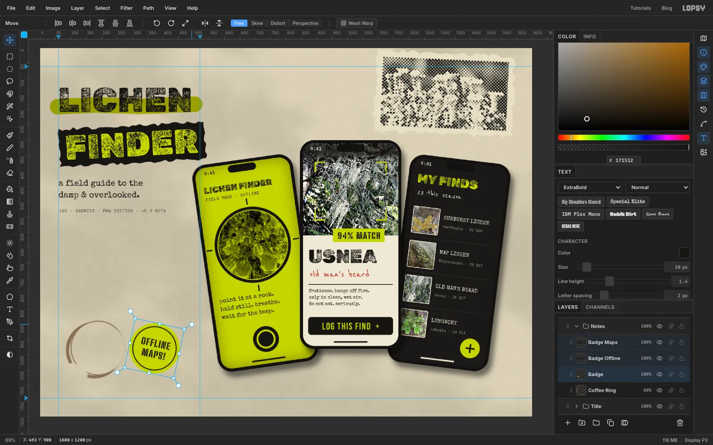

With *Badge* selected, type `MAPS!` in **Big Shoulders Stencil** ExtraBold, 30 px, ink, Letter spacing **2**, clicking at about **X 342, Y 982**. Select *Badge* again and type `OFFLINE` the same way at about **X 324, Y 934**. Use the arrow keys to centre each word across the badge, OFFLINE about 18 px above the centre and MAPS! about 18 px below it.

Click *Badge*, then [[Shift]]-click the *MAPS!* text row to select the badge and both words. Press [[Cmd]]+[[D]] and rotate them together about **12°** clockwise with the Move tool, a clear tilt, as if the sticker went on in a hurry. Press [[Enter]]. Then give *Badge* a small **Drop Shadow**: Offset X **4**, Offset Y **6**, Blur **6**, Opacity **35**.

## Scribble a note and an arrow

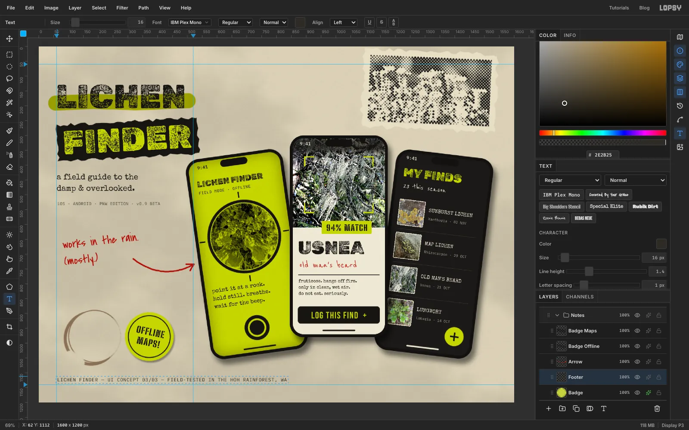

Select *Coffee Ring* and type **Covered By Your Grace**, 40 px, marker red, Letter spacing **0**, at **X 82, Y 628**: `works in the rain.`, [[Enter]], `(mostly.)`. To tilt live text, press [[Cmd]]+[[D]], take the Move tool and drag the corner rotation handle of the text's box about **6°** counter-clockwise, so the note runs gently uphill. Press [[Enter]].

Select *Badge* and add a layer called *Arrow*. With the **Brush** at Size **6**, Hardness **95**, in red, drag a lazy curve from just under the note to the left edge of the lime phone, around **X 522, Y 734**. Add the arrowhead with two short strokes back from the tip.

Finally, with *Badge* selected, add the footer in **IBM Plex Mono**, 16 px, `#2E2B25`, Letter spacing **1**, at **X 62, Y 1112**: `LICHEN FINDER — UI CONCEPT 03/03 — FIELD-TESTED IN THE HOH RAINFOREST, WA`.

## Tape things down

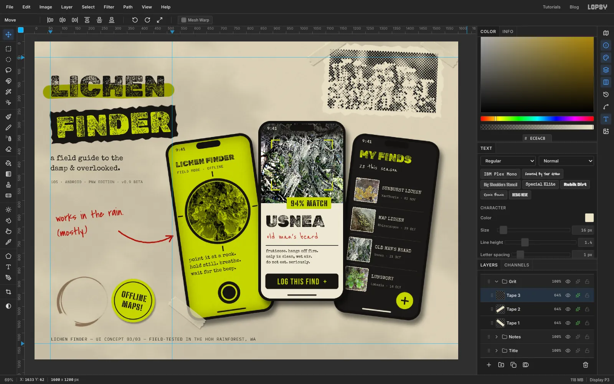

Collapse *Notes*, select it, and click **New Group**. Call it *Grit*. Inside, add a layer called *Tape 1*.

Draw one strip of tape with the **Lasso**, about 150 × 40 px, anywhere on empty wall. Make the long sides straight and the short ends ragged, as if torn. Fill it with tape `#ECE4C8`, deselect, and add **Add Noise** with Amount **16**, Mode **Mono**. Set the layer opacity to **64%** and give it a faint **Drop Shadow**: Offset X **2**, Offset Y **3**, Blur **4**, Opacity **22**.

Click **Duplicate Layer** twice to make *Tape 2* and *Tape 3*. For each strip, click its row and drag it with the **Move** tool to its spot. Then [[Cmd]]-click its thumbnail to select its pixels, and turn it with one of the round rotation handles just outside the corners:

- *Tape 1*: over the bottom-left corner of the lime phone, about **38°** clockwise.
- *Tape 2*: over the poster's top-left corner, about **34°** counter-clockwise.
- *Tape 3*: over the poster's top-right corner, about **36°** clockwise.

Press [[Enter]] and [[Cmd]]+[[D]] after each one.

## Spray ink and circle the match

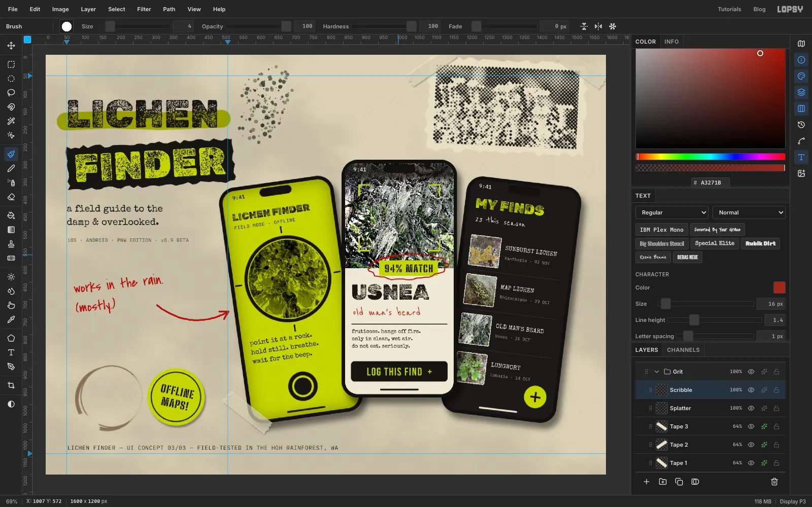

Add a layer called *Splatter*. Take the **Spray** tool ([[J]]) and set Size **110**, Density **40**, Opacity **95** and Softness **5**, in ink. Click four times in a loose cluster up and to the right of LICHEN, around X 600 to 660, Y 90 to 200, clear of the swash. Each click is one burst of dots.

Add a layer called *Scribble*. With the **Brush** at Size **4**, Hardness **100**, in marker red, draw one quick loop around the 94% MATCH sticker, a little more than once round and wide enough not to touch the sticker, the way you'd circle something in a magazine. Keep it inside the centre screen and clear of USNEA.

## Add photocopier grain and streaks

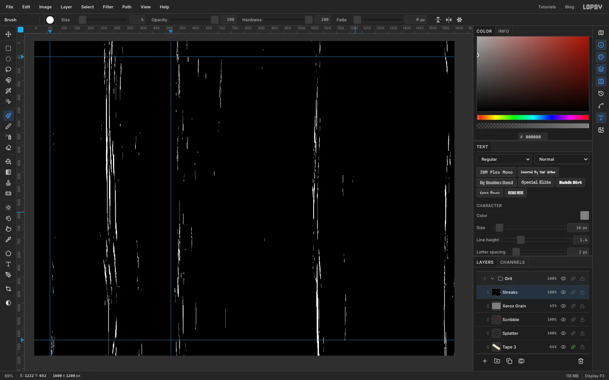

Add a layer called *Xerox Grain*. Fill it with mid grey `#808080`, then run **Add Noise**: Amount **45**, Mode **Mono**, Distribution **Gaussian**. Set it to **Overlay** at **45%**. Mid grey vanishes in Overlay, so only the grain stays.

Add a layer called *Streaks* and run **Filter → Fibers** with Variance **40** and Strength **50**. That fills the layer with vertical fibres. Then run **Filter → Threshold** at Level **205**. Almost everything turns black and only the brightest fibres survive as thin white streaks. The layer hides the whole picture for a moment, which is fine.

## Blend the streaks and add scan bands

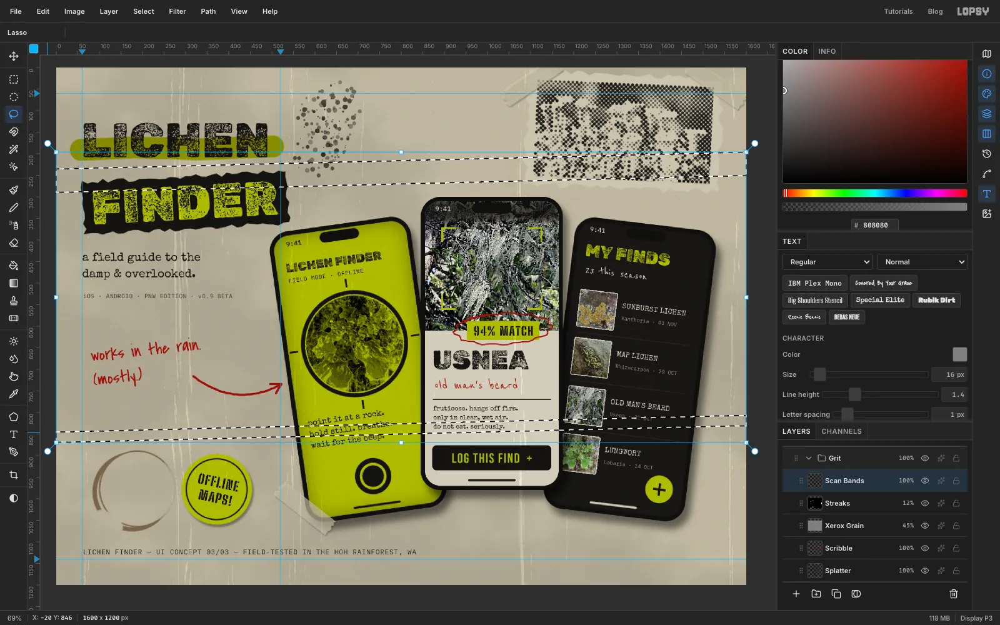

Set *Streaks* to **Multiply** at **12%**. The black now darkens the whole sheet very slightly, and the white fibres show through as pale scratches, like dust on the copier glass.

Copiers also leave soft bands where the light bar wobbles. Add a layer called *Scan Bands*. With the **Lasso**, drag a long thin band across the whole sheet that falls slightly from right to left, about 50 px tall, around Y 200 to 290. Hold [[Shift]] and drag a thinner band lower down, around Y 806 to 870. [[Shift]] adds the second band to the selection.

Fill with ink, deselect, run **Gaussian Blur** at Radius **3** to soften the edges just a little, and set the layer to **Multiply** at **7%**.

## Keep the hero screen clean

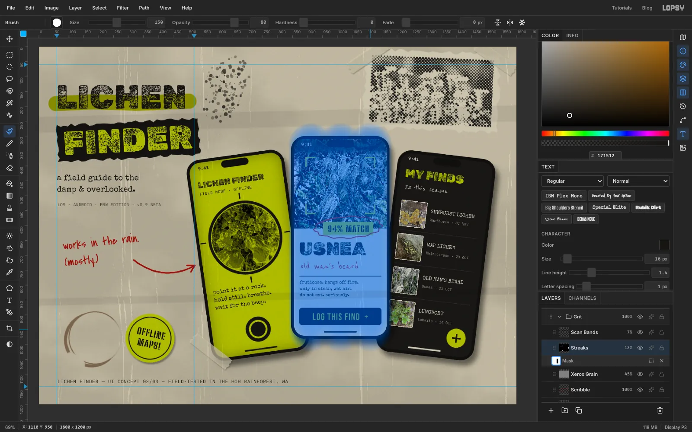

The streaks are nice on the wall but distracting on the hero screen. Select *Streaks* and click **Add Mask** at the bottom of the Layers panel. Click the mask thumbnail so you're painting on the mask.

Set the foreground to black and take the **Brush** with Size **150**, Hardness **0** and Opacity **80**. Paint three vertical strokes down the centre phone, from top to bottom, a little apart so they cover the whole screen. In a mask, the brush hides. While you're editing a mask, Lopsy tints the hidden area blue so you can see where you've painted. Then click the *Streaks* layer name to stop editing the mask, and set the brush Opacity back to 100.

## Darken the edges

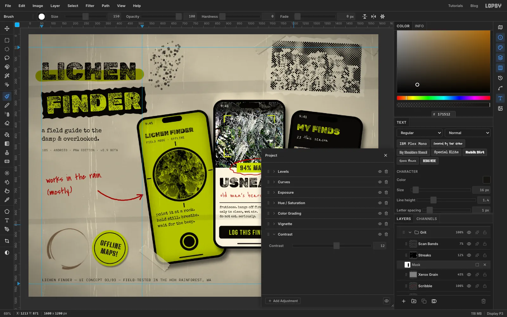

Choose **Layer → Adjustment Layer…** and click **Got it** in the note that appears. Lopsy puts adjustments on a group, and this opens the stack for the whole document.

Click **Add Adjustment → Vignette** and set it to **42**. Photocopies always come out darker at the edges. Then click **Add Adjustment → Contrast** and set it to **12**. Close the drawer.

## Save and export

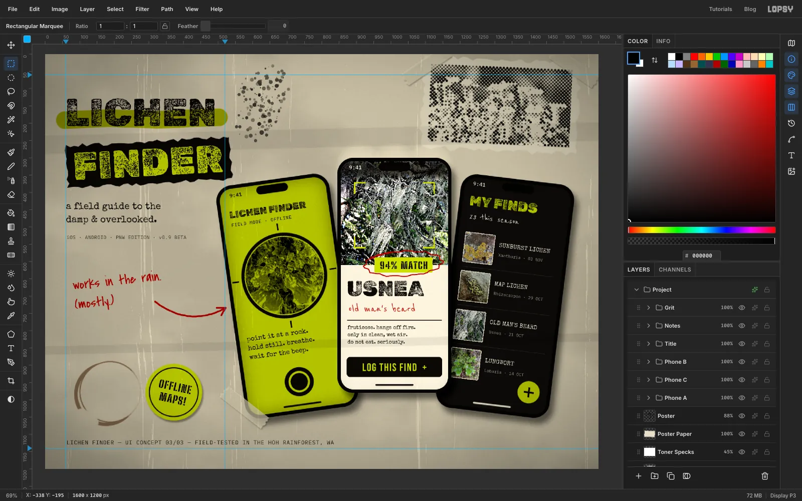

Choose **File → Save Project** to keep a `.lopsy` file with every layer, group, mask and adjustment still editable. Then use **File → Quick Export PNG** for the finished image.

The three screens are live groups, so you can swap in a different lichen, retype a name or re-tilt a phone without rebuilding anything. Try a second set of screens in moss green on cream for a "day mode" shot.
