Between 1899 and 1904 the zoologist Ernst Haeckel published
*Kunstformen der Natur*, a hundred plates of creatures most people had
never seen. Several of the best-loved ones show radiolarians, microscopic
plankton with skeletons of glass, drawn silver-white against a dark
ground as if lit from the side under a microscope. Many have a
rose-coloured capsule, an orange nucleus and a scatter of yellow cells.

This tutorial borrows that look for a fictional album, *Foraminifera
Oceanica* by **The Giltsch Ensemble** (Adolf Giltsch was the lithographer
who drew Haeckel's plates). The cover is a 1600 × 1600 px plate with five
numbered figures. Four are drawn from scratch in Lopsy. The fifth is a real
electron micrograph of a foraminifer, set in a microscope-field ring the
way a modern paper might print a photo beside a drawing.

The micrograph is
[Benthic foraminifera.jpg](https://commons.wikimedia.org/wiki/File:Benthic_foraminifera.jpg)
on Wikimedia Commons, from the US Geological Survey. It's a work of the US
federal government and in the **public domain**. It shows four specimens.
The Commons caption names the top-left one *Ammonia beccarii*, and that's
the one you'll use. Download the original file (427 px wide).

Along the way you'll use:

- **Voronoi**, the **Magic Wand**, **Invert** and **Lens Distortion** to grow a lattice sphere
- **Kaleidoscope** and **Sunburst** for the radiating spines and filaments
- the Brush's **Radial Symmetry**, the **Pencil** with Shift-click lines, and lasso **thorns**
- **Define Pattern** and **Fill with Pattern** to punch rows of pores
- **Add Noise** and **Threshold** to make lithograph stipple
- a **layer mask**, **Inner Glow** and **Outer Glow**, and **Multiply** shading layers
- exact selections, **Shrink**, **Feather**, and scaling, squashing and rotating with the **Move** tool
- ruler **guides** with **Snap to Guides**, groups, and **Old Standard TT** type

The palette is Haeckel's: silver on black, with dusty inks.

- Plate `#0E0E12`, frame rule `#9A9384`, microscope field `#040406`
- Silver `#E8E9EC`, ring grey `#C9CCD2`, glow shade `#4A4E58`, halo `#C8DCFF`
- Capsule `#A8687C` → `#8A4A5E` → `#4A2030`
- Nucleus `#C9944A` → `#AE7136` → `#6E3E1C`
- Symbionts `#D6C46E`, rim `#6E560A`, filaments `#DCE6F2`
- Stipple grey `#5A5A5A`, mask grey `#404040`
- Sphere shade `#FFFFFF` → `#D9DCE2` → `#7A7E88`
- Bell shade `#5C606A` → `#FFFFFF` → `#D5D8DE` → `#4A4E58`
- Title `#DCD5C4`, labels `#C9C3B4`, tagline `#BDB7A8`

Three habits make this plate much easier:

- **Exact circles.** With nothing selected, a single click (no drag) with
  the **Elliptical Marquee** opens the *Elliptical Selection* box, where
  you type the From and To corners. The circle fits inside that box. The
  steps give the corners whenever a circle has to be exact. For a quick
  round shape by eye, hold [[Cmd]] while you drag.
- **Finishing a transform.** After you scale or rotate with the **Move**
  tool's handles, press [[Cmd+D]]. That applies the transform and drops the
  selection.
- **The silver treatment.** Every specimen gets the same two effects, so
  they read as drawn by one hand. Click the **Layer effects** button on the
  layer's row, then turn on **Inner Glow** in `#4A4E58` (Size 3,
  Opacity 85%) and **Outer Glow** in `#C8DCFF` (Size 10, Opacity 30%). The
  dark inner edge makes thin parts look like round glass rods, and the
  pale outer glow is the dark-field halo.

## Start a black plate with guides

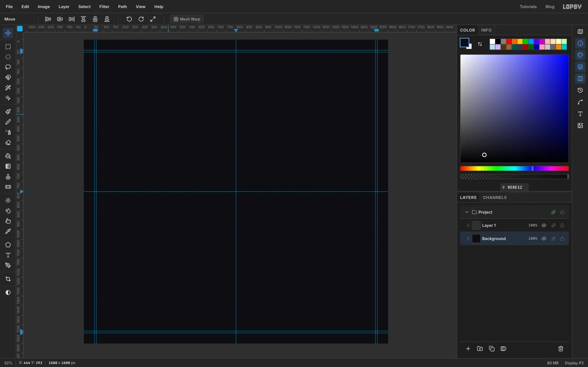

Choose **File → New** and make a **1600 × 1600** px document. Click the
*Background* layer, set the foreground to `#0E0E12` and choose
**Edit → Fill**.

Turn on the rulers if they aren't showing. Click the top ruler at **800**
for a vertical centre guide, and at **56**, **66**, **1534** and **1544**
for two pairs near the edges. Click the left ruler at the same five places
for the horizontal guides. Turn on **View → Snap to Guides**.

## Rule a double frame

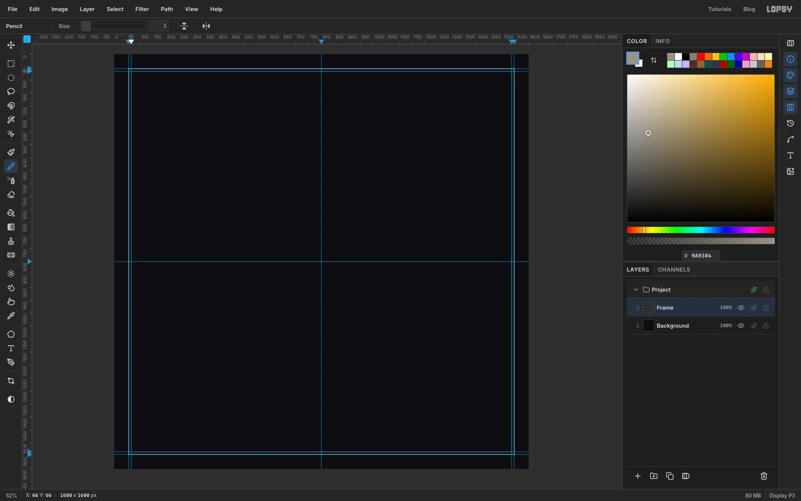

Click *Layer 1* and rename it *Frame*. Pick the **Pencil**, set Size to
**3** and the foreground to `#9A9384`. Click where the outer guides cross
at the top left, then hold [[Shift]] and click each of the other three
outer corners and back to the first. Shift-click draws a straight line
from the last point, and the clicks snap to the guides.

Set the Size to **1** and do the same around the inner guides. A thick
rule with a hairline inside it is the classic engraved plate border.

## Crack a white disc into Voronoi cells

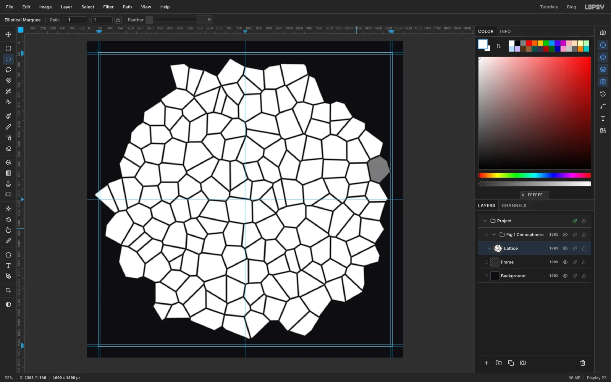

The big sphere in the middle is Figure 1. Click **New Group** at the
bottom of the Layers panel and name it *Fig 1 Cenosphaera*. Add a layer
inside it called *Lattice*.

You'll build the shell large and shrink it later, so the cell walls end up
fine. Click once with the **Elliptical Marquee** and enter From **100,
100** To **1500, 1500**. Fill the circle with white and deselect
([[Cmd+D]]).

Choose **Filter → Voronoi…** and set **Cells 16**, **Edge Width 14** and
**Seed 11**. Voronoi splits the disc into cells, each filled with the
colour at its centre, with dark walls between them. The outline goes
ragged because each edge cell is kept or dropped whole, and a cell whose
centre lands on the soft edge comes out grey. Both get trimmed away later.

## Select the cells, not the walls

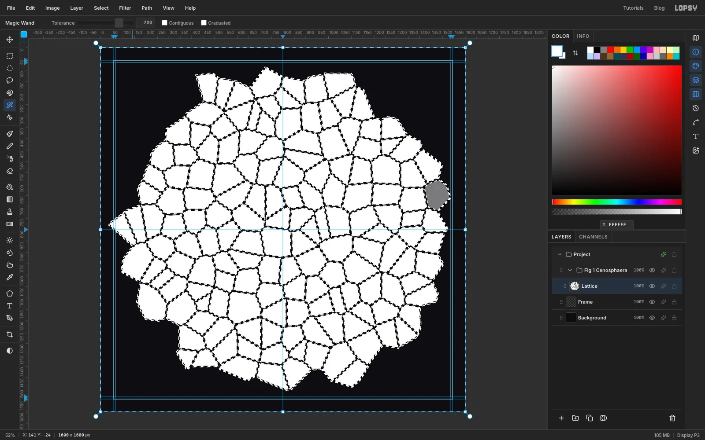

Pick the **Magic Wand**. Untick **Contiguous** and set **Tolerance** to
**200**, so the selection takes in the soft edges of the walls too. Click
right on one of the dark walls. With Contiguous off, every wall in the
disc is selected at once.

You want the opposite, so choose **Select → Inverse**. Now every cell is
selected.

## Turn the walls into a white net

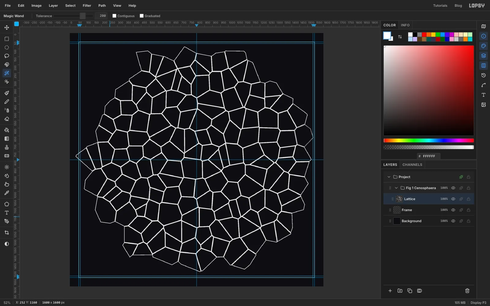

Press [[Delete]] to clear the cells, then deselect. What's left are the
black walls on a transparent layer.

Choose **Filter → Invert**. Invert leaves transparent pixels alone, so the
walls turn white and the gaps stay empty. You now have a flat silica net.

## Bulge the net into a sphere

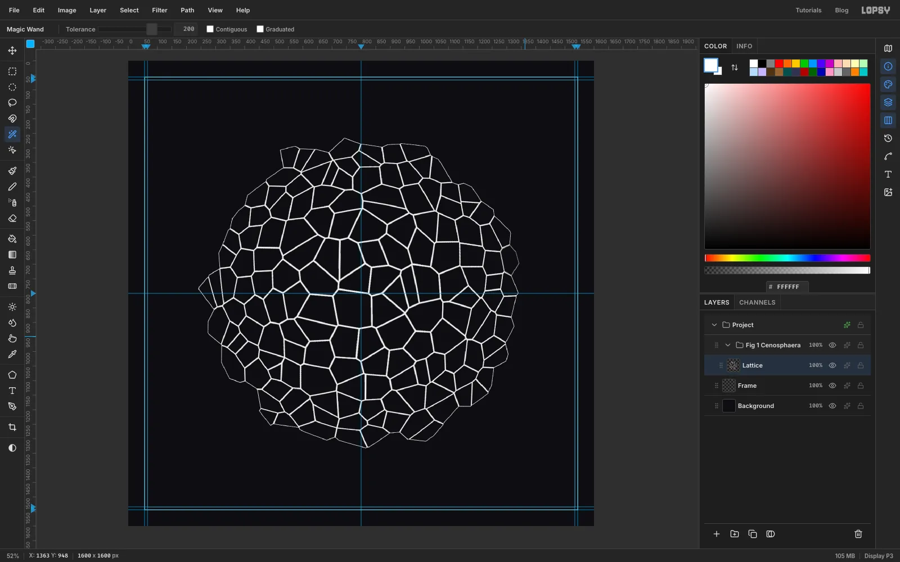

Choose **Filter → Lens Distortion…** and set **Strength 100** (barrel) and
**Zoom 100**. Lens Distortion is always centred on the canvas, which is
why the disc sits at the exact centre. The cells in the middle swell and
the ones near the rim crowd together, which is how a net on a ball looks
from the front. The whole net also pulls in a little from its old edge.

## Trim it round and add a rim

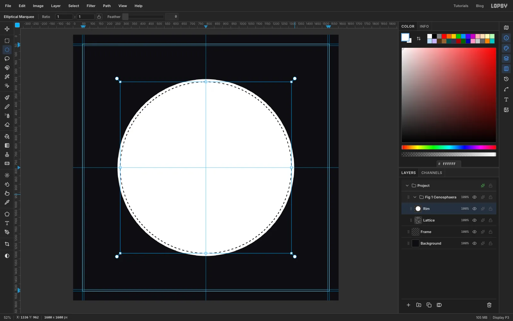

Click once with the Elliptical Marquee and enter From **280, 280** To
**1320, 1320**, just inside the ragged edge. Choose **Select → Inverse**,
press [[Delete]] and deselect. The net is round now.

For a clean rim, add a layer called *Rim*. Select From **268, 268** To
**1332, 1332** and fill it with white. The disc covers the net for a
moment. Select From **284, 284** To **1316, 1316**, press [[Delete]] and
deselect. That leaves a 16 px ring. Choose **Layer → Merge Down** to merge
the rim into *Lattice*.

## Shrink the shell

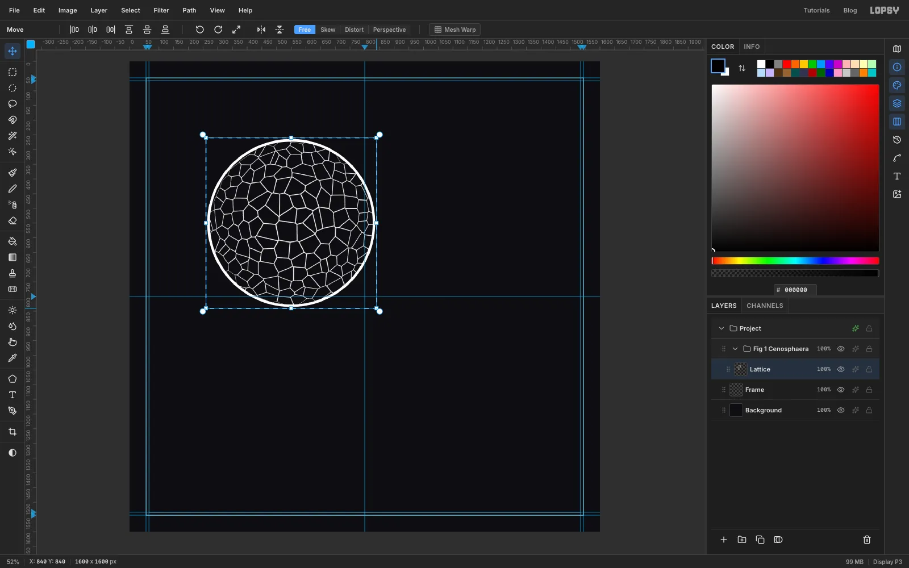

Draw a rectangular marquee around the whole net. Pick the **Move** tool,
hold [[Cmd]] (it keeps the proportions) and drag the bottom-right corner
handle up and to the left until the shell is a little over half its size,
about **570 px** across. Press [[Cmd+D]].

The scale is anchored at the opposite corner, so the shell has slid
towards the top left. Drag it back with the Move tool until it's roughly
centred, then use the arrow keys to put its centre exactly on the guide
crossing. The walls are now finer, like Haeckel's.

## Make a far side and a capsule

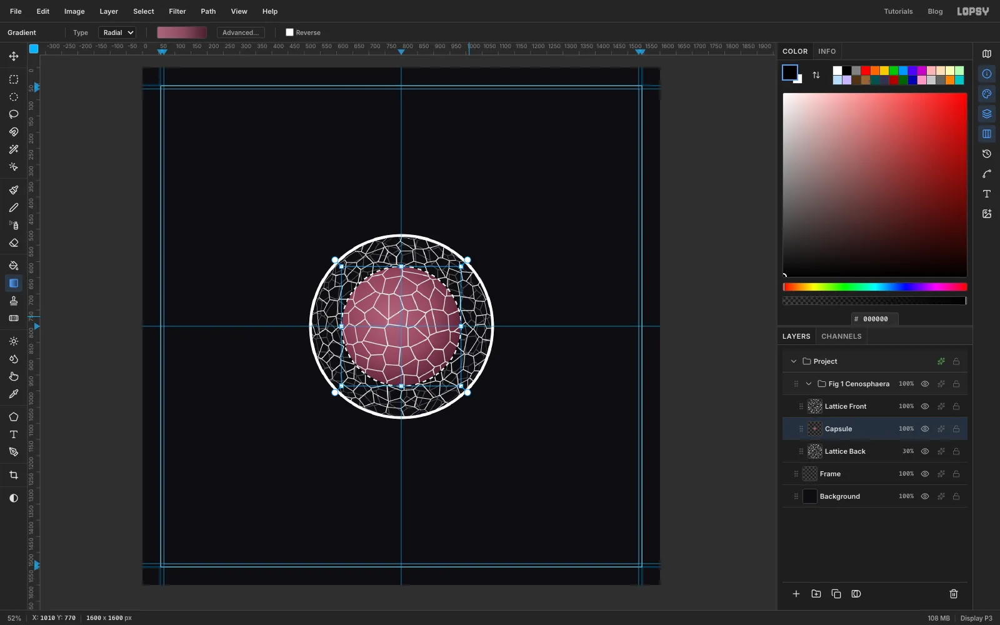

A glass sphere shows its back wall through the front. Choose
**Layer → Duplicate Layer** and rename the copy *Lattice Front*. Rename the
original *Lattice Back*. Click *Lattice Back* and choose
**Image → Flip Horizontal** and then **Image → Flip Vertical**, so the back
pattern doesn't line up with the front. Set its opacity to **30%**.

With *Lattice Back* still selected, add a layer called *Capsule*. It goes
in between the two halves. Select the circle From **615, 615** To
**985, 985**. Pick the **Gradient** tool, set it to **Radial** and open
**Advanced…** to set the three capsule stops: `#A8687C`, `#8A4A5E` at 55%
and `#4A2030`. Drag from a little up and left of the centre outwards about
240 px, then deselect.

## Stipple the capsule

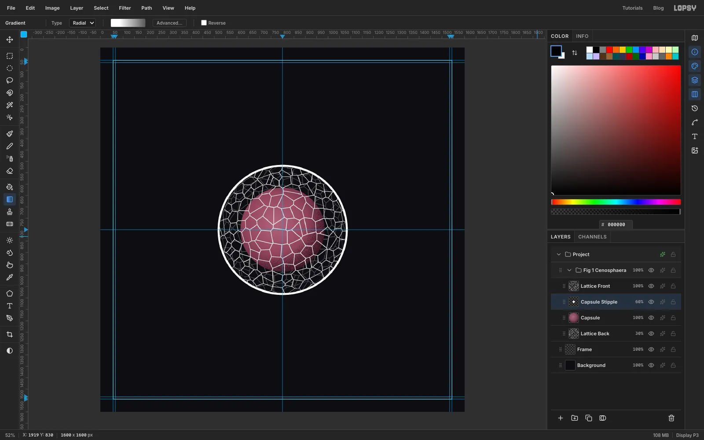

A lithograph shades with dots, not smooth gradients. Add a layer called
*Capsule Stipple*. [[Cmd]]-click the *Capsule* thumbnail to load its shape
as a selection.

Make a radial gradient from white, through white again at 25%, to
`#5A5A5A`. Drag it from the upper left of the capsule outwards about
330 px. Choose **Filter → Add Noise…** with **Amount 100** and **Mono**,
then **Filter → Threshold…** at **128**. The noise breaks the grey side
into random black and white specks, densest where the gradient was
darkest.

Deselect, set the layer's blend mode to **Multiply** so the white
disappears, and lower its opacity to **60%**.

## Silver the net and soften it over the capsule

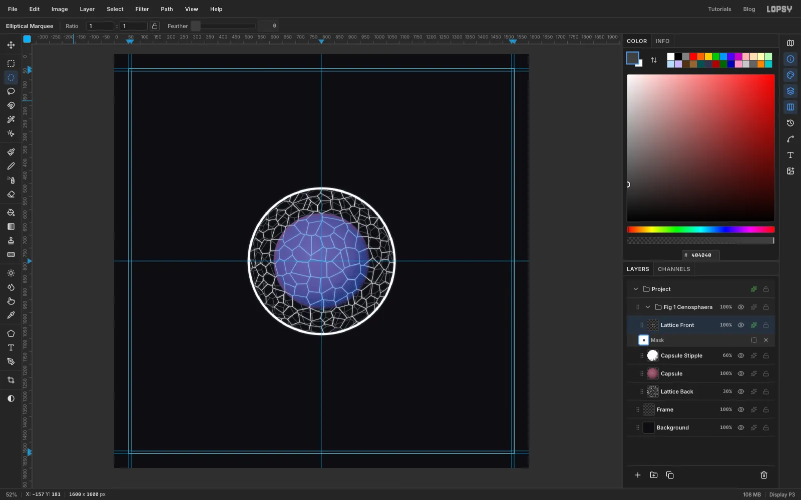

Click *Lattice Front* and give it the **silver** treatment.

The net is still too bright where it crosses the capsule, so the capsule
reads as on top rather than inside. Click **Add Mask** at the bottom of the
Layers panel, then click the new mask thumbnail to edit the mask. Select
the circle From **618, 618** To **982, 982** and choose
**Select → Feather…** at **12 px**. Set the foreground to `#404040` and
choose **Edit → Fill**. Dark grey in a mask means "mostly hidden", so the
net fades to about a quarter of its strength over the capsule. Deselect
and click the layer thumbnail to stop editing the mask.

## Add the nucleus

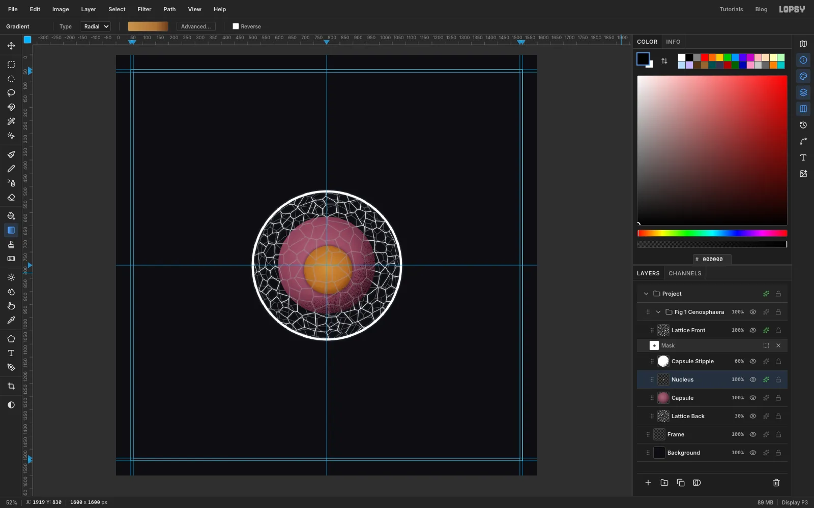

Click *Capsule* and add a layer called *Nucleus*, so it sits above the
capsule and below the stipple. Select From **714, 726** To **898, 910**,
a circle a little below and right of the centre. Fill it with a radial
gradient `#C9944A`, `#AE7136` at 70%, `#6E3E1C`, dragged from its centre
outwards. Deselect.

In the layer's effects, turn on **Drop Shadow** with both offsets at
**0**, Blur **18** and Opacity **60%**. With no offset, the shadow is just
a dark halo that sets the nucleus into the capsule.

## Shade the sphere

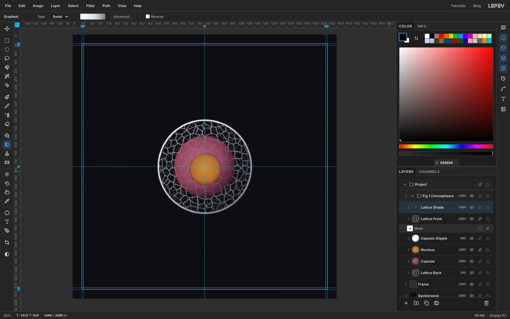

Click *Lattice Front* and add a layer called *Lattice Shade*.
[[Cmd]]-click the *Lattice Front* thumbnail to select the net.

Make a radial gradient from white, through `#D9DCE2` at 60%, to
`#7A7E88`. Drag it from the upper left of the sphere out past the far
side, about 470 px. Deselect and set the blend mode to **Multiply**. White
leaves the lit side alone and the grey darkens the side away from the
light.

## Draw one master spine

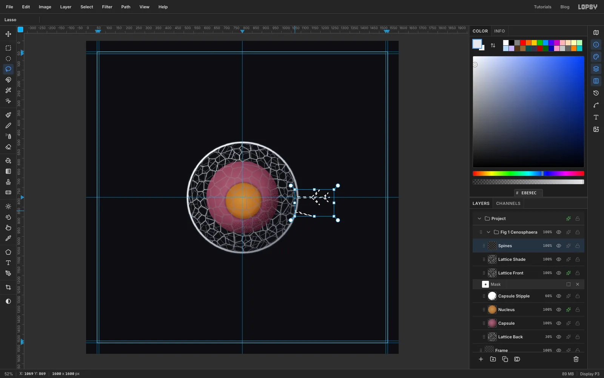

Add a layer called *Spines*. You'll draw one spine and let the
**Kaleidoscope** filter copy it all the way round. Kaleidoscope mirrors the
thin wedge just below the 3 o'clock line around the canvas centre, so the
master spine has to lie along that line and be symmetrical about it.

With the **Lasso**, drag out a long, thin triangle: an 8 px base at the
edge of the shell on the horizontal centre guide, out to a point about
**185 px** beyond the shell. Hold [[Shift]] and draw four small triangles
as side thorns, a pair angled up and down about 40% of the way out and a
smaller pair about 70% out. Shift adds each one to the selection.

Still holding [[Shift]], draw a second, shorter spine pointing **15°**
below the line, reaching about 90 px beyond the shell. With 12 segments,
15° is the other mirror line, so this spine will land neatly between the
long ones. Fill the selection with `#E8E9EC` and deselect.

## Copy it round with Kaleidoscope

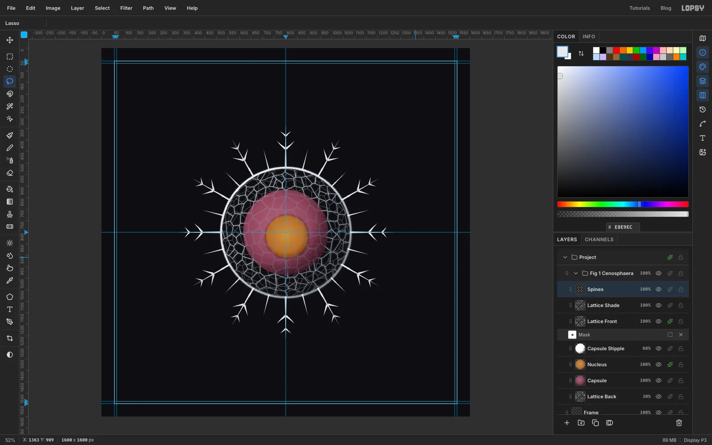

Choose **Filter → Kaleidoscope…**, set **Segments** to **12** and
**Rotation** to **0**, and apply. The long spine appears every 30° and the
short one between them, all crisp because both were centred on mirror
lines.

Give *Spines* the **silver** treatment.

## Radiate fine filaments with Sunburst

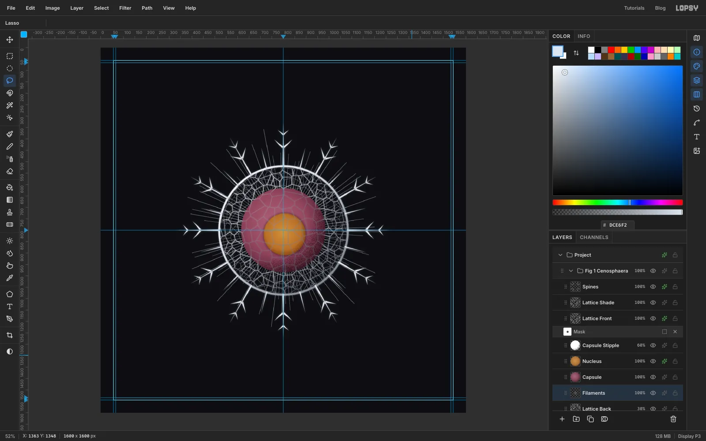

In Haeckel's drawings, hair-thin threads stream out of the capsule
through the shell. Click *Lattice Back* and add a layer called
*Filaments* above it. Set the foreground to `#DCE6F2`.

Choose **Filter → Sunburst…**. Set **Rays** to the maximum, **120**, and
**Length** to **40**, so the threads stop around the spine tips. Set
**Width 18** and **Taper 50**, which makes thin parallel-sided threads
instead of wedges. **Fade 50** and **Softness 40** let them dissolve at
the ends, and **Jitter 55** (Seed 4) makes some shorter than others. Set
**Rotation** to **1** so no thread hides exactly behind a spine, and
**Opacity** to **85**. The capsule hides their roots.

## Add clusters of symbiont cells

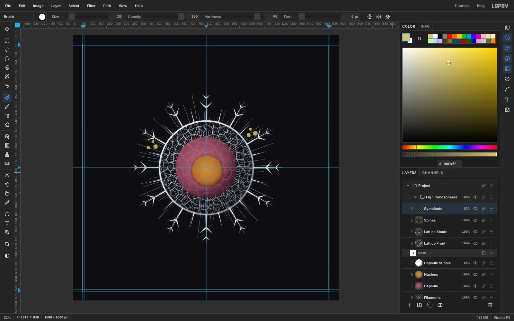

Click *Spines* and add a layer called *Symbionts*. Pick the **Brush** with
**Hardness 90** and the foreground `#D6C46E`. Click once for each cell,
changing the Size between about **18** and **32** so they're not uniform.
Put three just outside the shell between two spines at about 10 o'clock,
and three more at about 2 o'clock. Tight little groups look alive. An even
ring of dots looks like confetti.

Add an **Inner Glow** in `#6E560A`, Size **5**, Opacity **90%**, for a
darker rim, then set the layer opacity to **85%**.

## Figure 2: one spine with Radial Symmetry

Collapse the *Fig 1* group, click it, and click **New Group**. Name it
*Fig 2 Acanthometra*. Add a layer called *Acantha Spines*.

Pick the **Brush**. In its options bar click **Radial Symmetry** and set
**Segments** to **10**. [[Cmd]]-click the canvas at about **x 300,
y 424** on the rulers to move the symmetry centre there. Open the brush
settings from the brush preview in the options bar and, on the **Shape**
tab, set **Size 14**, **Hardness 100**, **Spacing 5** and **Taper 180**,
so each stroke thins to a point over its last 180 px.

Use the foreground `#E8E9EC`. Drag from near the centre outwards about
**200 px**, aiming a little right of straight up. Lopsy paints ten copies.

## Add short spines and cross-bars

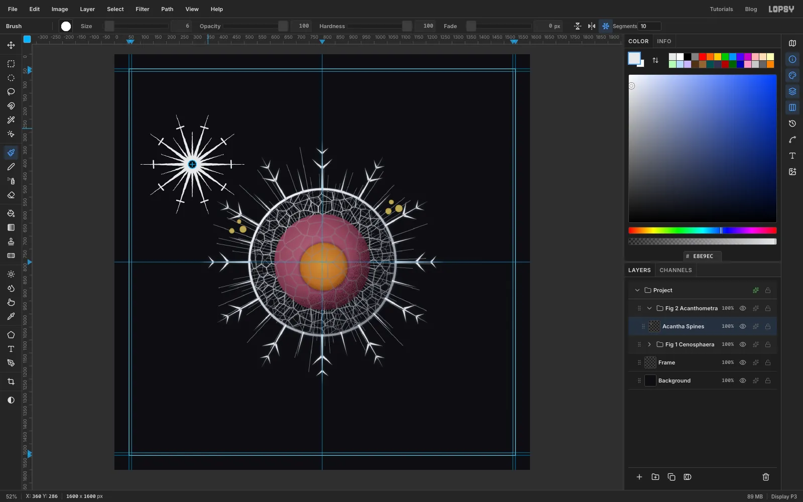

Set the brush to **Size 9** and **Taper 110** and drag a second, shorter
spine of about **130 px**, halfway between two long ones. Then set
**Size 6** and **Taper 0**. Click just to one side of a long spine about
150 px from the centre, and [[Shift]]-click just the other side to draw a
short bar across it. Symmetry repeats the bar on all ten long spines.
Acantharian spines have little blades like these.

Click **Radial Symmetry** again to turn it off. While it's on, it takes
over [[Cmd]]-clicks for every tool. Give the layer the **silver**
treatment.

## Give Figure 2 a capsule

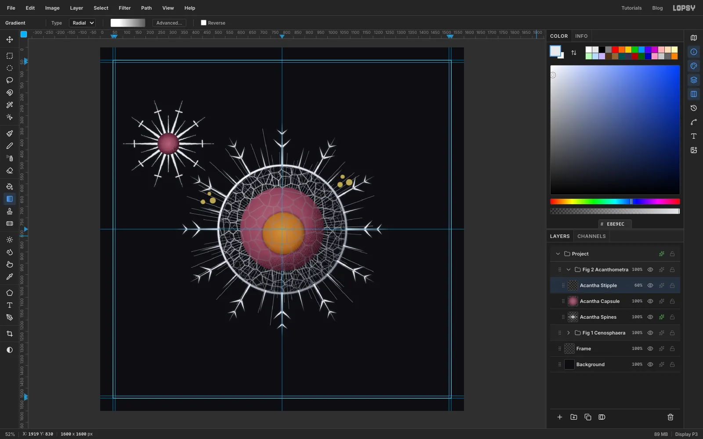

Add a layer called *Acantha Capsule* above the spines. Select the circle
From **252, 376** To **348, 472** and fill it with the capsule gradient,
dragged from the centre outwards about 50 px.

Stipple it the same way as the big capsule: a new *Acantha Stipple* layer,
[[Cmd]]-click the capsule thumbnail, a white to `#5A5A5A` radial gradient
from its upper left, **Add Noise** 100 Mono, **Threshold** 128, then
**Multiply** at **60%**.

## Figure 3: a disc and a pore tile

Collapse *Fig 2*, click it, and make a group called *Fig 3 Stylodictya*.
Add a layer called *Disc*, select the circle From **1190, 284** To
**1470, 564** and fill it with `#E8E9EC`.

Now make a pore pattern. On a new scratch layer, select the tiny circle
From **1107, 611** To **1117, 621** and fill it with white. Select the
square From **1104, 608** To **1120, 624**, which puts the dot in the
middle of a 16 px tile, and choose **Edit → Define Pattern**. Delete the
scratch layer. Small marquees like these are much easier to type than to
drag.

## Fill pores, then mark the chamber walls

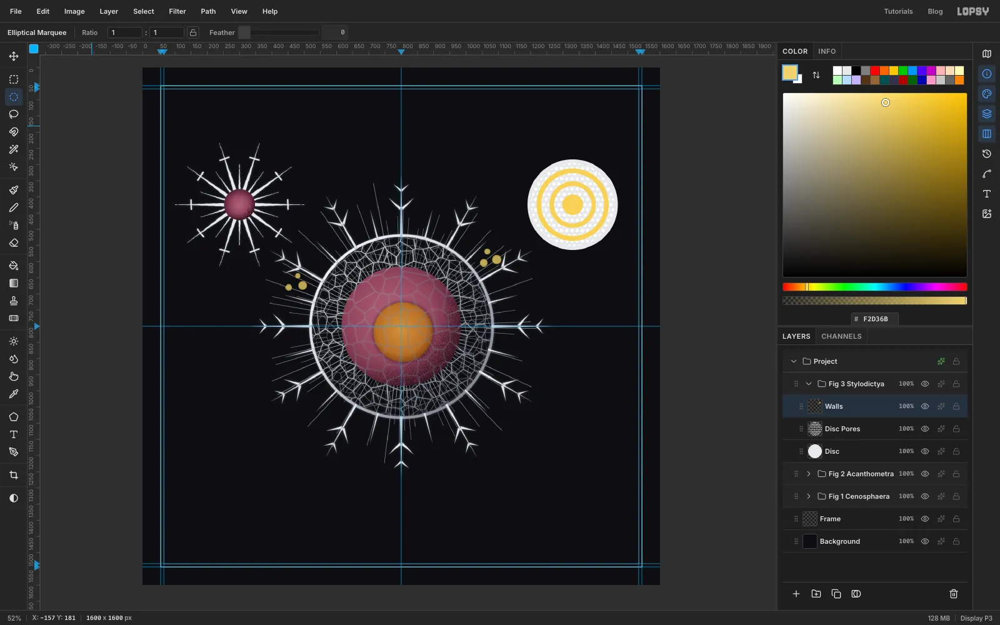

Add a layer called *Disc Pores*. [[Cmd]]-click the *Disc* thumbnail,
choose **Select → Shrink…** **10 px**, then **Edit → Fill with Pattern…**.
Pick your 16 × 16 pattern and set **Row Stagger** to **50%**, which offsets
every other row into a honeycomb. Deselect.

The disc needs solid rings between the rows of pores. On a new scratch
layer called *Walls*, using any bright colour you can see:

- fill the circle From **1218, 312** To **1442, 536**, then select From
  **1233, 327** To **1427, 521** and press [[Delete]] (outer wall)
- fill From **1258, 352** To **1402, 496**, then delete From **1272, 366**
  To **1388, 482** (middle wall)
- fill From **1298, 392** To **1362, 456** (solid hub)

[[Cmd]]-click the *Walls* thumbnail, click the *Disc Pores* row and press
[[Delete]] to clear the pores under the walls. Deselect and delete the
*Walls* layer.

## Cut the pores out of the disc

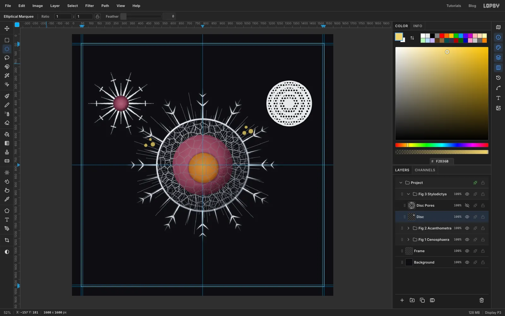

[[Cmd]]-click the *Disc Pores* thumbnail to select every dot, click the
*Disc* row, and press [[Delete]]. The dots become holes. Deselect and hide
the *Disc Pores* layer.

## Add six spines

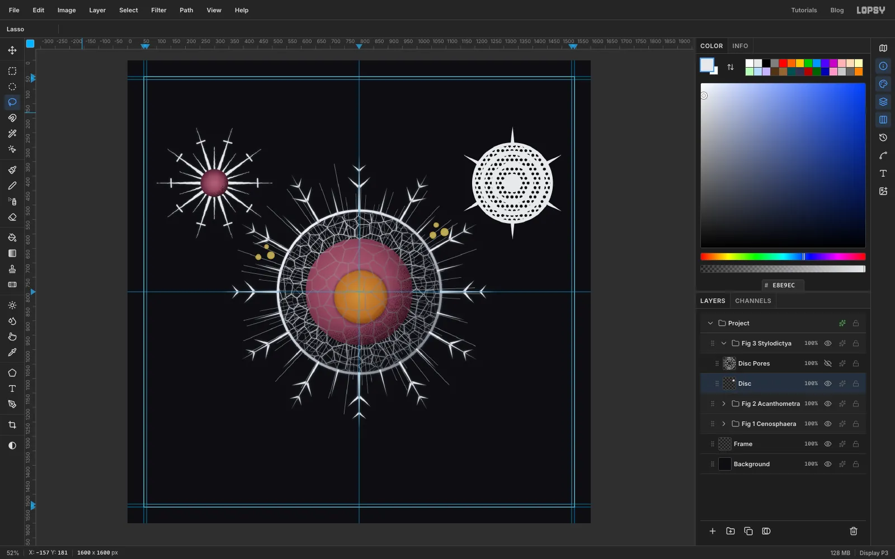

On *Disc*, use the **Lasso** to draw six thin, thorn-shaped triangles,
holding [[Shift]] for each one after the first. Space them every 60°,
starting at 30° (about 4 o'clock, then 6 o'clock, 8 o'clock and so on).
Each starts just inside the rim and reaches about 55 px past it. Fill them
with `#E8E9EC` and deselect.

## Tilt the disc: squash it

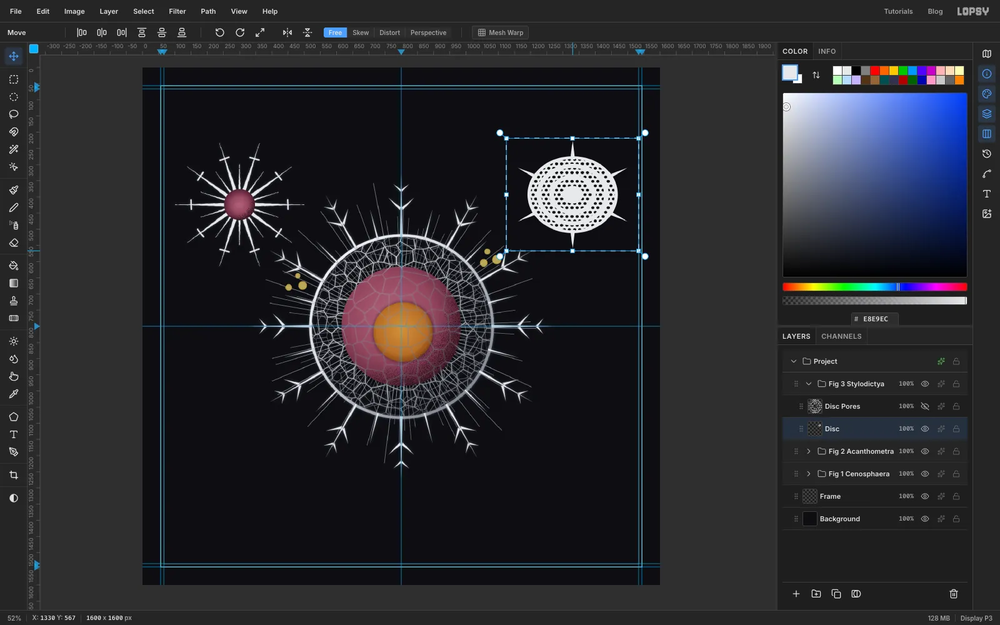

A disc seen square-on looks like a target, so tilt it. Draw a square
marquee around the disc and its spines. With the **Move** tool, drag the
**bottom middle** handle up about **60 px**, to roughly 85% of the height.
Press [[Cmd+D]].

## Tilt the disc: rotate it

Draw a new marquee just around the squashed disc. Drag the round handle
just outside its top-right corner anticlockwise by about **16°**, and
press [[Cmd+D]]. Nudge the disc back to its spot if it drifted, and give
*Disc* the **silver** treatment.

## Figure 4: paste the micrograph

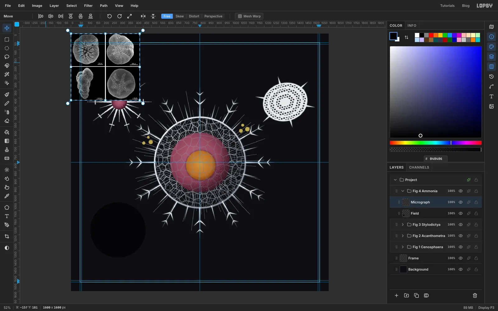

Collapse *Fig 3*, click it, and make a group called *Fig 4 Ammonia*. First
add a layer called *Field*. Select the circle From **120, 1048** To
**464, 1392** and fill it with `#040406`. This is the dark microscope
field, centred at x 292, y 1220.

Open the downloaded micrograph in your browser, copy it, and press
[[Cmd+V]] in Lopsy. A paste lands above the active layer, so it goes on
top of the field, at the top-left corner of the plate. Rename it
*Micrograph*.

## Circle one specimen

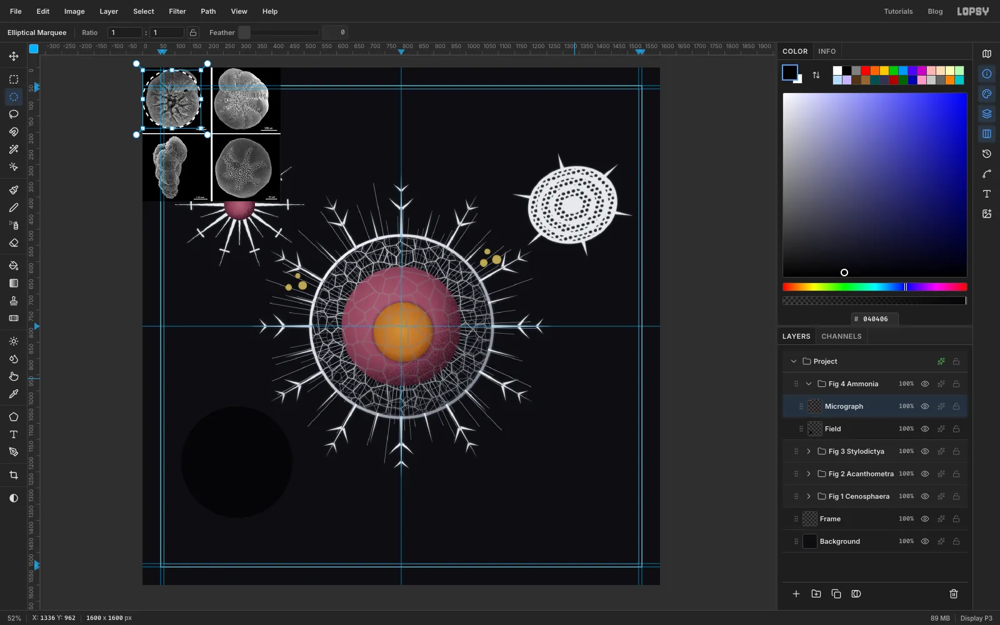

Select the circle From **1, 8** To **181, 188**. It sits around the
top-left specimen, *Ammonia beccarii*, inside the photo's border, and
leaves out the photo's own "200 µm" scale bar.

Choose **Select → Feather…** **2 px** so the cut-out edge isn't jagged,
then **Select → Inverse**, [[Delete]], and deselect.

## Scale the specimen up

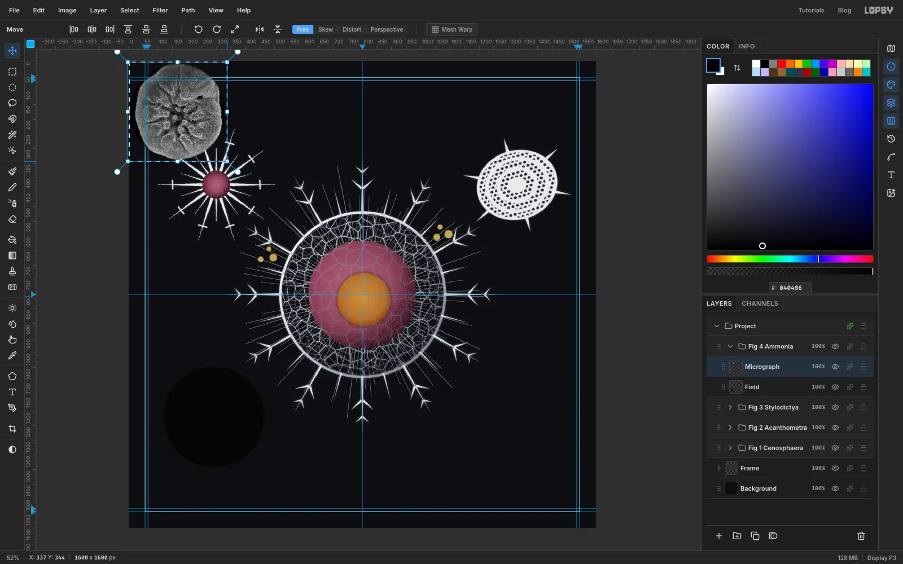

Draw a marquee around the circle, switch to the **Move** tool, hold
[[Cmd]] and drag the bottom-right handle outwards until the photo is about
**1.8×** its size, about 325 px across. Press [[Cmd+D]].

Drag the photo down onto the black field, then use the arrow keys to
centre it. Enlarging a small photo softens it slightly, which suits a
microscope image.

## Ring the microscope field

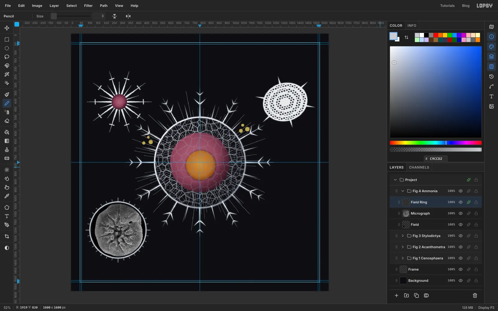

Add a layer called *Field Ring*. Select From **114, 1042** To
**470, 1398**, fill with `#C9CCD2`, then select From **121, 1049** To
**463, 1391** and press [[Delete]]. You have a 7 px ring.

For the ticks, pick the **Brush** and turn **Radial Symmetry** on with
**32** segments, then switch to the **Pencil**. The symmetry setting is
shared. [[Cmd]]-click the centre of the field. With the Pencil at
**Size 2**, click just outside the ring at 12 o'clock and [[Shift]]-click
12 px further out. You get 32 even ticks. Turn symmetry off, then add four
longer ticks (about 20 px) at 12, 3, 6 and 9 o'clock at **Size 3**. Give
the layer the **silver** treatment.

## Add a scale bar

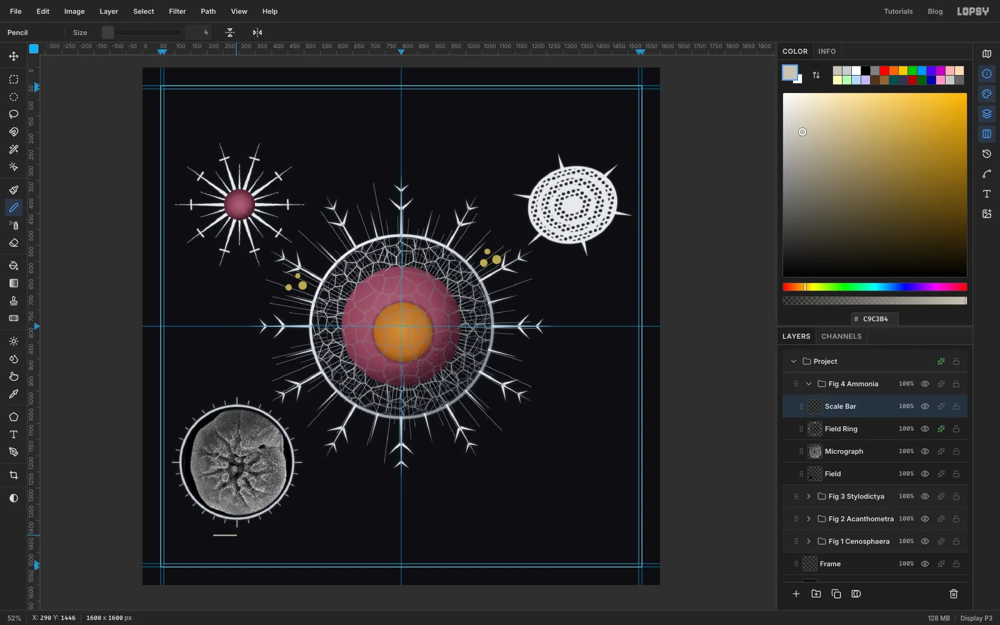

Add a layer called *Scale Bar*. With the **Pencil** at **Size 4** and
`#C9C3B4`, draw a **70 px** line about 25 px below the lowest tick, ending
just left of the field's centre line. Click the start and
[[Shift]]-click the end. The "200 µm" label goes to its right later.

## Figure 5: a second pore pattern

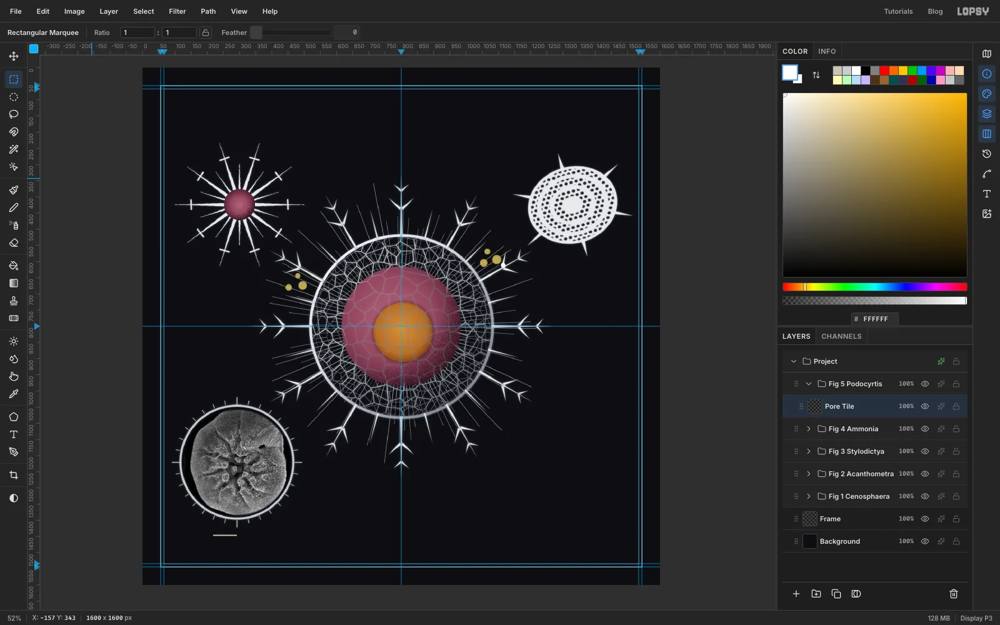

Collapse *Fig 4*, click it, and make a group called *Fig 5 Podocyrtis*.
The bell needs bigger pores. On a scratch layer, select From
**1108, 604** To **1122, 618** and fill it with white. Select the square
From **1104, 600** To **1126, 622**, choose **Edit → Define Pattern** and
delete the scratch layer. You now have a 22 × 22 tile as well as the
16 × 16 one.

## Draw the bell

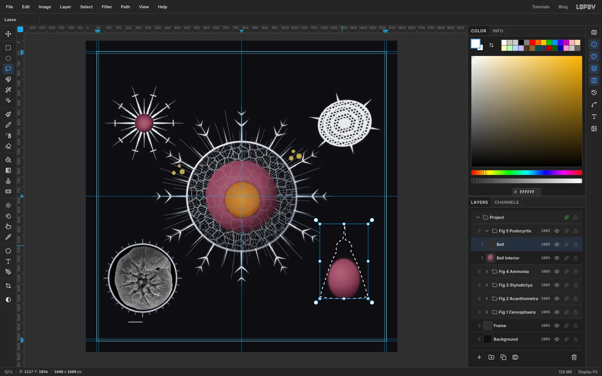

Add a layer called *Bell Interior*. Select the ellipse From
**1244, 1120** To **1408, 1328**, choose **Select → Feather…** **10 px**
and fill it with the capsule gradient. It will show through the pores.

Add a layer called *Bell*. With the **Lasso**, draw the bell's outline: a
narrow top about 60 px wide at y 1076 that flares out in a gentle curve to
about 245 px wide at y 1312, centred on x 1326. Then add to it:

- switch to the **Elliptical Marquee** and [[Cmd+Shift]]-drag an 80 px
  circle for the head, sitting on the narrow top
- [[Shift]]-drag a flat ellipse about 250 × 28 px along the bottom for the
  lip
- switch back to the **Lasso** and [[Shift]]-drag a thin triangle of a
  horn rising out of the head, about 110 px tall

Fill it all with `#E8E9EC` and deselect.

## Fill graded pores

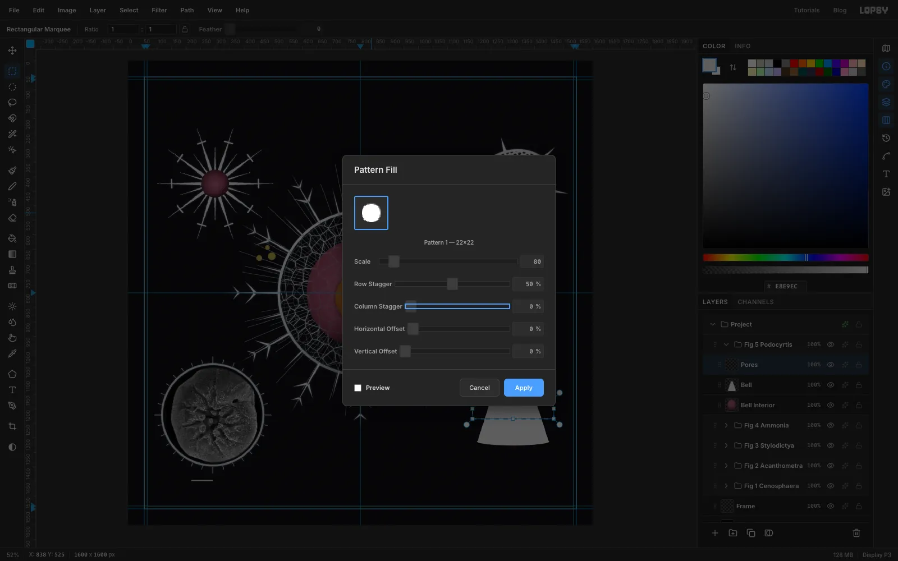

On real shells the pores are smaller near the head. Add a layer called
*Pores*. Draw a rectangular marquee across the top third of the bell,
below the head, and choose **Edit → Fill with Pattern…**. Pick the
**22 × 22** pattern and set **Scale 60** and **Row Stagger 50%**. Do the
middle third at **Scale 80** and the bottom third at **Scale 100**. Leave a
few pixels between the bands so their rows don't collide.

## Keep pores off the edge

Pores sliced by the outline look like bites. [[Cmd]]-click the *Bell*
thumbnail, choose **Select → Shrink…** **9 px** and **Select → Inverse**,
click the *Pores* row and press [[Delete]]. That clears every dot within
9 px of the edge. Deselect.

## Punch the pores through

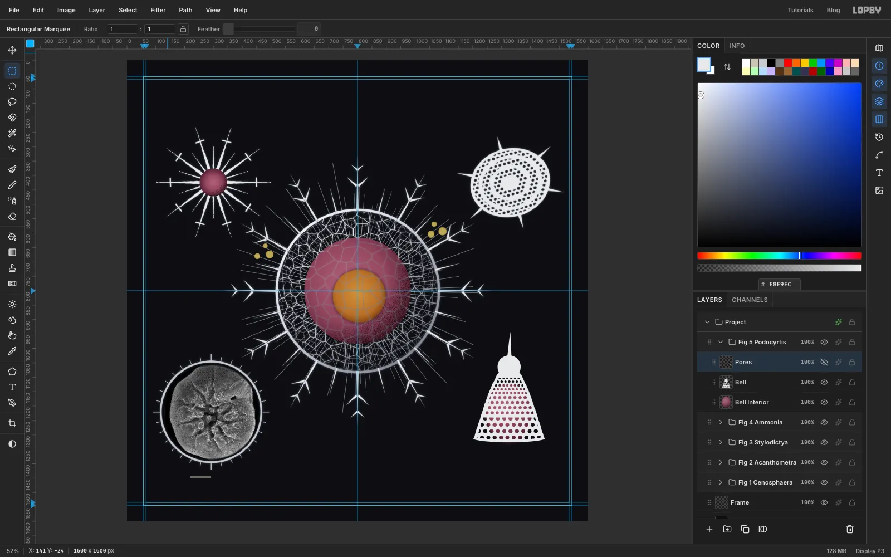

[[Cmd]]-click the *Pores* thumbnail, click the *Bell* row, and press
[[Delete]]. Deselect, hide the *Pores* layer, and give *Bell* the
**silver** treatment.

## Shade the bell and add its feet

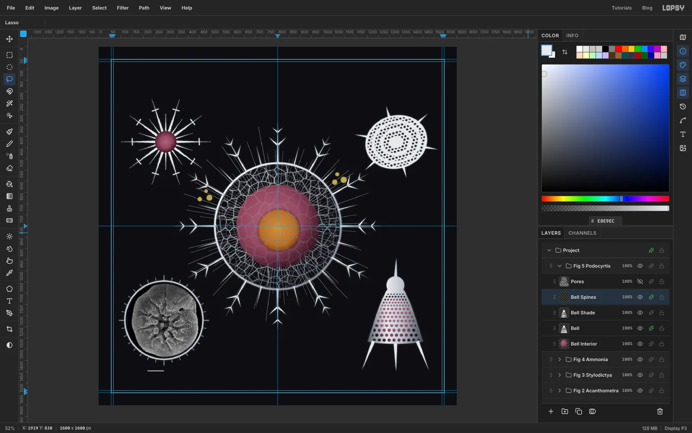

Add a layer called *Bell Shade*, [[Cmd]]-click the *Bell* thumbnail, and
drag a **linear** gradient straight across it from left to right with the
bell-shade stops: `#5C606A`, white at 35%, `#D5D8DE` at 60%, `#4A4E58`.
Deselect and set the layer to **Multiply**. That's how light falls on a
cone.

Add a layer called *Bell Spines*. With the **Lasso**, draw three long thin
thorns for feet, using [[Shift]] to add each after the first: one under
each side of the rim angling outwards, and one straight down the middle,
each about 130 px long. Fill them with `#E8E9EC` and give the layer the
**silver** treatment.

## Set the title

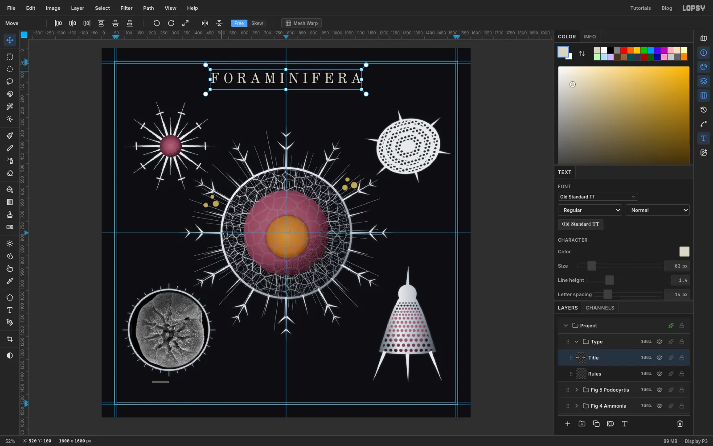

Collapse *Fig 5*, click it, and make a group called *Type*. Add a layer
called *Rules* inside it. Click *Rules* each time before you set up a new
piece of type. With a text layer active, the Text tool's options restyle
that layer instead.

Pick the **Text** tool. Choose **Old Standard TT**, Size **62**, colour
`#DCD5C4`, and in the **Text** panel set **Letter spacing** to **14**.
Click in the empty space at the top and type `FORAMINIFERA`, then press
[[Tab]] to commit. With the **Move** tool, nudge it so it's centred on the
middle guide, with its tops about 105 px from the top edge.

## Add the credits and figure labels

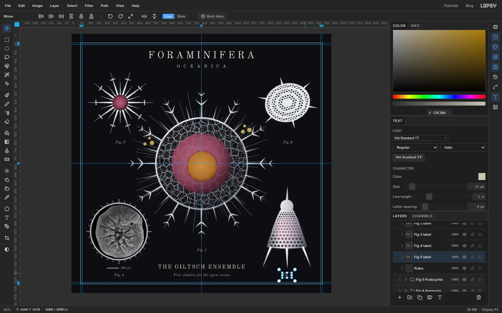

Click *Rules* each time, then add, all in **Old Standard TT**:

- `OCEANICA` at Size **28**, letter spacing **22**, in `#DCD5C4`, centred about 40 px under the title
- `200 µm` at Size **18** in `#C9C3B4`, just right of the scale bar
- `THE GILTSCH ENSEMBLE` at Size **34**, letter spacing **5**, in `#DCD5C4`, centred near the bottom
- `Five studies for the open ocean` in **Italic** at Size **24** in `#BDB7A8`, under the band name

Then label each figure `Fig. 1` to `Fig. 5` in **Italic**, Size **22**,
`#C9C3B4`, centred under its figure. Put *Fig. 2* and *Fig. 3* on one
line, and *Fig. 4*, *Fig. 5* and the tagline on another, so the labels
form a tidy grid. *Fig. 1* sits about 55 px under the big sphere's lowest
spine.

## Rule off the subtitle

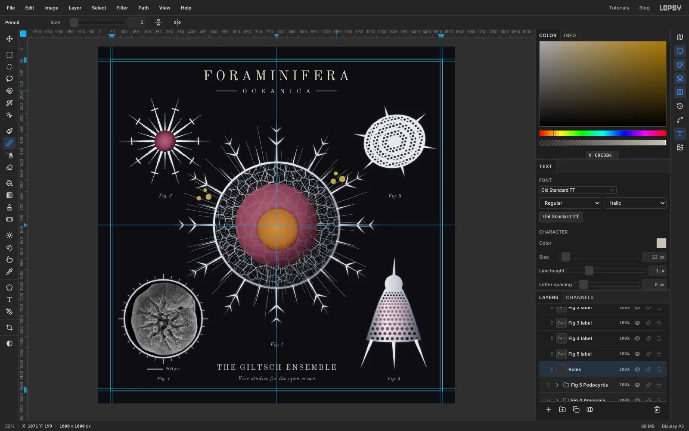

Click *Rules*. With the **Pencil** at **Size 2** and `#C9C3B4`, draw a
line about 90 px long on each side of `OCEANICA`, leaving about 28 px
between the line and the letters. Keep the lines level with the middle of
the capitals. Click the start and [[Shift]]-click the end.

## Darken the corners

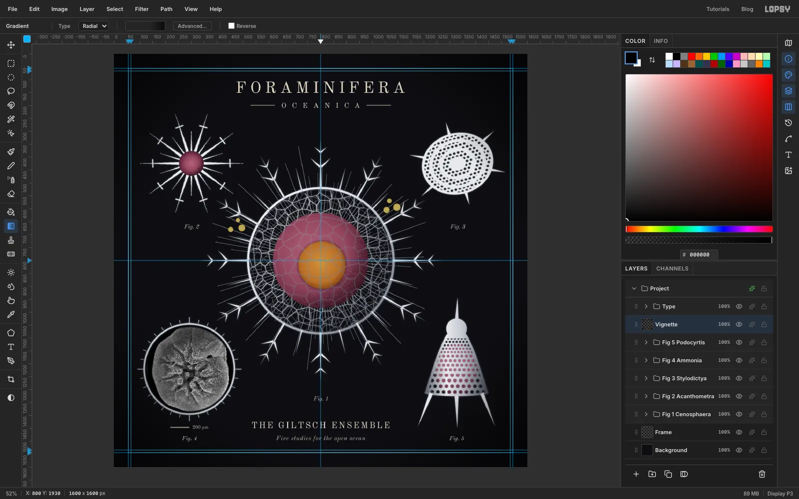

Click the collapsed *Fig 5* group and add a layer called *Vignette*. It
lands above the figures but below the *Type* group, so the labels stay
bright. Make a radial gradient that's fully transparent black from 0 to
62% and black at **75%** opacity at the end. Drag it from the centre of
the plate out past a corner.

## Add litho grain

Click the *Type* group and add a layer called *Litho Grain* at the top.
Fill it with black, then choose **Filter → Add Noise…** with
**Amount 100** and **Mono**. Set the blend mode to **Screen** and the
opacity to **30%**. Screen hides the black and lets only the specks
through, so the whole plate gets a printed tooth. Overlay or Soft Light
would do almost nothing over a black ground.

Hide the guides with **View → Show Guides**, export with
**File → Quick Export PNG**, and save the project with
**File → Save Project**.

> **Tip:** After a Fill with Pattern or a Kaleidoscope, try [[Cmd+Z]] and
> [[Cmd+Shift+Z]] to compare before and after. The plate comes back
> exactly as it was.
