On 30 June 1908, at about 7:17 in the morning, something exploded in the air over the Tunguska river in Siberia. It flattened around 80 million trees. Nobody reached the site until 1927, when Leonid Kulik's expedition found trees lying in a vast ring, pointing away from the blast.

This tutorial turns that story into a poster for an imaginary film, **TUNGUSKA UNEARTHED**, printed in the style of an old halftone screen print. Everything is made of dots:

- the blast is a disc of **orange** dots;
- the sun's core and the meteor trail are **yellow** dots;
- the flattened forest, from one of Kulik's own photographs, is **indigo** dots.

Wherever two layers of dots overlap, they use different screen angles (0°, 15°, 45° or 75°), just as real colour printing does, so the overlapping dots form tidy rosettes instead of clashing into a moiré pattern.

The photo, taken on the expedition in 1929, is in the public domain. You can download it from [Wikimedia Commons](https://commons.wikimedia.org/wiki/File:Tunguska_Ereignis-1.jpg).

The recipe you'll use again and again is:

1. paint a **black-to-white gradient** where you want the dots;
2. run **Filter → Halftone**, which turns dark into big dots and white into nothing;
3. recolour the dots with a **Color Overlay**, then **Rasterize Layer Style**.

Along the way you'll also use the **Pen tool**, **Path to Selection**, a **layer mask**, the **Move tool's** rotate and scale handles, **copy, paste and flip**, the **Pencil** with [[Shift]]-click lines, [[Cmd]]-clicked thumbnails, **guides**, **groups** and **undo / redo**.

The fonts are free Google Fonts:

- **Bebas Neue** for the title
- **Saira Extra Condensed** for the tagline, subtitle and credits
- **PT Sans Narrow** Bold for the Russian side text and the coordinates

The palette is three inks plus paper:

- Paper `#EFDCC0`, type peach `#F3D6AC`
- Indigo ink `#1F2150`
- Orange ink `#EE6230`
- Yellow ink `#F6C445`
- Sun cream `#FFF1C2`, ring peach `#F2D9B8`

## Set up the page and guides

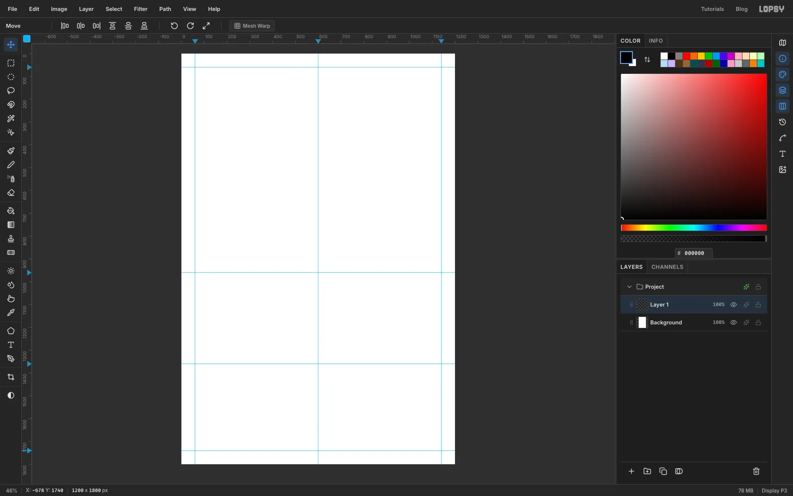

Choose **File → New**, set the size to **1200 × 1800** pixels with a White background, and click **Create**.

Click the top ruler at **60**, **600** and **1140** to drop three vertical guides: the two side margins and the centre line. Then click the left ruler at **60**, **960**, **1360** and **1740**. The guide at **960** is the horizon, where the sky meets the ground. **1360** roughly marks where the photo will fade out and the type will begin, and **1740** is the bottom margin.

## Lay down the paper and the sky

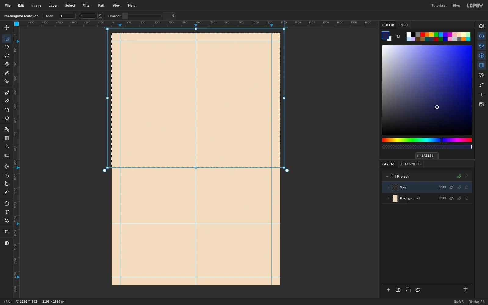

Click **Background**, set the foreground colour to paper `#EFDCC0`, choose **Select → All** and then **Edit → Fill**. Press [[Cmd+D]] to deselect.

Double-click **Layer 1** and rename it *Sky*. Set the foreground to indigo `#1F2150`. With the **Rectangular Marquee**, drag from just outside the top-left corner of the canvas to just outside the right edge at the horizon. The bottom edge snaps onto the 960 guide. Choose **Edit → Fill**, then deselect.

## Print a yellow glow above the horizon

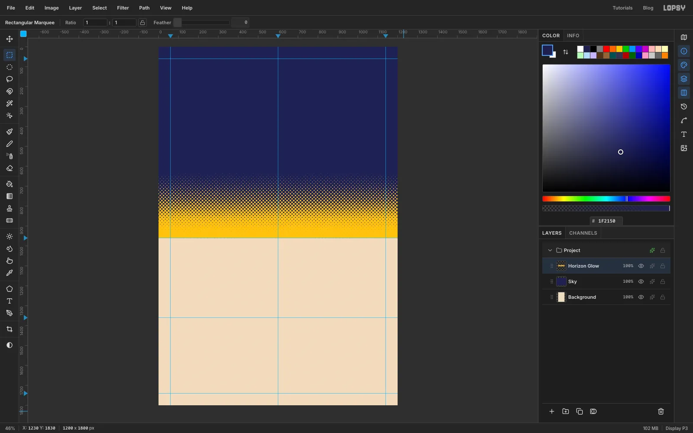

Click **Add Layer** in the Layers panel and name the new layer *Horizon Glow*. Select the sky again with the same marquee.

Pick the **Gradient** tool, set Type to **Linear** and click **Advanced…**. Make three stops:

- black `#000000` at the left end;
- dark grey `#3A3A3A` about a quarter of the way along;
- white `#FFFFFF` at the right end.

Drag from the horizon straight up to about a third of the way into the sky, then deselect.

Now choose **Filter → Halftone** and set **Dot Size 18**, **Density 1.5**, **Angle 45** and **Softness 0.4**. The halftone filter draws a big dot where the gradient is dark and nothing where it's white. Density 1.5 makes the darkest dots overlap, so the band turns solid at the horizon.

Open the layer's effects (✦), turn on **Color Overlay** with yellow `#F6C445`, and click **Rasterize Layer Style** to bake the colour in. A few dots sit across the horizon line, so marquee everything below the horizon and press [[Delete]].

## Shade the blast as a grey gradient

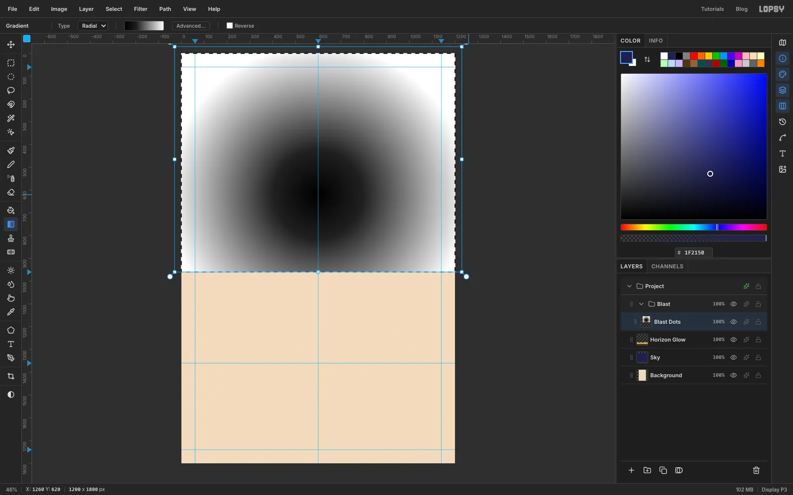

Click the **New Group** button in the Layers panel and name the group *Blast*. Add a layer inside it called *Blast Dots*, and select the sky once more.

With the Gradient tool, switch Type to **Radial** and set up three stops: black, then `#202020` about 30% along, then white. Drag from where you want the sun, on the centre guide a little below the middle of the sky (about two-thirds of the way down to the horizon), to just past the right edge of the canvas.

The darkest area will become the biggest dots, so this grey picture is really a map of how heavy the blast will be.

## Turn it into dots with Halftone

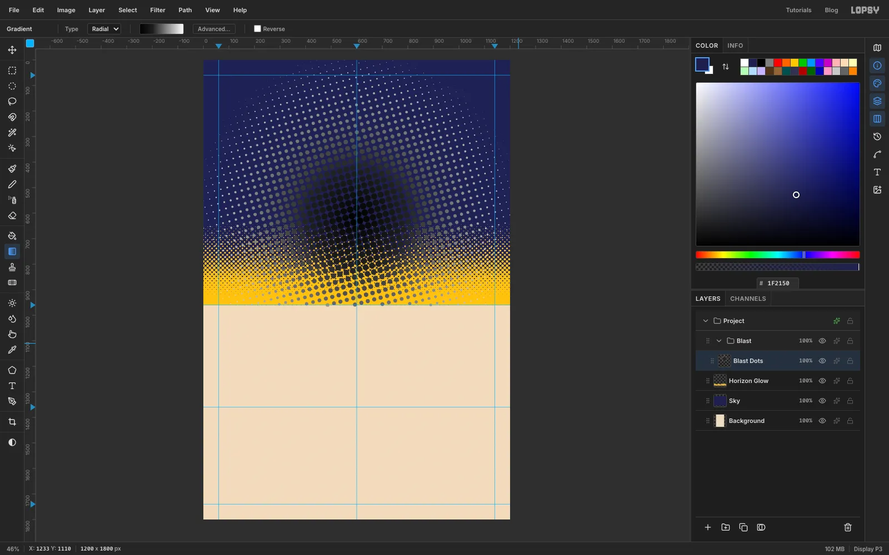

Deselect, then choose **Filter → Halftone** with **Dot Size 26**, **Density 1**, **Angle 15** and **Softness 0.4**.

Big dots fill the middle and shrink to specks towards the edges. Where the gradient was white, the layer is now transparent, so the indigo sky shows between the dots.

## Ink the blast orange

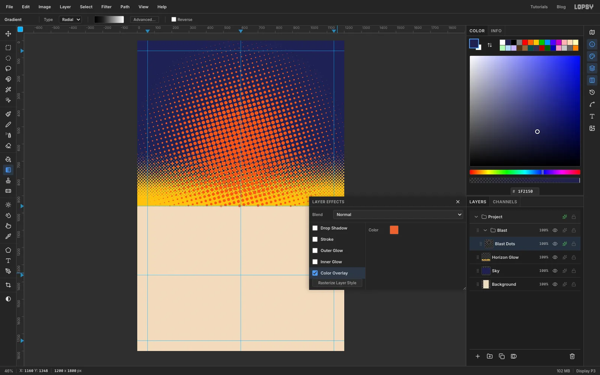

Open the effects for *Blast Dots*, turn on **Color Overlay** and set it to orange `#EE6230`. Then click **Rasterize Layer Style** so the dots are really orange, not just displayed that way.

## Draw the meteor trail with the Pen

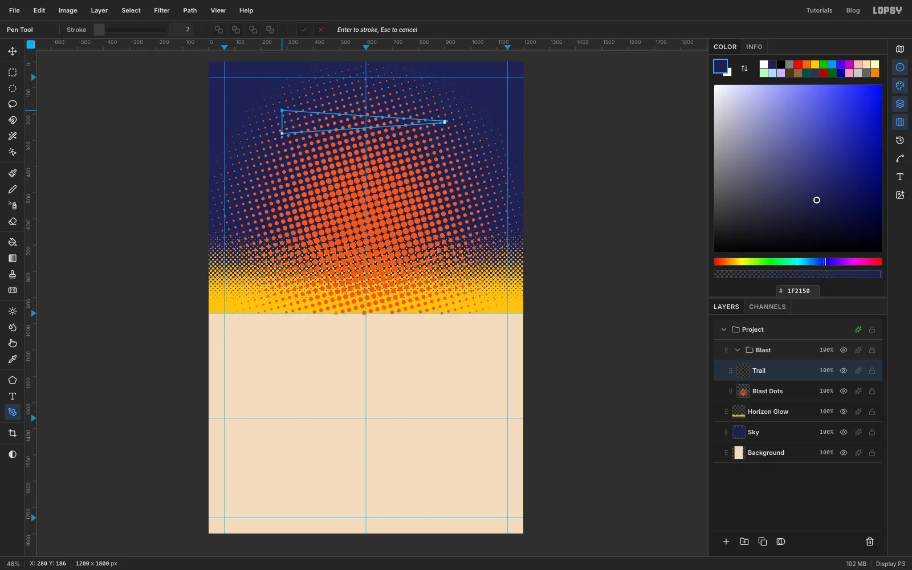

Add a layer called *Trail*. You'll draw it lying flat first and rotate it into place afterwards, because a level wedge is much easier to draw evenly.

Pick the **Pen** tool and click four anchors to make a long, thin wedge in the upper sky:

1. the top of the thick end, on the left;
2. the point, about 620 px to the right;
3. a second click just below the point, so the tip is blunt rather than a hairline;
4. the bottom of the thick end, about 90 px below the first anchor.

Click the first anchor again to close the shape. In the **Paths** panel, click **Path to Selection**, then **Delete Path**. The path has done its job.

## Print the trail in yellow dots

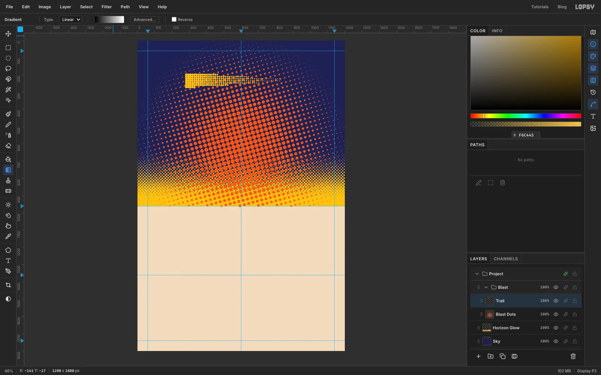

With the wedge still selected, drag a **Linear** gradient from black at the thick end to white at the point. Deselect, then run **Halftone** with **Dot Size 12**, **Density 1**, **Angle 0** and **Softness 0**. Add a yellow `#F6C445` Color Overlay and rasterize.

The tiniest dots at the tail are only partly opaque, so over indigo they'd print as a muddy olive. Clean them up:

1. [[Cmd]]-click the *Trail* thumbnail to select its dots.
2. Choose **Select → Grow** with a value of **1**.
3. Choose **Edit → Fill** with yellow.
4. Choose **Select → Inverse** and press [[Delete]], then deselect.

Every dot is now solid yellow with a crisp edge.

## Rotate the trail with the handle

Drag a marquee around the trail with a little room to spare and switch to the **Move** tool. Hover just outside the top-right corner of the box until the cursor turns into the rotate arrow.

Drag that rotate handle anticlockwise about **48°**, until the thin end points at the top-right corner of the poster. Press [[Cmd+D]] to commit the rotation.

## Slide the trail into the blast

With the Move tool, drag the trail down and to the right until its thick end sits just above and to the right of the middle of the blast. The sun's core will cover that end in a moment, so it looks as if the meteor is diving into it.

## Add yellow dots around the core

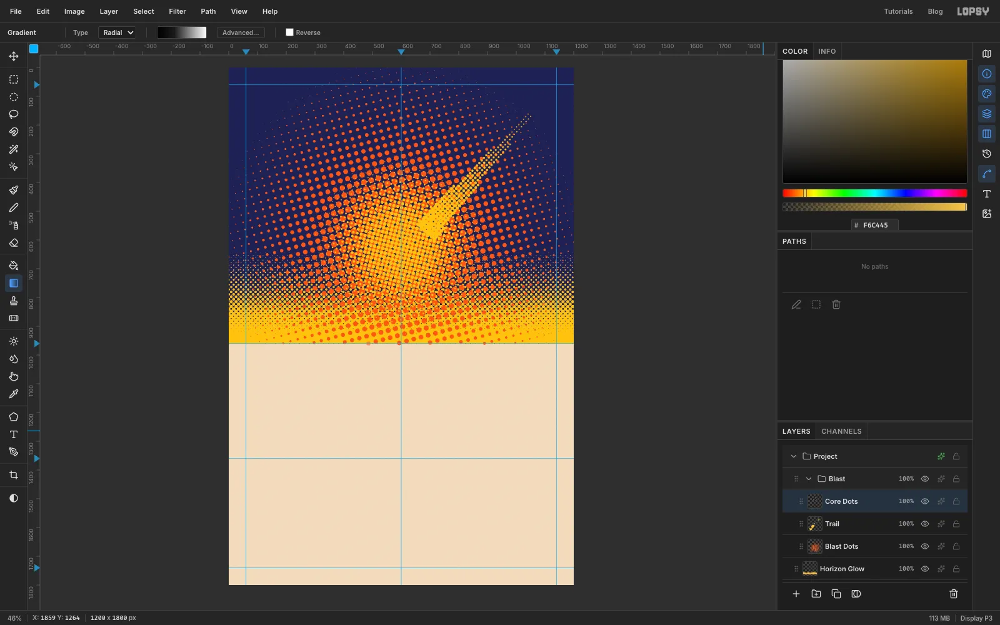

Add a layer called *Core Dots*. Drag a **Radial** gradient from the same centre point, black (with a second black-ish stop, `#1A1A1A`, about 35% along) to white, about 330 px out.

Run **Halftone** with **Dot Size 14**, **Density 1**, **Angle 75** and **Softness 0.4**, add a yellow Color Overlay, and rasterize. The yellow dots sit at 75° against the orange's 15°, so the two inks mix into a rosette instead of a moiré.

## Give the sun a dotted edge

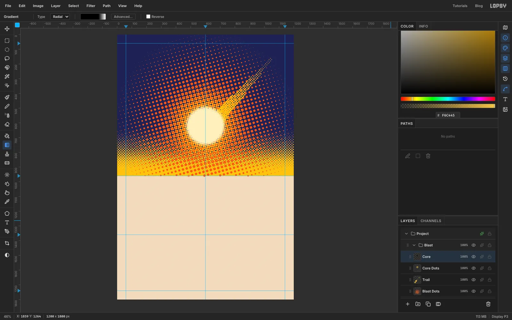

Add a layer called *Core*. Pick the **Elliptical Marquee** and, with nothing selected, click once on the canvas. In the **Elliptical Selection** dialog, enter From **450, 470** and To **750, 770** to get a 300 px circle centred on the blast.

Inside it, drag a **Radial** gradient from the centre to the edge, with black up to about 72% and white at the very edge. Deselect, then run **Halftone** with **Dot Size 14**, **Density 1.5**, **Angle 75** and **Softness 0**. Colour it with a sun-cream `#FFF1C2` Color Overlay and rasterize.

The middle merges into a solid disc, and only the rim breaks into dots, so the sun is printed like everything else around it.

## Draw the shock rings

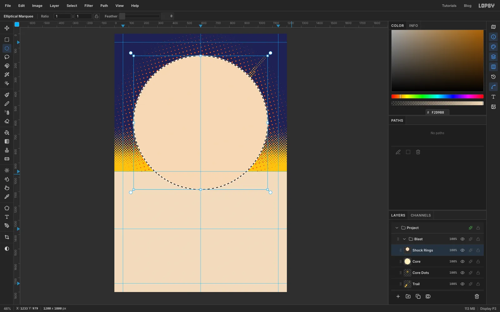

Add a layer called *Shock Rings* and set the foreground to ring peach `#F2D9B8`. You'll make three rings, **largest first**. Each Delete clears everything inside the current circle, which would wipe out any smaller ring you'd already drawn.

For each ring:

1. Click once with the Elliptical Marquee and type the corners.
2. Choose **Edit → Fill**.
3. Choose **Select → Shrink** by **4**.
4. Press [[Delete]], then deselect.

The corners are:

- From **130, 150** to **1070, 1090**
- From **230, 250** to **970, 990**
- From **330, 350** to **870, 890**

## Fade the rings out with a mask

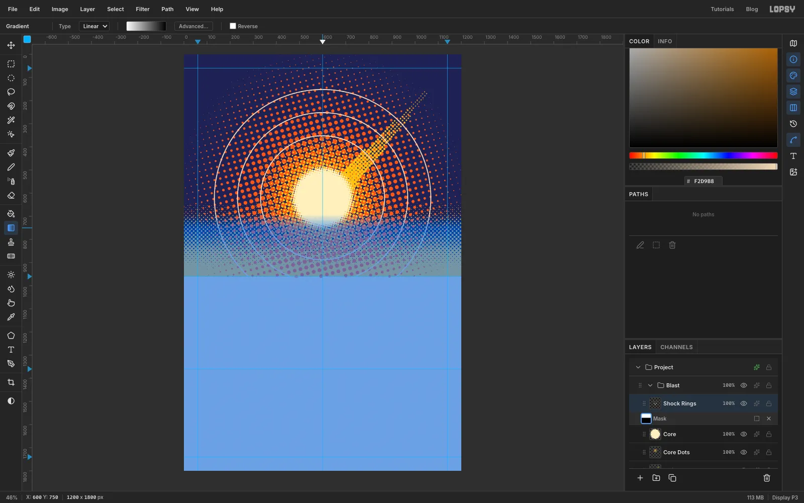

The rings would cross the yellow band and the trees, so fade them out instead. Click **Add Mask** in the Layers panel, then click the mask thumbnail to edit the mask. The canvas turns blue while you're editing it.

Drag a **Linear** gradient from white to black, starting level with the lower part of the sun (about y = 690) and ending 60 px further down. Above the gradient the rings show, and below it they're hidden. Click the *Shock Rings* row to stop editing the mask.

Finally, click *Blast Dots*, marquee everything below the horizon, and press [[Delete]] to trim the dots that spilled over it.

## Print the ground in orange dots

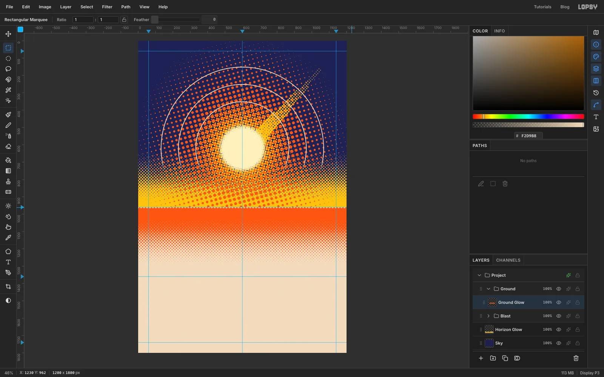

Click the *Blast* group row and collapse it with its arrow, so the next group goes beside it rather than inside it. Click **New Group** and name it *Ground*, then add a layer called *Ground Glow*.

Marquee the full width of the canvas from the horizon down to about 1420. Drag a Linear gradient from the horizon down to about 1300, using black at the top, `#151515` about 20% along, and white at the bottom. Deselect.

Run **Halftone** with **Dot Size 18**, **Density 1.5**, **Angle 45** and **Softness 0.4**, then add an orange Color Overlay and rasterize. This is the same screen as the yellow glow above the horizon, so the two bands mirror each other.

## Paste in the photograph

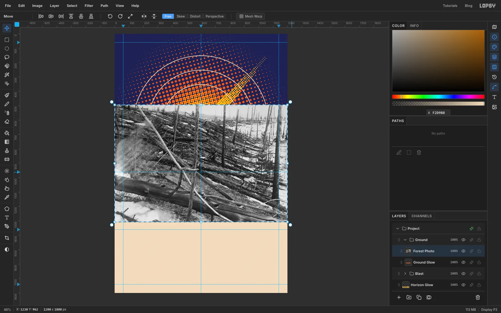

Open the Kulik photo in your browser, copy it, and press [[Cmd+V]] in Lopsy. It comes in as a new layer, scaled to fit the width of the canvas. Rename it *Forest Photo*.

## Scale the photo up

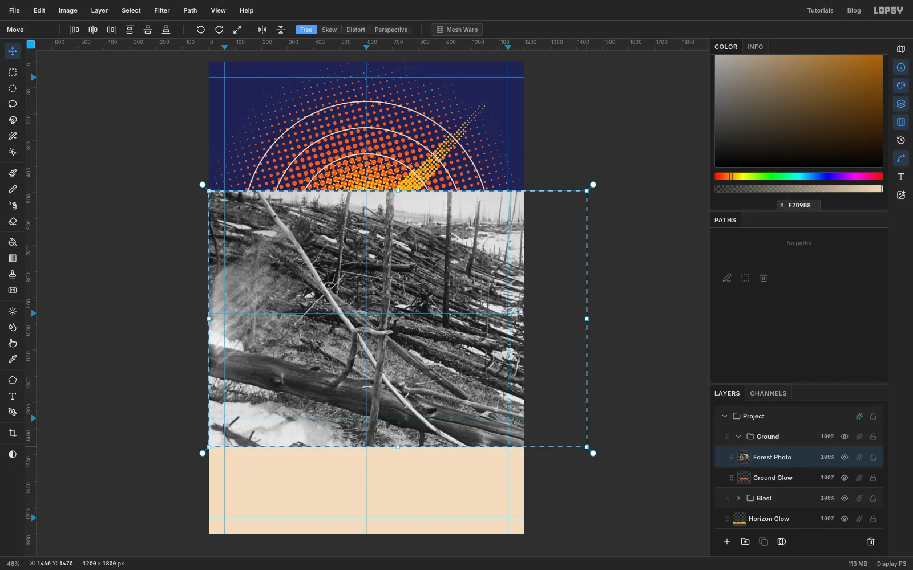

The interesting part of the photo is the fallen trunks in the middle, so make it bigger. Drag a marquee around the photo and switch to the Move tool. Hold [[Cmd]] (to keep the proportions) and drag the bottom-right handle out by about 240 px, so the photo is about 1440 px wide, then press [[Cmd+D]] to commit.

Drag the photo so it hangs evenly past both sides of the canvas, with its top edge at about y = 500.

## Boost the photo and crop it to the ground

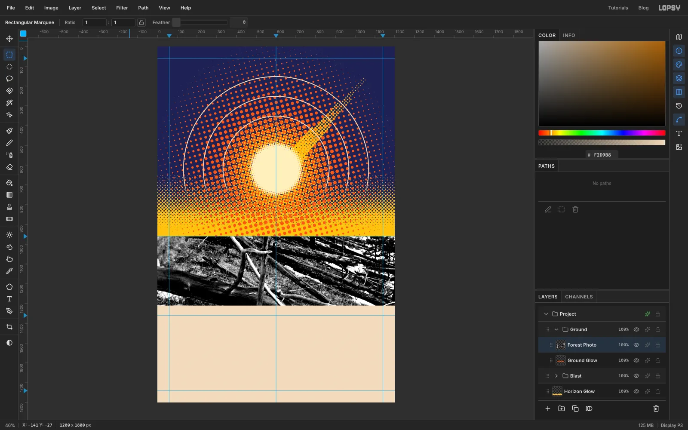

Choose **Filter → Desaturate**, then **Filter → Brightness/Contrast** with **Brightness 0** and **Contrast 85**. The dark trunks and the bright snow need to be far apart for the dots to read.

Marquee the full width from the horizon down to about y = 1310, choose **Select → Inverse**, press [[Delete]] and deselect. What's left is a band of photo sitting right under the horizon.

## Fade the bottom of the photo

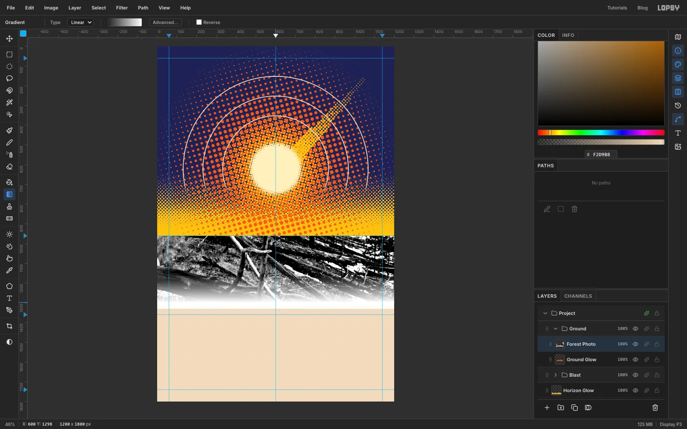

Marquee the bottom 150 px or so of the band, full width. In the gradient editor, set both stops to white and drag the left stop's opacity down to **0**. Then drag the gradient from the top of that marquee straight down to the bottom of the photo, and deselect.

White prints no dots at all, so this fade will turn into dots that shrink to nothing as they reach the paper.

## Halftone the photo in indigo

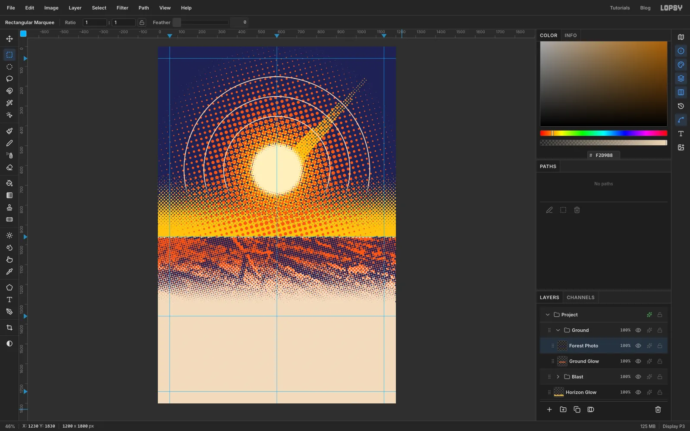

Run **Halftone** with **Dot Size 10**, **Density 1**, **Angle 15** and **Softness 0.3**. Add an indigo `#1F2150` Color Overlay and rasterize.

Parts of the photo hang off the sides of the canvas, and Select → Inverse never reached them, so a few dots can creep in at the edges below the band. Marquee everything below the band, full width, and press [[Delete]] to clean them up.

## Draw the dead trees with the Pencil

Add a layer called *Dead Trees*, set the foreground to indigo, and pick the **Pencil**. To draw a straight line, click where it starts and then [[Shift]]-click where it ends.

Draw seven bare trunks on the left half of the horizon, between about x = 90 and x = 460. Make them between 90 and 260 px tall, and lean each one a few pixels left or right. Space them unevenly. A tree line spaced like a fence looks fake.

Taper each trunk by drawing it in three pieces:

- **Size 9** for the bottom third;
- **Size 6** for the middle;
- **Size 3** for the tip.

Use a size or two thinner for the short trees.

Add two or three short branch stubs to each tree at **Size 3**, angled up and out. Finally, at **Size 6**, draw four fallen trunks lying against the horizon at different angles. Three lean away from the sun and one leans the other way, like the toppled trees in the photo.

## Copy the stand of trees

Drag a marquee around the whole stand, from just left of the first tree to just right of the last, and from above the tallest tip to just below the horizon. Press [[Cmd+C]] and then [[Cmd+V]] to paste a copy on its own layer, and name it *Trees Copy*.

## Flip the copy across the poster

Choose **Image → Flip Horizontal**. The copy flips in place, so its fallen trunks now lean the other way. Switch to the Move tool and move it to the right half of the horizon, with [[Shift]]+arrow keys for big steps and the arrow keys to finish. Leave it slightly off a perfect mirror.

## Break the mirror

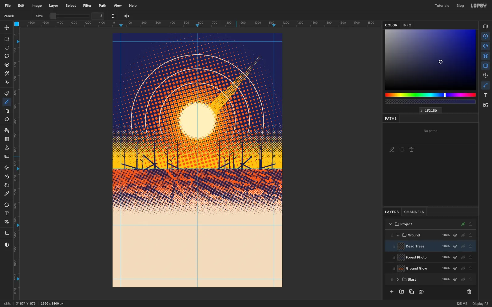

Choose **Layer → Merge Down** to merge the copy into *Dead Trees*.

A perfect mirror gives the trick away. Pick the **Eraser** at **Size 30** and drag up one of the short trees on the right to remove it. Then use the Pencil to draw two new tapered trees on the right side, at different heights from anything on the left.

## Rough up the horizon

The horizon is still a ruler-straight line, so break it with dots. Add a layer called *Horizon Dots* and pick the Pen tool.

1. Click once beyond the left edge of the canvas and once beyond the right, just above the horizon.
2. Come back along the bottom with about twenty clicks that wander up and down between about 10 and 50 px below the horizon.
3. Close the shape, then click **Path to Selection** and **Delete Path**.

Drag a Linear gradient straight down through the band, with white at the top, black about 30% of the way down, and white at the bottom. Deselect, then run **Halftone** with **Dot Size 9**, **Density 1.2**, **Angle 15** and **Softness 0**. Add an indigo Color Overlay and rasterize.

## Set the title

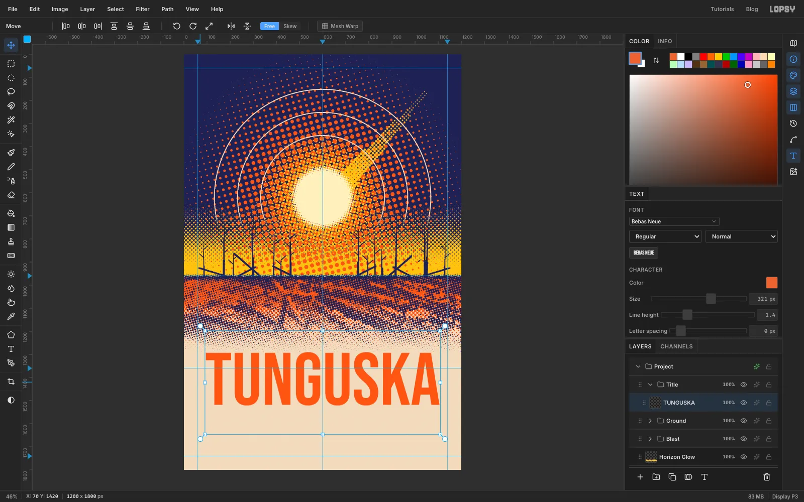

Collapse the *Ground* group, click **New Group** and name it *Title*.

Pick the **Text** tool. Set the font to **Bebas Neue**, Size **321**, and colour orange `#EE6230`. Click in an empty part of the paper, type **TUNGUSKA**, and press [[Tab]] to commit. At that size the word spans almost the full width between the margins.

With the Move tool, nudge it with the arrow keys until it's centred on the centre guide, with the tops of the letters about 70 px above the 1360 guide, just clear of the last photo dots.

## Select the title's letters

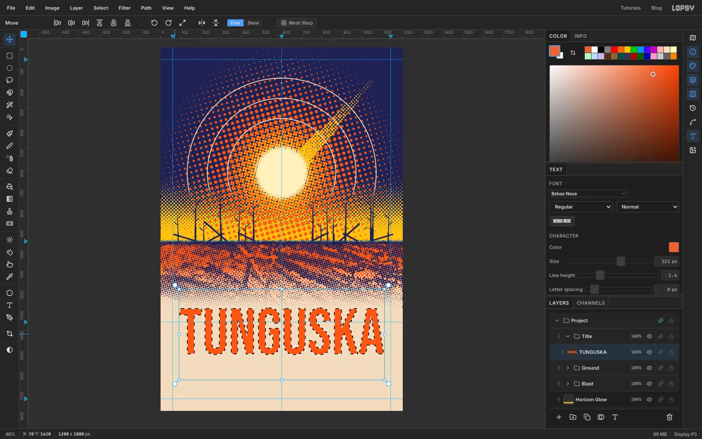

[[Cmd]]-click the *TUNGUSKA* thumbnail in the Layers panel. That loads the letters' shapes as a selection. Then click **Add Layer** and name the new layer *Title Shade*.

## Shade the letters with dots

Your gradient still has the three stops from the horizon. In **Advanced…**, delete the middle stop and set the ends to white and mid-grey `#5A5A5A`. Drag it from just below the middle of the letters down to their baseline. The selection keeps it inside the letters. Deselect.

Run **Halftone** with **Dot Size 9**, **Density 1**, **Angle 45** and **Softness 0.3**. Add an indigo Color Overlay and rasterize.

The dots along the edges of the letters spill slightly outside them. [[Cmd]]-click the *TUNGUSKA* thumbnail again, choose **Select → Inverse**, press [[Delete]] and deselect.

## Add a misregistered indigo plate

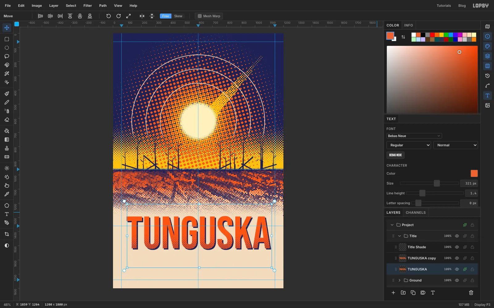

Click the *TUNGUSKA* layer and choose **Layer → Duplicate Layer**. The copy sits exactly on top of the original.

Click the original, the lower of the two, and give it an indigo Color Overlay. Then, with the Move tool, press → eight times and ↓ eight times. The orange copy stays on top with its dots, and the indigo plate peeks out down and to the right, like a print where the second ink landed slightly off.

## Add the subtitle and rules

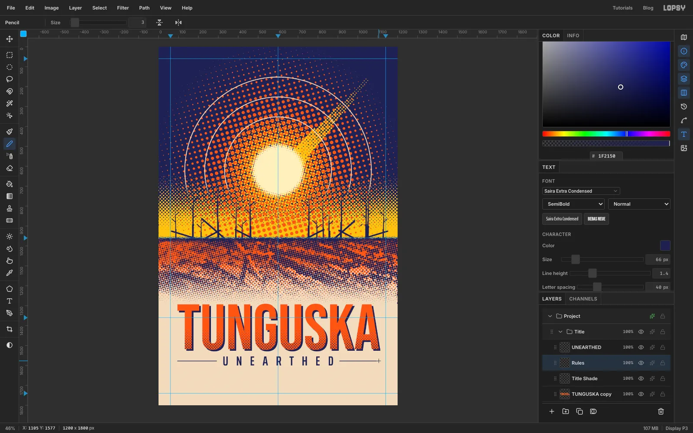

Click *Title Shade* first, so your new text settings don't restyle the title. With the Text tool, set **Saira Extra Condensed** SemiBold, Size **66**, indigo, and in the **Text** panel set **Letter spacing** to **40**. Click in empty paper, type **UNEARTHED** and press [[Tab]]. Centre it about 26 px below the bottom of the indigo plate.

Add a layer called *Rules*. With the Pencil at **Size 3**, draw two lines level with the middle of UNEARTHED. Click the start, then [[Cmd+Shift]]-click the end, which snaps the line perfectly level:

- from the left edge of the title to a letter-width short of the **U**;
- from a letter-width past the **D** to the right edge of the title.

Make the two gaps equal.

## Set the billing block

Every film poster needs a billing block. Click *Rules* again before each new piece of text, and type each one in empty paper before moving it.

- **Cast:** Saira Extra Condensed SemiBold, Size **21**, Letter spacing **6**, indigo. Type five names separated by six spaces, for example ILYA MAREK, NINA ORLOVA, OSKAR LIND, ANNA VOLKOVA and PIOTR SEMYONOV. Centre it about 30 px below UNEARTHED.
- **Crew:** the same font at Medium, Size **18**, Letter spacing **2**, about 13 px below the cast line. For example: PERMAFROST PICTURES PRESENTS, A VERA SOKOLOVA FILM, MUSIC ANTON BELYI, CINEMATOGRAPHY LEV KRAMER, DIRECTED BY VERA SOKOLOVA.
- **Release:** Bold, Size **40**, Letter spacing **14**, orange: **IN CINEMAS 30 JUNE**, centred just above the bottom margin.

## Add the tagline

Click *Rules*, then type **THE SKY OPENED AT 7:17 A.M.** in Saira Extra Condensed SemiBold, Size **50**, Letter spacing **14**, peach `#F3D6AC`. Type it in the empty top margin and centre it over the sun.

## Run type up the sides

The sides of the sky still have stray orange dots, so give the side type a clean strip to sit on.

1. Add a layer called *Side Bars*.
2. With the Rectangular Marquee, select a strip about 70 px wide just inside the left margin, running from under the tagline down to about the height of the sun, and **Edit → Fill** it with indigo. Do the same just inside the right margin, then deselect.
3. With *Side Bars* still active, pick the Text tool and set **PT Sans Narrow** Bold, Size **20**, Letter spacing **8.5**, peach.
4. Click in empty space and paste **ТУНГУССКИЙ ФЕНОМЕН · 1908** ("Tunguska phenomenon"), then press [[Tab]].
5. Switch to the Move tool and click **Rotate 90° CCW** in the options bar, so the text reads upwards.
6. Nudge it onto the left strip.

Do the same for the coordinates of the blast, **60°53′ N · 101°54′ E**, with Letter spacing **13** and **Rotate 90° CW**, on the right strip. Adjust the letter spacing until both lines come out the same length, about 428 px.

## Move the whole title group

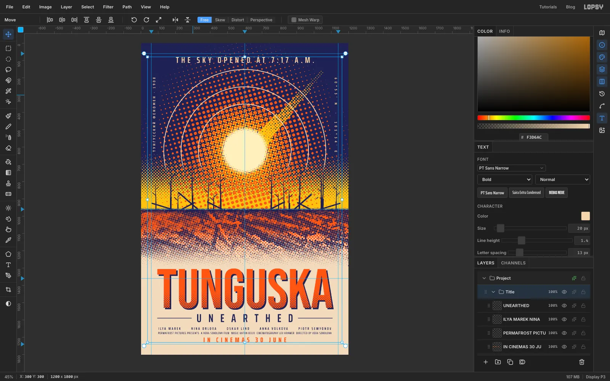

Step back and look at the whole poster. The bottom margin under the release line is tighter than the side margins, and the type block feels a touch high. Rather than moving seven text layers one at a time, move the group.

Click the *Title* group row, so the group itself is active, and switch to the Move tool. Press [[Shift+Down]] once and [[Down]] twice. Everything in the group moves down 12 px together: the title, the plate, the dots, the credits, the tagline and the side text. The release line now sits 72 px from the bottom edge.

To compare, press [[Cmd+Z]] three times to see the old position, then [[Cmd+Shift+Z]] three times to bring it back.

## Add newsprint grain and export

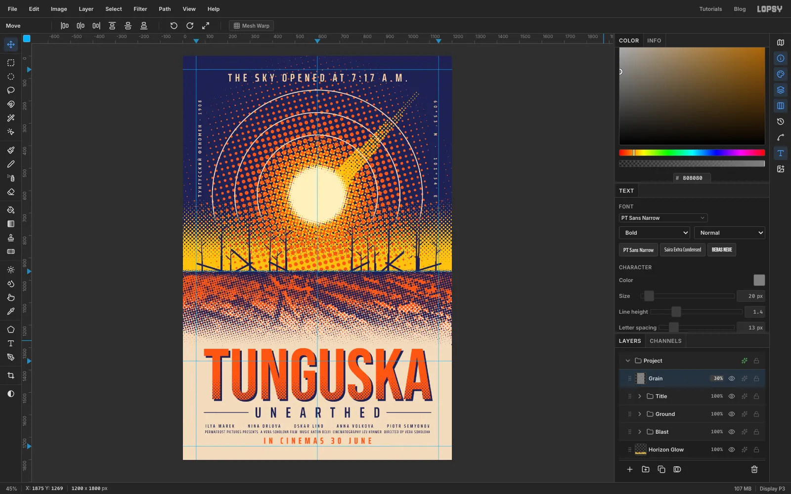

Collapse the *Title* group, click it, and click **Add Layer** to make a layer called *Grain* above it.

1. Choose **Select → All**.
2. Fill the layer with mid-grey `#808080`, then deselect.
3. Run **Filter → Add Noise** with **Amount 40**, **Mono** and **Gaussian**.
4. In the effects drawer, set the blend mode to **Overlay**.
5. Drop the layer's opacity to **30%**.

The grain makes the flat inks feel printed on paper rather than on a screen.

Save the project with **File → Save Project**, then export it with **File → Quick Export PNG**.
