Some of the earliest Christmas cards were hand-coloured prints, and printmakers have long sent small **etchings** as cards. The artist scratches a picture through a waxy ground on a copper plate and lets acid bite the lines into the metal. Large areas of tone come from **aquatint**: a dusting of rosin melted onto the plate, so the acid bites around each grain and leaves a speckled tone. After printing, each copy can be coloured by hand with thin watercolour washes, then numbered and signed in pencil under the **plate mark**, the dent the plate leaves when it's pressed into damp paper.

In this tutorial you'll make that kind of card digitally: **A Hedgehog's Christmas**, a 1500 × 2100 px card (5 × 7 in at 300 dpi). A big etched hedgehog sits in the snow under a grainy aquatint sky with a full moon. Behind it are a far-off cottage and a few firs, and holly frames the picture. Everything is printed in warm brown-black ink, washed with transparent colour, and signed under the plate.

You'll work from a real photo, [Adi kirpi.jpg](https://commons.wikimedia.org/wiki/File:Adi_kirpi.jpg), a CC0 picture of a European hedgehog on a lawn by Oldiefan on Wikimedia Commons. Download the full-size file (960 × 720 px).

The tools you'll use:

- **guides**, the **Rectangular** and **Elliptical Marquee**, the **Lasso**, and **Select → Shrink / Grow / Feather / Inverse**
- the **Gradient** tool, **Add Noise**, **Gaussian Blur**, **Threshold**, **Desaturate** and **Brightness/Contrast**
- the **Lighten**, **Darken**, **Multiply** and **Overlay** blend modes, and **Merge Down**
- the **Pen** tool, **Pencil**, **Brush** with **Taper**, **Dodge** and **Spray**
- **Define Pattern** and **Fill with Pattern**, and the **Inner Glow** and **Stroke** layer effects
- **Copy**, **Paste**, **Flip Horizontal** and the **scale** and **rotation handles**
- **Group Layers**, a **group mask**, and live text in Pinyon Script and Cedarville Cursive

The palette:

- Paper `#F0E8D5`, plate tone `#E3D7BD`, hill cream `#EEE5CF`, snow `#F7F2E6`
- Etching ink `#2A201B`, pencil `#707070`
- Sky wash `#8EA2B6`, moon `#F2DC98`
- Holly `#5E7F47`, berries `#B8232E`
- Hedgehog wash `#B88B5A`, lamplight `#F2B544`, snow shadow `#9EAABA`

> **Tip:** On a wide-gamut (Display P3) screen, Lopsy reads typed hex codes as P3 colours. These codes were picked on a P3 screen, so they look a touch duller on an sRGB screen.

> **Note:** Shortcuts are written for a Mac. On Windows use [[Ctrl]] wherever it says [[Cmd]].

> **Tip:** Watch the **X** and **Y** readout in the status bar at the bottom left while you work. It follows the pointer in document pixels, which makes the guide positions below easy to hit.

## Set up the card and guides

Choose **File → New**, keep the units on **Pixels**, and make the document **1500** wide and **2100** high. Click *Background*, set the foreground colour to paper `#F0E8D5` and choose **Edit → Fill**.

Now add guides. The plate will leave a 170 px margin at the top and sides and a deeper margin at the bottom for the signing. Inside the plate, the picture sits 70 px further in at the top and sides, which leaves a deep band at the bottom of the plate for the lettering. Click the top ruler at **170**, **240**, **1260** and **1330**, and the left ruler at **170**, **240**, **1480** and **1720**.

## Draw the copper plate

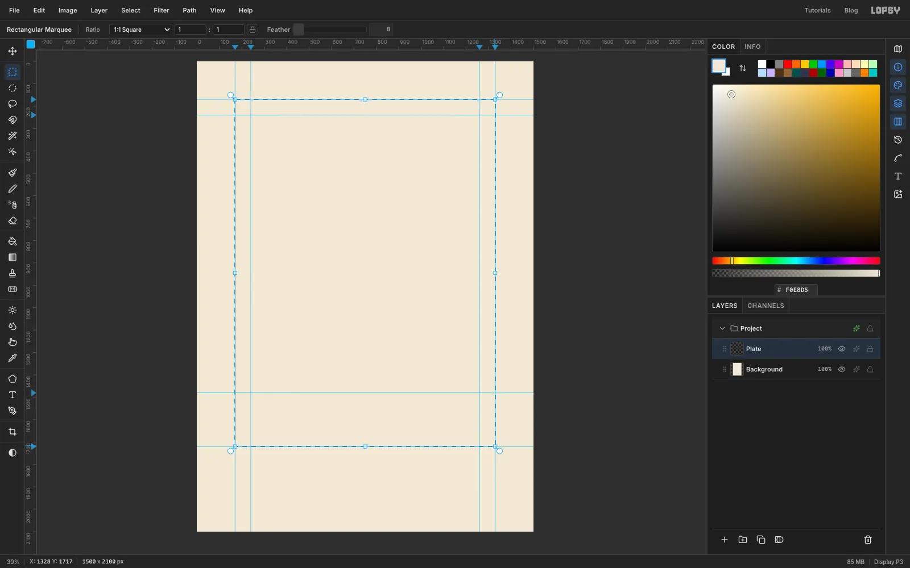

A new document comes with an empty *Layer 1*. Double-click its name and rename it *Plate*.

Pick the **Rectangular Marquee** ([[M]]) and drag from where the outer guides cross at the top left to where they cross at the bottom right. The marquee snaps to the guides.

Real plates have softly rounded corners. Choose **Select → Shrink…** with **8** px, then **Select → Grow…** with **8** px. Growing back rounds the corners. Fill the selection with the paper colour (**Edit → Fill**) and press [[Cmd+D]].

## Press in the plate mark and add plate tone

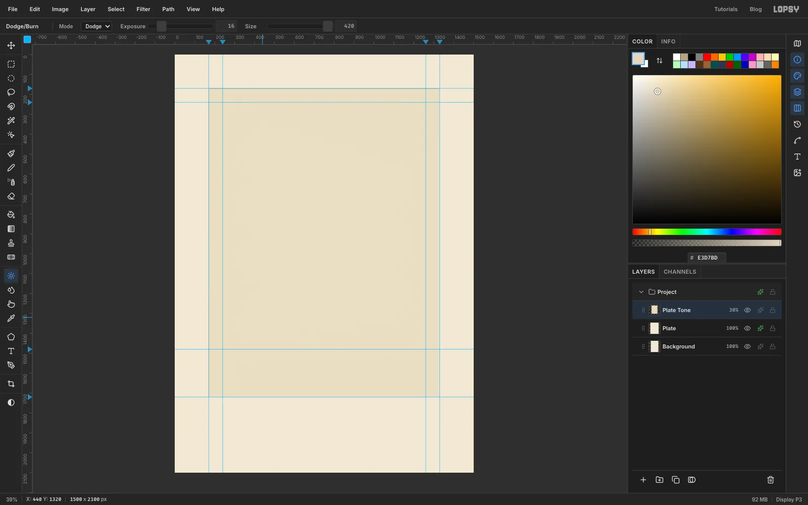

The plate is pressed *into* the paper, so its edge needs to look sunken.

1. Open the layer effects for *Plate* (the effects button on its row). Turn on **Inner Glow** with colour `#6F5F45`, **Size 5** and **Opacity 55**. This puts a soft dark rim just inside the edge.
2. Zoom in to 200% or more on each edge as you work, because these lines sit right at the plate's edge. Pick the **Pencil** ([[N]]) at **Size 2** with colour `#B4A383`. Click near the bottom of the plate's left edge, 2 px inside it, then [[Shift]]-click near the top. That's a straight line. Do the same along the top edge. Stop each line about 10 px short of the corners so the rounding stays clean.
3. Switch the colour to white and the size to **3**, and draw the same kind of line down the right edge and along the bottom. With light from the top left, the bevel is dark on the top and left and light on the bottom and right.

Plate tone is the thin film of ink left on the plate after wiping. Click **Add Layer**, name it *Plate Tone*, then [[Cmd]]-click the *Plate* thumbnail to select its shape. Fill with plate tone `#E3D7BD` and press [[Cmd+D]]. In the effects drawer set the **Blend** to **Multiply**, then set the layer's opacity to **30%**.

Printers wipe the middle of the plate cleaner than the edges. Pick **Dodge** ([[O]]) with **Size 420** and **Exposure 16**, and in one stroke zig-zag from side to side down through the middle of the plate.

## Lay a grey tone for the aquatint

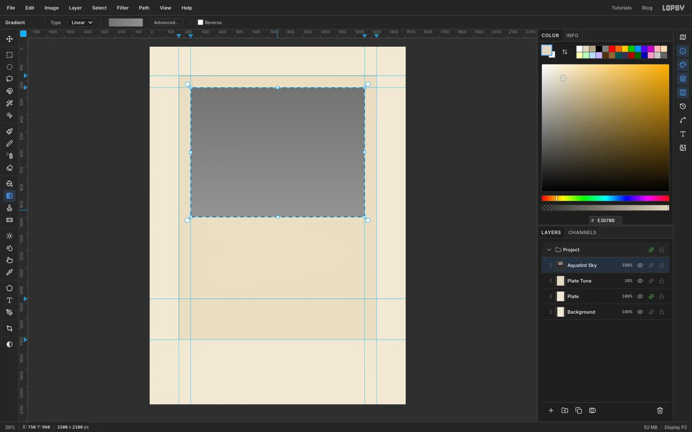

Click **Add Layer** and name it *Aquatint Sky*. With the **Rectangular Marquee**, select the picture area from the inner top-left guide across to the inner right guide, and down to about **y 1000**, a little below where the horizon will be.

Pick the **Gradient** tool, set it to **Linear** and open **Advanced…**. Make a two-stop gradient from `#737373` to `#919191`. Then drag straight down from the top of the selection to about **y 960**.

These two greys are close together on purpose. In a moment you'll turn this grey into grain, and the grey decides how dense the grain is. Keep the range narrow and the grain fades evenly from top to bottom.

## Lighten a halo where the moon will be

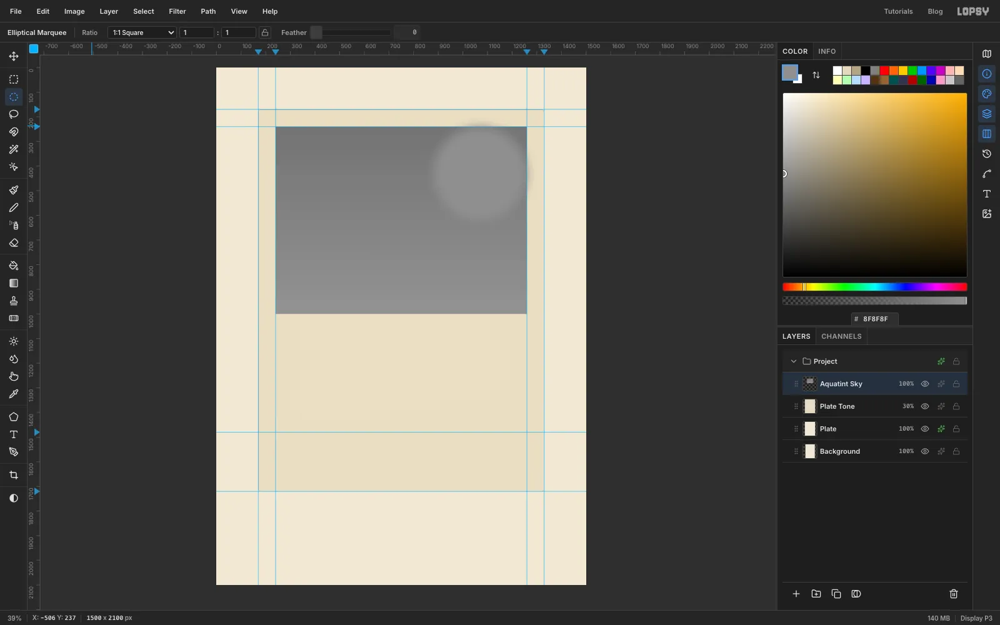

The moon will sit in the upper right, about 190 px in from the picture's right edge and 185 px down from its top. Pick the **Elliptical Marquee**, hold [[Cmd]] to keep it round, and use the status bar readout to drag from about **x 880, y 230** to **x 1270, y 620**, a circle about 390 px across. Choose **Select → Feather…** with **40** and fill it with `#8F8F8F`, a shade lighter than the sky. Press [[Cmd+D]].

It barely shows now, but this lighter patch will bite into a clearing of sparse grain around the moon.

## Bite the aquatint grain

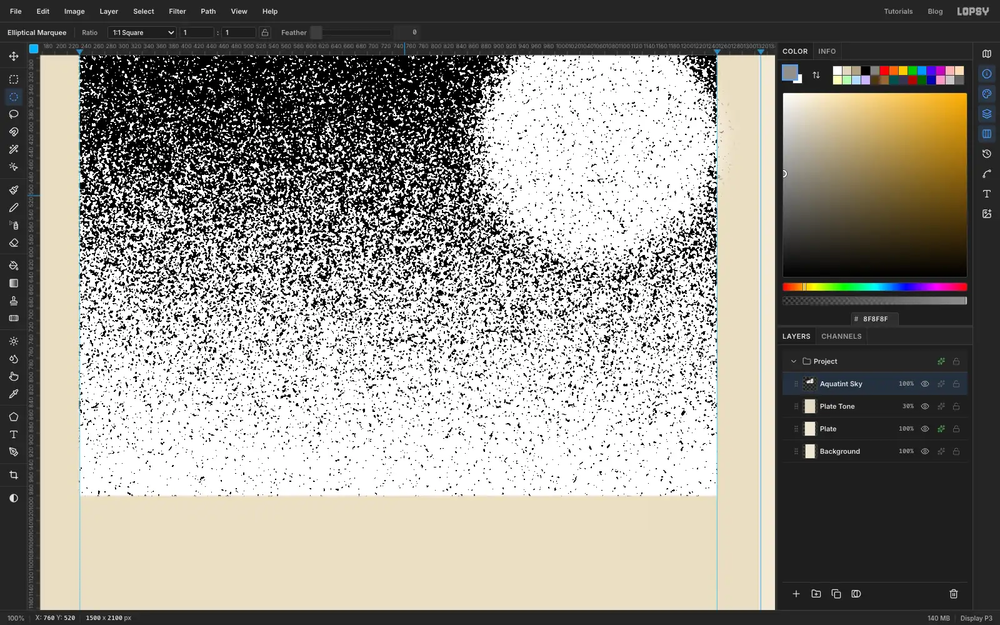

With the selection cleared, run three filters on *Aquatint Sky*:

1. **Filter → Add Noise…** with **Amount 100** and **Mono** selected.
2. **Filter → Gaussian Blur…** with **Radius 3**. This merges the single-pixel noise into blobs a few pixels across, like melted rosin.
3. **Filter → Threshold…** with **Level 128**.

Each blob now becomes solid black or white. Where the tone was darker, more blobs fall below 128, so the top of the sky is dense and the grain thins out toward the horizon.

## Stop out the moon

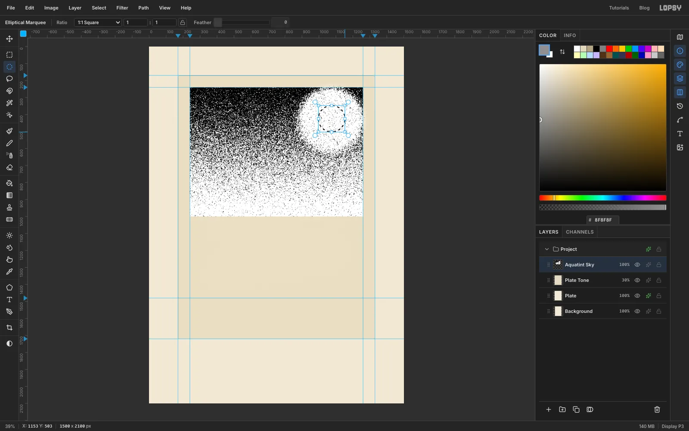

Etchers protect parts of the plate from the acid with varnish called **stop-out**. Here that just means painting white.

With the **Elliptical Marquee**, hold [[Cmd]] and drag from about **x 997, y 347** to **x 1153, y 503**: a circle 156 px across in the middle of the halo. Fill it with white and press [[Cmd+D]]. You now have a clean disc for the moon.

## Ink the grain and trim it to the picture

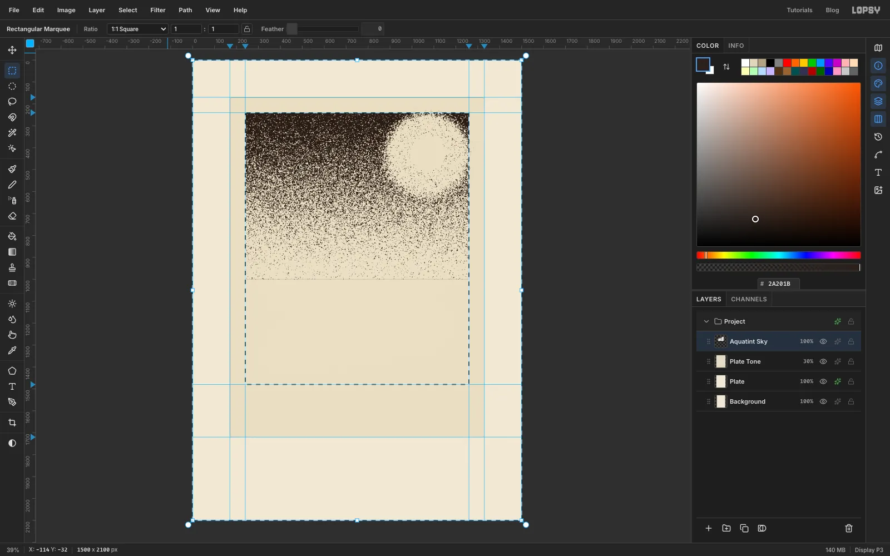

The grain is pure black, but etching ink is a warm brown-black. To change the black without touching the white:

1. **Add Layer** (name it *Ink Colour*), select the same sky area as before, and fill it with etching ink `#2A201B`. Press [[Cmd+D]].
2. Set the layer's **Blend** to **Lighten**. Lighten keeps the lighter of the two colours, so the white grain stays white and the black turns brown.
3. Choose **Layer → Merge Down**.

Click *Aquatint Sky* and set its **Blend** to **Multiply** so its white paper lets the plate show through.

The halo spilled a little past the picture's edge. Select the picture area (inner guides, top left to bottom right), choose **Select → Inverse**, press [[Delete]] and then [[Cmd+D]].

## Draw the snowy hill and its crest line

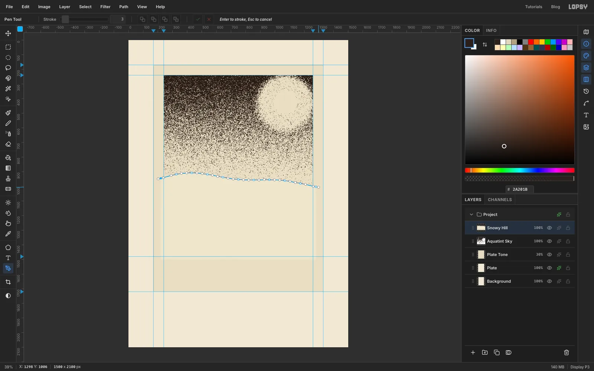

**Add Layer** and name it *Snowy Hill*. With the **Lasso** ([[L]]), draw a long gentle crest across the picture from left to right. Start a little outside the left edge at about **y 930**, rise and fall gently across the width, and finish a little outside the right edge at about **y 960**. Then go down and round the whole bottom of the picture to close the shape. Fill it with `#EEE5CF`, a snowy cream, and press [[Cmd+D]].

For the etched line along the crest, pick the **Pen** tool ([[P]]) and set **Stroke** to **3** in the options bar. With ink as the foreground colour, place points along the crest, dragging a little at each one to keep the curve smooth. Press [[Enter]] to stroke the path. Then open the **Paths** panel and click **Delete Path** so the next Pen path starts fresh.

## Etch one fir tree

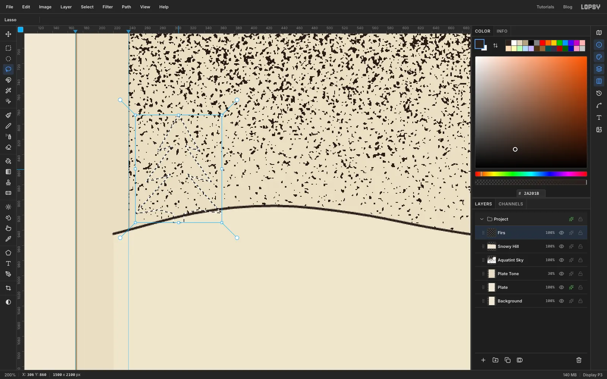

The firs are etched in lines, not filled solid, so you need a line pattern first:

1. **Add Layer** and name it *Hatch Tile*.
2. With the Rectangular Marquee, click once without dragging. A dialog asks for the corners. Type **From 20, 20** **To 36, 22** and fill it with ink.
3. Press [[Cmd+D]] and click again. Enter **From 20, 20** **To 36, 24** and choose **Edit → Define Pattern**. That's a 2 px line every 4 px.
4. Press [[Cmd+D]] and delete the *Hatch Tile* layer with the bin button.

Click *Snowy Hill*, **Add Layer**, and name it *Firs*. With the **Lasso**, draw one fir about **140 px** tall standing on the crest, about 70 px in from the picture's left edge. Draw three stacked, jagged tiers, each wider than the one above, on a short trunk.

Fill the selection with hill cream `#EEE5CF`, then choose **Edit → Fill with Pattern…**, pick the line tile and click **Apply**. Press [[Cmd+D]]. Give the layer a **Stroke** effect, **Width 2** in ink, and click **Rasterize Layer Style** so the outline becomes pixels.

## Copy the fir into a little wood

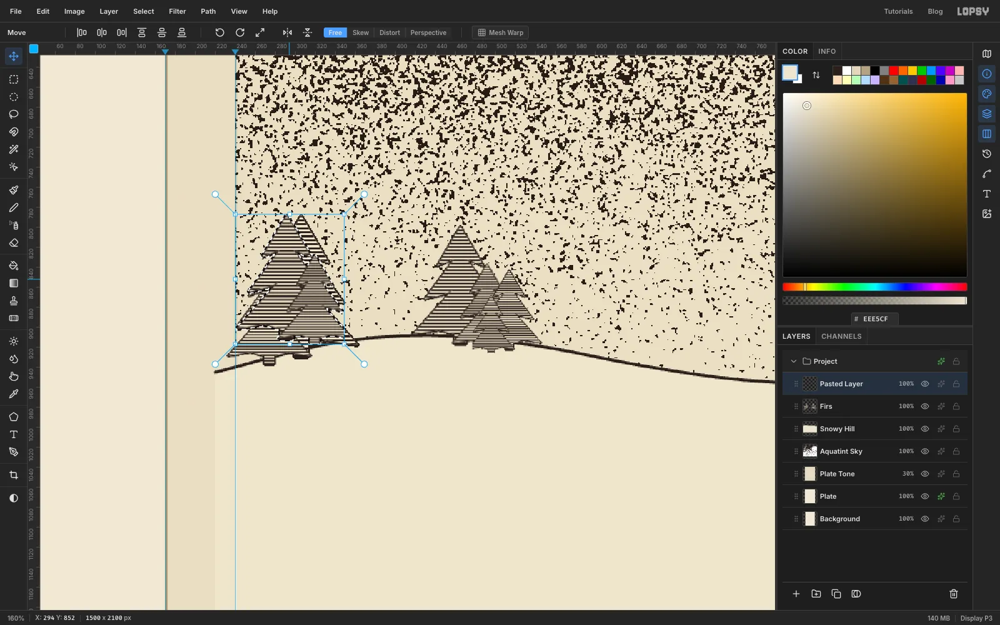

Drag a rectangular marquee just around the fir and press [[Cmd+C]], then [[Cmd+V]]. The copy is pasted exactly on top of the original as a new layer, with the Move tool active.

Hold [[Cmd]] and drag its bottom-right corner handle in to make it smaller. For every second copy, click **Flip Horizontal** in the options bar first, so the trees don't look stamped. Press [[Enter]], press [[Cmd+D]], then drag the copy along the crest and set its foot on the hill. Choose **Layer → Merge Down** to fold it back into *Firs*.

Repeat until you have a cluster of four firs at the left, around where the cottage will go, and two more at the far right, from about **75 px** to **140 px** tall. The far-right pair will peek out behind the hedgehog later.

## Block in the cottage

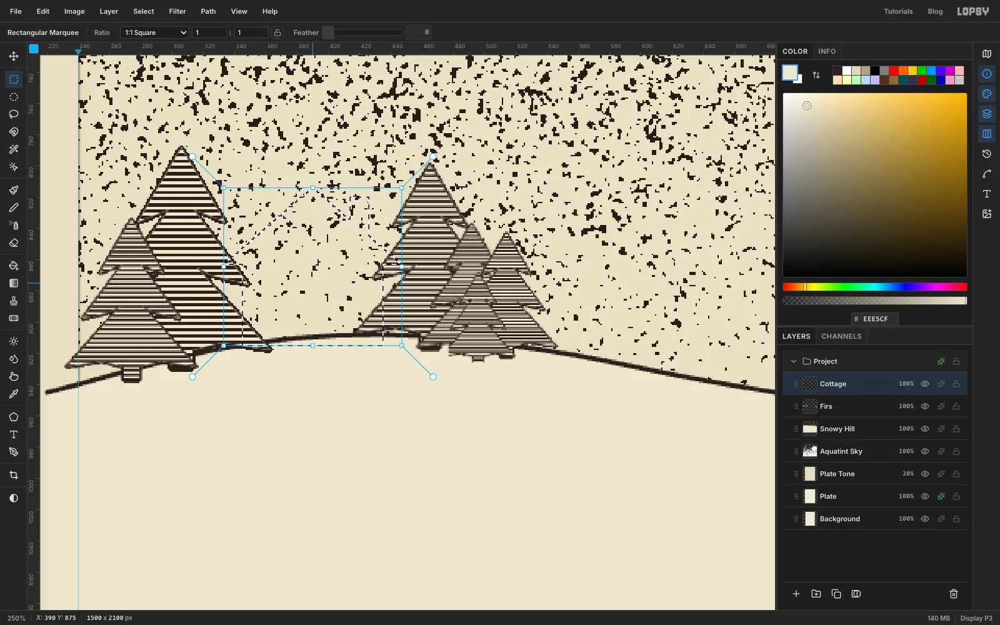

**Add Layer** and name it *Cottage*. The cottage sits on the crest in the gap between the firs on the left:

- Drag a rectangular marquee for the walls, **90 px** wide and **55 px** tall, with its bottom on the crest.
- Hold [[Shift]] and lasso a triangle on top for the gable roof, a little wider than the walls.
- Hold [[Shift]] again and drag a thin rectangle for the chimney on the right-hand slope.

Fill the selection with `#EFE7D4` and press [[Cmd+D]]. Add a **Stroke** effect, **Width 3** in ink, and click **Rasterize Layer Style**.

## Add the roof, window, door and smoke

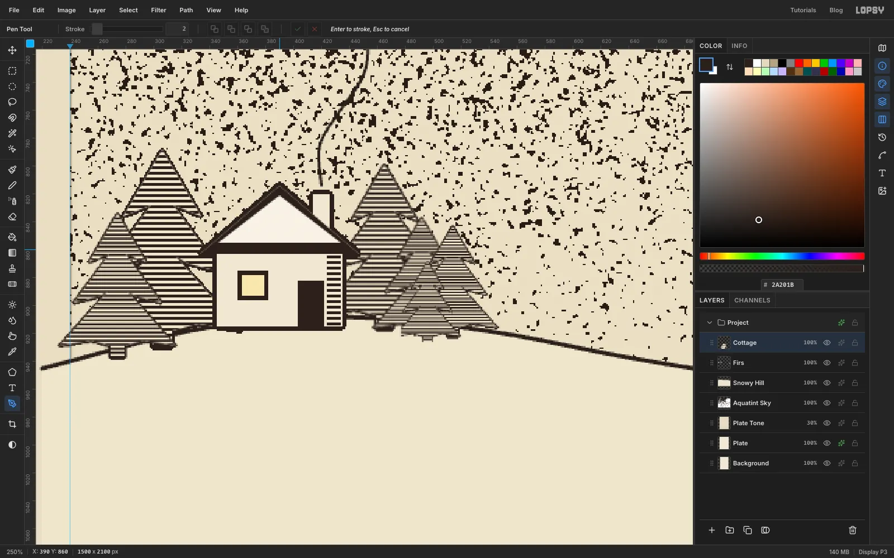

Work on the *Cottage* layer:

1. **Roof.** Lasso the roof triangle again and fill it with ink. Then lasso a slightly smaller triangle inside it and fill that with snow `#F7F2E6`. You're left with a snowy roof with dark eaves.
2. **Window.** Drag a small square on the left of the wall and fill it with ink. Choose **Select → Shrink…** with **3** and fill it with `#F6E7B4`.
3. **Door.** Drag a tall rectangle on the right, from about a third of the way down the wall to the ground, and fill it with ink.
4. **Shading.** Select the strip of wall to the right of the door and choose **Edit → Fill with Pattern…** with the line tile.
5. **Smoke.** Press [[Cmd+D]]. With the **Pen** at **Stroke 2**, draw an open curl rising from the chimney, then press [[Enter]] and delete the path.

Click *Snowy Hill*, [[Shift]]-click *Cottage* and choose **Layer → Group Layers**. Name the group *Village* and collapse it.

## Drop in the hedgehog photo and scale it

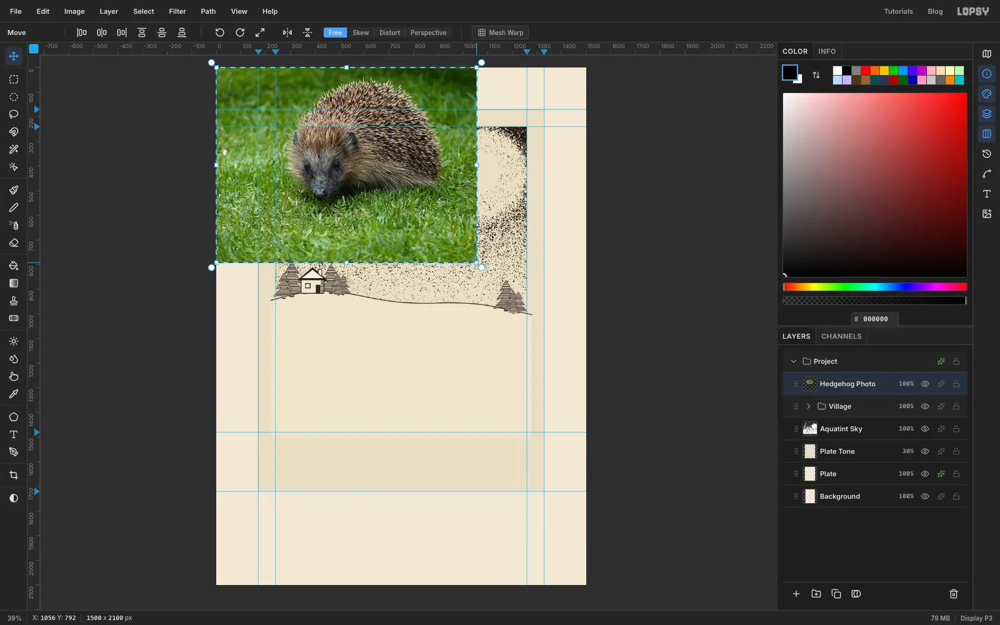

Click the *Village* group (collapsed, so new layers land above it). Drag the photo file onto the canvas. It lands at the top left at its own size, already selected, with the Move tool active. Rename the layer *Hedgehog Photo*.

Hold [[Cmd]] and drag the bottom-right corner handle outward to make the photo **10%** bigger, about **1056 × 792 px**. Press [[Enter]] and then [[Cmd+D]].

## Move the photo into place

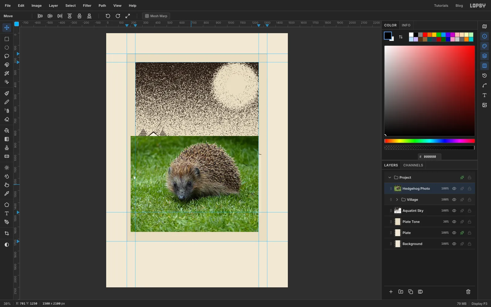

Drag the photo down and to the right until its left edge sits just left of the picture's left edge and the hedgehog's back overlaps the hill's crest. Its nose should end up a little left of centre, about 100 px above the bottom of the picture.

## Cut the hedgehog out

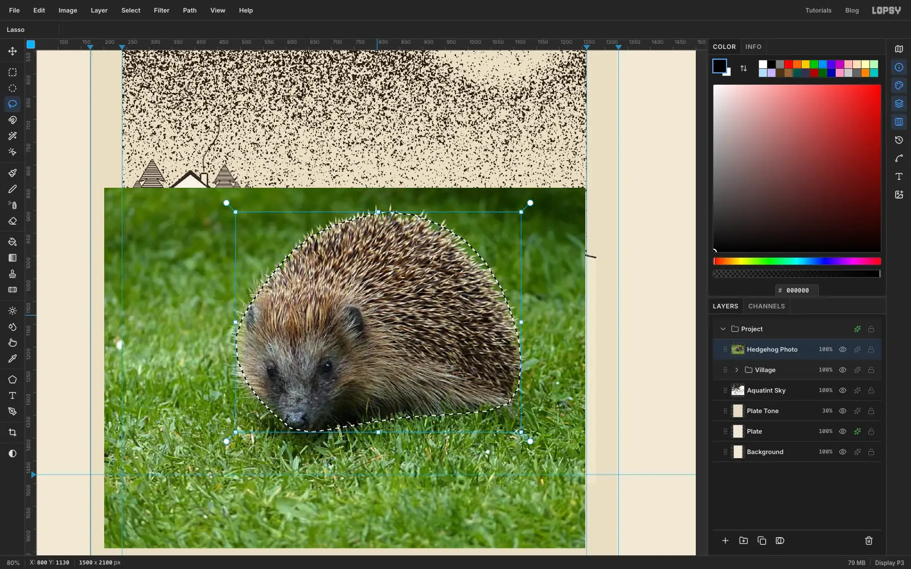

Pick the **Lasso** and trace round the hedgehog. Go just outside the tips of its spines across its back, and along the top of the grass under its chin and belly. A smooth line is fine. The real spiny edge comes later.

Choose **Select → Shrink…** with **10**. This pulls the cut inside any green fringe, so no grass survives. Then choose **Select → Inverse**, press [[Delete]] and press [[Cmd+D]].

## Desaturate and lift the face

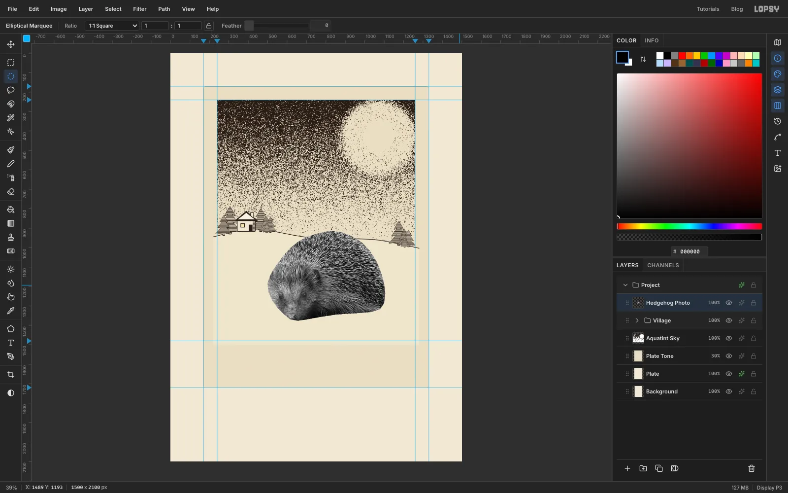

Choose **Filter → Desaturate**.

The face is very dark in the photo, and it would turn into a black blob when you threshold it in the next step. With the **Elliptical Marquee**, drag an oval about **240 × 190 px** over the face, centred on the snout. Choose **Select → Feather…** with **45**, then **Filter → Brightness/Contrast…** with **Brightness 12**. Press [[Cmd+D]].

## Bite the hedgehog in two passes

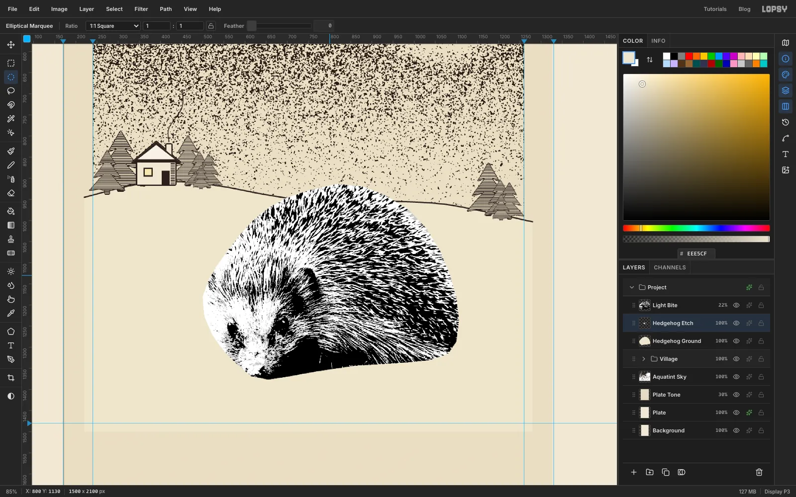

First give the hedgehog a solid backing, so the hill line doesn't show through its gaps:

- Click *Village*, **Add Layer** and name it *Hedgehog Ground*.
- [[Cmd]]-click the *Hedgehog Photo* thumbnail and fill the selection with `#EEE5CF`, the hill colour. Press [[Cmd+D]].

Now bite the photo twice, the way an etcher bites a plate lightly for the mid-tones and deeply for the darks:

1. Click *Hedgehog Photo* and rename it *Hedgehog Etch*. Click **Duplicate Layer** and name the copy *Light Bite*.
2. On *Light Bite*, choose **Filter → Threshold…** with **Level 110**. Set its **Blend** to **Multiply** and its opacity to **22%**.
3. Click *Hedgehog Etch* and run **Threshold** with **Level 82**. That's the deep bite: only the darkest spine shadows stay black.

## Turn the bites into warm ink

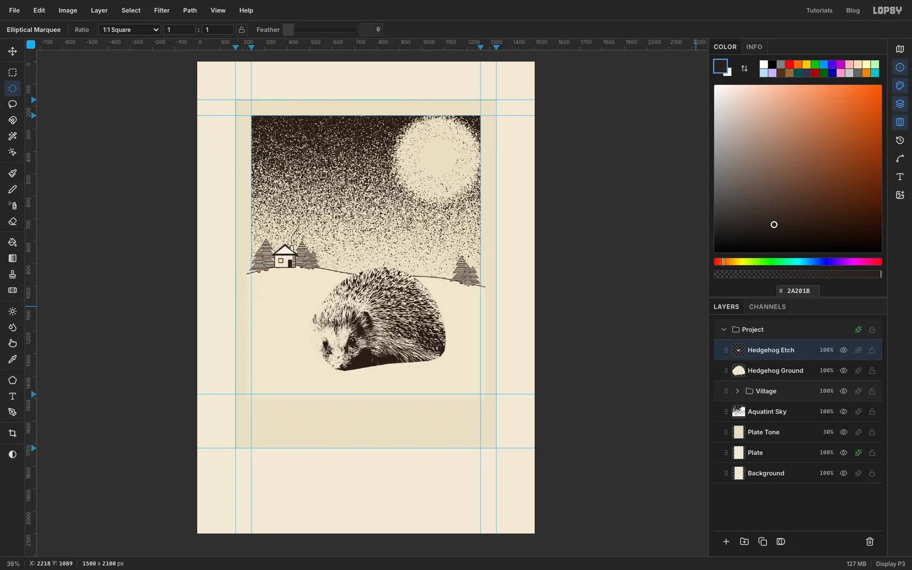

Click *Light Bite* and choose **Layer → Merge Down**. The two bites become one layer, with soft grey marks between the black ones.

Use the same Lighten trick as for the sky:

1. **Add Layer** (*Ink*), [[Cmd]]-click the *Hedgehog Etch* thumbnail and fill with ink `#2A201B`.
2. Press [[Cmd+D]], set the **Blend** to **Lighten** and choose **Layer → Merge Down**.
3. Set *Hedgehog Etch* to **Multiply**.

## Flick the spines past the outline

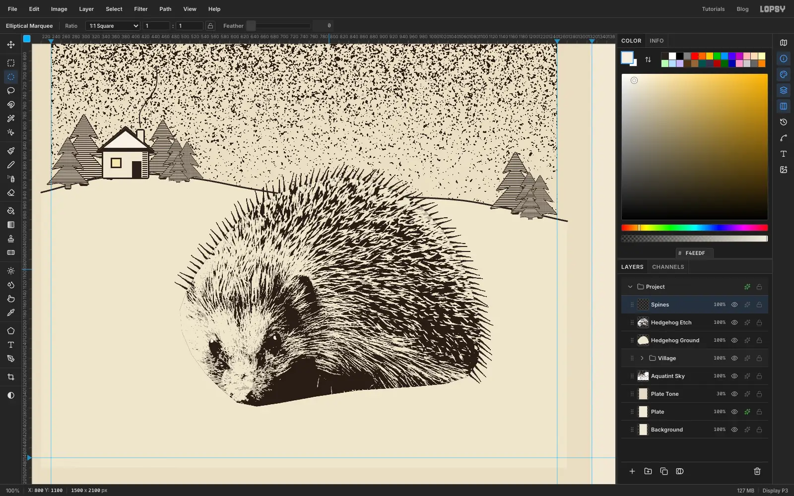

The cut edge is too smooth for a hedgehog. Draw the spines past it by hand, the way an etcher would scratch them:

1. **Add Layer** and name it *Spines*.
2. Pick the **Brush** ([[B]]) in ink and open the brush settings. On the **Shape** tab set **Size 5**, **Hardness 100** and **Taper 30**. Taper thins every stroke from where it starts, so each stroke begins at the root and ends in a point.
3. Starting about 10 px inside the outline, flick short strokes outward all the way from the cheek, over the back, to the rump. Make them roughly 15–30 px long and about 12 px apart. Lean each one back toward the tail, the way the spines lie. That's about seventy little strokes.

Last, give the face some life. Set the foreground to `#F4EEDF`. Zoom in on the eyes. With the Elliptical Marquee, drag a 5 px dot over the tiny highlight in each eye and fill it. Press [[Cmd+D]].

## Pile a snow drift in front

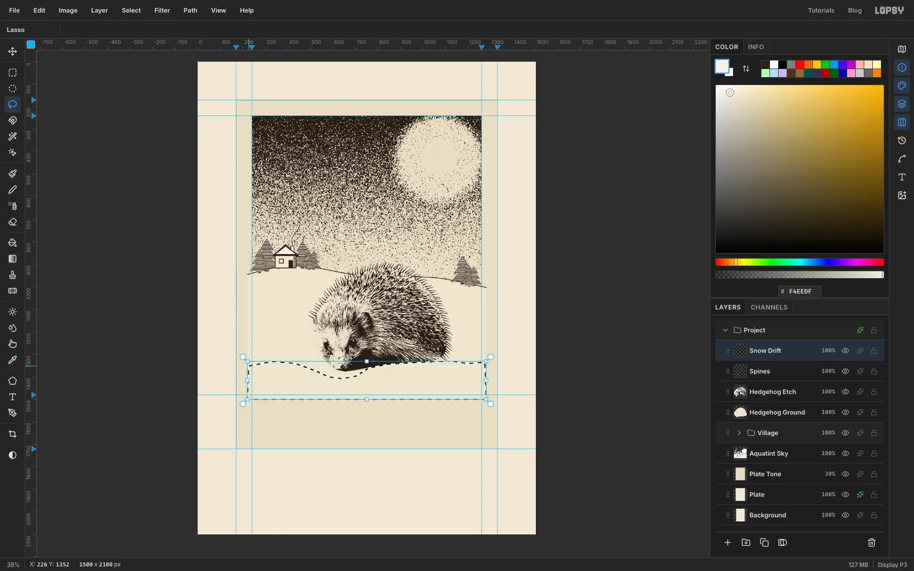

**Add Layer** and name it *Snow Drift*. With the **Lasso**, draw the top of a drift across the picture:

- start at the left edge at about **y 1350**
- dip down under the hedgehog's nose to about **y 1400**, so the snout is clear of the drift
- rise to hide its belly and the bottom of its spines
- run fairly level to the right edge

Then go round the bottom of the picture to close it. Fill it with snow `#F7F2E6` and press [[Cmd+D]].

## Draw the snow contours

Set the foreground back to ink `#2A201B`. With the **Pen** at **Stroke 3**, trace along the top of the drift and press [[Enter]], then delete the path.

At **Stroke 2**, add four gentle open curves to model the snow, deleting each path after you stroke it:

- one low in the drift on the right
- one low in the drift on the left
- one across the left of the hill, just below the crest
- a short one on the right of the hill

## Rule the hedgehog's shadow by hand

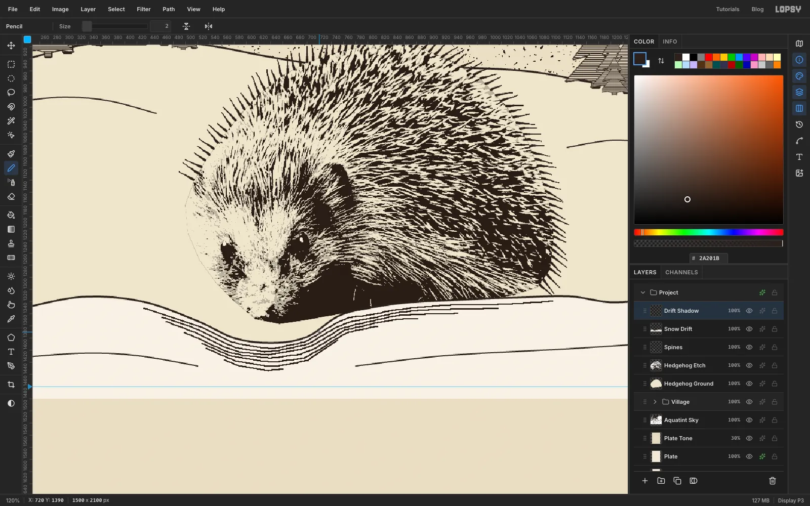

The moon is up to the right, so the hedgehog throws a shadow across the drift. **Add Layer**, name it *Drift Shadow*, and pick the **Pencil** at **Size 2**, still in ink.

Draw seven lines under the drift's top edge, each one about 6 px below the last. Start each line a little further right than the one above, and end it a little sooner, so the band tapers. Drag them by hand rather than [[Shift]]-clicking. A slight wobble is what makes them look etched rather than ruled.

## Leave a trail of footprints

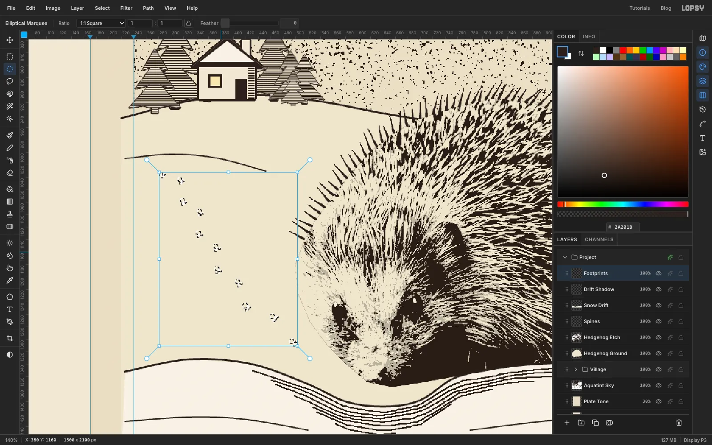

The empty snow on the left needs a story. **Add Layer** and name it *Footprints*. Hedgehogs leave little prints with a pad and short toes.

With the **Elliptical Marquee**, hold [[Shift]] to add each new shape to the selection. Each print is a small round pad, about 7 px across, with three tiny toe dots just in front of it. Place about ten prints along a wandering path:

- start up near the left of the hill
- curve down toward the hedgehog's nose
- step from side to side as you go
- make the prints a little bigger as they come closer

Fill with ink, press [[Cmd+D]] and set the layer's opacity to **80%**.

## Draw the holly stems

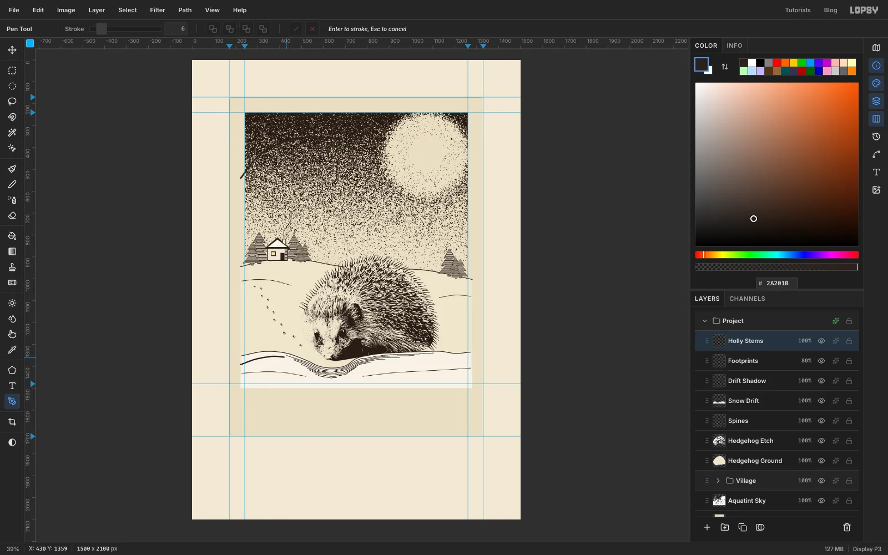

Click *Footprints*, **Add Layer** and name it *Holly Stems*. With the **Pen** at **Stroke 7** in ink, draw a curved stem that comes in from the left edge about a quarter of the way down, arches up, and runs right to the middle of the top. Press [[Enter]] and delete the path.

At **Stroke 6**, draw a shorter stem lying along the snow at the bottom left, ending well short of the hedgehog's nose.

## Draw one holly leaf with the Pen

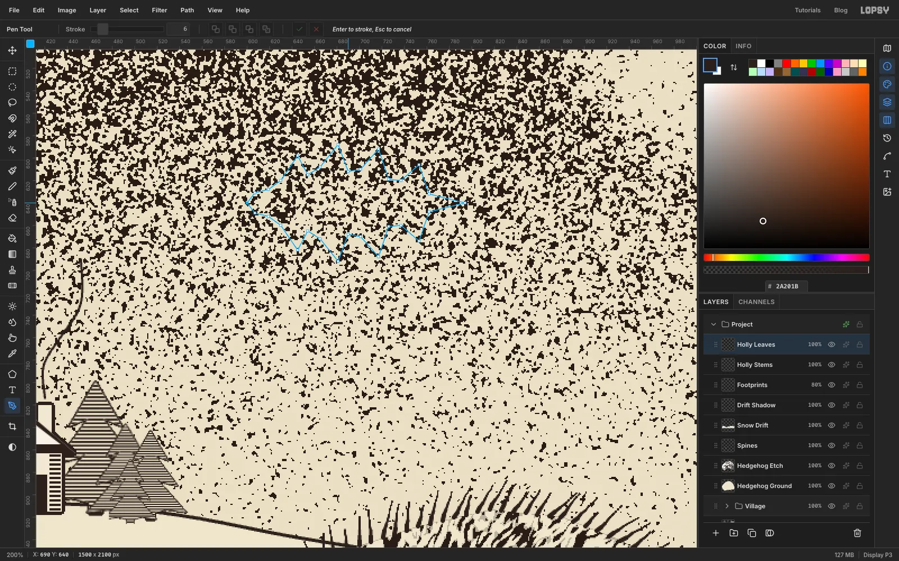

You'll draw one big holly leaf and copy it. First make a second line tile the same way as before: **From 20, 20** **To 36, 22** filled with ink, then define **From 20, 20** **To 36, 26** as the pattern. That's a 2 px line every 6 px.

**Add Layer** and name it *Holly Leaves*. In an empty patch of sky, draw the leaf with the **Pen**, clicking corner points only. Start at the stalk end on the left: the Pen puts small ✓ and ✕ buttons just left of your first point, and starting at the left keeps them clear of the leaf. The leaf is about **180 px** long and lies flat, tip to the right. Each side has four spines that point forward and out, with a shallow scooped curve between each spine and the next. Finish with a point at the tip. Click the first point to close the path.

In the **Paths** panel, click **Path to Selection** and then **Delete Path**. Fill the selection with `#EFE6D0` and press [[Cmd+D]].

## Hatch the leaf along its veins

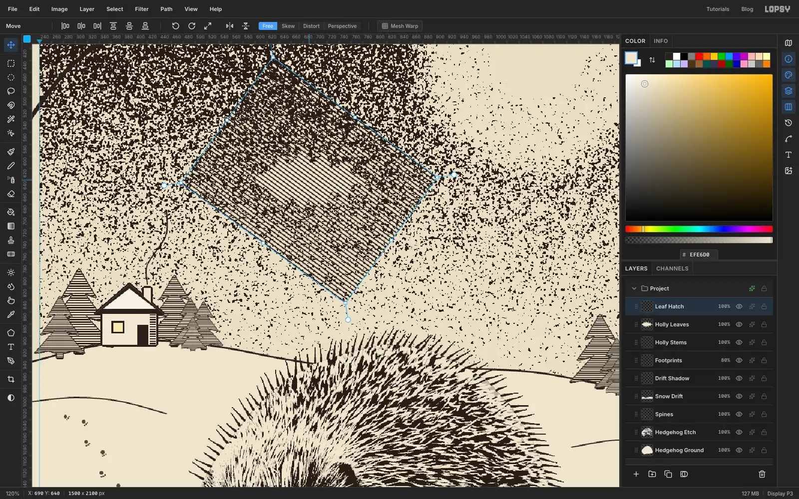

**Add Layer** and name it *Leaf Hatch*. With the **Rectangular Marquee**, drag a box well beyond the leaf on all sides and choose **Edit → Fill with Pattern…** with the new tile.

Holly veins run out from the midrib at an angle, so turn the lines to match. Switch to the **Move** tool, grab the rotation handle just outside a corner of the box, and turn it about **36°** clockwise. Press [[Enter]], then [[Cmd+D]].

## Keep the hatching on the lower half

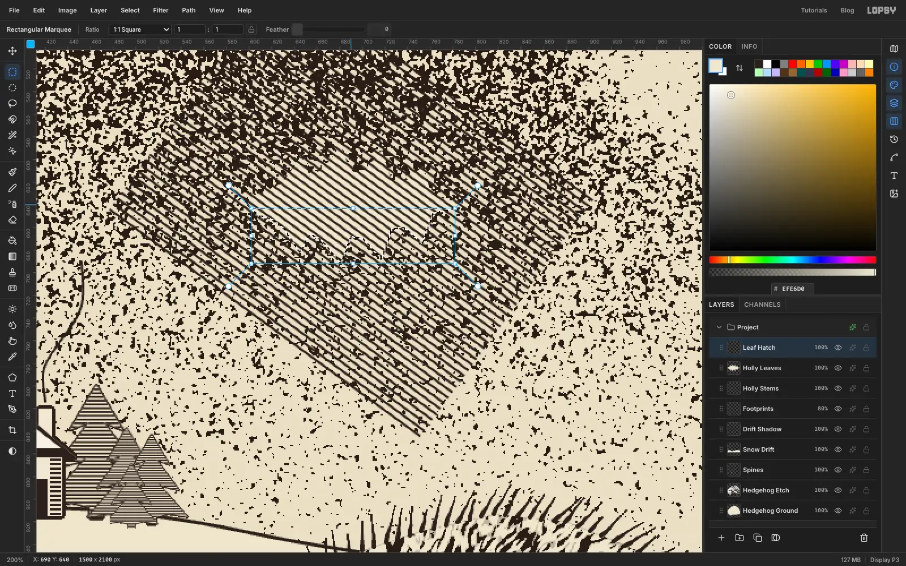

The light comes from above, so only the lower half of each leaf is shaded.

[[Cmd]]-click the *Holly Leaves* thumbnail to select the leaf. Then pick the **Rectangular Marquee**, hold [[Shift]] and [[Option]], and drag a box from just below the midrib down past the bottom of the leaf. Holding both keys keeps only where the two shapes overlap: the lower half of the leaf.

Choose **Select → Inverse**, press [[Delete]] to clear the hatching everywhere else, then [[Cmd+D]]. Choose **Layer → Merge Down** to put the hatching into *Holly Leaves*.

## Outline the leaf and add the veins

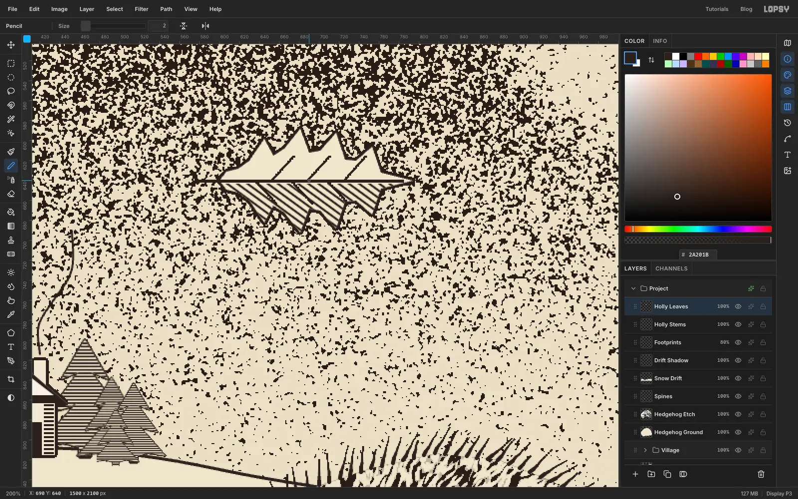

Give *Holly Leaves* a **Stroke** effect, **Width 3** in ink, and click **Rasterize Layer Style**.

Set the foreground to ink and pick the **Pencil** at **Size 3**. Click a little left of the leaf's base and [[Shift]]-click at the tip for the midrib and stalk. At **Size 2**, add three short veins on each side, from the midrib out toward the spines. [[Shift]]-click again for each one.

## Copy, scale and rotate the leaf

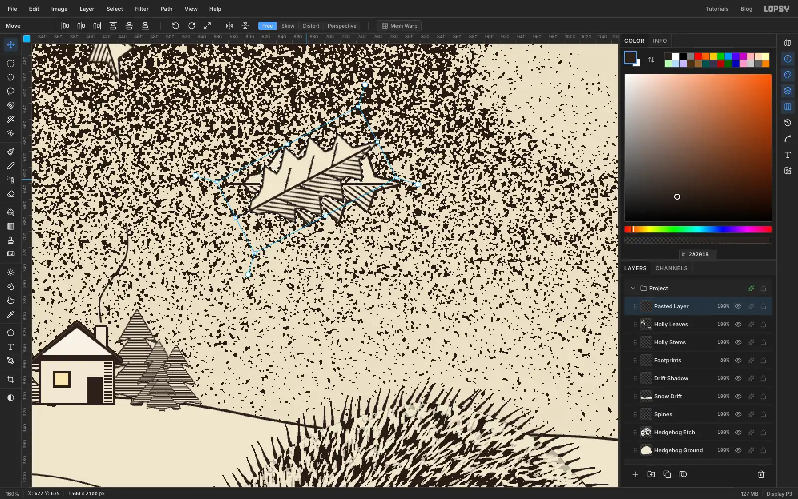

Each leaf on the sprigs is this one leaf, copied and turned. For each leaf:

1. Click *Holly Leaves*. With the **Rectangular Marquee**, drag a box just around the master leaf and press [[Cmd+C]], then [[Cmd+V]].
2. For about half the leaves, click **Flip Horizontal** in the options bar.
3. Hold [[Cmd]] and drag the bottom-right corner handle to make the copy 55–90% of the master's size.
4. Turn it with a rotation handle so its stalk points back to the stem.
5. Press [[Enter]], press [[Cmd+D]], and drag it so its stalk touches the stem.
6. Choose **Layer → Merge Down**.

## Finish the sprigs

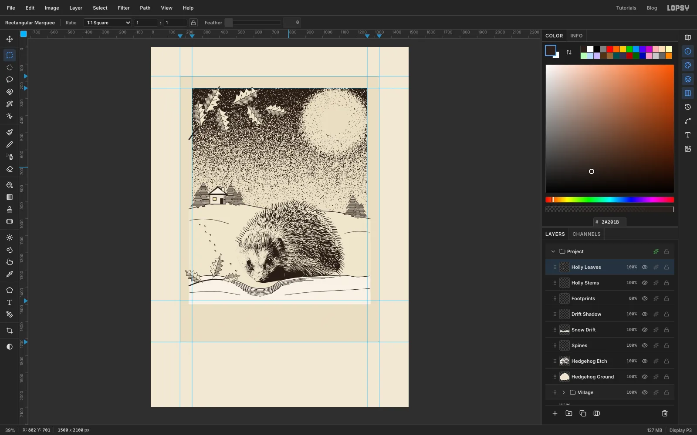

Place six leaves along the top stem, alternating sides and pointing in different directions. Put three on the bottom stem. Keep the left-most leaves just inside the picture's left edge.

When they're all placed, drag a rectangular marquee around the master leaf in the sky and press [[Delete]].

## Add the berries

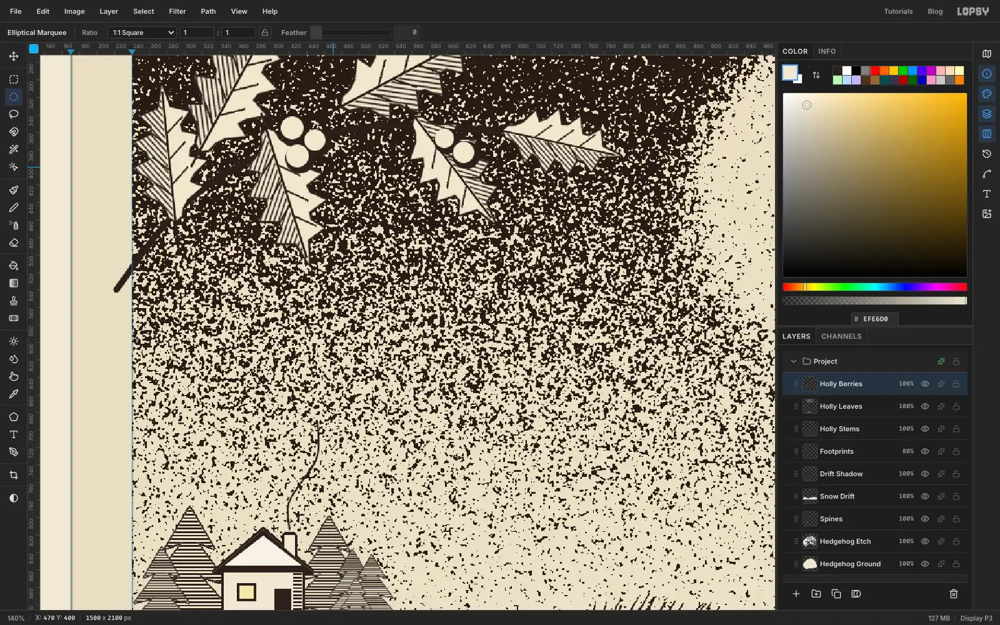

**Add Layer** and name it *Holly Berries*. With the **Elliptical Marquee**, hold [[Shift]] and draw berries about **30 px** across. Put a cluster of three where the top stem forks, a pair further along it, and three on the bottom stem. Fill with ink and press [[Cmd+D]].

For the round, shaded look, draw a slightly smaller circle on each berry, shifted 3 px up and to the left, again holding [[Shift]] for each one. Fill with `#EFE6D0`. Each berry keeps a dark crescent on its lower right.

## Group the holly and nudge it into place

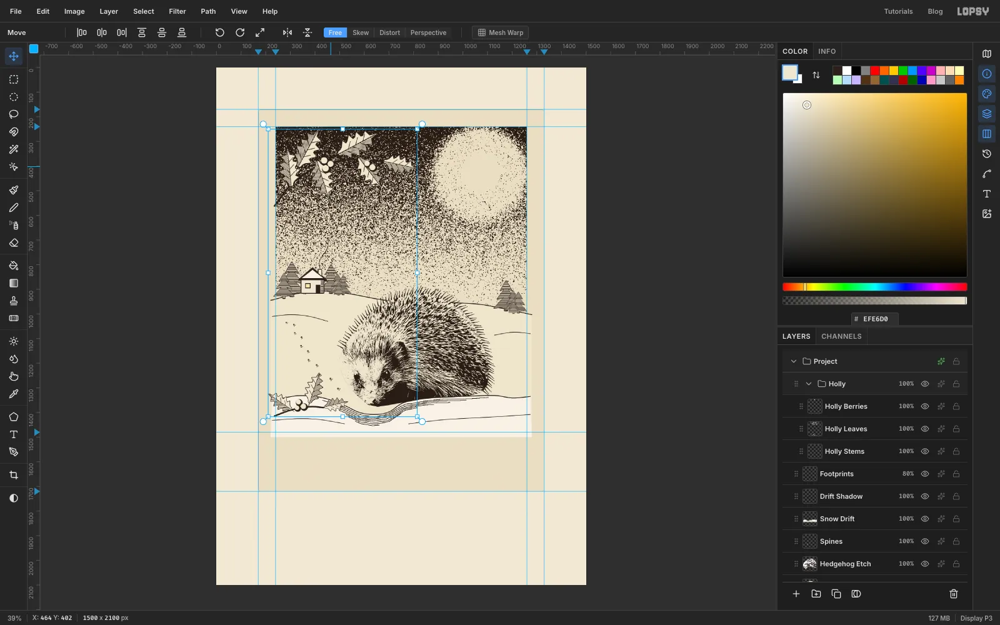

Click *Holly Stems*, [[Shift]]-click *Holly Berries* and choose **Layer → Group Layers**. Name the group *Holly*.

If the sprigs crowd the corner, click the group and use the **Move** tool to drag it a little down and to the right, so the top leaves clear the picture's top edge. Stems, leaves and berries move together. Collapse the group.

## Clip the picture to the neat line

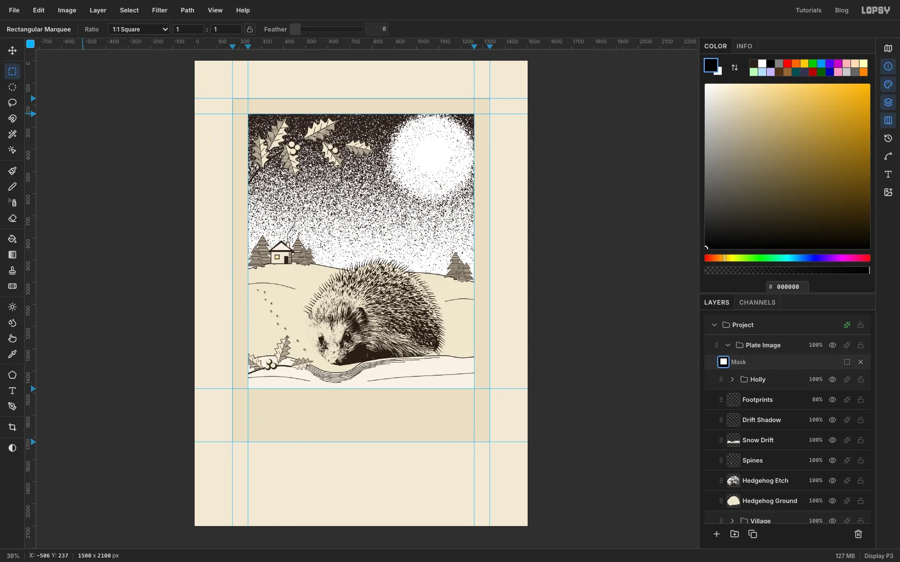

Several layers spill a little past the picture's edge. Click *Aquatint Sky*, [[Shift]]-click *Holly* and choose **Layer → Group Layers**. Name the group *Plate Image*.

With the group selected:

1. Click **Add Mask** at the bottom of the Layers panel. A **Mask** row appears under *Plate Image*. Click its thumbnail to edit the mask.
2. Select the picture area with the inner guides, choose **Select → Inverse**, set the foreground to black and choose **Edit → Fill**.
3. Press [[Cmd+D]], then click the group's name to stop editing the mask, and collapse the group.

A masked group is composited on its own before it's blended onto the plate. So the sky's clear grain now shows as bright, well-wiped paper rather than plate tone, which suits a moonlit sky.

## Rule the neat line

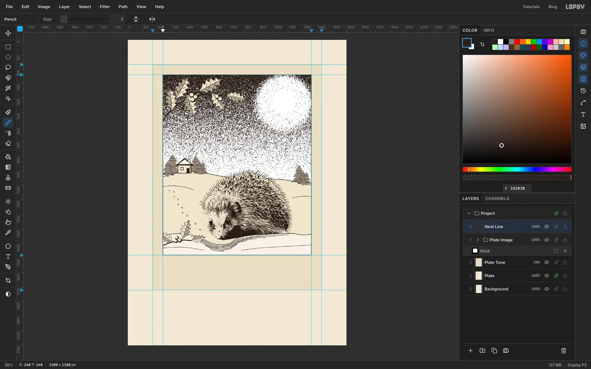

With *Plate Image* selected, **Add Layer** and name it *Neat Line*. Pick the **Pencil** at **Size 3** in ink. Click on the top-left inner guide crossing, then [[Shift]]-click each of the other three corners in turn, and finally the first corner again.

## Engrave Season’s Greetings

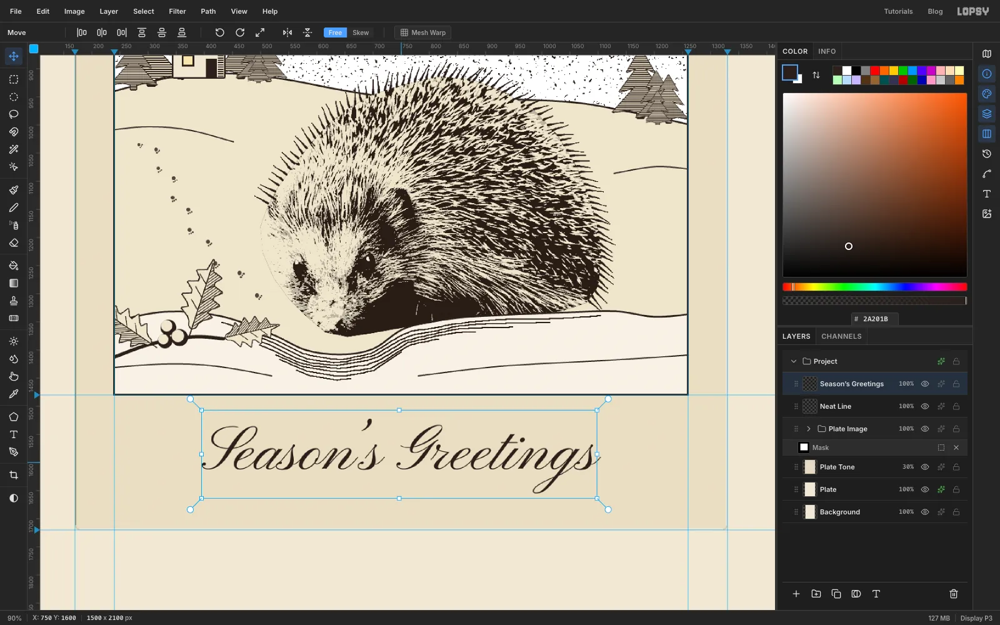

Pick the **Text** tool ([[T]]), choose **Pinyon Script** at **112** in ink, and click in the empty plate margin below the picture. Type **Season’s Greetings** with a curly apostrophe (’), which sits better in a script than a straight one. Press [[Tab]] to finish. Rename the layer *Season’s Greetings*.

Switch to the **Move** tool and click **Align center horizontally** in the options bar. Then nudge it up or down with the arrow keys until the words, including the tails of the *g*s, sit centred between the picture's bottom edge and the plate's bottom edge, a few pixels above the exact middle.

## Select the sky for the first wash

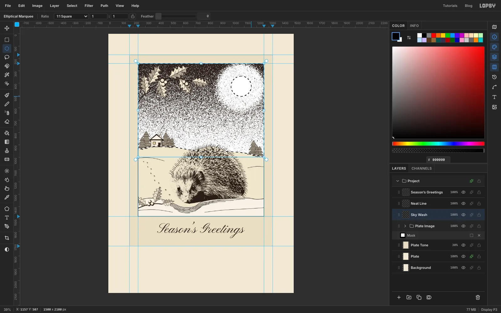

Now the hand colouring. Every wash goes on its own layer set to **Multiply**, so it tints the ink and paper without covering them.

Click *Plate Image*, **Add Layer** and name it *Sky Wash*. With the **Lasso**, select the sky: along the top of the picture, down the right edge to the hill, back along the crest and up the left edge. Then:

- Pick the **Rectangular Marquee**, hold [[Shift]] and [[Option]], and drag over the whole picture area. This trims anything you lassoed outside it.
- Pick the **Elliptical Marquee**, hold [[Option]], and drag a circle over the moon to take it out of the selection.

## Wash in the sky

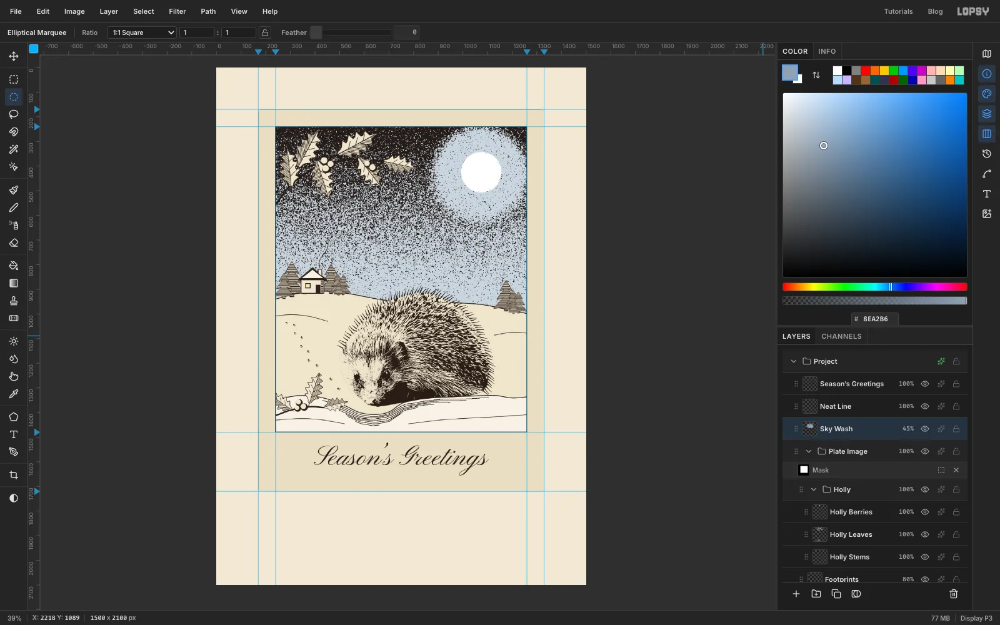

Fill the selection with sky wash `#8EA2B6`.

The hedgehog's back, the holly and the cottage stand against the sky, and they shouldn't turn blue. Expand the groups so you can see those layers. [[Cmd]]-click the thumbnail of each of *Hedgehog Ground*, *Holly Leaves*, *Holly Berries*, *Cottage* and *Firs* in turn, and press [[Delete]] each time. Press [[Cmd+D]], set the layer to **Multiply** and its opacity to **45%**.

## Tint the moon, holly and berries

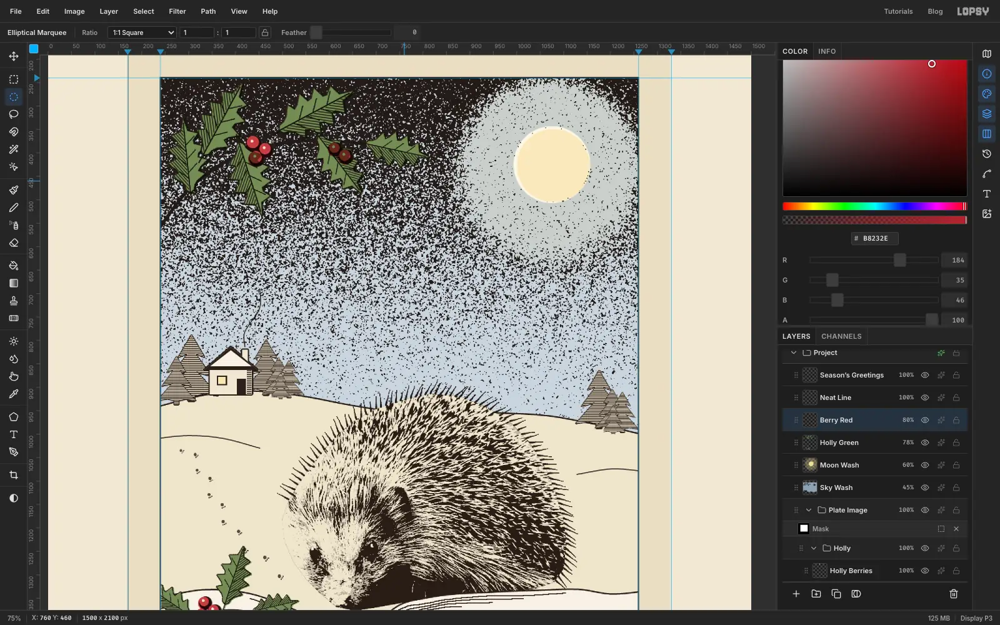

Make each of these as a new layer set to **Multiply**. A hand colourist never hits the lines exactly, so each wash gets nudged a couple of pixels off with the arrow keys:

- **Moon Wash.** With the **Elliptical Marquee**, drag a circle about 420 px across around the moon and choose **Select → Feather…** with **60**. Trim it to the picture with a [[Shift]]+[[Option]] rectangular marquee as before. Set the foreground to moon `#F2DC98`, lower the **A** value in the Color panel to **35**, and fill. Then put **A** back to **100**, select the 156 px moon disc again and fill. Set the layer to **60%** and nudge it **3 px** right and **2 px** down.
- **Holly Green.** [[Cmd]]-click the *Holly Leaves* thumbnail (expand the groups to see it), trim to the picture, fill with `#5E7F47`, set **78%**, and nudge it **2 px** right and **1 px** down.
- **Berry Red.** [[Cmd]]-click *Holly Berries*, trim to the picture, fill with `#B8232E`, set **80%**, and nudge it **2 px** left and **1 px** down. Then, with the **Elliptical Marquee** and [[Shift]] held, draw a dot about **7 px** across on the upper left of each berry and press [[Delete]], so a speck of paper shines through.

## Tint the hedgehog and shade the snow

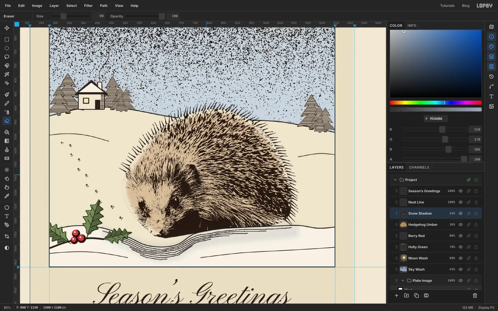

Two more Multiply washes:

- **Hedgehog Umber.** [[Cmd]]-click *Hedgehog Ground*, choose **Select → Shrink…** with **14** and **Select → Feather…** with **10**, fill with `#B88B5A` and set **36%**. Shrinking the selection keeps the wash off the pale fur round the edge of the face, so the cheek and muzzle stay light.
- **Snow Shadow.** With the **Lasso**, select a band under the drift's edge, from left of the nose to the right of the hedgehog, about 50 px deep. Feather it **16**, fill with `#9EAABA` and set **24%**.

## Light the window and group the washes

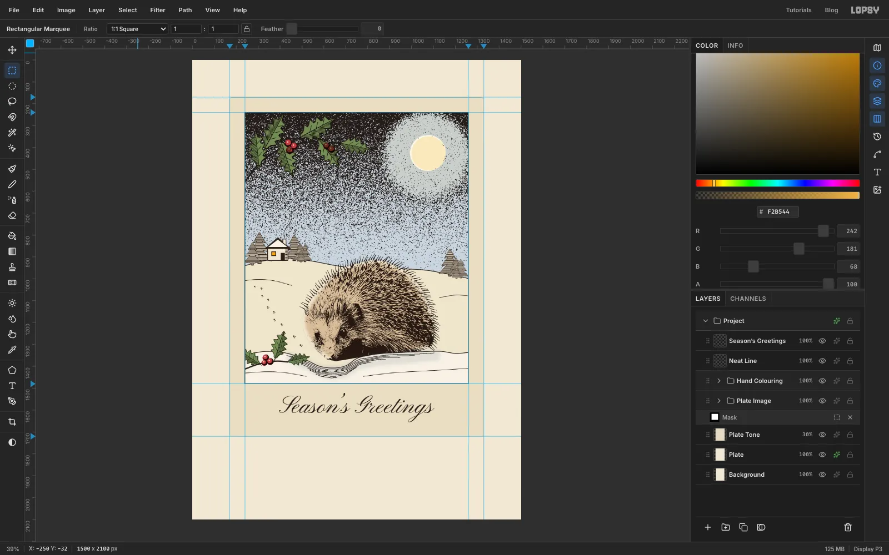

**Add Layer**, name it *Lamplight* and set it to **Multiply**. With the **Rectangular Marquee**, drag over the pale square of the window and fill it with `#F2B544`.

Click *Sky Wash*, [[Shift]]-click *Lamplight* and choose **Layer → Group Layers**. Name the group *Hand Colouring*.

> **Tip:** Don't put a mask on this group. A masked group is composited on its own first, so the Multiply washes inside it would stop multiplying with the etching below and lighten the ink. Trimming each wash's selection to the picture does the same job.

## Spray snowflakes onto black

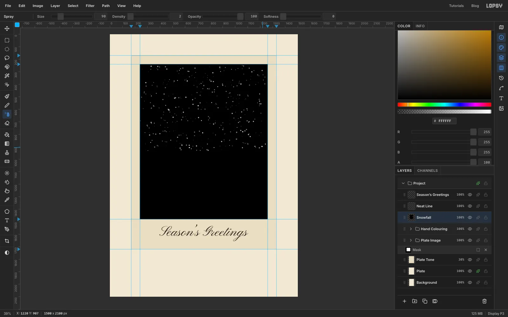

On a real plate the flakes would be stopped out before the aquatint bite, so they print as crisp paper-coloured dots, not soft blobs. Make them on black first:

1. Click *Hand Colouring*, **Add Layer** and name it *Snowfall*.
2. Select the picture area and fill it with black. Leave the selection active so the spray stays inside it.
3. Pick the **Spray** tool ([[J]]) in white with **Size 90**, **Density 2**, **Opacity 100** and **Softness 0**.
4. Drag it across the sky in seven loose wavy passes, working down from the top to just above the hill.
5. Press [[Cmd+D]] and choose **Filter → Threshold…** at **110**. Every faint dot snaps to pure white or vanishes.

## Turn them into paper-white flakes

1. **Add Layer**, select the picture area, fill it with snow `#F7F2E6` and press [[Cmd+D]].
2. Set this layer to **Darken** and choose **Layer → Merge Down**. Darken keeps the darker colour, so the white flakes become snow-coloured and the black stays black.
3. Set *Snowfall* to **Lighten**. The black now disappears, and only the flakes show.

Snow only falls in the sky. Expand *Plate Image* and [[Cmd]]-click the *Snowy Hill* thumbnail to select the hill and everything below it. With the **Elliptical Marquee**, hold [[Shift]] and add a circle over the moon. Click *Snowfall* and press [[Delete]]. Then [[Cmd]]-click *Hedgehog Ground*, click *Snowfall* and press [[Delete]] again, so no flakes sit on the hedgehog. Press [[Cmd+D]] and collapse the group.

## Number, title and sign the print in pencil

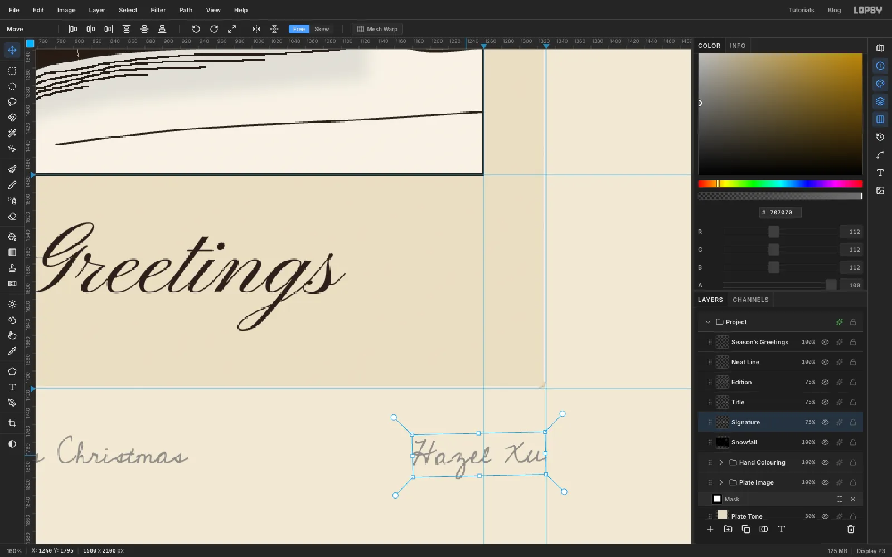

Printmakers sign below the plate mark in pencil: the edition number at the left, the title in the middle and the signature at the right. All three share one baseline.

With *Snowfall* selected, pick the **Text** tool with **Cedarville Cursive** at **34** in `#707070`. Make three text layers about **50 px** below the plate, clicking at the same height each time and clicking *Snowfall* again before each one:

1. Type **7/50**, press [[Tab]] and rename the layer *Edition*. With the **Move** tool, nudge it with the arrow keys until its left edge lines up with the plate's left edge.
2. Type **A Hedgehog’s Christmas**, press [[Tab]] and rename it *Title*. Click **Align center horizontally**.
3. Type **Hazel Xu**, press [[Tab]] and rename it *Signature*. Nudge it until its right edge lines up with the plate's right edge. Then tilt it about **1.5°** anticlockwise with a corner rotation handle, as a hand would, and press [[Enter]].

Set each layer's opacity to **75%** so it reads as graphite rather than ink.

## Group the inscriptions

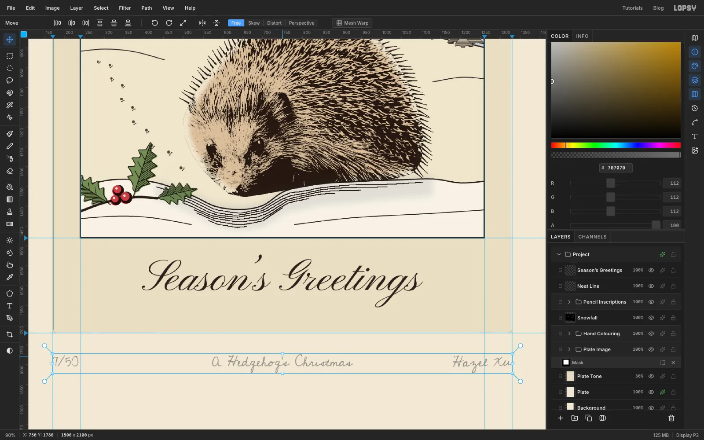

Click *Edition*, [[Shift]]-click *Signature* and choose **Layer → Group Layers**. Name the group *Pencil Inscriptions*. The three lines stay live text, so you can still change the edition number later, and if you want them a little higher or lower you can move the whole group at once.

## Add a paper grain and save

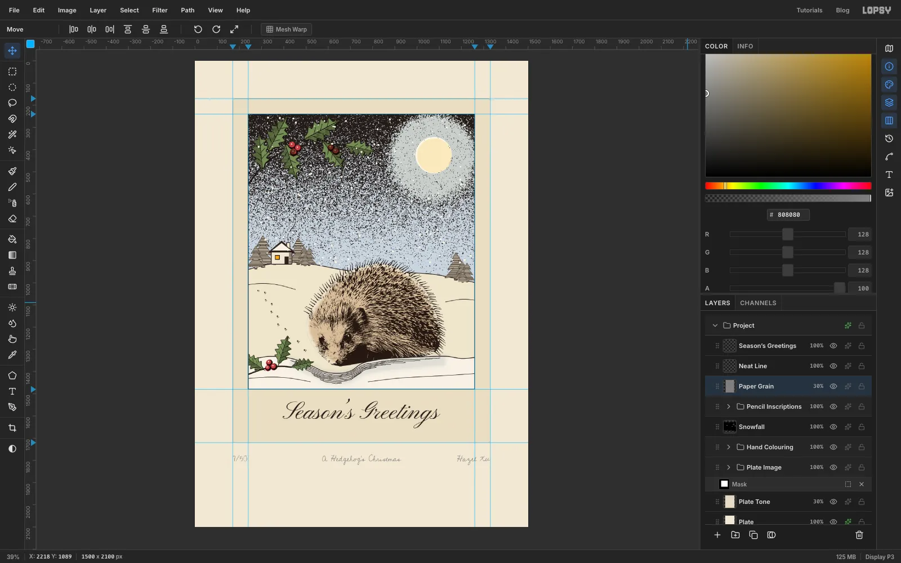

Collapse *Pencil Inscriptions* and click it, so the new layer goes on top of everything. **Add Layer**, name it *Paper Grain* and fill it with mid grey `#808080`. Then:

1. Choose **Filter → Add Noise…** with **Amount 30** and **Mono**.
2. Choose **Filter → Gaussian Blur…** with **Radius 1**.
3. Set the layer to **Overlay** at **30%**.

Overlay leaves mid grey invisible, so only the faint texture shows, over the paper, the ink and the washes alike.

Choose **File → Save Project** to keep every layer, then **File → Export…** for a PNG to print or send.
