The great 19th-century anatomy atlases were printed in black from engraved
copper or steel plates. A colourist then went through the edition by hand and laid
thin watercolour washes over the parts that mattered: blue for one system,
carmine for another, a yellow for a third. Every plate had the same
furniture: a running head, a plate number, numbered figures with italic
captions, and an "explanation of the plate" at the bottom.

In this tutorial you'll make a square album cover in that style for an
imaginary chamber-pop band, **Ossicle Keys**, and their album *The Organ of
Hearing*. It's 1600 × 1600 px. The idea behind it is real anatomy: inside
the snail-shaped **cochlea** runs a membrane that is narrow and stiff at
its base and wide and floppy at its tip. High notes make the base vibrate
and low notes the tip, so the cochlea is laid out like a keyboard rolled
up. Figure 5 unrolls it.

The pictures come from the 1918 edition of *Gray's Anatomy*, which is in
the **public domain**. Gray's figures were really wood engravings printed in
among the text; here you'll re-stage them as a copper-plate atlas page. Download these four files from Wikimedia Commons
(each page has a download link for the original):

- [Gray920.png](https://commons.wikimedia.org/wiki/File:Gray920.png), the right bony labyrinth seen from the side (500 × 365 px)
- [Gray916.png](https://commons.wikimedia.org/wiki/File:Gray916.png), the malleus (hammer)
- [Gray917.png](https://commons.wikimedia.org/wiki/File:Gray917.png), the incus (anvil)
- [Gray918.png](https://commons.wikimedia.org/wiki/File:Gray918.png), the stapes (stirrup)

You'll use:

- **Magic Wand**, **Lasso**, and marquees with Shift (add), Alt (subtract) and Shift+Alt (intersect)
- **Clone Stamp** and **Eraser** to retouch the scans
- the **Brush** inside a selection for watercolour washes, and the **Multiply** blend mode
- **Edit → Define Pattern**, **Fill with Pattern** and the Move tool's **Distort** mode
- **Fibers**, **Add Noise**, **Clouds**, **Unsharp Mask**, **Gaussian Blur** and **Threshold**
- **Drop Shadow**, **Stroke** and **Inner Glow** effects, a group **layer mask**, and group **adjustments**
- the **Shape** tool, the **Spray** tool, the **Text** tool and **groups**

The type is set in two free Google Fonts from Lopsy's font picker:
**Old Standard TT**, a revival of 19th-century scientific type, and
**IM Fell English**, cut from 17th-century type that still feels hand-set.

The palette is the colourist's box: three washes, an ink and a paper.

- Paper `#EEE4CB`, plate `#F1E8D2`, ink `#2A211B`
- Bone wash `#D8B98A`, gamboge `#D9A43A`
- Prussian blue `#3E5F8A`, carmine `#B8323A`
- Keyboard tint `#5F8FD6` → `#B0A3C4` → `#D2707A`
- Title red `#A92B22`, stamp blue `#2F4E86`

> **Tip:** Positions are written as `x, y` in document pixels from the top-left corner. The status bar at the bottom left shows where the cursor is. Key names are Mac keys; on Windows and Linux use Ctrl for Cmd. For an exact rectangle, **click once** with a marquee tool instead of dragging, and type the corners into the dialog. It only opens when nothing is selected, so press [[Cmd+D]] first if marching ants are showing.

## Set up the paper and guides

Open [Lopsy](/). In the **New Document** dialog set **Width** and
**Height** to `1600` and click **Create**.

1. Click **Background**, type `EEE4CB` into the Color panel's hex field and choose **Edit → Fill**.
2. Click the top ruler at **110**, **800** and **1490** to drop three vertical guides.
3. Click the left ruler at **110** and **1490** for the top and bottom margins.

Everything you set will start on these guides: the type, the rules and the keyboard.

## Press a plate mark

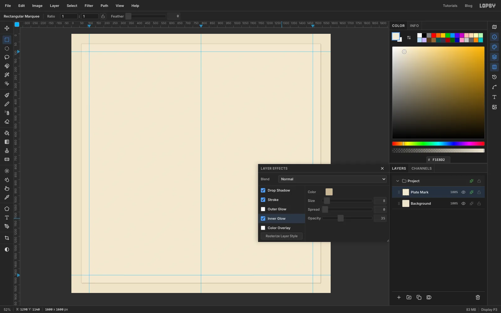

When a copper plate is printed, it presses a shallow, smoother rectangle
into the paper. That dent is the **plate mark**, and it's the first thing
that makes a print look like a print.

1. Rename `Layer 1` to `Plate Mark` (double-click the name).
2. Click once with the **Rectangular Marquee** and enter **From** `62, 62` and **To** `1538, 1538`. Set the colour to `F1E8D2`, choose **Edit → Fill**, and press [[Cmd+D]].
3. Click the layer's **fx** button. Tick **Drop Shadow**: **Offset X** and **Y** `2`, **Blur** `3`, **Opacity** `35`, colour `8C7A57`.
4. Tick **Stroke**: **Width** `1`, colour `B8A784`.
5. Tick **Inner Glow**: **Size** `8`, **Opacity** `35`, colour `C9B994`. Close the drawer.

The hairline and the soft inner shading read as a pressed edge rather than a lighter box.

## Add fibres and grain

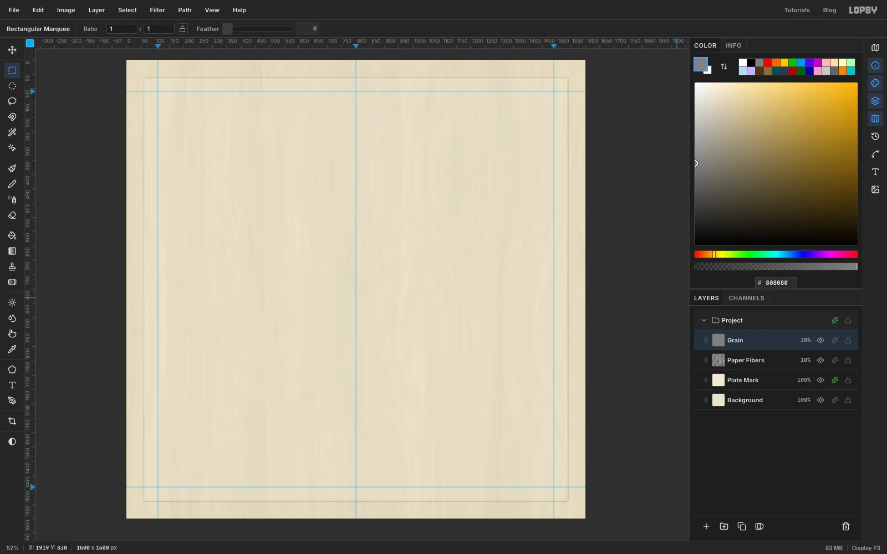

1. Add a layer named `Paper Fibers` and choose **Filter → Fibers…**. Keep the defaults and click **Apply**.
2. In the effects drawer set its blend mode to **Multiply**, then set the layer's opacity to `10%`.
3. Add a layer named `Grain`, fill it with `808080`, and choose **Filter → Add Noise…** with **Amount** `40`, **Mono** and **Gaussian**.
4. Set `Grain` to **Overlay** at `30%`.

Overlay leaves mid-grey invisible, so only the speckle shows.

## Drop in the labyrinth and scale it up

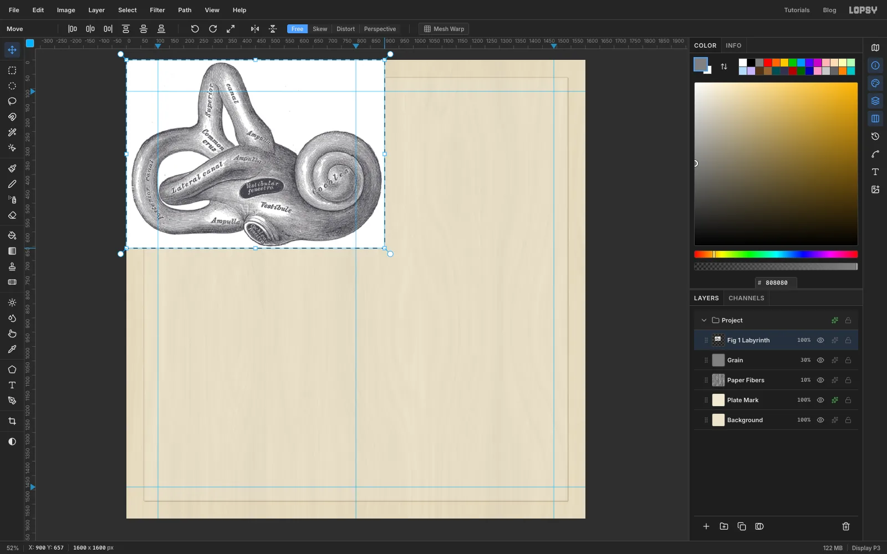

1. With `Grain` selected, drag `Gray920.png` from your desktop onto the canvas. It lands at the top-left corner, already selected.
2. Rename the new layer `Fig 1 Labyrinth`.
3. Hold **Cmd** and drag the bottom-right handle down and to the right until the scan is **900 × 657** px, 1.8 times its size. Cmd keeps the proportions. Press **Enter**.

The scan is only 500 px wide, so this is as far as it should be stretched. Any more and the engraved lines turn to mush.

## Place it and print it into the paper

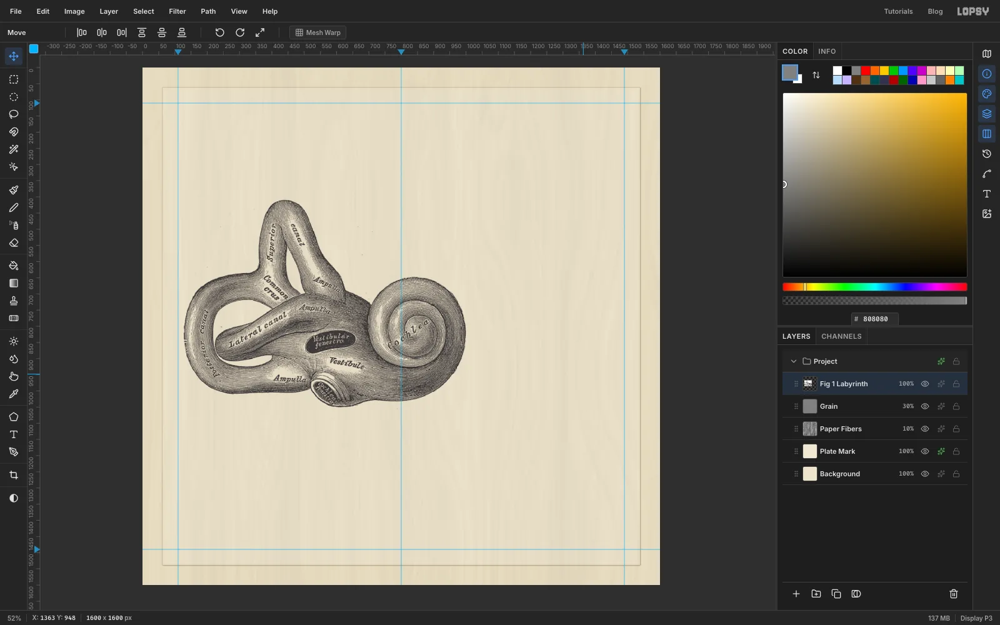

1. With the **Move** tool, drag the engraving down and right until its top-left corner is at `110, 400`. Finish with the arrow keys.
2. In the effects drawer set its blend mode to **Multiply**. Its white background disappears and the lines sit in the paper like printed ink.
3. Choose **Filter → Unsharp Mask…** with **Radius** `1`, **Amount** `0.8`, **Threshold** `2` to crisp up the enlarged lines. Keep it gentle: a stronger setting turns the fine hatching into stair-steps.

Keep Gray's italic labels. Engraving the names straight onto the figure was the house style of the period, and they make the plate look authentic.

## Select the outline of the labyrinth

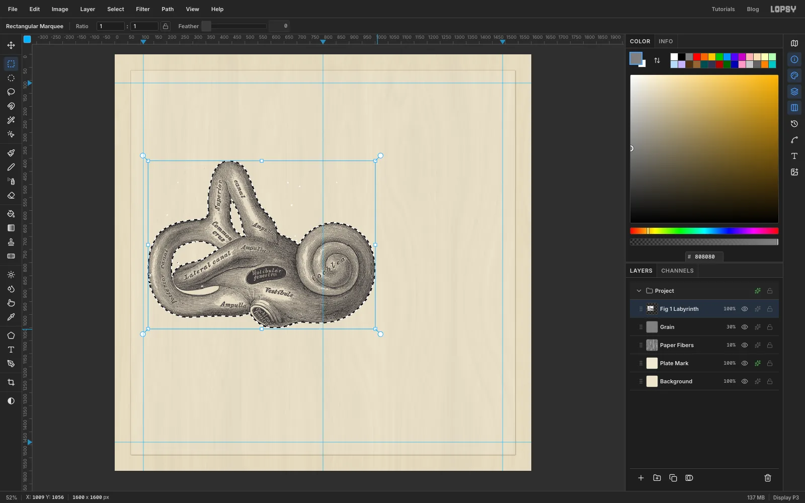

The washes have to stay inside the bone, so you need a selection of its outline.

1. Pick the **Magic Wand**, set **Tolerance** to `60`, and click the white corner of the scan, near `115, 405`. That selects the white around the figure.
2. Set **Tolerance** to `45`. Hold **Shift** and click inside each gap that the bone wraps around: the narrow gap inside the arch at the top (it's thin and crossed by faint lines, so Shift-click two or three spots down its length), the big loop on the left, and the slot under the lateral canal.
3. Choose **Select → Inverse**. Now the bone is selected, but so is everything outside the scan, because those pixels are empty.
4. Fix that with the **Rectangular Marquee**: hold **Shift+Alt** and drag around the scan from `111, 401` to `1009, 1056`. Shift+Alt keeps only the overlap.
5. Choose **Select → Feather…** and enter `3`.

The feather matters. Gray left the lit edges of the tubes open, with no outline. A soft edge stops the wash from ending in a hard line there.

## Wash the bone and the canals

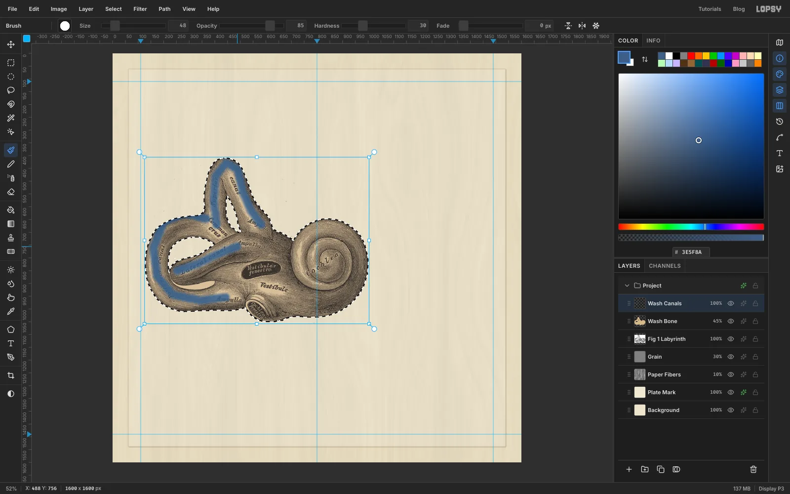

Keep the selection active for this whole step.

1. Add a layer named `Wash Bone`. Fill it with `D8B98A`, set it to **Multiply** and drop it to `45%`.
2. Add a layer named `Wash Canals`. Pick the **Brush** with **Size** `48`, **Hardness** `30`, **Opacity** `85` and the colour `3E5F8A`.
3. Paint along the middle of each of the three looping canals in one stroke each: up the superior canal and over its arch, around the big posterior loop on the left, and along the lateral canal in the middle. Keep the bottom of the posterior loop a little inside the outline. The selection keeps the brush inside the bone.
4. Set the layer to **Multiply** at `70%`.

The canals and the vestibule handle balance. Blue and, later, yellow keep them apart from the carmine cochlea, which hears.

## Paint the cochlea in carmine

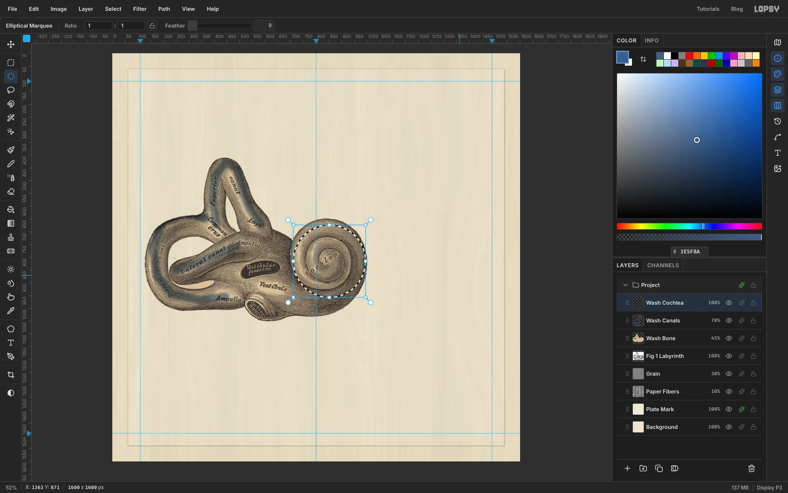

1. Add a layer named `Wash Cochlea`.
2. With the **Elliptical Marquee**, hold **Shift+Alt** and drag a circle over the cochlea from `706, 669` to `998, 961`. It intersects with the outline that's still selected, so you get just the cochlea. Choose **Select → Shrink…** `4` so the colour stops short of the engraved edge, the way a colourist's brush would.
3. Pick the **Brush** with **Size** `120`, **Hardness** `0`, **Opacity** `45`, colour `B8323A`. Paint two or three loose passes round the whorls, starting at the lower right. Go lightly over the upper left, so the highlights stay pale.
4. Set **Size** to `70` and **Opacity** to `40`, and run one more stroke round the lower-right rim, just inside the edge. That's where the pigment pools as watercolour dries.
5. Deselect. Set the layer to **Multiply** at `70%`.

## Add the gamboge and clean the scan

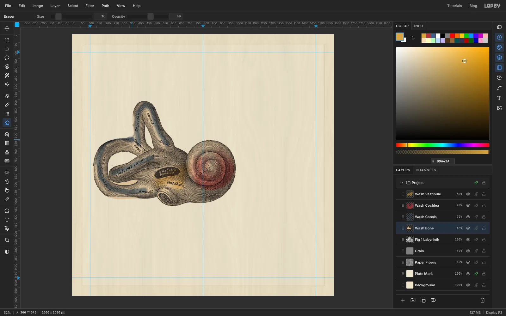

1. **Cmd-click** the `Wash Bone` thumbnail to load the outline again.
2. Add a layer named `Wash Vestibule`. Brush `D9A43A` at **Size** `120`, **Hardness** `0`, **Opacity** `60` over the bulge in the middle of the labyrinth, under the dark oval. Deselect and set the layer to **Multiply** at `80%`.
3. Old scans carry dust. Click `Fig 1 Labyrinth`, pick the **Eraser** at **Size** `110`, and sweep across the empty top-left and top-right corners of the scan and the strip under the figure. Use **Size** `14` for the two small scratch marks just outside the left-hand canal, at about `128, 840`.

4. Click `Wash Bone` and set the Eraser to **Size** `36` and **Opacity** `60`. Run it once down the left edge of the superior canal, the tall arch at the top, from about `352, 470` to `366, 645`. Gray left that lit edge open, with no outline, and a colourist would leave it pale too.

Erasing the scan's white background changes nothing you can see, since Multiply already hid it. The dust goes, though.

## Clone the leader lines off the malleus

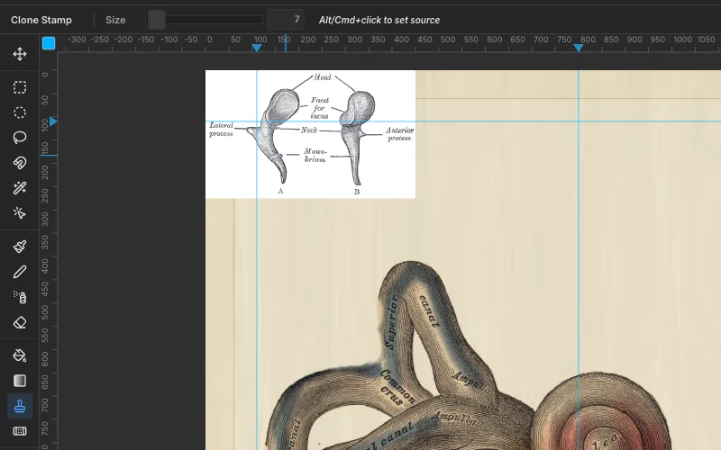

Figures 2 to 4 come from Gray's separate drawings of the three tiny bones
of the middle ear. Their label lines run into the bones, so they need
retouching before you cut them out.

Gray drew the left-side bones and the right-side labyrinth. Nobody will mind on a cover.

1. Click `Wash Vestibule` and drag `Gray916.png` onto the canvas. Rename the layer `Scan Malleus`. Zoom in on the top-left corner if the lines are hard to see.
2. Pick the **Clone Stamp** and set **Size** to `7`.
3. For each leader line that runs into the left-hand bone (the line into the oval facet at the top, the one across the neck, and the one into the long handle), **Alt-click** about 7 px above the line to set the source. Then drag along the part of the line that's inside the bone. The bone texture just above it is copied over the line.

Small, straight strokes along each line work best. A long drag starts copying its own fresh strokes, and you'll see repeats.

## Cut the bone out and scale it

1. Pick the **Lasso** and draw closely around the left-hand malleus, about 2 px outside its outline. Leave out the labels and the lines that stay outside the bone.
2. Press [[Cmd+C]] and then [[Cmd+V]]. The bone pastes onto a new layer in the same place, selected, with the Move tool active. Rename it `Fig 2 Malleus`.
3. Hold **Cmd** and drag its bottom-right handle out to **125%** (about 146 px wide). Press **Enter**.
4. Drag it to `1150, 405` and nudge it there with the arrow keys. Set it to **Multiply**.
5. Delete the `Scan Malleus` layer with the bin button.

## Cut out the incus and the stapes

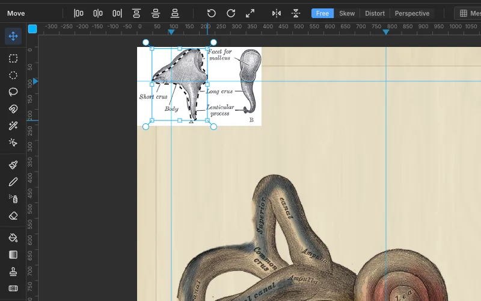

Do the same for the other two bones:

- **Incus** from `Gray917.png`: clone away the two lines that run up into the body from the labels below it, and the short stubs on its right. Cut it out, paste it as `Fig 3 Incus`, scale it to **110%**, and place it at `1133, 680`.
- **Stapes** from `Gray918.png`: this one is tiny, so use a Clone Stamp **Size** of `5`. Clone out the line that crosses the top of the arch and the line into the footplate. Lasso around the whole stirrup, then hold **Alt** and lasso the open arch inside it to take it out of the selection. Paste it as `Fig 4 Stapes`, scale it to **160%** and place it at `1163, 945`.

Set both to **Multiply** and delete their scan layers.

## Stack the three bones

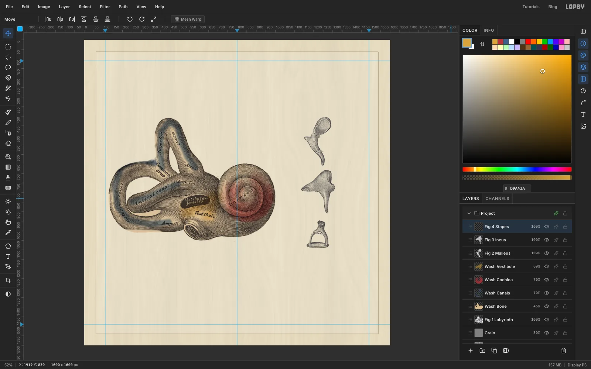

The three bones now sit in a column, in the order sound passes through them: hammer, anvil, stirrup.

Check each one at 100% zoom. If a bit of label line survived just inside an outline, go back to that layer and dab it out with the Clone Stamp.

## Draw one octave of keys

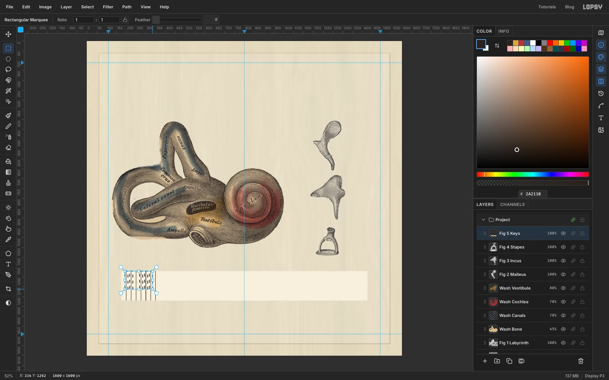

Now for Figure 5, the cochlea unrolled into a keyboard.

1. Click `Fig 4 Stapes` and add a layer named `Fig 5 Keys`.
2. Press [[Cmd+D]], click once with the **Rectangular Marquee** and enter `175, 1170` to `1425, 1320`. Fill it with `F6EFDD`, and deselect.
3. Pick the **Pencil** at **Size** `2` with the colour `2A211B`. Draw the dividers of the first octave: click at the top of the strip and **Shift-click** at the bottom, at `x = 201, 226, 251, 276, 301` and `326`, and one more at `349`, the right edge of the octave. Each white key is 25 px wide. That last line is the one between B and the next C, so every copy of the octave will carry it.
4. Black keys are 16 × 92 px rectangles, centred on five of the dividers. With the **Rectangular Marquee**, drag the first one from `193, 1170` to `209, 1262`. Hold **Shift** and add the others, centred on `226`, `276`, `301` and `326`. That's two, a gap, then three. Choose **Edit → Fill**.

## Repeat the octave with a pattern

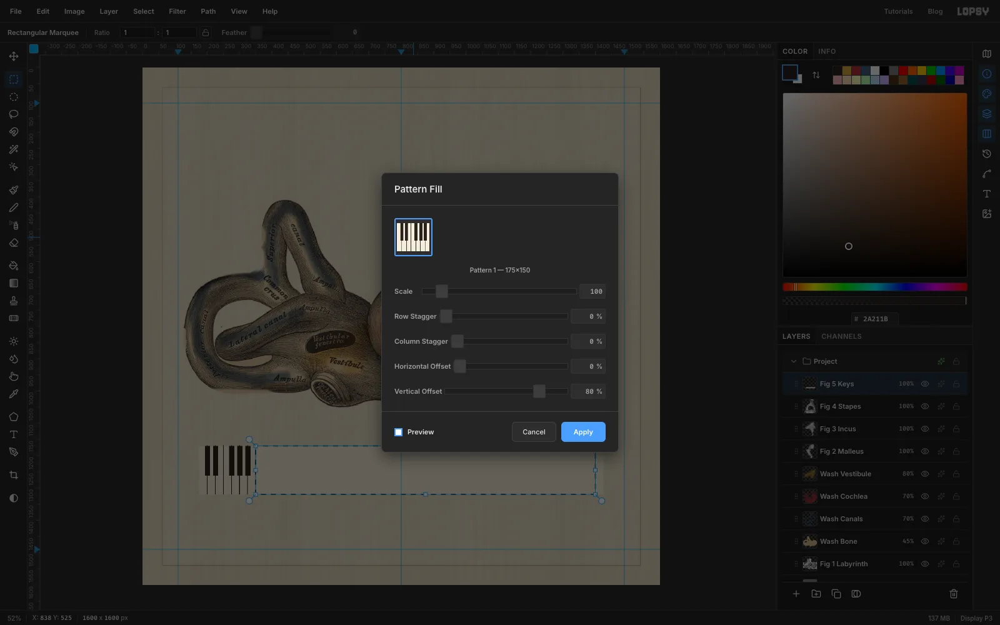

1. Press [[Cmd+D]] to drop the black-key selection. Click once with the **Rectangular Marquee** and select the first octave: `175, 1170` to `350, 1320`. Choose **Edit → Define Pattern**.
2. Select the rest of the strip, `350, 1170` to `1400, 1320`, and choose **Edit → Fill with Pattern…**.
3. Click the octave thumbnail and set **Vertical Offset** to `80`. Click **Apply**.
4. Deselect. The last tile ends at 1400, and the strip's final 25 px is a single white key: the top C.

Patterns tile from the top of the document. The strip starts at y 1170,
which is 120 px into a 150 px tile, so an 80% offset lines the tiles up
with the strip. Horizontally, 175 is already a whole tile.

## Taper the keyboard with Distort

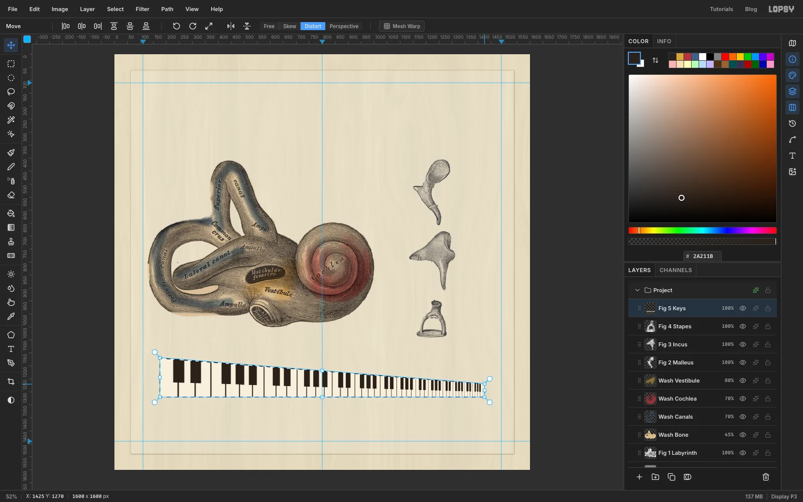

The membrane inside the cochlea is wide at the tip, where it hears low
notes, and narrow at the base, where it hears high ones. So the low end of
the keyboard stays tall and the high end shrinks.

1. **Cmd-click** the `Fig 5 Keys` thumbnail to select the keyboard.
2. Pick the **Move** tool and click **Distort** in the options bar.
3. Drag the **top-right** corner handle straight down **100 px**. Press **Enter** and deselect.
4. Give the layer a **Stroke** of `2` in `2A211B`, then **Filter → Add Noise…** at `18`, **Mono**, **Gaussian** so the ivory looks printed rather than flat.

Distort is a perspective warp, so the keys get narrower as well as shorter
toward the right. It looks like a measuring scale bunching up, which suits
the idea.

## Tint the keys from blue to rose

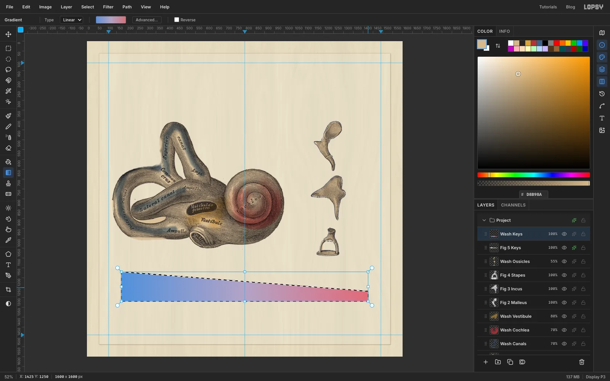

1. Add a layer named `Wash Keys` and **Cmd-click** the `Fig 5 Keys` thumbnail.
2. Pick the **Gradient** tool, set it to **Linear**, and open the gradient editor. Use three stops: `5F8FD6` at the left, `B0A3C4` in the middle and `D2707A` at the right.
3. Drag from the left end of the keyboard to the right end. Deselect, and set the layer to **Multiply** at `60%`.

Low notes are cool and high notes warm, matching the blue canals and the carmine cochlea above.

## Lead the eye from the cochlea to the keys

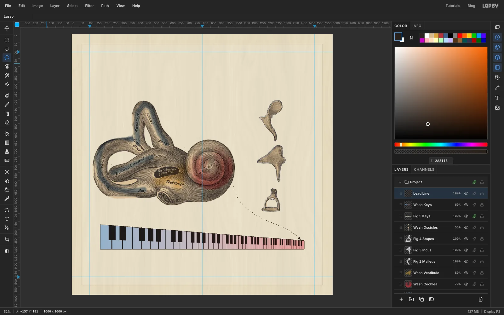

1. Add a layer named `Wash Ossicles` above `Fig 4 Stapes`. For each of the three bones, **Cmd-click** its thumbnail, choose **Select → Shrink…** `7` and **Edit → Fill** with `D8B98A`. Set the layer to **Multiply** at `55%`.
2. Add a layer named `Lead Line` above `Wash Keys`. Pick the **Brush** at **Size** `5`, **Hardness** `100`, colour `2A211B`.
3. Click a row of dots about 14 px apart. Start at the lower right of the cochlea, near `990, 935`, dip down to about `1100, 1120` so you pass well under the stapes, and come round to `1396, 1256`, just above the right end of the keyboard.
4. For the arrowhead, lasso a small triangle about 20 px long just past the last dot, pointing down and to the right, with its tip touching the top edge of the keyboard. Fill it.

## Set the title

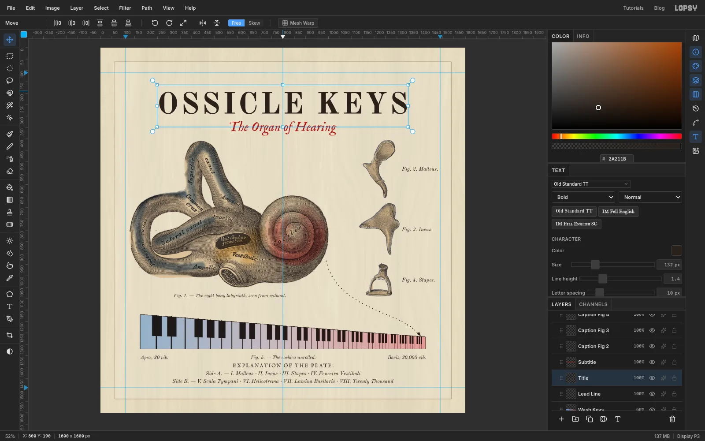

Make each text layer by clicking in an empty part of the canvas, typing,
and pressing **Tab**. Then nudge it into place with the Move tool and the
arrow keys. Click a picture layer (not a text layer) before you start each
new one, or the font change restyles the text you just made.

1. `OSSICLE KEYS` in **Old Standard TT**, **Bold**, **Size** `132`, **Letter spacing** `10`, colour `2A211B`. Centre it on the middle guide with the top of the capitals at y 193.
2. `The Organ of Hearing` in **IM Fell English**, **Italic**, **Size** `58`, colour `A92B22`, centred, with its tops at y 321.
3. `ANATOMY OF THE EAR.` and `PLATE XII.` in **IM Fell English SC**, **Size** `24`, **Letter spacing** `3`. Put the first on the left guide and end the second on the right guide, both at y 112.
4. On a new layer named `Rules`, draw a Pencil line at **Size** `3` from `110, 148` to `1490, 148`, and a **Size** `1` line just below it at y 155.

## Caption the figures and write the legend

All captions are **Old Standard TT Italic** in `2A211B`.

- `Fig. 2. Malleus.`, `Fig. 3. Incus.` and `Fig. 4. Stapes.` at **Size** `23`, left-aligned at x 1322, each level with the middle of its bone.
- `Fig. 1. — The right bony labyrinth, seen from without.` at **Size** `21`, centred under the labyrinth at x 566, about 22 px below the bottom of the bone.
- Under the keyboard, the same distance below the keys as Fig. 1's caption sits below the labyrinth: `Apex, 20 vib.` flush with its left end, `Basis, 20,000 vib.` flush with its right end, and `Fig. 5. — The cochlea unrolled.` centred between them.

Then the explanation, which doubles as the track list:

- `EXPLANATION OF THE PLATE.` in **IM Fell English SC**, **Size** `22`, **Letter spacing** `4`, centred, top at y 1384.
- `Side A. — I. Malleus · II. Incus · III. Stapes · IV. Fenestra Vestibuli` and `Side B. — V. Scala Tympani · VI. Helicotrema · VII. Lamina Basilaris · VIII. Twenty Thousand` at **Size** `23`, centred, at y 1418 and 1452.

## Stain the margins

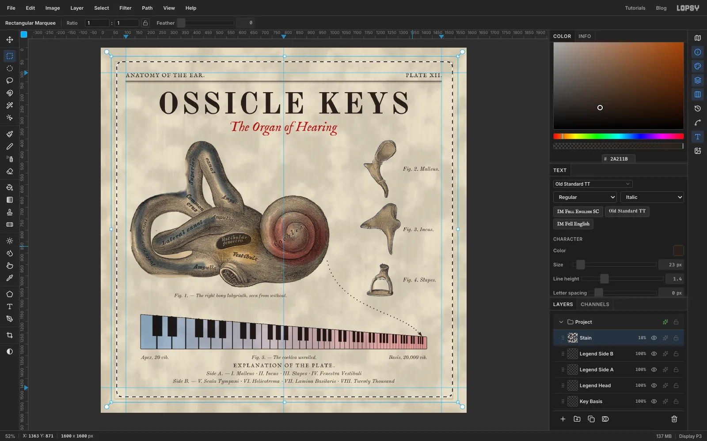

1. Click the top layer and add a layer named `Stain`. Choose **Filter → Clouds…** with **Scale** `20`.
2. Set it to **Multiply** at `10%`. Clouds draws in grey, but at this strength over the cream it reads as a brownish damp stain.
3. Click once with the **Rectangular Marquee** and enter `70, 62` to `1538, 1530`: the plate, nudged a few pixels in from the left and bottom. Choose **Select → Feather…** `24` and press **Delete**. Deselect.

The stain is left in the margins, where damp gets into a book, and the feather lets it creep a little way over the plate mark. The offset leaves a touch more along the left and bottom edges, because real damage is never even.

## Add foxing and warm the whole plate

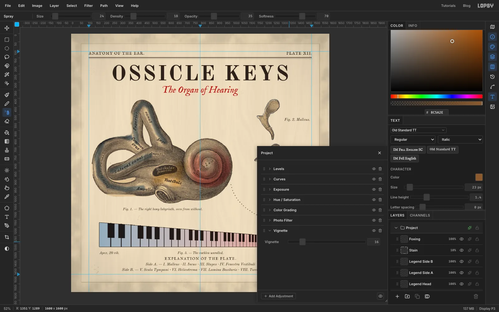

1. Add a layer named `Foxing` and pick the **Spray** tool with **Size** `24`, **Density** `18`, **Opacity** `35`, **Softness** `70` and the colour `8C5A2E`. Make a few short dabs, mostly near the corners; make the biggest ones with a larger Size, up to about `75`. Set the layer to **Multiply**.
2. Click the **fx** button on the `Project` group at the top of the Layers panel. Click **Add Adjustment** and add a **Photo Filter**, keep its default amber colour and set **Density** to `6`, then a **Vignette** of `16`. Close the panel.

Adjustments on the root group act on the whole picture without touching any pixels, so you can tune them at any time.

## Build the library stamp

1. Add a layer named `Stamp Ring`. Pick the **Shape** tool, choose **Ellipse** with **Output** set to **Pixels**, no fill, and a `2F4E86` stroke of **Width** `5`. Shapes grow from where you press, so press at `276, 514` and drag out until the circle is 172 px across.
2. Set the stroke **Width** to `2` and draw a second circle from the same centre, 146 px across.
3. Type three lines in `2F4E86`, centred on x 276: `LONG PLAY` in **IM Fell English SC** at **Size** `14`, `33⅓` in **Old Standard TT Bold** at `60`, and `R.P.M.` in **IM Fell English SC** at `20`. There's no key for ⅓: copy it from this page.
4. Shift-click to select `Stamp Ring` and the three text layers, and choose **Layer → Group Layers**. Name the group `Stamp`.

## Tilt the stamp

With the `Stamp` group selected, pick the **Move** tool and drag from just
outside a corner to turn it about **12° counter-clockwise**. Press **Enter**.
The ring and all three lines turn together.

The ring overlaps the edge of the superior canal, the way a careless
librarian's stamp lands half on the picture.

## Wear the ink

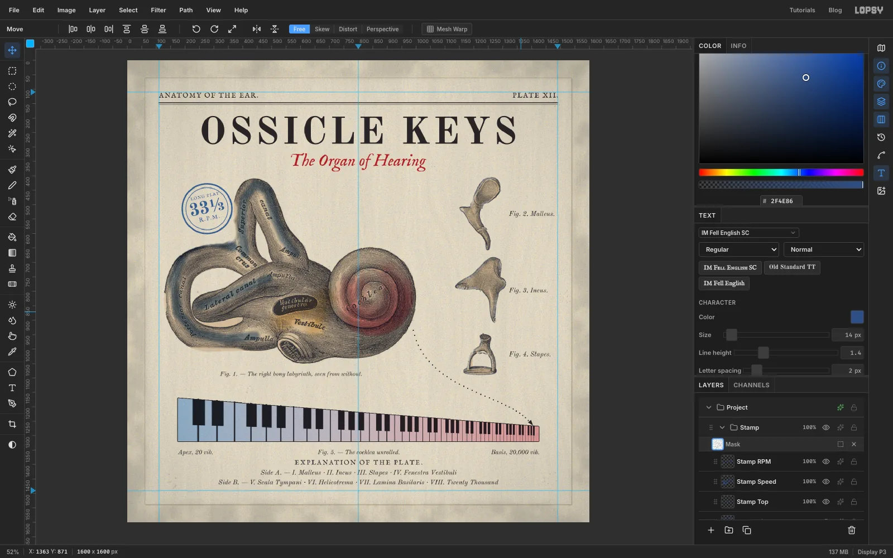

1. With `Stamp` selected, click **Add Mask** at the bottom of the Layers panel, then click the mask row to edit it.
2. Choose **Filter → Add Noise…** with **Amount** `100`, **Mono** and **Uniform**. Do it **three times**. One pass isn't enough to break up the ink; three build a rough, uneven grain.
3. Choose **Filter → Gaussian Blur…** with **Radius** `1` to clump the specks.
4. Choose **Filter → Threshold…** at `185`. Enough specks drop out that the ink looks pressed onto rough paper.
5. Click the `Stamp` name to leave mask editing.

## Group the plate

Tidy the Layers panel so the plate is easy to adjust later.

1. Click `Fig 1 Labyrinth`, **Shift-click** `Wash Vestibule`, and choose **Layer → Group Layers**. Name it `Fig 1`.
2. Do the same for `Fig 2 Malleus` to `Wash Ossicles` (`Ossicles`) and `Fig 5 Keys` to `Lead Line` (`Fig 5`). For `Type`, click the lowest text or rules layer above `Fig 5` and Shift-click the highest text layer below `Stain`.
3. To try a different spacing, select the `Ossicles` group and drag it with the **Move** tool. All three bones and their wash move together. Drag it back, or press [[Cmd+Z]].

## Save and export

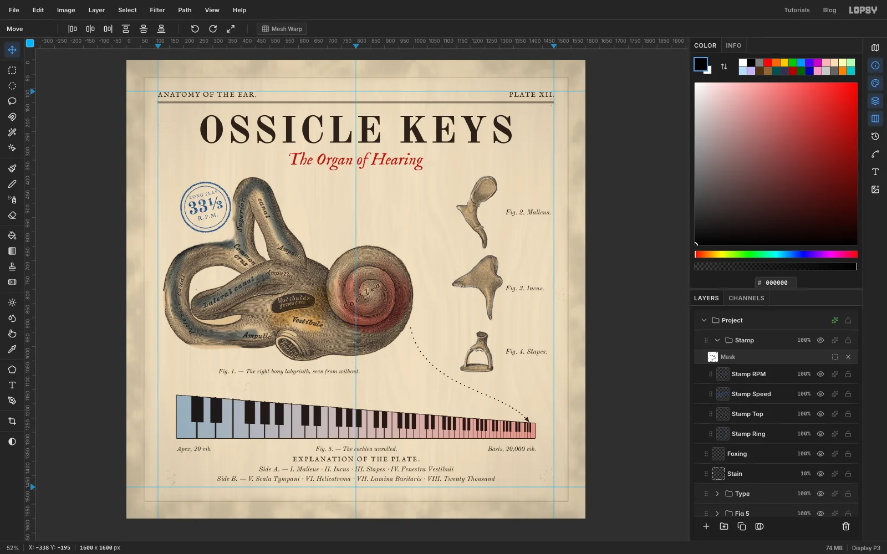

Choose **File → Save Project** to keep the layers, then
**File → Quick Export PNG** for the cover.

Before you call it done, look at the finished plate at thumbnail size. The
title, the red cochlea and the keyboard should read at a glance. Up close,
the captions, the stamp's broken ink and the stain at the edges reward a
second look.
