Print shops make holographic menus by stamping one sheet of foil through a
plate, so every foil element is cut from the same shimmer. This tutorial works
the same way. You'll make **Quasar Bao**, a 1500 × 2100 menu for a made-up
steamed bun restaurant, where the bun is the "o" in "Bao" and also a quasar,
with a disc around it and a jet of light that divides the two columns.

You build one grey sheet, turn it into foil with a **Gradient Map** on its
group, and hide all of it behind a **layer mask**. The mask is your printing
plate: wherever it's white, foil shows. The bun is a real photo that goes
through the same Gradient Map, so it looks stamped from the same material.

The bun comes from a public domain (CC0) photo on Wikimedia Commons,
[Baozi as a fast food](https://commons.wikimedia.org/wiki/File:Baozi_as_a_fast_food%282026,_Shandong%29.jpg)
by Cartonfox. Save it and crop it to about 850 px wide around the front bun,
without scaling it, or use any photo of a pleated bun seen from slightly above.

The fonts are free Google Fonts:

- **Abril Fatface** for the title and section headings
- **Krona One** for dish names, the tagline, the footer and the seal
- **Poppins** for descriptions
- **Space Mono Bold** for prices

The palette:

- Card `#0B0A10`
- Dish names `#F3F0FF`, descriptions `#C8C4D8`, leaders `#B9B5CC`
- Foil darks `#0A0720` → `#14105A` → `#3A2CD0`
- Foil colours `#25C8F5` → `#A8FFD8` → `#FFF4B8` → `#FF9FDB` → `#B394FF` → `#6FE3FF` → `#C4FFD9`
- Foil highlights `#FFFFFF`, `#FFD9F0`

A few habits will save you trouble:

- **Check the tool before you drag.** Transform handles only move pixels with the Move tool, so press [[V]] first. With a marquee tool the same handles resize just the selection outline.
- **Use the status bar for positions.** It shows the cursor's X and Y at the bottom left, so glance at it whenever a step gives a position.
- **Close the effects drawer when you're done.** It sits over part of the canvas and catches clicks.
- **Click a raster layer before you make new text.** If a text layer is active, changing the font or size restyles that layer. New text also picks up the last font, weight and spacing, so set them each time.
- **Set the foreground before you fill.** Most steps below say which colour to use, because it changes often.

## Set up the black card

Choose **File → New**, enter **1500 × 2100** pixels and click **Create**. The
document starts with a white **Background** and an empty layer above it.
Double-click the empty layer's name and rename it **Card**.

Type `#0B0A10` into the Color panel's hex field and choose **Edit → Fill**.
Then run **Filter → Add Noise** with **Amount 11** and **Mono** selected. You
can barely see the noise, but it gives the black the tooth of real card stock.

Click the top ruler to drop vertical guides at **x = 80**, **833** and **1420**,
and click the left ruler for horizontal guides at **y = 68**, **880** and **1989**.
The outer vertical guides are your margins. The one at 833 is where the bun and the jets will sit.

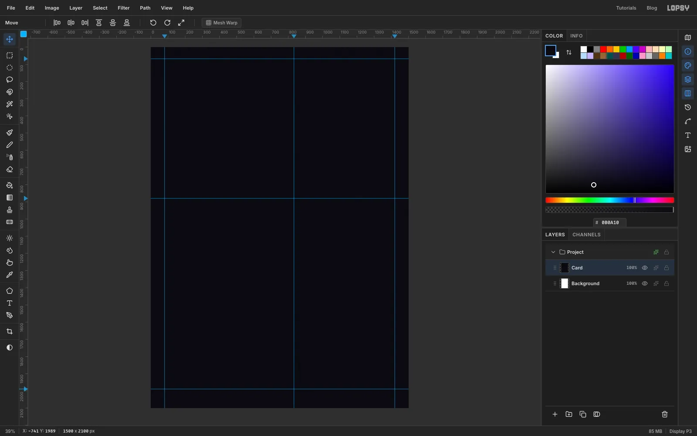

## Build the layers and render clouds

Next you'll stack three groups. New Group lands directly above the active
layer, so build them from the top down, always starting from **Card**:

1. Click **Card**, click **New Group** and name it **Menu**. Click **Add Layer** and name the new layer **Menu base**.
2. Click **Card** again, click **New Group** and name it **Plate**. Add a layer inside it called **Plate base**.
3. Click **Card** again, click **New Group** and name it **Holo**.

From top to bottom you now have Menu, Plate, Holo, Card and Background. Menu
holds normal type. Plate holds white artwork for the mask. Holo holds the foil.

With **Holo** active, click **Add Layer** and name it **Foil**. Run **Filter →
Clouds** with **Scale 4**.

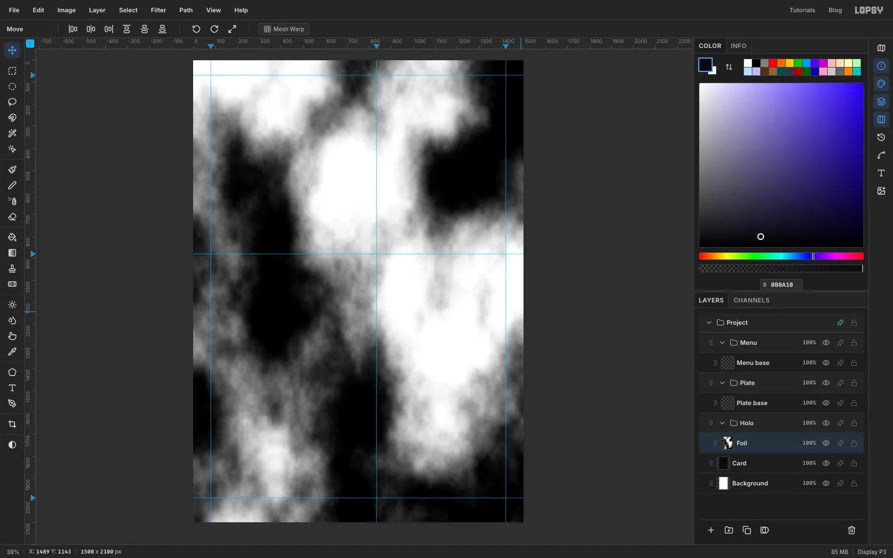

## Solarize the clouds into ripples

Real foil has thin bright ridges more than it has soft clouds. Run **Filter →
Solarize** with **Threshold 128** to fold the tones back on themselves. Then
run **Filter → Gaussian Blur** with **Radius 10** to soften the creases, and
**Filter → Brightness/Contrast** with **Brightness 22** and **Contrast 10**.

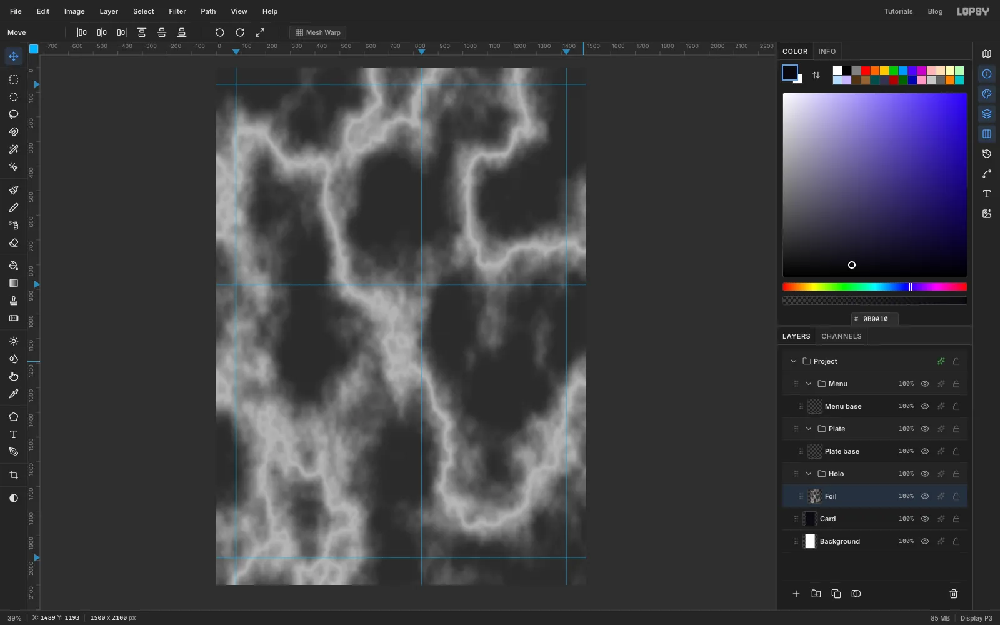

## Radiate rays from the bun

The foil should look lit by the quasar, so the rays start where the bun will
be. Click **Add Layer** and name it **Rays**. Set the foreground to black,
choose **Edit → Fill**, then set the foreground to white.

Run **Filter → Sunburst** with these settings:

- **Rays 16**, **Length 150**, **Width 50**, **Softness 100**
- **Center X 55.5**, **Center Y 31.9**, which is the point on your 833 guide about a third of the way down the page

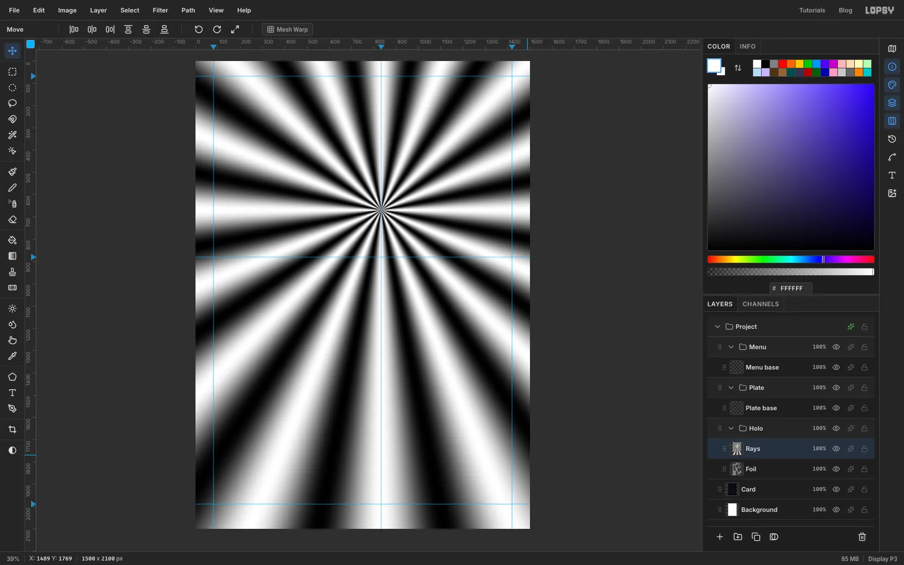

## Merge the rays into a grey sheet

Run **Gaussian Blur** on the rays with **Radius 24**. Click the layer's effects
button (the sparkle icon on its row), set **Blend** to **Hard Light** and close
the drawer. Click the percentage on the row and set the opacity to **55%**.
Choose **Layer → Merge Down**.

Now add finer lines the same way. Add a layer, fill it black, set the
foreground to white and run **Sunburst** with **Rays 90**, **Length 150**,
**Width 40**, **Softness 70** and the same centre. Set this layer to **Soft
Light** at **50%** and merge it down.

Finish the sheet with **Add Noise**, **Amount 5**, **Mono**. The grain turns
into fine sparkle in the next step.

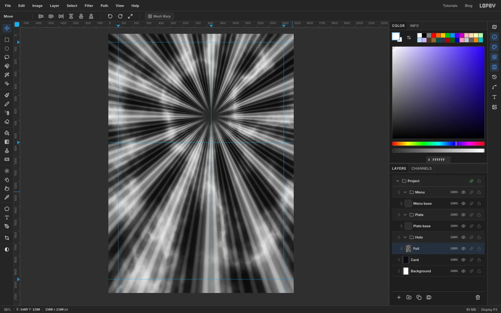

## Turn the grey into foil with a Gradient Map

Click the **Holo** group's effects button, click **Add Adjustment** and choose
**Gradient Map**. Every grey in the group now gets a colour from this ramp.

Click along the ramp to add stops, then select each stop and type its hex.
Drag a stop until the readout under the ramp shows its percentage. Set these
positions and colours:

- 0% `#0A0720`, 14% `#14105A`, 22% `#3A2CD0`, 30% `#25C8F5`
- 38% `#A8FFD8`, 44% `#FFFFFF`, 50% `#FFF4B8`, 58% `#FF9FDB`
- 66% `#B394FF`, 74% `#6FE3FF`, 82% `#C4FFD9`, 88% `#FFFFFF`
- 94% `#FFD9F0`, 100% `#FFFFFF`

The two narrow white stops are the hot streaks, and the near-black end gives
you dark reflections. Without both, foil looks like a pastel gradient fill.

Close the drawer.

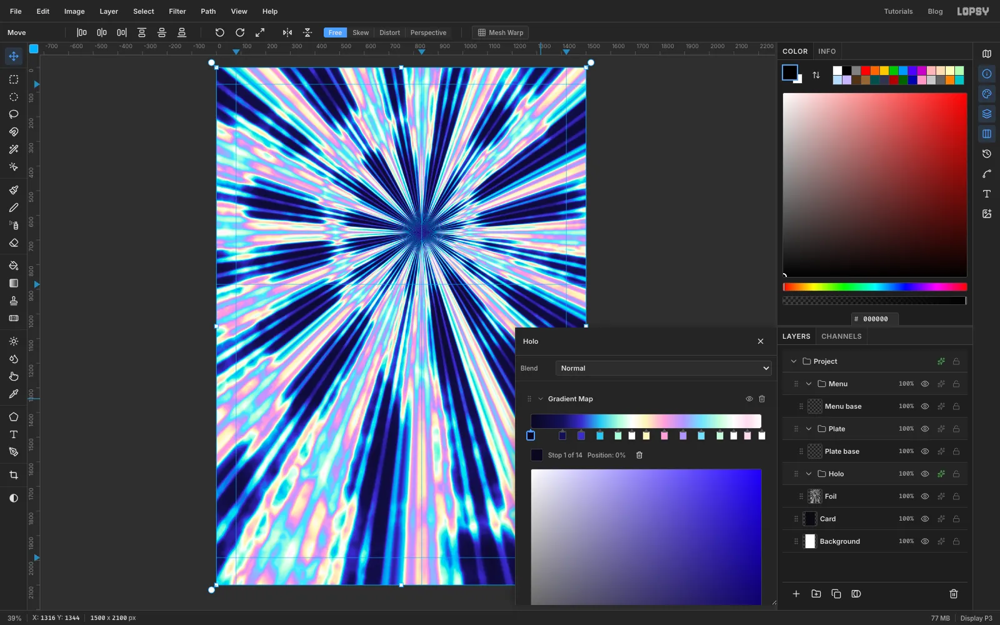

## Make a brighter copy for small type

The dark reflections look great in huge letters, but they would swallow a
price. So small type gets its own brighter copy of the same sheet.

Press [[V]] for the Move tool, click **Foil** and click **Duplicate Layer**.
Name the copy **Foil Small**. Then run **Brightness/Contrast** with
**Brightness 28** and **Contrast -30**. The rays stay in the same place, but
the darks are gone.

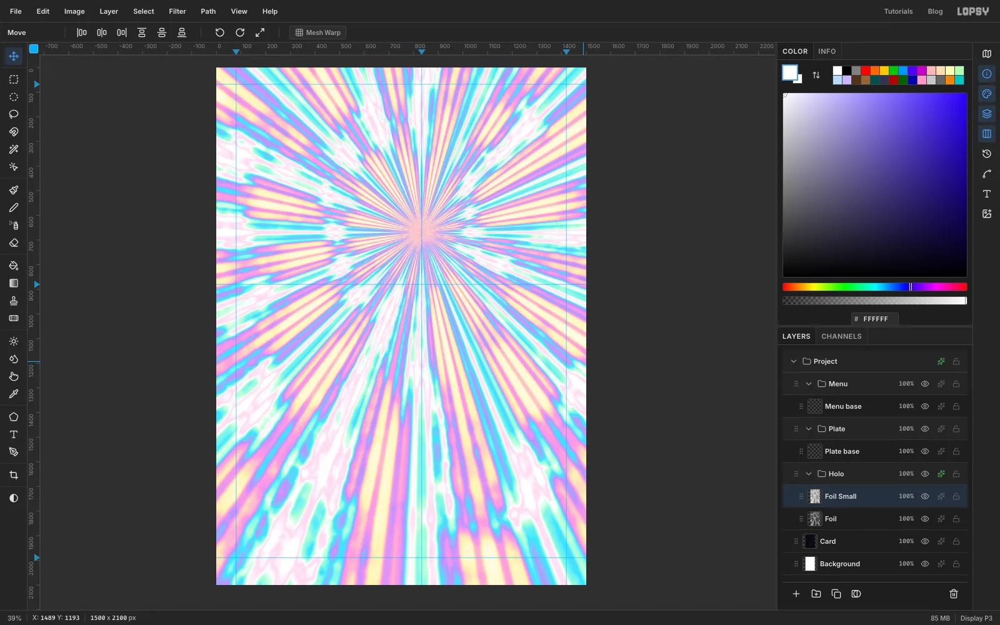

## Set the title on the plate

Click **Plate base** and press [[T]] for the Text tool. In the options bar set
**Size 403** and choose **Abril Fatface**. Set the foreground to white, click
near the top left of the page, type **Quasar** and press [[Tab]] to commit.
Press [[V]] and use the arrow keys ([[Shift]] moves 10 px) until the word runs
from guide to guide with its top on the 68 guide.

Click **Plate base** again and make a second text layer reading **Ba** at
**Size 476**. Put it on the left guide, about 30 px below the tail of the Q.

Rename the layers **Wordmark Quasar** and **Wordmark Ba**. They're plain white
for now because they're only the artwork for the plate.

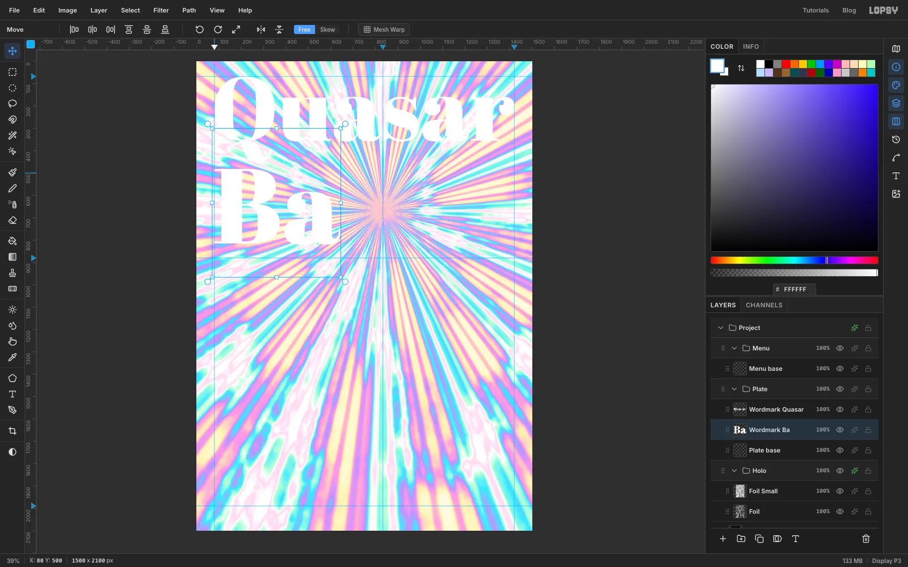

## Hide the foil behind a mask

Click **Foil** and click **Add Mask** in the Layers panel footer. Click the
**Mask** row under the layer to edit the mask. The canvas gets a translucent
blue tint while you're in this mode.

Set the foreground to black and choose **Edit → Fill**. The sheet is now hidden,
though you won't see that yet, because **Foil Small** still sits on top until it
gets its own mask below. In mask mode, Edit → Fill writes the foreground colour into the mask, so
black hides and white reveals.

Set the foreground to white. Hold [[Cmd]] and click the **Wordmark Quasar**
thumbnail to load its letters as a selection, then choose **Edit → Fill**. Do
the same for **Wordmark Ba**, and press [[Cmd+D]] to deselect.

Click the **Foil** row to leave mask mode. Then do the first part again for
**Foil Small**: Add Mask, click its Mask row, fill it black and click its row
to leave.

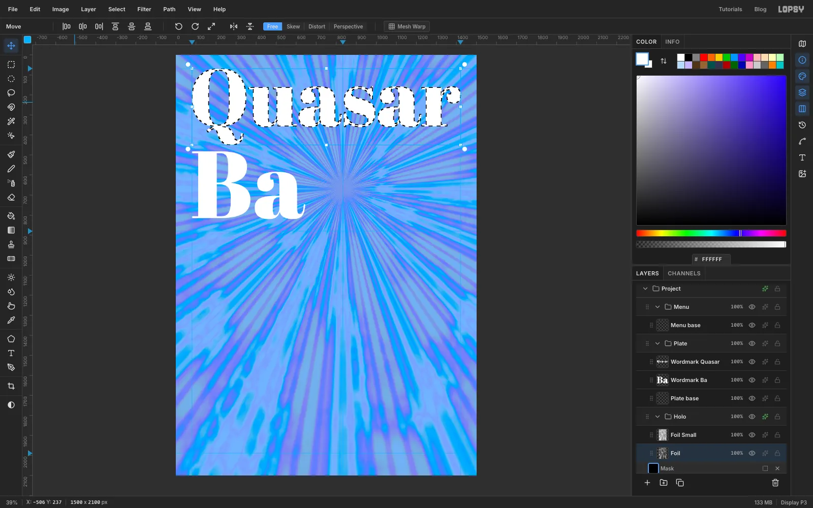

## Check the foil through the title

Click the eye on the **Plate** group to hide the white artwork. The Plate group
sits above the foil, so you'll need to hide it whenever you want a true view.
There's your stamped title on black card. Turn Plate back on when you need its
layers.

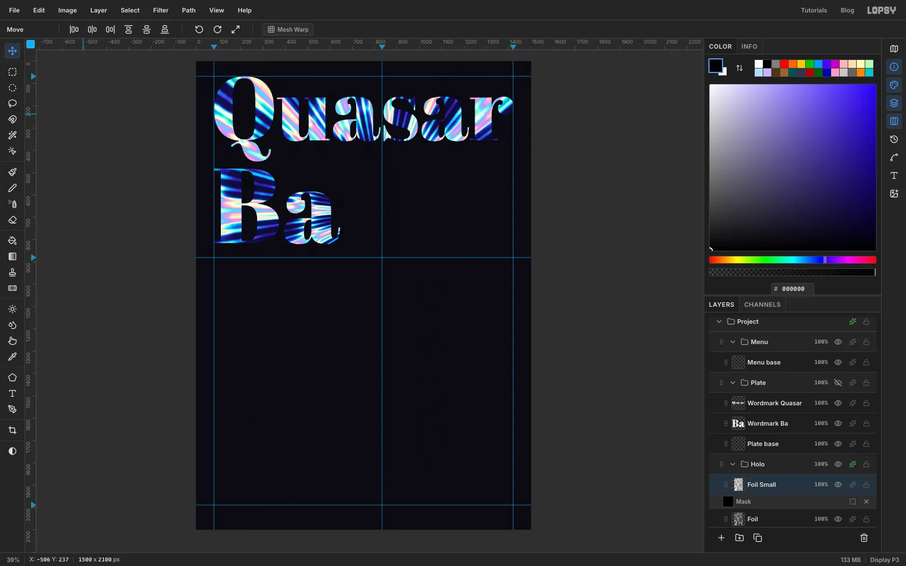

## Bring in the bun and heal it

Click **Foil Small** and hide **Plate** while you work on the photo, because its
white letters would cover it. Then drag your cropped photo onto the canvas. It lands in
the top left corner as a new layer inside Holo, and the Gradient Map colours it
straight away. Press [[Cmd+D]], and rename the layer **Bao**.

My bun has a bright yellow seed in its centre, which would turn into a hot spot
later. Choose the **Healing Brush** and set **Size** to about 44. Hold [[Alt]]
and click clean dough nearby, then paint over the seed. Skip this if your bun
has nothing to remove.

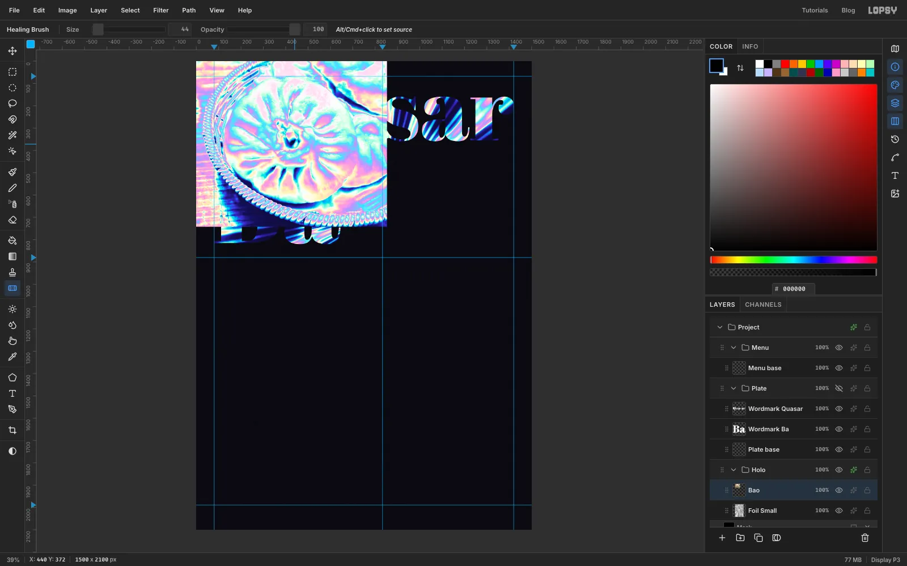

## Cut out the bun

Press [[L]] for the Lasso. Trace the outline of the front bun in one slow,
smooth drag, staying just inside the edge so that none of the basket comes along.
Quick Selection is tempting here, but pale dough on a pale background leaks.

Choose **Select → Feather** with a value of **2**. Then choose **Select →
Inverse**, press [[Delete]] and press [[Cmd+D]].

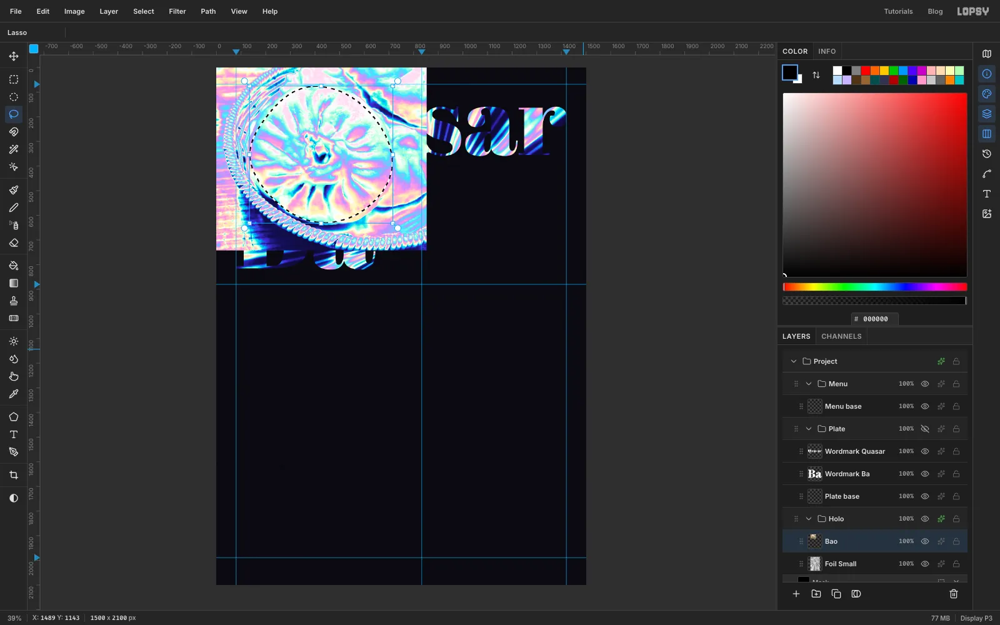

## Remove the colour and smooth the dough

Choose **Filter → Desaturate**, then run **Gaussian Blur** with **Radius 5**.
The blur looks heavy, but the bun is about to shrink. Without it, the map turns
every small crease into jagged contour lines.

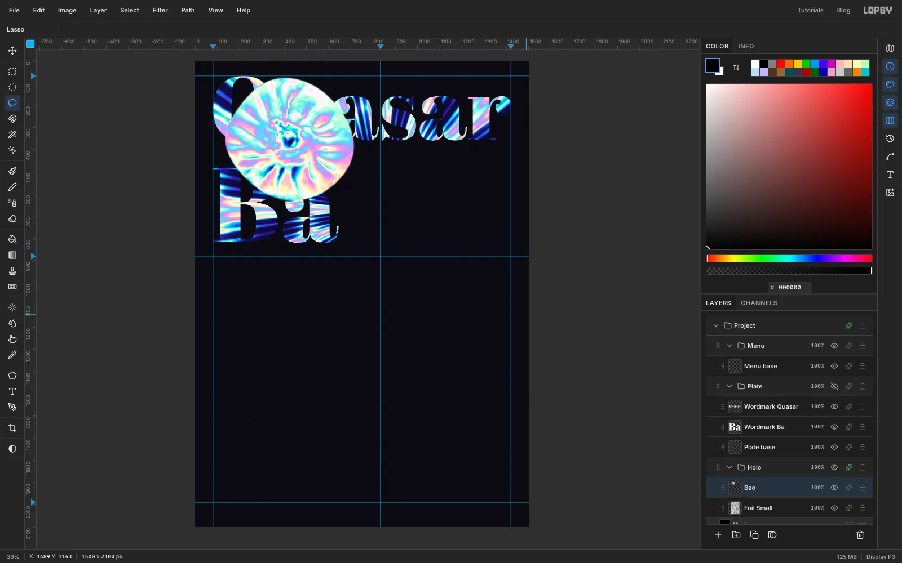

## Scale the bun and squash it into a dome

Press [[M]] and draw a marquee around the bun, a little bigger than it. Press
[[V]], hold [[Cmd]] and drag the bottom right corner handle inward until the
bun is about **345 px** wide. [[Cmd]] keeps the proportions. Press [[Cmd+D]].

Press [[M]], draw a new marquee around the smaller bun, press [[V]] and drag the middle
handle on the bottom edge up until it's about **300 px** tall. The disc will be
seen from an angle, and this slight squash makes the bun agree with it. Press
[[Cmd+D]].

Drag the bun so it's centred on the 833 guide with its base about 5 px below the
bottom of the **Ba** letters. It should sit about 20 px from the tail of the
"a". Now it reads as the third letter of the word.

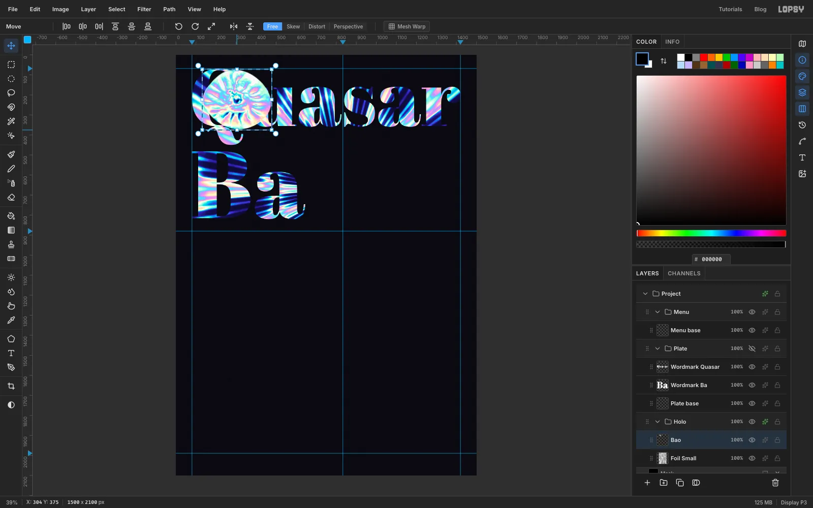

## Lift the knot with Liquify

The pleated knot sits dead centre, as if you were looking straight down on the
bun. Choose **Filter → Liquify** with **Push Forward** and a **Brush Size** of
**260**. Make one short drag straight up from the middle of the bun, about 35 px.
A second pass quickly makes it look like a jellyfish, so stop at one. Click
**Apply**.

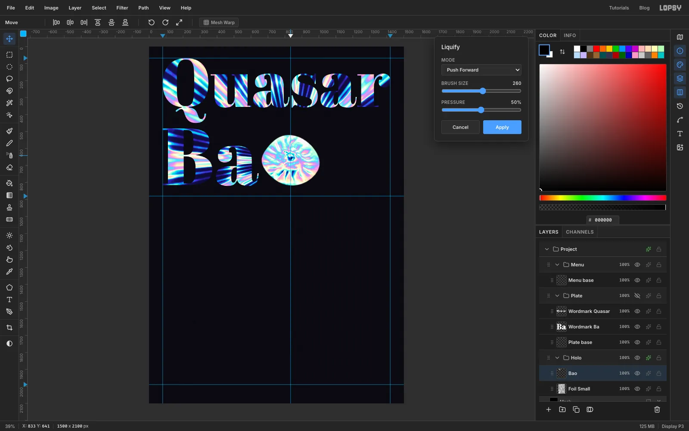

## Straighten the bun and add a shadow

The bun leans a little to the left. Press [[M]], draw a marquee around it, press [[V]] and
drag the round rotation handle at a corner about **4°** clockwise. Press
[[Cmd+D]]. If the turn moved it off the guide, drag it back into place.

Open its effects, tick **Drop Shadow** and set **Offset X 0**, **Offset Y 6**,
**Blur 18** and **Opacity 60**. Close the drawer. The shadow will separate the
bun from the disc behind it.

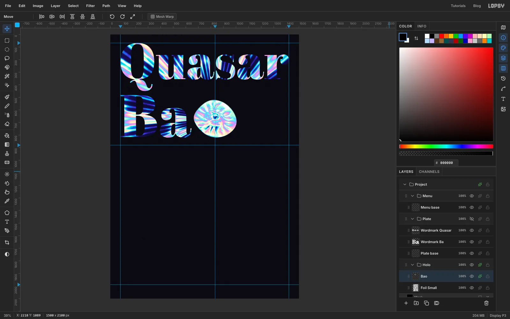

## Draw the disc on the plate

Show **Plate** again. Click **Plate base**, click **Add Layer** and name it **Disc plate**. Zoom in
on the bun with [[Cmd]] and the scroll wheel.

Choose the **Elliptical Marquee** and draw an ellipse centred on the bun, about
**480 × 200 px**. Hold [[Alt]] and drag, corner to corner, a second ellipse that
shares the same centre, about **342 × 142 px**, to subtract the middle. Its left and right ends should
just touch the sides of the bun. Choose **Select → Feather** with a value of
**2**.

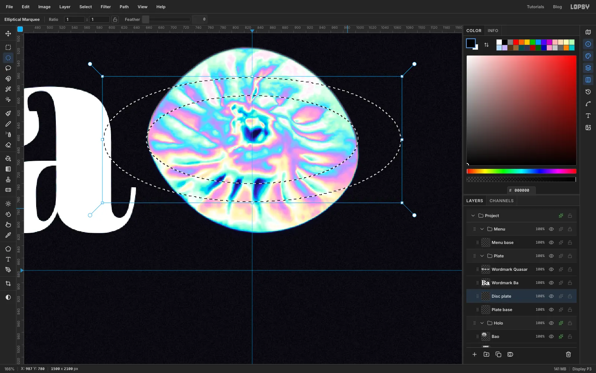

## Fade the tips and tilt the disc

Choose the **Gradient** tool with the type set to **Radial**, and click
**Advanced…**. Set three white stops at 0%, 72% and 100%. Select the last stop
and drag the **Opacity** bar to 0. The first two stay at full opacity. Click
**Done**.

Drag from the centre of the bun to the right tip of the ring, then
press [[Cmd+D]]. The disc now fades away at both ends, so it won't look like
Saturn's hard-edged rings.

Press [[M]], draw a marquee around the whole disc, press [[V]] and drag a rotation handle
about **7°** counter-clockwise. Press [[Cmd+D]] and press [[Cmd+0]] to fit the
page again.

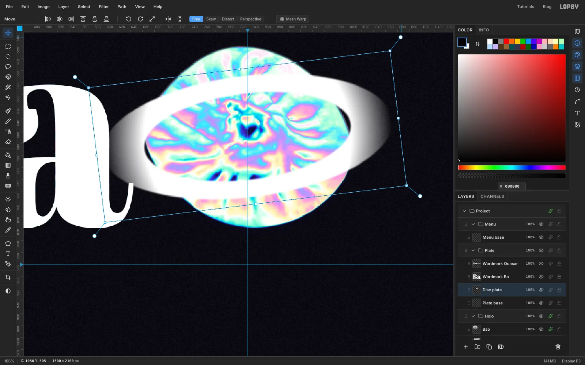

## Copy the foil through the disc

The disc should be cut from the same sheet as everything else. Hold [[Cmd]] and
click the **Disc plate** thumbnail. Click the **Foil Small** row and press
[[Cmd+C]]. Copy reads the layer's own pixels, not its mask, so you get the foil
in the shape of the disc. Press [[Cmd+V]]. The copy lands in place, above Foil
Small and under the bun. Rename it **Disc** and press [[Cmd+D]].

Run **Gaussian Blur** with **Radius 2** to calm the fine rays.

The left end of the disc runs into the "a", so let the letter win. Hold [[Cmd]]
and click the **Wordmark Ba** thumbnail, choose **Select → Grow** with a value
of **6**, click the **Disc** row and press [[Delete]]. Press [[Cmd+D]].

Hide **Plate** to check it.

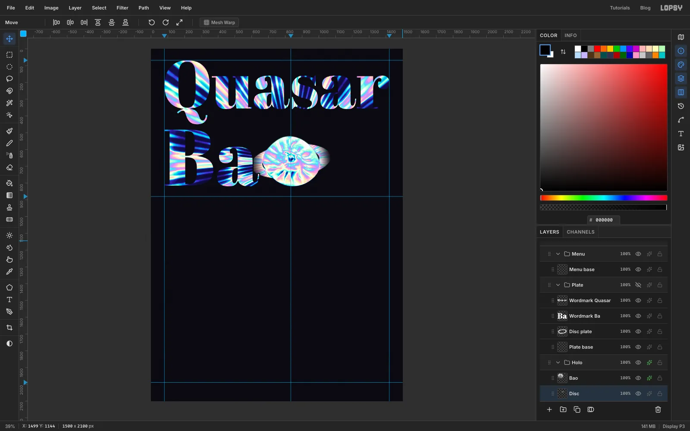

## Select the front of the disc

Now the near side of the disc has to cross in front of the bun, but only where
it overlaps. With **Plate** showing, hold [[Cmd]] and click the **Bao** thumbnail
to select the bun.

Press [[L]], hold [[Shift]] and [[Alt]] together, and draw around the lower half
of the bun, following the tilt of the disc along the top. Holding both keys
keeps only the overlap, so you end up with the bun's lower part.

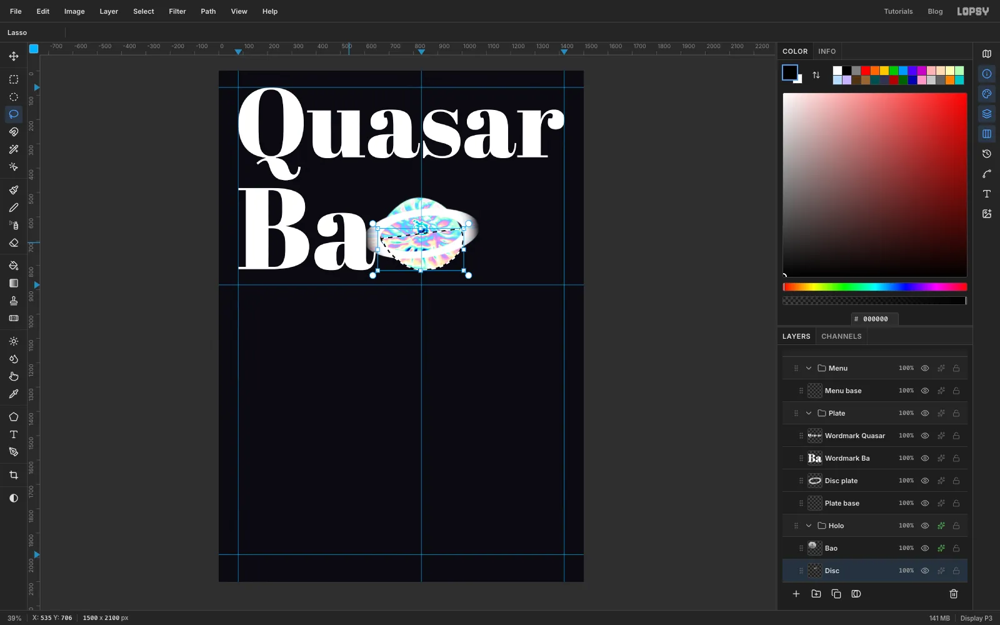

## Lay the front of the disc over the bun

Click the **Disc** row and press [[Cmd+C]]. Only the disc pixels inside your
selection get copied. Click the **Bao** row and press [[Cmd+V]], which places the
copy above the bun. Rename it **Disc Front** and press [[Cmd+D]].

Open its effects, tick **Drop Shadow** and set **Offset X 0**, **Offset Y 4**,
**Blur 8** and **Opacity 70**. Close the drawer. The band now wraps around the
bun, with no seam, because the full disc is still there behind it. Hide **Plate**
to check the wrap, then show it again.

## Draw the jets into the mask

Click the **Foil** row and then its **Mask** row. In a mask the **Brush** and
**Pencil** always hide, whatever the foreground colour, and the **Eraser** always
reveals. So press [[E]] for the Eraser and set **Size 3**.

Set **Opacity** to **55**. Click on the 833 guide at the very top of the page,
then hold [[Shift]] and click on the guide just under the title's baseline. The
jet stays dim across the word so that it doesn't read as a letter.

Set **Opacity** back to **100**. Click on the guide just below the bun, hold
[[Shift]] and click on the guide about **160 px** above the bottom of the page.
The lines are hard to see in this mode, so don't worry if they blend into the guide.

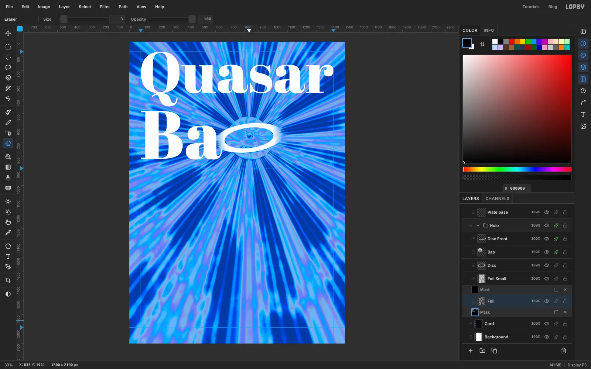

## Taper the jets

Thin lines don't look like energy, so give each jet a wedge at its base. Zoom in
above the bun. Set the foreground to white, and with the mask still active press
[[L]] and draw a long narrow wedge: about 16 px wide behind the bun, narrowing to a
point just inside the bottom of the title. Choose **Edit → Fill**.

Do the same below the bun, ending the wedge about 270 px under it. Press
[[Cmd+D]], press [[Cmd+0]] and click the **Foil** row to leave mask mode. Hide
**Plate** to see the result.

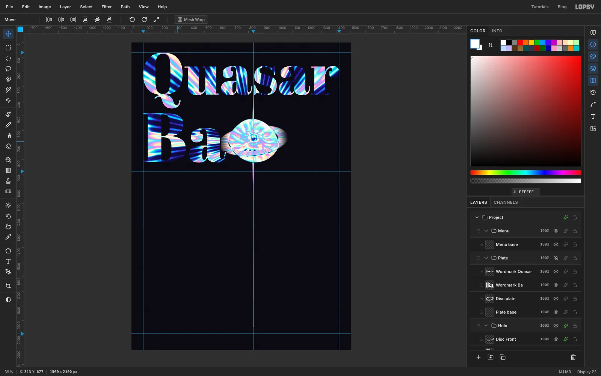

## Set the left column

The columns run from the left guide to **x = 797**, and from **x = 869** to the
right guide, which leaves the jet its gutter. Add guides at 797 and 869 if you'd
like them. Show **Plate** if it's hidden.

Headings and prices go on the plate in white. Click **Plate base** before each
one. Dish names and descriptions are normal type, so click **Menu base** before
each of those. Use these styles:

- Heading: Abril Fatface, **Size 84**, white, on the plate. Its top sits just below the 880 guide.
- Dish name: Krona One, **Size 29**, `#F3F0FF`.
- Description: Poppins Regular, **Size 23**, `#C8C4D8`, about 25 px under the name.
- Price: Space Mono **Bold**, **Size 30**, white, on the plate, with its right edge on the column edge and its baseline level with the name.

Start the first dish name about 1005 px down, and start each dish **116 px** below
the last. Type this into the left column under the heading **The Bao**:

- Event Horizon, 15. Black sesame bun, char siu pork, squid ink glaze.
- Red Shift, 14. Gochujang pork belly, pickled radish, crushed peanut.
- Supernova, 13. Molten salted egg custard that bursts at first bite.
- Dark Matter, 14. Braised shiitake, black garlic, truffle oil. Vegan.
- Cosmic Duck, 16. Five-spice duck, scallion, hoisin, orange zest.
- White Dwarf, 12. Small milk bun, condensed milk dip. Dense and bright.

Rename each price layer as you go, because you'll click through them shortly.
Krona One and Abril Fatface have one weight, so switching to them drops Bold back
to Regular, and you'll need to set Bold again for every price. If you go straight
from a price to a Poppins line, Bold stays on, so set it back to Regular.

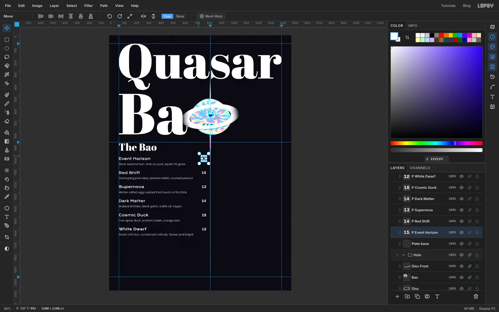

## Set the right column

Use the same styles from x = 869. Under **Small Orbits**, level with The Bao,
add three dishes on the same 116 px rows as the left column:

- Moon Rocks, 9. Smashed cucumber, chilli crisp, sesame.
- Solar Flare, 12. Salt and pepper squid, charred lime.
- Asteroid Belt, 8. Fried peanuts, lotus chips, five spice.

Put the heading **Liquid Light** with its top at about 1350. Start its first dish
level with Cosmic Duck in the left column, and continue at 116 px:

- Nebula, 7. Butterfly pea, jasmine, tonic.
- Aurora, 12. Yuzu, lychee, soju highball.
- Black Hole, 6. Iced Vietnamese coffee, condensed milk.

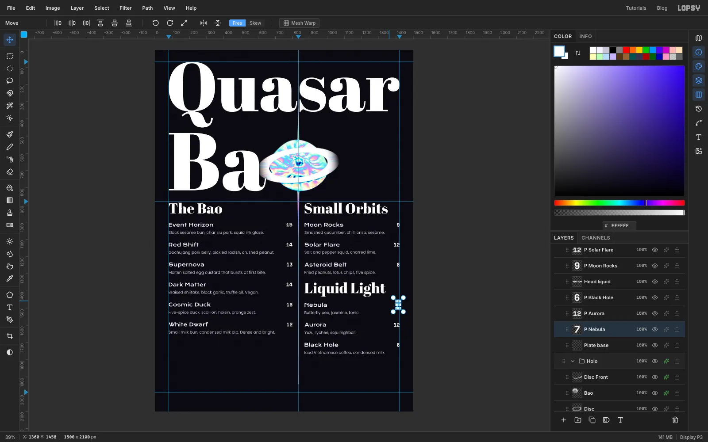

## Stamp the headings and prices

Click the **Foil Small** row and then its **Mask** row. Set the foreground to
white. For each heading and price, hold [[Cmd]] and click its thumbnail, then
choose **Edit → Fill**. It's repetitive, with fifteen layers to get through:
[[Cmd]]-click, Edit → Fill, next. Press [[Cmd+D]] when you're done.

While you're in this mask, add the rules. Press [[E]] for the Eraser with **Size
3** and **Opacity 100**. Click at one end of a rule, hold [[Shift]] and click the
other end. Draw one under each heading, about 20 px above the first dish, and one
across the page between the margins at about **y = 1990** for the footer.

Click the **Foil Small** row to leave the mask, then hide **Plate**.

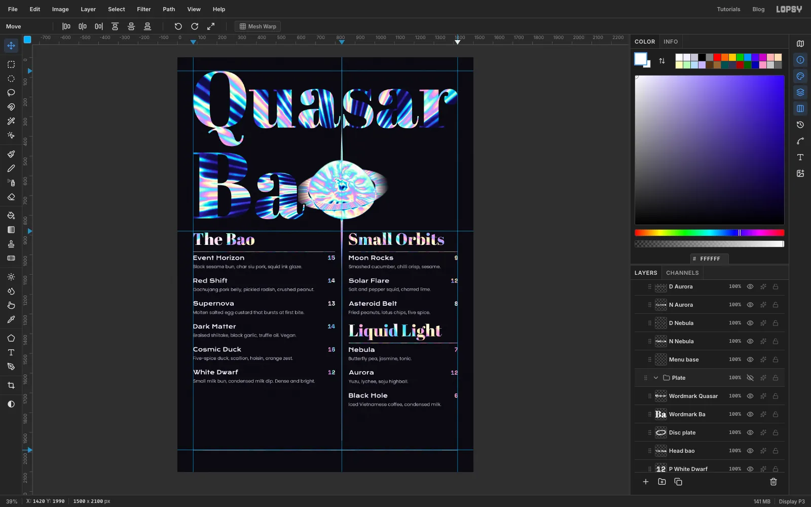

## Add dotted leaders

Left-column prices sit a long way from their names, and the eye needs a path.
Click **Menu base**, click **Add Layer** and name it **Leaders**. Set the
foreground to `#B9B5CC`. Press [[B]] for the Brush with **Size 3**. Click the
round brush preview at the left of the options bar, set **Spacing** to **200**,
then close the panel.

On each row, click just right of the dish name, about 2 px above the baseline,
then hold [[Shift]] and click just left of the price. Spacing stretches the line
into dots. When you've done every row, set **Spacing** down to **10** so it
doesn't catch you out later, and set this layer's opacity to **45%**.

## Rule the Full Orbit panel

The set menu deserves its own frame. It runs along the right column, from about
y = 1816 to y = 1966. Click the **Foil Small** row and then its **Mask** row.
You'll make a double rule by stacking four rectangles, each one inset from the
last. Press [[M]]. For each rectangle, press [[Cmd+D]], click once on the canvas
and type its corners into the dialog. Don't drag these, because the edges snap to
the guides.

1. From 869, 1816 to 1420, 1966: fill with white.
2. From 873, 1820 to 1416, 1962: fill with black.
3. From 878, 1825 to 1411, 1957: fill with white.
4. From 880, 1827 to 1409, 1955: fill with black.

Change the foreground before each **Edit → Fill**. Press [[Cmd+D]] and click the
**Foil Small** row to leave.

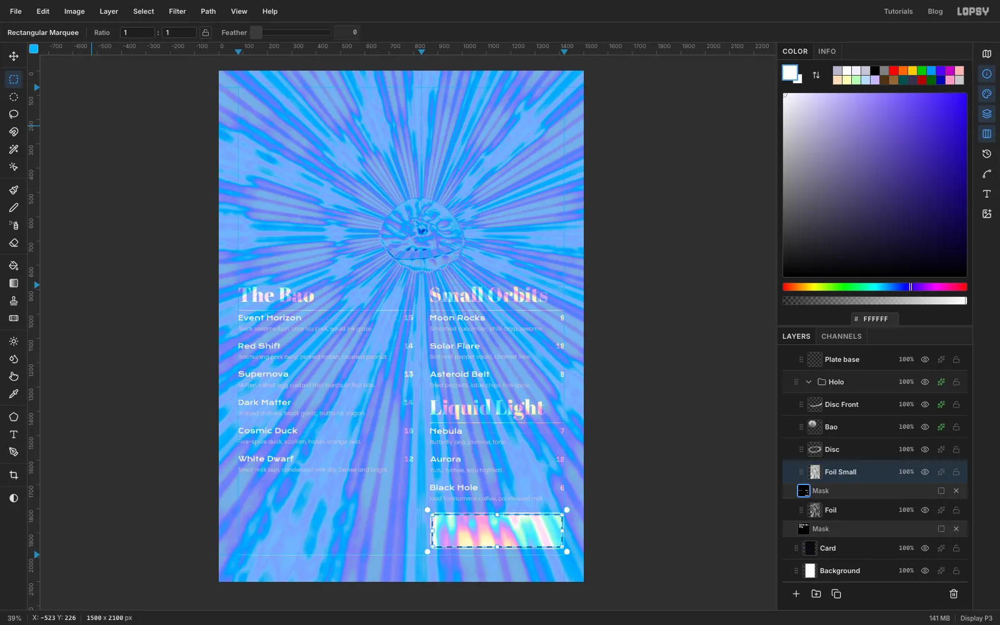

## Finish the small type

Show **Plate**. Add the remaining text the same way as the menu. Line height lives
in the **Text** panel (the T icon on the right edge), so set it after you press
[[Tab]], with the text layer still active.

- On **Menu base**, the panel text: **The Full Orbit** in Krona One 29 and `#F3F0FF`, and two lines of Poppins 23 in `#C8C4D8` reading *Four bao, two small orbits and a liquid light. Feeds two.* Leave about 25 px of space around the text inside the rule.
- On **Plate base**, the price **58** in Space Mono Bold 30, white, 30 px inside the panel's right edge, with its baseline level with The Full Orbit.
- On **Menu base**, the tagline in Krona One **Size 21**, `#F3F0FF`, with **Line height 1.45**: *STEAMED BUNS / FROM THE EDGE / OF THE OBSERVABLE / UNIVERSE* on four lines. Put its right edge on the right guide and its last baseline level with the bottom of **Ba**.
- On **Plate base**, the heading **Eighteen Pleats** in Abril Fatface **Size 58**, white, starting at x = 387 and about 1760 px down.
- On **Menu base**, under that heading, three lines of Poppins 23 in `#C8C4D8` at **Line height 1.45**: *Every bun is folded by hand, / steamed to order and served / two to a basket.*
- On **Plate base**, the footer in Krona One **Size 25**, white: *88 ORBIT LANE · OPEN FROM FIVE UNTIL THE LAST LIGHT · NO RESERVATIONS*, with three spaces either side of each dot. It should run from margin to margin just under the footer rule.

Stamp **58**, **Eighteen Pleats** and the footer into the **Foil Small** mask the
same way as the prices. Hide **Plate**.

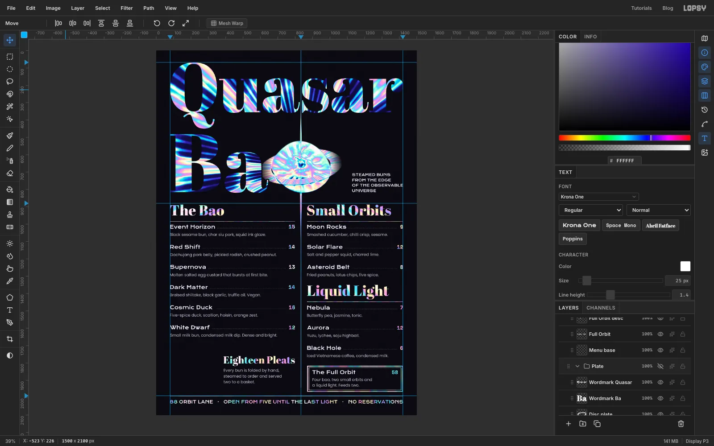

## Cut the rings of the seal

The empty corner at the bottom left is the place for a hologram seal, centred
around **x = 203**, **y = 1842**. It's made of nested circles in the **Foil Small**
mask. Show **Plate**, click **Foil Small**'s **Mask** row and choose the **Elliptical
Marquee**. For each circle, press [[Cmd+D]], click once on the canvas and type the
corners into the dialog, so the circles stay on one centre and don't snap to the
left guide:

1. From 80, 1719 to 326, 1965: fill with white.
2. From 86, 1725 to 320, 1959: fill with black.
3. From 91, 1730 to 315, 1954: fill with white.
4. From 147, 1786 to 259, 1898: fill with black.

That gives you a thin outer ring, a wide foil band and a black plate in the
middle. Press [[Cmd+D]] and click **Foil Small** to leave the mask.

## Stamp the monogram

Click **Plate base**. Make a text layer reading **QB** in
Abril Fatface **Size 60**, in white, somewhere empty. Press [[V]] and move it to
the middle of the black plate. Centre the two capitals by eye, since the tail of
the Q hangs below them.

Click the **Foil Small** Mask row, hold [[Cmd]] and click the **QB** thumbnail, and
choose **Edit → Fill** with the foreground still white. Press [[Cmd+D]] and click the
**Foil Small** row to leave the mask.

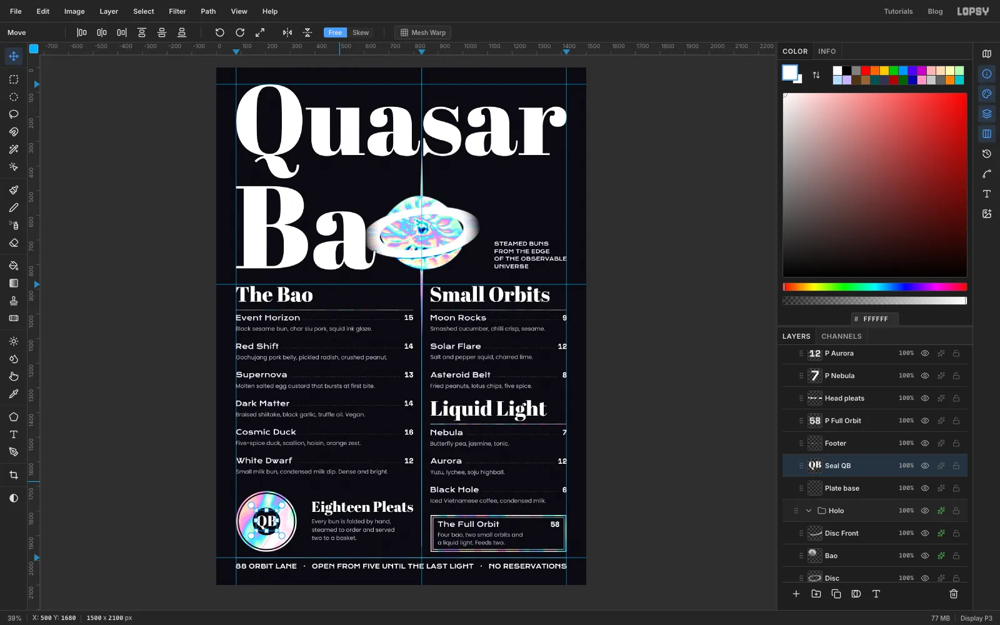

## Ink the pleats around the seal

Now print on top of the foil, the way a seal is overprinted in black ink. Click
**Menu base**, add a layer called **Seal Ink** and set the foreground to
`#0B0A10`. Press [[B]] for the Brush with **Size 3**.

In the options bar, click **Radial Symmetry** and set **Segments** to **24**. Hold
[[Cmd]] and click the centre of the seal to set the symmetry centre. Zoom in, then
draw one small curved stroke like a crescent in the foil band, leaving room
outside it for the rim text. It repeats around the circle. Twenty-four reads better
than eighteen at this size, and no one's counting.

Click **Radial Symmetry** again to turn it off, since it hijacks every
[[Cmd]]-click while it's on. Stay zoomed in for the next step.

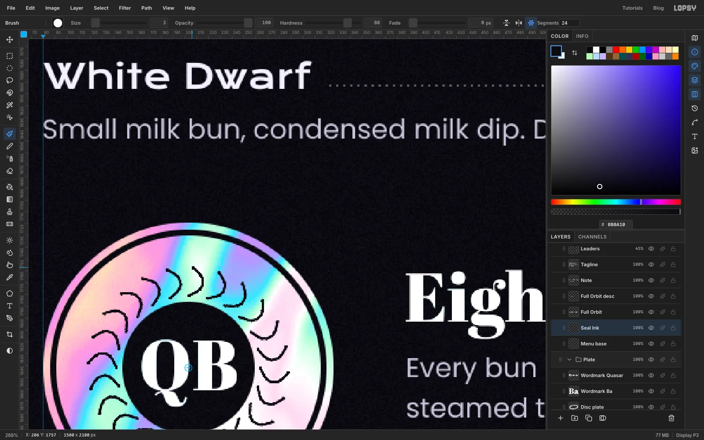

## Run the text around the rim

Press [[P]] for the Pen tool. Draw a circle in the band, outside the crescents,
with a radius of about **92 px**. Press at the left point and drag straight up.
Press at the top and drag right, at the right and drag down, and at the bottom
and drag left. Drag each handle about 50 px, a little over half the radius. Then
click the first point to close it, and press [[Cmd+0]].

Click **Seal Ink**, press [[T]] and set Krona One **Size 16** in `#0B0A10`. Click
in an empty area and type *GENUINE STEAM · EIGHTEEN PLEATS · HAND FOLDED ·* with
one space at the end, then press [[Tab]]. You won't see the text, because the ink
matches the card. With the Text tool still active, choose your circle in the **Path**
dropdown in the options bar, and it appears on the foil, wrapped around the ring
and almost closing it. Change the size by a pixel if yours leaves a bigger gap. Hide
**Plate** when you're done.

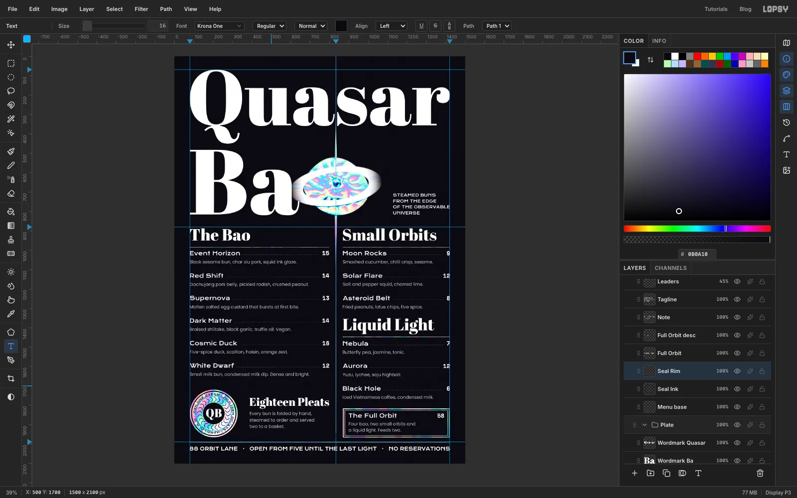

## Add a sparkle and copy it down the jet

Click **Disc Front**, press [[V]] and click **Add Layer**. Name it **Sparkles**,
so it stays in the Holo group and gets the foil colours.

Zoom in and lasso a four-point star about **64 px** across in the empty space right
of the bun, with concave sides. Choose the **Gradient** tool in **Linear** mode and
click **Advanced…**. Set four grey stops: `#F0F0F0`, `#8E8E8E`, `#E0E0E0` and
`#7E7E7E`. The opacity from the disc's gradient carries over, so set every stop's
opacity back to 100%. Click **Done**, drag across the star from corner to corner and
press [[Cmd+D]], then [[Cmd+0]].

Press [[M]], draw a marquee around the star, press [[Cmd+C]] and [[Cmd+V]], then drag
the copy to the end of the lower jet. Press [[Cmd+D]], press [[M]], draw a marquee
around it, press [[V]]
and hold [[Cmd]] while you drag a corner handle to scale it down to about **48 px**.
Press [[Cmd+D]], nudge it so the jet ends inside it, then choose **Layer → Merge
Down**.

Add a few soft stars around the bun. Set the foreground to `#F0F0F0`, then press [[B]]
for the **Brush** at **Hardness 0** and **Size** between 6 and 9, and click five or so times. Keep them sparse.

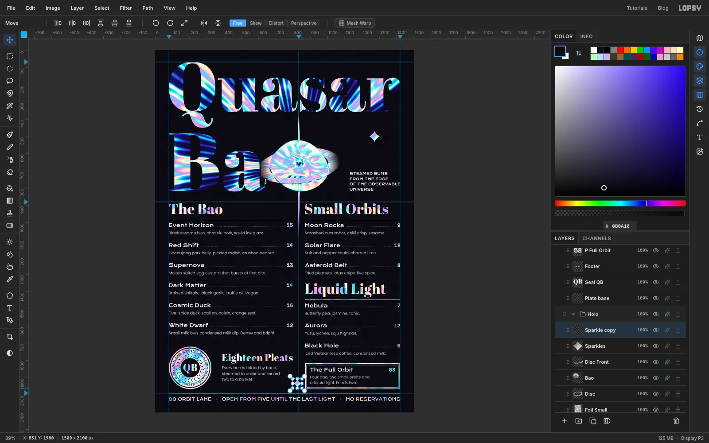

## Give the foil an edge and export

Foil stamped into card has a bright edge where it catches the light. That edge
also holds the shape of each letter where the foil goes dark.

Click **Foil**, open its effects and tick **Inner Glow** with **Size 5** and
**Opacity 55**. Click **Foil Small** and tick **Inner Glow** with **Size 3** and
**Opacity 55**. Layer effects follow the mask, so every letter gets its own rim.
Close the drawer.

Make sure the **Plate** group is hidden, and press [[Cmd+;]] to hide the guides
if you want a clean look. Choose **File → Save Project** to keep the layers, then
**File → Quick Export PNG** for the finished menu.

To try other colours, open the Holo group's Gradient Map and move a stop. The
title, bun, disc, seal and footer all change together, because they all pass through
one Gradient Map.

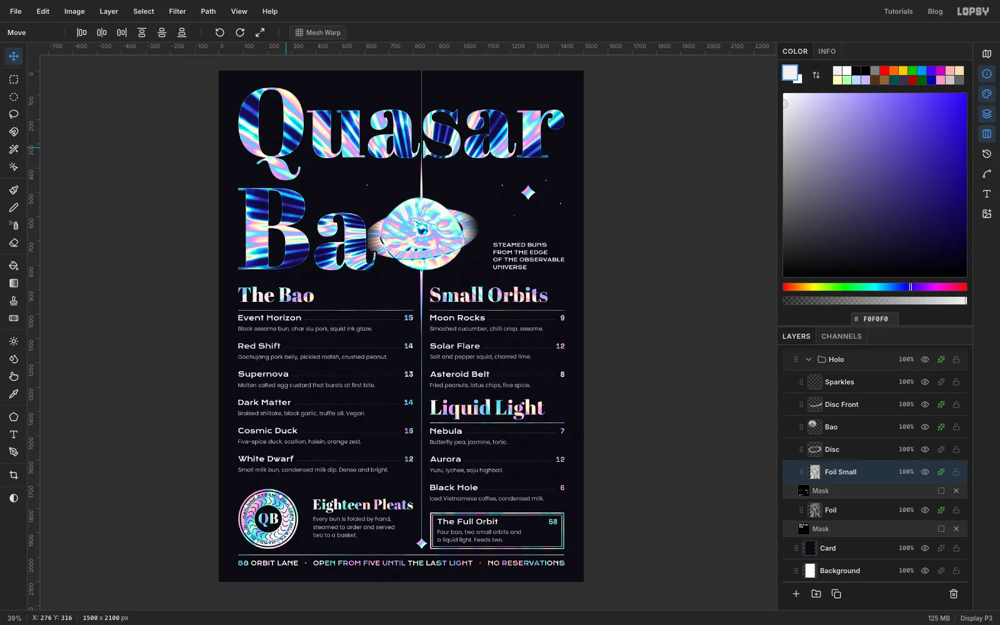
