Holographic prints look like they're made of light. Hold an old CD under a lamp and its silver face splits into wedges of rainbow, because the tiny data tracks diffract the light. Holographic heat-transfer vinyl does the same with flakes of foil. On a black t-shirt, pastel spectrum colours and hard white glints glow like they're lit from inside.

In this tutorial you'll design **YO-YO ORBIT**, a 1800 × 2160 print for a black tee and an imaginary yo-yo club. A chrome yo-yo with a CD-style diffraction face floats in the middle like a planet. Its rainbow string loops round it as a tilted orbit, two mini yo-yos ride that orbit, and the string climbs up to tie onto the hyphen of the title.

You'll build:

- **The diffraction face:** a silver radial gradient, a fan of spectrum wedges made with **Filter → Sunburst**, and fine diffraction lines from a 120-ray Sunburst on Soft Light.
- **A three-quarter yo-yo:** you'll **Copy Merged** the flat face, squash it on the Move handles and build a chrome band, a dark string slit and a back half behind it.
- **The orbit:** an unfilled ellipse from the **Shape** tool, tilted 15° on the rotation handle and tucked behind the yo-yo with a **layer mask**.
- **Sparkle:** comet tails, a crystal-chip brush tip made with **Define Brush** and sprayed with the **Spray** tool, **Bloom**, and four-point glints.
- **Type:** YO-YO in a holographic foil with cyan and magenta print offsets, and ORBIT in 80s chrome with a hard horizon line. Both are set in **Unbounded** Black, with the tagline in **Space Mono** Bold.

The palette is pastel light on dark ink:

- Shirt colour `#0E0D16` (the fabric, not printed)
- Halo `#9C7BFF` → `#5B3BC8`
- Silver face `#D7DCE6` → `#8E95A8` → `#434859`
- Spectrum `#FF4FD8` / `#FFE14F` / `#4FFFA8` / `#4FC8FF` / `#9B6BFF`
- Chrome `#F2F4F8` / `#9A9EAC` / `#2A2A33`
- String `#FF5FD2` → `#FFB86B` → `#FFF27A` → `#7DFFB2` → `#6FD8FF` → `#A78BFF`
- Foil `#FF6FD8` / `#FFE08A` / `#7FE8FF` / `#8CFFC4` / `#B497FF`
- Print offsets `#00E5FF` / `#FF2BD6`, foil bands `#FF2BD6` / `#00E5FF` / `#FFF04A`
- Glitter and tails `#FF8FE6` / `#7FF6FF` / `#FFF27A` / `#B7A0FF`
- String tail `#FF8FA6` → `#FFE08A` → `#C8F5A0`
- ORBIT chrome `#1E4FD8` → `#BFE8FF`, horizon `#1A1033`, floor `#6A3FA0` → `#FF8FD0` → `#FFE3F3`
- Extrusion `#3A2A7A`, tagline `#E6DCFF`

> **Tip:** Positions are in document pixels, written `x, y`. The status bar at the bottom shows where the pointer is. "Fill" means **Edit → Fill**, which fills the selection with the foreground colour, and [[Cmd+D]] deselects.

> **Tip:** When a step says "on a new layer called `Name`", click **Add Layer** at the bottom of the Layers panel and double-click the new layer's name to rename it. New layers land just above the selected one. Effects and the **Blend** dropdown live in the drawer behind the sparkle icon on each layer's row. To change a layer's opacity, click the `100%` readout on its row.

> **Tip:** Every gradient here is set up in the Gradient tool's **Advanced…** editor. Click the bar to add a stop, then type its colour into the **Hex** field. Percentages are stop positions along the bar.

## Fill the shirt and drop two guides

Create an **1800 × 2160** document. That's a 5 : 6 print area, the usual shape for a tee front. Select **Background**, set the foreground to the shirt colour `#0E0D16` and fill. This is the shirt colour: in the real print it would be bare fabric.

Click the top ruler at **900** to drop a vertical guide down the middle. Click the left ruler at **1015** to drop a horizontal guide. The yo-yo's axle sits where they cross, a little above the centre, which leaves room for the title underneath.

## Sprinkle star dust

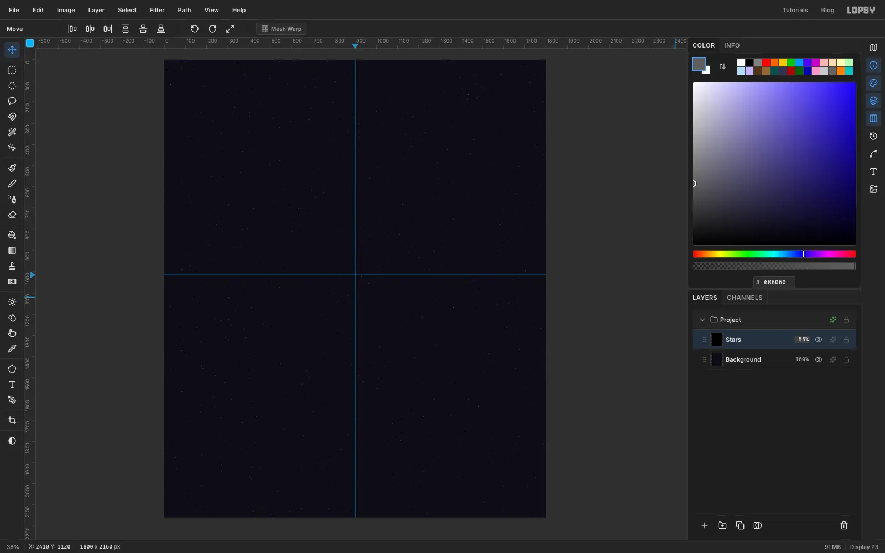

Rename **Layer 1** to `Stars`. Fill it with a mid-dark grey `#606060`, then choose **Filter → Add Noise…** with **Amount 100**, **Mode Mono** and **Distribution Gaussian**.

Now choose **Filter → Threshold…** at **150**. Gaussian noise only reaches that bright in a few thousand pixels, so you get a sparse field of white specks on black. Set the layer's **Blend** to **Screen** and its opacity to **55%**, so the black disappears and the stars stay faint.

## Add a lilac halo

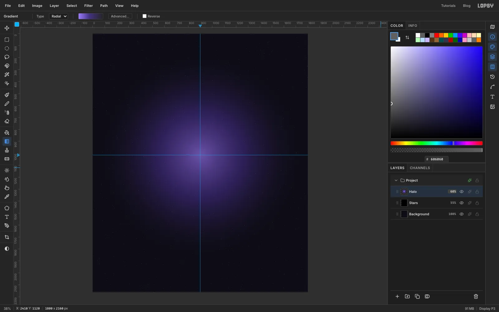

On a new layer called `Halo`, set up a **Radial** gradient: `#9C7BFF` at 0%, `#5B3BC8` at 45% with its opacity dropped to about 55%, and `#1A1030` at 100% with opacity 0. Drag from the guide crossing about 820 px to the right.

Set the layer to **Screen** at **60%**. This is the yo-yo's glow. It's soft enough that it won't print as a hard-edged blob.

## Draw the silver face

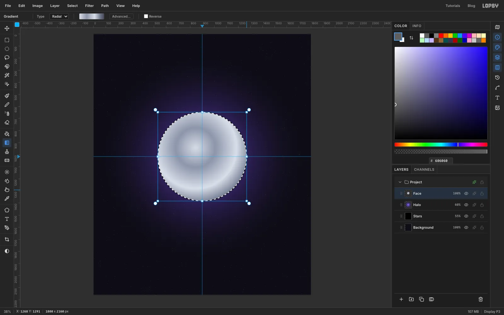

On a new layer called `Face`, draw a circle with the **Elliptical Marquee**. Start at `532, 647` and drag to `1268, 1383` for a 736 px circle centred on the guides. The marquee snaps to the guides, which helps.

Fill it with a **Radial** gradient in five silver stops: `#D7DCE6`, `#8E95A8` at 30%, `#D9DEE8` at 62%, `#6E7589` at 86% and `#434859` at 100%. Drag from just up and left of the centre down to the lower-right edge of the circle. The off-centre start makes the light look like it comes from the top left.

## Fan out the spectrum with Sunburst

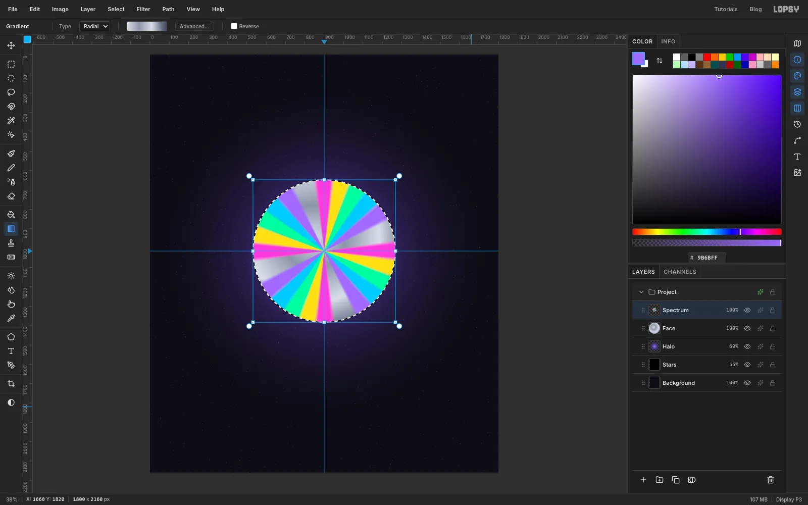

On a new layer called `Spectrum`, [[Cmd]]-click the `Face` thumbnail to load the disc as a selection. **Filter → Sunburst…** paints rays in the foreground colour, so you'll run it five times with a different colour and rotation each time.

Use **Rays 4**, **Length 60**, **Width 16**, **Taper 0**, **Softness 30** and **Center X 50 / Center Y 47** (the guide crossing) for every pass. Then:

1. Foreground `#FF4FD8`, **Rotation 0**.
2. `#FFE14F`, **Rotation 14**.
3. `#4FFFA8`, **Rotation 28**.
4. `#4FC8FF`, **Rotation 42**.
5. `#9B6BFF`, **Rotation 56**.

Each pass lays four wedges a quarter-turn apart, so you get four rainbow fans with a gap of silver between them, the way a CD catches light.

## Blur the spectrum into the silver

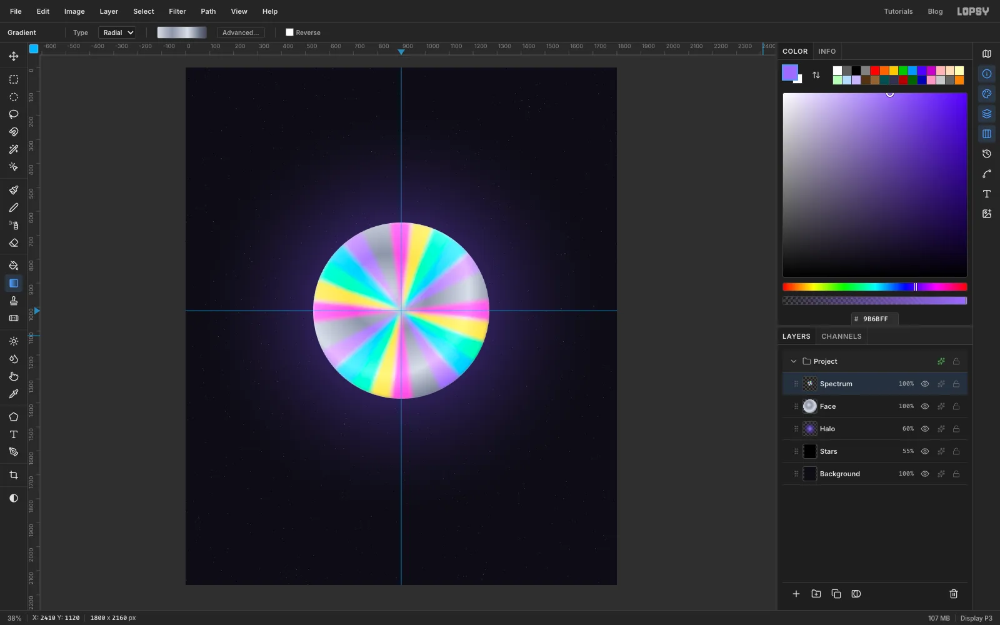

With the selection still active, run **Filter → Gaussian Blur…** at **22** to melt the wedge edges. Then **Filter → Hue/Saturation…** with **Saturation +10**.

Deselect and set the layer to **Hard Light**. Hard Light lets the silver's light and dark rings show through the colour, so the fans pick up the face's bands instead of sitting on top like paint.

## Cut a ring for the rim

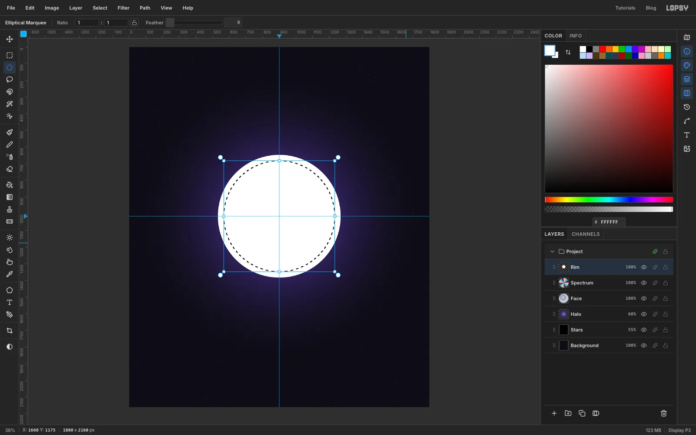

On a new layer called `Rim`, draw the same 736 px circle and fill it with white. Choose **Select → Shrink…** by **35**. You now have a selection 35 px inside the edge. Press [[Delete]], and only a 35 px ring is left.

## Chrome the rim

Deselect, then [[Cmd]]-click the `Rim` thumbnail to select the ring. Fill it with a **Linear** gradient in hard chrome bands: `#FFFFFF`, `#7C8296` at 20%, `#F4F6FB` at 40%, `#3C4153` at 60%, `#DCE0EA` at 80% and `#6A7084` at 100%. Drag from top left to bottom right, across the disc.

Deselect and open the layer's effects. Add an **Outer Glow** in `#7FF6FF` (Size 40, Opacity 25%) and an **Inner Glow** in white (Size 8, Opacity 70%). The inner glow puts a polished bevel on the ring.

## Etch fine diffraction lines

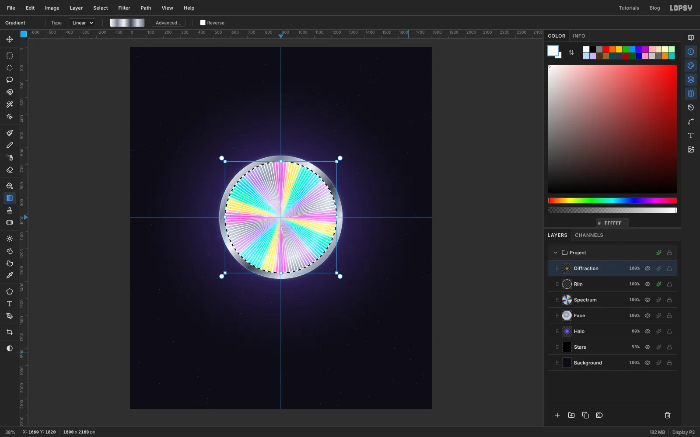

Real holographic foil has a fine line texture. On a new layer called `Diffraction`, [[Cmd]]-click the `Face` thumbnail, then **Select → Shrink…** by **35** so the lines stop at the rim.

Set the foreground to white and run **Sunburst** again with **Rays 120**, **Length 40**, **Width 28**, **Softness 20** and the same centre. Deselect, then set the layer to **Soft Light** at **35%**. The lines are now just a sheen.

> **Tip:** To see what the lines add, click the `Diffraction` layer's eye icon off and on.

## Build the chrome hub cap

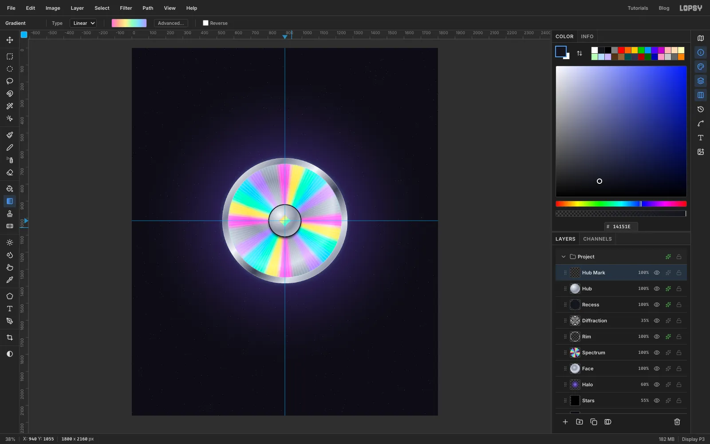

1. **Recess.** On a new layer called `Recess`, draw a 194 px circle from `803, 918` to `997, 1112` and fill it with `#14151E`. Add an **Inner Glow** in black (Size 24, Opacity 85%) so it looks sunk into the face.
2. **Cap.** On a new layer called `Hub`, draw a 184 px circle from `808, 923` to `992, 1107`. Fill it with a **Radial** gradient, `#F4F6FA` to `#8A90A0` at 55% to `#E0E4EC`, dragged from a little up and left of the centre to the lower-right edge. Add a **Stroke** of **3** in `#2A2A3A` and a **Drop Shadow** (Offset 0 / 10, Blur 18, Opacity 65%, black).
3. **Mark.** On a new layer called `Hub Mark`, zoom in to 200% and use the **Lasso** to draw a small four-point star with pinched sides, about 80 px across, in the middle of the cap. Fill it with a **Linear** gradient running `#FF6FD8`, `#FFB38A`, `#FFF38A`, `#8CFFC4`, `#7FD8FF` and `#B497FF`, dragged from the star's top-left to its bottom-right.

## Add one curved highlight

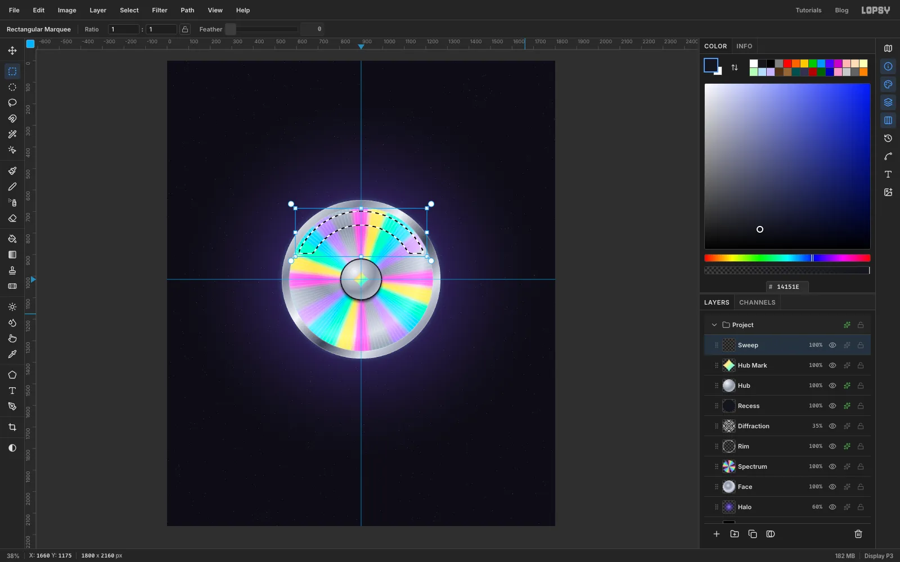

A specular highlight should follow the face's curve. On a new layer called `Sweep`:

1. Draw a 632 px circle from `584, 699` to `1216, 1331` with the **Elliptical Marquee**.
2. Hold [[Alt]] and drag a 504 px circle from `648, 763` to `1152, 1267`. This subtracts it and leaves a ring.
3. Switch to the **Rectangular Marquee**, hold [[Shift+Alt]] and drag a rectangle from `570, 685` down to `1230, 895`, about 120 px above the centre. That intersects it, so only the top arc of the ring is left.
4. **Select → Feather…** by **14**.

Fill with white, deselect, and set the layer to **Screen** at **55%**.

## Copy Merged the face

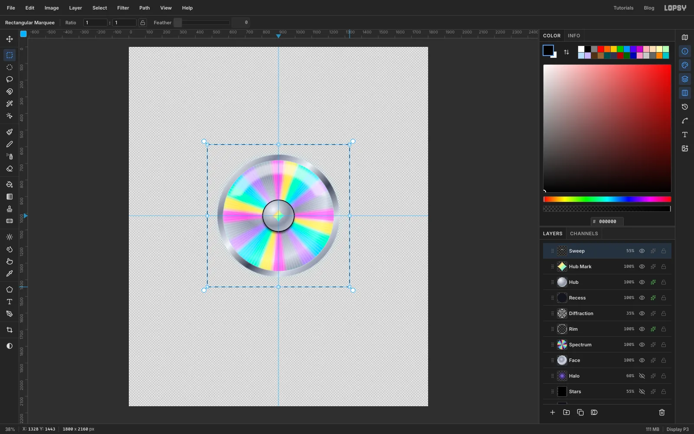

You've built the face from eight layers. Now you'll turn them into one flat layer you can transform.

Hide `Stars`, `Halo` and `Background` with their eye icons, so only the face is visible. Select `Sweep` and drag a **Rectangular Marquee** 856 px square around the face, from `472, 587` to `1328, 1443`. Choose **Edit → Copy Merged**, then **Edit → Paste**. The pasted layer lands in place. Rename it `Yo-yo Front`.

Show `Stars`, `Halo` and `Background` again, and hide the eight face layers (`Face` up to `Sweep`). Keep them in case you want to change the face later.

## Squash it to a three-quarter view

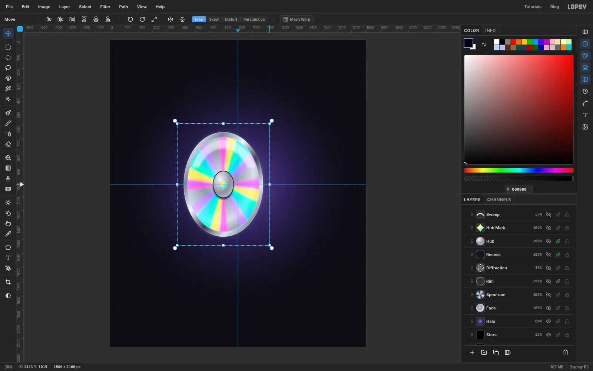

Draw the same 856 px square marquee around `Yo-yo Front` and switch to the **Move** tool. Drag the handle in the middle of the right edge about **200 px** to the left. That makes the face about three-quarters of its width, as if it had turned away from you a little.

Press [[Cmd+D]] to commit. Scaling pins the left edge, so the oval is now about 100 px left of the guide. Drag it about 100 px right, until the face's left edge sits at x 620 and its centre is back on the vertical guide.

## Add the back half and the string slit

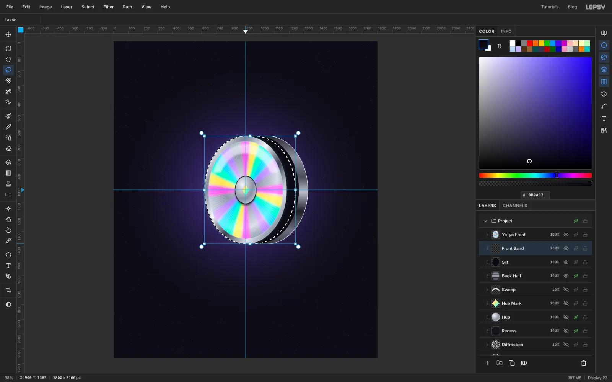

A yo-yo is two halves with a gap between them for the string. You'll build them behind the face. The oval face is 560 px wide and 736 px tall. Each new piece is that same oval, slid to the right.

1. **Back half.** Select the hidden `Sweep` layer so the next new layer goes under the face. On a new layer called `Back Half`, use the **Elliptical Marquee** to drag the oval slid **84 px** right, from `704, 647` to `1264, 1383`. Hold [[Shift]] and add the oval slid **144 px** right, from `764, 647` to `1324, 1383`. Then [[Shift]]-drag a **Rectangular Marquee** from `984, 647` to `1044, 1383` to fill the gap between the two ovals. Fill it with a **Linear** gradient dragged from top to bottom in dark chrome bands: `#26262E`, `#8E92A0` at 20%, `#4A4D58` at 38%, `#B9BCC8` at 52%, `#1E1E26` at 70%, `#6E7280` at 88% and `#34363F`. Add a **Stroke** of **3** in `#E8ECF5` for a crisp rim.
2. **Slit.** On a new layer called `Slit`, drag a single elliptical marquee from `704, 647` to `1264, 1383` (the oval slid **84 px** right) and fill it with `#0B0A12`. Only a thin black crescent will show: the gap between the two halves.
3. **Front band.** On a new layer called `Front Band`, build the band the same way: the face's own oval (`620, 647` to `1180, 1383`), plus the oval slid **60 px** right (`680, 647` to `1240, 1383`), plus a rectangle from `900, 647` to `960, 1383`.

## Chrome the front band

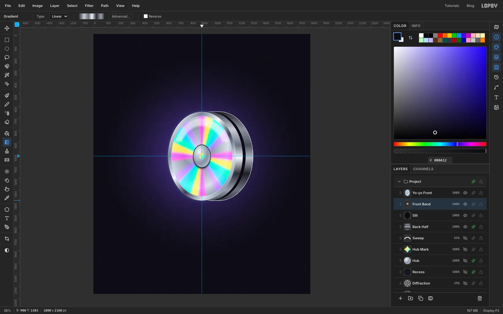

Fill the `Front Band` selection with a top-to-bottom **Linear** gradient in brighter chrome bands: `#3A3A44`, `#C9CCD6` at 20%, `#6A6E7C` at 38%, `#F2F4F8` at 52%, `#2A2A33` at 70%, `#9A9EAC` at 88% and `#4A4D58`.

Deselect. Reading left to right, you now have the face, the front band, the slit and the back half's rim. It reads as a solid yo-yo, not a coin.

## Draw the string orbit

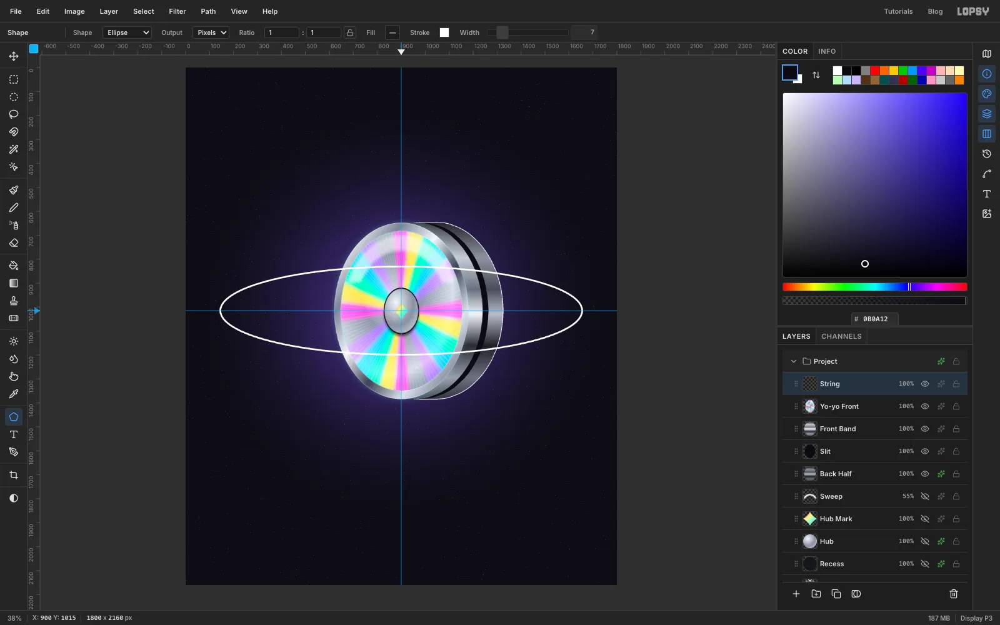

Select `Yo-yo Front` and add a new layer called `String` above it. Choose the **Shape** tool (**U**), set **Shape** to **Ellipse** and **Output** to **Pixels**, remove the fill, and set the **Stroke** to white with **Width 7**.

Click once on the guide crossing without dragging. The **Shape Size** dialog opens. Type **1510** × **368** and press [[Enter]]. That's about twice the yo-yo's width and half its height, so the orbit swings well clear of it.

## Tilt the orbit 15°

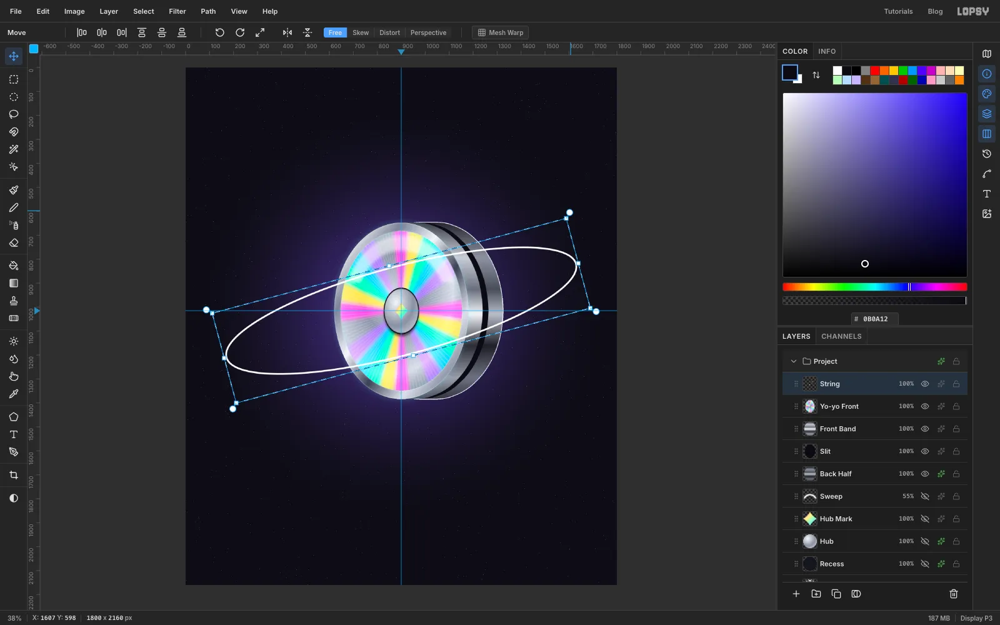

Draw a **Rectangular Marquee** just around the ellipse and switch to the **Move** tool. Hold [[Cmd]] and drag the rotation handle just outside the top-right corner upward. [[Cmd]] snaps the angle to 15° steps, so stop at **−15°**: the right end rises and the left end drops.

Press [[Cmd+D]] to commit.

## Make the string holographic

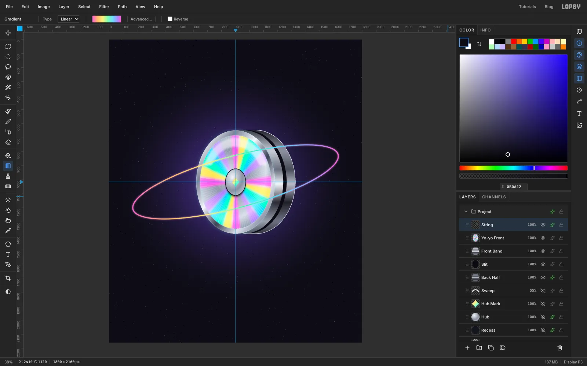

[[Cmd]]-click the `String` thumbnail. Set up a **Linear** gradient with seven stops: `#FF5FD2`, `#FFB86B` at 18%, `#FFF27A` at 36%, `#7DFFB2` at 54%, `#6FD8FF` at 72%, `#A78BFF` at 88% and `#FF5FD2` again at 100%. Drag it from the ring's left tip to its right tip.

Deselect and add an **Outer Glow** in `#FF9EF0` (Size 16, Opacity 70%).

## Tuck the back of the orbit behind the yo-yo

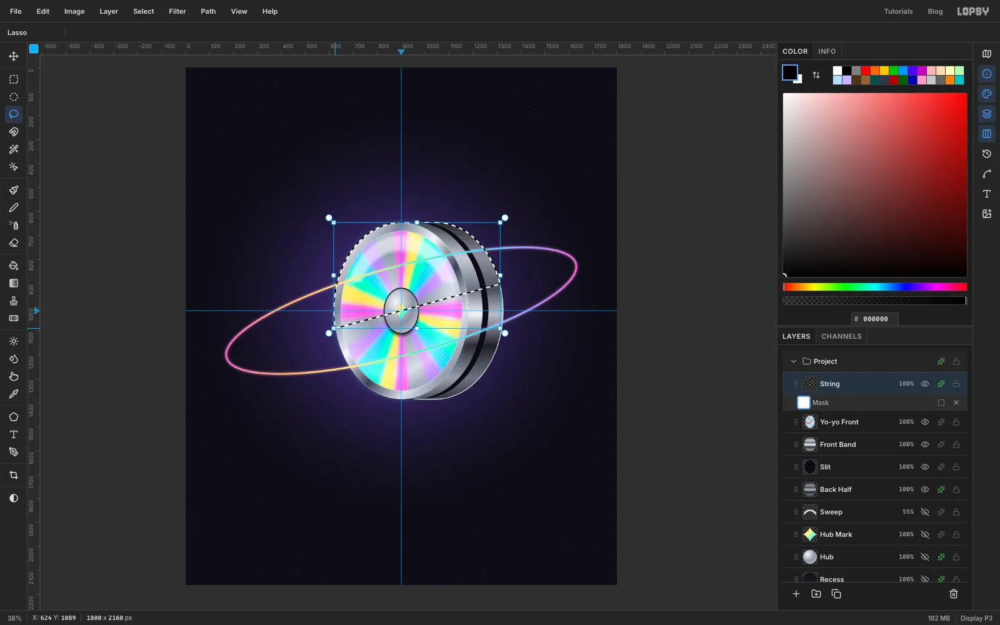

Right now the whole ring crosses in front of the yo-yo. The far half of the orbit should pass behind it.

With `String` selected, click **Add Mask** at the bottom of the Layers panel, then click the mask thumbnail (**Edit mask for String**). Set the foreground to black `#000000`. With the **Lasso**, draw round everything above the ring's tilted centre line. Start on the face's left edge, where the top arc of the ring meets it, and loop well above the yo-yo. Come down the back half's right rim to where the arc comes out, then cut back through the axle on a line tilted 15° like the ring. Only the two crossing points need care, because everything else inside the loop is empty on this layer. Fill and deselect.

The top arc of the ring now disappears behind the yo-yo and comes out past the back half's rim, while the bottom arc stays in front. Click the `String` layer's name to leave mask editing.

## Draw a comet tail on the orbit

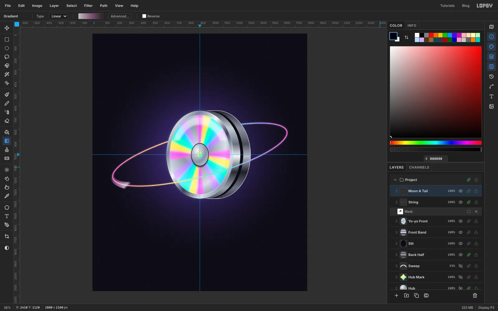

Select `String` and add a new layer called `Moon A Tail`. With the **Lasso**, draw a thin crescent that follows the orbit near its lower-left end. Make it about 72 px wide where the mini yo-yo will sit, at about `292, 1273`, and taper it to a point as it curves up round the ring's left tip.

Fill it with a **Linear** gradient from white at 70% opacity, through `#FF8FE6` at 45% opacity, to `#FF8FE6` at 0%, dragged from the wide end to the point. Deselect, run **Filter → Motion Blur…** with **Angle 48** (the direction of the tail) and **Distance 20**, and set the layer to **Screen**.

## Copy, paste and shrink a mini yo-yo

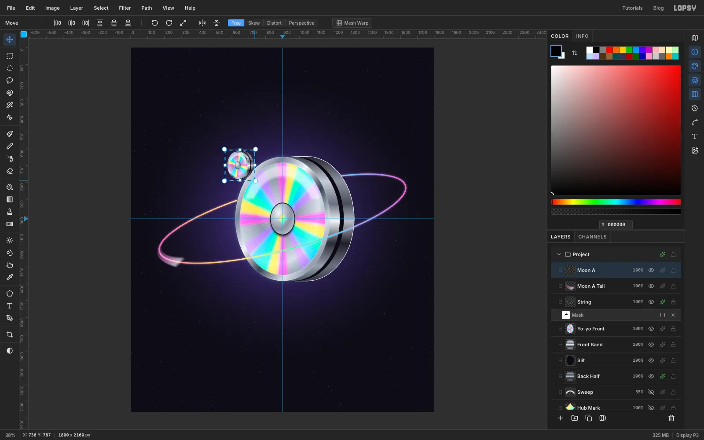

Hide `String`, `Moon A Tail`, `Stars`, `Halo` and `Background` so only the yo-yo is visible. Select `Yo-yo Front`, drag a marquee from `560, 607` to `1360, 1423` around the whole yo-yo and choose **Edit → Copy Merged**. Deselect and show those five layers again.

Select `Moon A Tail` and choose **Edit → Paste**. The copy lands in place on top of the original, just above the tail layer. Rename it `Moon A`.

Draw the same 800 × 816 marquee around it, switch to the **Move** tool, hold [[Cmd]] and drag the bottom-right corner handle up and to the left to about `736, 787`, so the box is about 176 px wide (22%). Press [[Cmd+D]], then drag the little yo-yo down onto the orbit at the head of its comet tail.

## Send a second mini yo-yo round the back

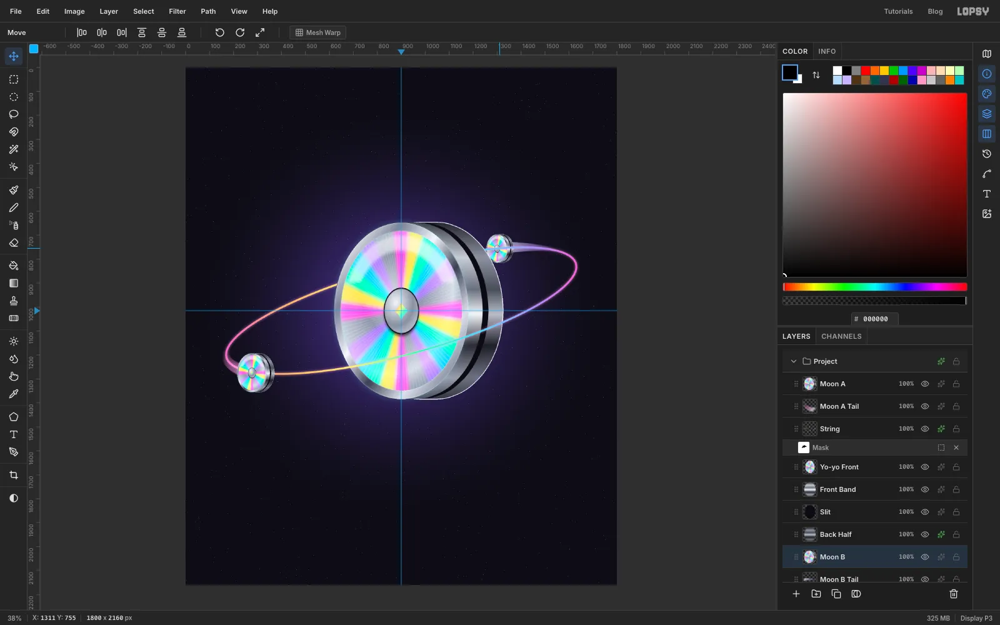

Select the hidden `Sweep` layer so the next layers sit behind the yo-yo. Add a layer called `Moon B Tail` and draw a second comet tail along the back of the orbit at the upper right. Start it at about `1311, 755`, where the second mini yo-yo will sit, and taper it to a point at about `1570, 770`, towards the ring's right tip. Use lilac `#B7A0FF` this time, with **Screen** and the same Motion Blur but at **Angle 4**, because this tail is nearly flat.

Paste again (it lands above `Moon B Tail`), rename it `Moon B`, and shrink it with the same [[Cmd]] corner drag to about `688, 738`, so the box is about 128 px wide (16%). Drag it onto the head of the lilac tail. Because it's below the yo-yo layers in the stack, it's on the far side of the orbit.

## Make a crystal-chip brush tip

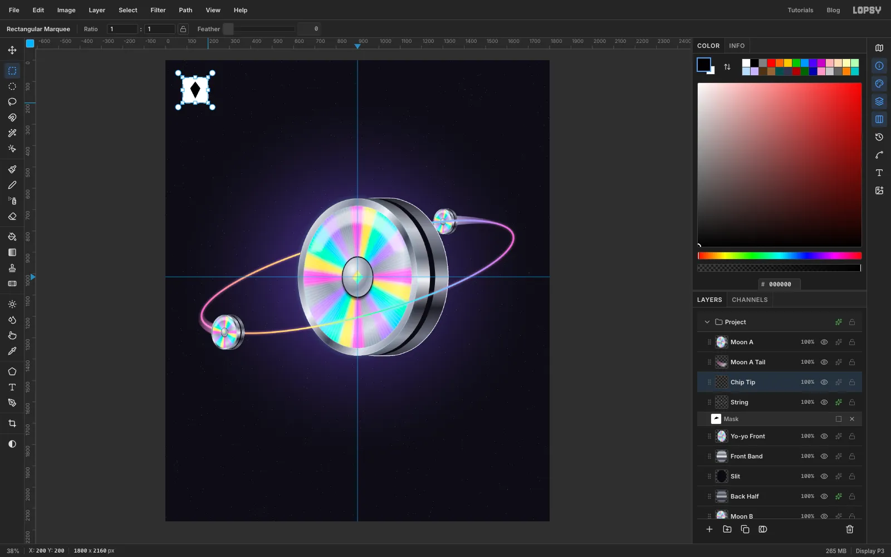

Holographic vinyl glitter is made of flat, angular chips, not round dots. You'll make that shape into a brush.

Select `String` and add a new layer called `Chip Tip`. Zoom in on the empty top-left corner, drag a 120 px square marquee from `80, 80` to `200, 200` and fill it with white. Lasso a tall diamond in the middle, about 48 × 80 px, and fill it with black. Brush tips are made from the dark pixels.

Drag the 120 px square marquee again and choose **Edit → Define Brush…**. Name it `Crystal Chip`. It becomes the active brush tip. Deselect and delete the `Chip Tip` layer.

## Spray crystal glitter along the orbit

Select `String` and add a new layer called `Glitter`. Pick the **Spray** tool (**J**) and set **Size 150**, **Density 10**, **Opacity 100** and **Softness 0**. The Spray tool uses the Brush's active tip, so every dot is a little crystal chip.

Make five passes along the front (lower) arc of the orbit, changing the foreground colour each time:

1. White `#FFFFFF` along the whole front arc.
2. Pink `#FF8FE6` along the right half, a little outside the string.
3. Cyan `#7FF6FF` along the left half, a little inside the string.
4. Yellow `#FFF27A` through the middle.
5. Lilac `#B7A0FF` round the left tip.

## Thin the clump and make it shine

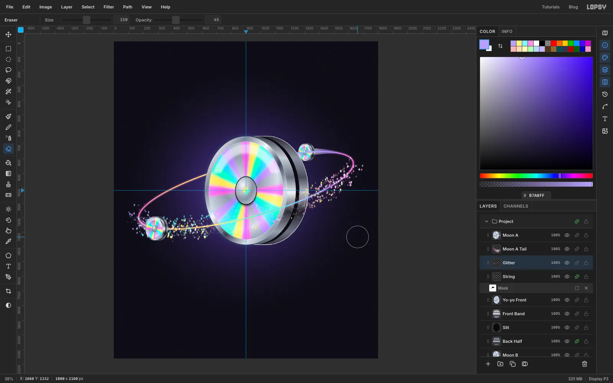

Where the orbit crosses the yo-yo face, the glitter turns into noise. Pick the **Eraser** (**E**) at **Size 150** and **Opacity 45**, and make one pass along the orbit where it crosses the face.

Then run **Filter → Bloom…** with **Threshold 40**, **Soft Knee 50**, **Radius 10** and **Intensity 90**. Each chip gets a little halo.

## Make a four-point glint

On a new layer called `Glints`, set the foreground to white and run **Sunburst** twice at the guide crossing (Center X 50, Center Y 47):

1. **Rays 4**, **Length 6**, **Width 24**, **Taper 100**, **Fade 50**, **Softness 30**, **Rotation 0**.
2. **Rays 4**, **Length 5**, **Width 12**, **Taper 100**, **Fade 60**, **Softness 30**, **Rotation 45**, **Opacity 70**.

**Taper 100** makes each ray a spike that's widest at the centre. Finish with **Bloom** (Threshold 30, Soft Knee 60, Radius 14, Intensity 110).

## Scale and place the glints

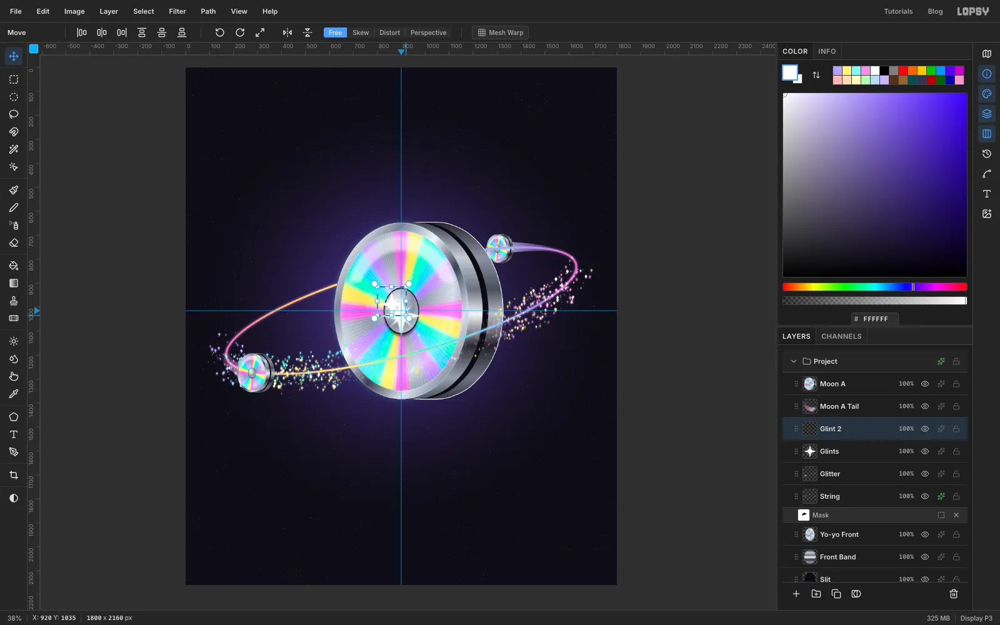

Drag a 200 px square marquee around the glint, choose **Edit → Copy**, then **Edit → Paste**. With the same 200 px marquee (`800, 915` to `1000, 1115`) and the **Move** tool, [[Cmd]]-drag the bottom-right corner up to about `920, 1035` to shrink the copy to 60%, a box about 120 px wide. Press [[Cmd+D]] and drag it to the orbit's right tip.

Shrink the original glint to 60% the same way and drag it to the upper-left edge of the face, where the light hits the rim. Select the copy and choose **Layer → Merge Down** to merge the two.

## Keep the stars off the print edge

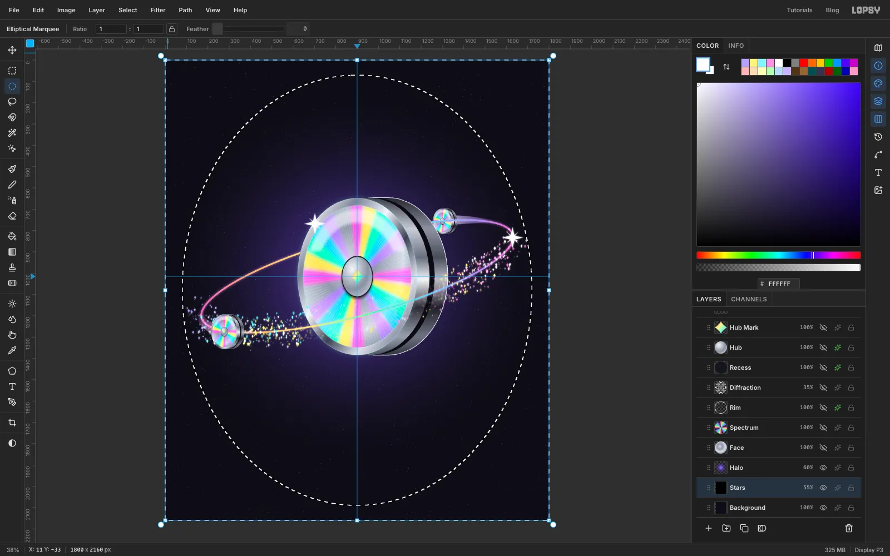

Stars that run right to the edge print as a hard rectangle on the shirt. Select `Stars` and draw a large elliptical marquee centred on the canvas, about 1640 × 2020 px. **Select → Feather…** by **180**, then **Select → Inverse**, and press [[Delete]]. The stars now fade out before the edge.

## Set ORBIT and the tagline

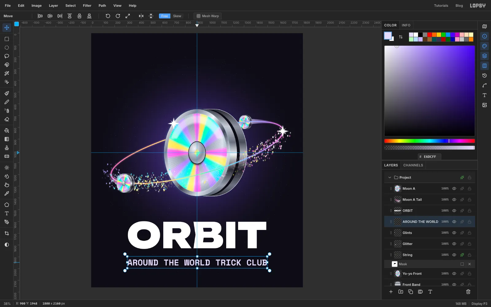

Select `Glints` first, so the type layers stack together above it. If a text layer were selected, the Text options would restyle it.

Pick the **Text** tool (**T**). Choose **Unbounded** in the font browser, **Black (900)**, **Size 300**, white, **Align: Center**. Click below the yo-yo on the vertical guide, type `ORBIT` and commit with the ✓. With the **Move** tool, drag it so it's centred on the guide with the tops of the letters at about y 1600.

Select `Glints` again and set the tagline: **Space Mono** **Bold**, **Size 72**, `#E6DCFF`. Type `AROUND THE WORLD TRICK CLUB` and place it centred about 90 px below ORBIT. At 72 px it comes out almost exactly as wide as ORBIT, so the two lines lock up as one block.

## Set YO-YO

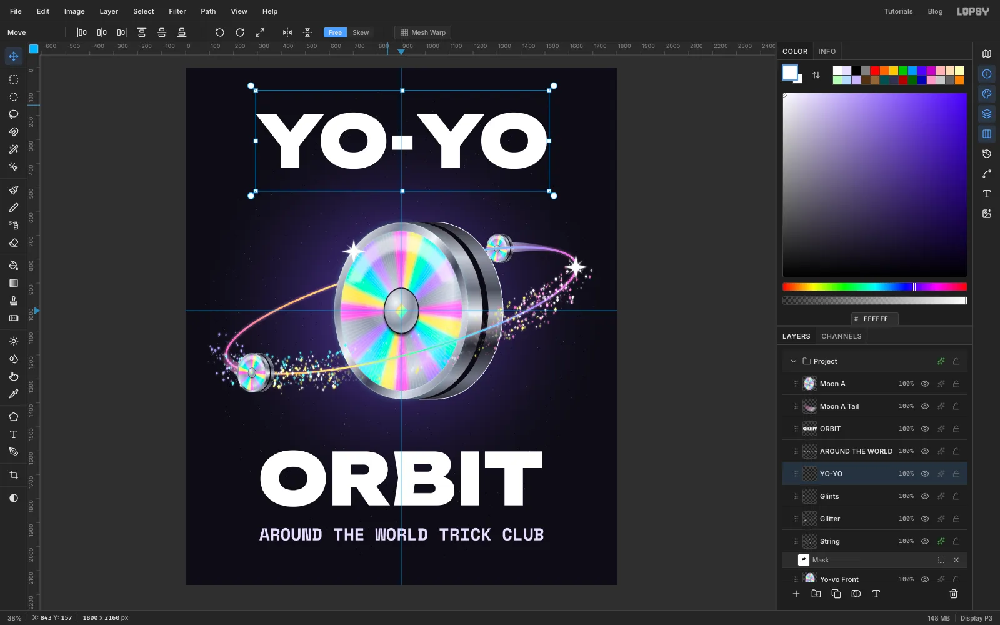

Select `Glints` once more and set `YO-YO` with the same Unbounded Black at 300 px. Centre it on the guide with the tops of the letters at about y 190. That gives roughly the same space above the yo-yo as below it.

## Add print offsets and the foil fill

Holographic transfers are often printed with a slight colour offset. With `YO-YO` selected:

1. [[Cmd]]-click its thumbnail. On a new layer called `Prism Cyan`, fill with `#00E5FF`, deselect, and nudge it up and left by 3 px with the arrow keys (Move tool). Set it to **70%**.
2. [[Cmd]]-click the `YO-YO` thumbnail again. On a new layer called `Prism Magenta`, fill with `#FF2BD6` and nudge it down and right by 3 px. Set it to **70%**.
3. [[Cmd]]-click the `YO-YO` thumbnail once more. On a new layer called `YO-YO Foil`, fill with a **Linear** gradient that cycles twice: `#FF6FD8`, `#FFE08A` at 17%, `#7FE8FF` at 34%, `#FF8FE6` at 50%, `#FFF38A` at 67%, `#8CFFC4` at 84% and `#B497FF`. Drag it from the word's top-left corner to its bottom-right corner.

The foil covers the white letters, and the cyan and magenta show only as a thin edge on either side.

## Break it into foil bands

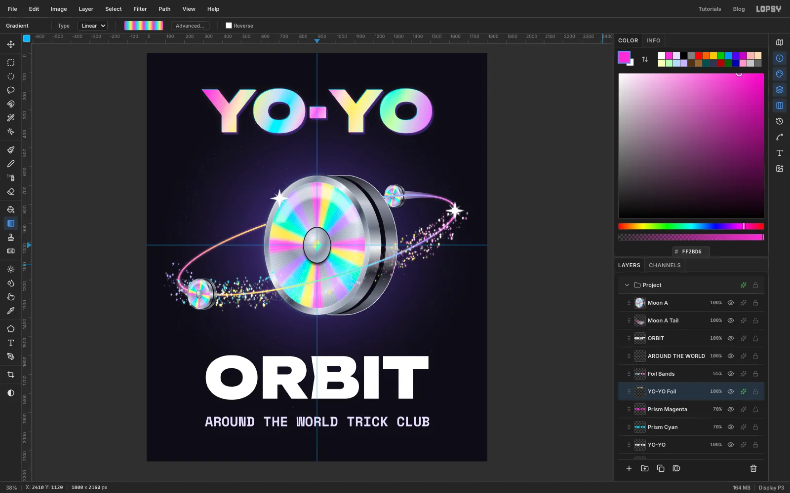

Keep the selection. On a new layer called `Foil Bands`, set up a **Linear** gradient that repeats magenta `#FF2BD6`, cyan `#00E5FF` and yellow `#FFF04A` four times: 13 stops, evenly spaced (every 8 or 9%). Drag it diagonally across the word from upper left to lower right, about 860 px long. Deselect and set the layer to **Overlay** at **55%**. Now the colour shifts in diagonal bands, the way foil does when you tilt it.

Select `YO-YO Foil` and add a **Drop Shadow** in `#3A2A7A` (Offset 10 / 12, Blur 1, Opacity 75%) for a clean extrusion. Add a faint **Outer Glow** in `#FF8FE6` (Size 36, Opacity 22%).

## Paint ORBIT in 80s chrome

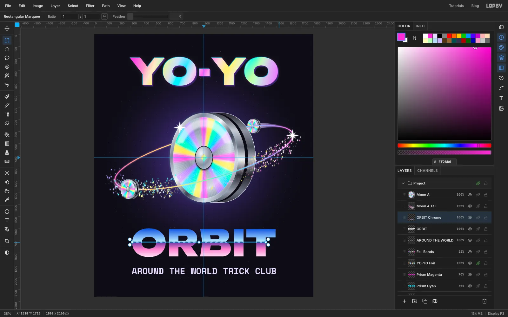

Select `ORBIT`, [[Cmd]]-click its thumbnail and add a layer called `ORBIT Chrome`. Fill it with a **Linear** gradient dragged from the top of the letters straight down to the bottom: deep blue `#1E4FD8`, pale sky `#BFE8FF` at 46%, violet `#6A3FA0` at 50%, pink `#FF8FD0` at 75% and blush `#FFE3F3` at 100%. The jump from sky to violet is the horizon.

To make the horizon a hard line, keep the letter selection. Switch to the **Rectangular Marquee**, zoom in so you can see the band, hold [[Shift+Alt]] and drag a thin band about 5 px tall across the whole word, just under half its height. That intersects it with the letters. Fill with `#1A1033`.

## Give ORBIT an edge and a shadow

Deselect. On `ORBIT Chrome`, add a **Stroke** of **3** in white and set **Position** to **Inside**. This gives the letters the same crisp edge as YO-YO. Then add the same **Drop Shadow** as YO-YO: `#3A2A7A`, Offset 10 / 12, Blur 1, Opacity 75%.

## Add two glints to ORBIT

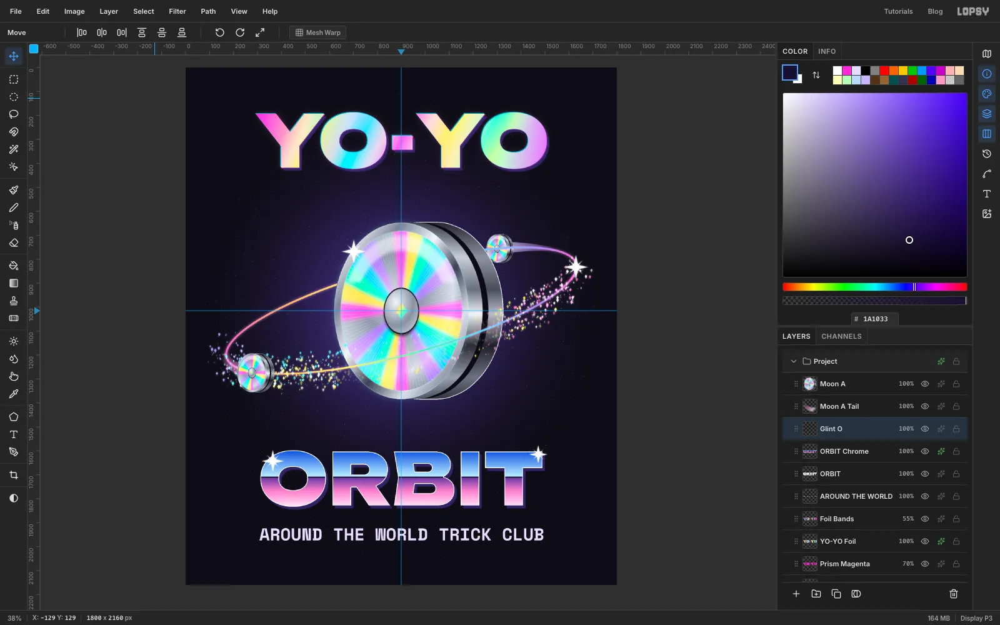

Select `Glints` and drag a 200 px square marquee around the flare on the yo-yo's rim. Choose **Edit → Copy**. Select `ORBIT Chrome`, paste, marquee the same 200 px box (`602, 655` to `802, 855`) and [[Cmd]]-drag its corner to about `782, 835`, a box about 180 px wide. Drag it to the top-left curve of the **O**.

Paste again, drag the corner to about `752, 805` (a box about 150 px wide) and drag it to the top-right corner of the **T**. **Layer → Merge Down** joins the two glints. Rename the layer `Glint O`.

## Pen the string up to the title

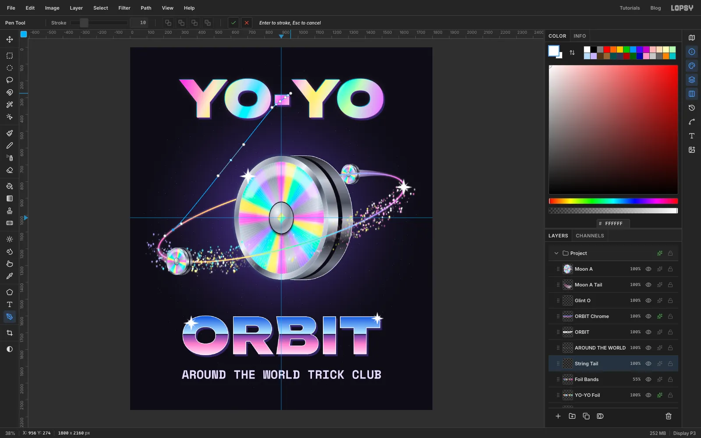

Select `Foil Bands` and add a layer called `String Tail` on top of the YO-YO layers. Set the foreground to white, pick the **Pen** tool (**P**) and set **Stroke** to **10**.

Place four anchors, dragging out a handle at each one:

1. **On the orbit's back arc**, about 190 px above the left mini yo-yo (around `255, 1085`). Drag a short handle along the orbit, so the string peels off it smoothly.
2. **Halfway up**, at about `600, 670`. Drag the handle towards the hyphen.
3. **The hyphen's bottom-left corner.** Drag the handle along the hyphen's diagonal, towards its top-right corner.
4. **The hyphen's top-right corner.** Drag the handle a little further along the same diagonal.

Press [[Enter]] to stroke the path. The string now climbs up from the orbit and crosses the front of the hyphen.

## Tie a knot

Pick the **Shape** tool, set the fill to white and remove the stroke. Click once on the end of the string at the hyphen's top-right corner and enter **26** × **26** in the **Shape Size** dialog.

> **Tip:** The Shape tool's click-to-size dialog is the quickest way to get an exact small circle. A marquee this small is hard to drag at fit-to-screen zoom.

## Colour the string and let the ends hang

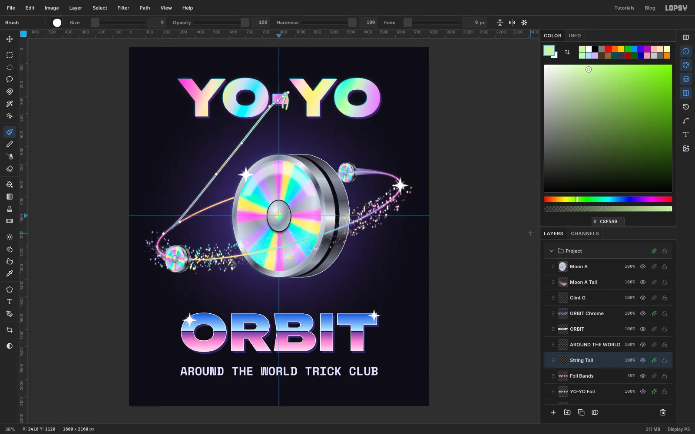

[[Cmd]]-click the `String Tail` thumbnail and fill it with a **Linear** gradient from `#FF8FA6` through `#FFE08A` to `#C8F5A0`, dragged from where the string leaves the orbit up to the knot. The bottom matches the orbit's colour at that point, so the string looks continuous.

Deselect. Pick the **Brush** with **Size 9** and **Hardness 100**, set the foreground to `#C8F5A0`, and drag two short, slightly curved strokes down from the knot into the gap under the hyphen. These are the loose ends.

Finish the layer with three effects: a 1 px **Stroke** in `#7FBF6A`, a small **Drop Shadow** in `#120A24` (Offset 2 / 2, Blur 1, Opacity 50%) so the string sits on the letters, and an **Outer Glow** in `#FF9EF0` (Size 12, Opacity 55%).

## Group the type

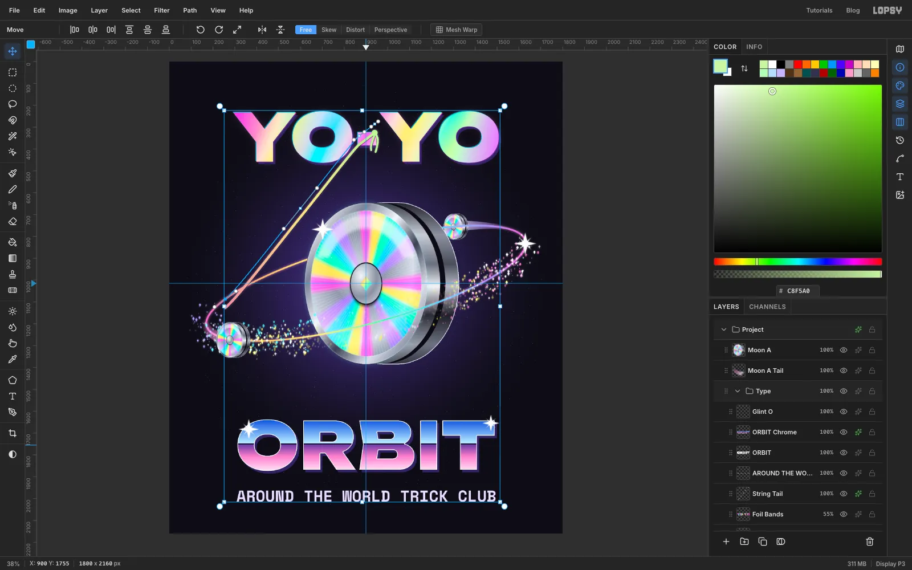

Click `Glint O` (the top layer of the type stack) and [[Shift]]-click `YO-YO` to select all of them, including `String Tail`, the prism layers and the ORBIT glints. Choose **Layer → Group Layers** and name the group `Type`.

With the group selected and the **Move** tool, drag anywhere on the canvas and the whole lockup moves together. Try it, then press [[Cmd+Z]] to put it back.

## Export the print

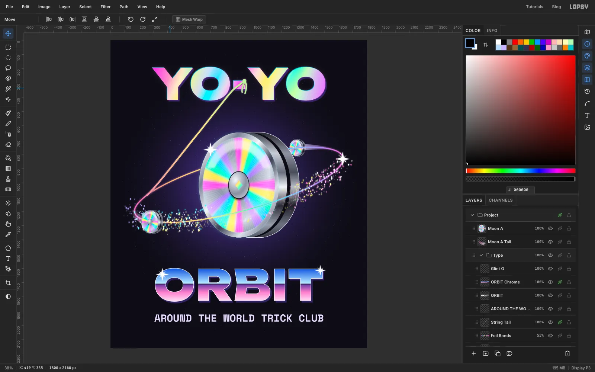

Hide the guides with **View → Show Guides**. Then choose **File → Quick Export PNG** for the print file and **File → Save Project** to keep the layers.

For a real holographic print, ask your printer how they want the file split into foil and ink. Check the soft parts first, like the `Stars`, the `Halo` and the glow effects, because many transfer methods can't print soft gradients without a halftone.
