Medieval *Books of Hours* are prayer books made for wealthy owners in the
fourteenth and fifteenth centuries. Their pages share a recognisable
toolkit:

- a painted *miniature* framed in burnished gold
- skies of ground lapis lazuli, often scattered with gold stars
- a *champie* initial: a gold letter on a ground split into blue and rose,
  dotted with white penwork
- black textura script, with *rubrics* (headings) in red
- *line-fillers*: painted bars that close the gap at the end of a short line
- borders of hairline ink vines carrying gold ivy leaves and gold dots
  called *bezants*

In this tutorial you'll use all of them on a Christmas card called **Ice
Skaters**. The miniature is a real painting: a detail of Hendrick
Avercamp's *Winter Landscape with Ice Skaters* (about 1608, Rijksmuseum,
public domain). You'll set it in a pointed gilt arch and give it a lapis
sky. Everything else is drawn in Lopsy. The card is **1500 × 2100 px**, a
5 × 7 inch card at 300 ppi.

Along the way you'll use:

- **Paste** from the clipboard, a uniform corner scale and a **layer mask**
- the exact-corners marquee dialog, **Inverse** and [[Cmd]]-clicking a
  thumbnail to cut and reload a pointed arch
- **Grow**, **Shrink** and **Feather**
- the **Gradient** tool with transparent stops, and **Multiply** blending
- **Clouds**, **Add Noise**, **Hue/Saturation** and **Unsharp Mask**
- the **Spray**, **Eraser**, **Pencil** and **Brush** tools, including the
  **Square** brush preset
- the **Pen** tool for outlines, **Path to Selection**, stroked paths and
  **text on a path**
- **Define Color Brush** with **Angle Jitter**
- **Copy**, **Paste**, **Merge Down**, **Duplicate Layer** and a rotation
  handle
- the **Stroke**, **Inner Glow** and **Color Overlay** layer effects
- a **Photo Filter** adjustment on a group, and group nudging
- **UnifrakturCook**, one blackletter family for all the text

The palette:

- Vellum `#E9DBB8`, edge umber `#8A6A3C`, stains `#7A5A30`
- Lapis `#273E94`, band `#1E3A8E`
- Sky `#1C2C7C` → `#3D5DB5` → `#9FB2DC` → `#B8C6E4`
- Gold `#C19843`, highlight `#F0D68E`, star gold `#CDA64E`, dark gold `#A98139`
- Vermilion `#A43628`
- Rose `#A34E5B`
- Ink `#2A1B12`, gold outline `#3A2410`
- Scroll `#F1EAD5`, scroll outline `#5A3A1A`, tails `#A99A74` → `#D2C6A0`, fold `#8E7F5C`
- White lead `#F7F1E2`, snow `#FBF7EE`

New layers always appear above whichever layer is selected, so each
section tells you which row to click first.

> **Tip:** Many steps use the marquees' exact-corners dialog. With nothing
> selected, click the canvas once with the **Rectangular** or **Elliptical
> Marquee** without dragging. A dialog opens where you type **From X / Y**
> and **To X / Y** in pixels and click **Select**. The numbers may run off
> the page; anything outside it is simply not selected.

> **Tip:** A marquee smaller than about 8 screen pixels doesn't make a
> selection, so a fill after it floods the whole layer. Small round and
> square marks in this tutorial are therefore painted with the brush.

## Create the vellum and darken its edges

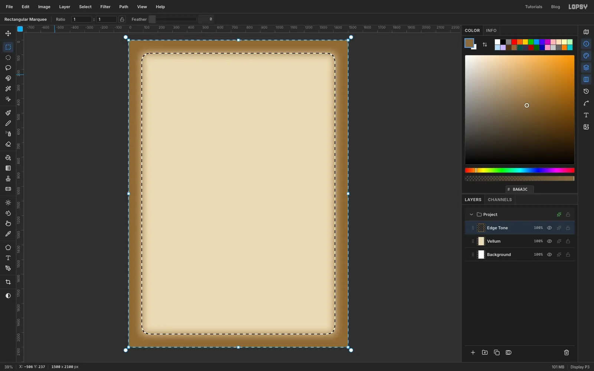

Choose **File → New**, enter **1500 × 2100**, pick a **White** background
and click **Create**. Double-click *Layer 1*'s name and rename it
*Vellum*. Set the foreground to `#E9DBB8`, press [[Cmd+A]] and choose
**Edit → Fill**.

Real vellum darkens where hands have held it. Click **Add Layer** and name
the new layer *Edge Tone*. With the exact-corners dialog, select from
**90, 90** to **1410, 2010** and press [[Cmd+Shift+I]] to invert. That
leaves a 90 px band around the edge. Choose **Select → Feather…**, enter
**60** (the largest feather Lopsy applies) and click **Apply**. Fill the
band with `#8A6A3C`, deselect with [[Cmd+D]], and set the layer to
**Multiply** at **35%**.

## Add skin texture, grain and stains

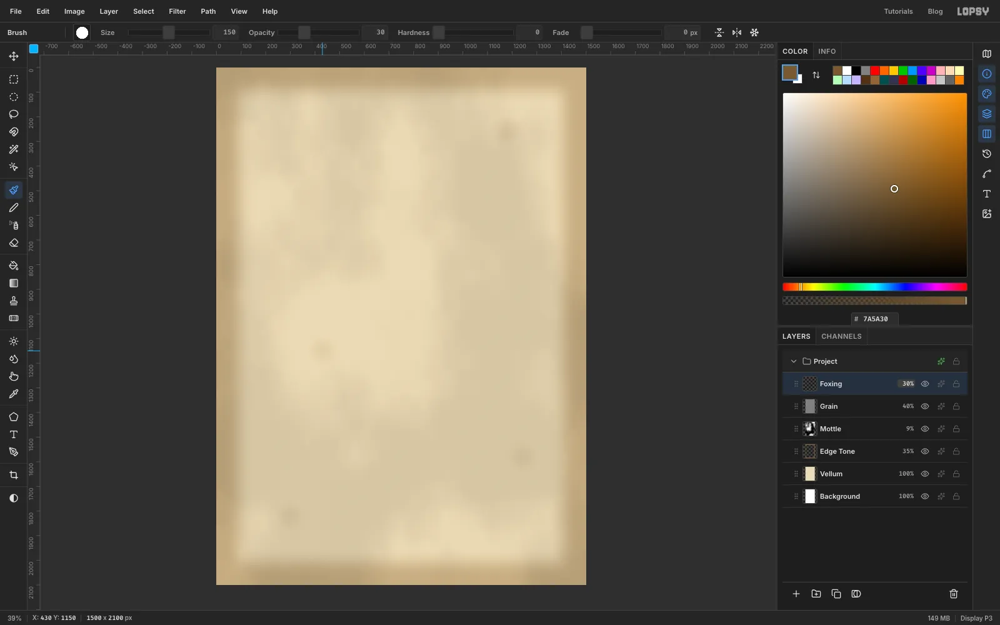

Add a layer called *Mottle* and run **Filter → Clouds…** with **Scale 4**.
Set it to **Multiply** at **9%**. The clouds give the page soft, uneven
patches with no direction, like animal skin.

Add a layer called *Grain*. Fill it with `#808080` and run **Filter → Add
Noise…** with **Amount 14**, **Mono** and **Gaussian**. Set it to
**Overlay** at **40%**.

Add a layer called *Foxing*. Pick the **Brush** and, in the options bar,
set **Size 150**, **Hardness 0** and **Opacity 30**. With `#7A5A30`,
click four or five times in different places, away from the centre: these
are old stains. Set the layer's opacity to **30%**.

## Mark the margins with guides

If the rulers aren't showing, choose **View → Show Rulers**. Click the top
ruler at **210**, **750** and **1290** to drop three vertical guides: the
left edge of the picture, the centre line and the right edge. Click the
left ruler at **210** and **1180** (top and bottom of the picture), and at
**1312** and **1537** (top and bottom of the initial letter).

Watch the coordinate readout in the status bar before you click. To
remove a guide that landed in the wrong place, click it on the ruler
again.

## Paste the painting

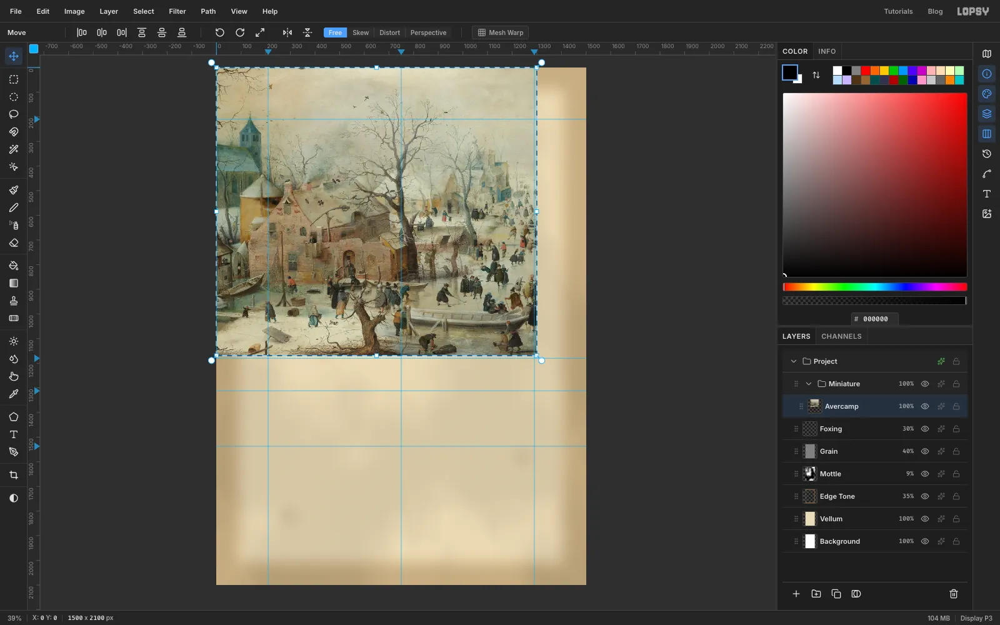

Download Avercamp's painting from Wikimedia Commons
(*Hendrick Avercamp – Winterlandschap met ijsvermaak*, public domain). In
any image viewer, crop the left part of the scene: the church tower, the
brick house, the big bare tree and the skaters to its right. Make the
crop about 1.1 times as wide as it is tall. Scale it to **1300 px** wide,
a little bigger than you need, so you can fit it by eye in Lopsy. Copy
it.

In Lopsy, click *Foxing*, click **New Group** and name the group
*Miniature*. Press [[Cmd+V]]. The painting lands at the top-left corner
of the page as a new layer, already selected, with the **Move** tool
active. Rename the layer *Avercamp*.

## Scale the painting into place

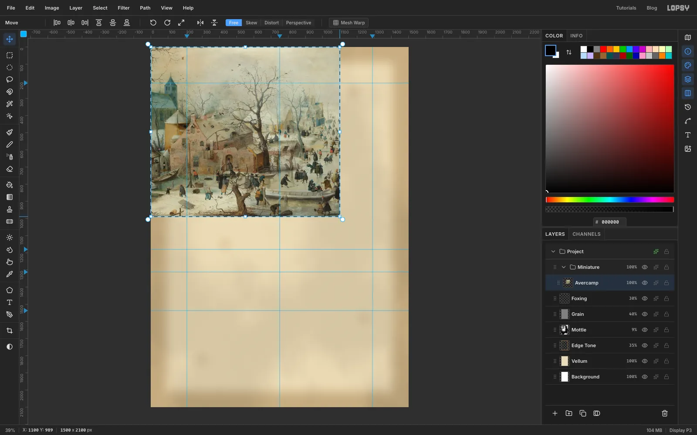

Hold [[Cmd]] and drag the bottom-right corner handle up and to the left
until the painting is about **1100 px** wide. [[Cmd]] keeps the
proportions. Then drag from the middle of the painting to move it, so its
top-left corner sits at about **200, 200**. It should overlap all four
picture guides by about 10 px. Press [[Cmd+D]] to commit.

## Cut a pointed arch on its own layer

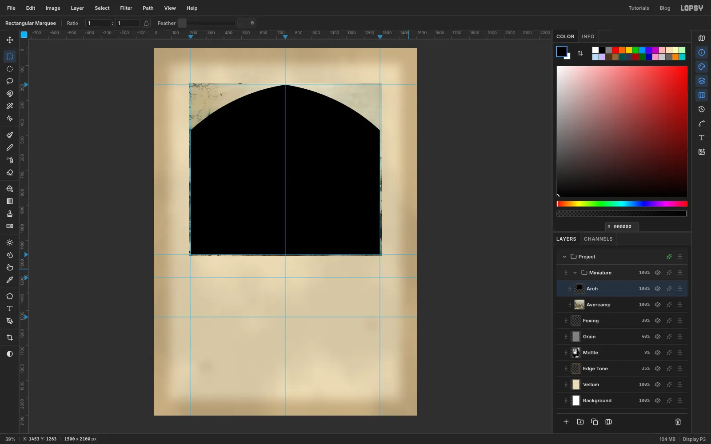

A Gothic *two-centred* arch is where two big overlapping circles meet.
Each side of the arch is part of a circle centred low on the opposite
side of the page. You'll need this shape several times, so build it once
on its own layer and reload it whenever you need it.

1. Add a layer called *Arch*. Pick the **Elliptical Marquee**, click once
   and enter **From −113, 199** and **To 1913, 2225**. That is a circle
   2026 px across, centred at **900, 1212**. Most of it hangs off the
   page, which is fine. Fill it with black.
2. Deselect, click again and enter the mirror-image circle: **−413, 199**
   to **1613, 2225**. Press [[Cmd+Shift+I]] and then [[Delete]]. Only the
   lens where the two circles overlap is left.
3. Deselect. With the **Rectangular Marquee**, click once and enter
   **210, 210** to **1290, 1180**, the picture guides. Invert and press
   [[Delete]]. The lens is now a pointed arch with straight sides.
4. Deselect and click the eye on the *Arch* row to hide it.

From now on, "load the arch" means: deselect, then [[Cmd]]-click the
*Arch* thumbnail. That loads its shape as a selection even while the
layer is hidden.

## Mask the painting to the arch

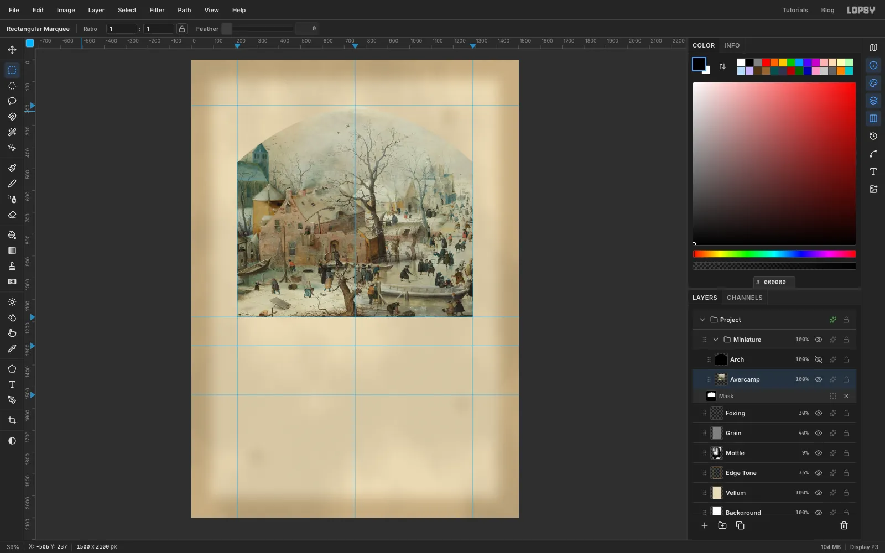

Click *Avercamp* and click **Add Mask** at the bottom of the Layers
panel. Load the arch, then click the mask thumbnail (*Edit mask for
Avercamp*) so you paint on the mask instead of the picture. Press
[[Cmd+Shift+I]], set the foreground to black and choose **Edit → Fill**.
Deselect, then click the *Avercamp* row to stop editing the mask.

Run **Filter → Hue/Saturation…** with **Hue −4** and **Saturation +22**,
then **Filter → Unsharp Mask…** with **Radius 2**, **Amount 0.8** and
**Threshold 0**. The old varnish becomes a little richer and crisper.

## Paint a lapis sky

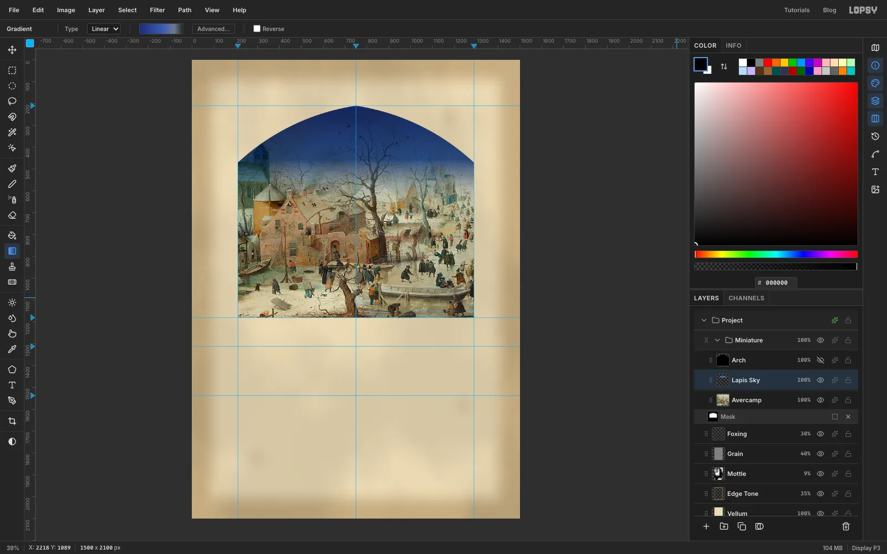

Add a layer called *Lapis Sky* and load the arch. Pick the **Gradient**
tool, set it to **Linear**, click **Advanced…** and build four stops:

- **0%** `#1C2C7C`
- **55%** `#3D5DB5`
- **80%** `#9FB2DC` at **60%** opacity
- **100%** `#B8C6E4` at **0%** opacity

Drag from the top of the arch (**750, 210**) straight down to **750,
660**, just below the rooftops. Deselect and set the layer to
**Multiply**. Multiply keeps every dark branch and bird, so the painted
trees stand out against the blue like silhouettes.

## Give the town its warm colour back

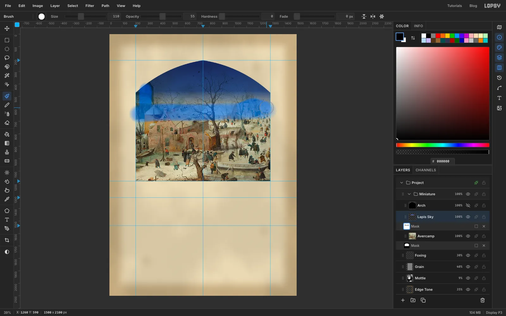

The blue also tints the rooftops and church. Click **Add Mask** on *Lapis
Sky* and click *Edit mask for Lapis Sky*. Pick the **Brush** with **Size
150**, **Hardness 0**, **Opacity 55** and black. Paint one stroke from left
to right along the rooftops, at about y **620**.

Lower the size to **110**. Paint up the church tower on the left, from
about **288, 570** to **288, 440**, and across the distant town on the
right at about y **580**. Click the *Lapis Sky* row when you're done.

## Gild the frame

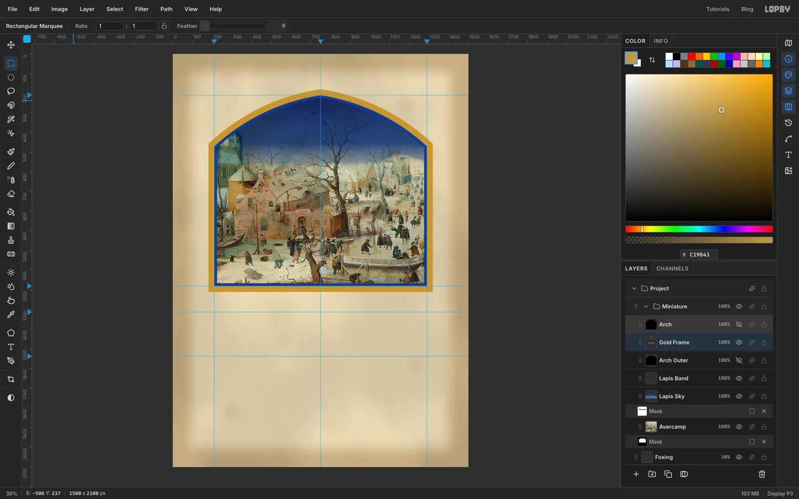

Click *Lapis Sky*, add a layer called *Lapis Band* and load the arch.
Fill it with `#1E3A8E`, choose **Select → Shrink…** with **14**, and press
[[Delete]]. That leaves a 14 px blue rim around the window. Deselect.

The frame needs a second arch, 30 px bigger all round. Build it exactly
like *Arch* on a new layer called *Arch Outer*: circles from **−143, 169**
to **1943, 2255** and from **−443, 169** to **1643, 2255**, then a
rectangle from **180, 180** to **1320, 1210**. Hide it.

Add a layer called *Gold Frame*. [[Cmd]]-click the *Arch Outer* thumbnail
and fill with gold `#C19843`. Load the normal arch and press [[Delete]]
to cut the window back out.

## Burnish the gold

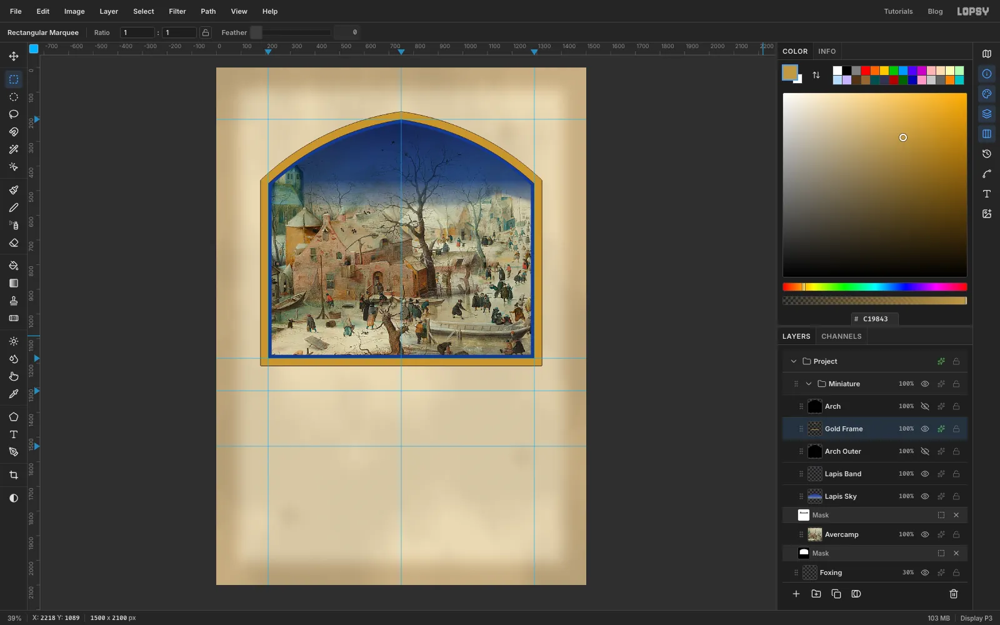

Deselect and run **Filter → Add Noise…** with **Amount 5** and **Mono**.
Open the layer's effects (the ✦ button on its row) and add:

- **Stroke**, **Width 2**, in gold outline `#3A2410`
- **Inner Glow**, **Size 3**, **Opacity 85**, in highlight `#F0D68E`

The glow puts a thin light line along each edge, the way burnished gold
catches light on the rim of its raised base.

## Add white pearling

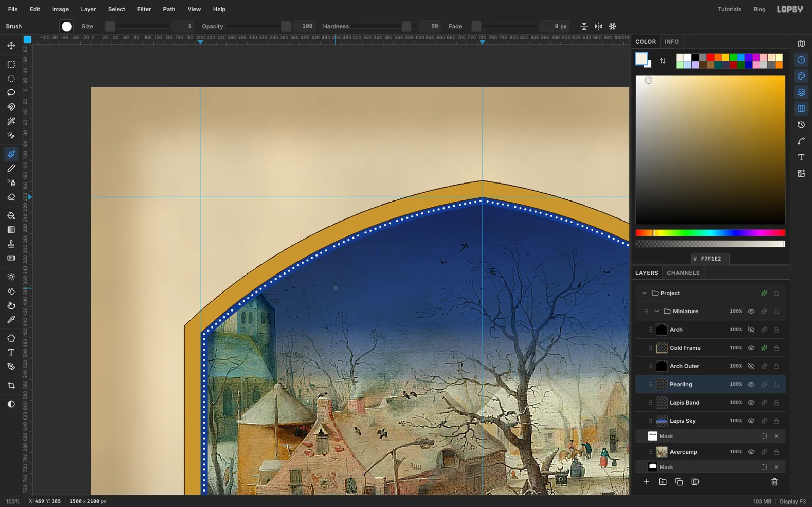

Click *Lapis Band* and add a layer called *Pearling*. Pick the **Brush**
and set **Size 5**, **Hardness 90** and **Opacity 100** in the options
bar. Then click the brush-tip thumbnail at the left of the options bar to
open the **Brushes** panel, and on its **Shape** tab set **Spacing 200**.
At 200% spacing the brush leaves separate dots instead of a line.

Set the foreground to white lead `#F7F1E2`. Work along the middle of the
blue band, about 7 px inside the window's edge. Click at the bottom of
the left side, then **Shift**-click at the shoulder: one click does the
whole straight side. Round the curve, **Shift**-click every 60 px or so,
with one click exactly on the point, then come down the right side the
same way. Each short straight piece comes out as an even row of dots.

## Draw a star with the Pen

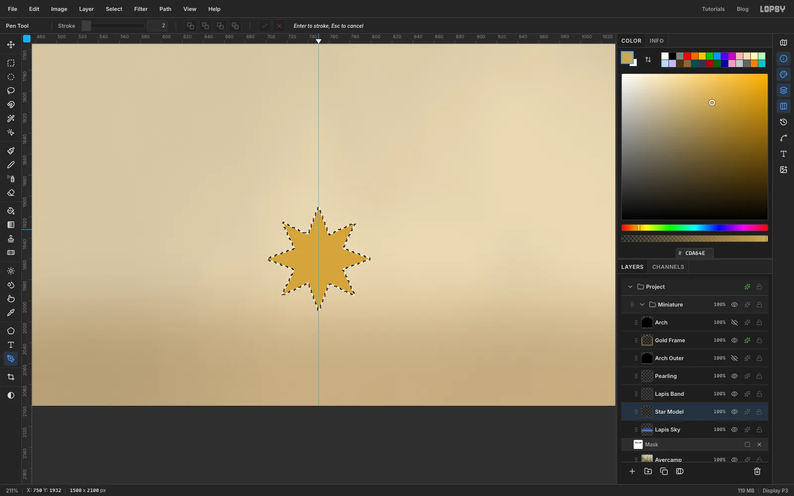

You'll stamp all the stars from one star drawn carefully. Add a layer
called *Star Model* and zoom in on an empty spot near the bottom of the
page. Pick the **Pen** and click the 16 corners of an eight-point star
about **100 px** across, going round in order: a tip, then a notch, then
the next tip. Put the notches half as far from the centre as the tips.
Click the first point again to close the path.

Open the **Paths** panel, click **Path to Selection** and then **Delete
Path**. Fill the selection with star gold `#CDA64E`.

Select a square just around the star and choose **Edit → Define Color
Brush…**. Name it *Gold Star*. The star becomes the brush tip, colour and
all. Deselect and delete the *Star Model* layer.

## Stamp the gold stars

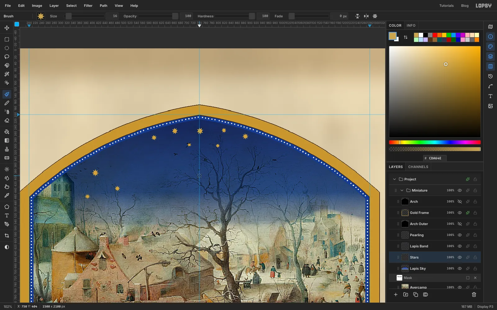

Click *Lapis Sky* and add a layer called *Stars*. With the **Brush**
(now using *Gold Star*), open the **Brushes** panel and on the
**Dynamics** tab set **Angle Jitter** to **10**, so the stars sit at
slightly different angles. Click once for each star, changing **Size**
between **12** and **22** as you go:

- seven in a loose, uneven group under the arch's point, between y
  **240** and **310**, where the scroll will sit below them
- three on the left, between the church tower and the big tree, at about
  **420, 395**, **490, 445** and **395, 470**

Keep them irregular: a neat row looks mechanical.

## Copy the stars to the other side

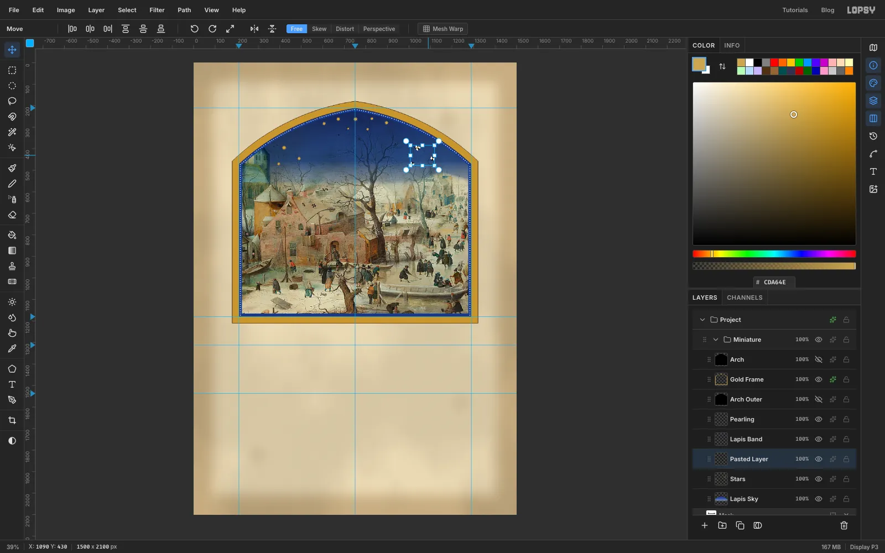

Draw a rectangle around the three left-hand stars, from about **380,
380** to **570, 485**. Press [[Cmd+C]] then [[Cmd+V]]. The copy is pasted
in place as a new layer, with the **Move** tool ready. Drag it **620 px**
to the right, into the sky right of the tree.

Deselect, choose **Layer → Merge Down** to merge the copy into *Stars*,
and give *Stars* a **Stroke** of **Width 1** in gold outline `#3A2410`.
Manuscript stars are solid gold with a fine outline, not glowing
sparkles.

## Let it snow

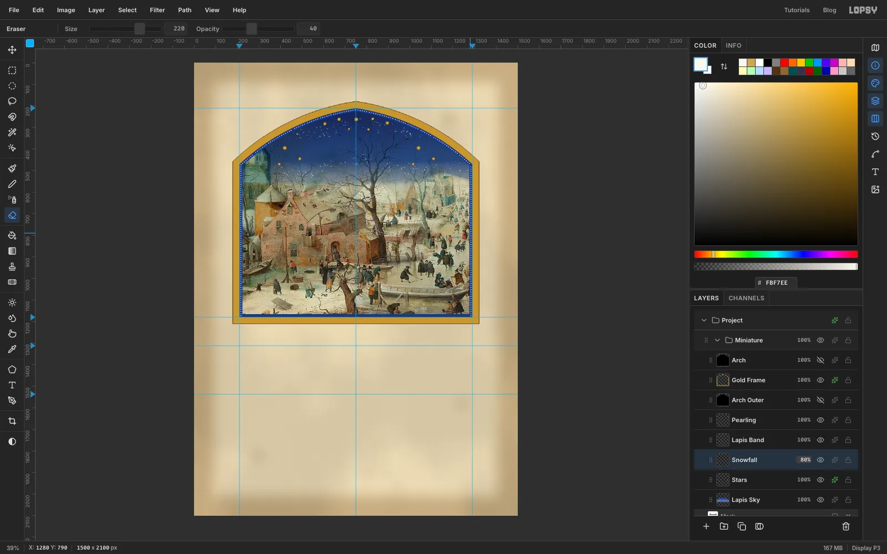

The **Spray** tool borrows the Brush's tip, so put the round tip back
first. Pick the **Brush**, open the **Brushes** panel, set **Angle
Jitter** back to **0**, and on the **Presets** tab choose **Hard Round**.

Add a layer called *Snowfall* and load the arch. Pick the **Spray** tool
with **Size 60**, **Density 3**, **Softness 35** and **Opacity 85**. Set
the colour to snow `#FBF7EE`. Make five slow, slightly wavy passes from
left to right, at about y **300**, **470**, **640**, **820** and
**1000**. The flakes come out 2–7 px across. Deselect.

Snow should be thickest in the sky. Pick the **Eraser** with **Size 220**
and **Opacity 55** and drag across the bottom of the picture at about y
**1080** and **930**. Lower **Opacity** to **40** and drag across y
**790** and **650**. Set the layer to **80%**.

## Cut the scroll's tails

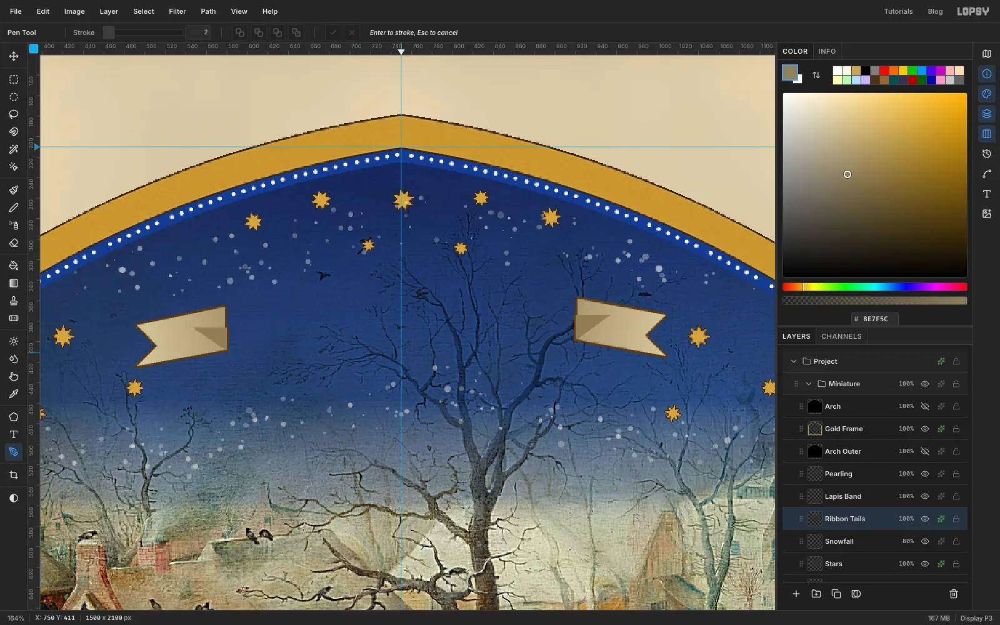

A *banderole* is a painted scroll carrying words. Its ends turn under, so
draw the tails first, on a layer underneath the scroll. Add a layer
called *Ribbon Tails*.

With the **Pen**, draw the left tail. It's a ribbon end about 85 px long
and 40 px tall, sloping slightly down and outward, with a V-notch about
20 px deep in its outer end. Click **578, 366**, **492, 384**, **512,
404**, **492, 424** and **578, 408**, then click the first point again to
close it. Click **Path to Selection**, then **Delete Path**.

Pick the **Gradient** tool and click **Advanced…**. Delete the two middle
stops and set the ends to `#A99A74` and `#D2C6A0`, both at full opacity.
Drag from the scroll end outward, from **578, 390** to **492, 404**.

Draw the right tail as its mirror image, about 10 px higher because the
scroll rises to the right: **922, 358**, **1008, 374**, **988, 394**,
**1008, 414** and **922, 398**. Shade it the same way, from **922, 378**
to **1008, 394**.

Then draw a small triangle with the Pen where each tail disappears under
the scroll, and fill it with fold `#8E7F5C`. The left one is **546,
386**, **580, 386** and **580, 409**; the right one is **954, 374**,
**920, 374** and **920, 399**. That dark fold makes the tail read as the
back of the ribbon. Deselect and add a **Stroke** of **Width 2** in
scroll outline `#5A3A1A`.

## Draw the scroll's path

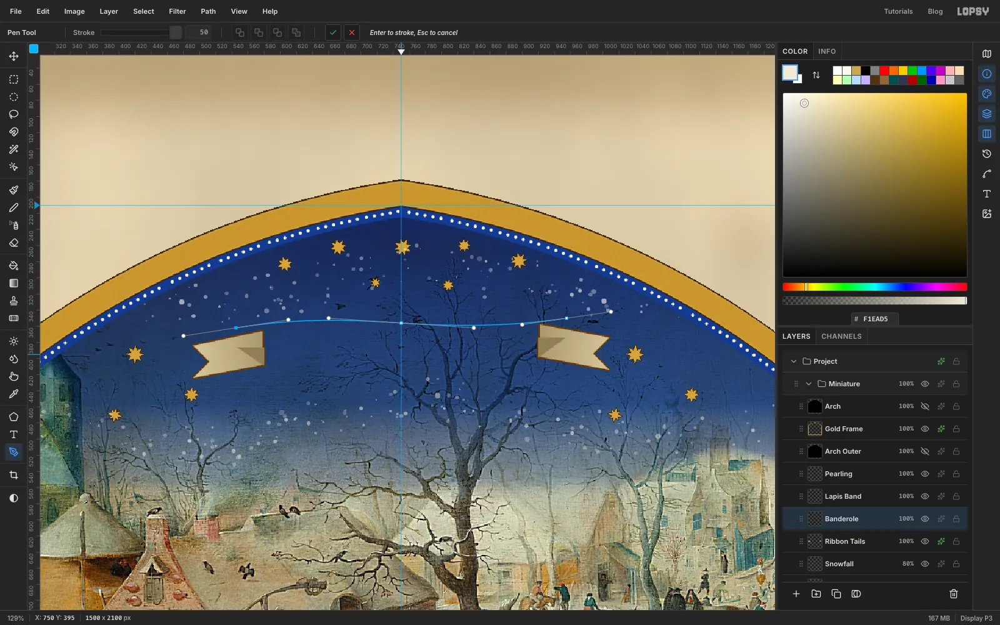

Add a layer called *Banderole* and set the foreground to scroll cream
`#F1EAD5`. Pick the **Pen**. Press and drag at each of three points to
make a smooth anchor:

1. press at **545, 362** and drag to **610, 352**
2. press at **750, 356** and drag to **840, 362**
3. press at **955, 350** and drag to **1010, 342**

The curve rises slightly from left to right with a gentle wave. Set the
Pen's **Stroke** option to **50**.

## Stroke the scroll

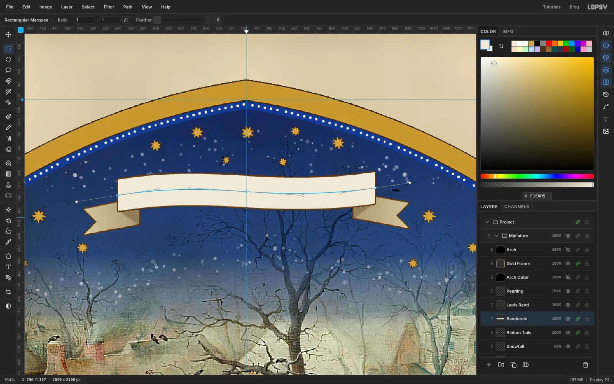

Press [[Enter]]. The path is stroked 50 px wide in cream. The round ends
need squaring off: select from **480, 300** to **546, 420** with the
exact-corners dialog and press [[Delete]], then do the same from **954,
280** to **1024, 400**. Deselect and add a **Stroke** of **Width 2** in
scroll outline `#5A3A1A`.

## Letter the scroll on a path

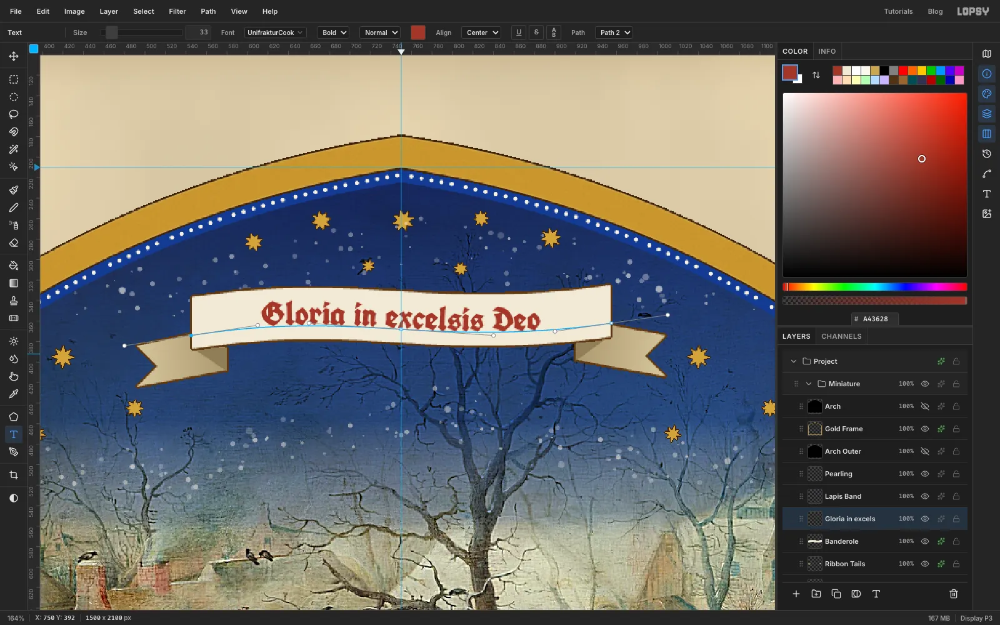

Text on a path sits *on* the path, so the lettering needs its own path a
little below the scroll's centre. Open the **Paths** panel and click the
selected path to deselect it; otherwise the Pen would edit it. Draw the
same three anchors 12 px lower: **545, 374** dragged to **610, 364**;
**750, 368** dragged to **840, 374**; and **955, 362** dragged to **1010,
354**. Click the **✓** (*Commit path*) button in the options bar, which
saves the path without stroking it.

Set the foreground to vermilion `#A43628`. Pick the **Text** tool and
choose **UnifrakturCook**, **Size 33**, **Align Center**. Click an empty
spot low on the page and type **Gloria in excelsis Deo**. While you're
still typing, choose the new path in the options bar's **Path** menu,
then click **✓**. The words flow along the curve with about 12 px of
cream above and below.

## Lay the champie ground

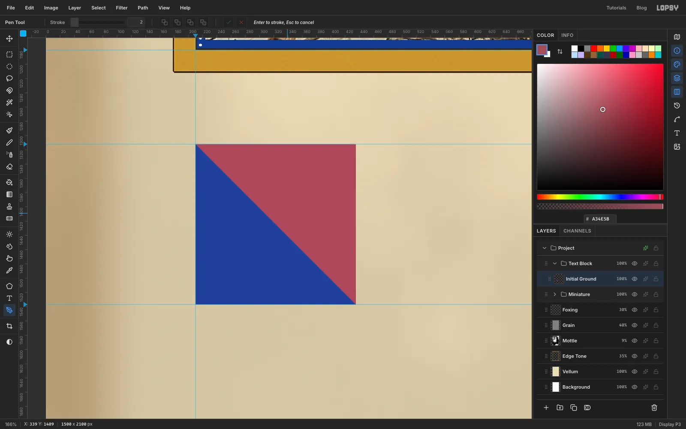

Collapse the *Miniature* group, click its row, click **New Group** and
name the group *Text Block*. Add a layer called *Initial Ground*.

Select a square from **210, 1312** to **435, 1537**, which matches the
guides, and fill it with lapis `#273E94`. Deselect. With the **Pen**,
click the square's top-left, top-right and bottom-right corners, then the
first corner again to close the triangle. Click **Path to Selection** and
**Delete Path**, and fill the triangle with rose `#A34E5B`. Deselect.

## Add white filigree

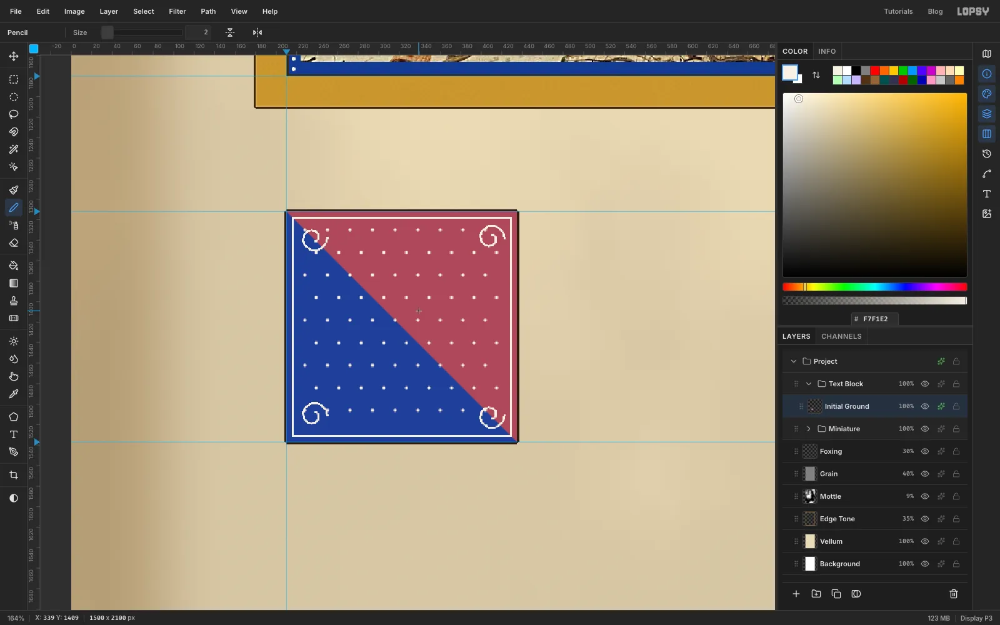

Champie grounds are decorated with fine white penwork. Pick the
**Brush** and set **Size 4**, **Spacing 10** and white lead `#F7F1E2`.
Click a staggered grid of dots about 22 px apart across the square.

Lower the size to **2** and draw a tiny spiral, about 28 px across, in
each corner. Then pick the **Pencil** at **Size 2**. Click 6 px inside the
square's top-left corner and **Shift**-click each of the other corners in
turn, then back to the start, to draw a white hairline frame. Give the
layer a **Stroke** of **Width 2** in ink `#2A1B12`.

## Set the G and select it

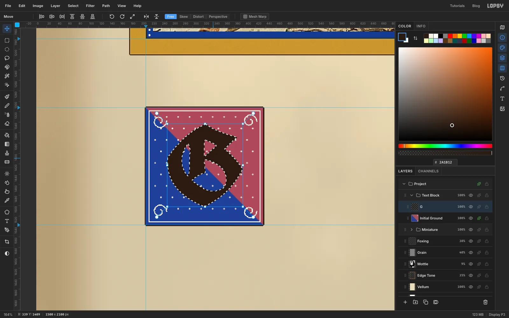

Set the foreground to ink `#2A1B12`. Pick the **Text** tool with
**UnifrakturCook**, **Size 215** and **Align Center**. Click in the
middle of the square and type a capital **G**, then click **✓**. With the
**Move** tool, use the arrow keys to centre the letter on the square,
then nudge it up 2 px. A letter looks better centred optically, slightly
high.

Click **Rasterize Layer** at the bottom of the Layers panel, then
[[Cmd]]-click the G's thumbnail. That loads the letter's shape as a
selection.

## Gild the G

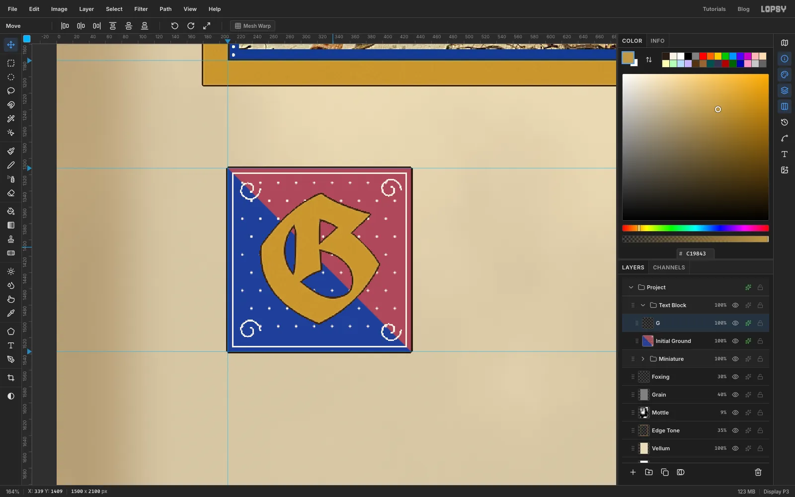

Set the foreground to gold `#C19843` and choose **Edit → Fill**. Run
**Filter → Add Noise…** with **Amount 5** and **Mono**, then deselect. Add
the same effects as the frame:

- **Stroke**, **Width 2**, in gold outline `#3A2410`
- **Inner Glow**, **Size 3**, **Opacity 85**, in highlight `#F0D68E`

## Trace white penwork around the letter

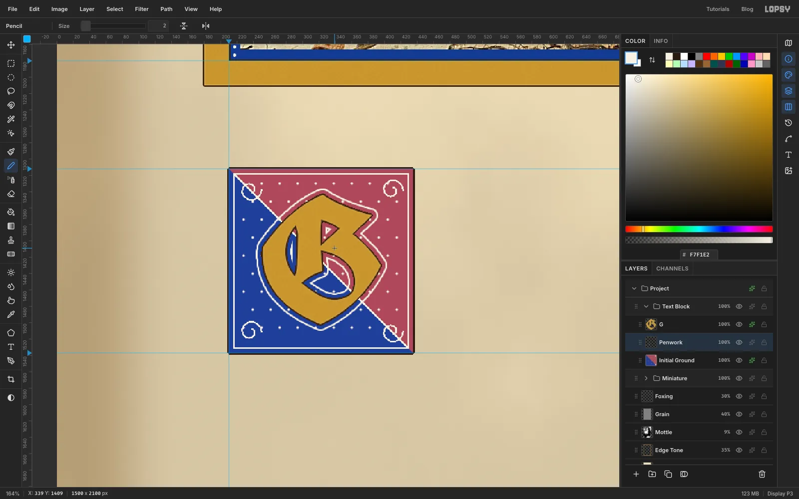

Click *Initial Ground* and add a layer called *Penwork*, which sits below
the G. [[Cmd]]-click the G's thumbnail, choose **Select → Grow…** with
**8** and fill with white. [[Cmd]]-click the G's thumbnail again, grow it
by **6** and press [[Delete]]. A 2 px white line now traces the letter.
Deselect.

With the **Pencil** at **Size 2**, click 8 px inside the square's
top-left corner and **Shift**-click 8 px inside the bottom-right corner.
The white diagonal disappears behind the G.

## Write the text

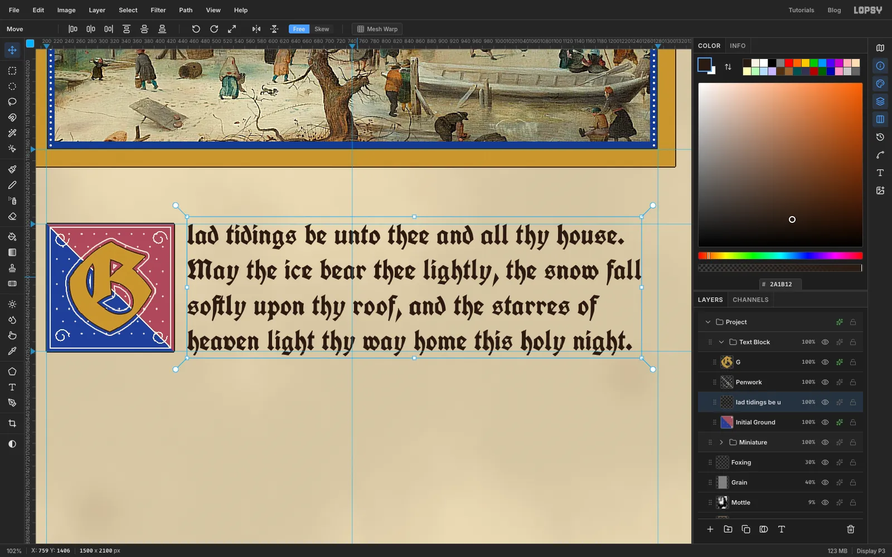

Click *Initial Ground*, so the text layer sits under the initial's
penwork and G. Set the foreground to ink, pick the **Text** tool and
choose **UnifrakturCook** at **Size 50**. In the **Text** panel set **Line
height** to **1.25** and **Letter spacing** to **0**, and choose **Align
Left**.

Drag a text box from **457, 1300** to the right guide at **1290, 1550**.
That leaves a 22 px gap after the initial. Leave off the G, because the
gilded initial supplies it, and type:

*lad tidings be unto thee and all thy house. May the ice bear thee lightly,
the snow fall softly upon thy roof, and the starres of heaven light thy
way home this holy night.*

Click **✓**. The text wraps into four lines. Use the **Move** tool's
arrow keys to raise or lower it until the top of the first *l* touches
the **1312** guide. The last line's baseline then sits on the **1537**
guide, level with the bottom of the square. Leave the right edge ragged:
justifying four short lines opens wide gaps between the words.

## Close the short lines with line-fillers

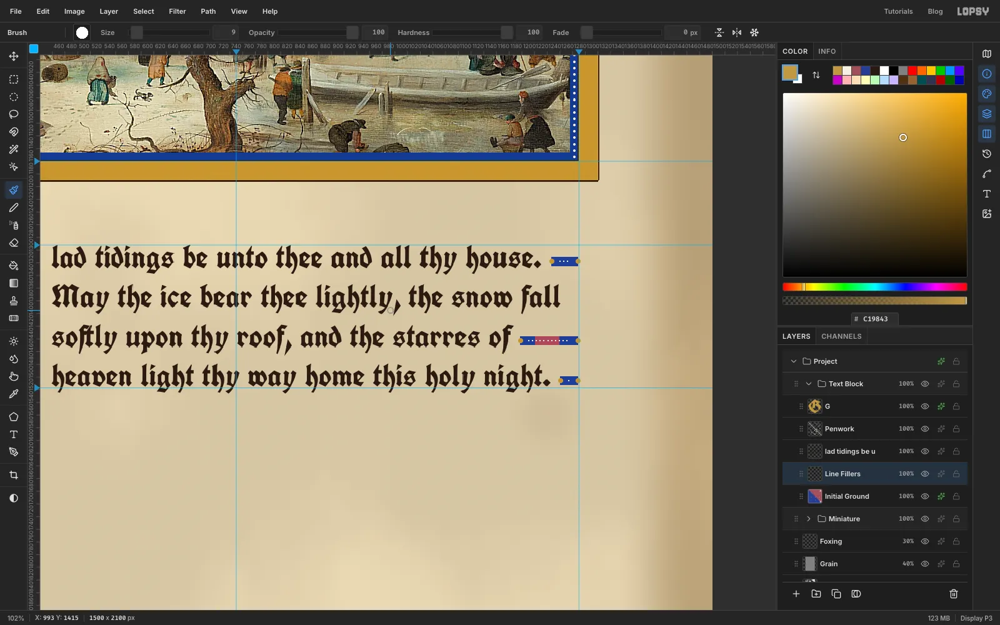

Scribes filled the space at the end of a short line with a painted bar.
Click *Initial Ground* and add a layer called *Line Fillers*. Pick the
**Brush**, open the **Brushes** panel, choose the **Square** preset and
set **Size 14** and **Spacing 10**. The square tip gives the bars square
ends.

Work on each line that ends more than about 34 px short of the right
guide. Here that's the first, third and fourth. Keep the bars about 12 px
above the baseline, centred on the small letters:

1. In lapis `#273E94`, click 23 px after the last letter and
   **Shift**-click 7 px short of the **1290** guide. The 14 px tip adds 7
   px at each end, so the bar runs from 16 px after the text to the guide.
2. In rose `#A34E5B`, starting about 30 px in, click and **Shift**-click
   24 px apart. With the tip that makes each rose bar about 38 px long.
   Start a new one every 48 px.
3. Switch to the **Hard Round** preset at **Size 3** and **Spacing 200**,
   and **Shift**-click a row of white dots along the middle.
4. At **Size 9**, click a gold `#C19843` dot on each end.

## Add the rubric and date

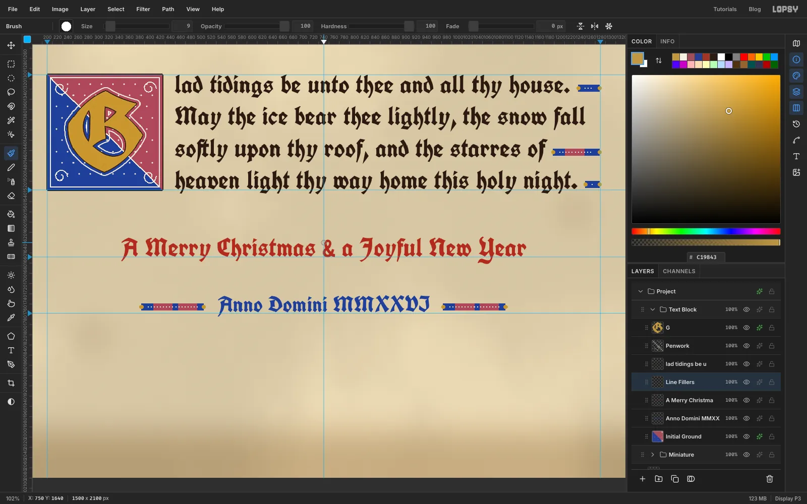

Click the left ruler at **1668** and **1778** to drop two baseline
guides, 130 px and 240 px below the paragraph's last line.

Click *Initial Ground* first: changing Text options while a text layer is
selected restyles that layer. Set the foreground to vermilion, choose
**UnifrakturCook** at **Size 50** with **Align Center**, click on the
centre line well below the text, and type **A Merry Christmas & a Joyful
New Year**. Click **✓** and nudge the line until its baseline sits on the
**1668** guide. At the same size as the text, the red does the work and
the line doesn't compete with the initial.

Click *Initial Ground* again. In lapis at **Size 44**, type **Anno Domini
MMXXVI** on the centre line and nudge its baseline onto the **1778**
guide. Click *Line Fillers* and paint two fillers, as in the last step,
each about 124 px long. Centre them on the date's small letters, 26 px
from its first and last letters.

## Rule the gold keyline and red rule

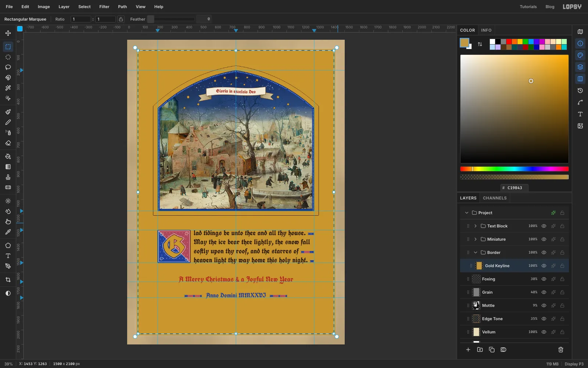

Collapse *Text Block* and *Miniature*, click *Foxing*, click **New
Group** and name it *Border*. The group sits under the picture and text.

Add a layer called *Gold Keyline*. Select from **64, 64** to **1436,
2036** and fill it with gold. Deselect, select from **74, 74** to **1426,
2026** and press [[Delete]], leaving a 10 px frame. Deselect and run
**Filter → Add Noise…** with **Amount 5** and **Mono**. Add a **Stroke**
(**Width 1**, gold outline `#3A2410`) and an **Inner Glow** (**Size 2**,
**Opacity 80**, highlight `#F0D68E`).

Add a layer called *Red Rule* and do the same with a 3 px line: fill
**84, 84** to **1416, 2016** with vermilion, then delete **87, 87** to
**1413, 2013**.

## Draw the vine stems with the Pen

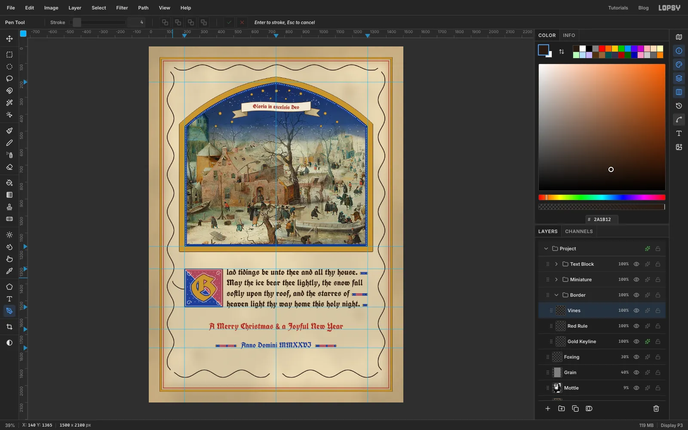

Add a layer called *Vines* and set the foreground to ink `#2A1B12`.
Freehand waves 1,700 px long never come out even, so draw them with the
**Pen** and set its **Stroke** to **4**. Every wave crest is one anchor.
Press on the crest and drag about 40 px along the direction of the stem
to make a smooth anchor:

- **Left margin:** start at **128, 150**. Then put a crest every **110
  px** down the page from y **205**, alternating between x **148** and x
  **108**. Finish at **128, 1908** and press [[Enter]] to stroke it.
- **Right margin:** the same, centred on x **1372**.
- **Top:** start at **150, 124** and put a crest every 110 px from x
  **205**, alternating between y **140** and y **108**. Finish at **1350,
  124**.
- **Bottom:** two stems centred on y **1930**, swinging 22 px either
  side. Each runs from a corner to just short of the centre (x **712** and
  x **788**); the roundel will hide their ends.
- **From the initial:** a short stem from the initial's left edge at
  **213, 1430**, curving down and back up into the left vine at about
  **140, 1385**.

After each [[Enter]], deselect the path in the **Paths** panel before
you start the next one.

## Add hairline tendrils

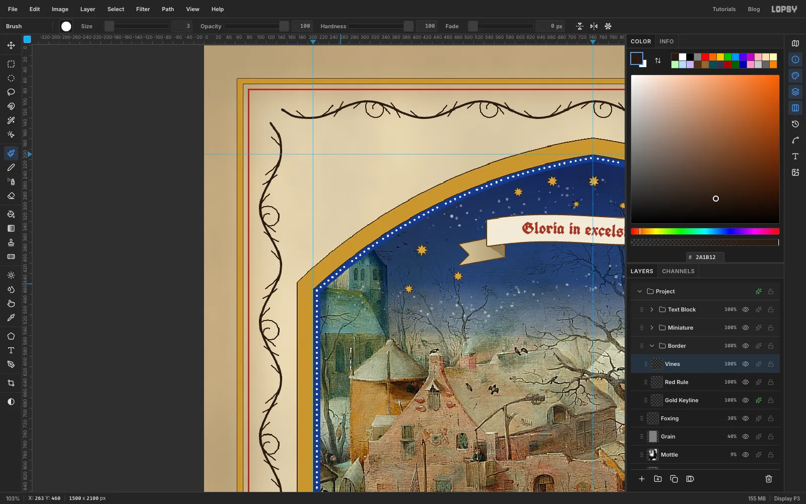

Medieval penwork repeats the same few strokes on every wave, so get one
wave right, then work along each stem. Pick the **Brush** (**Hard
Round**, **Size 3**) and zoom to 100% or more on the top-left corner. A
*crest* is each outward bulge of a stem, on either side. At every crest:

1. Starting on the stem at the crest, flick one curved hairline about 40
   px long. It crosses back over the stem and ends over the next hollow.
   A leaf will sit on its tip.
2. Flick a shorter one, about 25 px, backwards along the crest's own
   side. A gold dot will sit on its tip.
3. On every second crest, add a small spiral curl about 30 px across in
   the hollow beside it.

Where a stem crosses its centre line, add two tiny stalks about 15 px
long, one on each side. They'll carry leaves too. Quick, short strokes
make cleaner hairlines than slow ones; undo any that wobble. It's slow
work, so compare your corner with the screenshot before you go round the
page.

## Make an ivy-leaf brush

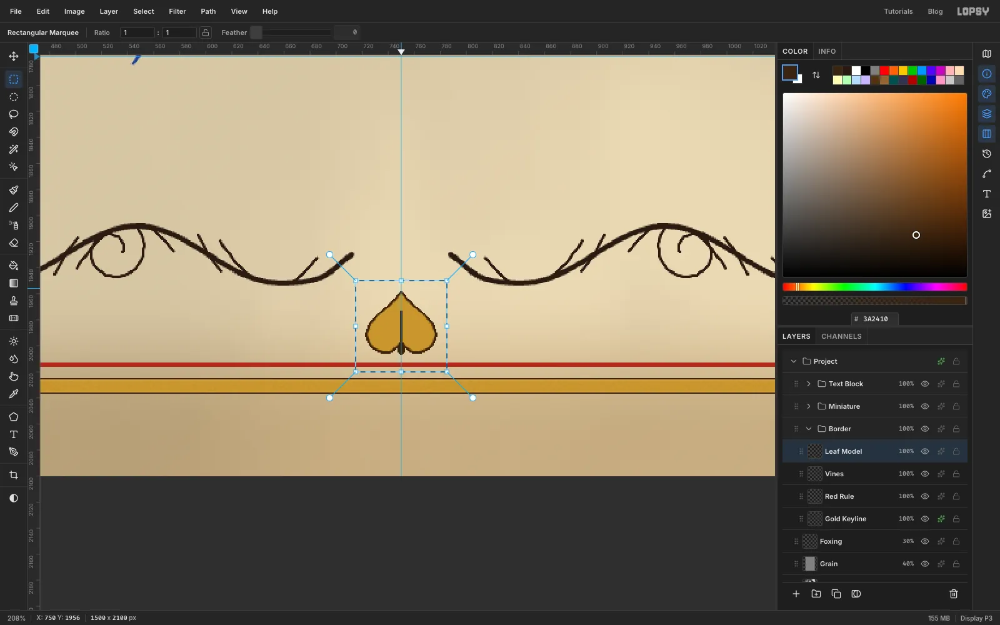

Add a layer called *Leaf Model* and zoom in on an empty spot near the
bottom margin. Drag the **Lasso** round a heart-shaped leaf about 50 px
wide, with its point up, and fill it with gold `#C19843`. With the brush
at **Size 2** in gold outline `#3A2410`, click at the notch and
**Shift**-click near the point to draw a midrib. Add a **Stroke** of
**Width 2** in `#3A2410`, then click **Rasterize Layer Style** in the
effects drawer.

Draw a square selection just around the leaf and choose **Edit → Define
Color Brush…**. Name it *Ivy Leaf*. Deselect and delete the *Leaf Model*
layer.

## Stamp the gold leaves

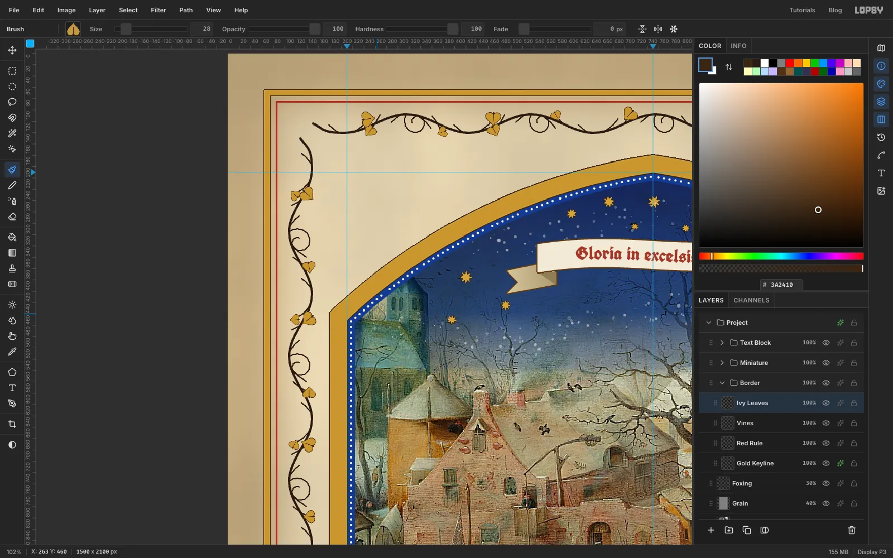

Click *Vines* and add a layer called *Ivy Leaves*. In the **Brushes**
panel's **Dynamics** tab, set **Angle Jitter** to **100**, so every leaf
lands at a different angle. Switch between **Size 20**, **24** and **28**
as you go, and click once at the tip of each leaf hairline and each tiny
stalk. Leave every second leaf position empty for the next step.

## Paint some leaves blue and rose

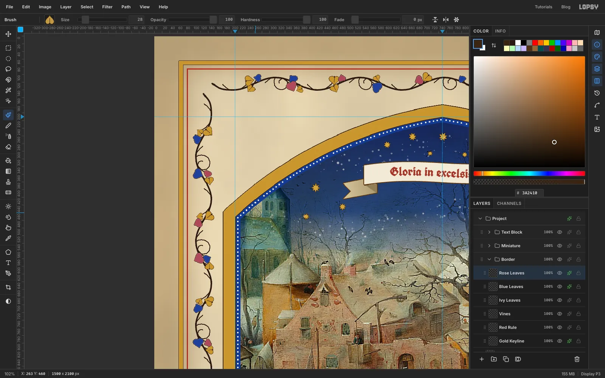

Gothic ivy borders mix gold leaves with painted ones. Add a layer called
*Blue Leaves* and stamp half of the empty positions with the same brush.
Give the layer:

- **Color Overlay** in lapis `#273E94`
- **Inner Glow**, **Size 2**, **Opacity 70**, in white lead `#F7F1E2`
- **Stroke**, **Width 1**, in ink `#2A1B12`

Add a layer called *Rose Leaves*, stamp the remaining positions, and give
it the same three effects with a rose `#A34E5B` overlay.

## Add bezants, rosettes and trefoils

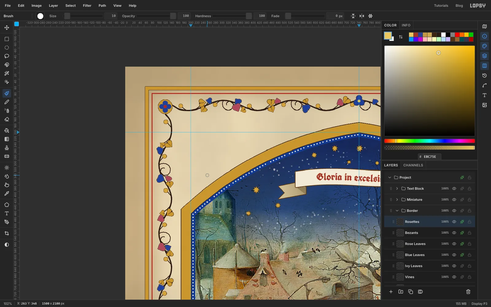

Add a layer called *Bezants*. In the **Brushes** panel, set **Angle
Jitter** back to **0**, choose the **Hard Round** preset and set **Size
14**. In star gold `#CDA64E`, click the tip of each short backward
hairline. Add a **Stroke** of **Width 1** in gold outline `#3A2410`.

Add a layer called *Rosettes*. At each corner where the vines meet
(**128, 128**, **1372, 128**, **128, 1930** and **1372, 1930**):

1. click a gold dab at **Size 46**
2. click four lapis dabs at **Size 17**, 11 px above, right, below and left
   of the centre
3. click a vermilion dab at **Size 11** in the middle

On the same layer, make trefoils from three **Size 20** dabs around a
point, with a **Size 10** gold dab in the middle. Put blue ones on the
left vine at **128, 1029** and on the top vine at **750, 110**, and red
ones at **1372, 1029**, **430, 1930** and **1070, 1930**. Add a **Stroke**
of **Width 1** in gold outline `#3A2410`.

## Turn a second star in the roundel

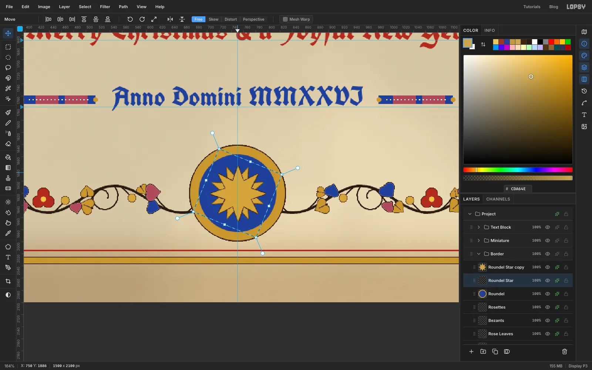

Add a layer called *Roundel*. Select a circle from **672, 1842** to **828,
1998** (radius 78 around **750, 1920**) and fill it with gold. Deselect,
select a smaller circle from **686, 1856** to **814, 1984** and fill it
with lapis. Add a **Stroke** (**Width 2**, gold outline `#3A2410`) and an
**Inner Glow** (**Size 2**, **Opacity 80**, highlight `#F0D68E`).

Add a layer called *Roundel Star*. With the **Pen**, draw an eight-point
star centred on the roundel, as you did for the model star: tips 46 px
from the centre and notches 23 px. Use **Path to Selection** and
**Delete Path**, fill it with star gold, and give it a **Stroke** of
**Width 1** in `#3A2410`. Click **Duplicate Layer**. The copy sits
exactly on top.

Click the original *Roundel Star* row and select a square from **694,
1864** to **806, 1976**. Pick the **Move** tool and drag a corner's
rotation handle until each point of this star sits exactly halfway
between two points of the copy: a sixteenth of a turn. There's no angle
readout, so zoom in and judge it by eye. Press [[Cmd+D]] to commit, then
give the original a **Color Overlay** of dark gold `#A98139`. The two
stars together make a sixteen-point star.

## Pearl the roundel

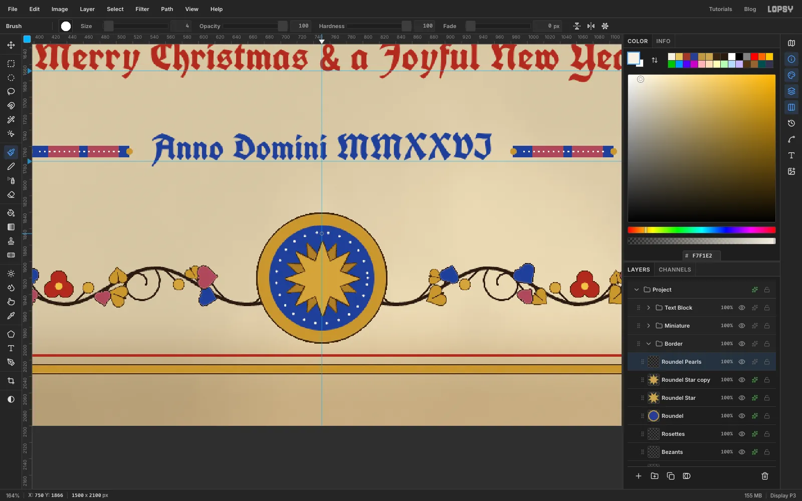

Click *Roundel Star copy* and add a layer called *Roundel Pearls*. Pick
the brush at **Size 4** with **Spacing 200**, in white lead. Pearl a
circle with a radius of 56 px around the star: click once on the circle,
then **Shift**-click about every 15 px round it, back to the start.

The bottom vines run in behind the roundel from both sides, so the
border reads as one unbroken plant.

## Warm the whole page

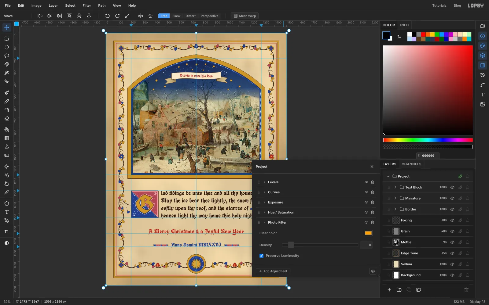

Collapse the three groups. Click the **✦** button on the *Project*
group's row, click **Add Adjustment** and choose **Photo Filter**. Set
**Density** to **8**. The adjustment is non-destructive and covers every
layer evenly, like a coat of old varnish, so all the gold stays the same
colour.

## Nudge the text block into balance

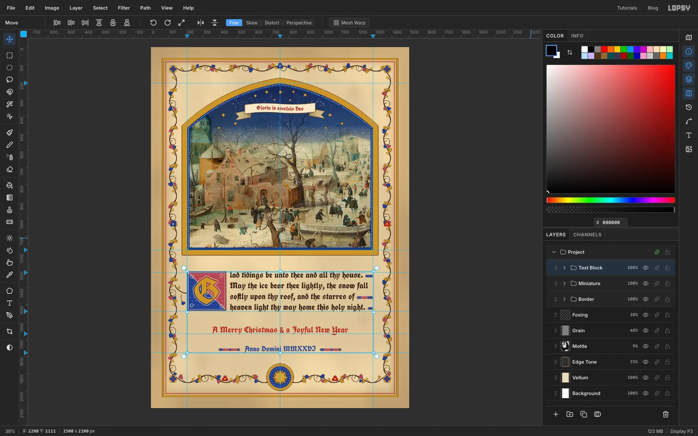

Step back and compare the gaps between the picture, the text and the
roundel. If the text block looks low, as it did here, click the *Text
Block* group's row, pick the **Move** tool and nudge it up with [[Up]].
This card took six presses. The initial, text, fillers, rubric and date
all move together.

Save with **File → Save Project**, then choose **File → Quick Export
PNG**.
