Gothic manuscripts were painted in a small, fixed kit of materials: gold
leaf, lapis blue, vermilion, a green, ink and the cream of the vellum. The
pages are full of standard pieces. There are pointed arches, gold-framed
miniatures set on a chequered **diaper** ground, ivy-leaf borders studded
with gold dots called **bezants**, and big **Lombardic** capitals that
alternate red and blue.

In this tutorial you'll put that kit together as a T-shirt print for an
imaginary monastery brewery, **Ambrosian Mead**. Saint Ambrose is the patron
saint of beekeepers, so the picture is a straw **skep** (a woven beehive)
with bees flying round it. The design is 1800 × 2400 px on a charcoal tee.

The bees start as a real photograph, then get repainted to match the flat
style. Download this public-domain honeybee from Wikimedia Commons. It was
taken by the USGS Bee Inventory and Monitoring Lab, and the bee is on a
black background:

- [Apis mellifera, dark body, back, beltsville, md](https://commons.wikimedia.org/wiki/File:Apis_mellifera,_dark_body,_back,_beltsville,_md_2017-05-26-15.01_(34240025053).jpg) (use the **1,280 × 1,027** download)

You'll use:

- the **Elliptical** and **Rectangular Marquee** with Shift (add), Alt (subtract) and Shift+Alt (intersect), and **Select → Shrink** and **Feather**
- the **Lasso** to trace a hive and a photo
- **Edit → Define Pattern** and **Fill with Pattern**
- the **Brush** with mirror and **Radial Symmetry**, and the **Pencil**
- **Add Noise**, **Clouds**, **Gaussian Blur**, **Motion Blur**, **Oil Paint**, **Invert**, **Desaturate**, **Brightness/Contrast** and **Hue/Saturation**
- **Inner Glow** and **Stroke** effects, and a group **Gradient Map**
- Move-tool scale, rotate and flip, **Copy** and **Paste**, and **groups**
- the **Text** tool, **Rasterize Layer**, and select-and-fill to colour single letters

The type is three free Google Fonts from Lopsy's font picker:

- **Uncial Antiqua** for the Lombardic capitals
- **UnifrakturCook** for the blackletter title
- **Grenze Gotisch** for the small lines

The palette is the illuminator's kit:

- Shirt `#1C1A1F` (the tee, not an ink)
- Vellum `#EEE1C0`, aged edge `#9C7A45`, ink `#2B1D14`
- Gold leaf `#D4A53A`, glint `#FFF1B0`, keyline `#7A5410`
- Lapis `#1A3A96`, vermilion `#A81E1A`, leaf green `#3E6B37`, dark green `#24432A`
- Straw `#D6A84E`, straw shadow `#6B4A1E`
- Bee map `#24160C` → `#8A5A1C` → `#D29A2A` → `#F7EDCF`
- Emblem map `#3A2408` → `#9A6A18` → `#D4A53A` → `#F6E3A0`
- Pearl white `#FBF6E8`, lattice gold `#D9B154`, flower gold `#E2B33C`
- Straw ridge `#F4D88E`, hive outline `#3A2410`, door `#24140A`, shadow green `#1E5225`

> **Tip:** Positions are written as `x, y` in document pixels from the top-left corner, and the status bar at the bottom left shows where the cursor is. Key names are Mac keys; on Windows and Linux use Ctrl for Cmd. For an exact rectangle or ellipse, **click once** with a marquee tool instead of dragging, and type the corners into the dialog. It only opens when nothing is selected, so press [[Cmd+D]] first. To set a colour, type its code into the Color panel's hex field.

## Set up the shirt and guides

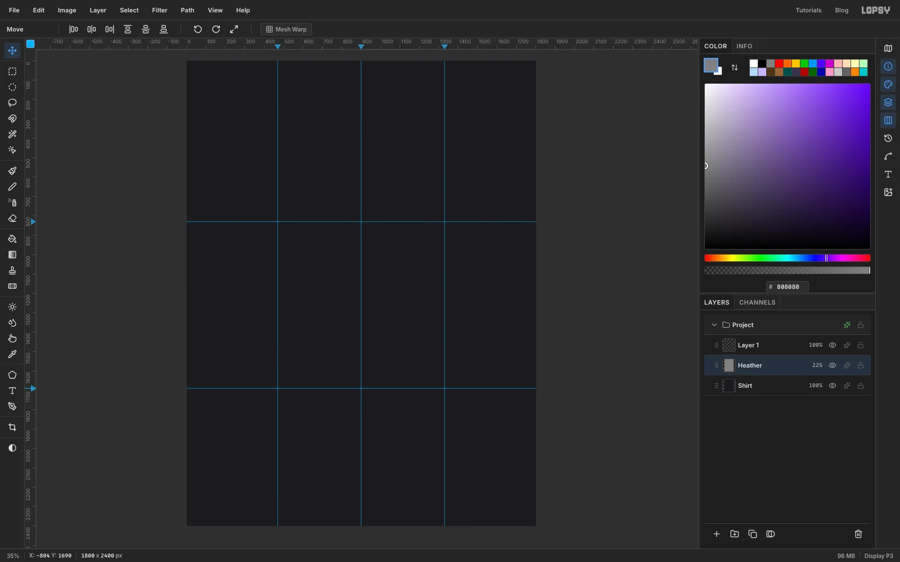

Open [Lopsy](/). In the **New Document** dialog set **Width** to `1800`
and **Height** to `2400`, and click **Create**.

1. Click **Background**, set the colour to `1C1A1F` and choose **Edit → Fill**. Rename the layer `Shirt` (double-click the name).
2. Add a layer named `Heather`. Fill it with `808080`. Choose **Filter → Add Noise…** with **Amount** `40`, **Mono** and **Gaussian**, then **Filter → Gaussian Blur…** with **Radius** `0.5`.
3. Open the layer's **fx** drawer, set the blend mode to **Overlay**, and set the layer's opacity to `22%`. The grey disappears, leaving a faint flecked heather.
4. Click the top ruler at **470**, **900** and **1330**, and the left ruler at **830** and **1690**. The square between them is where the picture goes.

The empty `Layer 1` that Lopsy adds to a new document stays in the stack. You'll use it later as a place to start a group.

## Draw a Gothic lancet arch

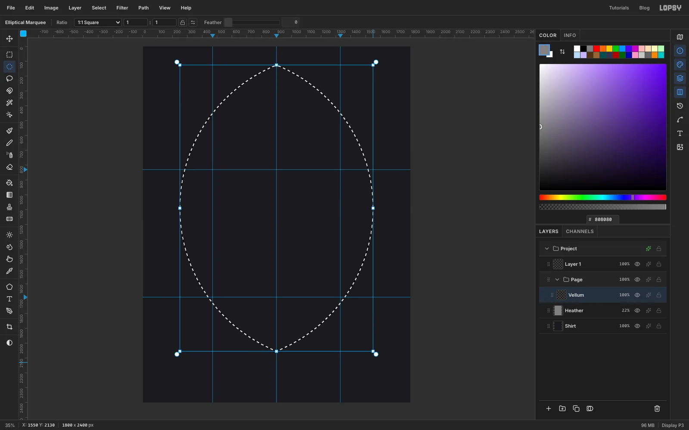

A pointed Gothic arch is where two circles overlap. Each side of the arch is
an arc drawn from a centre on the opposite side.

1. Click `Heather`, then click **New Group** at the bottom of the Layers panel and name it `Page`. Add a layer named `Vellum` inside it.
2. With the **Elliptical Marquee**, hold **Cmd** and drag a circle from `250, 50` to `2330, 2130`. It runs off the right of the canvas, so keep dragging onto the grey pasteboard. Cmd keeps it round.
3. Hold **Shift+Alt+Cmd** and drag a second circle from `-530, 50` to `1550, 2130`, starting on the pasteboard to the left. Shift+Alt keeps only the overlap, a tall pointed lens, and Cmd keeps this circle round too.
4. Switch to the **Rectangular Marquee**, hold **Shift**, and drag from `250, 1090` to `1550, 2200`. The rectangle adds the straight sides and the foot of the page.

The bigger the circles, the sharper the point. Circles only a little wider
than the arch give an almost round top.

## Fill the vellum and age its edges

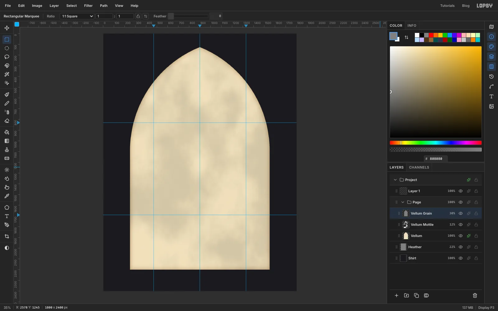

1. Set the colour to `EEE1C0`, choose **Edit → Fill**, and press [[Cmd+D]].
2. In the **fx** drawer tick **Inner Glow**: **Size** `70`, **Spread** `0`, **Opacity** `70`, colour `9C7A45`. Old vellum darkens towards its edges.
3. Add a layer named `Vellum Mottle`. **Cmd-click** the `Vellum` thumbnail to select the page, then choose **Filter → Clouds…** with **Scale** `6`. Set it to **Multiply** at `12%`.
4. Add a layer named `Vellum Grain`. Cmd-click the `Vellum` thumbnail again and fill with `808080`. Run **Add Noise…** at `30` (**Mono**, **Gaussian**) and **Gaussian Blur…** at `1`, deselect, and set it to **Overlay** at `30%`.

Leave the page without a drop shadow. On a shirt, a shadow prints as a muddy
grey band.

## Grow the gold frame in from the edge

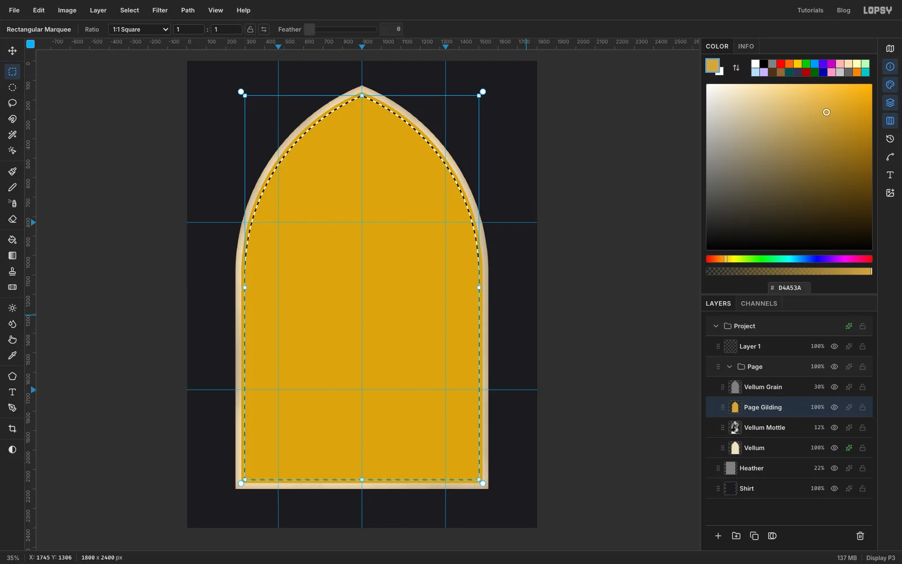

**Select → Shrink** follows any shape, so the frame comes straight off the
page outline.

1. Click `Vellum Mottle` and add a layer named `Page Gilding`.
2. Cmd-click the `Vellum` thumbnail, choose **Select → Shrink…** and enter `30`.
3. Fill with `D4A53A`.
4. Choose **Select → Shrink…** again with `18` and press **Delete**. That leaves an 18 px gold band. Press [[Cmd+D]].

## Gild it and rule the margin

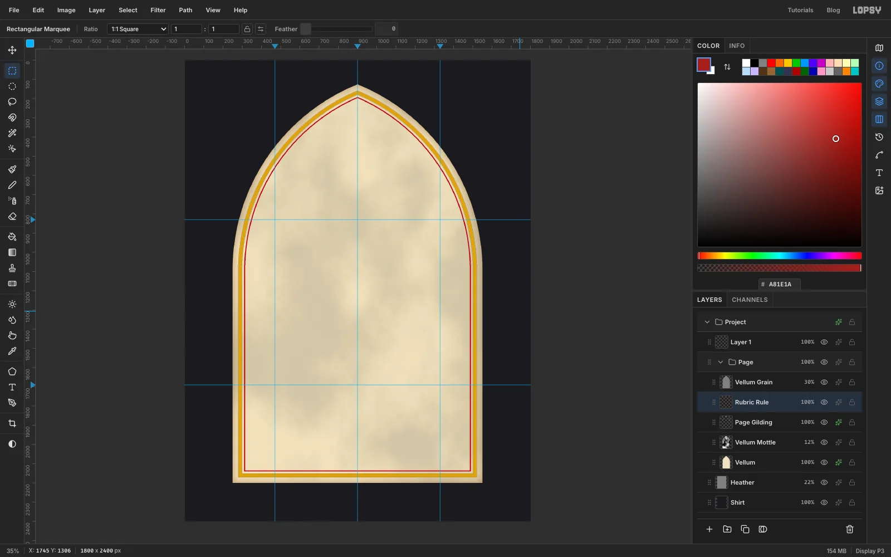

Painted gold leaf is flat in colour. What makes it read as metal is a
bright edge and a crisp outline, not a 3D bevel.

1. Cmd-click the `Page Gilding` thumbnail and run **Add Noise…** at `6`, **Mono**, for a hammered surface. Deselect.
2. In the **fx** drawer tick **Inner Glow**: **Size** `3`, **Opacity** `90`, colour `FFF1B0`. Tick **Stroke**: **Width** `1`, colour `7A5410`.
3. Add a layer named `Rubric Rule`. Cmd-click `Vellum`, shrink by `60`, fill with `A81E1A`, shrink by `5` more and press **Delete**, then [[Cmd+D]]. You now have a 5 px red rule just inside the gold.

You'll gild every gold shape in this design the same way: noise, a pale inner glow and a thin dark stroke.

## Paint a diaper tile

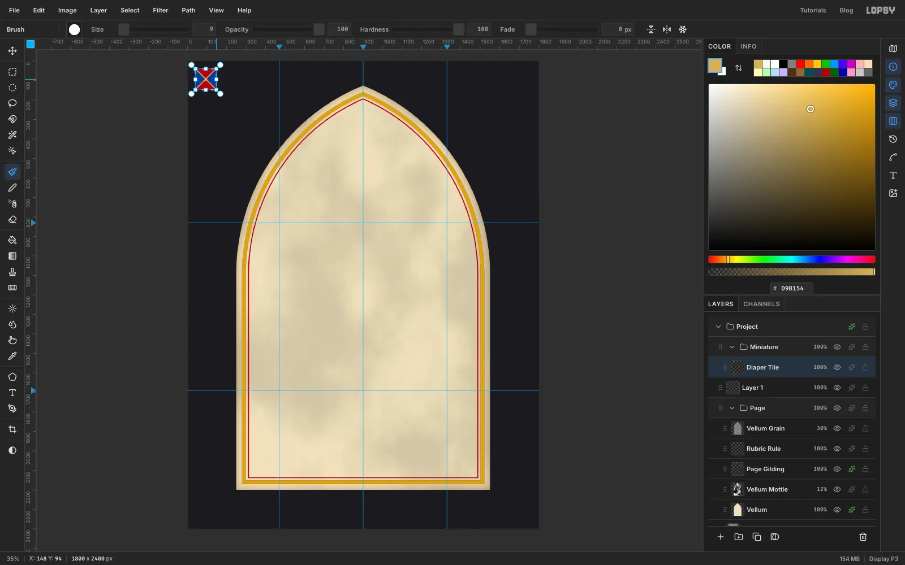

A **diaper** is the chequered ground behind a medieval miniature. Here it's
red and blue lozenges in a gold lattice. You only paint one square, and
Lopsy tiles it.

1. Click `Layer 1`, click **New Group** and name the group `Miniature`. Add a layer named `Diaper Tile`.
2. Click once with the **Rectangular Marquee** and enter **From** `40, 40` **To** `148, 148`. Fill with `1A3A96`.
3. With the **Lasso**, drag a triangle from just outside the top-left corner, to just outside the top-right corner, to the centre at `94, 94` and back. Hold **Shift** and drag the same triangle along the bottom edge.
4. Switch to the Rectangular Marquee, hold **Shift+Alt** and drag around the square to trim the triangles to it. Fill with `A81E1A` and deselect.
5. Click once again for the `40, 40` to `148, 148` square. Pick the **Pencil**, **Size** `4`, colour `D9B154`. Click just outside one corner and **Shift-click** just outside the opposite corner, then do the other diagonal. The selection keeps the lines inside the tile.
6. With the **Brush** at **Size** `15`, **Hardness** `100`, click a gold dot on each corner and on the centre. Switch to **Size** `9` and click white (`FBF6E8`) dots at the middle of the top and bottom edges, then gold ones at the middle of the left and right edges.
7. With the square still selected, choose **Edit → Define Pattern** and press [[Cmd+D]]. Then delete the `Diaper Tile` layer.

Half dots on the edges are deliberate. When the tiles meet, the halves join
into whole dots.

## Tile the diaper into the miniature

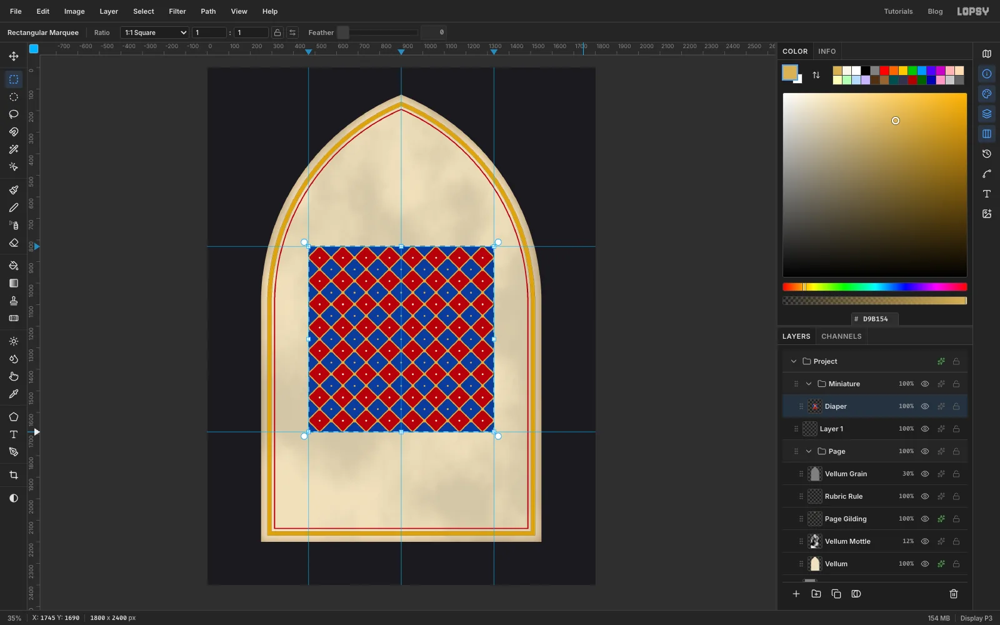

1. Click the `Miniature` group row and add a layer named `Diaper`; it goes inside the group. Click once with the Rectangular Marquee and enter `470, 830` to `1330, 1690`, the square between your guides.
2. Choose **Edit → Fill with Pattern…** and pick your tile.
3. Set **Horizontal Offset** to `33` and **Vertical Offset** to `17`. The first centres a lozenge left to right, so the pattern is cut evenly at the left and right edges, and the second does the same top to bottom. Click **Apply** and deselect.

## Frame the miniature in gold

1. Add a layer named `Miniature Frame`. Click once with the Rectangular Marquee and enter `444, 804` to `1356, 1716`. Fill with `D4A53A` and press [[Cmd+D]].
2. Click once more and enter exactly the diaper's square, `470, 830` to `1330, 1690`, then press **Delete** and [[Cmd+D]]. That leaves a 26 px band that butts right up against the pattern. A hole any bigger leaves a cream hairline of vellum showing between the gold and the diaper.
3. Gild it as in the "Gild it and rule the margin" step: noise `6`, Inner Glow and Stroke.

If you want to check that everything lines up, **View → Show Grid** puts a
grid over the canvas. Turn it off again before you draw, because it also
snaps.

## Lay the green mound

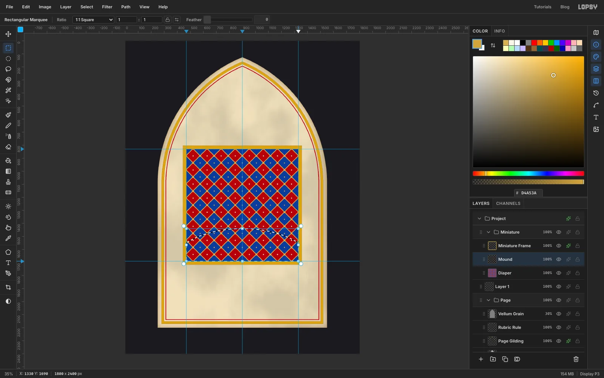

1. Click `Diaper` and add a layer named `Mound`.
2. With the Elliptical Marquee, drag from `360, 1440` to `1440, 2000`. Then hold **Shift+Alt** with the Rectangular Marquee and drag around the miniature square to cut the ellipse off at the frame.
3. Fill with `3E6B37`, deselect, and add an **Inner Glow**: **Size** `40`, **Opacity** `80`, colour `24432A`.
4. Add a layer named `Skep Shadow`. Drag an ellipse from `676, 1500` to `1124, 1558` and fill it with `1E5225`. A hard-edged pool of shadow looks painted. A blurred one looks like a photo.

## Trace the skep

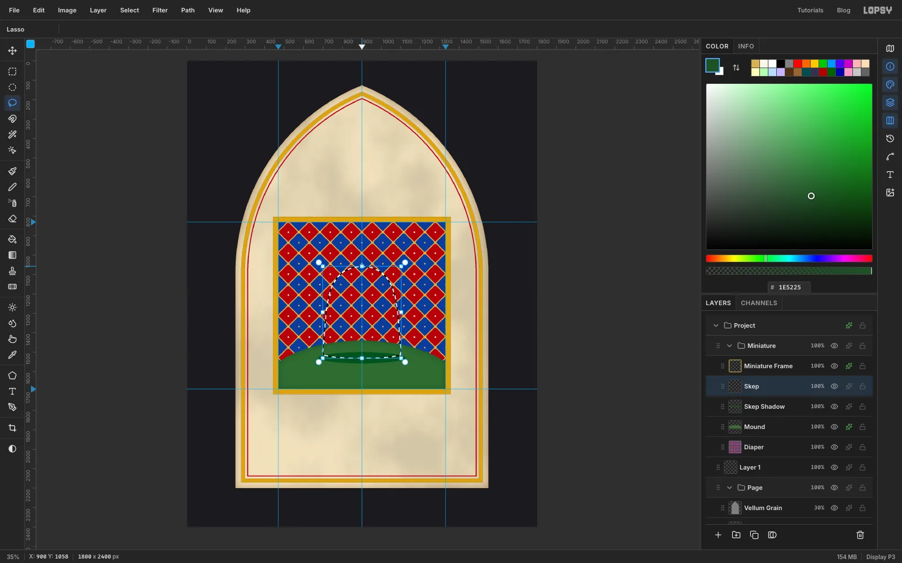

1. Add a layer named `Skep`.
2. With the **Lasso**, drag round a bell shape. Start at the top at about `900, 1058`. Go down the left side, bulging out to `720, 1280` and to the widest point at `698, 1494`. Round the corner and run along a slightly curved base that dips to about `900, 1530`, then come back up the right side through `1102, 1494`. Make the sides nearly straight towards the bottom.
3. Fill with `D6A84E`, deselect, and add a **Stroke** of `3` in `3A2410`.

## Coil the straw and stitch it

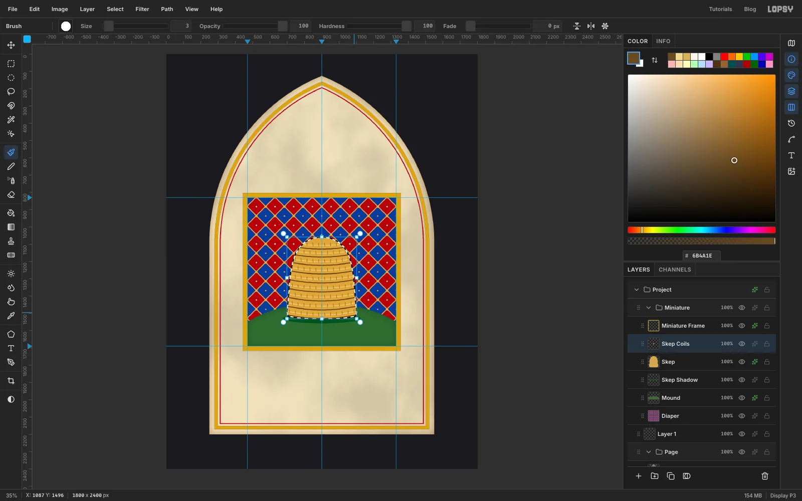

A skep is a rope of straw coiled round and round, bound with split bramble.
Each coil is a dark groove, a pale ridge and a row of stitches.

1. Add a layer named `Skep Coils` and Cmd-click the `Skep` thumbnail. The brush will now stay inside the hive.
2. **Brush**, **Size** `7`, **Hardness** `100`, colour `6B4A1E`. Drag nine strokes across the hive, evenly spaced from just under the top down to just above the base, about 50 px apart. Let each one sag in the middle by about half the gap between coils, so the coils look round.
3. Set **Size** `6`, **Hardness** `60`, **Opacity** `70`, colour `F4D88E`, and drag the same arcs again 20 px higher for the ridges.
4. Set **Size** `3`, **Opacity** `100`, colour `6B4A1E`. Drag a short vertical stitch across every coil, then more along the coil, each a little shorter than the coil is tall and spaced about twice that apart. Shift each row half a step so the stitches stagger like brickwork.

## Add straw grain and the door

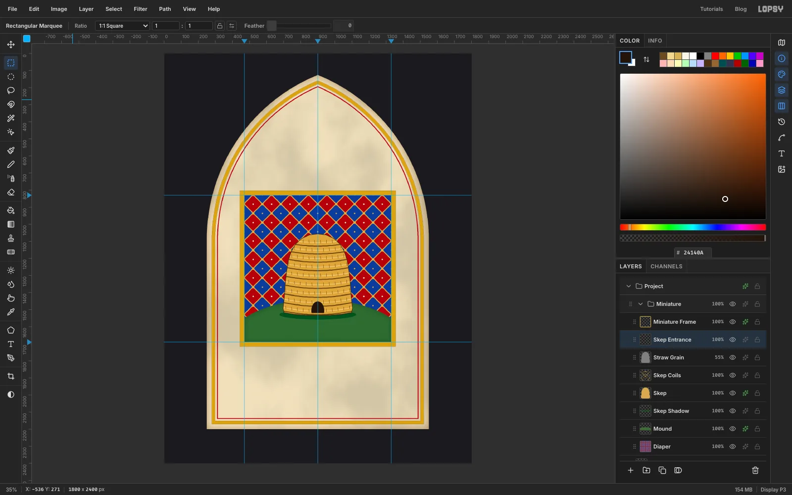

1. Keep the selection and add a layer named `Straw Grain`. Fill it with `808080`, then run **Add Noise…** at `70` (**Mono**) and **Filter → Motion Blur…** with **Angle** `0` and **Distance** `28`. Deselect and set it to **Overlay** at `55%`. The noise smears into straw running round the coils.
2. Add a layer named `Skep Entrance`. Drag an ellipse from `862, 1452` to `938, 1560`. Switch to the Rectangular Marquee, hold **Alt** and drag from `840, 1520` to `960, 1580` to cut off the bottom. Fill with `24140A`.

Keep the hive flat: no gradient across it. In an illumination, the
outline and the coils show its shape.

## Drop in the bee photo

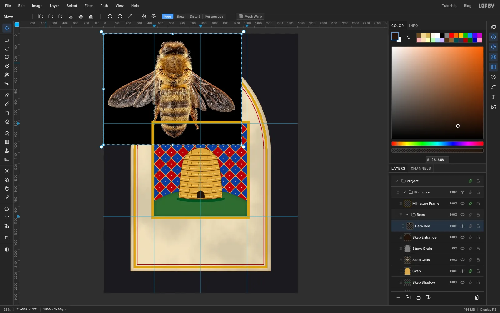

1. With `Skep Entrance` selected, click **New Group** and name it `Bees`. It goes inside `Miniature`, above the hive.
2. Drag the downloaded bee photo onto the canvas. It lands in the top-left corner on its black background. Rename the layer `Hero Bee`.

## Trace the bee with the Lasso

The wings are see-through, so the Magic Wand would leak into them through
the black. Trace the bee by hand instead.

1. With the **Lasso**, drag slowly round the outside of the bee: over the head, out along the top edge of each wing to its tip, back under the wings, and down round the legs and abdomen. Stay just outside the hairs.
2. Choose **Select → Inverse** and press **Delete**, then deselect.

## Scale the bee down

1. Drag a Rectangular Marquee round the bee.
2. Pick the **Move** tool, hold **Cmd** and drag the bottom-right handle in until the bee is about **220 px** wide. Press **Enter** and deselect.
3. The photo leaves a dark fringe. Cmd-click the layer thumbnail, then choose **Select → Shrink…** at `2` and **Select → Feather…** at `1`. Choose **Select → Inverse**, press **Delete** to trim it off, then press [[Cmd+D]].

## Paint the bee flat

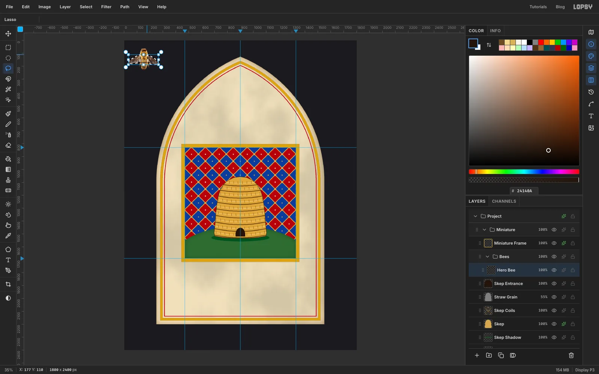

1. Run **Filter → Oil Paint…** with **Radius** `2` and **Sharpness** `1.5`. The fur becomes painted patches. Then run **Hue/Saturation…** with **Saturation** `20` and **Lightness** `4`.
2. With the Lasso, draw round the left wing, then hold **Shift** and draw round the right one.
3. Choose **Filter → Invert**. The dark membrane turns pale and the veins turn dark, like ink lines. Then **Filter → Desaturate**, and **Brightness/Contrast…** with **Brightness** `40` and **Contrast** `25`. Deselect.
4. Add a **Stroke** of `2` in `2A1A10`, then click **Rasterize Layer Style** in the drawer. The outline becomes part of the pixels, so every copy you paste will have one.

## Turn the hero bee and set it in place

1. Drag a marquee round the bee. With the **Move** tool, drag from just outside a corner to turn it about **28° counter-clockwise**, so it flies up and to the left. Press **Enter** and deselect.
2. Drag the bee into the top right of the miniature, centred near `1150, 935`. Keep at least 25 px of diaper between it and the top of the hive.

## Copy and paste the smaller bees

1. Drag a marquee round `Hero Bee`, press [[Cmd+C]], then [[Cmd+V]]. The copy arrives on a new layer as a live transform. Rename it `Bee West`.
2. Cmd-drag a corner handle in until it's about **130 px** wide and press **Enter**.
3. Paste two more: `Bee Low West` at about **110 px** and `Bee Low East` at about **95 px**. Before scaling `Bee Low West`, click **Flip Horizontal** in the Move options bar so it isn't an exact copy.

Different sizes make the bees look like a swarm at different distances
instead of four stamps.

## Turn each bee towards the hive

Rotate each small bee the same way you turned the hero, then move it into
place:

- `Bee West` heads up and to the right, near `650, 930`.
- `Bee Low West` heads down towards the door, near `578, 1330`.
- `Bee Low East` heads in towards the hive at a different height, near `1236, 1175`.

Keep them off a grid: four bees at matching heights look like decoration,
not flight.

## Recolour every bee at once

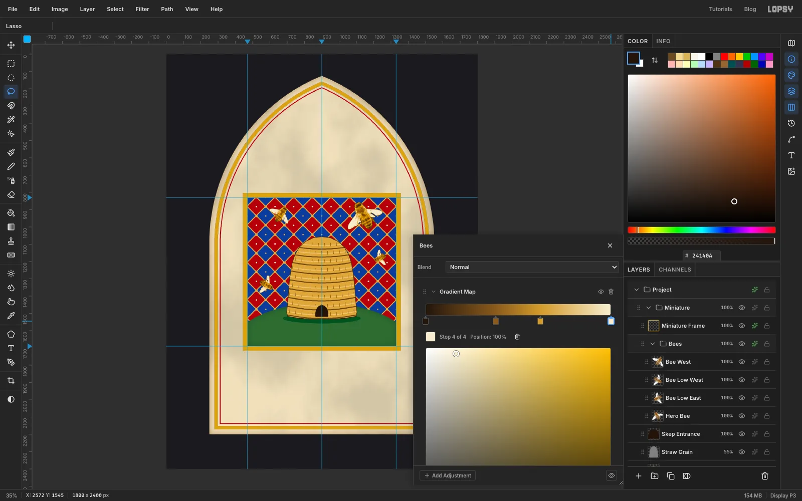

The photo colours still look like a photo. A **Gradient Map** on the group
repaints all four bees by brightness.

1. Click the `Bees` group row and open its **fx** drawer. Click **Add Adjustment → Gradient Map**.
2. Click the gradient bar twice to add two stops near `38%` and `62%`. Click each stop and type its colour: `24160C`, `8A5A1C`, `D29A2A`, `F7EDCF`.

The dark stripes become sepia, the fur ochre, and the wings cream. That's
the illuminator's flat colouring, and it's the same on all four bees.

## Scatter the millefleurs

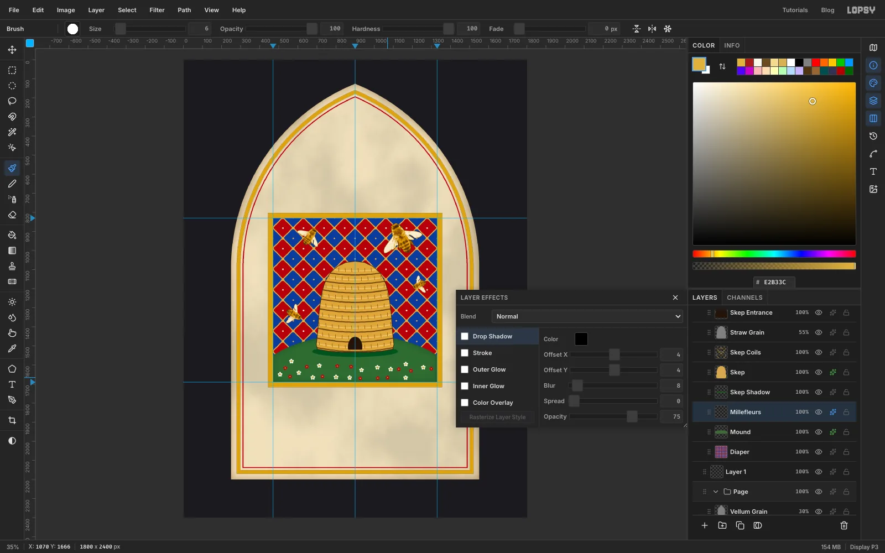

1. Click `Mound` and add a layer named `Millefleurs`.
2. **Brush**, **Size** `10`, **Hardness** `100`, colour `FBF6E8`. Make a flower by clicking five dots in a small ring. Make about sixteen across the grass, keeping clear of the hive.
3. Make about a dozen more in `A81E1A` at **Size** `9`, in the gaps.
4. Give every flower a centre: click a single dot in `E2B33C` at **Size** `8` for the white ones and `6` for the red ones.

## Mirror an ivy vine down both margins

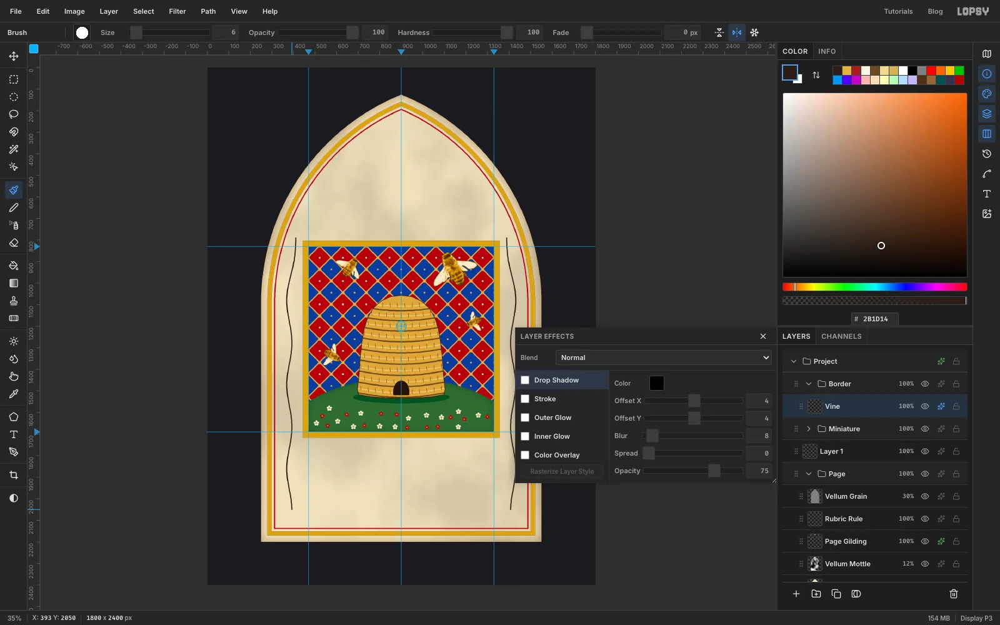

1. Collapse the `Miniature` group, click its row, then click **New Group** and name it `Border`. Add a layer named `Vine`.
2. Pick the **Brush**, **Size** `6`, colour `2B1D14`, and click **Symmetry Vertical** in the options bar (the mirror icon). Everything you paint on the left is copied on the right.
3. Drag a gently waving stem down the left margin, from about `410, 790` to about `380, 2060`. Let it swing a little to each side, a full wave roughly every 120 px. Near the top, keep it about 65 px inside the red rule, because the arch curves in there.
4. At **Size** `2`, add a small curling tendril at every swing of the stem.

## Leaf the vine and stud it with bezants

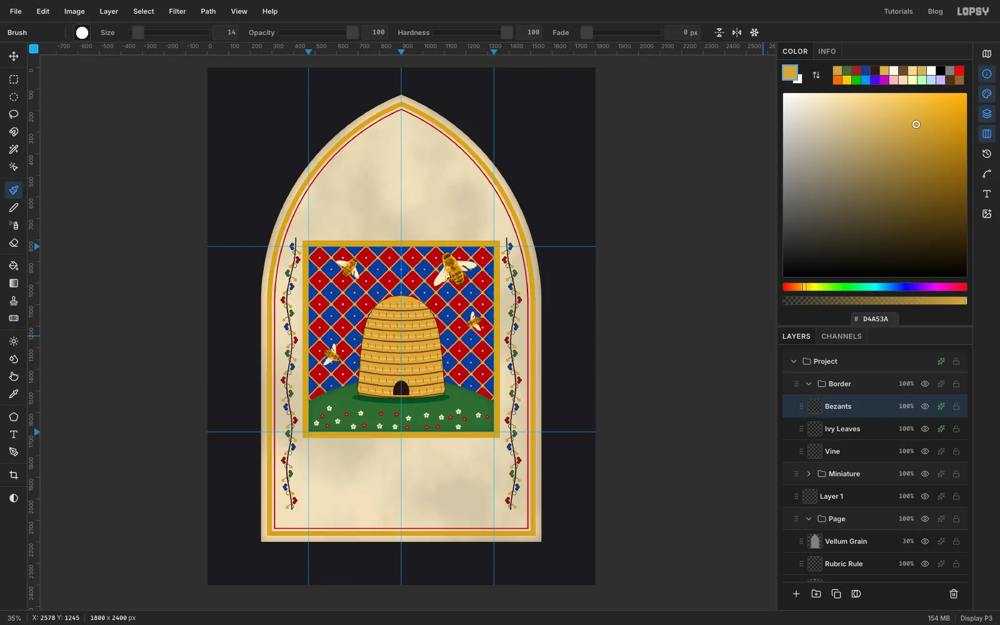

1. Add a layer named `Ivy Leaves`. With the **Brush** at **Size** `13`, make each leaf from three dabs in a fan, one straight out from the stem and one each side. Put a leaf at every swing, alternating sides of the stem. Cycle the leaves through `1A3A96`, `A81E1A` and `3E6B37` in turn.
2. Add a **Stroke** of `2` in `2B1D14`.
3. Add a layer named `Bezants`. At **Size** `14` in `D4A53A`, click a gold dot on the opposite side of the stem from each leaf. Gild the layer as before.
4. Click **Symmetry Vertical** again to turn the mirror off.

Keep at least 25 px between the leaves and both the frame and the red rule.

## Set a roundel in the point of the arch

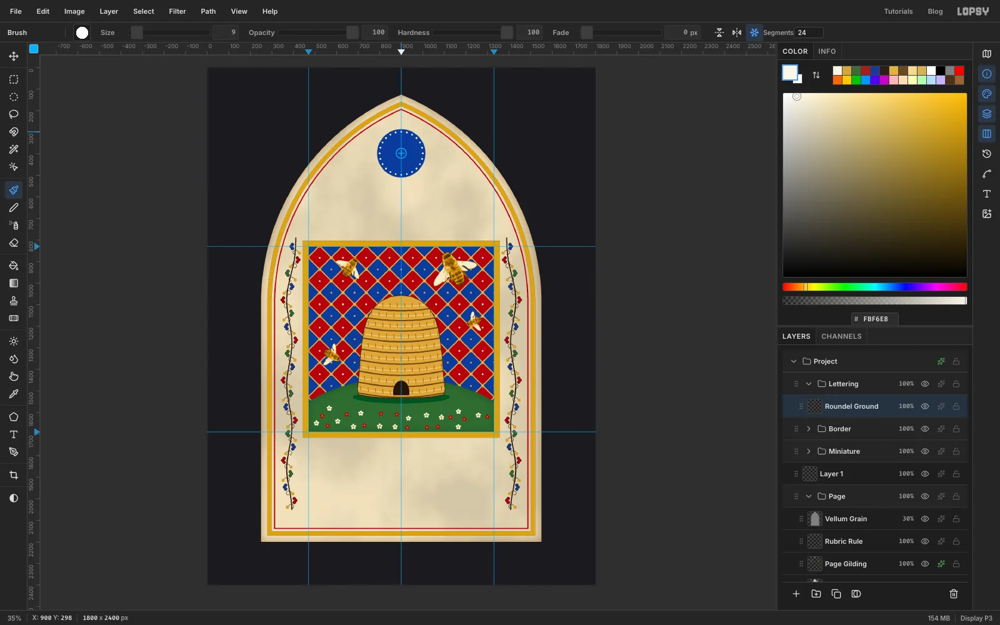

1. Collapse `Border`, click its row, click **New Group** and name it `Lettering`. Add a layer named `Roundel Ground`.
2. Click once with the Elliptical Marquee and enter `788, 286` to `1012, 510`. Fill with `1A3A96` and deselect.
3. Pick the **Brush** at **Size** `9`, colour `FBF6E8`. Click **Radial Symmetry** and set **Segments** to `24`. **Cmd-click** the centre of the disc (`900, 398`) to put the symmetry centre there.
4. Click once just inside the top of the disc. You get twenty-four evenly spaced pearls. Turn Radial Symmetry off.
5. Add a layer named `Roundel Gilding`. Click once with the Elliptical Marquee for `774, 272` to `1026, 524`, fill with `D4A53A` and press [[Cmd+D]]. Click once more for the inner circle `788, 286` to `1012, 510`, press **Delete** and [[Cmd+D]]. Gild the ring.

## Gild an emblem bee

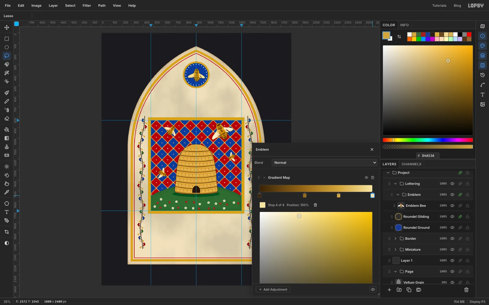

1. Expand `Miniature` and `Bees`, click `Hero Bee`, drag a marquee round it and press [[Cmd+C]]. Press [[Cmd+D]] and collapse the groups again.
2. Click `Roundel Gilding`, click **New Group** and name it `Emblem`, then press [[Cmd+V]]. Rename the pasted layer `Emblem Bee`. Cmd-drag a corner handle until it's about **160 px** wide, press **Enter**, then turn it **28° clockwise** so it stands upright, press **Enter** and deselect. Centre it in the disc.
3. Give `Emblem` its own **Gradient Map**: `3A2408`, `9A6A18` at `40%`, `D4A53A` at `70%`, and `F6E3A0`.

An upright gold bee on blue is a heraldic charge, the kind of badge an
abbey would paint over its door.

## Make room for the title

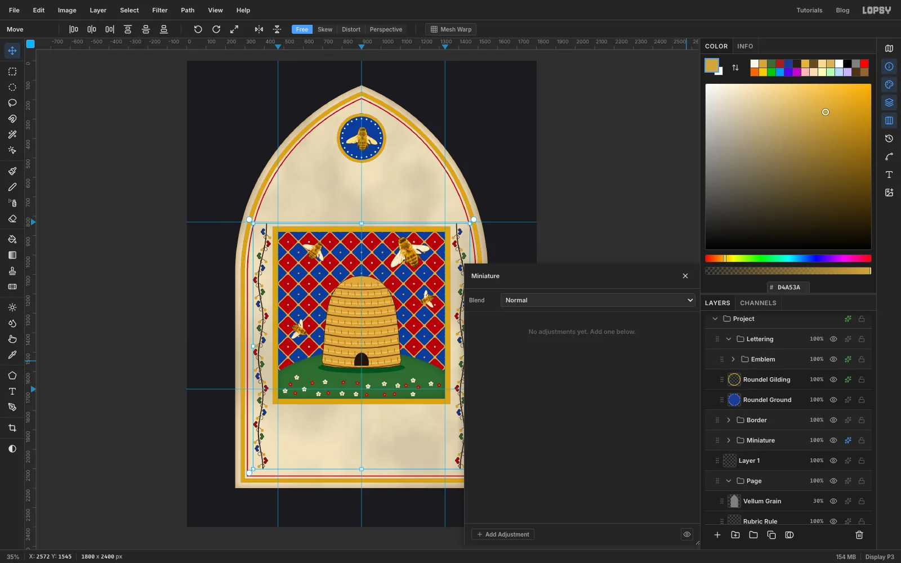

With the roundel in, the gap above the picture is too tight for the title.

1. Click the `Miniature` row and **Shift-click** the `Border` row.
2. Pick the **Move** tool and press [[Shift+Down]] five times. Both groups move 50 px down together.

## Build the illuminated initial

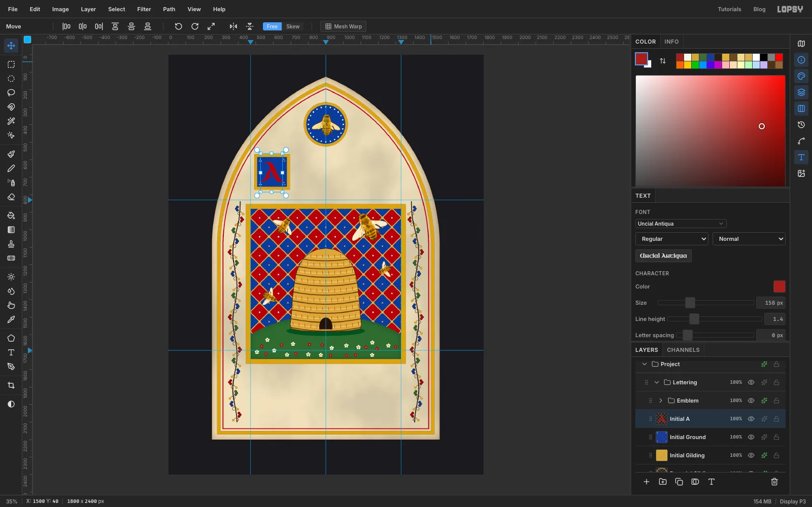

1. Click `Roundel Gilding` and add a layer named `Initial Gilding`. Fill the square `492, 569` to `694, 771` with `D4A53A`, press [[Cmd+D]] and gild it.
2. Add a layer named `Initial Ground`. Fill `508, 585` to `678, 755` with `1A3A96`. With a white **Size** `6` brush, click a three-dot cluster into each corner.
3. Pick the **Text** tool. Set **Uncial Antiqua**, **Size** `158`, colour `A81E1A`. Click an empty part of the canvas, type `A`, press **Tab** and rename the layer `Initial A`. Move it to the middle of the blue square, with about 12 px of blue on each side.
4. Add a **Stroke** of `2` in white. The A stands off the blue the way a white-lined capital does.

Uncial Antiqua's A has a pointed top and a crossbar, so it can't be read as
a U. Blackletter capitals can.

## Set the title and its penwork

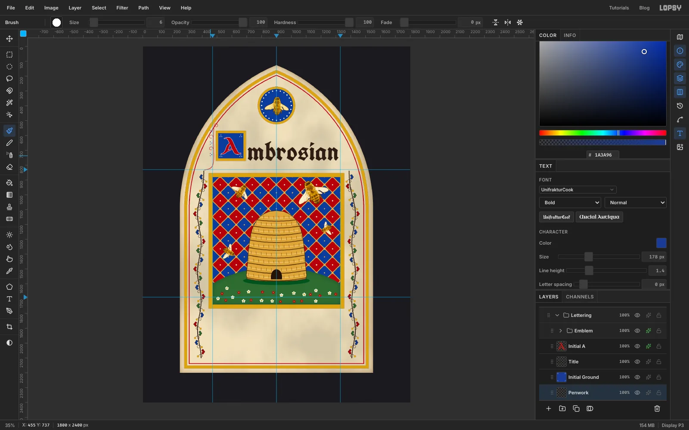

1. Click `Initial Ground` (a raster layer, so the new type doesn't restyle the A). Type `mbrosian` in **UnifrakturCook**, **Size** `178`, colour `2B1D14`, and rename the layer `Title`.
2. Move it so its left edge is about 12 px right of the gold box and the bottom of its letters sits exactly on the box's bottom edge (`771`). The box should read as the first letter of the word.
3. Click `Initial Gilding` and add a layer named `Penwork`. With a **Size** `4` brush in `A81E1A`, draw a stem from just above the box down its left side, curving out to join the top of the left-hand vine.
4. At **Size** `3`, add a curl at its top and two small curls off its left side. Click a few three-dot sprays in `1A3A96` at **Size** `6` beside it.

## Type MEAD in Lombardic capitals

1. Click `Initial Gilding` again. Type `MEAD` in **Uncial Antiqua**, **Size** `176`, colour `1A3A96`, and rename the layer `Mead`. In the Text panel set **Letter spacing** to `40`.
2. Centre it on the middle guide with the top of the tall D at `1800`. That leaves about 30 px clear under the gold frame.
3. Click **Rasterize Layer** at the bottom of the Layers panel.

## Rubricate the E and D

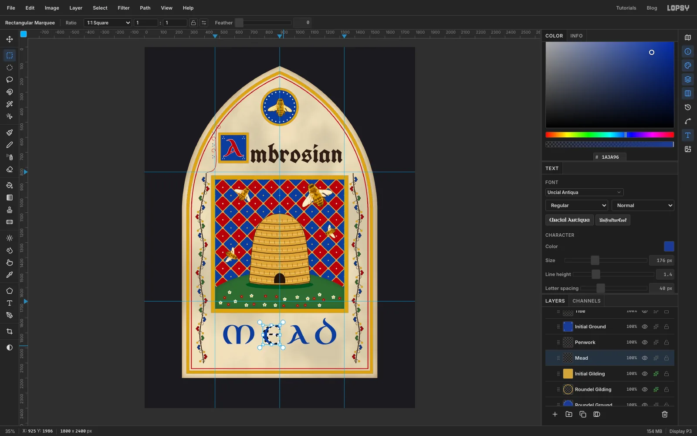

Lombardic capitals alternate blue and red. You'll recolour two letters by
selecting them, not by retyping.

1. Cmd-click the `Mead` thumbnail to select the letters.
2. With the Rectangular Marquee, hold **Shift+Alt** and drag a box round the **E**. Start and finish halfway into the gaps on either side, so you catch the tips of its serifs. Only the E stays selected.
3. Fill with `A81E1A`. Repeat for the **D**, then deselect.
4. Add a **Stroke** of `2` in `2B1D14`.
5. Add a layer named `Lozenges`. With the Lasso, draw a small diamond (about 22 × 38 px) in each gap, centred on the letters' middle height. Hold **Shift** for the second and third so they add to the selection. Fill with `D4A53A`, deselect, and gild them.

## Add the tagline and the date

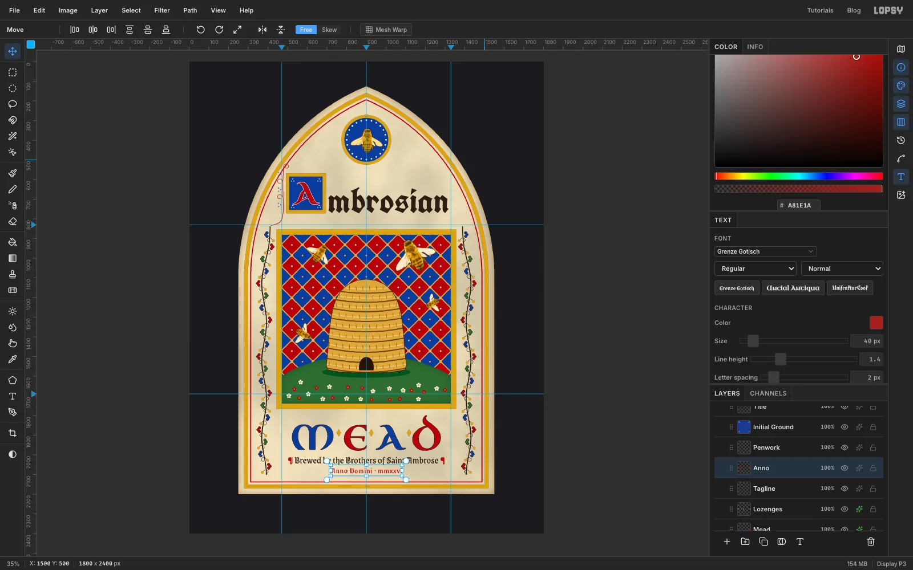

1. Click `Lozenges`. Type `¶ Brewed by the Brothers of Saint Ambrose ¶` (on a Mac, ¶ is **Option+7** and · is **Option+Shift+9**) in **Grenze Gotisch**, **Size** `50`, colour `2B1D14`. Rename it `Tagline` and centre it about 34 px below MEAD. It should be narrower than MEAD and well clear of the vines.
2. Rasterize it. Cmd-click its thumbnail, Shift+Alt-drag a box round the first ¶, and fill with `A81E1A`. Do the same for the last ¶, then deselect.
3. Type `Anno Domini · mmxxvi` in **Grenze Gotisch**, **Size** `40`, colour `A81E1A`, **Letter spacing** `2`. Rename it `Anno` and centre it 16 px below the tagline. Scribes often wrote numerals in lowercase, and a run of Grenze's blackletter capital Ms is hard to read, so only the two words keep their capitals.

Check the bottom margin: there should be at least 30 px between the date and the red rule.

## Finish and export

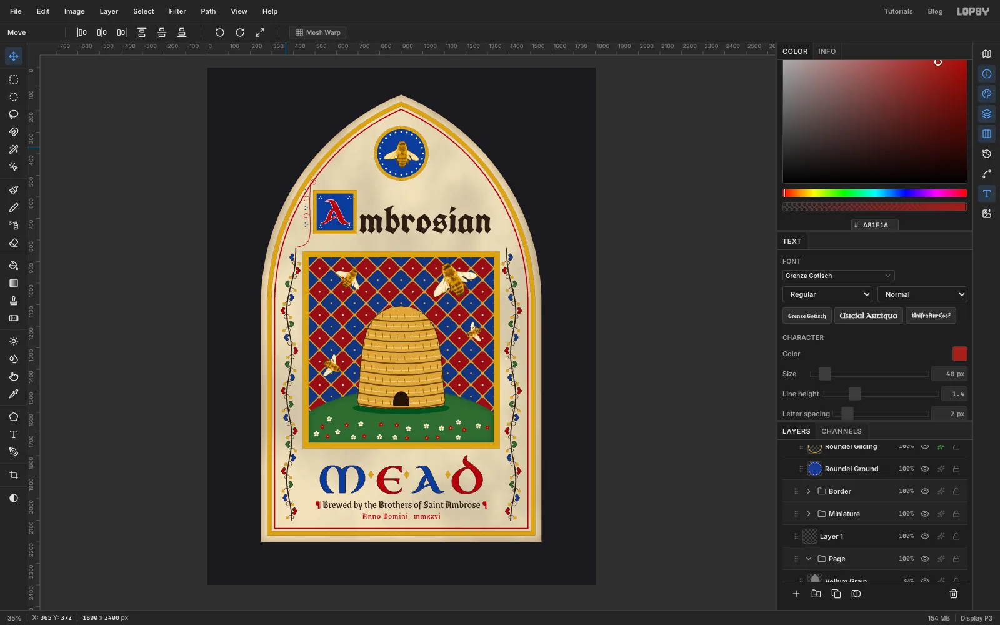

1. Expand `Miniature`, click `Diaper` and run **Hue/Saturation…** with **Saturation** `-10` and **Lightness** `-5`. The pattern stays in the same red and blue as the lettering, just a step quieter, so the bees and hive lead.
2. Untick **View → Show Guides** to hide the guides.
3. Choose **File → Save Project**, then **File → Quick Export PNG**.

For a print-ready file, hide `Shirt` and `Heather` before exporting so the
page sits on transparency. Look at it at thumbnail size: "Ambrosian" and
"MEAD" should read at a glance, and the bee and hive should still be the
first thing you see.
