The margins of 14th-century prayer books are full of rabbits behaving
badly. Scribes in England and northern France drew them riding snails into
battle, jousting with knights and putting armoured men to flight. Scholars
call the reversal funny for the same reason it still is: the most timid
animal in the field wins.

In this tutorial you'll turn that joke into a T-shirt graphic called
**Hare Insurrection**. It's a vellum page on a charcoal shirt. A burnished
gold initial **H** holds a real hare, cut out of Albrecht Dürer's
public-domain *Young Hare* (1502), who carries a lance like a knight's
standard. Below are a ribbon scroll, red rubric lines, ivy borders and a
small joust at the bottom of the page, called the *bas-de-page*. The canvas is
**1500 × 1800 px**.

Along the way you'll use:

- the **Pen** tool, **Path to Selection** and **Stroke Path** (Enter) for most of the shapes, including a spiral
- the exact-corner **Marquee** dialog for borders and frames
- **Define Pattern** and **Fill with Pattern** for a diapered background
- **Define Brush** with **Angle Jitter** for ivy leaves
- a **layer mask** filled with **Clouds** for warm foxing stains
- a photo cutout with the Pen, the **Magic Wand**'s Alt-click subtract, and copy and paste
- **scale**, **rotate** and **Flip Horizontal** with the Move tool, on layers and on whole groups
- an uncial initial in **Uncial Antiqua**, **text on a path** in **Pirata One** with a recoloured first letter, and rubrics in **Almendra SC**
- **Stroke**, **Inner Glow**, **Surface Blur**, **Posterize**, **Add Noise** and the **Overlay** blend mode

The palette:

- Shirt `#221E25`, vellum `#EFE1BF`, edge stain `#93602C`, foxing `#A8743C`
- Lapis `#234A9B`, rose `#B4485B`, penwork white `#FBF3DF`
- Gold leaf `#F6E19A` → `#D6A53A` → `#9C6A1C` → `#ECCA6C`, gold edging `#C8962E`, burnish `#FFF6D6`
- Diaper burgundy `#7A2231`, lattice `#D9A944`, pearls `#F4E7C6`
- Ink `#2B1B12` / `#1D1410`, hare keyline `#3B2412`
- Vermilion `#C4361E`, rubric red `#B8321B`
- Ribbon `#F6ECD2`, tails `#D6C093`, fold `#8A6D42`
- Helm steel `#E3E7EC` → `#7D8794` → `#C5CCD5`, lance steel `#EEF1F4` → `#8A95A3` → `#D9DEE5`, lance cream `#F1E4C4`
- Grass `#4F7D47`, tufts `#2C4F2B` / `#3D6A37`, ivy green `#3F7D55`
- Snail `#B9A87C`, shell `#C98A44`, spiral `#5E3216`

> **Tip:** Positions are in document pixels, written `x, y`, and the
> status bar shows where the pointer is. **Edit → Fill** fills the
> selection with the foreground colour, and [[Cmd+D]] deselects. New layers
> appear above the selected layer. If the selected row is an *expanded*
> group, the new layer goes inside it. So before each section, click the
> row you want to build on, and collapse groups you've finished.

> **Tip:** For an exact rectangle or circle, pick the **Rectangular** or
> **Elliptical Marquee**, make sure nothing is selected, and click the
> canvas once without dragging. A dialog asks for the **From X / Y** and
> **To X / Y** corners. Effects live in each layer's effects drawer (the
> sparkle icon on its row), together with the **Blend** dropdown.

## Set up the canvas and guides

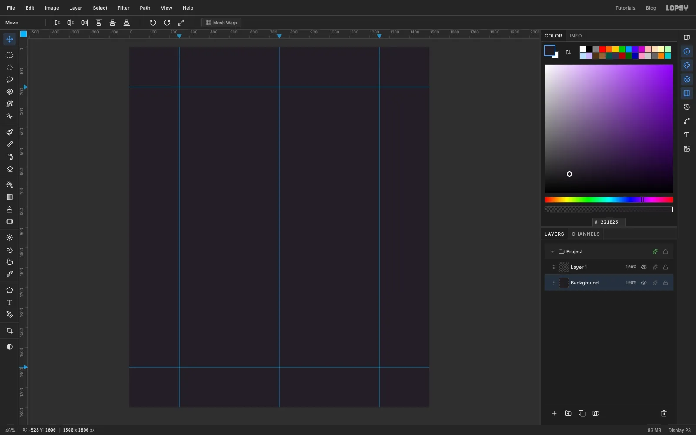

Choose **File → New**, enter **1500 × 1800** pixels and click **Create**.
Click the *Background* row, set the foreground to the shirt colour
`#221E25` and choose **Edit → Fill**.

Click the top ruler at `250`, `750` and `1250` to drop three vertical
guides: the left border, the centre and the right border. Click the left
ruler at `200` and `1600` for the top and bottom borders.

## Cut a vellum leaf with the Pen

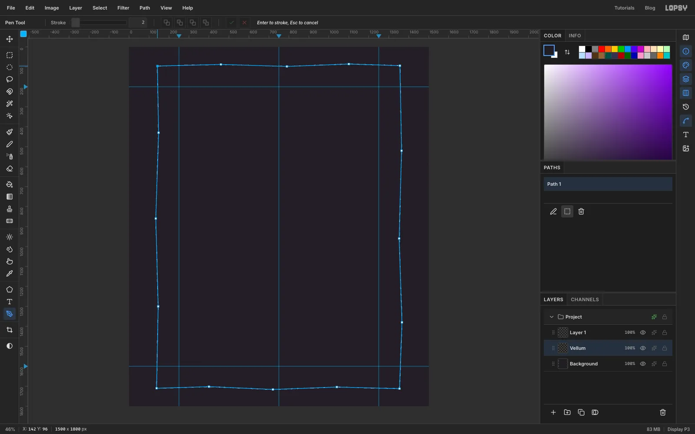

Add a layer named *Vellum* (you can delete the starter *Layer 1*). Pick the
**Pen** tool and click your way round the page about 140 px in from the
canvas edge: four or five anchors along the top and bottom and three or
four down each side. Let each anchor sit a few pixels in or out of a
straight line, because real vellum is never cut square. Click the first
anchor again to close the path.

In the **Paths** panel, click **Path to Selection**, then **Delete Path**.
Set the foreground to `#EFE1BF`, choose **Edit → Fill** and deselect.

## Stain the edge

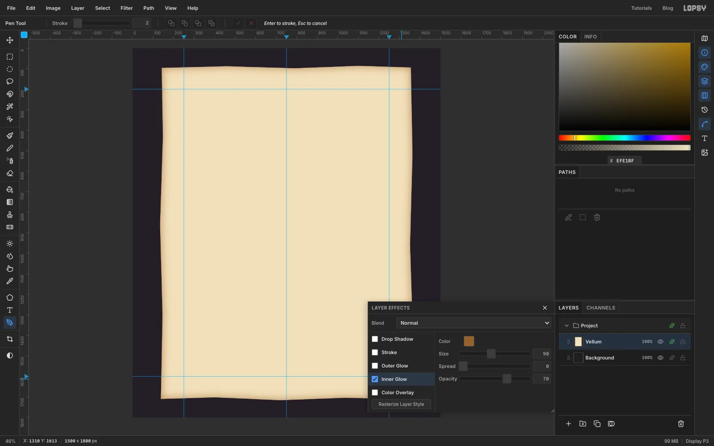

Open *Vellum*'s effects drawer and turn on **Inner Glow**. Set the colour
to `#93602C`, **Size** `90`, **Spread** `0` and **Opacity** `70`. The glow
darkens the leaf toward its edge, the way old vellum browns where hands
have held it.

## Wear the edge with the Chalk brush

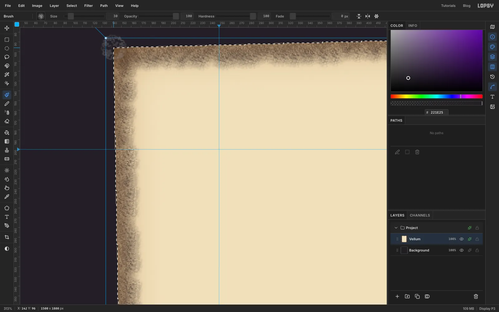

Pick the **Brush** tool, open the brush presets and choose **Chalk**. Set
**Size** `30`, **Opacity** `100` and the foreground to the shirt colour
`#221E25`. [[Cmd]]-click the *Vellum* thumbnail so the brush can only paint
on the leaf.

Click the first corner of the leaf, then [[Shift]]-click each of the
corners in turn, all the way round. Each Shift-click paints a straight
line. The chalk tip only paints in specks, so the edge comes out worn and
dirty rather than as a hard line. Deselect.

## Paint foxing into a layer mask

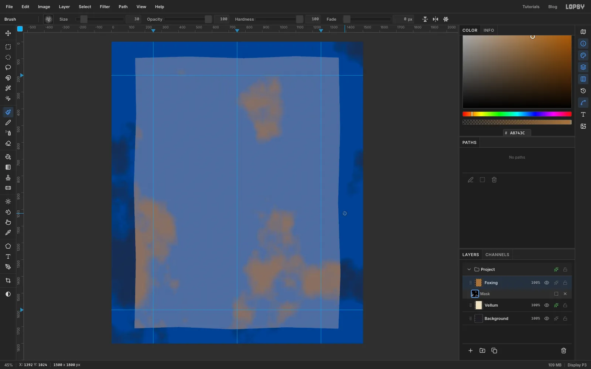

Old vellum gets brown spots called foxing. To paint them, add a layer
named *Foxing*, [[Cmd]]-click the *Vellum* thumbnail and fill the
selection with `#A8743C`. Deselect, then click **Add Mask** at the bottom
of the Layers panel and click the new mask thumbnail to edit the mask.

With the mask in edit mode, choose **Filter → Clouds…** and click
**Apply**. Then choose **Filter → Brightness/Contrast…** with
**Brightness** `-70` and **Contrast** `60`. In mask editing, every filter
writes to the mask, so the clouds turn into a few patchy openings.

## Blend the foxing

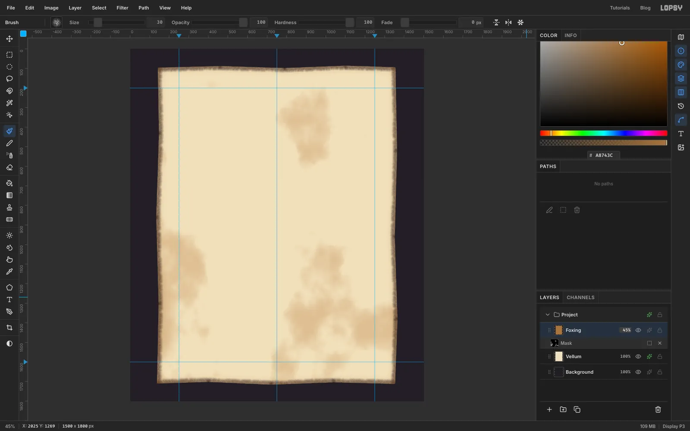

Click the *Foxing* row to leave mask editing. Set its **Blend** to
**Multiply** and its opacity to **45%**. Only the cloudy openings in the
mask show the brown, so you get warm stains rather than an even tint.

To finish the paper, click the *Vellum* row and choose **Filter → Add
Noise…** with **Amount** `10`, **Mono** and **Gaussian**. That adds a
fine grain you'll only notice up close.

## Draw the bar border

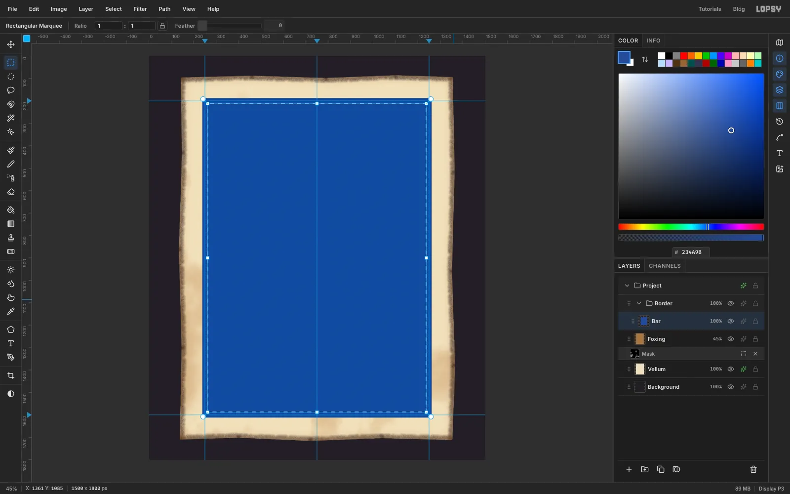

Click *Foxing*, click **New Group** and name it *Border*. Add a layer named
*Bar*. With the marquee dialog, select from `238, 188` to `1262, 1612` and
fill with lapis `#234A9B`.

Then select from `262, 212` to `1238, 1588` and press [[Delete]]. That
leaves a 24 px blue bar that runs right along the guides.

## Add the rose segments

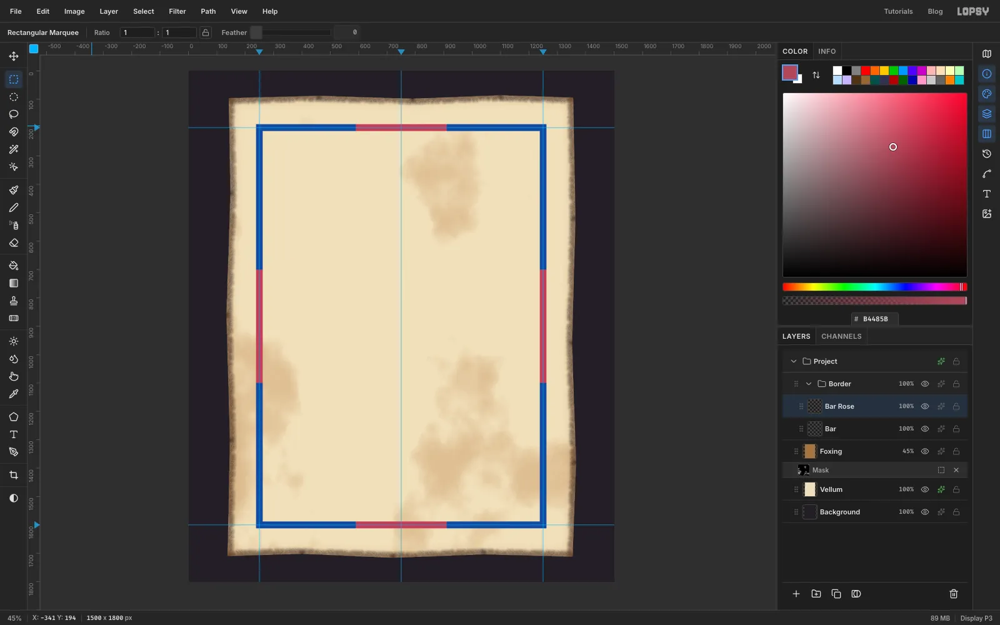

Medieval bar borders alternate colours. Add a layer named *Bar Rose* and
fill four rectangles with rose `#B4485B`, one in the middle of each side:

- top: `590, 188` to `910, 212`
- bottom: `590, 1588` to `910, 1612`
- left: `238, 700` to `262, 1100`
- right: `1238, 700` to `1262, 1100`

## Add white penwork

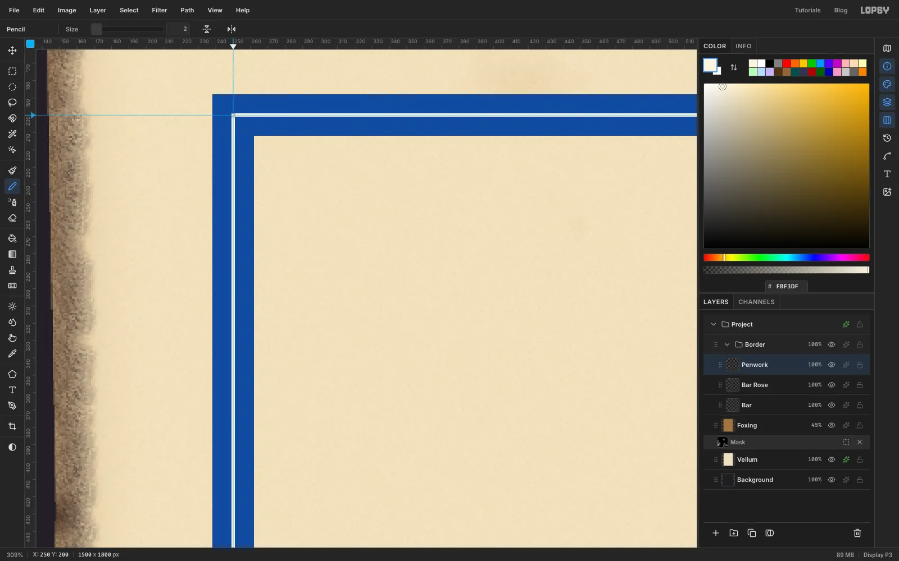

Add a layer named *Penwork*. Pick the **Pencil**, set **Size** to `2` and
the foreground to `#FBF3DF`. Click on the guide crossing at `250, 200`,
then [[Shift]]-click `1250, 200`, `1250, 1600`, `250, 1600` and `250, 200`
again. The white hairline runs down the middle of the bar on every side.

## Edge the bar in gold

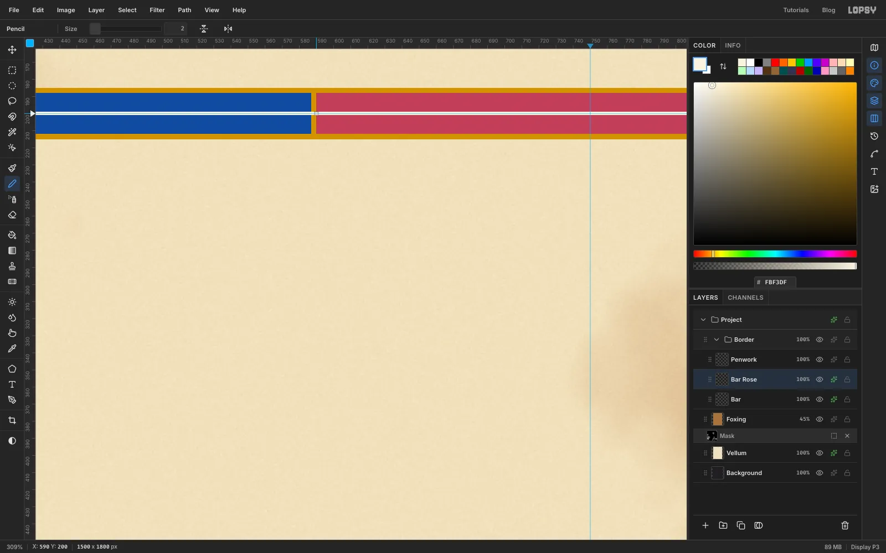

Click *Bar* and turn on **Stroke** in its effects drawer: **Width** `3`,
colour `#C8962E`. Do the same on *Bar Rose*. Each segment now has its own
gold edge, so a gold line also separates the blue from the rose.

## Add gold corner bosses

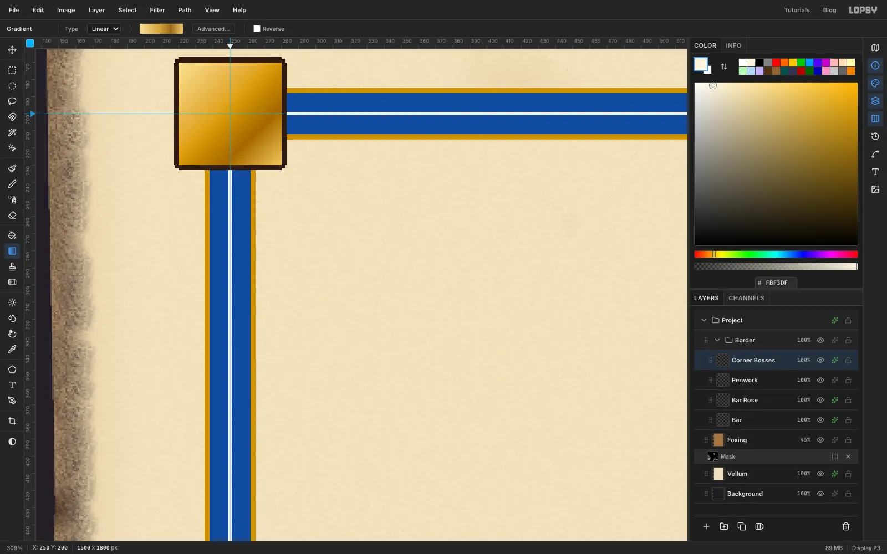

Click *Penwork* so the next layer goes above it, and add a layer named
*Corner Bosses*. Pick the **Gradient** tool, set it to **Linear**, and
open **Advanced…** to build the gold ramp: `#F6E19A` at the left, `#D6A53A`
at 45%, `#9C6A1C` at 72% and `#ECCA6C` at the right.

For each corner of the bar, press [[Cmd+D]] so nothing is selected, then
select a 60 px square centred on the guide crossing. The first one runs
from `220, 170` to `280, 230`. Drag the gradient across each
square from its top-left corner to its bottom-right corner. Deselect, then
give the layer a **Stroke** of **Width** `3` in ink `#2B1B12`.

## Paint a diaper tile

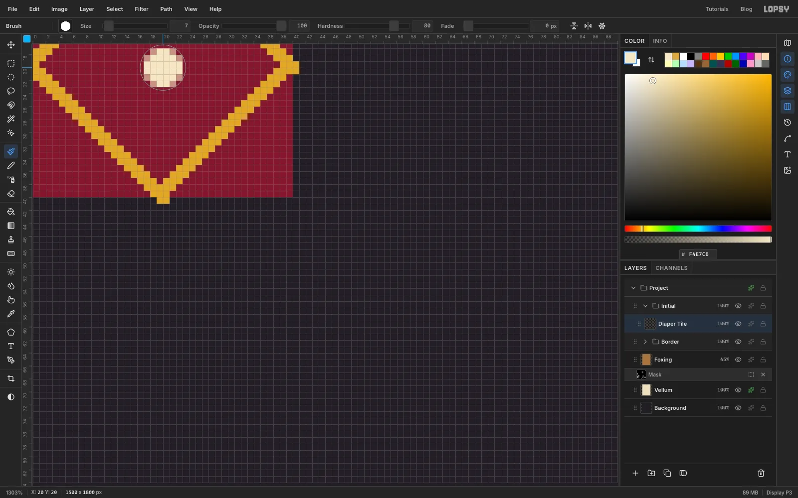

The square behind a medieval initial is often *diapered*, covered in a
small repeating lattice. Collapse *Border*, click it and add a group named
*Initial*. Inside it, add a scratch layer named *Diaper Tile*.

Select from `0, 0` to `40, 40` and fill with burgundy `#7A2231`. Deselect,
then zoom in on the top-left corner of the canvas until the tile fills
most of the window. With the **Pencil** at size `2` in gold `#D9A944`, click `20, 0`, then
[[Shift]]-click `40, 20`, `20, 40`, `0, 20` and `20, 0` to draw a diamond
that touches the middle of each side. Switch to the **Brush**, open the brush presets
(the brush-tip thumbnail at the left of the options bar) and choose
**Hard Round**, since the Chalk tip from earlier is still active. Set the
size to `7` and click once at `20, 20` in cream `#F4E7C6` for a pearl.

Select `0, 0` to `40, 40` again and choose **Edit → Define Pattern**.
Deselect, then delete the *Diaper Tile* layer.

## Fill the block with the pattern

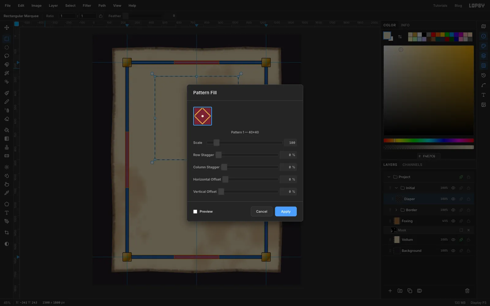

Add a layer named *Diaper*. Select from `450, 300` to `1050, 900` and
choose **Edit → Fill with Pattern…**. Your tile is already picked. Leave
**Scale** at 100% and click **Apply**. The tiles join into a gold lattice
with a pearl in every diamond. Deselect.

## Frame the block in lapis

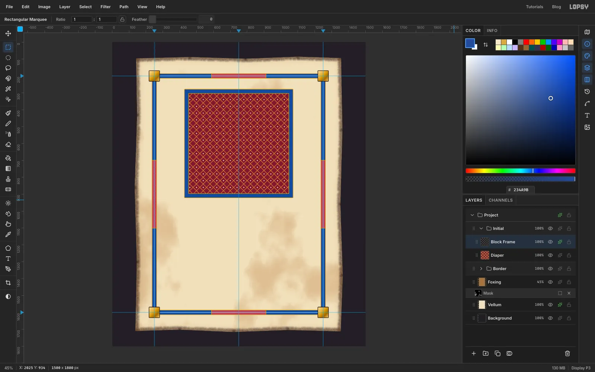

Add a layer named *Block Frame*. Select from `430, 280` to `1070, 920` and
fill with lapis `#234A9B`. Select from `452, 302` to `1048, 898` and press
[[Delete]], which leaves a 22 px frame round the diaper. Deselect and give
the layer a gold **Stroke**, **Width** `3`, colour `#C8962E`.

## Type the uncial H

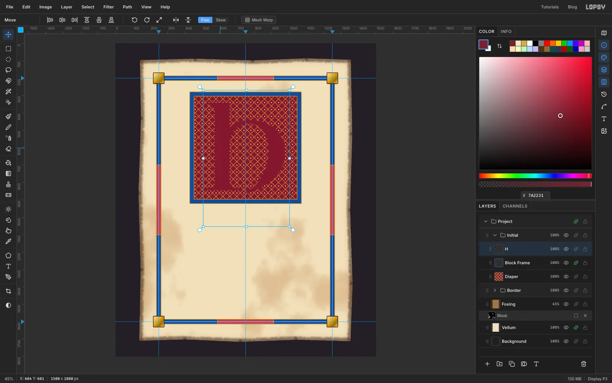

Pick the **Text** tool. In the options bar, choose **Uncial Antiqua** and
type `560` into the **Size** box (the slider itself stops short of that). Click near the top-left of the block, type a capital
**H** and press [[Tab]] to commit.

Uncial Antiqua's capital H is the round medieval form, with a tall stem
and a bowl that sweeps out to the right. Switch to the **Move** tool and
drag the letter until it sits in the middle of the block, with about the
same diaper showing above and below it. The colour doesn't matter: the next
step replaces it.

## Gild the letter

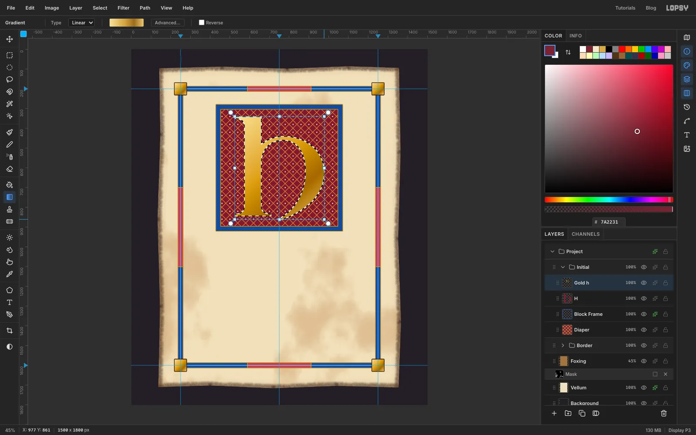

[[Cmd]]-click the *H* text layer's thumbnail to select the letter's shape.
Add a layer named *Gold h* and drag the gold gradient from the letter's top
left to its bottom right. Then choose **Filter → Add Noise…** with
**Amount** `8`, **Mono** and **Gaussian**, which gives the gold a slightly
hammered look. Deselect and delete the *H* text layer, since *Gold h*
replaces it.

On *Gold h*, turn on **Stroke** (**Width** `3`, ink `#1D1410`) and **Inner
Glow** (colour `#FFF3C4`, **Size** `10`, **Opacity** `55`). Don't add a soft
drop shadow. Gilding is flat leaf, outlined in ink.

## Burnish the gold

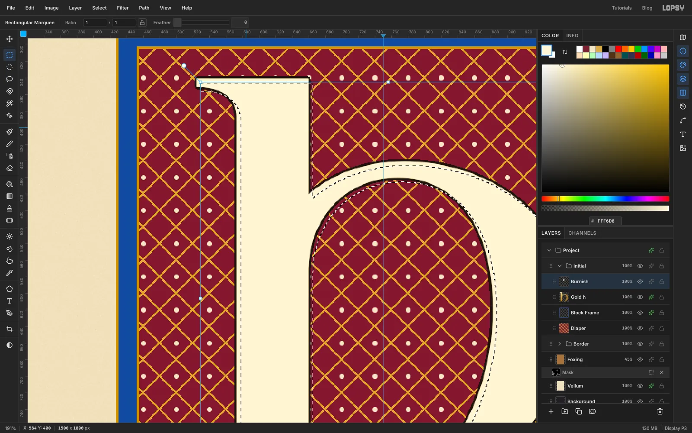

Burnished gold catches the light along its upper edges. Add a layer named
*Burnish*, [[Cmd]]-click *Gold h*'s thumbnail and fill with `#FFF6D6`.

Pick the **Rectangular Marquee** and press [[→]] and [[↓]] five times each.
With a marquee tool active, the arrow keys move the selection outline, not
the pixels. Press [[Delete]]. What's left is a thin crescent of light along
every top and left edge of the letter. Deselect, choose **Filter →
Gaussian Blur…** with **Radius** `1`, and set the layer's opacity to
**80%**.

## Dot the frame

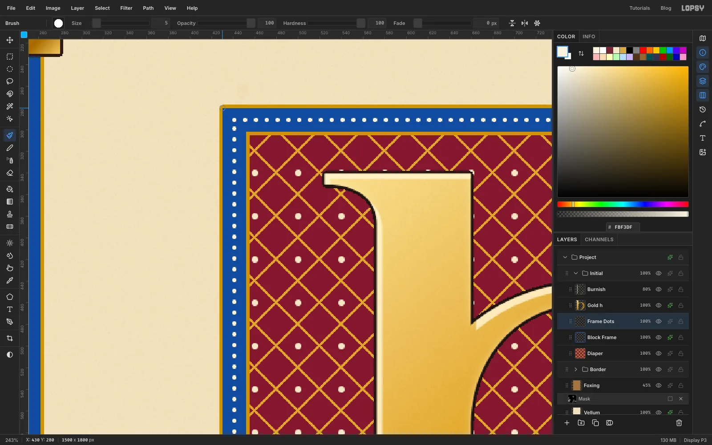

Click *Block Frame* and add a layer named *Frame Dots*. Pick the **Brush**,
click the brush-tip thumbnail to open the Brushes modal and, on its
**Shape** tab, set **Size** `5`, **Hardness** `100` and **Spacing** `200`. At 200% spacing the brush
leaves separate dots instead of a line.

With white `#FBF3DF`, click `441, 291` and [[Shift]]-click `1059, 291`,
`1059, 909`, `441, 909` and back to the start. That's the middle of the
frame all the way round.

## Bring in Dürer's hare

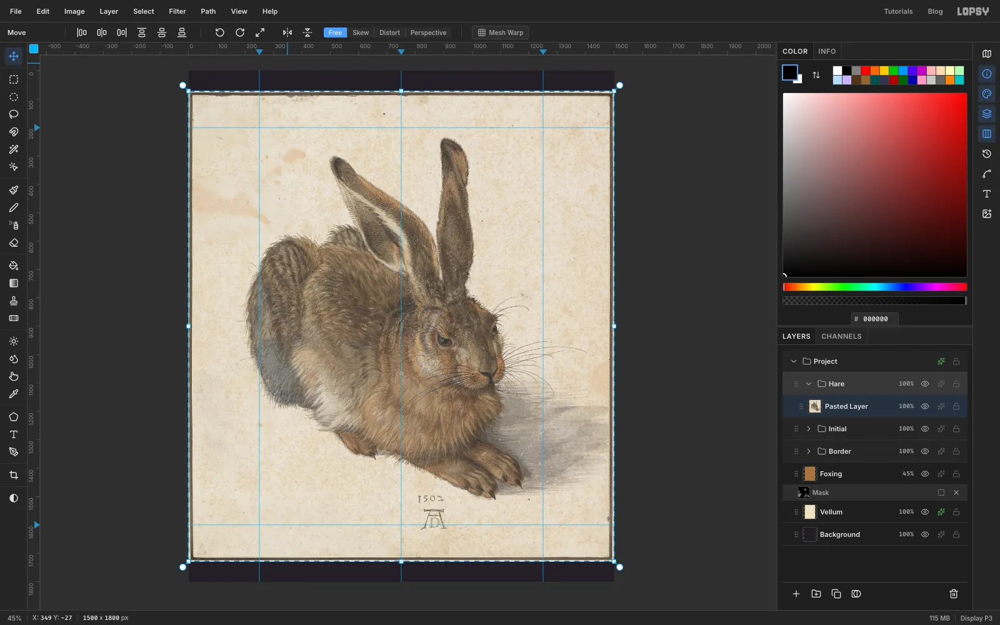

Download Albrecht Dürer's *Young Hare* from Wikimedia Commons (search for
*Albrecht Dürer – Hare, 1502*). It's in the public domain. Collapse
*Initial*, click it and add a group named *Hare*.

Drag the image file onto the canvas. Lopsy adds it as a new layer and
shrinks it to fit the page. Press [[Cmd+D]] to drop the selection it
arrives with, and rename the layer *Durer Hare*.

## Trace the hare

Pick the **Pen** and click your way round the hare, just inside the edge
of the fur. Start at the tip of the left ear and work clockwise. Go up and
over the right ear, down the face, chest and front paws, along the belly
and round the back. That's about 50 anchors.

Keep inside the fur on the right, where the grey shadow touches the chest
and paws, so none of the shadow comes along. It's fine to cut off the
whiskers that stick out into the paper. Click the first anchor to close the
path.

## Turn the trace into a clean selection

In the Paths panel, click **Path to Selection**, then **Delete Path**.

Between the left ear and the back there's a pocket of paper inside your
outline. Pick the **Magic Wand**, set **Tolerance** to `40` with
**Contiguous** on, and [[Alt]]-click that pocket. Alt-clicking subtracts
the paper from the selection.

## Copy the hare to its own layer

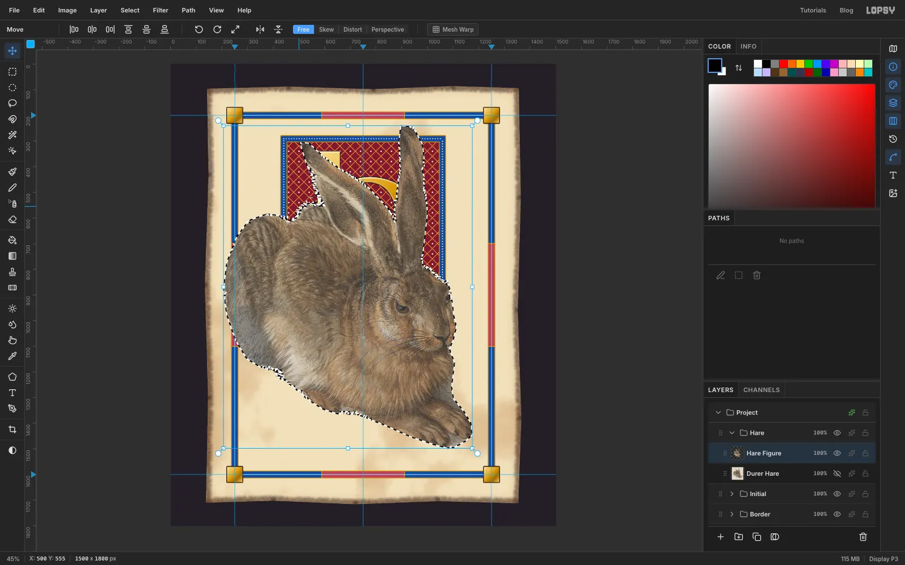

Press [[Cmd+C]] and then [[Cmd+V]]. The hare pastes in place as a new
layer. Rename it *Hare Figure* and hide *Durer Hare* with its eye icon.
Keep the original in case you want to re-trace.

## Scale the hare down

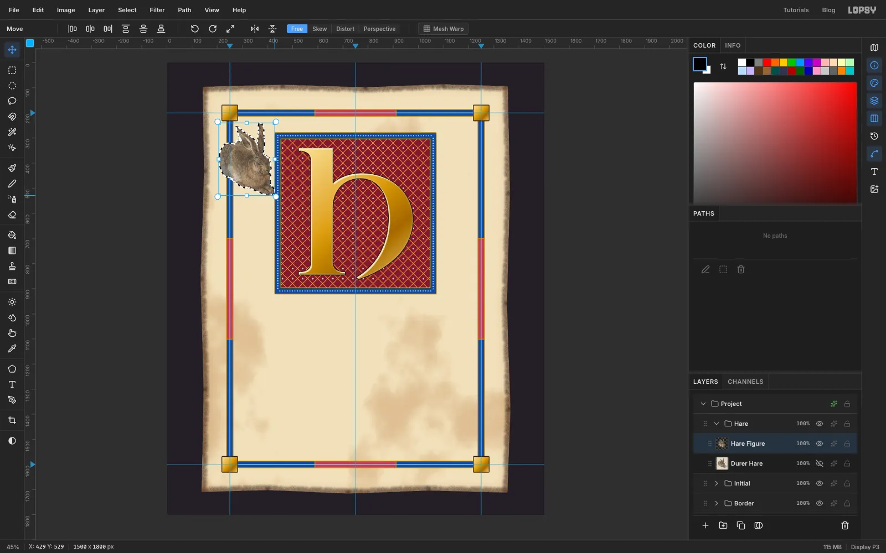

The paste is still selected, so the Move tool shows its transform handles.
Hold [[Cmd]] to keep the proportions, and drag the bottom-right handle up
and to the left until the hare is about a quarter of its size, roughly
220 px wide. Press [[Cmd+D]] to commit the scale.

> **Tip:** Press [[Cmd+Z]] and then [[Cmd+Shift+Z]] if you want to compare
> before and after. The scale undoes and redoes as one step.

## Seat the hare in the bowl

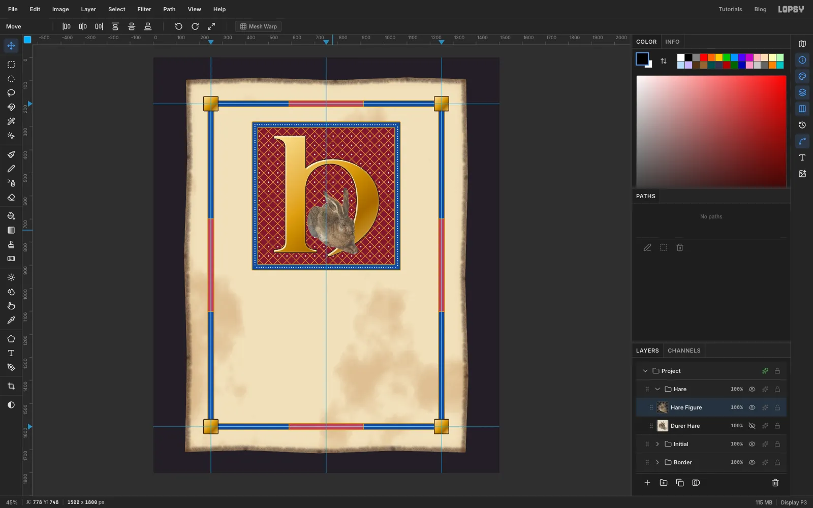

Drag the hare into the bowl of the H, so its back rests against the stem,
its paws sit on the tail of the bowl and its ears reach up into the arch.
Keep the curve of the gold bowl clear above and to the right of it. A figure that sits *inside* a letter like
this is what makes an initial *historiated*.

## Paint it to match the gold

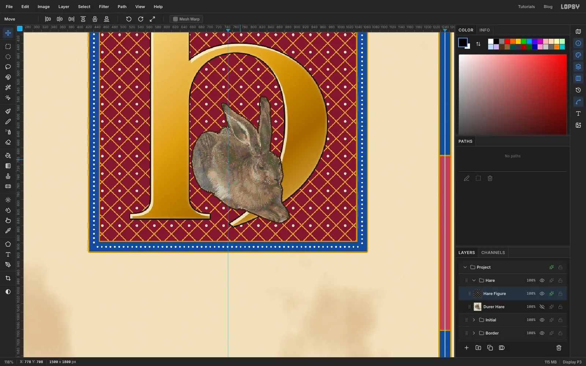

Dürer's fur is finer than everything else on the page, so simplify it.
With *Hare Figure* selected, run **Filter → Surface Blur…** with **Radius**
`4` and **Threshold** `30`. Then run **Filter → Posterize…** with
**Levels** `10`, and **Surface Blur** again with **Radius** `3` and
**Threshold** `28`. Give the layer a **Stroke** of **Width** `3` in
dark brown `#3B2412`, so it's outlined like the rest of the page. Last,
run **Filter → Hue/Saturation…** with **Saturation** `18` to warm the fur
back up.

## Draw the lance shaft

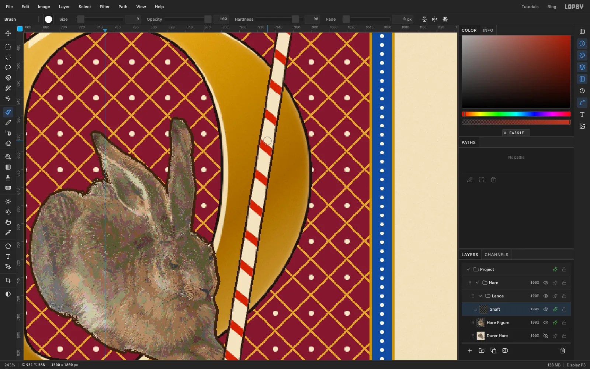

With *Hare Figure* still selected, add a group named *Lance* and a layer
named *Shaft* inside it.

With the **Pen**, draw a long, thin four-anchor shape from just inside the
hare's front paws at the bottom of the block up to about `975, 330`,
leaning slightly right. Make it about 16 px wide at the bottom and 12 px at
the top. Turn it into a selection, delete the path and fill with
`#F1E4C4`.

While the shaft is still selected, pick the **Brush** and choose the
**Hard Round** preset again, which puts **Spacing** back to 1% after the
dotted frame. Set **Size** `9`, **Hardness** `90` and the colour to
vermilion `#C4361E`. Paint short diagonal strokes
across the shaft every 34 px or so. Click one side and [[Shift]]-click the
other. The selection keeps the paint on the shaft. Deselect and add a
**Stroke**, **Width** `2`, in ink.

## Add the head and the pennon

Add a layer named *Lance Head*. Draw a leaf-shaped point with the Pen at
the top of the shaft, about 86 px long and 32 px wide, so it pokes out
above the block's frame. Select it, pick the **Gradient** tool and open
**Advanced…**. Delete one of the gold stops and set the other three to
`#EEF1F4`, `#8A95A3` and `#D9DEE5`. Then drag across the head from one
side to the other. Deselect and add an ink
**Stroke** of `2`.

Click *Shaft* and add a layer named *Pennon*. Draw a swallow-tailed flag
with the Pen. Fix it to the left side of the shaft just below the head and
let it fly about 170 px to the left, with a notch cut into its tail. Fill
it with vermilion and give it a gold **Stroke** of `3` (`#C8962E`).

## Rotate the whole lance

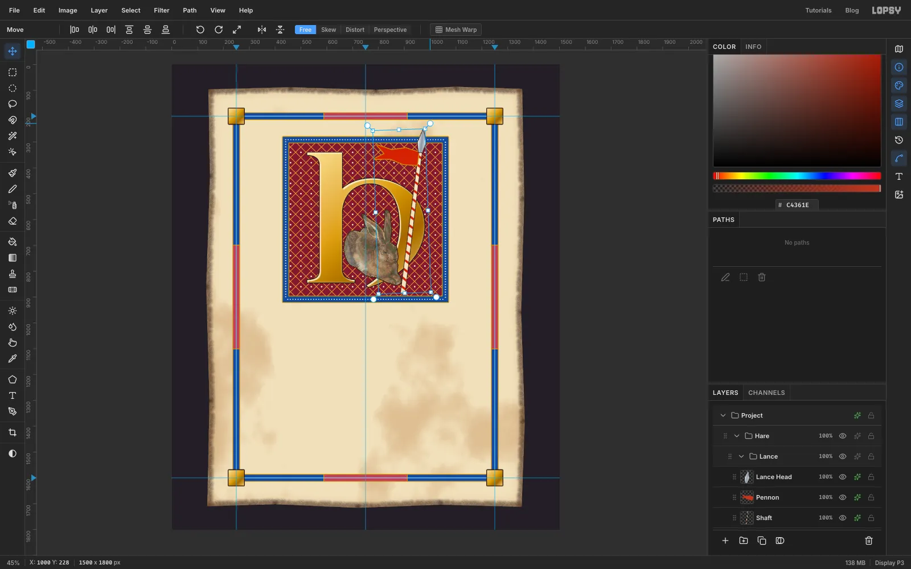

Click the *Lance* group's row and switch to the **Move** tool. The
transform box goes round all three layers. Drag the round rotation handle
outside the top-right corner a hair anticlockwise, just enough that the
lance leans a little less. Press [[Cmd+D]] to commit.

Rotating the group turns the shaft, head and pennon together about the
group's centre, so they stay lined up.

## Put the paws over the shaft

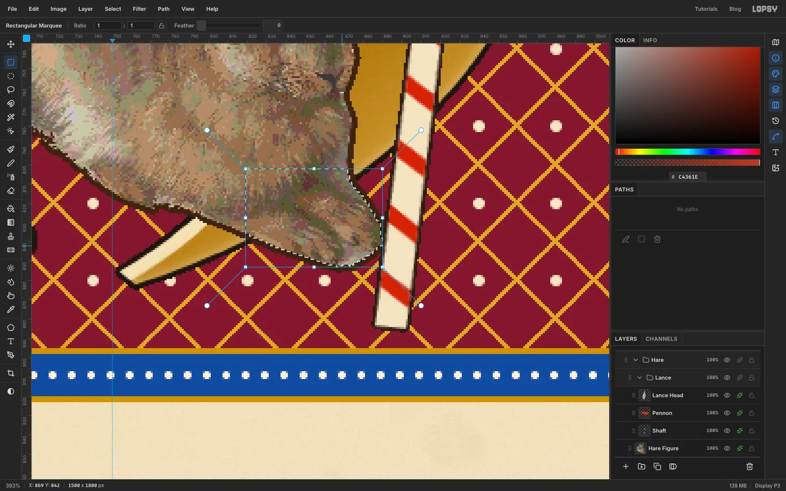

To make the hare hold its lance, part of the shaft has to go behind its
paws. [[Cmd]]-click the *Hare Figure* thumbnail. Pick the **Rectangular
Marquee**, hold [[Shift+Alt]] and drag a box round the front paws.
Shift+Alt keeps only the overlap, so now just the paws are selected.

Click the *Shaft* row and press [[Delete]], then deselect. The paws now
overlap the bottom of the shaft instead of sitting behind it.

## Build the ribbon scroll

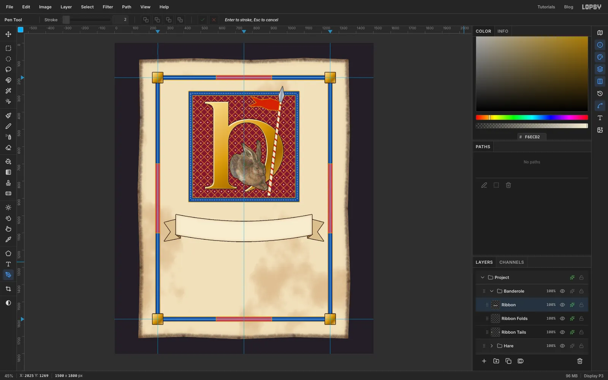

Collapse *Hare*, click it and add a group named *Banderole*. On a layer
named *Ribbon Tails*, draw two swallow-tailed tail pieces with the Pen.
Each is a five-anchor shape about 90 px wide with a notch in its outer end.
The left one spans `290` to `380` across and about `1016` to `1148` down,
so it peeks out below the end of the ribbon. The right one mirrors it
from `1120` to `1210`. Fill them with `#D6C093` and add an ink **Stroke** of `3`.

On a layer named *Ribbon Folds*, use the Pen to make a three-anchor
triangle about 30 px across where each tail tucks behind the ribbon: one
at `352, 1108`, `382, 1108`, `382, 1132`, and its mirror on the right.
Fill them with `#8A6D42`.

For the ribbon, add a layer named *Ribbon* and use the Pen with corner
and smooth anchors:

1. Click the top-left corner at `356, 994`.
2. Press at `750, 1034` and drag right about 200 px to make a smooth
   anchor.
3. Click `1144, 994`, then `1144, 1110`.
4. Press at `750, 1150` and drag left about 200 px.
5. Click `356, 1110` and close the path on the first anchor.

Turn it into a selection, fill with `#F6ECD2` and deselect. Add an ink
**Stroke** of `3` and an **Inner Glow** in `#C3A66C`, **Size** `22`,
**Opacity** `55`, which shades the ribbon toward its edges.

## Draw a path for the lettering

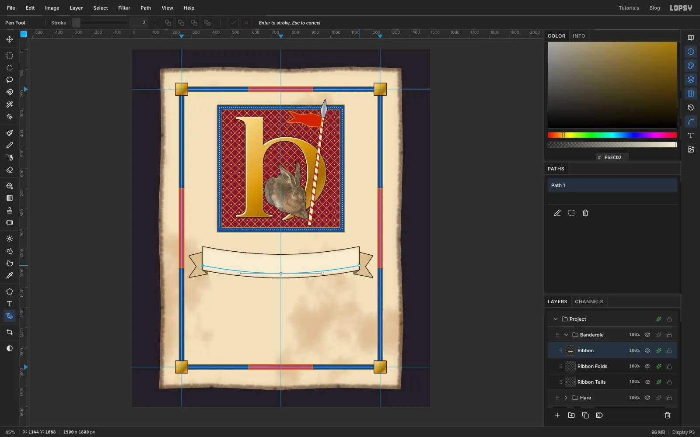

The lettering will follow a path that sags exactly like the ribbon, 94 px
below its top edge. With the Pen, click `356, 1088`, press at `750, 1128`
and drag right about 200 px, then click `1144, 1088`. Click the **✓**
(**Commit path**) button in the options bar to keep it as an open path.

Don't press [[Enter]] here. With the Pen, Enter strokes the path onto the
current layer.

## Set the title on the path

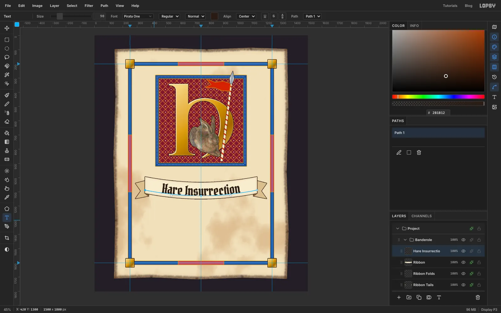

Set the foreground to ink `#2B1B12`. Pick the **Text** tool, choose
**Pirata One** and set **Size** to `90`. Click in an empty area below the
scroll, type *Hare Insurrection* and press [[Tab]].

In the options bar, set **Path** to *Path 1* and **Align** to **Center**.
The words drop onto the curve, centred along it. In many blackletter fonts
the I and the J look almost the same; Pirata One's I is unambiguous. At
this size there's about 22 px of ribbon above and below the letters all
the way along.

## Rubricate the first letter

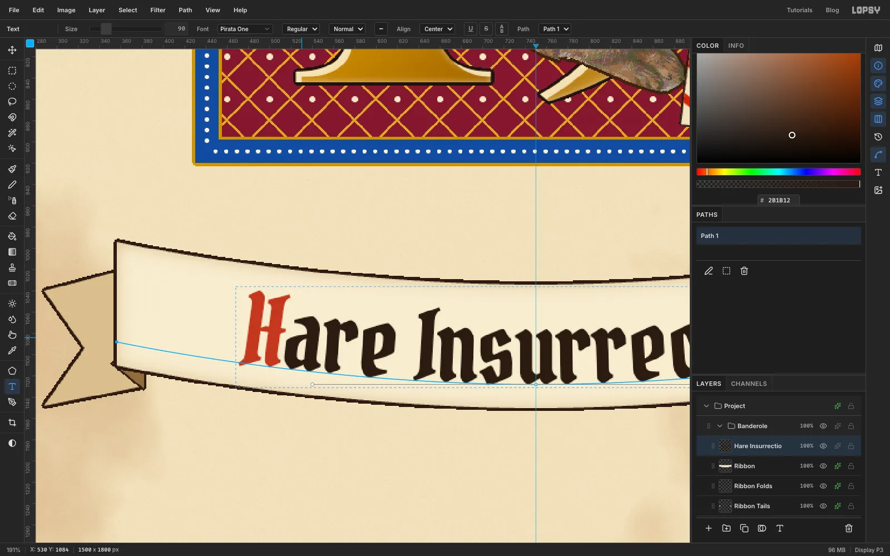

Scribes picked out key letters in red, which is called *rubrication*.
With the Text tool, click into the title, press [[Home]], then
[[Shift+→]] to select just the H. Click the **Text color** swatch in the
options bar and type `C4361E` into its hex field. Press [[Tab]] to commit.
Only the H turns red.

## Add the rubric lines

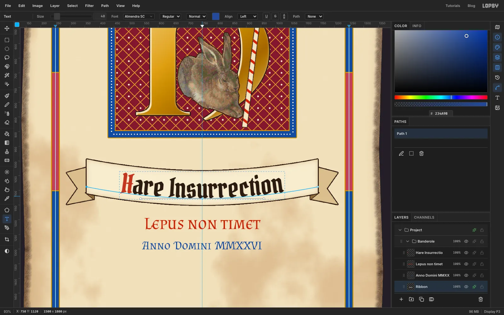

Click the *Ribbon* row first, so the next text settings don't restyle the
title. Set the foreground to `#B8321B`, choose **Almendra SC** at size
`58`, and click at `750, 1172`. Because **Align** is still **Center**, the
line centres on the point you click. Type *Lepus non timet* ("the hare is
not afraid") and press [[Tab]].

Click *Ribbon* again, set the foreground to lapis `#234A9B` and the size
to `40`. Click at `750, 1260` and type *Anno  Domini  MMXXVI* with two
spaces between the words. The small capitals sit close together, and one
space looks too tight. Press [[Tab]], then set **Align** back to **Left**
for later text.

## Lay the ground

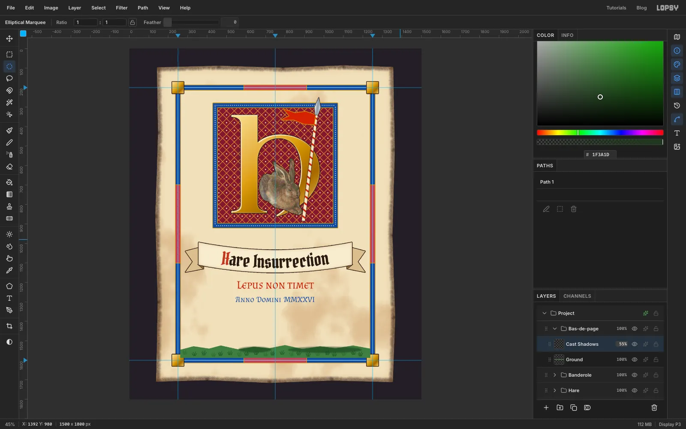

Collapse *Banderole*, click it and add a group named *Bas-de-page*. On a
layer named *Ground*, draw the grass with the Pen. Let the top edge
wander between y `1522` and y `1546` across the inside of the border,
then come down to `1588` at each side. Fill it with `#4F7D47`.

With the **Pencil** at size `2`, draw tufts every 45 px or so. Each tuft is
five short blades that fan out from almost the same point. Switch
between `#2C4F2B` and `#3D6A37` from one tuft to the next.

On a layer named *Cast Shadows*, fill two flat ellipses in `#1F3A1D`.
Make one from `560, 1530` to `730, 1560` for the helm and one from
`815, 1530` to `1195, 1562` for the snail. Run **Gaussian Blur** at
`8` and set the layer to **55%**.

## Draw a great helm

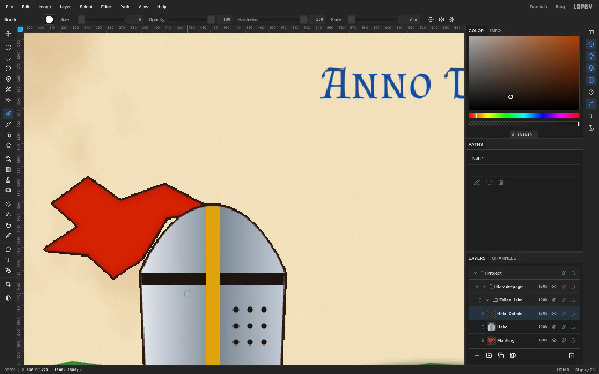

Add a group named *Fallen Helm*. On a layer named *Mantling*, draw the
cloth that hangs from the helmet with the Pen. It's a jagged red shape,
about from `305, 1370` to `455, 1456`, that flows off to the left with
three pointed dags. Fill it with vermilion
and add an ink **Stroke** of `2` and a dark red **Inner Glow** (`#7A1A0E`,
**Size** `8`).

On a layer named *Helm*, draw the helmet: corners at `394, 1540` and
`390, 1452`, a smooth anchor at the top (`452, 1394`, dragged 40 px right),
then `514, 1452` and `510, 1540`. Select it and drag the steel gradient
(`#E3E7EC` → `#7D8794` → `#C5CCD5`) across it from left to right. Add an
ink **Stroke** of `2`.

On a layer named *Helm Details*, [[Cmd]]-click the *Helm* thumbnail, then
[[Shift+Alt]]-drag a thin box across the helmet at `1452` to `1462` and
fill it with near-black `#1D1612` for the eye slit. Do the same with a
narrow vertical box down the middle and fill it with gold `#D6A53A` for the
cross band. Then dab a 3 × 3 grid of breathing holes with a size-6 brush.

## Topple the helm

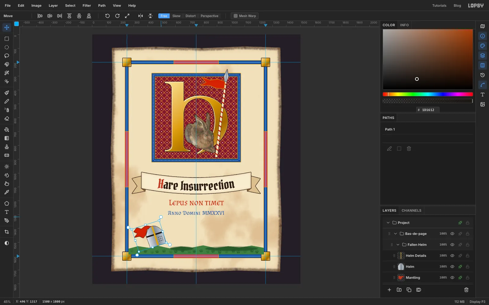

Click the *Fallen Helm* group row, switch to the **Move** tool and drag
the rotation handle anticlockwise until the helmet clearly tips over,
about a twentieth of a turn.
Press [[Cmd+D]], then drag the group so the helmet rests on the grass at
the left of the shadow you made for it.

## Draw a snail with a spiral shell

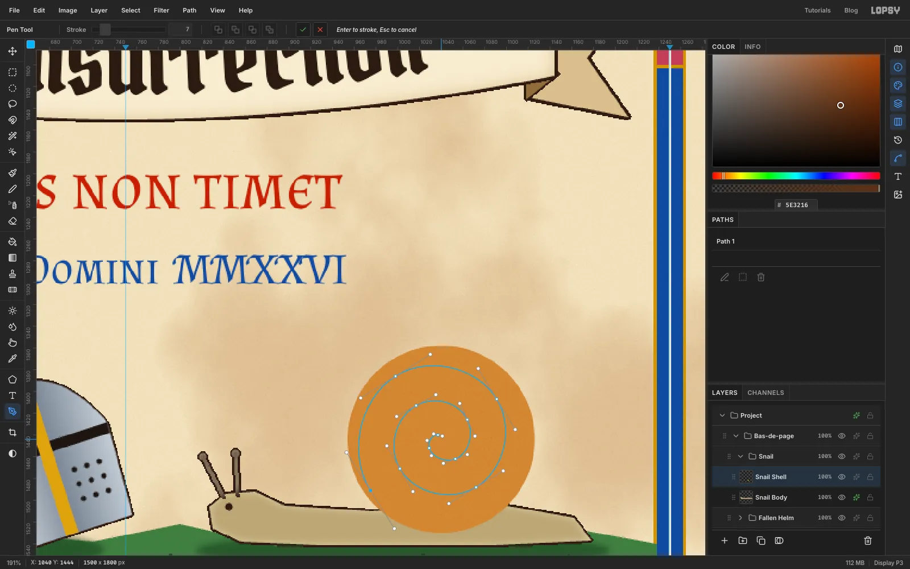

Collapse *Fallen Helm*, click it and add a group named *Snail*. On a layer
named *Snail Body*, draw a long, low slug shape with the Pen. The head
rises at the left end and a pointed tail stretches to the right, from
about `830` to `1180` along the ground. Fill it with `#B9A87C`, then add an
ink **Stroke** of `2` and a pale **Inner Glow** (`#EFE4BF`, **Size** `10`,
**Opacity** `70`). Draw two horns with the **Pencil** at size `3`, and dab
their tips and the eye with the brush at size `8`.

On a layer named *Snail Shell*, select a circle from `954, 1358` to
`1126, 1530` and fill it with `#C98A44`. Add **Mono** noise at `8`.

For the spiral, set the Pen's **Stroke** to `7` in the options bar and the
foreground to `#5E3216`. Start at the bottom-left edge of the shell and
place an anchor every quarter turn, dragging each one along the direction
of travel. Each anchor sits a little closer to the centre than the last,
so the path winds in over a little more than two turns. Press [[Enter]] to
stroke it onto the shell, then delete the path.

Give the shell an ink **Stroke** of `3` and a brown **Inner Glow**
(`#6E3B17`, **Size** `16`) to make it look round.

## Copy the hare for the rider

Expand *Hare*, click *Hare Figure*, then [[Cmd]]-click its thumbnail and
press [[Cmd+C]]. Clicking the row first matters, because Copy takes
pixels from the selected layer, not from the thumbnail you Cmd-clicked.
Collapse *Hare*, click *Snail Shell* and press [[Cmd+V]]. Rename the
paste *Rider*.

While the paste is still selected, click **Flip Horizontal** in the Move
tool's options bar so the rider faces left, toward the helm. Press
[[Cmd+D]].

## Scale the rider onto the shell

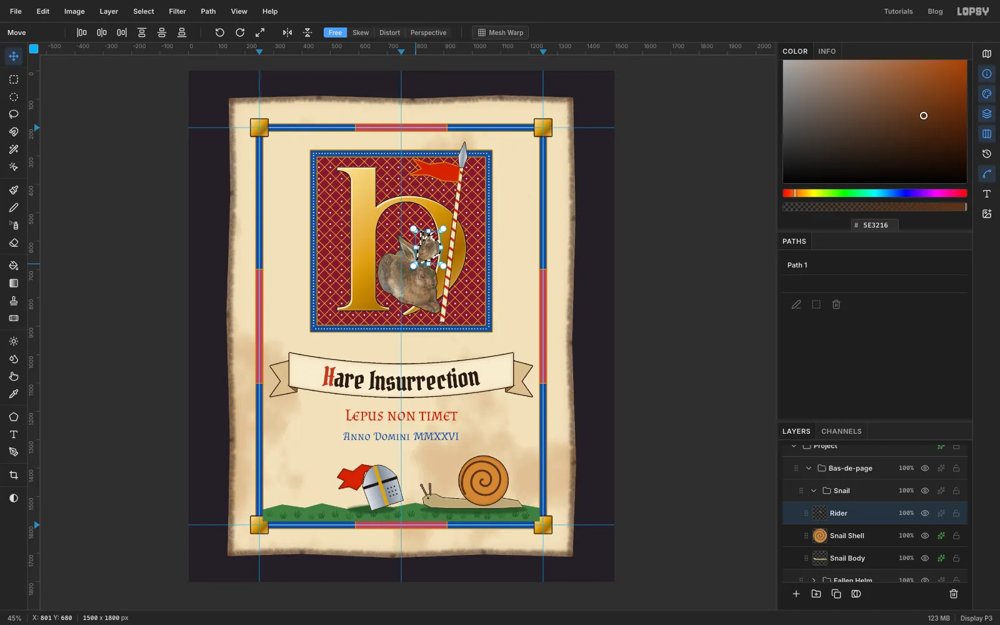

[[Cmd]]-click the *Rider* thumbnail to select it, then [[Cmd]]-drag the
bottom-left handle inward until the rider is about 40% of its size.
Commit with [[Cmd+D]] and drag the rider onto the top of the shell, as if
it were riding the snail. Give it a dark brown **Stroke** of `2`
(`#3B2412`).

## Arm the rider

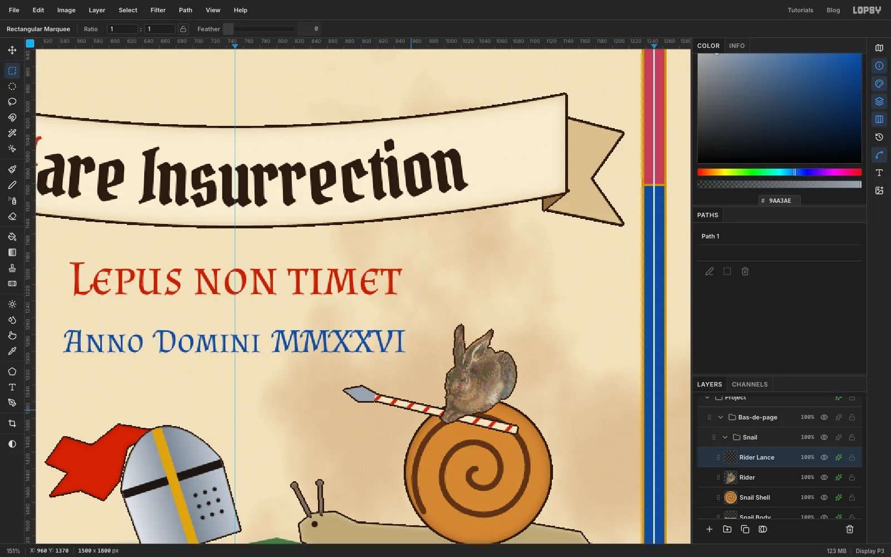

Add a layer named *Rider Lance* and build a smaller version of the big
lance. Draw a thin Pen shaft about 210 px long, starting behind the rider
and pointing forward and slightly up, toward the helm. Fill it with cream, add
size-5 vermilion stripes every 20 px, and give it a small steel head.
Add an ink **Stroke** of `2`.

Do the paw trick again. [[Cmd]]-click *Rider*, [[Shift+Alt]]-drag a box
round its front paws, click *Rider Lance* and press [[Delete]].

## Plant flowers with copy and paste

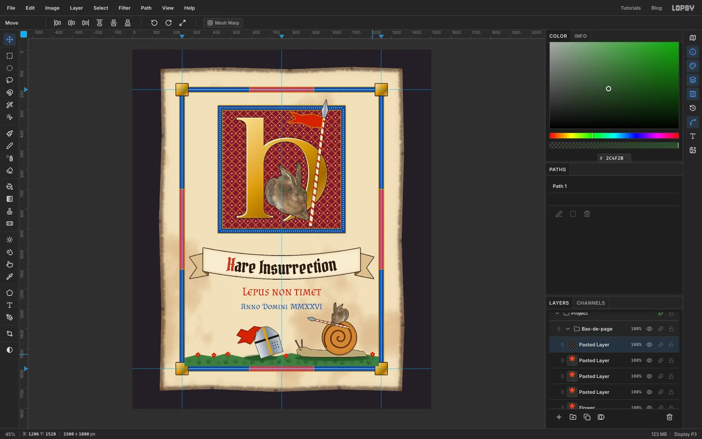

Collapse *Snail*, click it and add a layer named *Flower*. Near the left
of the grass, dab five vermilion petals in a ring with the brush at size
`11`, add a gold `#E9C45A` centre at size `6`, and draw a short green stem
with the Pencil.

[[Cmd]]-click the *Flower* thumbnail and press [[Cmd+C]]. Then press
[[Cmd+V]], drag the copy to a new spot in the grass with the Move tool and
press [[Cmd+D]]. Repeat until you have five flowers spread along the
ground, keeping them clear of the helm and the snail.

## Make an ivy-leaf brush

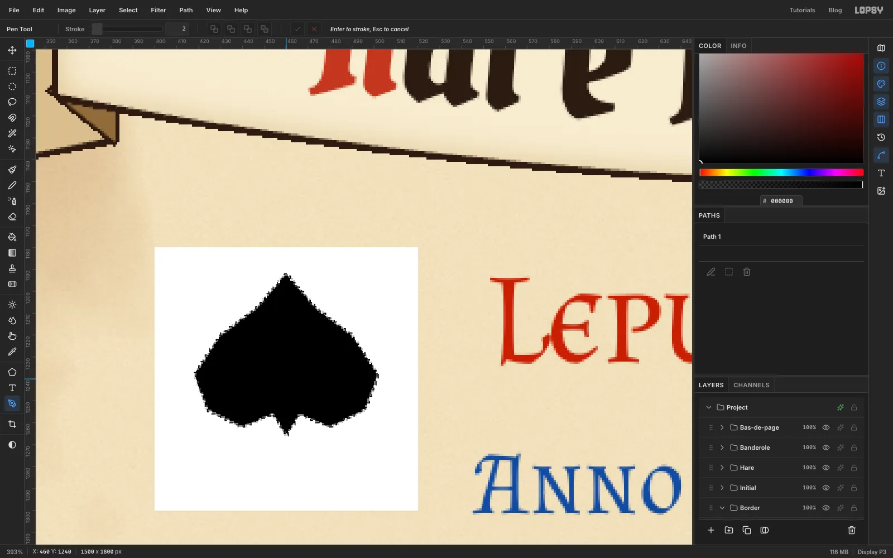

Expand *Border*, click *Corner Bosses* and add a group named *Ivy*. The
ivy goes inside *Border*, so it sits behind the initial and the scroll.

Add a scratch layer named *Leaf Tip*. On an empty patch of vellum, select
`400, 1180` to `520, 1300` and fill with white. Then draw an ivy leaf with the Pen about 85 px across, with a
pointed tip, two rounded side lobes and a notch at the stem. Fill it with
black.

Select `400, 1180` to `520, 1300` again and choose **Edit → Define Brush…**.
Name it *Ivy Leaf*. Black paints and white stays clear, so the brush tip
is just the leaf. Deselect and delete *Leaf Tip*.

## Draw the vines

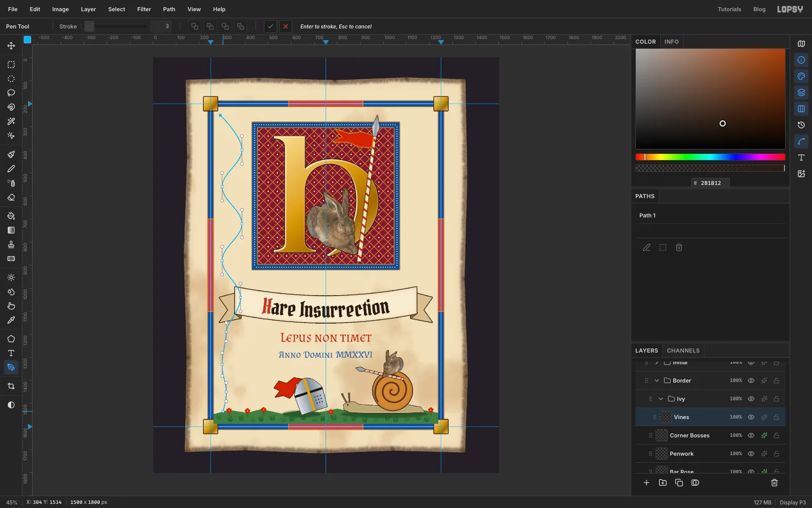

Add a layer named *Vines*. Set the foreground to ink and the Pen's
**Stroke** to `3`. Start at `292, 250` near the top-left corner boss. Then
press and drag straight down at each turn to make a vertical S-curve:
alternate between about `386` and `300` across, with a turn every 160 px
or so on the way down. Finish in the grass at `304, 1534`. Press [[Enter]]
to stroke it.

Draw the same vine down the right margin, mirrored across the centre
guide, and stroke it too.

## Stamp the leaves

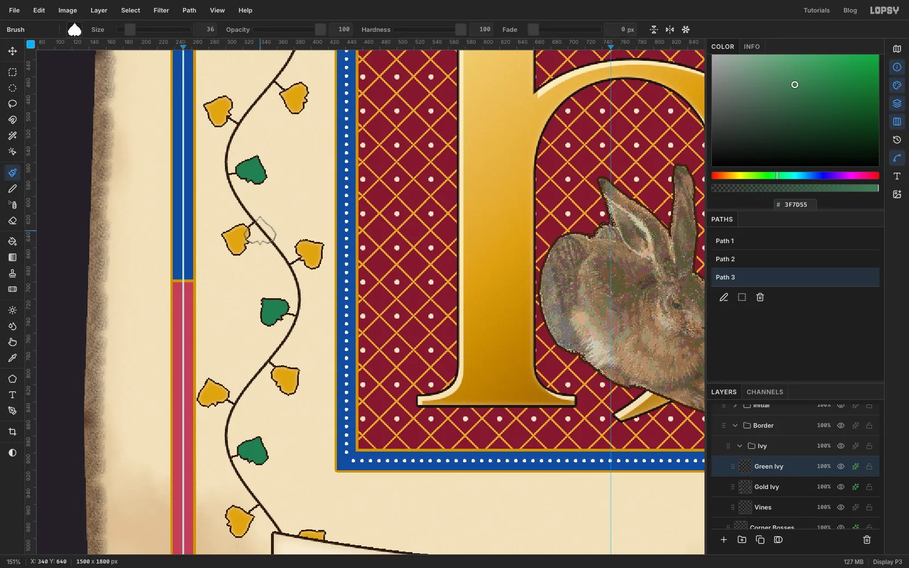

On the *Vines* layer, with the **Pencil** at size `2`, draw a short stem
off the vine every 62 px or so, alternating left and right. Leave out any stems that would
hit the helm, the snail or the text.

Add a layer named *Gold Ivy*. Pick the **Brush**, which now uses the *Ivy
Leaf* tip. Set **Size** `36` and **Spacing** `100`, and on the
**Dynamics** tab set **Angle Jitter** `45`, so no two leaves point the same
way. With gold `#D6A53A`, click once at the end of two stems out of every
three. Add an ink **Stroke** of `2` and a pale **Inner Glow** (`#FFF3C4`,
**Size** `6`).

Add a layer named *Green Ivy* and click the remaining stems in verdigris
green `#3F7D55`. Give it an ink **Stroke** of `2`.

## Add bezants

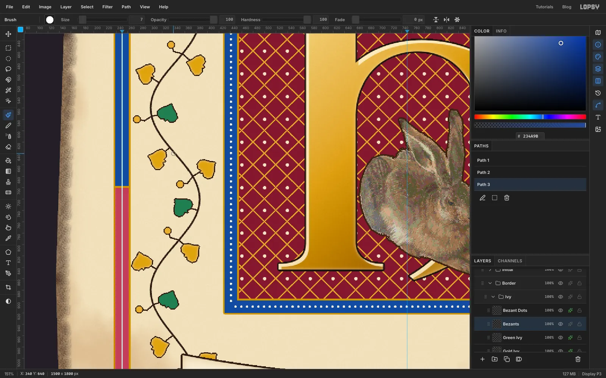

On a layer named *Bezants*, draw hairline tendrils in ink with the Pencil,
two short segments each, on the opposite side of the vine from the leaves.

Switch the **Brush** back to the **Hard Round** preset (the Ivy Leaf tip is
still active) and set the size to `12`. On a
new layer named *Bezant Dots*, click a gold `#E0B04A` ball at the end of
each tendril and give the layer an ink **Stroke** of `2`.

Finally, open the Paths panel and delete the two vine paths, keeping the
scroll's *Path 1*.

## Add print grain

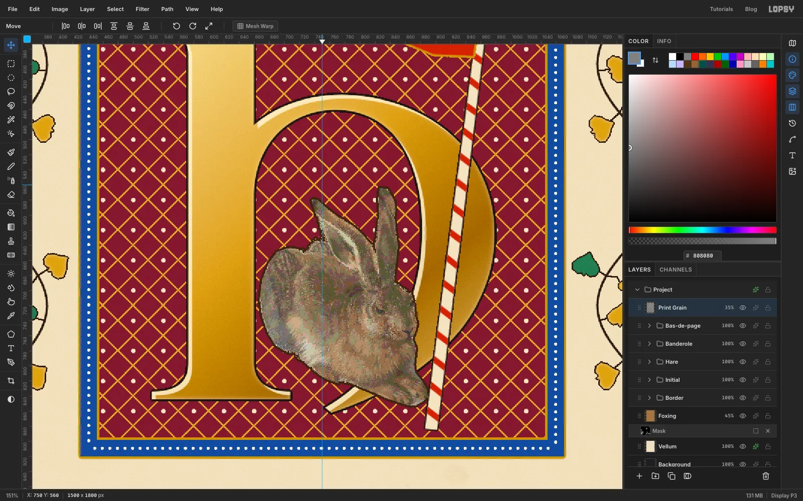

Collapse the open groups, click *Bas-de-page* and add a layer named *Print
Grain* at the top. [[Cmd]]-click the *Vellum* thumbnail, fill with grey
`#808080` and choose **Filter → Add Noise…** with **Amount** `45`,
**Mono** and **Gaussian**. Deselect, set the **Blend** to **Overlay** and
the opacity to **35%**. Mid grey disappears in Overlay, so only the grain
shows, like ink pressed into a printed shirt. Choose **View → Actual Size**
to check it.

Export with **File → Quick Export PNG** and save the project with **File →
Save Project**. On a dark shirt, print the vellum leaf as its own ink
layer, under the colours.
