Bonsai growers sort trees by one number: how far the trunk leans from straight up. A formal upright stands at 0°. A cascade hangs its tip below the bottom of the pot. This tutorial turns that one idea into a poster. You'll cut six bonsai styles out of stencil plates, photograph them onto two strips of medium-format film, mark the lean on every frame, and plot all six on a protractor.

The piece is two things at once. It's a **stencil contact sheet**: cut plates, bridges and registration holes, frame numbers, and a grease pencil marking the frame to print. It's also an **infographic**: one accent colour for data, numbered frames, a chart, and notes that explain the marks.

Along the way you'll use:

- **guides**, the **grid** and **Snap** to lay out the film and frames
- **Shift**, **Alt** and **Shift+Alt** marquee drags to add, subtract and intersect selections
- a **Cutter** layer, a **Cmd-click** on its thumbnail and **Delete** to cut real holes through the plates
- copy and paste, a **45° rotation** on the transform handles, and arrow-key nudges
- the **Brush** with **Taper** for trunks, and the **Eraser** for stencil bridges
- **Inner Glow**, **Drop Shadow** and an inside **Stroke** for cut Mylar, plus a **Soft Light** sheen
- **Define Pattern** and **Fill with Pattern**, and **Radial Symmetry** for the chart's ticks
- a dropped photo, **Desaturate**, **Gaussian Blur**, **Threshold**, the **Magic Wand**, and **Grow** / **Shrink** to clean a selection
- live text in **Stardos Stencil**, **IBM Plex Mono**, **Barlow Condensed** and **Permanent Marker**, including a right-aligned text box and a rotated note
- **Group Layers** to tidy everything at the end

The palette is warm paper and film black, with one green for the plates and two inks for the marks:

- Paper `#ECE6D8`, ink `#1F1D1A`, chart tint `#DCD3BE`, hatching `#9C927C`
- Film `#191816`, bench `#3A3832`
- Mylar `#A9BB9A`, plate bevel `#E2ECD6`, plate glow `#25301F`
- Data vermilion `#E2522B`, edge-print amber `#E3A13B`
- Grease pencil `#C2185B`

> **Tip:** The film strips and frames are a grid, so the early steps give exact positions. The status bar at the bottom of the window shows the pointer's X and Y in document pixels while you drag. For a selection with exact corners, click once with a marquee tool, without dragging, while nothing is selected. A dialog opens where you can type the corners. If you'd rather not measure, open the project with the **Follow along** button and trace over it.

## Set up the paper, guides and grid

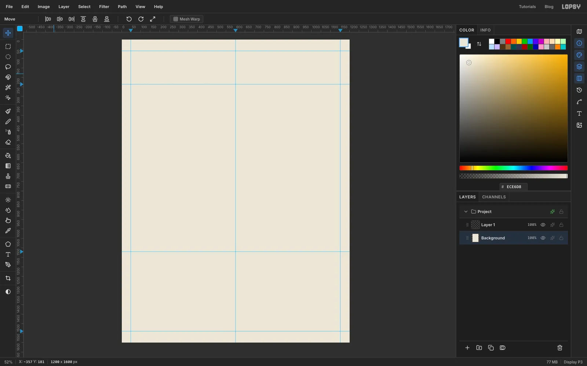

Open [Lopsy](/). In the **New Document** dialog, set **Width** to `1200` and **Height** to `1600`, choose a **White** background and click **Create**.

1. Leave **Layer 1** where it is, at the top of the stack. Later it becomes the paper grain.
2. Select **Background**, set the foreground colour to `#ECE6D8` and choose **Edit → Fill**. With nothing selected, it fills the whole layer.
3. Click the top ruler at `48`, `600` and `1152`. Those are the side margins and the centre line.
4. Click the left ruler at `60`, `236`, `1120` and `1540`. Those are the top margin, the bottom of the header, the top of the footer and the bottom margin.

## Lay down two film strips

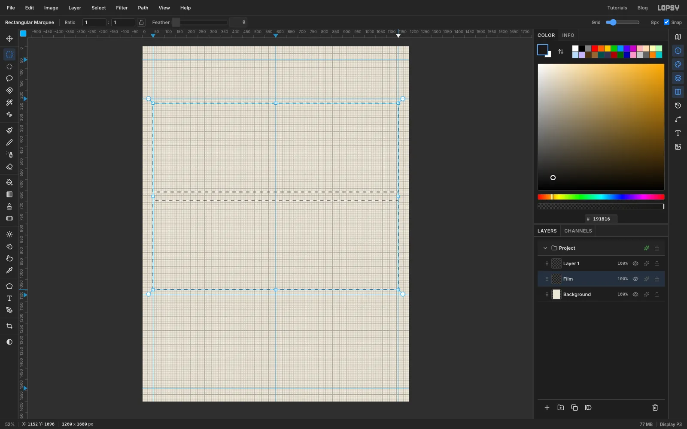

Select **Background** and click **Add Layer** at the bottom of the Layers panel. New layers go directly above the selected one. Double-click the new layer's name and call it `Film`.

Choose **View → Show Grid**, drag the **Grid** slider in the options bar to **8px** and make sure **Snap** is ticked. Every corner in the next three steps falls on that 8 px grid.

Pick the **Rectangular Marquee** ([[M]]). Drag the first strip from `48, 256` to `1152, 656`: from the left guide to the right guide, 400 px tall. Hold [[Shift]] and drag the second strip from `48, 696` to `1152, 1096`. **Shift** adds the second rectangle to the first. Set the foreground to `#191816`, choose **Edit → Fill**, then deselect with [[Cmd+D]].

## Cut six frame windows

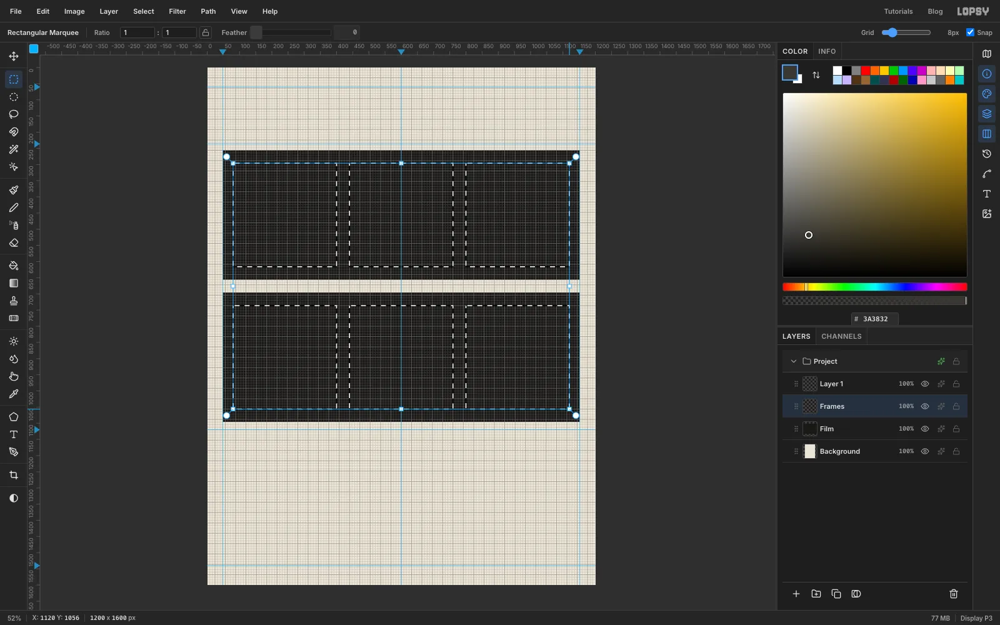

Add a layer called `Frames`. A 120 film frame is square, so make six 320 × 320 squares, three per strip:

- top row from `y 296`, starting at `x 80`, `440` and `800`
- bottom row from `y 736`, at the same three x positions

Drag the first square, then hold [[Shift]] for the other five. Leave 40 px of film above the frames for the edge print and 40 px below for the captions. Fill with `#3A3832`, the bench the plates were photographed on, and deselect.

## Add the Mylar plates

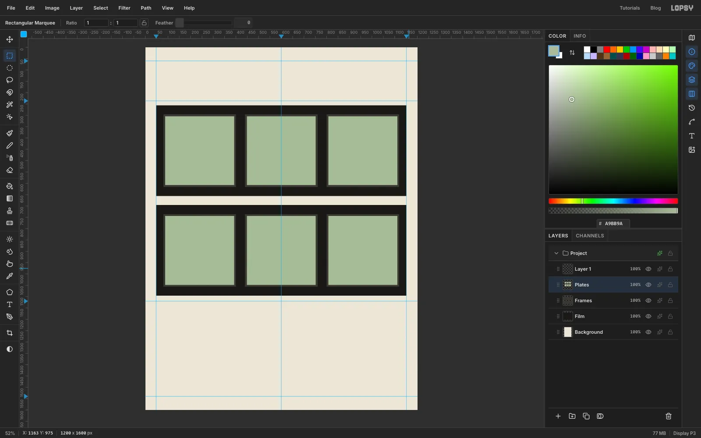

Add a layer called `Plates`. Each plate is 8 px smaller than its frame on every side, so draw six 304 × 304 squares starting at `88, 304`, `448, 304`, `808, 304` and the same three x positions at `y 744`. Shift-add them as before.

Fill with `#A9BB9A`. Deselect, then turn the grid off with **View → Show Grid**. Run **Filter → Add Noise…** with **Amount** `6` and pick **Mono**, so the plates have a slight tooth.

## Start the Cutter with the formal upright

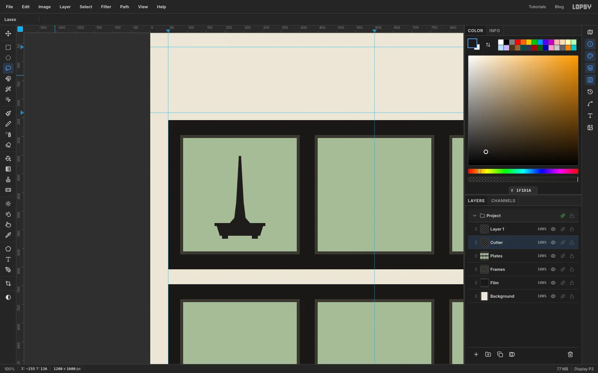

Every tree is drawn on one black **Cutter** layer, then cut out of the plates in one go. Add a layer called `Cutter` above `Plates` and set the foreground to `#1F1D1A`. Zoom to 100% on frame 01 (**Cmd** and the scroll wheel, or [[Cmd+=]]).

The first tree is **Chokkan**, the formal upright. It's a straight trunk over a rectangular pot.

1. **Pot.** With the **Rectangular Marquee**, drag a thin rim about 136 × 8 px across the lower third of the plate (it starts at `172, 532` in this frame). Shift-add two small feet, about 16 × 8 px, under where the pot will end. Then pick the **Lasso** ([[L]]), hold [[Shift]] and trace the pot's body under the rim: a trapezoid a little narrower at the base, about 26 px deep. Fill and deselect.
2. **Trunk.** With the **Lasso**, trace a long spike that stands on the middle of the rim. Make it about 56 px wide at the ground, flaring out at both sides like roots, and taper it to about 6 px at the top, 180 px higher. Fill and deselect.

## Copy the pot into frame 03

The slanting style in frame 03 uses the same pot. Draw a marquee around the pot, press [[Cmd+C]] and then [[Cmd+V]]. Lopsy pastes a copy on its own layer in exactly the same place and switches to the **Move** tool.

Deselect, then nudge the copy two frames to the right with the arrow keys. Two frames is 720 px, but stop 26 px short, at 694 px, so the pot sits left of centre and leaves room for the lean. [[Shift+→]] moves 10 px at a time, so that's 69 presses and then 4 more with plain [[→]]. Choose **Layer → Merge Down** to put it back on `Cutter`.

## Rotate a copy of the trunk 45°

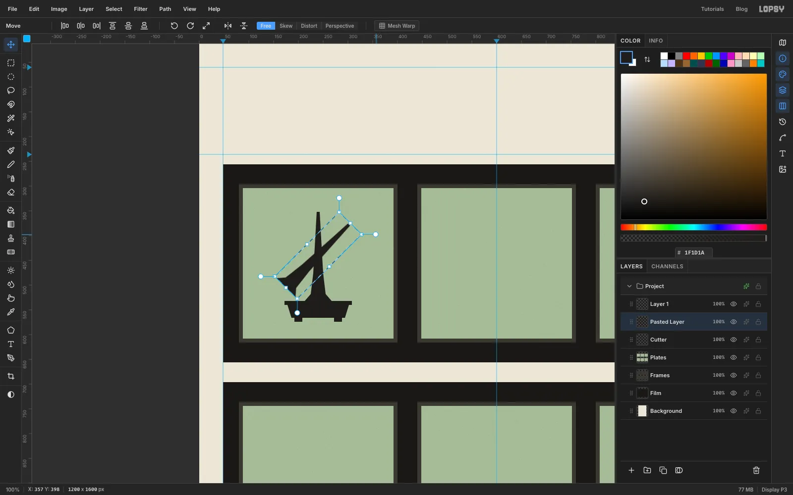

A slanting tree is an upright tree tipped over. Draw a marquee around the frame 01 trunk only, from just above its tip to just above the pot rim, then copy and paste it. Paste selects the copy and switches to the **Move** tool, so its transform handles are already showing.

Point just outside the top-right corner until the cursor turns into the rotate arrow. Hold [[Cmd]] and drag clockwise. **Cmd** snaps the angle to 15° steps, so stop at the third step, 45°. Press [[Cmd+D]] to commit the rotation.

## Move the leaning trunk into frame 03

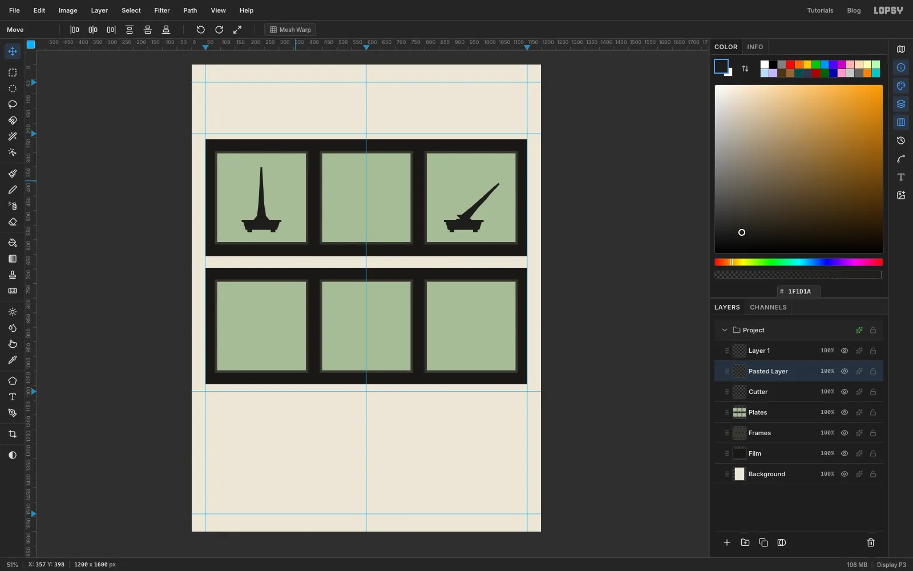

Nudge the rotated trunk with the arrow keys until its base sits on the left half of the frame 03 pot rim. It's about two frames right and a little down, roughly 752 px right and 29 px down. Choose **Layer → Merge Down**.

The rotation leaves the trunk's base cut off at an angle. Zoom in, and with the **Lasso** trace a low root flare over it: a wedge about 70 px wide at the rim that rises 30 px along the trunk. Fill it.

## Build cloud pads with Shift-added ellipses

Bonsai foliage is clipped into flat clouds called pads. Each pad here is one wide, flat ellipse with two smaller domes on its top edge.

Back on frame 01, pick the **Elliptical Marquee**. Drag a flat ellipse about 104 × 30 px for the lowest pad on the left. Hold [[Shift]] and add two domes overlapping its top edge, each about half as wide. Shift-add the other pads up the trunk the same way, alternating left and right and getting smaller towards the top. Finish with a rounder apex pad on the tip.

Fill the whole selection at once and deselect.

## Connect the pads with branches

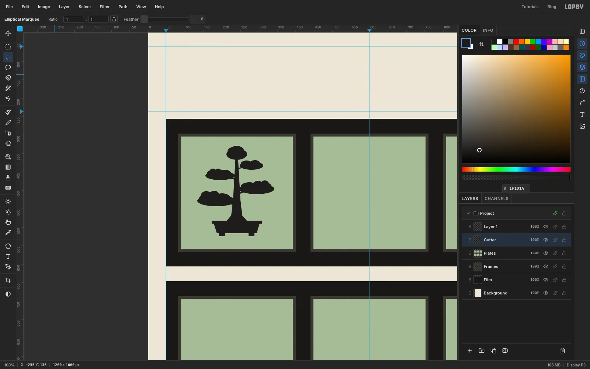

Pick the **Brush** ([[B]]) and open the brush settings with the tip thumbnail at the left of the options bar. Choose **Hard Round**, set **Hardness** to `100`, **Spacing** to `5` and **Taper** to `0`.

Paint a short branch from the trunk to the middle of each pad. Use **Size** `6` for the low branches and `4` near the top. Frame 01 is done.

## Shape a bowl pot with a subtract

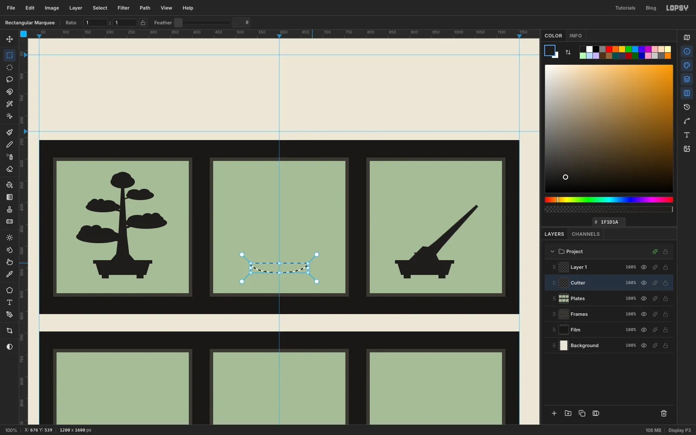

Frame 02 is **Moyogi**, the informal upright, in a shallow oval pot.

1. With the **Elliptical Marquee**, drag an ellipse about 132 × 44 px centred on the pot's rim line.
2. Switch to the **Rectangular Marquee**, hold [[Alt]] and drag a rectangle over the top half of the ellipse. **Alt** subtracts it, so only the lower half is left: a bowl.
3. Hold [[Shift]] and add a rim of about 144 × 7 px across the top of the bowl and two small feet under it.

Fill and deselect.

## Paint a tapered S-curve trunk

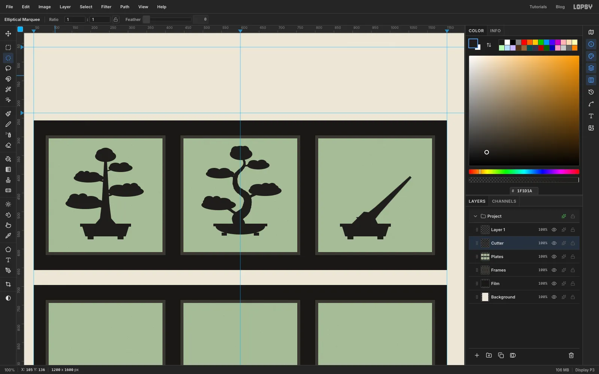

**Taper** shrinks the brush as the stroke goes on, so a stroke that starts at the root thins out towards the tip.

Open the brush settings and set **Size** to `30` and **Taper** to `270`. The S below rises about 200 px, so the path along its bends is about 230 px long. A Taper a bit longer than that thins the tip to about 15% of the root's width without letting it vanish. Starting at the middle of the rim, drag up in a gentle S: left, then right, then left, then back over the root. Each bend should be about 30 px out from the centre line. Always drag trunks from the root, because Taper thins the stroke from where it starts.

Add the pads and branches as in frame 01, with each pad on the outside of a bend. Then set **Taper** back to `0`, because it carries over to the next stroke.

## Finish the slanting tree

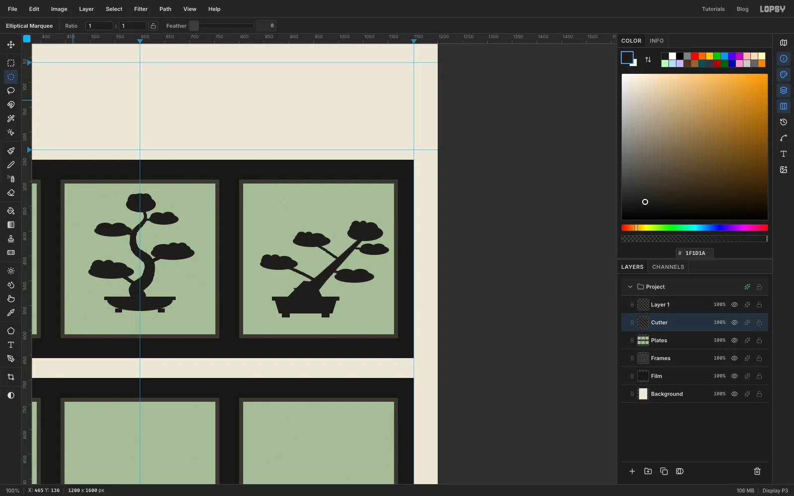

On frame 03, add the **Shakan** pads. A slanting tree needs a counterweight, so put one low pad out on the left, uphill from the lean. Then add pads along both sides of the trunk and a big apex pad at its tip. Join them with branches as before.

## Paint the windswept tree

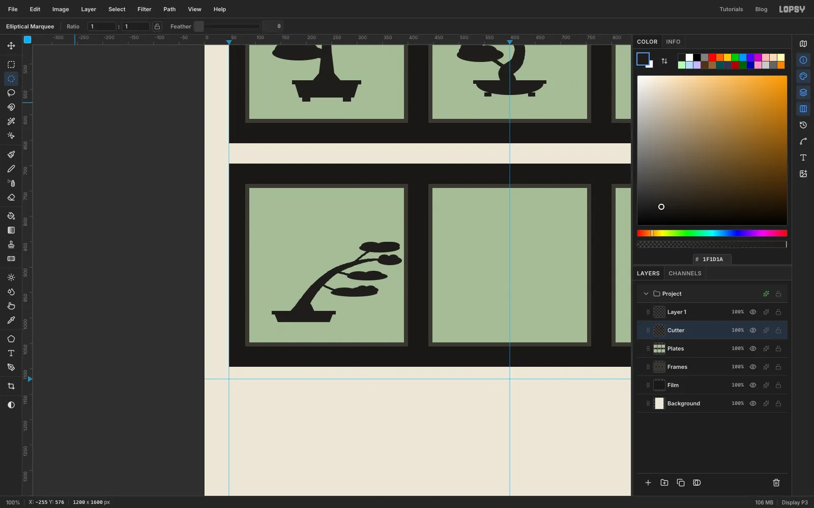

Frame 04 is **Fukinagashi**, the windswept tree. Everything streams one way, as if a gale blew from the left.

1. **Pot:** a low slab. Use a rim of about 126 × 7 px on the left third of the plate, and Shift-lasso a shallow body under it.
2. **Trunk:** **Size** `24`, **Taper** `250` (the sweep is about 210 px long). Start on the rim near the left end of the pot and sweep up and to the right, ending near the top-right corner of the plate. Set **Taper** back to `0`.
3. **Root flare:** lasso a small wedge where the trunk meets the rim, so the trunk looks planted instead of balanced on a point.
4. **Pads:** long and thin, about 80–90 × 16 px, all hanging off the right-hand side of the trunk. Use Hard Round branches at **Size** `5`, all pointing downwind.

## Paint the semi-cascade

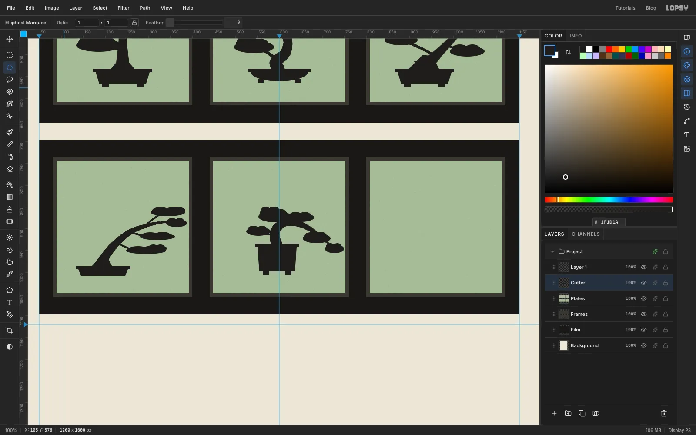

Frame 05 is **Han-kengai**, the semi-cascade. The trunk arcs out over the rim, and its tip ends roughly level with it.

1. **Pot:** deep and narrow. Use a rim of about 102 × 8 px with a body about 56 px deep, plus two feet.
2. **Trunk:** **Size** `26`, **Taper** `230` (about 195 px of path). Rise about 30 px from the middle of the rim, then curve right and down. Stop just to the right of the pot, about level with the rim. Set **Taper** back to `0`.
3. **Pads:** a crown over the bend, one pad tucked under the left side, and two pads along the falling arm. The last pad marks the tip.

## Paint the full cascade on a stand

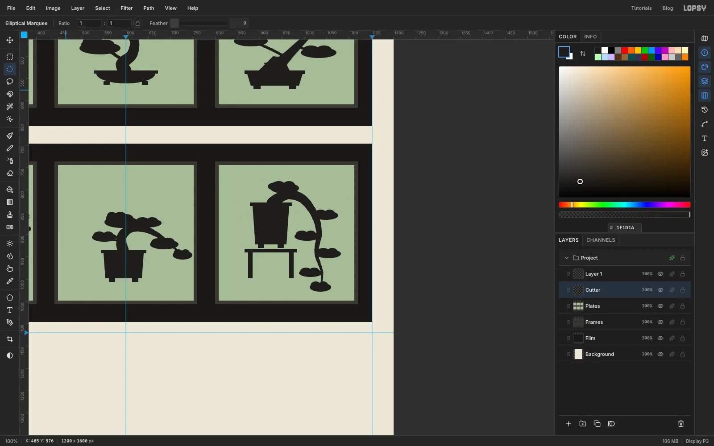

Frame 06 is **Kengai**, the full cascade. Its tip falls below the bottom of the pot, so the pot needs a stand to hang from.

1. **Pot:** tall. Use a rim of about 94 × 8 px near the top-left of the plate, a body about 86 px deep that narrows slightly, and two feet.
2. **Stand:** Shift-add a 118 × 8 px table top under the feet and two 10 px legs, each about 58 px long.
3. **Trunk:** **Size** `26`, **Taper** `340` (about 290 px of path). Start on the rim, rise briefly, arc right over the rim and then fall almost straight down past the table, wobbling slightly. End near the bottom of the plate. Set **Taper** back to `0`.
4. **Pads:** a crown over the rim, then small pads alternating left and right down the fall.

Zoom out with [[Cmd+0]]. All six trees are on the Cutter.

## Add bridges and registration holes

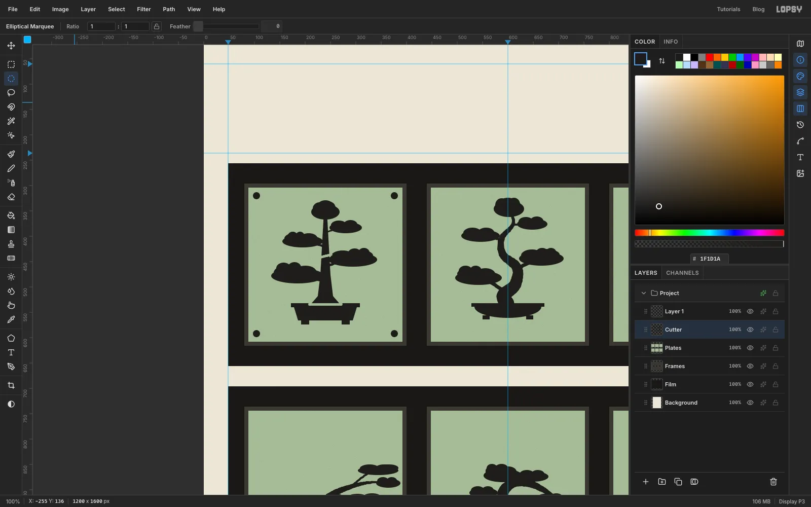

A real stencil can't have a hole that cuts the plate in two, and loose pieces fall out. **Bridges** are thin strips of plate left uncut to hold things together. Here they also make the plates read as stencils at a glance.

1. Pick the **Eraser** ([[E]]) and set **Size** to `5`.
2. On each tree, click on one side of the trunk and **Shift-click** on the other to erase a straight line across it. Add one bridge across the trunk's base, along the top of the pot rim, so the tree is separate from the pot. Add a second across the trunk higher up.
3. For the **registration holes**, use the **Elliptical Marquee** to Shift-add four 14 px circles on every plate, one near each corner and 16 px in from both edges (24 in all). Fill them. They'll become punched holes that line each plate up on paper.

> **Tip:** Small marquees near a guide can snap onto it and collapse to nothing. If a circle won't draw, turn off **View → Snap to Guides** for that step.

## Load the Cutter as a selection

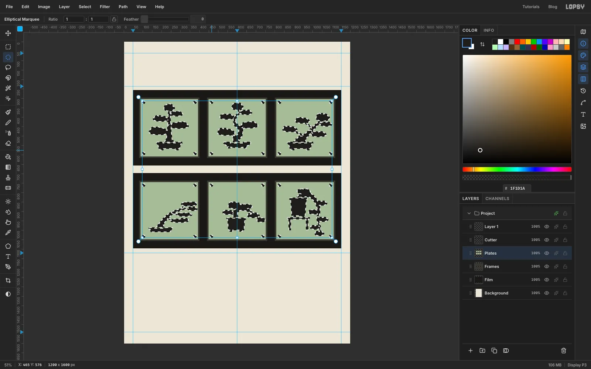

**Cmd-click** the `Cutter` thumbnail in the Layers panel. Every black pixel on it becomes a selection. Then click the `Plates` row, so the selection now targets the plates.

## Cut the trees out of the plates

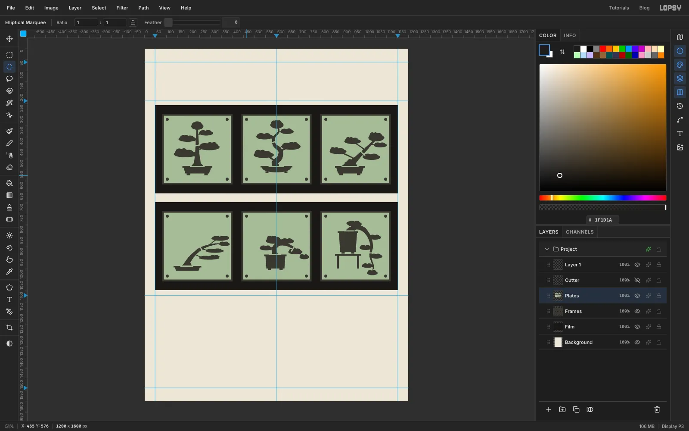

Press [[Delete]]. The trees, pots and holes are cut out of the green, and the bench shows through. Deselect, then click the eye on `Cutter` to hide it. Keep the layer, because it's your master drawing if you ever need to recut a plate.

## Give the plates thickness

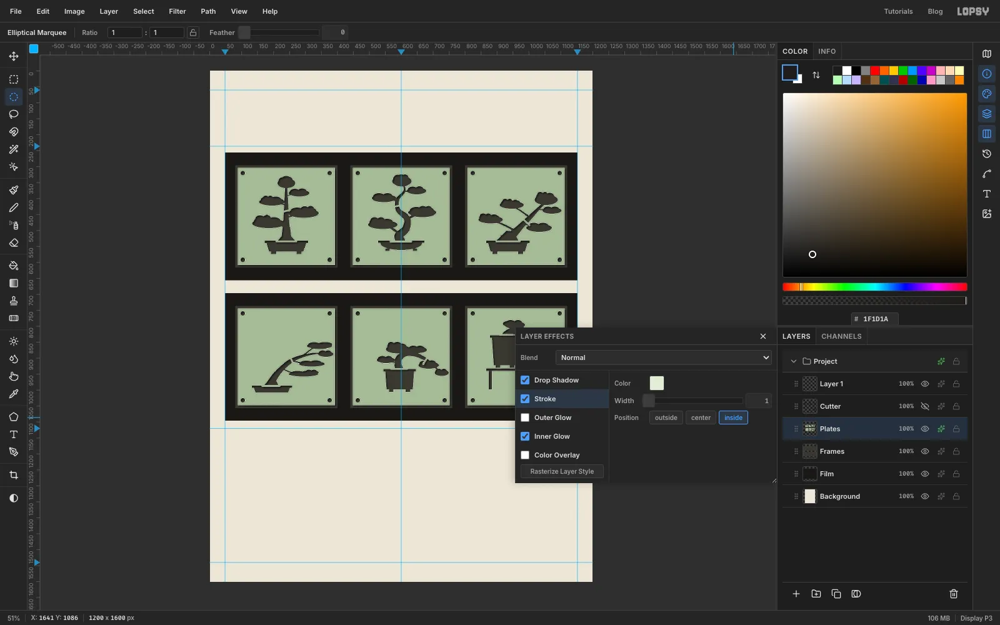

Select `Plates` and click its **Layer effects** button (the sparkle at the end of its row).

- **Inner Glow:** colour `#25301F`, **Size** `6`, **Opacity** `70`. This darkens every cut edge, so the Mylar looks thick.
- **Drop Shadow:** colour `#0C0B0A`, **Offset X** `3`, **Offset Y** `4`, **Blur** `6`, **Opacity** `70`. The plates now sit just above the bench, so shadow falls into the holes too.
- **Stroke:** colour `#E2ECD6`, **Width** `1`, position **inside**. This is the bright bevel where the knife cut the plastic.

Close the drawer.

## Add a sheen and a little translucency

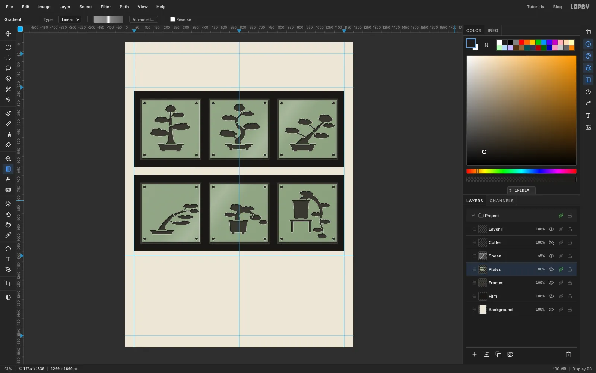

Add a layer called `Sheen` above `Plates` and **Cmd-click** the `Plates` thumbnail to select the plate shapes.

Pick the **Gradient** tool, set **Type** to **Linear** and open **Advanced…**. Use five stops: `#9A9A9A` at 0%, `#808080` at 42%, `#FFFFFF` at 50%, `#808080` at 58% and `#5A5A5A` at 100%. Drag from the top-left of the first strip to the bottom-right of the second. Deselect, set the layer's blend mode to **Soft Light** and its opacity to `45%`.

Mid grey does nothing on Soft Light, so only the white band and the darker ends show. Last, set `Plates` to `86%` opacity so a hint of the bench shows through the plastic.

## Draw the lean axis on each frame

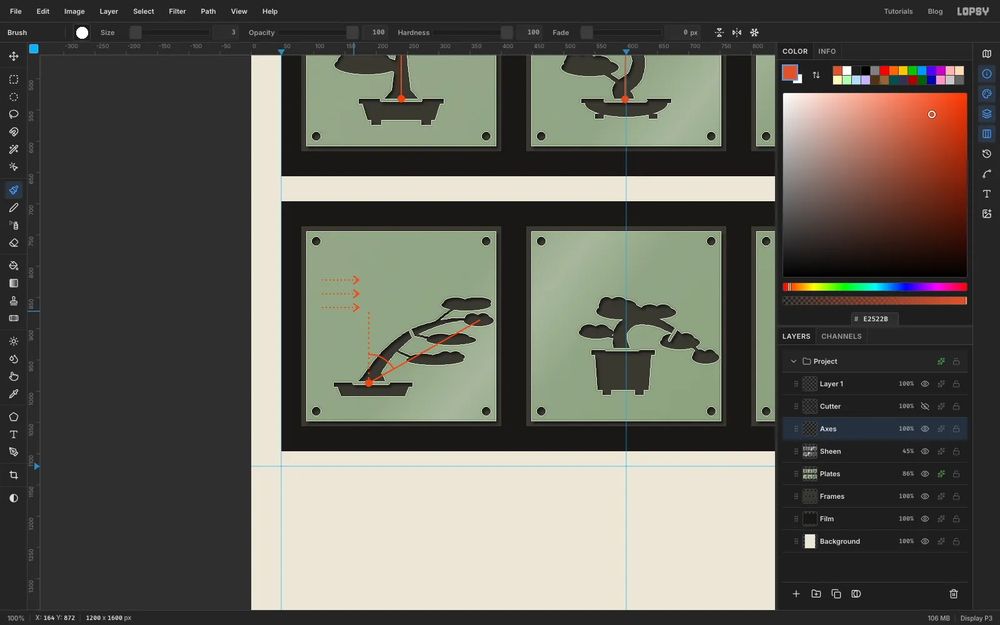

Now the infographic layer. Click `Sheen`, then add a layer called `Axes` above it, so the marks don't pick up the Soft Light tint. Set the foreground to `#E2522B`. Turn off **View → Snap to Guides** while you work on this layer, because the dots are small.

On each frame:

1. **Plumb line** (leaning trees only): with the **Brush** at **Size** `4`, **Taper** `0` and **Spacing** `200` (the maximum), drag straight up from the root about 110 px. The wide spacing turns the stroke into dots.
2. **Axis:** set **Size** `3` and **Spacing** `5`. Click the root, then **Shift-click** the tip of the tree.
3. **Angle arc:** click a point 46 px up the plumb line, then Shift-click your way round to the axis in short steps.
4. **Root dot:** a 12 px circle with the **Elliptical Marquee**, filled.

On frame 04, add three dotted wind arrows on the left, each with a small chevron head.

## Check all six overlays

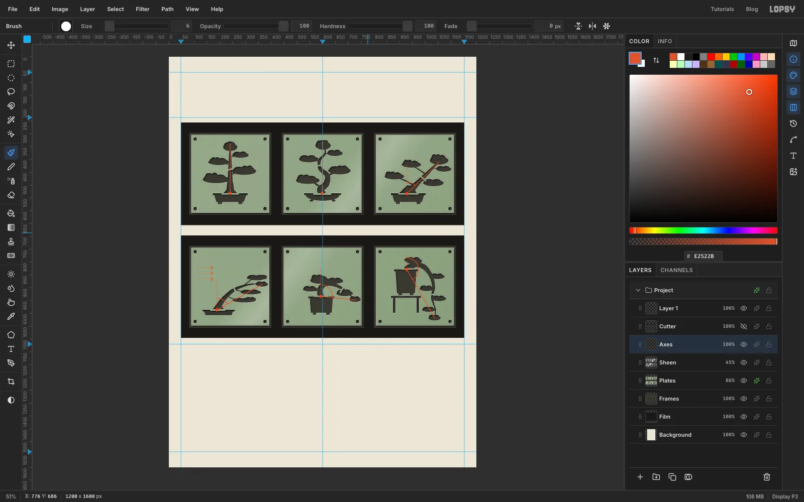

For the two upright trees, the axis is the plumb line, so skip the dotted line and the arc. The tag you add later says 0°. Turn **Snap to Guides** back on.

## Start the lean chart with a half disc

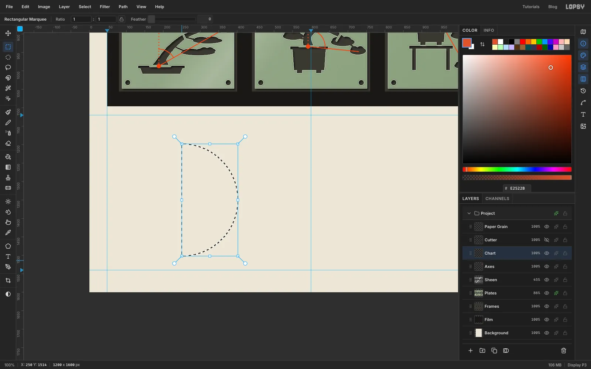

The footer's chart is a protractor that plots all six leans. Its centre is `250, 1350` and its radius is 152.

First, rename **Layer 1** (still at the top of the stack) to `Paper Grain`. It gets its grain at the very end. Then click the `Axes` row and add a layer called `Chart`. With the **Elliptical Marquee**, drag a circle from `98, 1198` to `402, 1502`. Then, with the **Rectangular Marquee**, hold [[Alt]] and drag over the circle's left half to subtract it. Fill with `#DCD3BE` and deselect.

## Hatch the cascade zone with a pattern

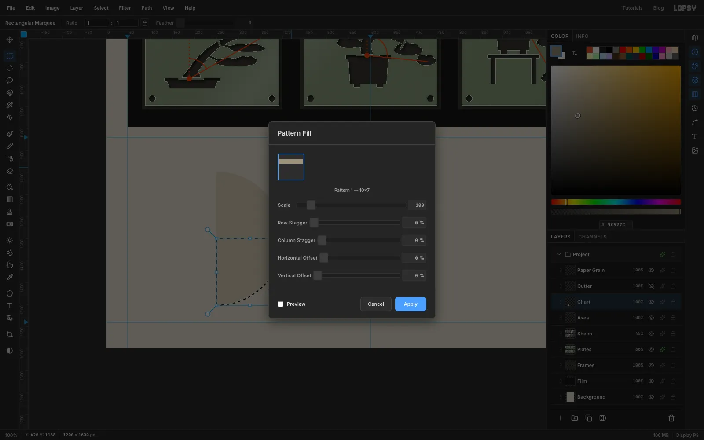

Any tree that leans past 90° drops below the soil line, so that quarter gets hatching.

1. **Make the tile.** Add a layer called `Tile`. In an empty corner of the footer, click once (without dragging) with the **Rectangular Marquee**. The **Rectangular Selection** dialog opens, where you can type exact corners. Select a 10 × 2 px strip and fill it with `#9C927C`. Then select 10 × 7 px from the same corner and choose **Edit → Define Pattern**. Delete the `Tile` layer with the trash button.
2. **Select the zone.** On `Chart`, draw the same circle again. Then hold [[Shift+Alt]] and drag a rectangle from the centre down and right past the circle. **Shift+Alt** keeps only the overlap: the lower-right quarter.
3. Choose **Edit → Fill with Pattern…**, pick your stripe and click **Apply**. Deselect.

## Draw the ring and tick it with radial symmetry

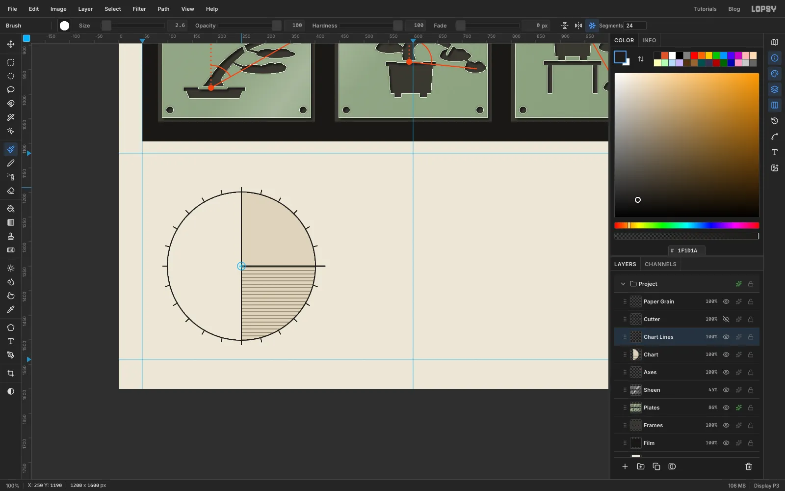

Add a layer called `Chart Lines` and set the foreground to `#1F1D1A`.

1. **Ring:** select the circle again, fill it, choose **Select → Shrink…** by `2` and press [[Delete]]. A 2 px ring is left.
2. **Diameter:** **Brush** at **Size** `2.6` and **Spacing** `5`. (Below about 2.5 px the brush barely paints.) Click the top of the ring and Shift-click the bottom.
3. **Soil line:** **Size** `4`. Click the centre and Shift-click 18 px past the ring on the right.
4. **Ticks:** click **Radial Symmetry** in the Brush options bar and set **Segments** to `24` (one every 15°). **Cmd-click** the chart's centre to move the symmetry centre there. Drag a short stroke 8 px straight up from the top of the ring. Lopsy repeats it 24 times round the circle. Click **Radial Symmetry** again to turn it off.
5. Draw a marquee over everything left of the centre and press [[Delete]], so the ring and ticks only run round the right half.
6. Add the 15° "upright limit" as a dotted ray. Use **Size** `3` and **Spacing** `200`, from the centre to the ring at about `289, 1203`.

## Plot the six leans

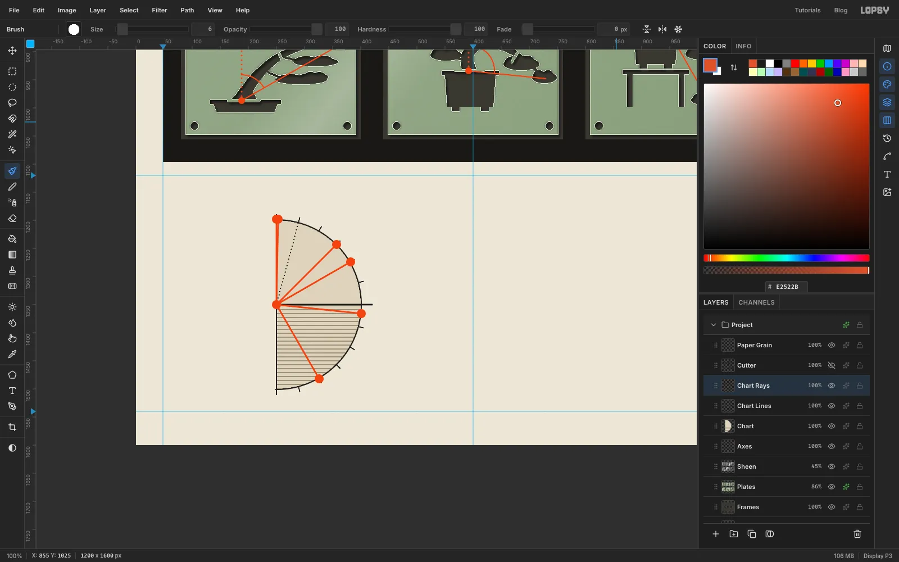

Add a layer called `Chart Rays` and set the foreground to `#E2522B`. With the **Brush** at **Size** `4` and **Spacing** back to `5`, click the centre and Shift-click each point on the ring:

- 0° (frames 01 and 02): `250, 1198`
- 45°: `357, 1243`
- 60°: `382, 1274`
- 95°: `401, 1365`
- 150°: `326, 1482`

Turn **Snap to Guides** off again. Shift-add a 16 px circle at the end of each ray and one at the centre, then fill. Turn snapping back on.

## Bring in a reference photo

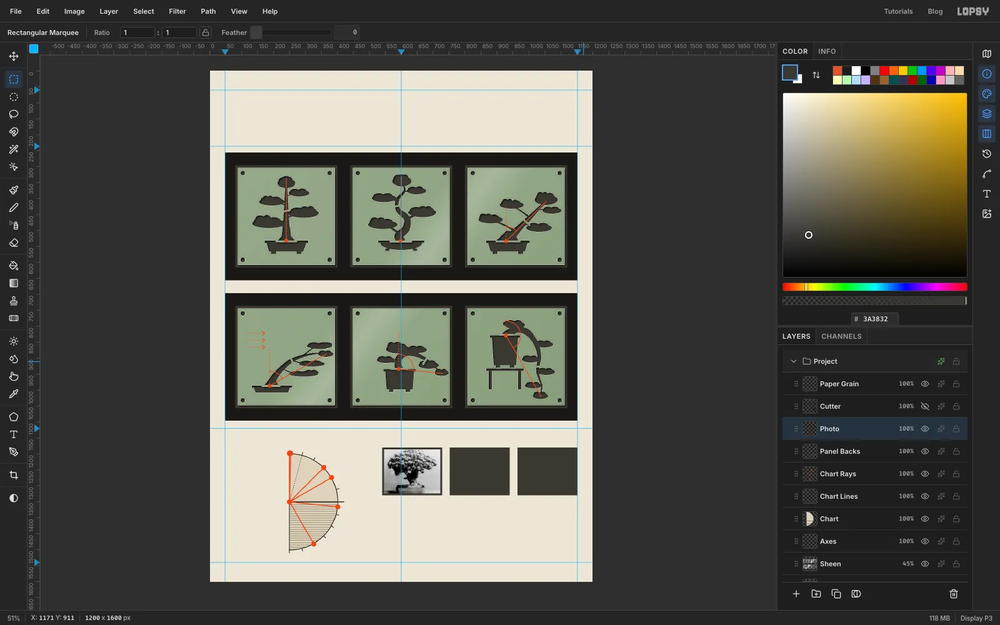

The right half of the footer shows how a photo becomes a plate. The photo is *Sandai Shogun*, a public-domain 1920s image of a pine bonsai, from [Wikimedia Commons](https://commons.wikimedia.org/wiki/File:Bonsai,_%22Sandai_Shogun%22.jpg).

1. Add a layer called `Panel Backs`. Shift-add three 188 × 150 rectangles at `540, 1180`, `752, 1180` and `964, 1180`, and fill with `#3A3832`.
2. Drag the photo file onto the canvas. It lands at the top-left, selected. Hold [[Cmd]] and drag its bottom-right handle in until it's about 279 px wide (Cmd keeps the proportions). Press [[Cmd+D]]. Rename the layer `Photo`.
3. Nudge it with the **Move** tool until the tree is centred on the first panel.
4. Draw a marquee 6 px inside the first panel, choose **Select → Inverse** and press [[Delete]], so the photo is trimmed to the panel with a dark border all round. Deselect.
5. Choose **Filter → Desaturate**, then **Filter → Brightness/Contrast…** with **Contrast** `25`.

## Threshold a copy

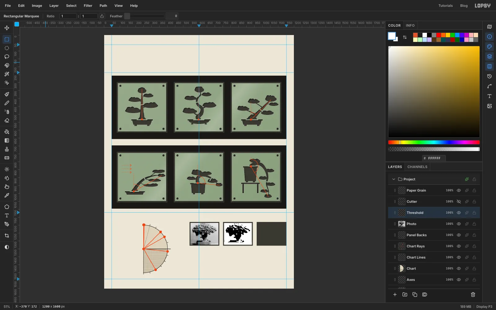

Choose **Layer → Duplicate Layer** and rename the copy `Threshold`. Switch to the **Move** tool ([[V]]) and nudge it 212 px right into the second panel: [[Shift+→]] 21 times, then [[→]] twice.

A knife can't follow pine needles. Run **Filter → Gaussian Blur…** at **Radius** `4` so the needles clump into masses, then **Filter → Threshold…** at **Level** `140`.

The blur smeared the edges outward, so trim it again: marquee 6 px inside the panel, **Select → Inverse**, [[Delete]]. Then select the bottom 16 px inside the panel and fill it white to drop the table's shadow.

## Select the black and clean it up

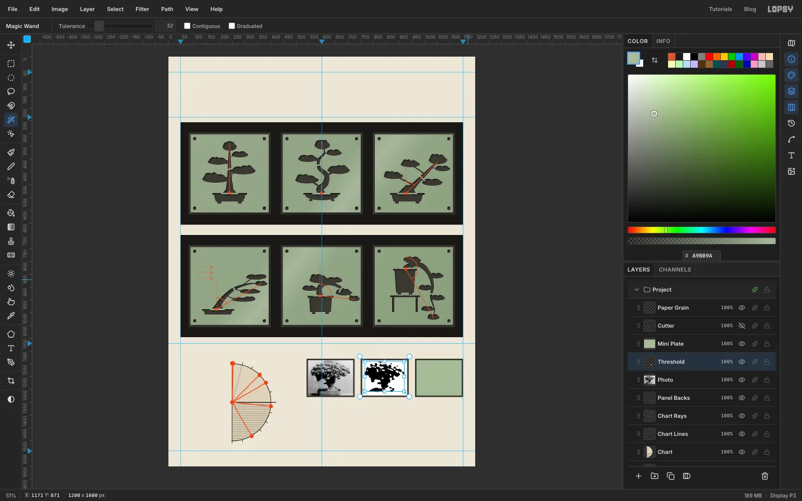

First make the card to cut. Add a layer called `Mini Plate` and fill a rectangle 6 px inside the third panel with `#A9BB9A`, then deselect.

Click the `Threshold` row. Pick the **Magic Wand** ([[W]]), untick **Contiguous** and click on the black trunk. Every black pixel in the panel is selected.

Now clean the selection up for cutting:

1. **Select → Grow…** `3`, then **Select → Shrink…** `3`. This closes small gaps, which would be plate islands that fall out.
2. **Select → Shrink…** `2`, then **Select → Grow…** `2`. This removes specks too small to cut.

Tick **Contiguous** again when you're done with the wand.

## Slide the selection over and cut the mini plate

1. With the **Magic Wand** still active, press [[Shift+→]] 21 times and [[→]] twice. With a selection tool active, the arrow keys move the selection outline 212 px and leave the pixels where they are.
2. Click the `Mini Plate` row and press [[Delete]].

## Finish the photo-to-plate strip

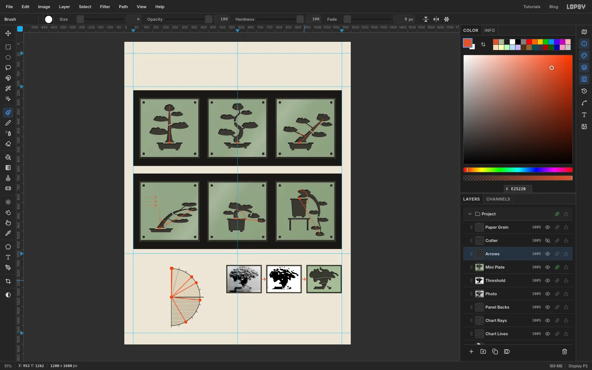

Deselect. On `Mini Plate`, paint two bridges across the trunk and canopy with the **Brush** at **Size** `3` in `#A9BB9A`. Shift-click three points for each so they bend with the branches.

Give the mini plate the same treatment as the big plates, a little smaller: **Inner Glow** `#25301F` at **Size** `4`, **Opacity** `70`, and **Drop Shadow** `#0C0B0A` with offsets `2` / `3`, **Blur** `4`, **Opacity** `70`.

Add a layer called `Arrows`. With the Brush at **Size** `4`, **Spacing** `5`, in vermilion, draw a 16 px arrow with a small chevron head in each gap between the panels.

## Set the type

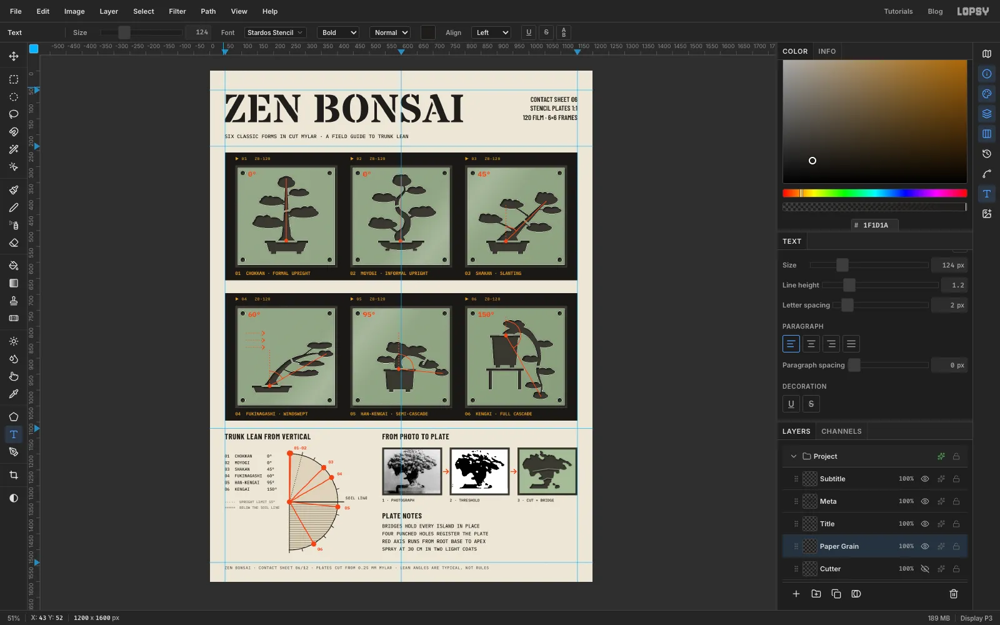

Pick the **Text** tool ([[T]]). Before each new piece of text, click a *picture* layer, not a text layer, in the right group. With a text layer selected, changing the font or size restyles that layer instead. Press [[Tab]] to commit each one. Create text from the bottom of the page upward, in the order below: a click inside an existing text box edits that text instead of starting new.

- **Footer line** (click `Arrows`): one line of Plex Mono `12` in `#57514A` along the bottom margin.
- **Photo strip** (click `Arrows`). Heading `FROM PHOTO TO PLATE` in Barlow Condensed Bold `24`. Captions `1 · PHOTOGRAPH`, `2 · THRESHOLD` and `3 · CUT + BRIDGE` under the panels in Plex Mono `12`. Then `PLATE NOTES` and four lines of notes in Plex Mono `15` at **Line height** `1.6`.
- **Chart** (click `Chart Rays`). The heading `TRUNK LEAN FROM VERTICAL` is **Barlow Condensed Bold** `24` with **Letter spacing** `1`. The legend is a six-line Plex Mono **Medium** `13` table at **Line height** `1.6`. Under it, a two-line key reads `·····  UPRIGHT LIMIT 15°` and `=====  BELOW THE SOIL LINE`. Set it in `11` px, grey `#6E675A`. Each ray gets a vermilion **Bold** `13` number just outside its dot, and the soil line gets a small `SOIL LINE`.
- **Film** (click `Axes` first). Use **IBM Plex Mono** in amber `#E3A13B`. Above each frame, at **Medium** `12`, type `▶ 01   ZB-120` and so on, 12 px below the strip's top edge. Below each frame, at **SemiBold** `14`, type the caption, for example `01  CHOKKAN · FORMAL UPRIGHT`, 12 px above the strip's bottom edge. In each plate's top-left corner, beside the punched hole, add the angle tag in **Bold** `22`, vermilion: `0°`, `0°`, `45°`, `60°`, `95°`, `150°`.
- **Header** (click `Paper Grain`, so the type sits above the grain and stays crisp). `ZEN BONSAI` is **Stardos Stencil Bold** `124` with **Letter spacing** `2`, its left edge on the 48 guide. Under it, the subtitle is Plex Mono **Medium** `16`. For the spec block, set **Align right** in the Text panel first. Then *drag* a text box from about `880, 74` to the right margin guide, and type three lines in **Barlow Condensed SemiBold** `22` at **Line height** `1.3`. A dragged box respects alignment, so the lines end exactly on the 1152 guide. Set **Align left** again afterwards, because alignment carries over to the next text.

> **Tip:** Text panel settings like **Letter spacing**, **Line height** and **Align** stick to the next text you create, so reset them each time.

## Grain, registration marks and a grease pencil

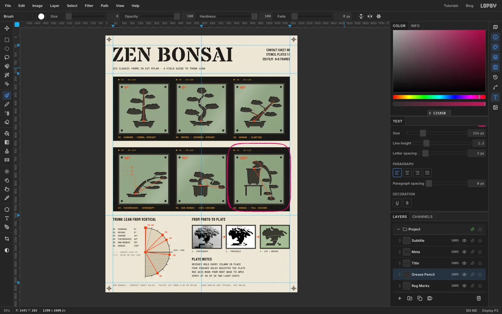

1. **Grain:** select `Paper Grain`. It sits above everything except the header type. Fill it with `#808080`, run **Add Noise** at **Amount** `28`, **Mono** and **Gaussian**, set it to **Overlay** and drop the opacity to `40%`.
2. **Registration marks:** add a layer called `Reg Marks`. In each corner, fill an 18 px circle centred 24 px in from both edges, **Shrink** it by `2` and delete the inside. Then draw a 32 px cross through it with the Brush at **Size** `2.6`.
3. **Grease pencil:** add a layer called `Grease Pencil` with the foreground at `#C2185B`. In the brush settings, set **Size** `8`, **Hardness** `45`, and on the **Dynamics** tab **Size Jitter** `30`, **Opacity Jitter** `35` and **Scatter** `6`. That gives the waxy, broken line of a china marker. Draw one loose, boxy loop round frame 06. Start at its bottom-left, go up the gap on its left, across the paper above the strip, down the right edge and back along the bottom. Keep the line outside the frame number and caption, and overlap the start a little at the end. Reset the jitters and Scatter to `0` afterwards.

## Add a rotated grease-pencil note

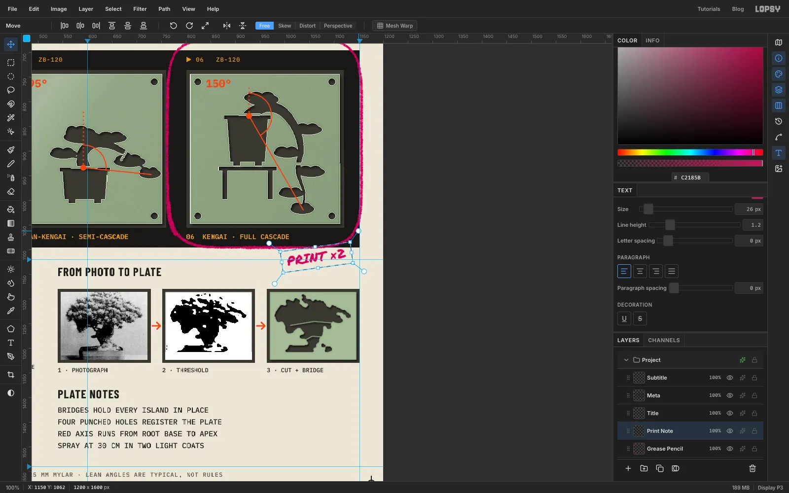

With `Grease Pencil` selected, add text in **Permanent Marker** `26`, `#C2185B`: `PRINT ×2`. Put it on the paper just under the loop. Click **Rasterize Layer** at the bottom of the Layers panel so you can rotate it as pixels.

Draw a marquee around the words with a little room to spare. With the **Move** tool, drag the rotate handle about 8° anticlockwise, then press [[Cmd+D]]. Choose **Layer → Merge Down** to put the note on the grease-pencil layer.

## Group the layers

Four groups keep the file manageable. For each one, click its top layer, **Shift-click** its bottom layer to select the run, choose **Layer → Group Layers** and rename the group:

- `Header`: the title, subtitle and spec block
- `Photo to Plate`: the notes and captions down to `Panel Backs`
- `Lean Chart`: the ray numbers and legend down to `Chart`
- `Contact Strips`: the captions, tags and edge print down to `Film`

Collapse them. Now you can select a group and nudge the whole section with the **Move** tool. Choose **File → Save Project** to keep the layers, then **File → Quick Export PNG** for the finished sheet.
