Infographic tees borrow the look of old textbook plates: a big labelled drawing, numbered callouts, small figures with captions, and a strict grid holding it all together. Screen printing suits the style, because every colour is a separate flat ink.

This shirt explains how a croissant gets its layers. A cutaway croissant gets halftone shading and a magnified cross-section. Around it go a diagram of the folds that turn one slab of butter into 27 layers, a recipe chart and a timeline. Everything is drawn in Lopsy with four inks on a sage shirt. There are no photos.

Along the way you'll use:

- the **Lasso** with **Select → Shrink** to cut outlined segments, and **Shift**-added selections
- a radial **gradient**, the **Halftone** filter and **Multiply** for screen-print shading
- the **Pen** tool, pressing [[Enter]] to stroke curves and a spiral
- live text in **Fraunces**, **DM Mono** and **Archivo Narrow**, with letter spacing and line height from the **Text** panel, and **Drop Shadow** for an offset print look
- the **Move** tool to move, rotate and scale whole groups, plus live text rotation
- the **Shape** tool, both for pixel circles and for a circular **path** that text runs around
- **Define Pattern** and **Fill with Pattern** for striped diagrams
- intersecting selections ([[Shift]]+[[Alt]]) to cut donut-chart wedges
- a dotted **Brush** line made with the Brushes window's **Spacing**, and the **Eraser**
- **Copy Merged**, **Paste**, scaling and rotating a pasted icon
- **Add Noise**, **Threshold**, the **Magic Wand** and **Color Overlay** for a worn print texture

The palette is four inks on a sage shirt:

- Shirt `#86997A` (the ground, not an ink)
- Chocolate `#3A2418`
- Cream `#F6EBD3`
- Butter `#F2BC3D`
- Toasted amber `#C2652A`

> **Tip:** Positions are in document pixels, written `x, y`. The status bar at the bottom shows where the pointer is. When a step says to fill, that's **Edit → Fill**, which fills the selection with the foreground colour. [[Cmd+D]] deselects. To load a layer's pixels as a selection, [[Cmd]]-click its thumbnail in the Layers panel.

> **Tip:** Blend modes and layer effects live in each layer's effects drawer, opened from the sparkle icon on its row. Before you change the font or size for a new piece of text, click a plain pixel layer in the Layers panel. If a text layer is selected, the change restyles that layer instead.

## Start the shirt

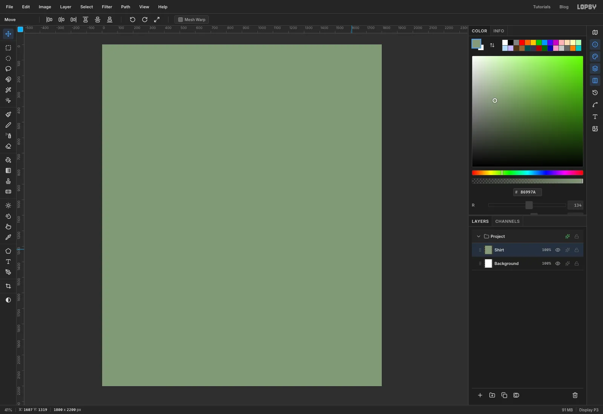

The canvas is the print area of the shirt. The sage fill stands in for the fabric, so it isn't one of the four inks.

1. Create a new document **1800** × **2200** px with a white background.
2. Rename **Layer 1** to `Shirt`.
3. Set the foreground colour to `#86997A` and fill the layer.
4. Run **Filter → Add Noise…** at **Amount** `7` with **Mono** and **Gaussian** for a heathered knit.

## Add margin guides

Click once on the top ruler at `110`, `900` and `1690`. Each click drops a vertical guide. Then click the left ruler at `110`, `1230` and `2090` for horizontal guides.

The outer guides are the margins and `900` is the centre line. Keep the big croissant above `1230`. The four small figures go below it.

## Cut the first horn

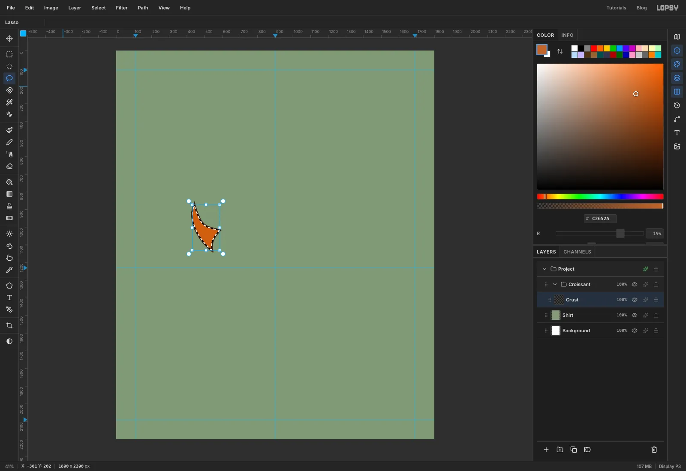

The croissant is seven curved segments sitting on an arch, like a rainbow: a fat centre segment, two pairs either side of it, and two pointed horns. The arch is centred on `900` and spans about `x 424–1376` and `y 552–1144`. Draw the outer pieces first so each new segment overlaps the one beside it.

1. Click **New Group** and name it `Croissant`. Add a layer inside it called `Crust`.
2. Pick the **Lasso** and trace the left horn. It's a curved wedge about 170 px wide and 290 px tall, from about `440, 850` at the top down to a point near `560, 1140` that hooks in towards the middle. The top end is a soft curve where the next segment will cover it.
3. Fill with chocolate `#3A2418`.
4. Choose **Select → Shrink…** and shrink by `7` px, then fill with amber `#C2652A`.

That leaves a 7 px brown outline around an amber segment.

## Build all seven segments

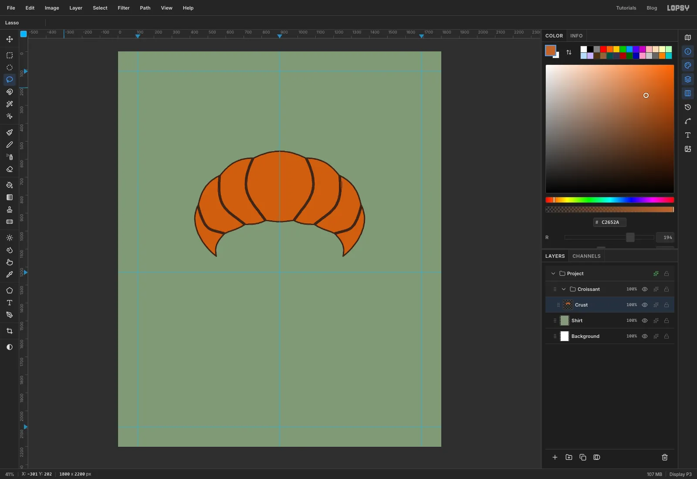

Repeat the lasso, brown fill, shrink and amber fill for each segment in this order:

1. **The right horn**, mirroring the left one.
2. **The outer segments**: fat, rounded wedges that lean outwards along the arch, about 265 px wide and 330 px tall. The left one covers about `x 444–710`, `y 686–1015`, and the right one mirrors it at `x 1090–1356`.
3. **The inner segments**: taller and more upright, about 260 × 375 px, at `x 563–823` and `x 977–1237`, `y 590–966`.
4. **The centre segment**: the biggest, an upright barrel shape at `x 712–1088`, `y 552–951`.

Bow the seams between segments outwards, towards the horns, as if the dough wraps around the middle. Each new segment's outline is drawn over the previous one, so the seams stay crisp.

## Add the butter highlights

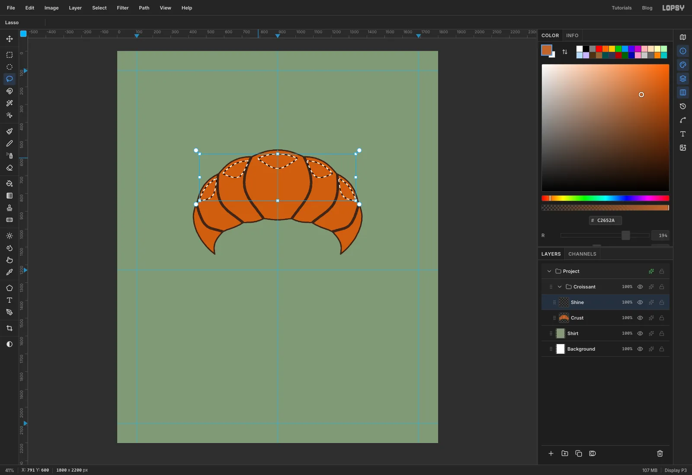

1. Add a layer called `Shine` above `Crust`.
2. With the **Lasso**, draw a thin crescent along the top edge of the centre segment, a little inside its outline. Make it widest in the middle and taper it at both ends.
3. Hold [[Shift]] and draw a crescent on each inner and outer segment. Shift adds each one to the same selection. Leave the horns plain.
4. Fill with butter `#F2BC3D` and deselect.

## Paint the toasted shading

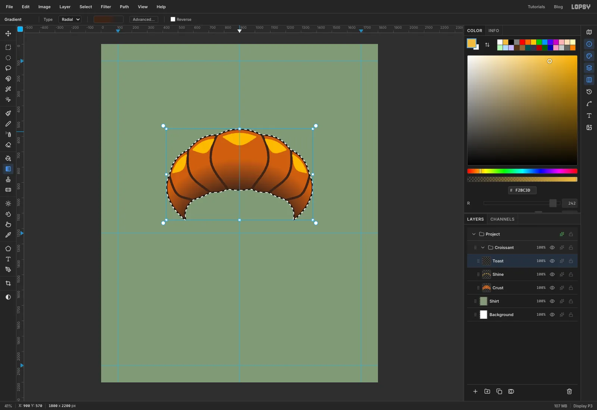

1. Add a layer called `Toast` and [[Cmd]]-click the `Crust` thumbnail to select the croissant.
2. Pick the **Gradient** tool, set **Type** to **Radial**, and open **Advanced…**. Use four stops: chocolate at `0%`, chocolate at `50%`, then chocolate with its opacity at zero at `78%` and `100%`.
3. Drag from `900, 1340`, below the croissant, straight up about 790 px.

The gradient is solid along the inner curve of the arch and fades out before it reaches the highlights.

## Turn the shading into halftone dots

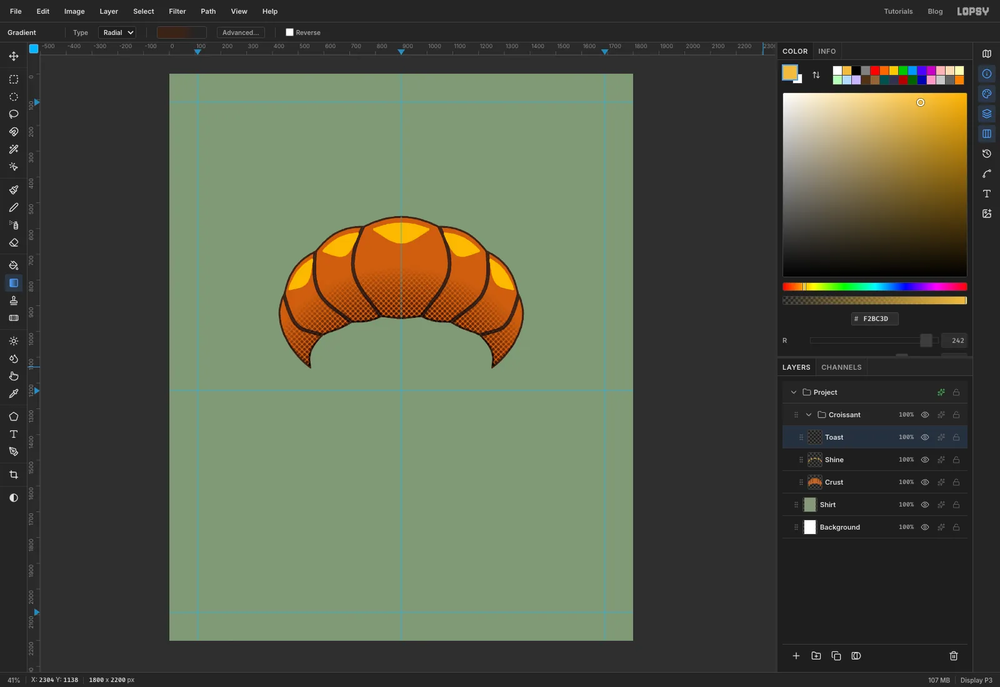

1. Deselect, then run **Filter → Halftone…** with **Dot Size** `14`, **Angle** `45` and **Softness** `0.5`.
2. [[Cmd]]-click the `Crust` thumbnail again, choose **Select → Inverse** and press [[Delete]]. This trims any dots that fall outside the croissant.
3. Deselect and set the `Toast` layer's blend mode to **Multiply**.

A 14 px dot is coarse enough to print cleanly on a shirt.

## Draw the ridges with the Pen

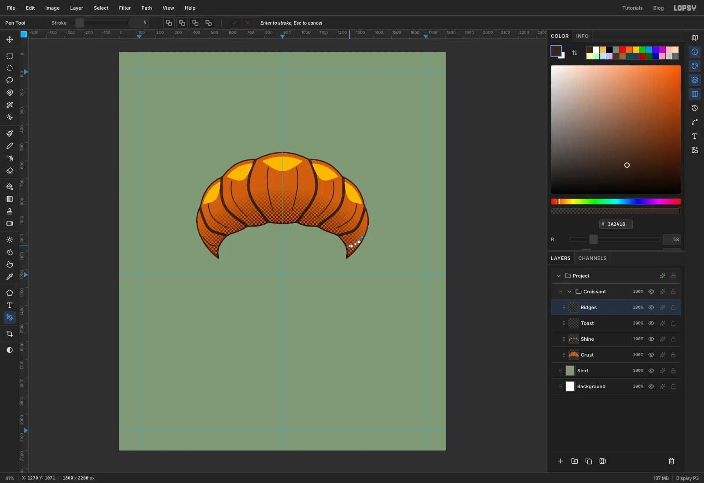

1. Add a layer called `Ridges`, set the foreground to chocolate, pick the **Pen** tool and set **Stroke** to `5`.
2. For each segment, click near its top, then click and drag in the middle to pull out a handle that bends the line, then click near its bottom.
3. Press [[Enter]]. The Pen strokes the path onto the layer in the foreground colour.

Draw one ridge on each segment and two on the centre segment, running roughly parallel to the seams. Press [[Escape]] after each one so the next click starts a new path.

## Set the word "dissected."

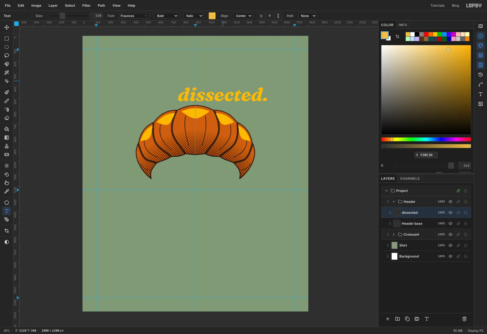

Create the lowest line of the title first. A text click inside an existing text layer edits that layer, so working from the bottom up keeps each click in empty space.

1. Collapse `Croissant`, click **New Group** and name it `Header`. Add a pixel layer inside it called `Header base`.
2. Set the foreground to butter. Pick the **Text** tool and set **Fraunces**, **Bold**, **Italic**, **Size** `150`, **Align** **Center**.
3. Click at `1120, 360`, type `dissected.` and press [[Tab]] to commit.

## Set the title

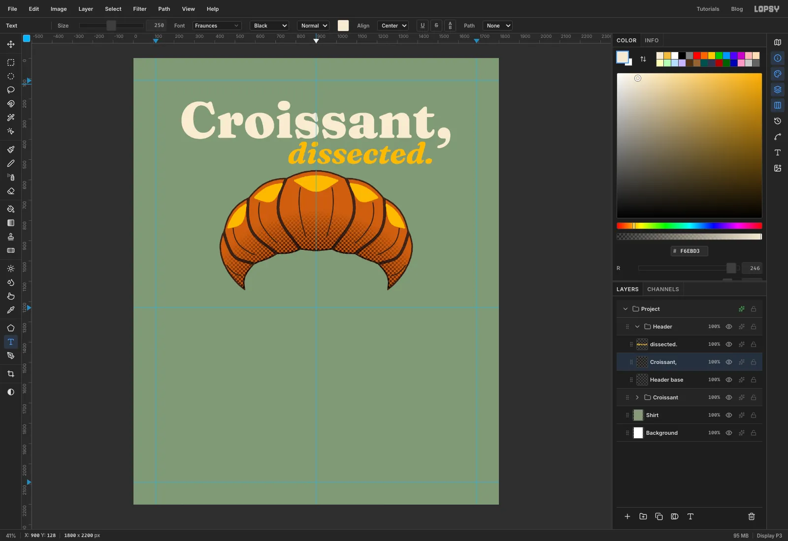

1. Click `Header base`, set the foreground to cream `#F6EBD3`, and switch the text options to **Fraunces**, **Black**, **Normal**, **Size** `250`.
2. Click at `900, 128` and type `Croissant,`.

## Add the plate line

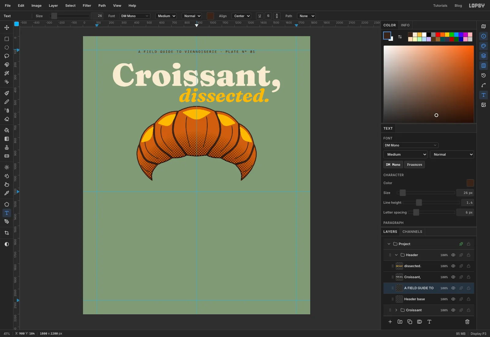

1. Click `Header base` again and set the foreground to chocolate.
2. Choose **DM Mono**, **Medium**, **Size** `26`. Open the **Text** panel and set **Letter spacing** to `6`.
3. Click at `900, 104` and type `A FIELD GUIDE TO VIENNOISERIE · PLATE Nº 01`.

## Tilt the italic

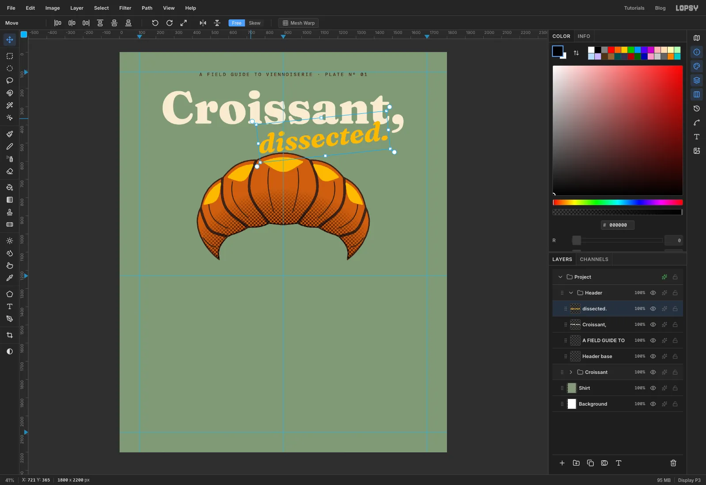

1. Click the `dissected.` layer and pick the **Move** tool. Handles appear around the text with no selection needed.
2. Hover just outside the top-left corner until the cursor turns into the rotate arrow, then drag upwards to rotate the text about `6°` anticlockwise.
3. Press [[Escape]] to commit.

The text stays live, so you can still edit the word later.

## Give the type an offset shadow

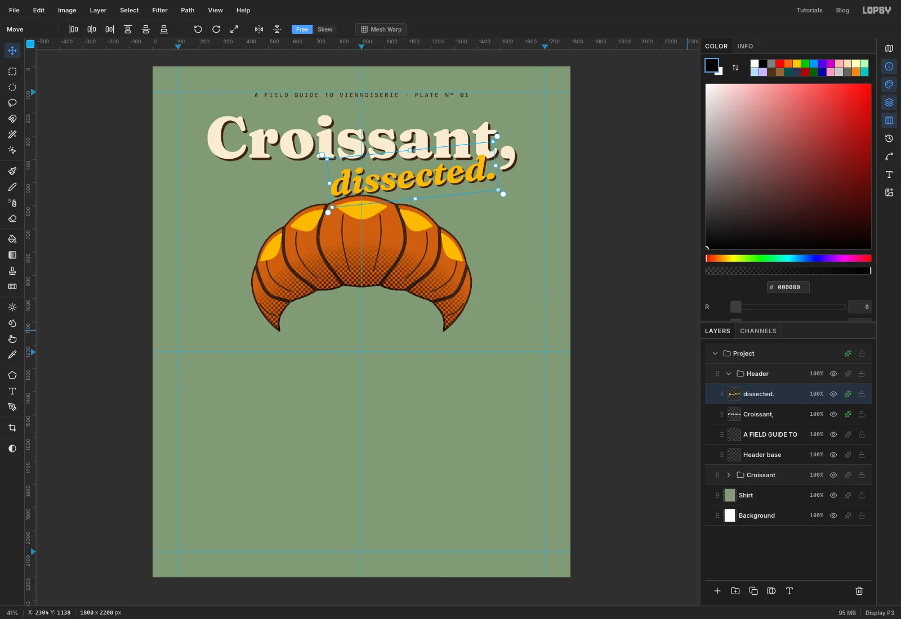

A hard offset shadow looks like a second ink printed slightly out of register.

1. Open the effects drawer on `Croissant,` and enable **Drop Shadow** with **Offset X** `9`, **Offset Y** `9`, **Blur** `0`, **Opacity** `100` and colour chocolate.
2. Give `dissected.` the same shadow with both offsets at `7`.

## Move and tilt the whole croissant

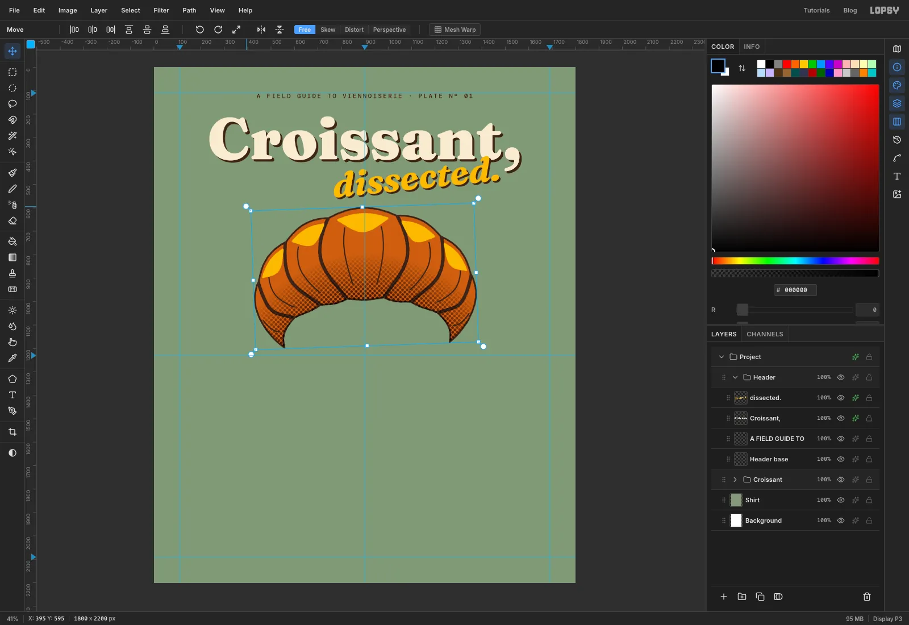

Moving a group moves every layer inside it together.

1. Click the `Croissant` group row and pick the **Move** tool.
2. Drag the croissant straight down `45` px so it clears the italic. The **Y** readout in the status bar should go up by 45 between where you press and where you let go.
3. Drag from just outside the top-left corner of the transform box to rotate the whole group about `2°` anticlockwise, then press [[Cmd+D]] to commit.

The segments, highlights, dots and ridges all rotate together.

## Add a crust shadow

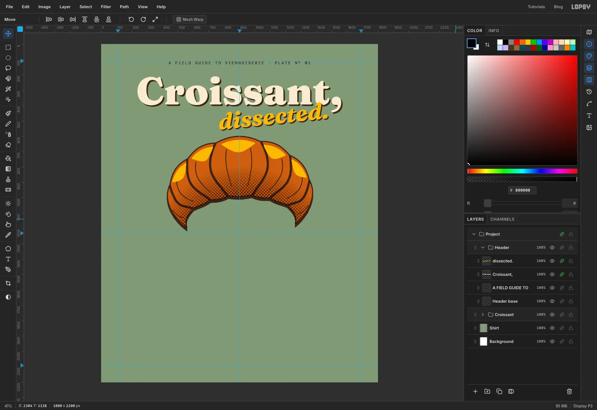

Expand the group and give `Crust` a **Drop Shadow** with **Offset X** `0`, **Offset Y** `16`, **Blur** `0`, **Opacity** `100` and colour chocolate. The croissant now looks like it's printed in two passes, just like the title.

## Draw the callout leaders

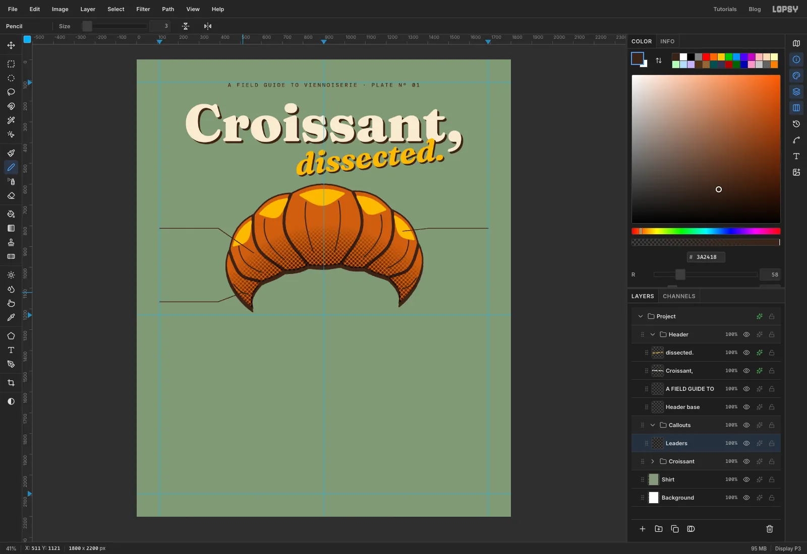

Each callout sits on a short horizontal shelf that turns and angles in to the part of the croissant it describes.

1. Collapse `Croissant`, click its row, and click **New Group** called `Callouts`. Add a layer called `Leaders`.
2. Pick the **Pencil** at **Size** `3` in chocolate. Click at `110, 812`, [[Shift]]-click at `392, 812`, then [[Shift]]-click on the amber crust of the second segment from the left, around `563, 931`. Shift-clicks join the clicks with straight lines.
3. Do the same from the right margin: `1690, 812`, then `1408, 812`, then a point on the butter highlight of the second segment from the right, around `1280, 826`.
4. For the horn, go from `110, 1166` to `392, 1166`, then to about `511, 1121` on the left horn.
5. Pick the **Shape** tool and set it to **Ellipse**, **Pixels**, a cream fill and a `4` px chocolate stroke. On a new layer, drag from the end of each leader to make a 22 px pin. Shapes grow from where you press.

## Write the callouts

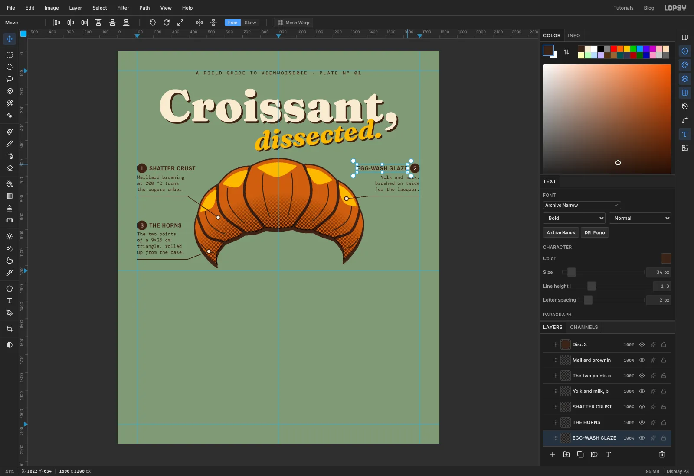

1. On another new layer, use the **Shape** tool with a chocolate fill and no stroke to draw 54 px discs centred at `137, 656`, `1663, 656` and `137, 976`.
2. Click `Leaders`, then type the numbers `1`, `2` and `3` in cream **DM Mono Medium** at `30` px. Create each one in empty space, then move it into its disc with the arrow keys until it sits in the middle.
3. Click `Leaders` again and switch to chocolate **DM Mono Regular** at `26` px with **Line height** `1.3` for the body text. Press [[Enter]] between lines:
   - Left-aligned at `110, 690`: `Maillard browning` / `at 200 °C turns` / `the sugars amber.`
   - Left-aligned at `110, 1008`: `The two points` / `of a 9×25 cm` / `triangle, rolled` / `up from the base.`
   - Right-aligned at `1690, 690`: `Yolk and milk,` / `brushed on twice` / `for the lacquer.`
4. Click `Leaders` once more and switch to **Archivo Narrow Bold** at `34` px with **Letter spacing** `2` for the headings. Put `SHATTER CRUST` and `THE HORNS` left-aligned just right of their discs, and `EGG-WASH GLAZE` right-aligned at `1622`. Nudge each heading with the arrow keys until it's centred on its disc.

Keep the body lines short. At 26 px each DM Mono character is about 16 px wide, so 17 characters fill the 280 px column.

## Start the badge

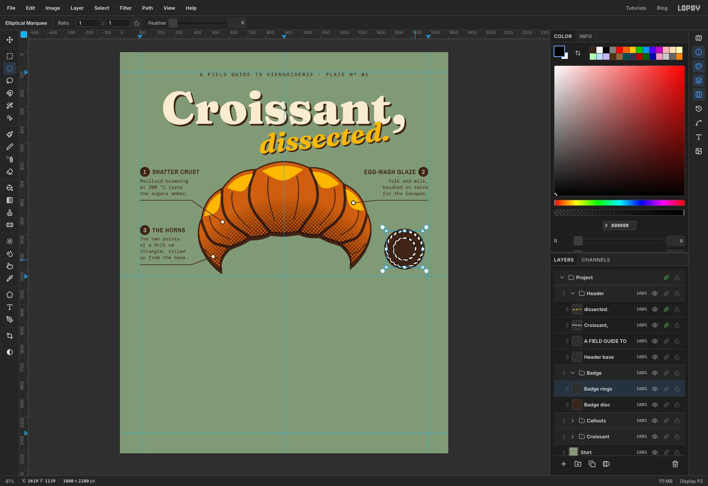

The badge goes beside the right horn, centred at `1560, 1080`.

1. Collapse `Callouts`, click its row and click **New Group** called `Badge`.
2. Turn off **View → Snap to Guides** so the shape doesn't jump to the margin guide. Add a layer `Badge disc` and use the **Shape** tool to draw a 224 px chocolate circle, dragging from the badge centre.
3. Add a layer `Badge rings`. With the **Elliptical Marquee**, drag from `1460, 980` to `1660, 1180`. Hold [[Alt]] and drag from `1464, 984` to `1656, 1176` to take out the middle, which leaves a 4 px ring.
4. Hold [[Shift]] and drag from `1498, 1018` to `1622, 1142` to add an inner circle. Then [[Alt]]-drag from `1501, 1021` to `1619, 1139` to hollow that one out too.

## Fill the rings and draw a circular path

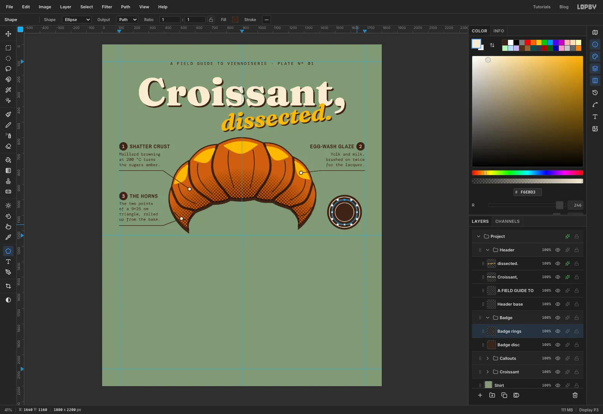

1. Fill the ring selection with cream and deselect.
2. Set the **Shape** tool's **Output** to **Path** and drag from the badge centre to make a 160 px circle. It's added to the **Paths** panel instead of being drawn as pixels.
3. Turn **View → Snap to Guides** back on.

## Run text around the badge

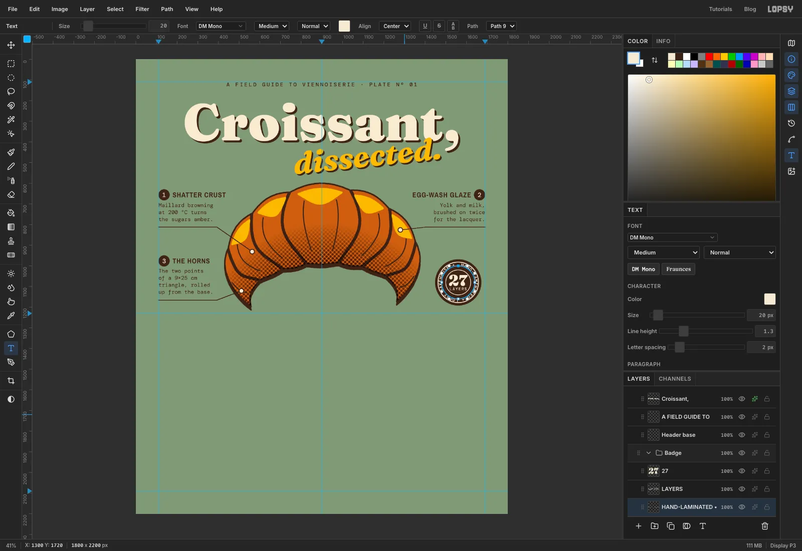

1. Click `Badge rings`. In cream, type `27` in **Fraunces Black** at `74` px. Click `Badge rings` again and type `LAYERS` in **DM Mono Medium** at `19` px with **Letter spacing** `3`. Make both in empty canvas, then nudge them into the inner ring with the arrow keys.
2. Click `Badge rings` again and type `HAND-LAMINATED • LOPSY BAKEHOUSE •` in **DM Mono Medium** at `20` px with **Letter spacing** `2`, again in empty canvas.
3. With that text layer selected and the **Text** tool active, pick your circle in the options bar's **Path** dropdown.

The text wraps around the circle. At this size and spacing it fills the circle almost exactly.

## Rasterize the ring text

The badge is going to be rotated and scaled as a group, but text that follows a path can't be transformed together with other layers. If you try, Lopsy shows the notice in the screenshot and leaves everything where it was.

Click the `HAND-LAMINATED…` layer and click **Rasterize Layer** in the Layers panel toolbar. The `27` and `LAYERS` text can stay live.

## Rotate the badge

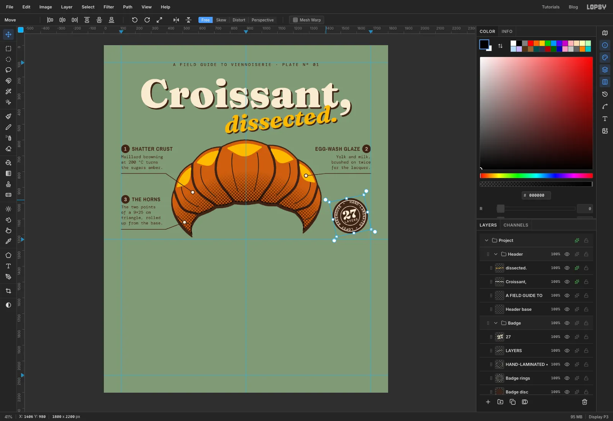

1. Click the `Badge` group row and pick the **Move** tool.
2. Drag from just outside the top-left corner of its box to rotate the group about `12°` anticlockwise.
3. Press [[Cmd+D]] to commit.

A tilted badge looks like a rubber stamp.

## Scale the badge down

1. With the group still selected, hold [[Cmd]] and drag the bottom-right handle up and to the left until the badge is about 180 px across. [[Cmd]] keeps the proportions.
2. Press [[Cmd+D]] to commit.
3. Nudge the group with the arrow keys until its right edge touches the `1690` guide, with its centre at about `y 1070`.

The live `27` and `LAYERS` scale with it and stay sharp.

## Rule the figure grid

1. Collapse `Badge`, click its row, and click **New Group** called `Structure`. Add a layer `Rules`.
2. With the **Pencil** in chocolate at `3` px, draw horizontal rules from `110` to `1690` at `y 1260` and `y 1772`.
3. At `2` px, draw vertical dividers down the centre line, `x 900`, from `1292` to `1742` and from `1804` to `2090`.

That gives four boxes for the four figures.

## Draw the cross-section

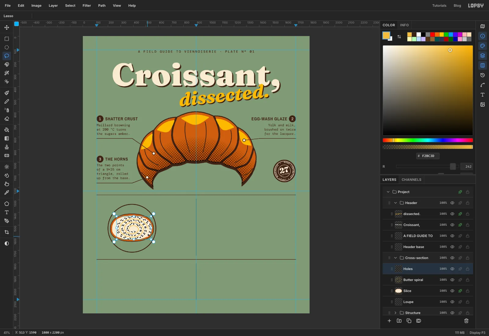

The first figure shows a slice through the croissant. Because the dough is rolled up, the slice is a spiral.

1. Collapse `Structure`, click its row and click **New Group** called `Cross-section`.
2. Add a layer `Loupe`. Turn off **Snap to Guides** again. Set the **Shape** tool to **Ellipse**, **Pixels**, no fill and a `6` px chocolate stroke, and drag a 380 px circle from `390, 1525`. Turn snapping back on.
3. Add a layer `Slice`. Lasso a flattened oval about 340 × 236 px in the middle of the ring, a little flatter along the bottom, like a loaf. Fill it amber, shrink the selection by `12` and fill it cream. Deselect and give the layer a 4 px chocolate **Stroke** effect so the crust stands out from the shirt.
4. Add a layer `Butter spiral`, set the foreground to butter, and pick the **Pen** with **Stroke** `4`. Start a few pixels from the centre of the slice. Click and drag a new anchor every quarter turn, working outwards about 27 px per turn and dragging each handle along the direction of the curve. After three turns, press [[Enter]] to stroke it.
5. Add a layer `Holes` and zoom in to about 200%. With the **Lasso**, draw small ovals in the gaps between the turns of the spiral, holding [[Shift]] to add each one. Make them longer along the spiral and a little bigger towards the outside. About 50 holes fill it nicely.

## Fill the holes

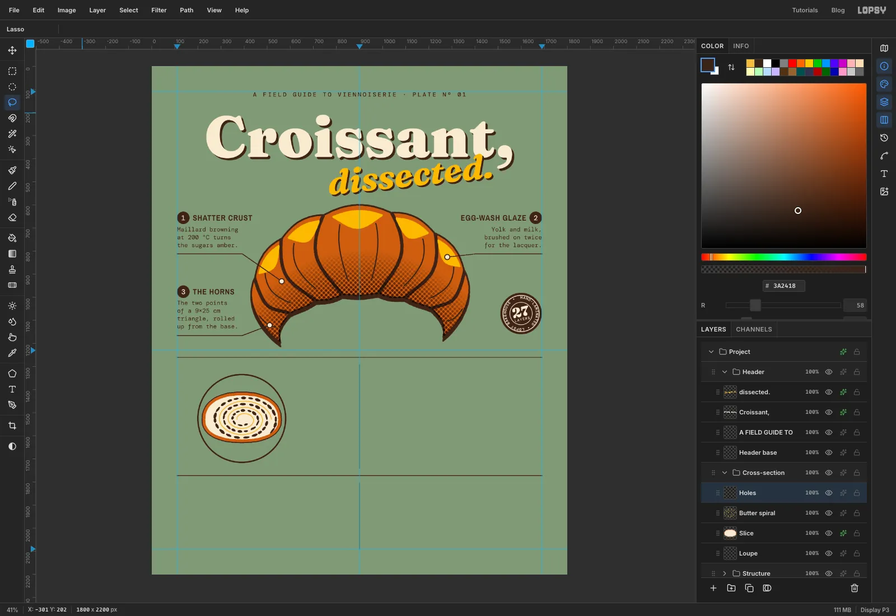

Fill the holes selection with chocolate and deselect. The crumb now reads as a honeycomb, with butter streaks spiralling through it.

## Connect the slice to the croissant

1. Add a layer called `Cut line`.
2. Pick the **Brush** and click the brush-tip thumbnail at the left of the options bar to open the **Brushes** window. On its **Shape** tab, set **Hardness** to `100` and **Spacing** to `200`. Close it and set **Size** to `8`. Spacing above 100% spreads the dabs out into a dotted line.
3. The line runs from about `780, 873` on the croissant towards the magnifier. In cream, click just below that point and [[Shift]]-click where the line leaves the croissant. Switch to chocolate, click just past the croissant's edge and [[Shift]]-click about 40 px short of the magnifier ring.
4. Lasso a small triangle at the end of the line, pointing at the ring, and fill it with chocolate for the arrowhead.
5. Pick the **Eraser** at **Size** `34` and click once where the dots cross the `y 1260` rule. That leaves a clean gap for the rule to run through.
6. On a new layer, `Section pin`, draw a 30 px chocolate circle with a `4` px cream stroke at `780, 873`. Draw a small cream cross in it with two short 3 px **Pencil** lines.

The crosshair makes this mark look different from the numbered callout pins.

## Label the crumb

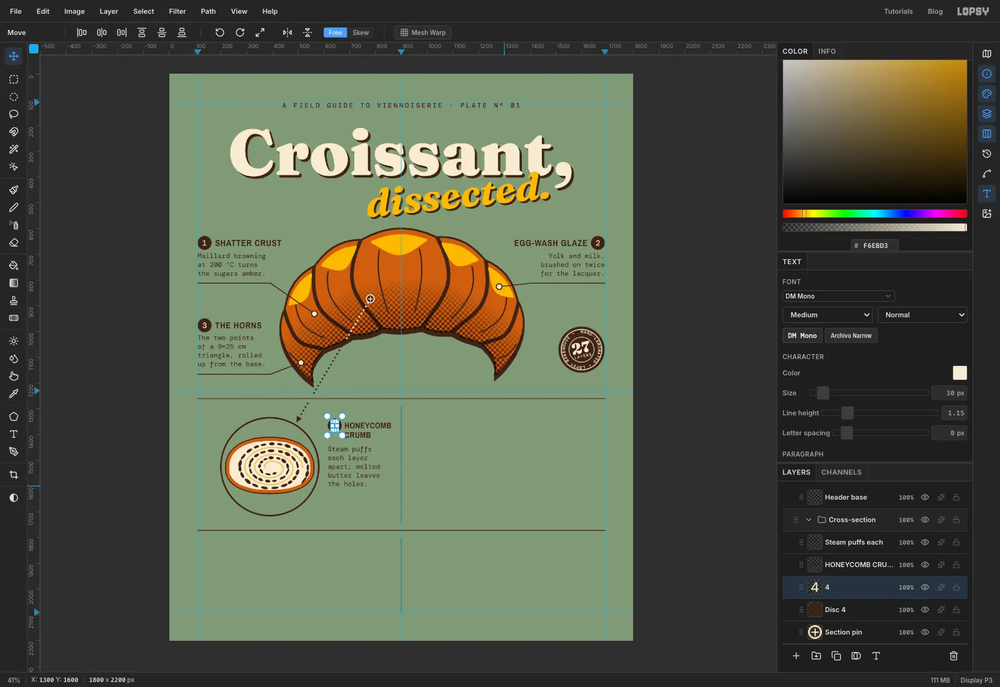

1. Add a layer `Disc 4` and draw a 54 px chocolate disc at `642, 1365` with the **Shape** tool.
2. With `Disc 4` selected, type the body text at `615, 1440` in chocolate **DM Mono Regular**, `26` px: `Steam puffs` / `each layer` / `apart; melted` / `butter leaves` / `the holes.`
3. Click `Disc 4` again and type `HONEYCOMB` / `CRUMB` at `680, 1320` in **Archivo Narrow Bold**, `32` px, with **Line height** `1.15`. Nudge it so the first line is level with the disc.
4. Add a cream `4` in **DM Mono Medium** `30` px and nudge it into the middle of the disc.

## Paint the stripe tiles

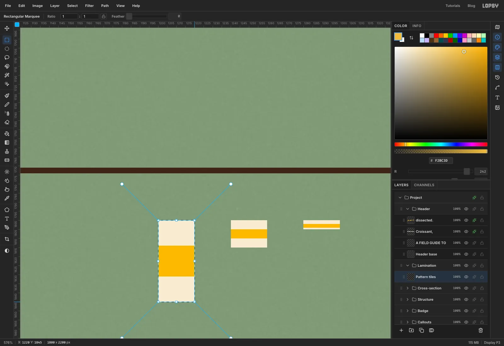

The second figure shows lamination. Every letter fold triples the layers of butter, so a single slab becomes 3, then 9, then 27 layers. Each stage gets a tile filled with a striped pattern.

1. Collapse `Cross-section`, click its row and click **New Group** called `Lamination`.
2. Add a temporary layer called `Pattern tiles` and zoom in to about 600% on an empty area, around `1250, 1830`.
3. Paint three tiles side by side, each 20 px wide, with the **Rectangular Marquee** and **Edit → Fill**:
   - 45 px tall: cream, with a butter band from 14 to 31 px down.
   - 15 px tall: cream, with a butter band from 5 to 10 px down.
   - 5 px tall: cream, with a butter band from 2 to 4 px down.
4. Marquee the first tile exactly and choose **Edit → Define Pattern**. Do the same for the other two. They're saved as **Pattern 1**, **2** and **3**.
5. Delete the `Pattern tiles` layer and choose **View → Fit to Screen**.

## Fill the fold tiles

1. Add a layer `Fold tiles`. Each tile is 135 × 135 px with its top at `y 1395`. They start at `x 960`, `1158`, `1356` and `1555`.
2. Fill the first tile cream, then fill a band across its middle, from `y 1440` to `1485`, with butter.
3. Marquee the second tile, choose **Edit → Fill with Pattern…**, click the **Pattern 1** thumbnail and click **Apply**. Fill the third tile with **Pattern 2** and the fourth with **Pattern 3**.

Patterns tile from the top-left corner of the document, and `1395` divides evenly by 45, 15 and 5. That's why every tile starts with a full cream row.

## Outline the tiles and add arrows

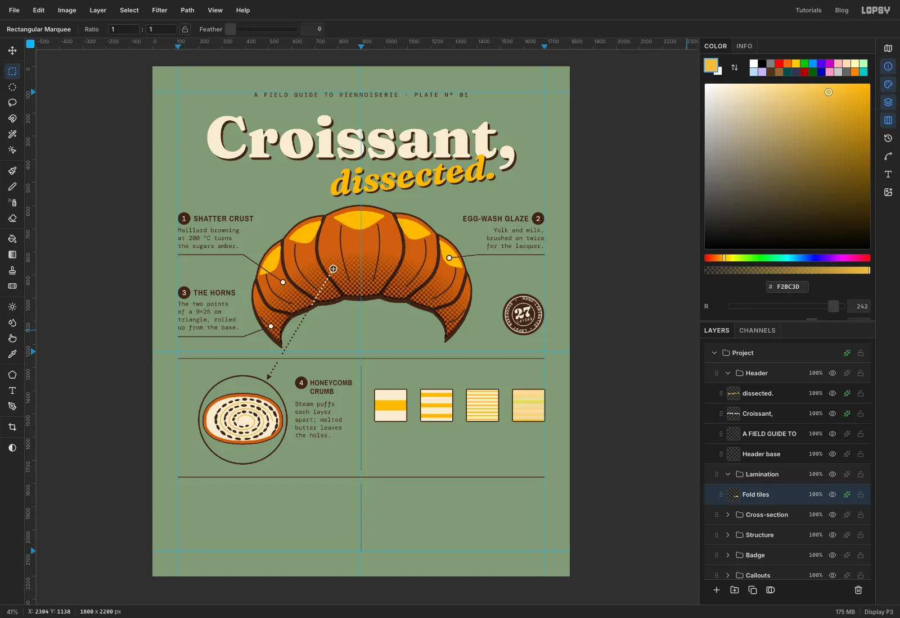

1. Deselect and give `Fold tiles` a **Stroke** effect with **Width** `4` in chocolate. Each tile gets its own outline.
2. Add a layer `Arrows`. With the **Pencil** at `4` px in chocolate, draw a horizontal line across each gap at `y 1462`. Add an arrowhead with two short Shift-click strokes.

## Caption the lamination figure

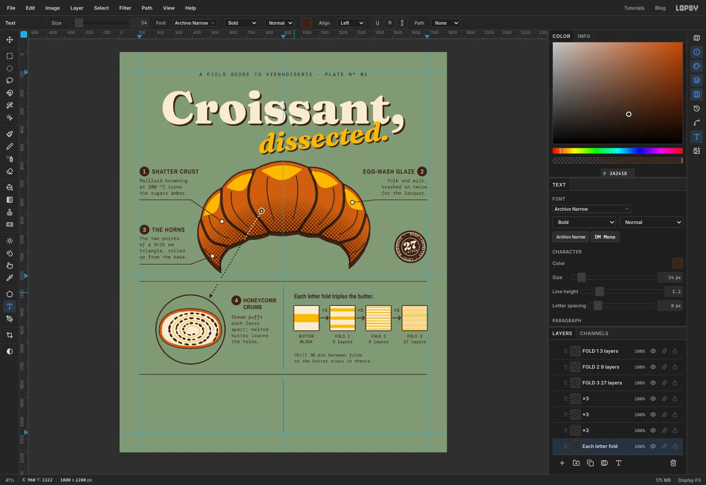

Work from the bottom up again, and click the `Arrows` layer before each new style:

1. Type the note at `960, 1650`, left-aligned, in **DM Mono Regular** `24` px: `Chill 30 min between folds` / `so the butter stays in sheets.`
2. Centre a two-line caption under each tile at `y 1548` in **DM Mono Medium** `23` px: `BUTTER` / `BLOCK`, `FOLD 1` / `3 layers`, `FOLD 2` / `9 layers` and `FOLD 3` / `27 layers`.
3. Put `×3` in **DM Mono Medium** `24` px above each arrow.
4. Add the heading `Each letter fold triples the butter.` at `960, 1322` in **Archivo Narrow Bold** `34` px.

## Select the first donut wedge

The third figure is the recipe by weight: 500 g of flour, 320 g of butter, 280 g of milk and water, and 86 g of sugar, salt and yeast. That's 1.2 kg in all, so the wedges take 42%, 27%, 24% and 7% of the ring, or about 152°, 97°, 85° and 26°.

1. Collapse `Lamination`, click its row and click **New Group** called `By weight`. Add a layer `Donut`.
2. Turn off **Snap to Guides**. The donut is centred at `212, 1995`. With the **Elliptical Marquee**, drag from `112, 1895` to `312, 2095`, then [[Alt]]-drag from `158, 1941` to `266, 2049` to cut the hole.
3. Pick the **Lasso**, hold [[Shift]]+[[Alt]] and draw a pie slice from the centre that covers the first 152°, clockwise from 12 o'clock. Let its curved edge overshoot the ring. Shift+Alt keeps only the overlap, so you get a clean wedge.
4. Fill it with cream.

## Finish the donut

1. Repeat for the other three wedges: rebuild the ring selection, then intersect it with a pie slice for the next angle. Fill them butter, amber and chocolate. Start and end each slice a degree or so inside the angle, so a thin gap of shirt shows between the wedges.
2. Deselect and turn **Snap to Guides** back on.
3. Give `Donut` a **Drop Shadow** with **Offset X** `0`, **Offset Y** `8`, **Blur** `0`, **Opacity** `100` in chocolate.

## Add the legend

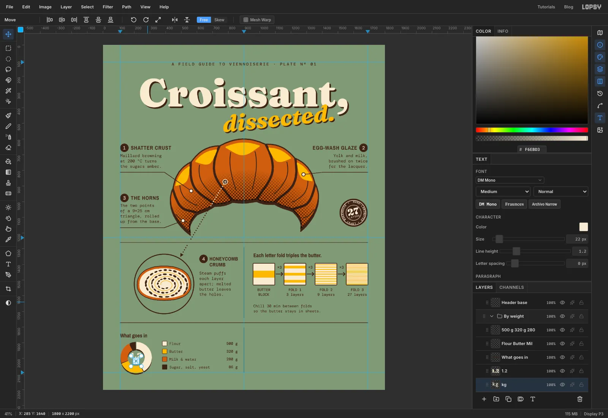

1. Add a layer `Legend swatches` and fill four 28 px squares at `x 380` in the four wedge colours, one every 50 px from `y 1891`. Give the layer a 2 px chocolate **Stroke**.
2. Click `Legend swatches` and type the weights right-aligned at `860` in chocolate **DM Mono Medium** `24` px: `500 g` / `320 g` / `280 g` / `86 g`. Set **Line height** to `2.08` so each line lands 50 px below the last, level with the squares.
3. Click `Legend swatches` again and type the names left-aligned at `424` in **DM Mono Regular** `24` px with the same line height: `Flour` / `Butter` / `Milk & water` / `Sugar, salt, yeast`.
4. Put `What goes in` at `110, 1834` in **Archivo Narrow Bold** `34` px.
5. In the donut hole, put a cream `1.2` in **Fraunces Black** `48` px, with `kg` under it in cream **DM Mono Medium** `22` px.

## Draw the timeline

1. Collapse `By weight`, click its row and click **New Group** called `Timeline`. Add a layer `Timeline line`.
2. Draw a 4 px chocolate **Pencil** line at `y 2000` from `975` to `1470`, with a short vertical end tick at `1470`.
3. Add a layer `Nodes` and use the **Shape** tool to draw 28 px cream circles with a `5` px chocolate stroke at `x 1045`, `1170`, `1295` and `1420`.
4. Click `Nodes`, then centre the labels on the nodes in chocolate **DM Mono Medium** `22` px with **Line height** `1.3`. Put `DAY 1` / `mix & chill` and `DAY 3` / `roll & cut` above the line, and `DAY 2` / `3 folds` and `PROOF` / `2 h, 26 °C` below it. Alternating keeps neighbours apart.
5. Add `BAKE · 200 °C` in the same style above the space at the end of the line, centred at `x 1600`. The croissant icon goes under it later.
6. Add the heading `Three days to breakfast` at `960, 1834` in **Archivo Narrow Bold** `34` px.

## Label the figures

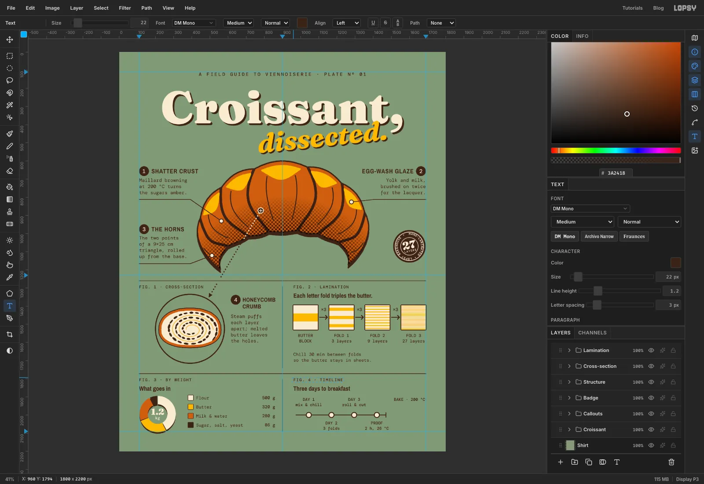

Expand `Structure`, click `Rules` and type the four figure labels in chocolate **DM Mono Medium** `22` px with **Letter spacing** `3`:

- `FIG. 1 · CROSS-SECTION` at `110, 1282`
- `FIG. 2 · LAMINATION` at `960, 1282`
- `FIG. 3 · BY WEIGHT` at `110, 1794`
- `FIG. 4 · TIMELINE` at `960, 1794`

## Copy a flat croissant

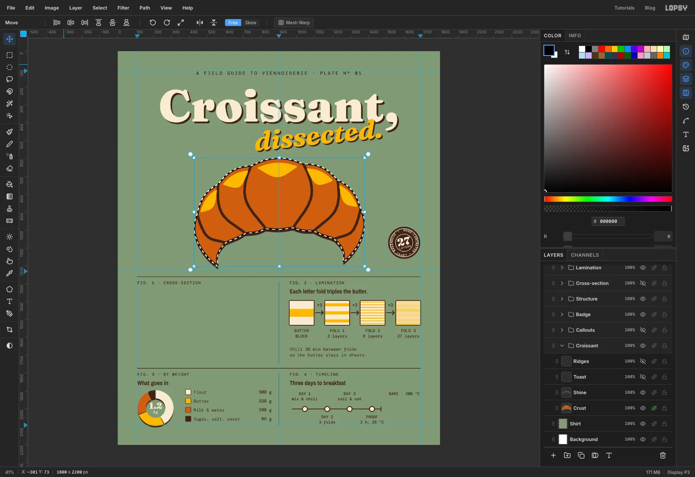

The timeline ends in a small croissant, which you can copy from the big drawing.

1. Hide the `Callouts` and `Cross-section` groups with their eye icons, because their pins and the dotted line sit on top of the croissant. Inside `Croissant`, also hide `Toast` and `Ridges`. Fine detail turns to mush when it's shrunk.
2. [[Cmd]]-click the `Crust` thumbnail and choose **Edit → Copy Merged**. This copies everything visible inside the selection, so you get the outlined segments and highlights together.
3. Deselect, and turn both groups and both layers back on.

## Paste, scale and level the icon

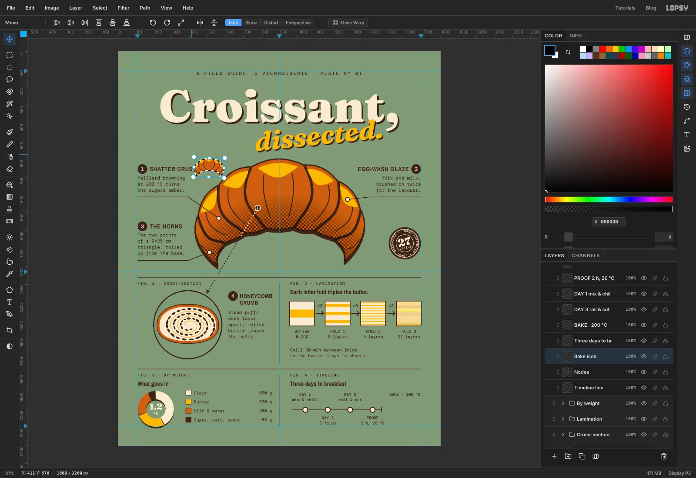

1. Expand `Timeline`, click `Nodes` and press [[Cmd+V]]. The copy lands on a new layer in the same place as the original. Rename it `Bake icon`.
2. With the **Move** tool, hold [[Cmd]] and drag the bottom-right handle up and in until the icon is about 165 px wide.
3. Before committing, drag from just outside the top-left corner to rotate it about `2°` clockwise. That cancels the big croissant's tilt.
4. Press [[Cmd+D]] to commit.

## Place the icon

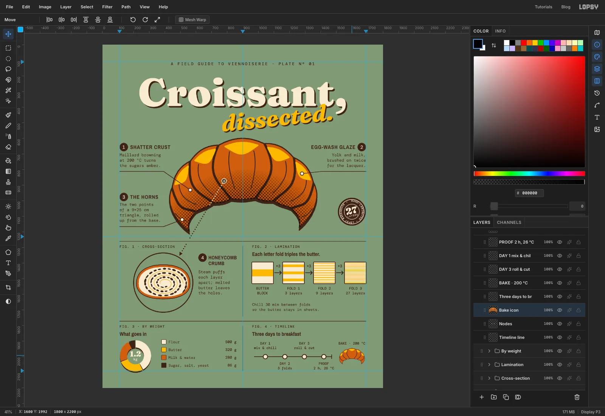

Drag the icon to the end of the timeline, centred around `1600, 1996`, and fine-tune it with the arrow keys. It should sit just right of the end tick, under its label.

## Make the worn print texture

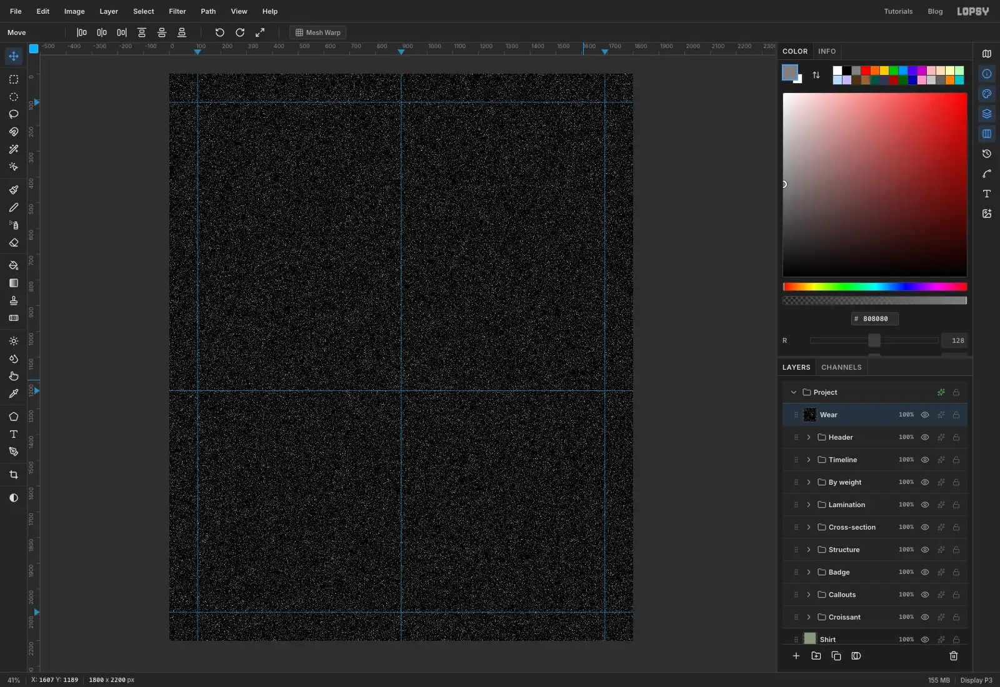

Real screen prints crack and fade. A layer of shirt-coloured specks over everything makes the inks look worn.

1. Click the `Header` group row, collapse it, and add a layer called `Wear`. It lands above everything.
2. Fill it with `#808080`. Run **Add Noise…** at **Amount** `100` with **Mono** and **Uniform**, then **Gaussian Blur…** at **Radius** `1.6`.
3. Run **Filter → Threshold…** at a **Level** of about `170`. You want sparse white specks in small clumps on black. Raise the level if they're too dense.

## Finish the wear

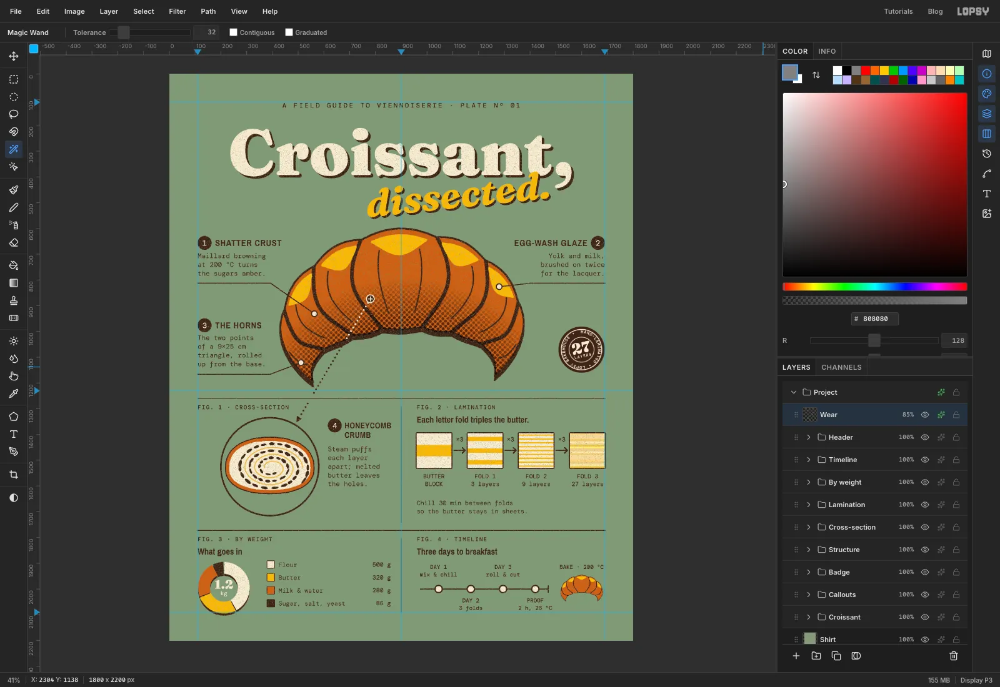

1. Pick the **Magic Wand**, untick **Contiguous**, click a black area and press [[Delete]]. Only the white specks are left.
2. Expand `Badge` and [[Cmd]]-click the `Badge disc` thumbnail. Click `Wear` and press [[Delete]] to clear the specks over the badge, which keeps its small type crisp. Deselect.
3. Give `Wear` a **Color Overlay** in the shirt colour `#86997A`.
4. Click the `100%` on the `Wear` row and set the layer's opacity to `85%`.

Over the bare shirt the specks disappear. Over the inks they look like ink that has flaked off.

Save your work with **File → Save Project**, and use **File → Quick Export PNG** for the print file. For a real screen print, the printer separates the four inks from the PNG, or you can split them onto their own layers yourself.
