Iridescence is colour that changes as the light or angle changes. You see it
on soap bubbles, oil on a wet road, beetle shells and the wings of the
banded demoiselle, a damselfly whose whole body shines metallic blue-green.

In this tutorial you'll make **Demoiselle Ultramarine**, a 2100 × 1400 px
birthday card front built on a photo of a male banded demoiselle. You'll
turn the sunny green photo into a deep blue night with a **Gradient Map**, keep the
insect's real metallic colour by cutting it out first, and then add colour
only where iridescence belongs: a sheen on the wing, a faint oil-slick film
in the corners, soap bubbles with rainbow rims, and pastel foil on the
script title.

The photo is [Calopteryx splendens](https://commons.wikimedia.org/wiki/File:Thomas_Bresson_-_Calopteryx_splendens-3_(by).jpg)
by Thomas Bresson on Wikimedia Commons, licensed **CC BY 2.0**, so credit
the photographer if you share your card. To follow along, open its
Commons page and download the 2,560 px wide version. Any side-on photo of a
dragonfly or damselfly on a plain, blurred background works too.

Along the way you'll use:

- pasting and scaling a photo, the **Lasso**, **Feather**, the **Magic Wand** and **Shrink** to cut out a subject
- a **layer mask** painted with a soft brush, and another made with a radial gradient
- **Gradient Map** adjustments on groups, for the night grade and for the oil-slick colours
- **Smoke**, **Gaussian Blur** and **Add Noise**
- **Dodge**, **Sponge**, and the **Color Dodge**, **Screen**, **Multiply** and **Overlay** blend modes
- **Copy Merged**, copy and paste, scaling and rotating with the **Move** tool, and the **Eraser**
- a scattered, jittered **Brush** for sparkle dust, plus **Outer Glow** and **Drop Shadow**
- ruler **guides**, the **grid**, text in **Pinyon Script** and **Marcellus SC**, and letter spacing
- grouping layers and moving a group as one

The palette:

- Night grade `#03020E` → `#160B4A` → `#1C2A8E` → `#2B5BC8` → `#3FA6D8` → `#A8EDE6` → `#F7F2FF`
- Oil-slick film `#0B0630` → `#3A1A9E` → `#B23BD6` → `#F06BC8` → `#2FC8C8` → `#3FA8F2` → `#6B6BFF` → `#E0CCFF`
- Wing sheen `#2C9FB8` → `#5DB884` → `#C49A4E` → `#C45A86` → `#8E34A8` → `#4552C4`
- Wing glow `#2FC8E8` → `#3F7BFF` → `#7A4BFF` → `#C04BE0`
- Bubble rim `#6A4BFF` → `#FF5FD2` → `#FFD36B` → `#6BFFD1` → `#5BD8FF` → `#F4F0FF`
- Title foil `#FFD1EC` → `#FFE9B8` → `#C8FFE4` → `#BDEBFF` → `#D9CCFF` → `#FFD1EC`
- Shade navy `#04051A` / `#050820`, title glow `#0A0F3D`, caption shadow `#070A2A`
- Title `#F3EEFF`, caption `#D6E2FF`, rim light `#7FE6FF`, sparkle glow `#BFF0FF`, dust `#E4F6FF` / `#B79BFF`

## Paste the photo

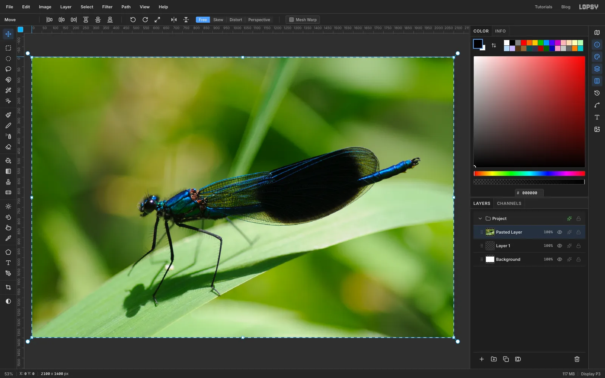

Choose **File → New**, keep the unit on **Pixels**, and create a
**2100 × 1400** document. Open the downloaded photo in another app, copy
it, and paste it into Lopsy with [[Cmd+V]]. Lopsy shrinks an oversized
paste to fit the canvas and switches to the **Move** tool, with the photo
selected.

## Scale it to cover the canvas

The photo is a slightly different shape from the canvas, so it leaves a
hairline of white at the top and bottom. Hold [[Cmd]] and drag the
**top-left** corner handle a little up and out, then do the same with the
**bottom-right** handle, until the photo covers every edge. [[Cmd]] keeps the
proportions. Press [[Cmd+D]] to commit, and rename the layer *Photo*.

## Lasso the head, thorax and tail

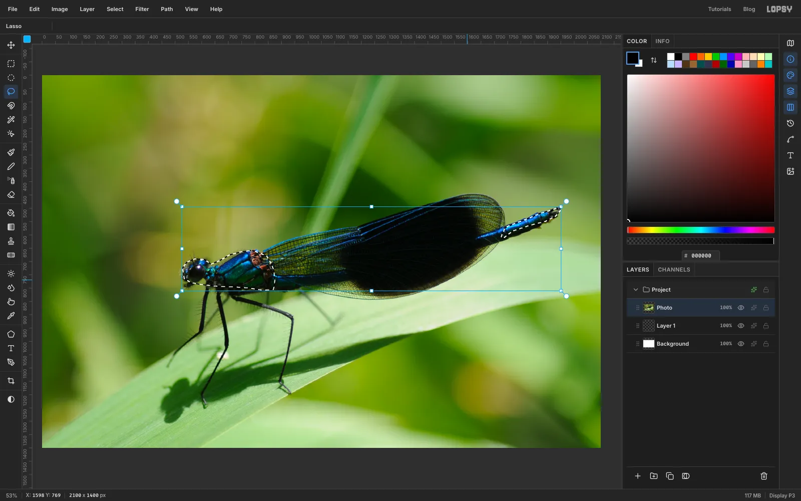

You'll turn the background blue in a moment, and that would turn the
insect blue as well. So copy its metallic parts onto their own layer first.

Pick the **Lasso** and trace closely around the eye, head and thorax, ending
at the wing root. Don't include the legs or the wing. Then hold
[[Shift]] and lasso the tail where it sticks out past the wing tip, to add
it to the selection. Choose **Select → Feather…** with **2** px so the edges
aren't razor sharp.

## Wand away the leftover background

Press [[Cmd+C]] and [[Cmd+V]]. The copy pastes in exactly the same place.
Rename it *Demoiselle*.

A hand-traced lasso always catches a little background. Pick the
**Magic Wand**, set **Tolerance** to **90** and leave **Contiguous** on.
Click the pale green rim along the top of the tail. Then [[Shift]]-click the
olive rim above the thorax, in front of the face and behind the eye. Each
[[Shift]]-click adds to the selection. Press [[Delete]], then [[Cmd+D]].

## Trim the edge by two pixels

[[Cmd]]-click the *Demoiselle* thumbnail in the Layers panel to load its
shape as a selection. Choose **Select → Shrink…** with **2** px, then
**Select → Inverse**. Now everything except the body, minus a 2 px border,
is selected. Press [[Delete]] and [[Cmd+D]]. That shaves off the last
hairline of background.

## Soften the cut with a mask

The bottom of the thorax still ends in a straight lasso line. With
*Demoiselle* active, click **Add Mask** at the bottom of the Layers panel,
then click the mask thumbnail to edit it. Pick the **Brush**, set the
foreground to black, **Size 44** and **Hardness 0**. Paint one stroke
along the underside of the thorax, from below the eye to the wing root. Click the
*Demoiselle* row when you're done to leave mask editing.

## Grade the photo to night

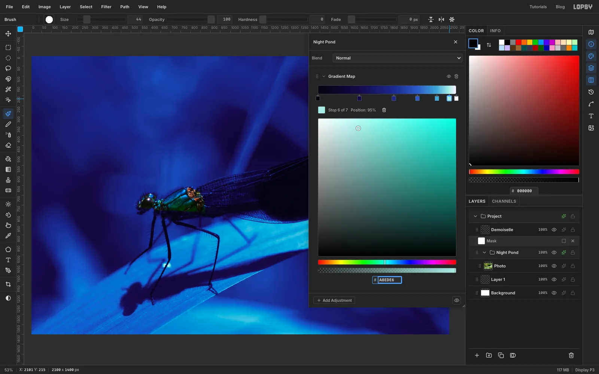

Click the *Photo* row and choose **Layer → Group Layers**. Rename the
group *Night Pond*. With the group selected, open its drawer with the
effects button on its row, click **Add Adjustment** and choose **Gradient Map**.

A gradient map recolours each pixel by its brightness. Click along the row
under the gradient bar to add stops, and type each colour into the **Hex**
field:

- `#03020E` at 0%, `#160B4A` at 30%, `#1C2A8E` at 55%
- `#2B5BC8` at 72%, `#3FA6D8` at 86%, `#A8EDE6` at 95%, `#F7F2FF` at 100%

Dark shadows go deep violet-navy, the blurred background goes ultramarine and the
sunlit leaf turns cyan. The hue shift from violet to cyan already hints at
iridescence. Because the *Demoiselle* layer sits outside the group, the
insect keeps its real colours.

## Add a vignette

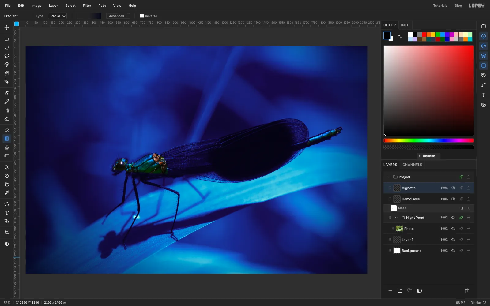

Click *Demoiselle* and add a new layer above it called *Vignette*. Pick the
**Gradient** tool, set **Type** to **Radial**, and click **Advanced…**. Use
three `#04051A` stops: position **0%** at 0% opacity, position **50%** at 0%
opacity, and position **100%** at 90% opacity. Drag from the middle of the damselfly
down to just past the bottom-right corner.

## Shade the bright leaf

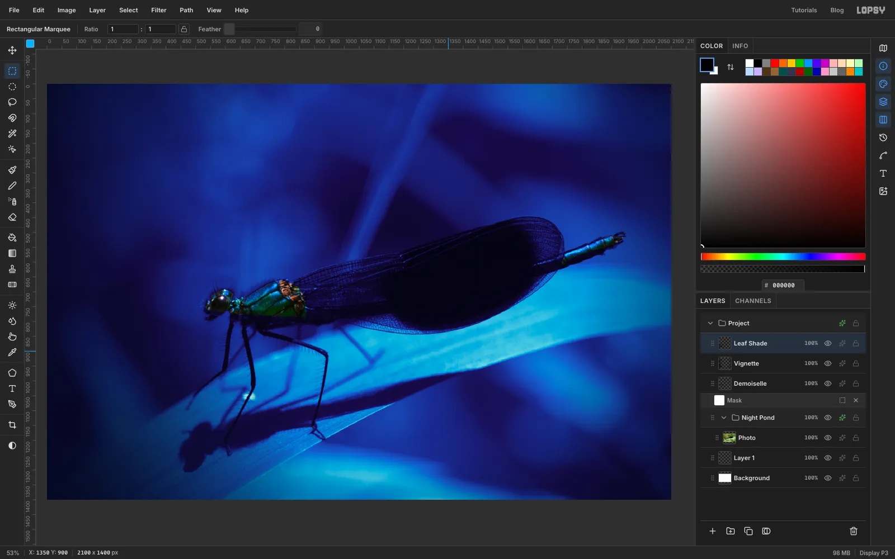

The sunlit leaf at the bottom left pulls the eye out of the frame. Add a
layer called *Leaf Shade*. Draw a rectangular marquee over the bottom-left
corner of the card, about two-fifths of the width and the bottom
two-thirds of the height. Set a radial gradient from `#050820` at **75%** opacity to the
same colour at **0%**. Drag from the bottom-left corner almost to the
marquee's right edge.

Then marquee the bottom middle of the card, under where the caption will
go, and drag the same gradient up from just below the bottom edge. The
gradient only fills inside each marquee, so the two don't erase each other.
Press [[Cmd+D]].

## Make a thin film with Smoke

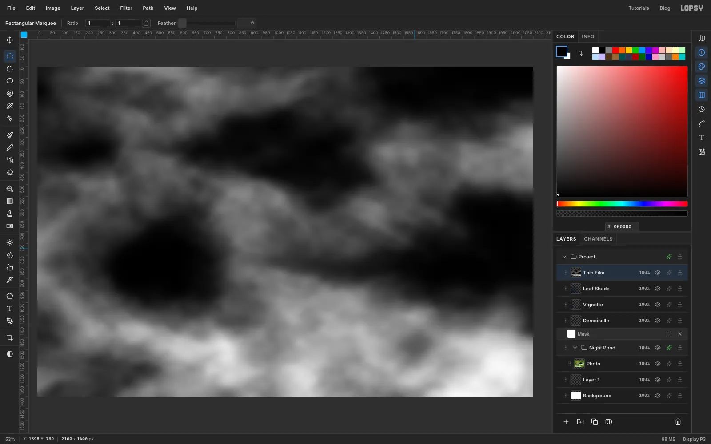

Add a layer called *Thin Film*. Choose **Filter → Smoke…**, set
**Scale 3** and **Turbulence 45**, and apply. Then run
**Filter → Gaussian Blur…** at **30** px. Soap films and oil slicks have
soft, flowing bands, not crisp ones.

## Map the smoke to an oil-slick spectrum

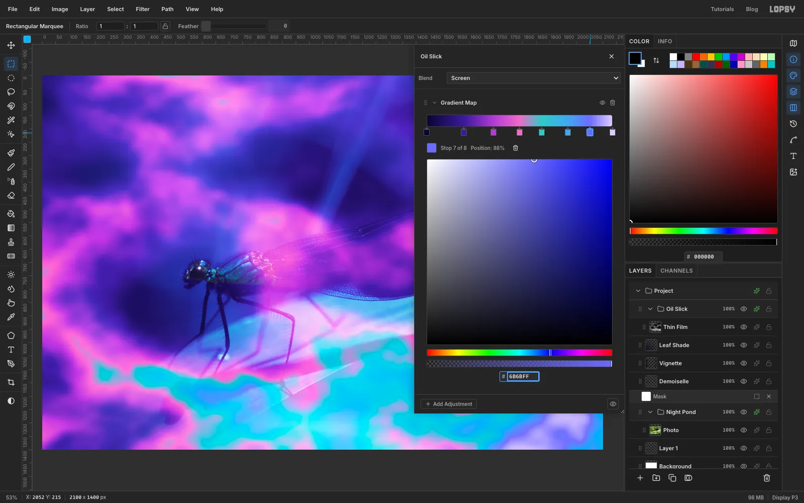

With *Thin Film* selected, choose **Layer → Group Layers** and name the
group *Oil Slick*. Open the group's drawer, add a **Gradient Map** and set
these stops:

- `#0B0630` at 0%, `#3A1A9E` at 20%, `#B23BD6` at 36%, `#F06BC8` at 50%
- `#2FC8C8` at 62%, `#3FA8F2` at 76%, `#6B6BFF` at 88%, `#E0CCFF` at 100%

Set the drawer's **Blend** to **Screen** and close it. Screen only
lightens, so the dark parts of the smoke vanish. At full strength it's far too much,
so click the **100%** on the *Oil Slick* row and drag its slider down to **28%**.

## Mask the film off the subject

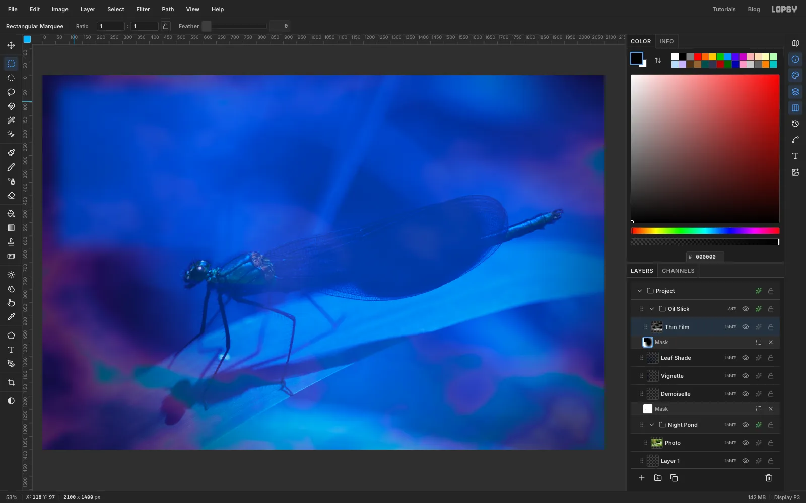

The film should glow at the edges, not over the damselfly or the title.
Select *Thin Film*, click **Add Mask**, and click its mask thumbnail. With
the **Gradient** tool on **Radial**, open **Advanced…** and set black stops at
**0%** and **40%** and a white stop at **100%**. Drag from the damselfly's wing out to just past the
right edge of the canvas.

Next, marquee the top-left area where the title will sit, about half the
width and the top 45%. Choose **Select → Feather…** at **60**, set the
foreground to black and choose **Edit → Fill**. In mask edit mode, Fill
paints the mask. Press [[Cmd+D]] and click the *Thin Film* row.

## Polish the thorax

Select *Demoiselle*. Pick **Dodge/Burn** on **Dodge**, **Exposure 12**,
**Size 46**, and make one stroke along the middle of the thorax, from just
behind the eye to the wing root. Then pick the **Sponge** on **Saturate**,
**Strength 35**, **Size 60**, and follow the same path. Keep it subtle.
Dodge has a fairly hard edge, and too much turns metal into plastic.

## Select the wing

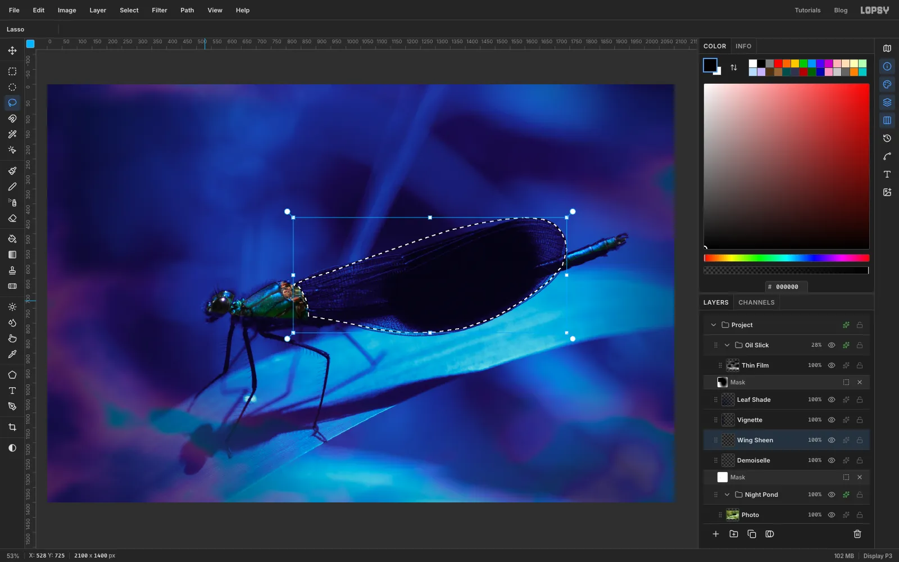

Add a layer called *Wing Sheen*. With the **Lasso**, trace around the
whole wing: start at the wing root, follow the top edge out to the
rounded tip, and come back along the bottom edge. Then hold [[Alt]] and lasso the head and
thorax again. That subtracts them, so the sheen stays on the wing.

## Give the wing a sheen

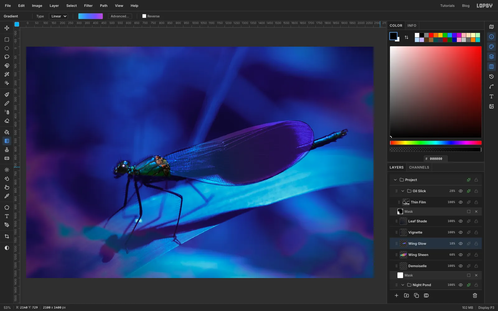

Set a **Linear** gradient with six stops: `#2C9FB8`, `#5DB884`, `#C49A4E`,
`#C45A86`, `#8E34A8` and `#4552C4`. Drag from the wing root to the wing tip.
Keep the selection for now. Color Dodge brightens the clear parts of the
wing and the veins, and leaves the black band alone.

> **Tip:** keep every channel of a Color Dodge colour below 255. Pure
> `#FF…` channels blow even near-black pixels to full brightness.

To lift the black band just enough to show its veins, add a layer called
*Wing Glow* while the wing is still selected. Drag a cooler gradient
(`#2FC8E8`, `#3F7BFF`, `#7A4BFF`, `#C04BE0`) along the same line, then press
[[Cmd+D]]. Set *Wing Sheen* to **Color Dodge** at **60%** opacity and
*Wing Glow* to **Screen** at **18%**.

## Add a rim light

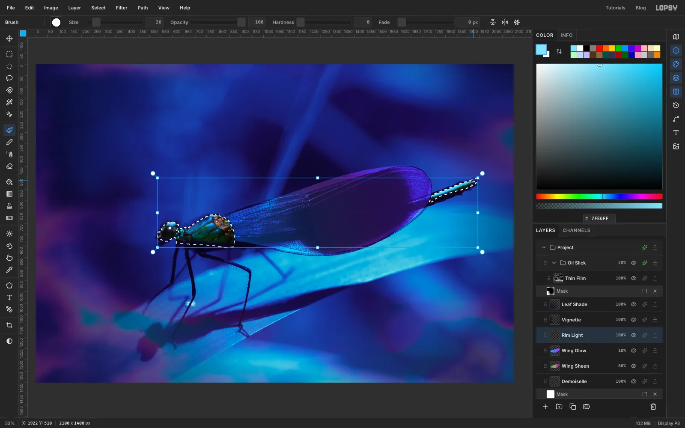

[[Cmd]]-click the *Demoiselle* thumbnail to load the body's shape, and
add a layer called *Rim Light*. Pick the **Brush** with `#7FE6FF`,
**Size 26** and **Hardness 0**. Paint one stroke along the top edge of the
head and thorax, and another along the top of the tail. The selection keeps
the paint on the body. Press [[Cmd+D]], then set the layer to **Screen**
at **30%**. This puts the insect in the same cool light as the scene.

## Magnify a lens for the big bubble

Bubbles bend what's behind them. Collapse the *Oil Slick* group with its
arrow and click its row, so new layers land above it instead of inside it.
Pick the **Elliptical Marquee** and click once on the canvas without
dragging. The **Elliptical Selection** dialog opens: enter **From**
1710, 115 and **To** 1950, 355 for a 240 px circle in the top-right corner,
above the tail.

Choose **Edit → Copy Merged** and paste with [[Cmd+V]]. Rename the new layer
*Hero Lens*. Hold [[Cmd]] and drag its bottom-right handle out to scale it
up by about a quarter. Press [[Cmd+D]], then drag it up and left so it's
centred on the circle again. Open the Elliptical Selection dialog again with
the same From and To values, choose **Select → Inverse** and press
[[Delete]] to trim the magnified copy back to a disc.

## Paint the thin-film rim

Add a layer called *Bubble Film* and make the same circle with the dialog
(From 1710, 115, To 1950, 355). Set a **Radial**
gradient with these stops, each with its own opacity:

- `#FFFFFF` at 0% (8% opacity), `#CFEFFF` at 55% (6%)
- `#6A4BFF` at 72% (16%), `#FF5FD2` at 82% (34%), `#FFD36B` at 88% (44%)
- `#6BFFD1` at 93% (52%), `#5BD8FF` at 97% (72%), `#F4F0FF` at 100% (95%)

Drag from the centre of the circle to its edge. The middle stays almost
clear, and the colour crowds into a thin rim, the way a real bubble looks.

## Cut a window reflection

Bubbles reflect a window or the sky as a curved highlight. Draw a wide,
flat ellipse in the upper-left part of the bubble. Then hold [[Alt]] and
draw a second ellipse of the same size, a little lower and to the right.
That leaves a crescent.

## Fill the reflections

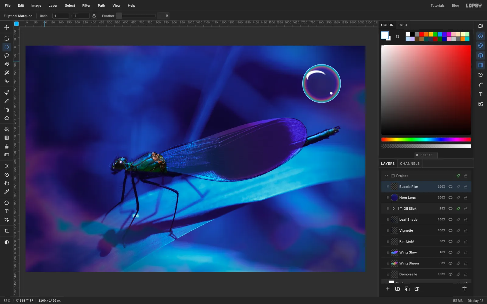

Choose **Select → Feather…** at **3**, set the foreground to white and
choose **Edit → Fill**. Then draw a tiny circle about **17 px** across near
the bottom-right of the rim, feather it by **2** and fill it white too. That's
the second, smaller reflection. Press [[Cmd+D]].

## Copy, scale and rotate a smaller bubble

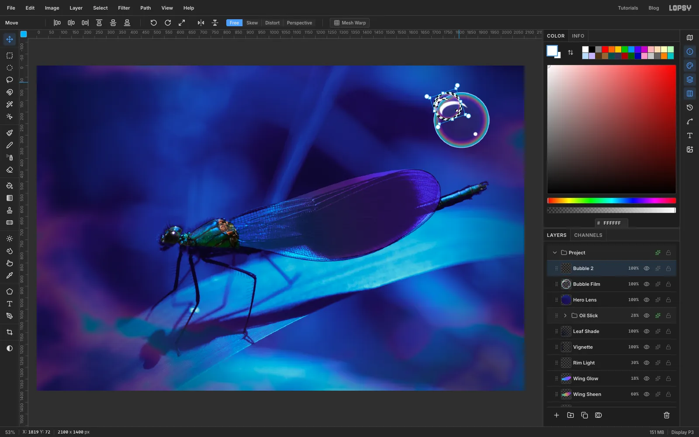

Click *Bubble Film*, then press [[Cmd+C]] and [[Cmd+V]]. The copy pastes
in place, already selected. Rename it *Bubble 2*. Hold [[Cmd]] and drag its bottom-right handle
in until the bubble is about **120 px** across. Then drag the rotation
handle, just outside a corner, about **20°** anticlockwise. Turning each copy
stops the glints from looking stamped. Press [[Cmd+D]], then drag the
bubble to the top middle of the card, right of the title.

## Make five bubbles

Repeat the copy, scale and rotate for three more bubbles, each copied from
*Bubble Film*, and name them *Bubble 3*, *Bubble 4* and *Bubble 5*:

- about **88 px** across, turned **25°** clockwise, beside the tail tip
- about **152 px** across, turned **12°** clockwise, lower right over the leaf's far end
- about **60 px** across, turned **25°** anticlockwise, down and left of that one

On the 88 px and 60 px bubbles, pick the **Eraser** at about **Size 20** and
click once on the small dot so not every bubble has one. Five bubbles of different sizes read
as a breeze. Nine identical ones read as clutter.

## Add an eight-point glint

Click *Bubble 2* and add a layer called *Glints* above it. Zoom in on the
big bubble's upper-left rim. With the **Lasso**, draw a four-point star
about **90 px** across: start at the top tip and work round in four
inward-curving arcs, tip to tip, so the arms come out thin and pinched,
ending where you started. Set the foreground to white and choose
**Edit → Fill**.

Marquee around the star, copy and paste it. Hold [[Cmd]] and drag the
copy's bottom-right handle in to shrink it to about **40%**, then turn it
**45°** with the rotation handle. Press [[Cmd+D]], drag the small star back
to the centre of the big one, and choose **Layer → Merge Down**.

## Scatter a few sparkles

On *Glints*, lasso and fill three smaller four-point stars the same way, about **48**, **36** and
**28 px** across. Put one beside the top-middle bubble, one at the edge of
the bubble near the tail, and one at the bottom right. Open the layer's effects and add an
**Outer Glow** in `#BFF0FF`, **Size 16**, **Opacity 95**.

## Sprinkle sparkle dust

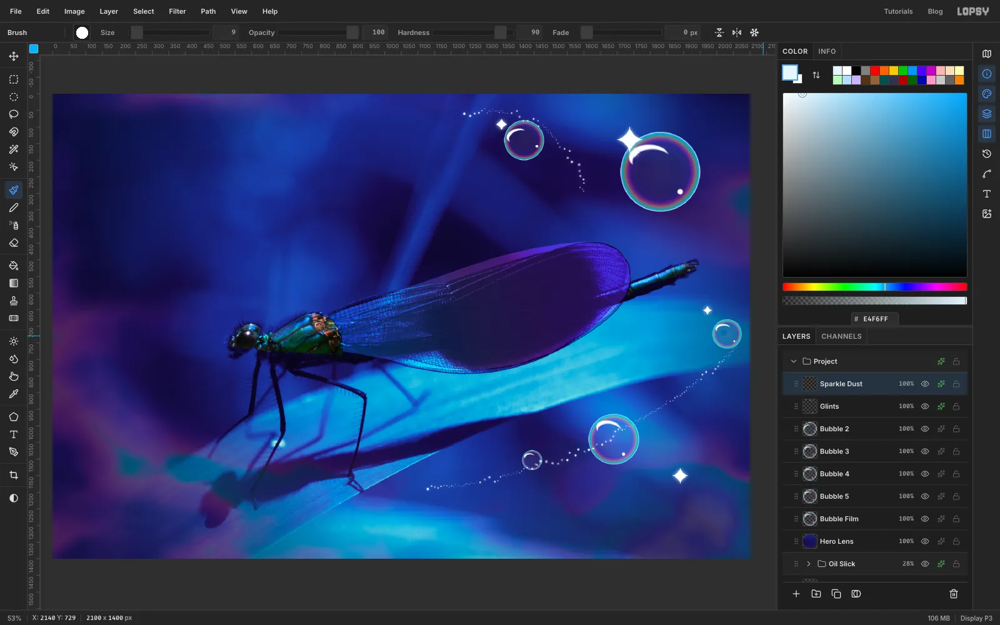

Add a layer called *Sparkle Dust*. Pick the **Brush** with `#E4F6FF` and
click the brush-tip preview at the left of the options bar to open the
**Brushes** window. On the **Shape** tab set **Size 9**,
**Hardness 90** and **Spacing 260**. On the **Dynamics** tab set
**Scatter 90**, **Size Jitter 85** and **Opacity Jitter 60**. Wide spacing
plus jitter turns one stroke into a trail of different-sized specks.

Paint one long, gently curving stroke from the bottom middle of the card up
to the right edge, passing the lower bubbles. Paint a shorter one that loops
over the top-middle bubble. Add an **Outer Glow** in `#B79BFF`, **Size 12**,
**Opacity 60**.

## Set margin guides

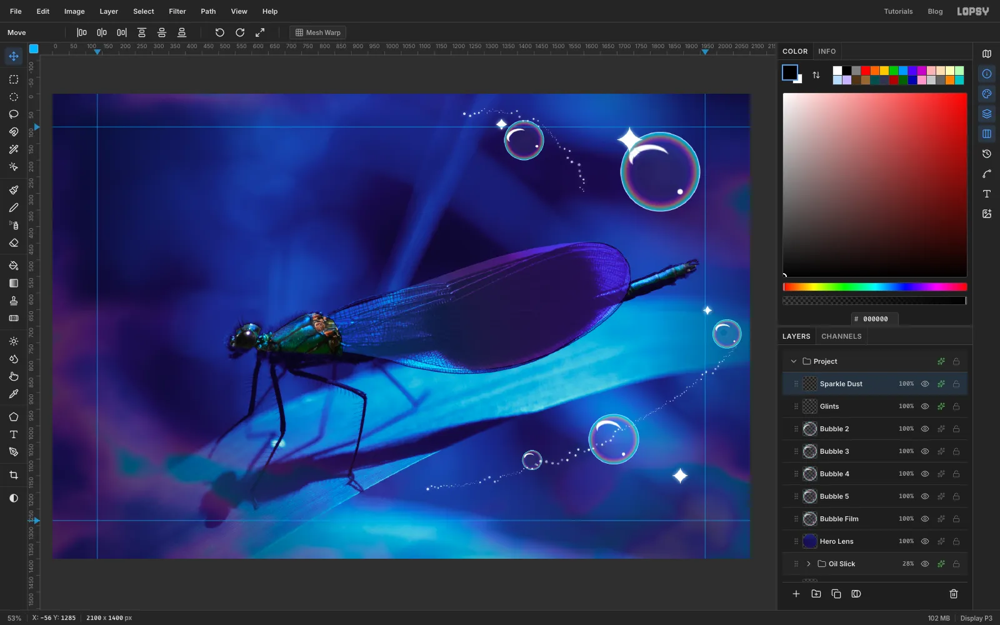

Click the top ruler at **135** and at **1965** to drop two vertical guides,
then click the left ruler at **100** and at **1285** for two horizontal ones.
These are the card's margins. The title will hang from the top-left corner
and the caption will sit in the bottom-right one.

## Set the script title

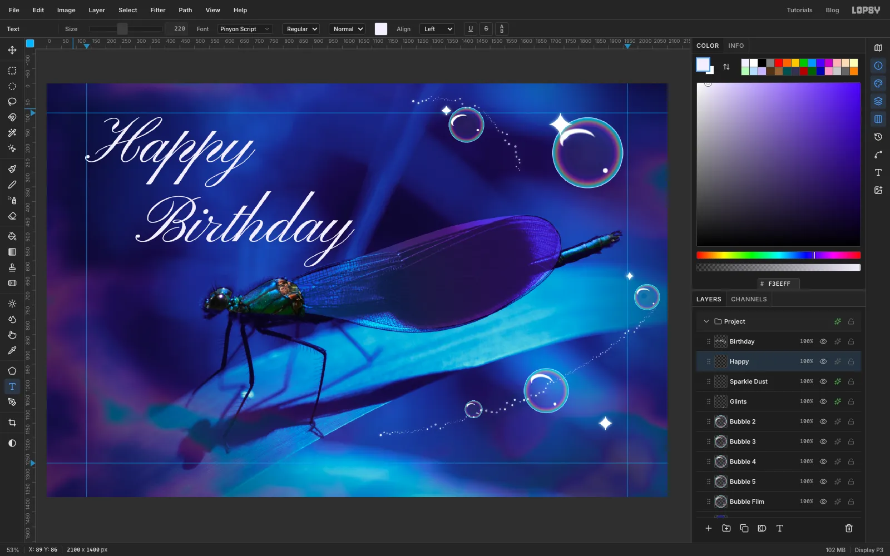

Click *Sparkle Dust* so the text lands above it. Pick the **Text** tool,
choose **Pinyon Script** at **220** px and set the foreground to `#F3EEFF`.

Type **Birthday** first, clicking a little below and right of where the two
top-left guides cross. Then click *Sparkle Dust* again and type **Happy** higher up and
further left. Create *Birthday* first: a click inside an existing text
layer's box edits that layer instead of making a new one.

## Line up the title and add a caption

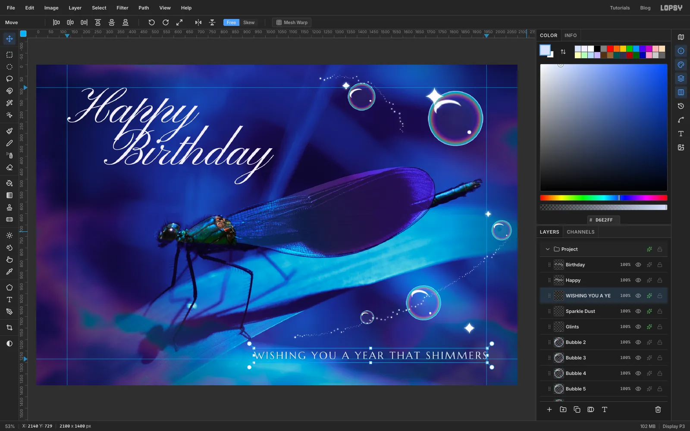

Select *Happy* and use the arrow keys with the **Move** tool to put the left
edge of the H's swash on the left guide and the top of the letters on the
top guide. Then move *Birthday* so it starts about **160 px** right of
*Happy*'s left edge and its tall letters rise about **70 px** into the descenders of *Happy*.
The two words then lock together, and the tail of the *y* stays well clear
of the wing.

For the caption, click *Sparkle Dust* and type **WISHING YOU A YEAR THAT
SHIMMERS** in **Marcellus SC** at **45** px, in `#D6E2FF`. In the **Text**
panel set **Letter spacing** to **6**. Nudge it until its right edge sits on
the right guide and the letters rest on the bottom guide. Give it a
**Drop Shadow** in `#070A2A` with **Offset X 0**, **Offset Y 0**, **Blur 8**
and **Opacity 50**. The shadow is just a soft dark halo that keeps the
letters crisp over the leaf.

## Add an iridescent foil

Click *Birthday* and add a layer above it called *Title Foil*.
[[Cmd]]-click the *Happy* thumbnail to load its letters as a selection, then
click the *Title Foil* row. Set a **Linear** gradient of `#FFD1EC`,
`#FFE9B8`, `#C8FFE4`, `#BDEBFF`, `#D9CCFF` and `#FFD1EC`. Drag it from the
top-left of *Happy* to the bottom-right of *Birthday*.

[[Cmd]]-click the *Birthday* thumbnail, click *Title Foil* again, and drag
the gradient along exactly the same line. Press [[Cmd+D]] and set
*Title Foil* to **Multiply**. Multiplying pastel over white text tints the
letters with the colours, and they flow across both words like foil.

## Give the title a dark halo

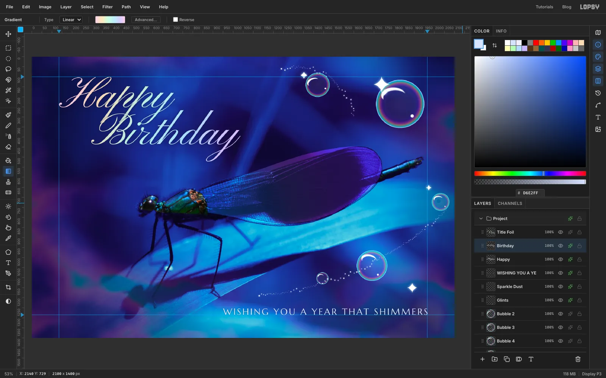

Select *Happy* and add an **Outer Glow** in `#0A0F3D`, **Size 16**,
**Opacity 70**, then do the same on *Birthday*. A light glow would melt
into the blue background. A dark one separates the thin hairlines from the
smoke behind them.

## Group the layers

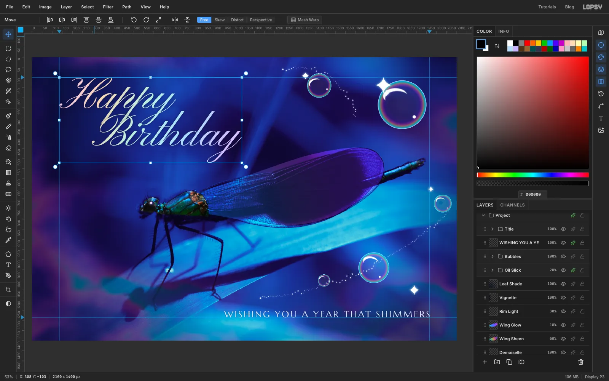

Click *Sparkle Dust*, [[Shift]]-click *Hero Lens*, and choose
**Layer → Group Layers**. Name the group *Bubbles*. That takes in the dust,
the glints, all five bubbles and the lens, so the sparkles stay on their
bubbles when the group moves. Do the same with
*Title Foil*, *Birthday* and *Happy*, and name it *Title*. Collapse both
groups to keep the panel tidy.

## Check the balance with the grid

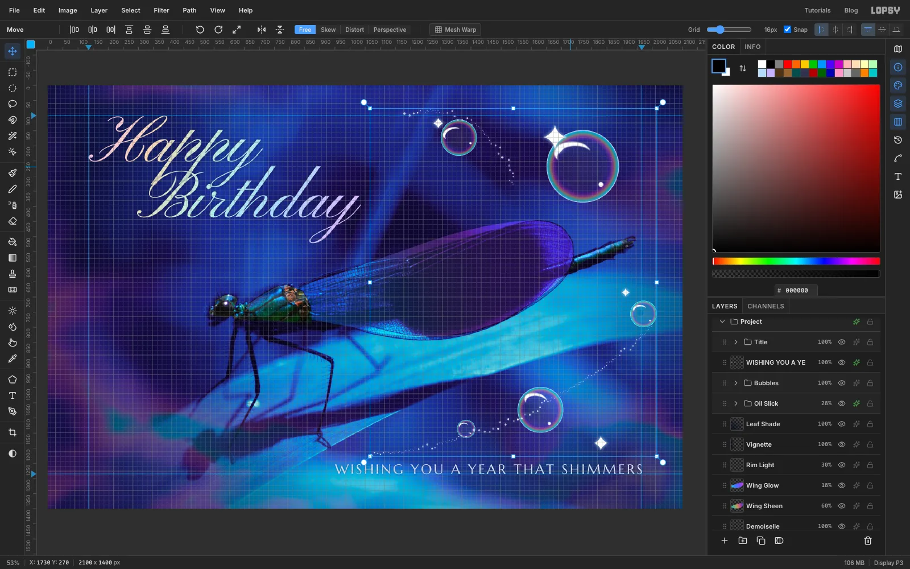

Choose **View → Show Grid** (Snap turns on with it). Click the *Bubbles*
group and drag on the canvas with the **Move** tool. All the bubbles move
together, and you can judge whether the right side feels too heavy or too
light. If the original spot was better, as it was here, press [[Cmd+Z]] to
put the group back. Hide the grid again with **View → Show Grid**.

## Finish with film grain

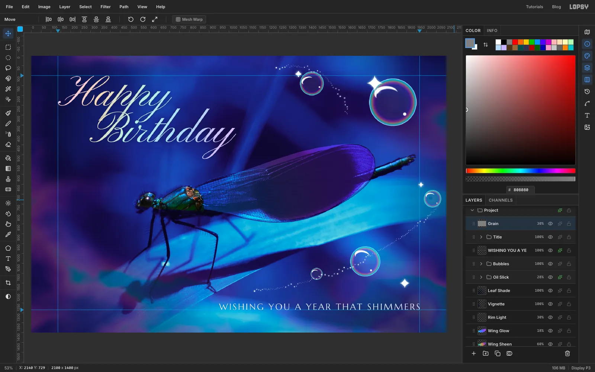

Click the *Title* group, add a layer called *Grain*, set the foreground to
`#808080` and choose **Edit → Fill**. Run **Filter → Add Noise…** with
**Amount 60**, **Mono** and **Gaussian**. Set the layer to **Overlay** at
**30%**. The grain ties the photo and the drawn bubbles into one image.

Save with **File → Save Project** and export with
**File → Quick Export PNG**.
