Iridescence is colour that changes with the angle you look from: the inside of a shell, a soap film, a patch of oil on water. A screen can't change with your viewing angle, so designers fake it with a pastel rainbow that keeps shifting hue across a surface, bent into soft swirls so it never reads as plain stripes.

This tutorial builds a logo sheet for **Pearl Reef**, an invented freediving school. You'll make one sheet of marbled "nacre" (mother-of-pearl) and reuse it everywhere: the rim of the emblem, the nautilus shell, an app icon and the wordmark. The type stays plain so it's easy to read.

Along the way you'll use:

- a 15-stop **Gradient**, **Clouds**, **Posterize** and **Find Edges** for the veins, and **Liquify** to marble them
- the **Lasso**, **Select → Grow** and the **Pen** tool to draw the shell
- copy and paste through a selection to cut nacre into any shape
- **Group Layers** with the Move tool's rotate and scale handles
- text bound to a path, plus letter spacing in the Text panel
- **Radial Symmetry** for a ring of dots
- guides, the **Shape** tool, layer effects, a layer mask and a **Color Grading** adjustment

The palette is deep navy and a seven-colour pastel ramp:

- Abyss `#1E2A6B` → `#0E1440` → `#060818`
- Disc `#1B2B78` → `#0C1242` → `#060920`
- Nacre `#F9A8D4` → `#C4A7FF` → `#7DD3FC` → `#7FF0D8` → `#D9F99D` → `#FFF3A6` → `#FFB8A1`
- Pearl white `#F4F1FF`, ice blue `#BFE9FF`, caption blue `#A9B8F0`

> **Tip:** The emblem is centred on (670, 750) and is 1120 px across. The status bar shows your pointer position while you work, so the coordinates below are easy to hit.

## Paint the deep-water background

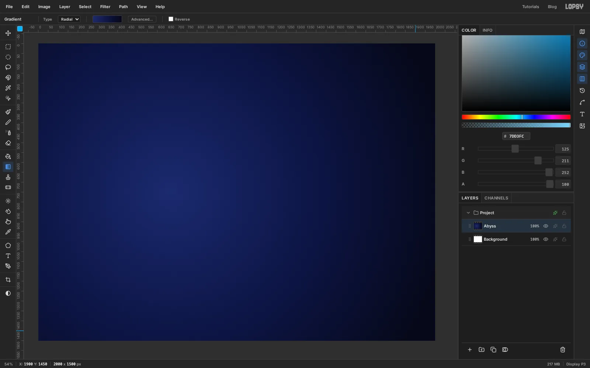

Open [Lopsy](/). In the **New Document** dialog set **Width** to `2000` and **Height** to `1500` and click **Create**.

1. Double-click **Layer 1** in the Layers panel and rename it `Abyss`.
2. Pick the **Gradient** tool and set **Type** to **Radial**. Click **Advanced…** and give the gradient three stops: `#1E2A6B` at the start, `#0E1440` a little past halfway and `#060818` at the end. Click **Done**.
3. Drag from (670, 750), where the emblem will sit, out to the bottom-right corner.

The brightest water ends up behind the emblem, and the right side falls off to near black.

## Build a pastel rainbow gradient

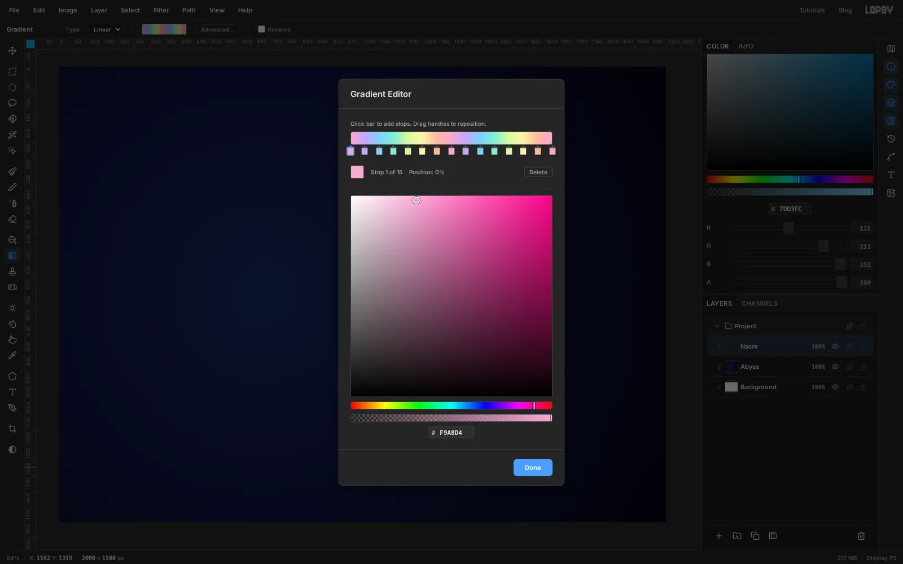

1. Click **Add Layer** and name the layer `Nacre`.
2. With the Gradient tool, set **Type** to **Linear** and open **Advanced…** again.
3. Make 15 evenly spaced stops by clicking along the bar. Colour them in this order, then start the order again: `#F9A8D4`, `#C4A7FF`, `#7DD3FC`, `#7FF0D8`, `#D9F99D`, `#FFF3A6`, `#FFB8A1`. The last stop ends up pink again.
4. Click **Done** and drag from the top-left corner to the bottom-right corner.

You now have about two full pastel rainbows running diagonally across the canvas.

## Draw vein lines with Clouds and Find Edges

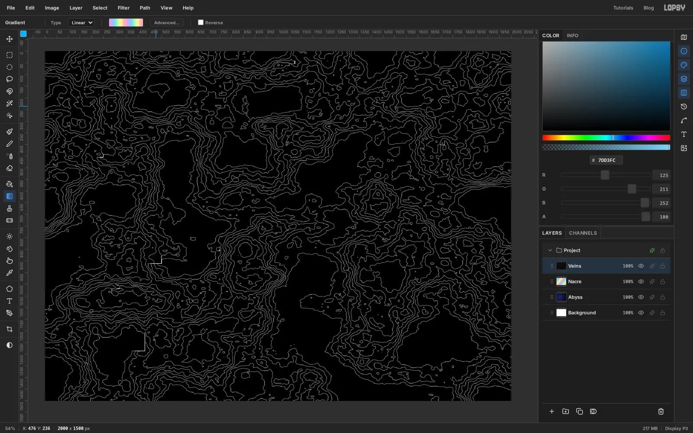

Real nacre has fine growth lines. You can get them from a contour map of random clouds.

1. Add a layer named `Veins`.
2. Choose **Filter → Clouds**, set **Scale** to `7` and click **Apply**.
3. Choose **Filter → Posterize** with **Levels** `9`. The soft clouds become nine flat grey bands.
4. Choose **Filter → Find Edges**. Only the borders between the bands are left, as thin white lines on black.

Clouds is random, so your lines won't match the screenshot. Any set will do.

## Screen the veins over the gradient

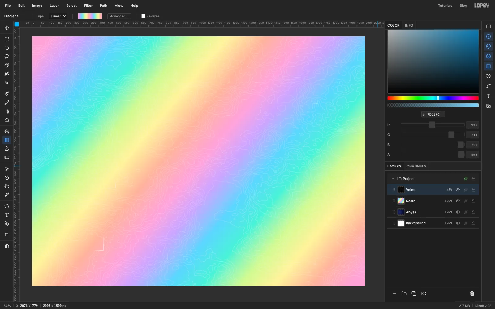

1. Choose **Filter → Gaussian Blur** with **Radius** `2` to soften the lines.
2. Click the effects button on the `Veins` row and set the blend mode to **Screen**. Screen drops the black and keeps the white.
3. Click the layer's opacity button and set it to **45%**.
4. Press [[Cmd+E]] (**Layer → Merge Down**) to fold the veins into the gradient. The merged layer keeps the name `Nacre`.

Merge now, before the next step, so the veins get swirled along with the colour.

## Marble it with Liquify

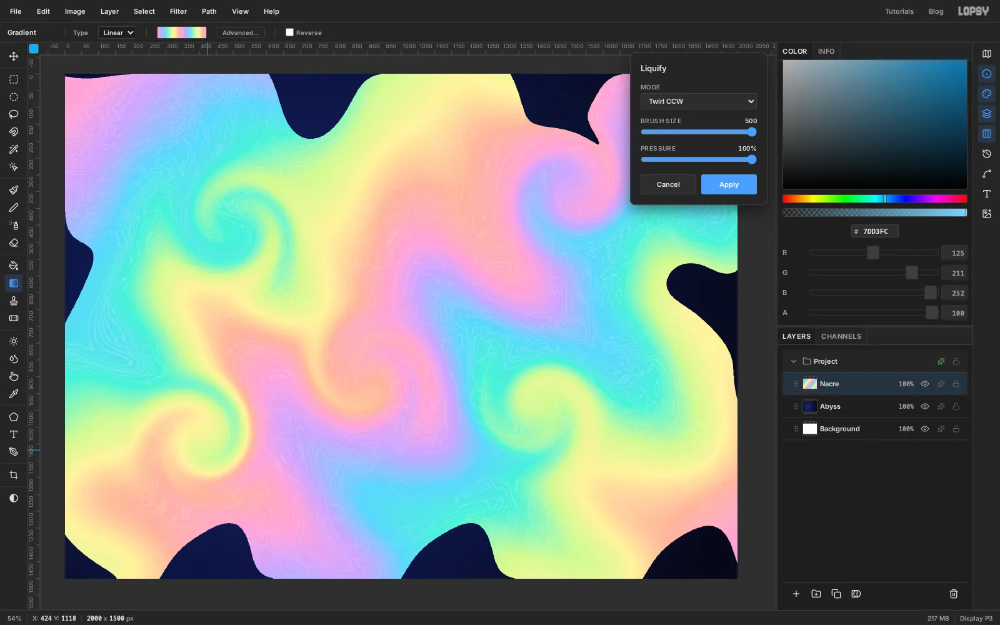

1. Choose **Filter → Liquify**. Set **Brush Size** to `500` and **Pressure** to `100%`.
2. In **Push Forward** mode, drag seven long wavy strokes across the canvas, one under the other, alternating left-to-right and right-to-left. Let each stroke rise and fall by about 150 px. The straight stripes bend into ribbons.
3. Switch **Mode** to **Twirl CW**. Hold the pointer down and make small circles for a few seconds near (500, 450), (1400, 1000) and (900, 900).
4. Switch to **Twirl CCW** and do the same near (1500, 350) and (400, 1100).
5. Click **Apply**.

Gaps open at the edges of the canvas where pixels were pushed inward. The next step fills them.

> **Tip:** Liquify applies as one step, so a single [[Cmd+Z]] takes you back to the stripes if you want another go.

## Back the sheet so it has no holes

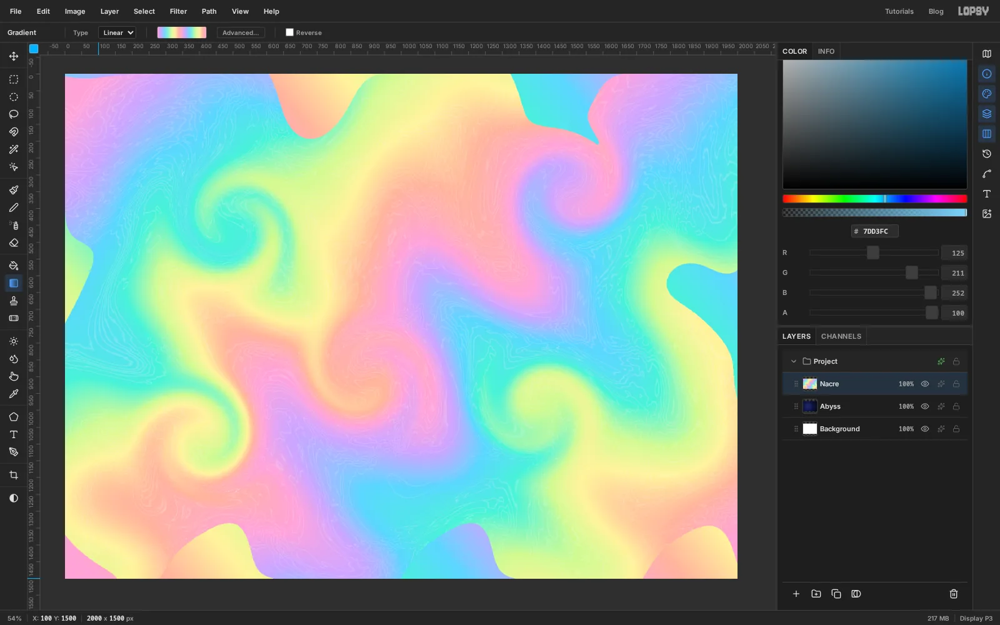

Pushing pixels around drags transparent gaps in from the edges of the canvas. A plain copy of the gradient underneath fills them.

1. Select `Abyss` and add a layer named `Nacre Base`. It appears just under `Nacre`.
2. The Gradient tool still holds the pastel stops. Drag from the top-right corner to the bottom-left corner, so these stripes cross the others.
3. Select `Nacre` and press [[Cmd+E]]. The merged layer takes the lower layer's name, so rename it back to `Nacre`.
4. Click the eye on `Nacre` to hide it. From here on it's a sheet of material you copy pieces from.

## Fill the emblem disc

1. Add a layer named `Disc`.
2. Pick the **Elliptical Marquee** and drag from (110, 190) to (1230, 1310). That's a circle 1120 px across.
3. Switch to the Gradient tool, **Radial**, with the stops `#1B2B78`, `#0C1242` (at about 60%) and `#060920`. Drag from just above the middle of the circle straight down to its bottom edge. A gradient only fills the selection.
4. Press [[Cmd+D]] to deselect.

## Cut the iridescent rim from the sheet

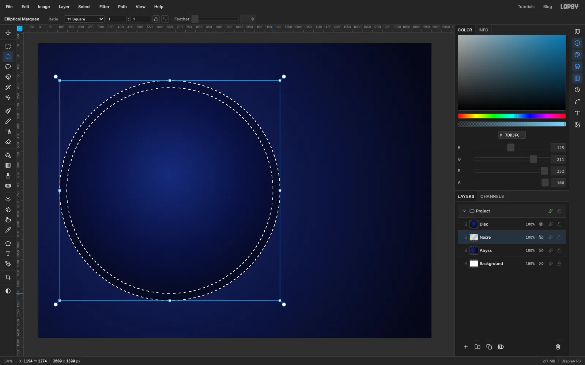

1. With the Elliptical Marquee, drag the same circle again, from (110, 190) to (1230, 1310).
2. Hold [[Alt]] and drag a second circle from (146, 226) to (1194, 1274). Alt subtracts, so what's left is a ring 36 px wide.
3. Select the hidden `Nacre` layer and press [[Cmd+C]].
4. Select `Disc` and press [[Cmd+V]]. The ring of nacre lands on a new layer in the same place. Name it `Rim` and deselect.

Copying from a hidden layer works, and this select, copy, paste routine is how every iridescent piece on the sheet is made.

## Lasso the shell's outline

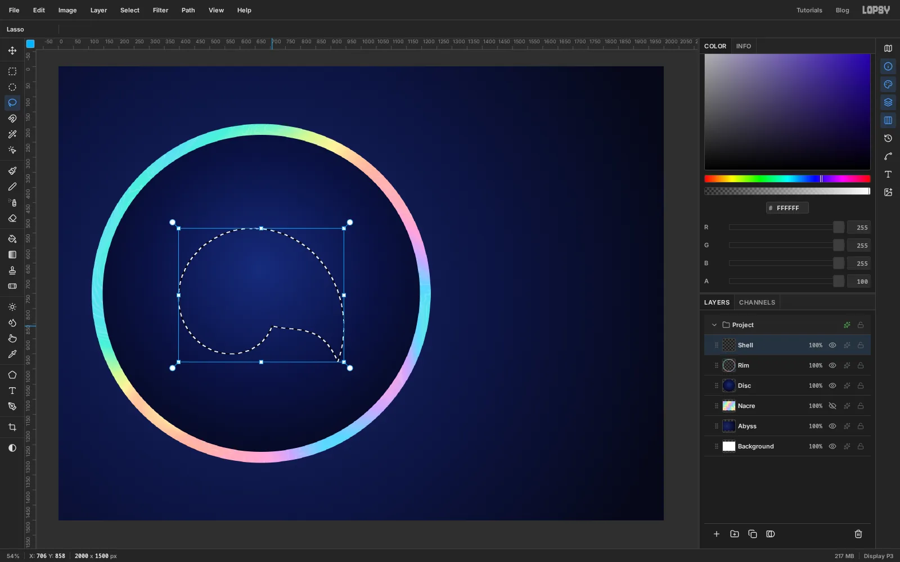

A nautilus is a spiral that gets three times wider with every full turn. Draw it upright for now. You'll tilt it later.

1. Add a layer named `Shell` above `Rim`.
2. Pick the **Lasso** and trace the outer turn clockwise through these points: (706, 858), (637, 935), (519, 942), (417, 851), (408, 695), (528, 562), (732, 550), (908, 707) and (923, 977). The curve keeps moving away from the spiral's centre at (597, 798) as it goes round.
3. From (923, 977) come back along the mouth of the shell with a shallow inward curve through (885, 913), (831, 879) and (770, 867), and finish where you started at (706, 858).
4. Set the foreground colour to white and choose **Edit → Fill**. Deselect.

It doesn't have to be perfect. A slightly wobbly edge reads as hand-drawn, and the outline in the next step tidies it.

## Give the shell a crisp outline

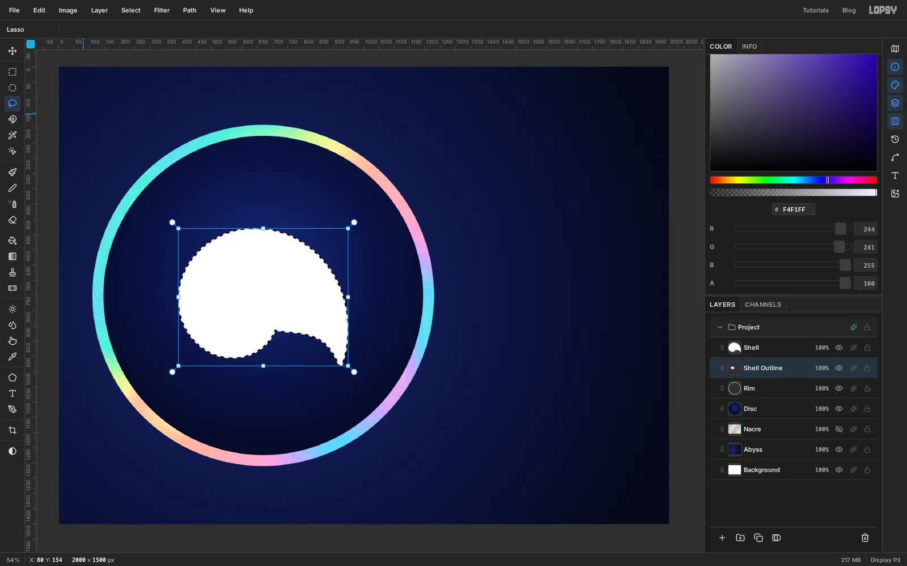

1. Hold [[Cmd]] and click the `Shell` thumbnail to load the shell as a selection.
2. Choose **Select → Grow**, enter `5` px and click **Apply**.
3. Select `Rim` and add a layer named `Shell Outline`, so it sits under the shell. Fill it with pearl white `#F4F1FF`.
4. Cmd-click the `Shell` thumbnail again, make sure `Shell Outline` is still the selected layer, and press [[Delete]]. That removes the middle and leaves a 5 px ring.
5. Deselect.

The outline has to be a ring and not a solid shape, because the next steps cut gaps into the shell and the disc should show through them.

## Draw the inner wall with the Pen

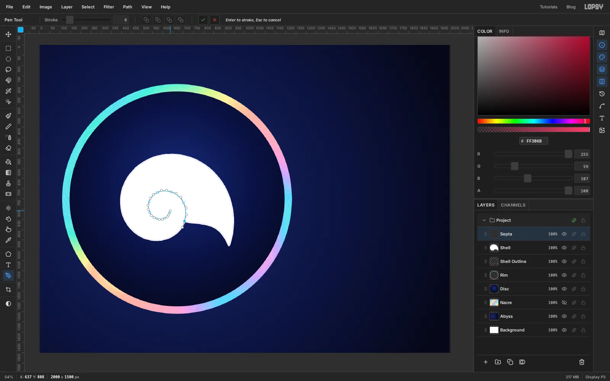

The chamber walls are smooth curves, which is the Pen's job. Draw them on their own layer first.

1. Add a layer named `Septa` above `Shell` and set the foreground colour to any bright colour, such as `#FF3B6B`.
2. Pick the **Pen** tool and set **Stroke** to `6`.
3. Draw the inner spiral by pressing on each of these points and dragging a short way along the direction the curve is travelling before you let go: (706, 858), (701, 768), (642, 716), (574, 719), (534, 764), (537, 816), (571, 846), (610, 844) and (633, 818). Dragging pulls out handles, which is what makes each anchor smooth. A drag of about a quarter of the distance to the next point works well.
4. Press [[Enter]]. The path is stroked onto the layer in your foreground colour.
5. Set **Stroke** to `4` and carry on inward from (633, 818) the same way, through (631, 788), (612, 771), (589, 772), (576, 787), (577, 804), (588, 814) and (601, 813). The drags are tiny here, 5 to 10 px. Press [[Enter]] again.

> **Tip:** After a path is stroked it stays selected, and a click near it grabs one of its anchors. Before you start the next curve, click on empty canvas well away from the shell and press [[Esc]].

## Add the chamber walls
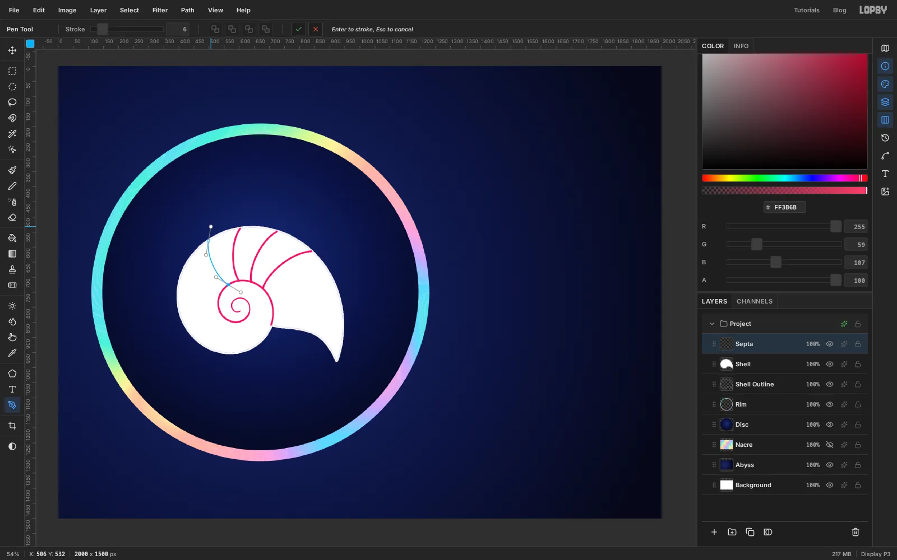

Each wall (a septum) is a two-anchor curve from the inner spiral out to the shell's edge. Every one is drawn the same way:

- Press on the inner spiral and drag outward, leaning anticlockwise, toward where the next wall will go.
- Press on the outer edge straight out from where you started and drag leaning clockwise, back toward the wall before.
- Make each drag about a fifth of the wall's distance from the spiral's centre, then press [[Enter]] to stroke it.

That gives a line that bows back toward the centre of the spiral.

1. Start the first wall at (678, 737). Drag about 60 px almost straight up. Press at (839, 614) on the outer edge and drag about 60 px to the right. Press [[Enter]].
2. Work round the shell anticlockwise, adding a wall roughly every 26°, which is 14 per turn. These five are evenly spread around the outer turn, with two more walls between each pair:
   - (564, 725) out to (498, 579)
   - (535, 811) out to (411, 836)
   - (596, 848) out to (593, 948)
   - (635, 808) out to (712, 827)
   - (624, 778) out to (678, 737), which is where the first wall began
3. As the walls get shorter, drop **Stroke** to `5` once they're under about 150 px from the centre and to `4` under 80 px.
4. Keep going round the inner turn, where the walls run from the smallest spiral out to the first one: (578, 782) to (540, 751), (589, 814) to (572, 847) and (603, 812) to (616, 840), again with two more between each pair.
5. Leave the stretch between the first wall and the mouth empty. That's the living chamber, where the animal sits.

I drew 25 walls. The exact count doesn't matter as long as the spacing looks even and each wall is a little shorter than the last.

## Knock the walls out of the shell

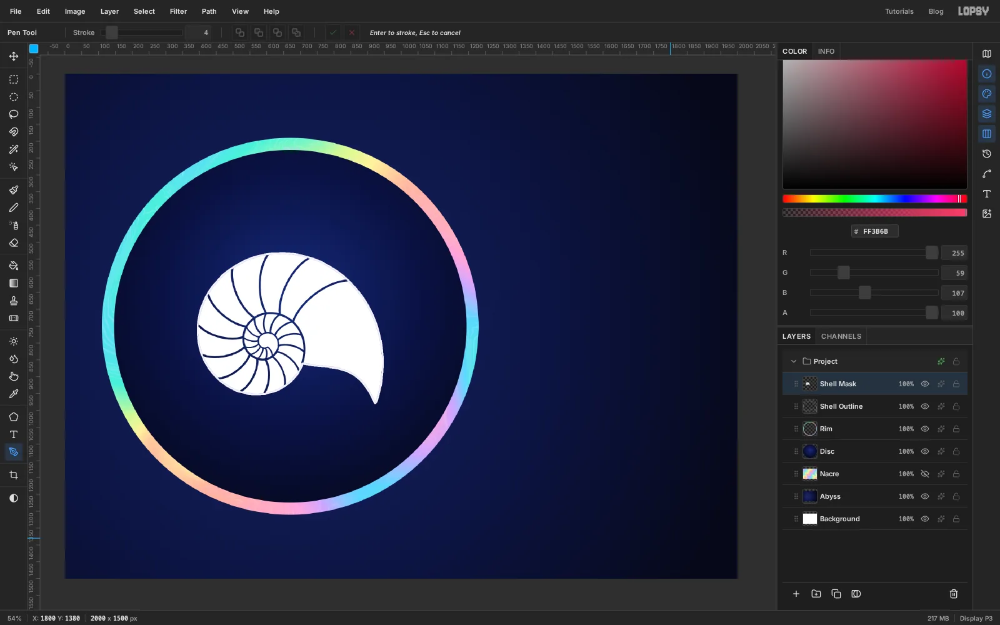

1. Cmd-click the `Septa` thumbnail to load every stroke as a selection.
2. Select `Shell` and press [[Delete]], then deselect.
3. Select `Septa` and click **Delete Layer**. It has done its job.
4. Rename `Shell` to `Shell Mask`. From now on it's the stencil the coloured layers are cut with, and the name frees up `Shell` for the group you'll make later.

The walls are now gaps in the shell, so whatever colour you put in the shell, the lines stay the colour of the disc behind it.

## Fill the shell with nacre

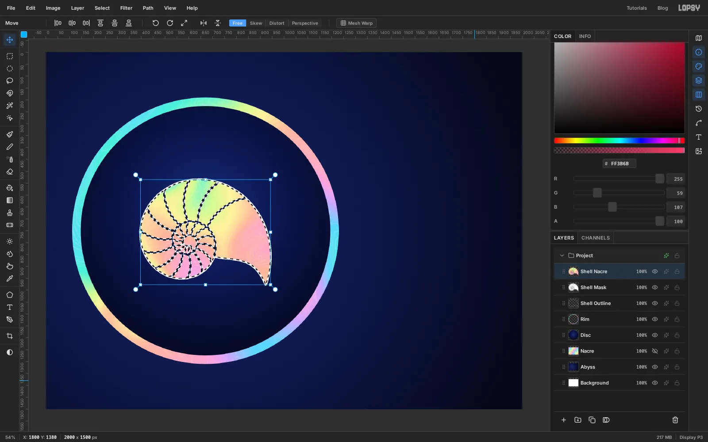

1. Cmd-click the `Shell Mask` thumbnail.
2. Select `Nacre` and press [[Cmd+C]].
3. Select `Shell Mask` and press [[Cmd+V]]. Name the new layer `Shell Nacre`.

## Shift the hues with a radial sheen

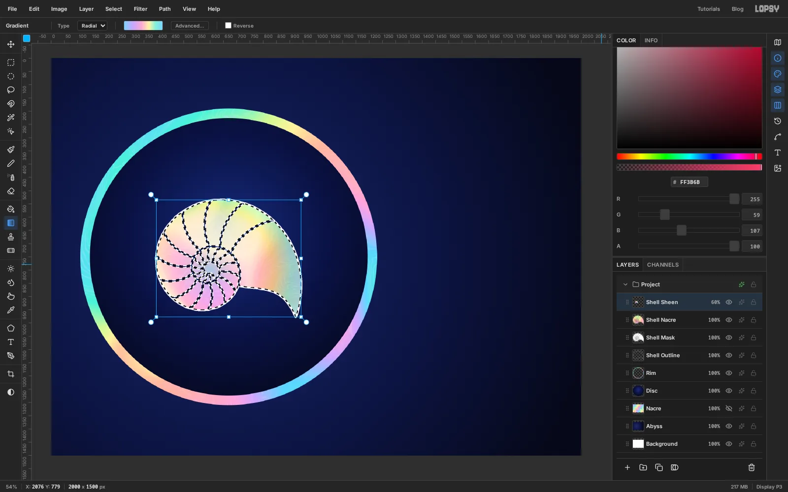

The piece of sheet under the shell might be mostly one colour. A radial rainbow in **Color** blend mode fixes that without flattening the marbling.

1. Cmd-click `Shell Mask` again and add a layer named `Shell Sheen` above `Shell Nacre`.
2. With the Gradient tool on **Radial**, set six stops: `#7DD3FC`, `#C4A7FF`, `#F9A8D4`, `#FFF3A6`, `#7FF0D8` and back to `#7DD3FC`.
3. Drag from the centre of the spiral at (597, 798) to the far edge of the shell near (957, 678).
4. Set the layer's blend mode to **Color** and its opacity to **60%**.

Color mode takes hue and saturation from the gradient and keeps the light and dark of the nacre below, veins included.

## Paint a soft highlight

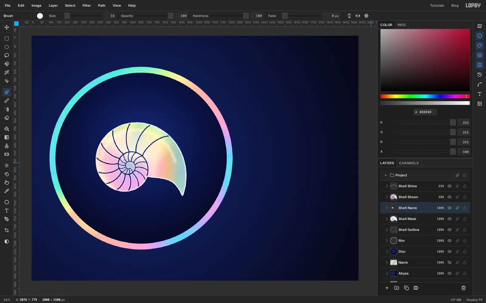

1. With the shell still selected, add a layer named `Shell Shine`.
2. Pick the **Brush**, white, **Size** `38`, **Hardness** `0` and **Opacity** `70`.
3. Paint one stroke that follows the outer edge, a little inside it, from the lower left up over the top and partway down the right side. The selection keeps the paint inside the shell.
4. Drop **Size** to `16` and add a short stroke along the top of the inner turn.
5. Deselect and set the layer to **65%** opacity.
6. Open the effects for `Shell Nacre`, tick **Inner Glow** and set the colour to white, **Size** `12` and **Opacity** `60`. That brightens the edge of each chamber.

Set the Brush back to **Hardness** `100` and **Opacity** `100` when you're done.

## Group the shell and rotate it

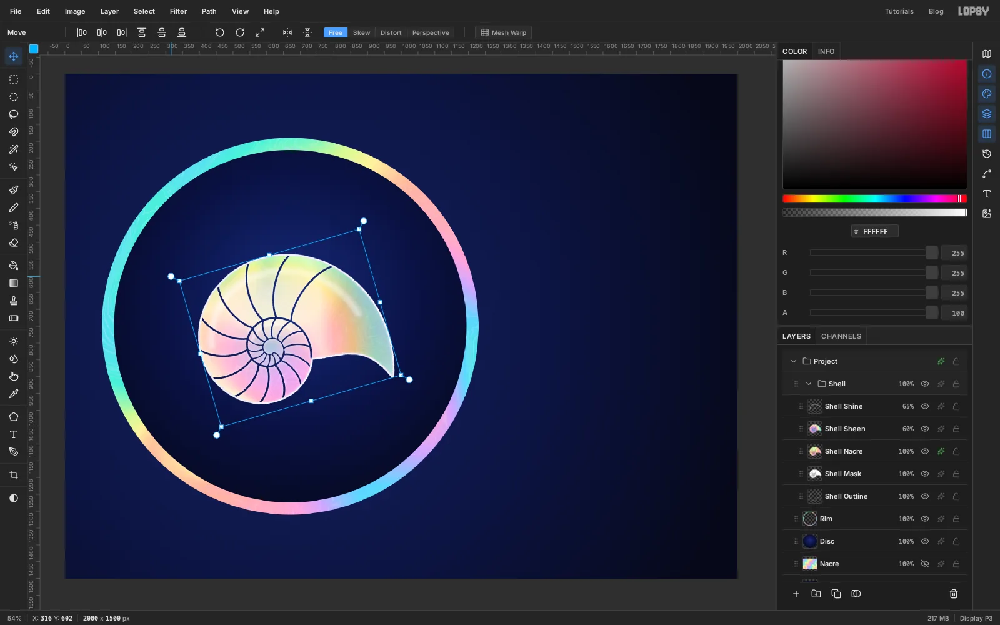

1. Click `Shell Shine` in the Layers panel, then **Shift-click** `Shell Outline`. All five shell layers are selected.
2. Choose **Layer → Group Layers** and name the group `Shell`.
3. With the group selected, pick the **Move** tool. Handles appear around everything in the group.
4. Drag the round rotation handle just outside the top-left corner and turn the shell about 16° anticlockwise, so the mouth opens toward the right.
5. Press [[Cmd+D]] to commit.

## Scale it up and centre it

1. Hold [[Cmd]] and drag the bottom-right corner handle outward until the shell is about 12% bigger, roughly 655 px wide. Cmd keeps the proportions. Commit with [[Cmd+D]].
2. Drag the shell so it sits in the middle of the disc, with the centre of its handles box at about (670, 754).

The shell reaches about 300 px above the centre and 325 px below it. Keep those numbers in mind: the type has to clear them.

## Draw two arcs for the type

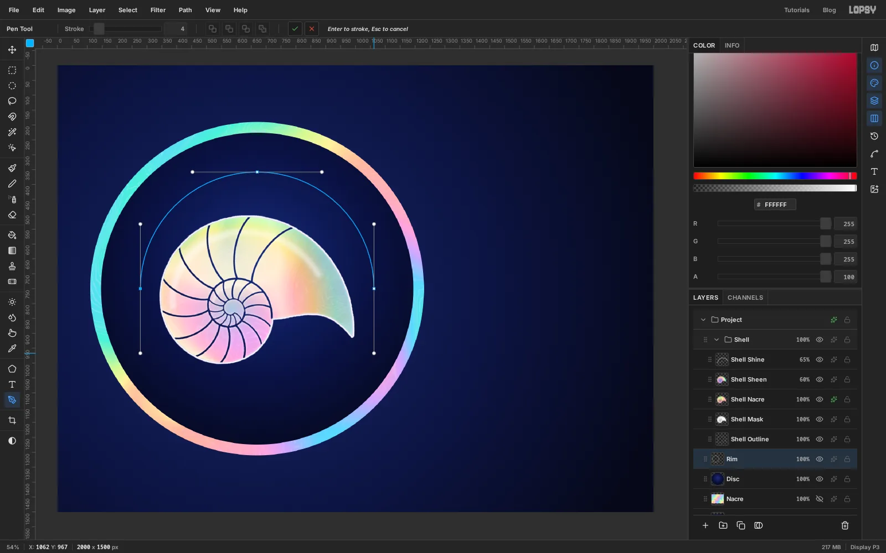

Text on a circle needs a path to sit on. Each arc is three smooth anchors.

1. Select `Rim`, pick the **Pen** and click empty canvas followed by [[Esc]] to drop any selected path.
2. For the top arc, press at (278, 750) and drag straight up about 215 px. Press at (670, 358) and drag right 215 px. Press at (1062, 750) and drag down 215 px. That's a half circle with a 392 px radius, drawn left to right over the top.
3. Click the **✓ Commit path** button in the options bar. It saves the path without stroking it.
4. For the bottom arc, press at (208, 750) and drag down about 255 px, press at (670, 1212) and drag right 255 px, then press at (1132, 750) and drag up 255 px. Commit that one too.

The direction matters. Text reads along the path in the order you drew it and stands on its left side, so the bottom arc, drawn left to right, puts the letters inside the curve and the right way up.

## Set the name on the top arc

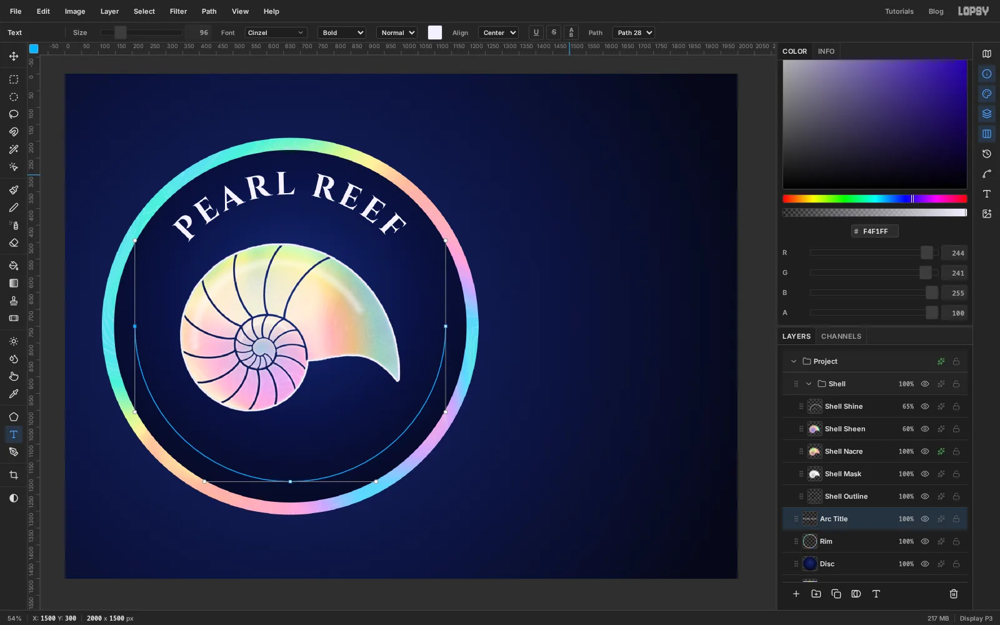

1. Select `Rim` again so no text layer is active, and set the foreground colour to `#F4F1FF`.
2. Pick the **Text** tool. Set **Size** to `96`, choose **Cinzel** in the font list, **Bold**, and **Align** **Center**.
3. Click on empty canvas to the right of the emblem, type `PEARL REEF` and press [[Tab]] to commit.
4. Open the **Text** panel and set **Letter spacing** to `10`.
5. In the options bar's **Path** dropdown choose the top arc. The dropdown lists every path in the document, including all the chamber walls, so the top arc is the second-to-last entry (`Path 28` for me) and the bottom arc is the last.

Center alignment puts the middle of the words at the top of the arc. The capitals stand about 68 px tall on a 392 px radius, which leaves a gap of about 45 px to the dotted ring you'll add shortly and more than that to the shell.

> **Tip:** Changing the font or size while a text layer is selected restyles that layer. Select a pixel layer first whenever you're about to make new text.

## Set the tagline on the bottom arc

1. Select `Rim` again, then set the Text tool to **Josefin Sans**, **Bold**, **Size** `58`, still centred.
2. Click empty canvas, type `FREEDIVING SCHOOL` and press [[Tab]].
3. Set **Letter spacing** to `14` and bind the layer to the bottom arc, the last entry in the **Path** dropdown.
4. Rename the two text layers `Arc Title` and `Arc Tagline`.

Both lines use the same pearl white and a bold weight, so they read as one lockup even though the faces differ.

## Stamp a ring of dots with Radial Symmetry

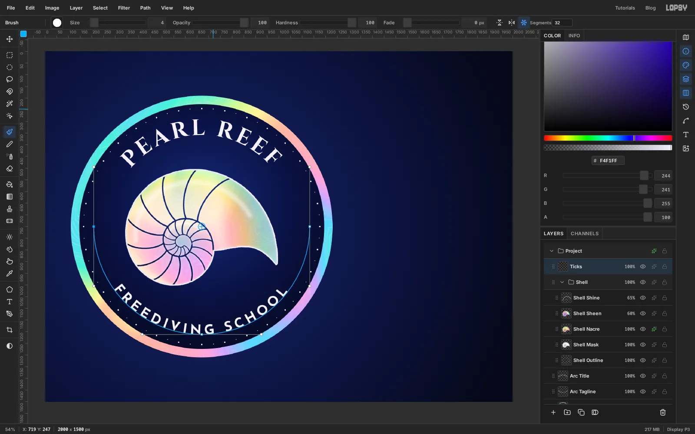

1. Select the `Shell` group and add a layer named `Ticks`. A new layer lands inside the selected group, so drag its grip up until it sits above the group.
2. Pick the **Brush**: `#F4F1FF`, **Size** `7`, **Hardness** `100`.
3. Click **Radial Symmetry** in the options bar and type `32` into **Segments**.
4. Hold [[Cmd]] and click the centre of the emblem at (670, 750). That moves the symmetry centre there without painting.
5. Click once at the top of the disc, at (670, 245). Thirty-two dots appear, evenly spaced.
6. Set **Size** to `4` and click once more a few degrees round, near (719, 247). A second ring of smaller dots fills the gaps.
7. Click **Radial Symmetry** again to turn it off.

## Add pearls, group the emblem and give it depth

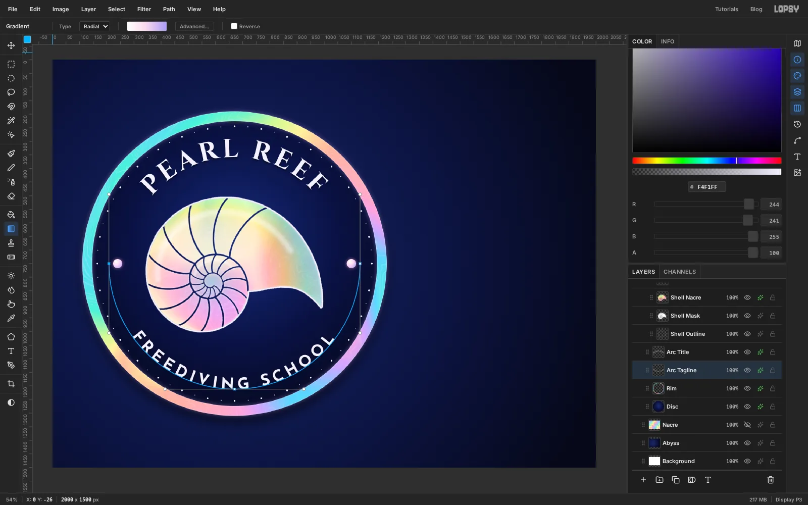

1. Add a layer named `Pearls`. With the Elliptical Marquee, drag from (223, 733) to (257, 767) for a 34 px circle on the left of the emblem, level with its centre.
2. Fill it with a **Radial** gradient of `#FFFFFF`, `#FBD9EE` and `#A99BF5`, dragging from just up and left of the circle's centre to its lower-right edge. The off-centre start makes it look lit from above.
3. Do the same for a second pearl on the right, from (1083, 733) to (1117, 767), then deselect.
4. Tick **Outer Glow** on `Pearls`: colour `#F9A8D4`, **Size** `18`, **Opacity** `60`.
5. Click `Pearls`, Shift-click `Disc` and choose **Layer → Group Layers**. Name the group `Emblem`.
6. Add the depth effects:
   - `Disc`: **Drop Shadow**, colour `#02030C`, **Offset Y** `26`, **Blur** `60`, **Opacity** `70`.
   - `Rim`: **Outer Glow** `#C4A7FF`, **Size** `26`, **Opacity** `40`, and **Inner Glow** white, **Size** `6`, **Opacity** `70`.
   - `Arc Title` and `Arc Tagline`: a small **Drop Shadow**, **Offset Y** `5`, **Blur** `10`.

## Lay out the column with guides and two tiles

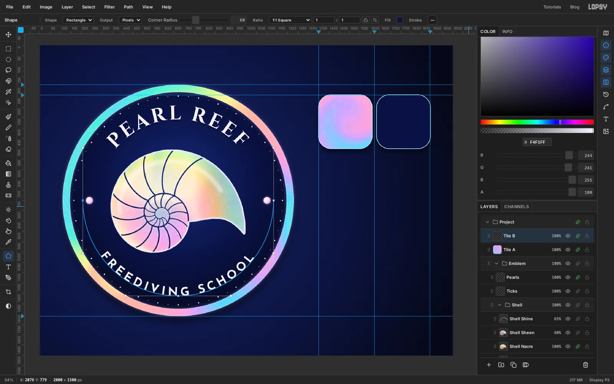

The right-hand column is 540 px wide, with the same 110 px margin to the canvas edge that the emblem has on the left.

1. Make sure **View → Snap to Guides** is ticked. Click the top ruler at `1350`, `1620` and `1890`, and the left ruler at `190`, `240` and `1310`.
2. Add a layer named `Tile A Mask` and drag it above the `Emblem` group.
3. Pick the **Shape** tool. Set **Shape** to **Rectangle**, **Corner Radius** to `60`, the fill to white and no stroke.
4. A shape grows from its centre. Press at (1479, 369) and drag up and left toward the corner where the 1350 and 240 guides cross. Hold [[Cmd]] as you drag if you want to be sure it stays square. The corner snaps onto both guides and you get a 258 px rounded square.
5. Fill the tile with nacre the same way as the rim:
   - Cmd-click the `Tile A Mask` thumbnail to select its shape.
   - Select `Nacre` and press [[Cmd+C]].
   - Select `Tile A Mask` and press [[Cmd+V]], then deselect.
   - Name the pasted layer `Tile A` and delete `Tile A Mask`.
6. Add a layer named `Tile B`, change the Shape fill to `#0C1242`, press at (1761, 369) and drag to the corner where the 1890 and 240 guides cross.
7. Give both tiles the same effects: **Stroke**, colour `#BFE9FF`, **Width** `3`, and **Drop Shadow**, **Offset Y** `14`, **Blur** `28`, **Opacity** `60`.

## Make a small one-colour shell

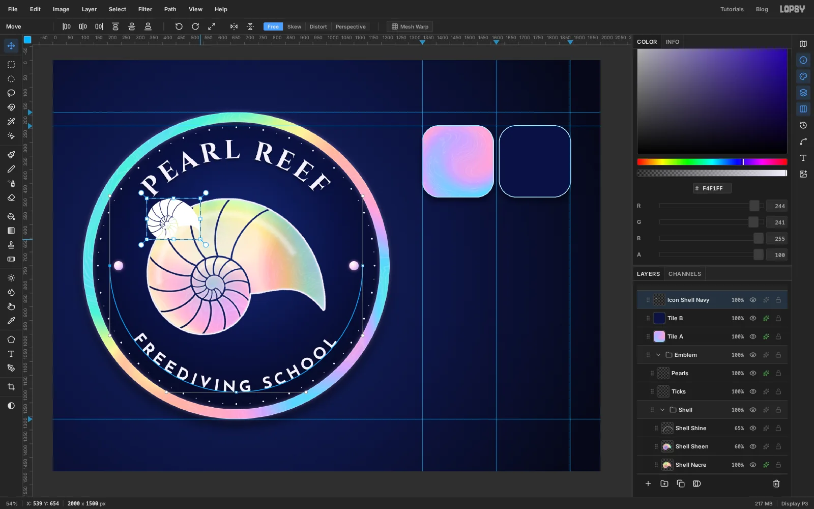

1. Select `Shell Mask` inside the `Shell` group and choose **Layer → Duplicate Layer**.
2. Drag the copy out of the groups to the top of the panel and name it `Icon Shell Navy`.
3. A single pixel layer has no handles of its own, so draw a **Rectangular Marquee** around the copy.
4. With the Move tool, hold [[Cmd]] and drag the bottom-right handle up and to the left until the shell is about 30% of its size, around 195 px wide. Press [[Cmd+D]].
5. Drag the small shell onto the middle of `Tile A`.
6. Open its effects, tick **Color Overlay** and set the colour to `#0C1242`.

## Add the full-colour icon

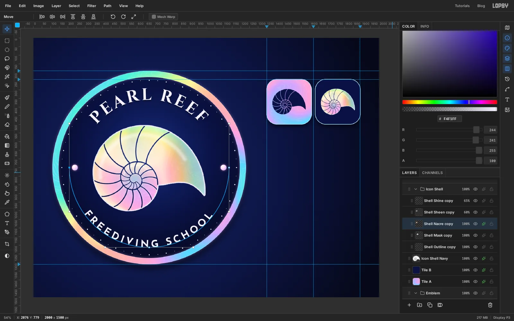

1. Select the `Shell` group and choose **Layer → Duplicate Layer**. The whole group is copied.
2. Drag `Shell copy` to the top of the panel and name it `Icon Shell`.
3. A group does get handles. With the Move tool, Cmd-drag the bottom-right handle to shrink it to the same 30%, commit, and drag it onto `Tile B`.
4. Layer effects don't shrink with the pixels. Open the effects for `Shell Nacre copy` and lower **Inner Glow** **Size** to `4`.

## Set the wordmark, captions and motto
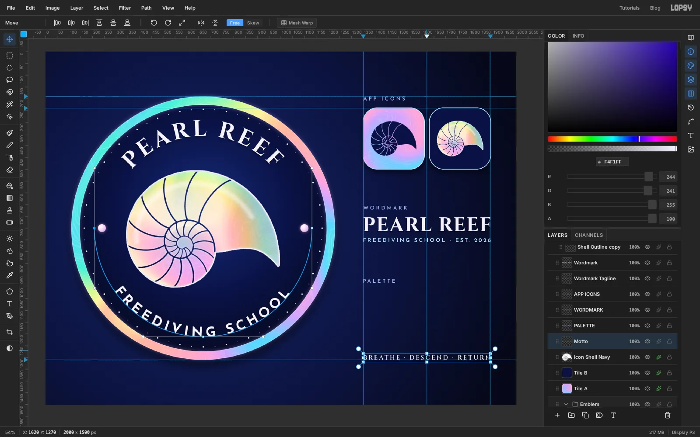

Six lines of type go in the column. Select `Icon Shell Navy` before you make each one. It's a pixel layer, so nothing gets restyled, and every new layer lands just above it. Click roughly where the line belongs, type, press [[Tab]], then fine-tune: select the layer, pick the Move tool and use the arrow keys. [[Shift]] with an arrow moves 10 px.

The wordmark and its tagline:

- Cinzel **Bold**, **Size** `84`, colour `#F4F1FF`, **Align** **Center**. Click near (1620, 690) and type `PEARL REEF`. Rename the layer `Wordmark`, because the next step loads it by name.
- In the Text panel, adjust **Letter spacing** until the word runs exactly from the 1350 guide to the 1890 guide. For me that was `3.4`. Nudge it until the tops of the letters are at y `702`.
- Josefin Sans **SemiBold**, **Size** `23`, colour `#BFE9FF`, centred: `FREEDIVING SCHOOL · EST. 2026` with **Letter spacing** `6`, which also fills the column. Put the tops of its letters at y `791`, about 28 px under the wordmark. Name it `Wordmark Tagline`.

The three captions. Set all three in Josefin Sans **SemiBold**, **Size** `22`, colour `#A9B8F0`, **Align** **Left**, **Letter spacing** `7`, with the left edge on the 1350 guide:

- `APP ICONS`, with the tops of its letters on the 190 guide, level with the top of the emblem
- `WORDMARK`, tops at y `654`
- `PALETTE`, tops at y `965`

The motto:

- Cinzel **SemiBold**, **Size** `26`, colour `#F4F1FF`, centred: `BREATHE · DESCEND · RETURN` with **Letter spacing** `5.6`, so it too spans the column. Sit the bottoms of its letters on the 1310 guide, level with the bottom of the emblem. Name it `Motto`.

Those positions leave the same gap of about 155 px between the tiles, the wordmark block and the palette block.

> **Tip:** Letter spacing carries over to the next text you make. Check the Text panel each time.

## Fill the wordmark with nacre

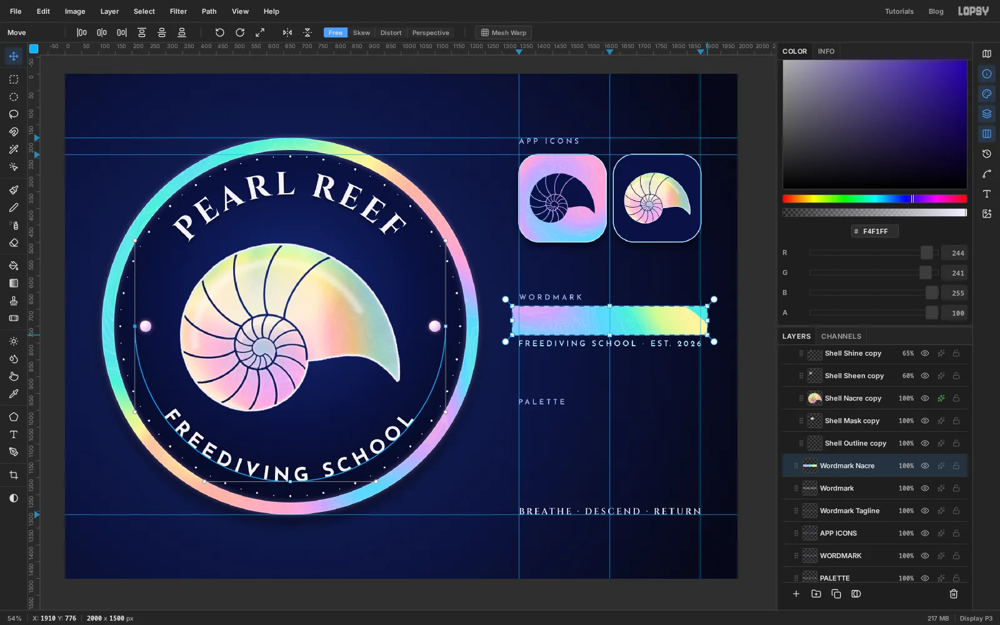

1. Untick **View → Snap to Guides** so selections stop jumping to the guides.
2. Select `Nacre` and drag a Rectangular Marquee that covers the wordmark with a little room to spare. Press [[Cmd+C]].
3. Select `Wordmark` and press [[Cmd+V]]. Name the strip `Wordmark Nacre`.
4. Cmd-click the `Wordmark` thumbnail to load the letters, choose **Select → Inverse** and press [[Delete]]. Only the letter shapes are left.
5. Deselect, and add an **Outer Glow** to `Wordmark Nacre`: `#7DD3FC`, **Size** `12`, **Opacity** `30`.

The white text layer stays underneath, still editable. If the name changes, retype it and cut a new strip.

## Add the palette swatches
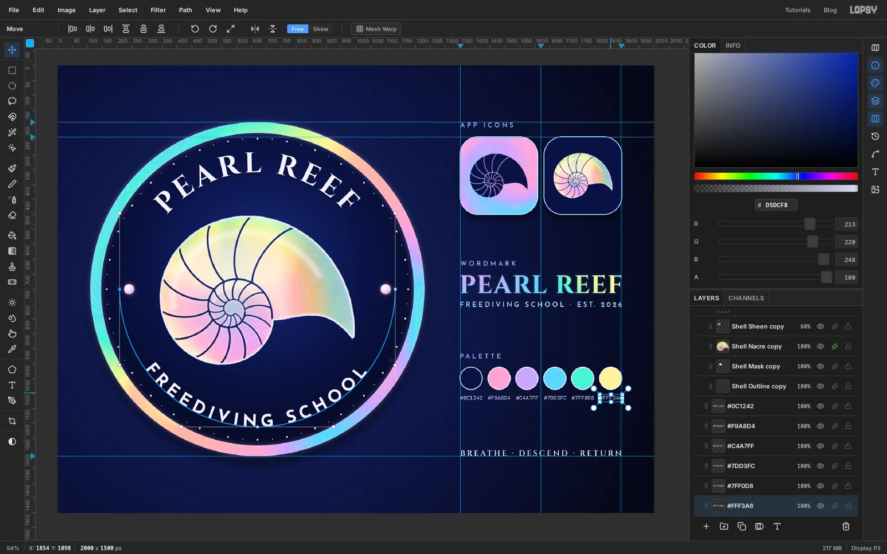

1. Add a layer named `Chips`.
2. With the Elliptical Marquee, drag from (1350, 1013) to (1422, 1085) for a 72 px circle, and fill it with `#0C1242` (**Edit → Fill**).
3. Make five more circles the same size along the row, each one about 94 px further right, and fill them with `#F9A8D4`, `#C4A7FF`, `#7DD3FC`, `#7FF0D8` and `#FFF3A6`. Their centres are at x `1480`, `1573`, `1667`, `1761` and `1854`, so the last circle's right edge touches the 1890 guide.
4. Tick **Stroke** on the layer: `#F4F1FF`, **Width** `3`. The ring is what makes the navy swatch visible on a navy background.
5. Label each swatch with its hex code. Select `Chips` first each time, then set **DM Mono**, **Size** `18`, colour `#D5DCF8`, **Align** **Center** and **Letter spacing** `0`. Click under the middle of a swatch, type the code (`#0C1242` and so on), press [[Tab]], and nudge it so the tops of the characters are at y `1108`.
6. Click `Icon Shell` in the Layers panel, Shift-click `Tile A` and choose **Layer → Group Layers**. Name the group `Brand Sheet`.

> **Tip:** With Snap to Guides on, the two swatches either side of the 1620 guide get pulled onto it and come out the wrong size. That's why it was turned off in the last step.

## Send light rays out from behind the emblem

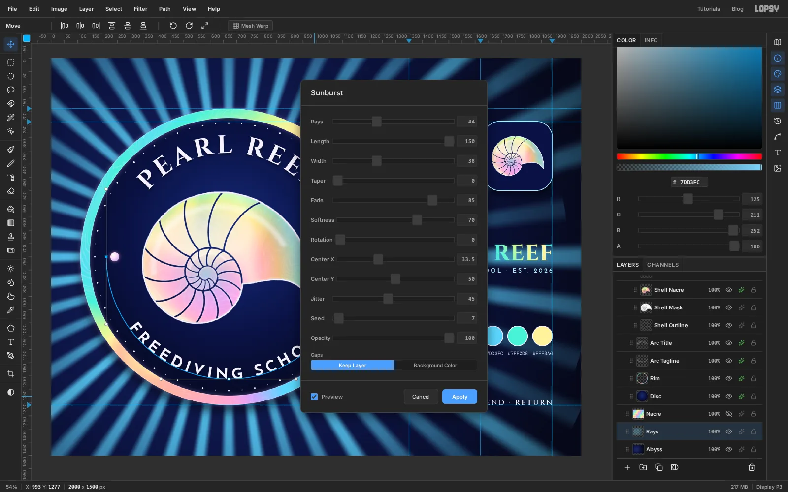

1. Select `Abyss` and choose **Filter → Add Noise** with **Amount** `6`, **Mono** and **Gaussian**, for a little grain in the water.
2. Add a layer named `Rays` above `Abyss` and set the foreground colour to `#7DD3FC`.
3. Choose **Filter → Sunburst** and set **Rays** `44`, **Length** `150`, **Width** `38`, **Fade** `85`, **Softness** `70`, **Center X** `33.5`, **Center Y** `50`, **Jitter** `45` and **Seed** `7`. Center X is a percentage of the canvas width, and 33.5% of 2000 is the emblem's centre. Click **Apply**.
4. Soften the rays with **Gaussian Blur**, **Radius** `5`.
5. Set the layer's blend mode to **Screen** and its opacity to **8%**. They should be a hint, not a pattern.

## Fade the rays out of the column with a mask

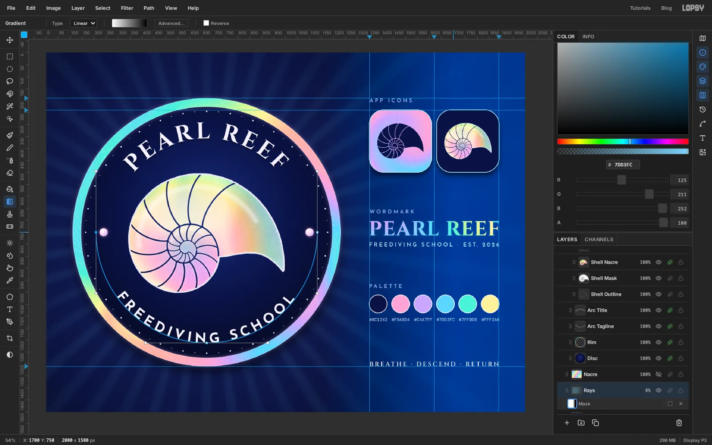

Rays behind small type make it harder to read.

1. With `Rays` selected, click **Add Mask**. The layer enters mask edit mode.
2. Pick the Gradient tool, **Linear**, with two stops: white, then black.
3. Drag from (1150, 750), just inside the emblem's right edge, across to (1700, 750). White keeps the rays and black hides them. The blue overlay shows the hidden part.
4. Click the `Rays` layer row to leave mask edit mode.

## Tint the shadows with Color Grading

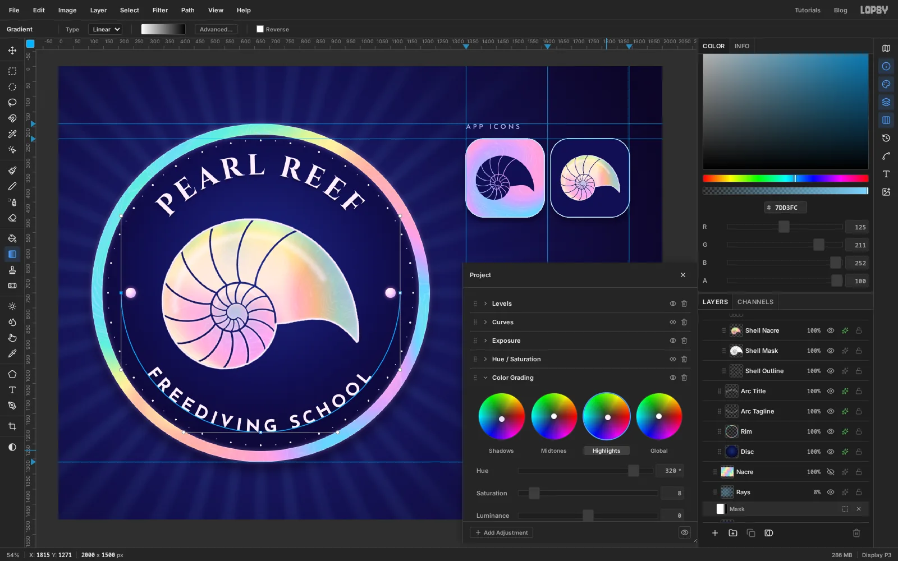

1. Choose **Layer → Adjustment Layer…**. A note explains that adjustments live on groups. Click **Got it**, and the adjustments drawer is open for the whole document.
2. Expand **Color Grading**. Click **Shadows** under the colour wheels and set **Hue** `268` and **Saturation** `14`.
3. Click **Highlights** and set **Hue** `320` and **Saturation** `8`.
4. Close the drawer.

The navy takes on a little violet and the pale colours a little pink, which ties the background to the nacre. Keep the numbers low. The swatches should still look like their hex codes.

## Export the sheet and save the project

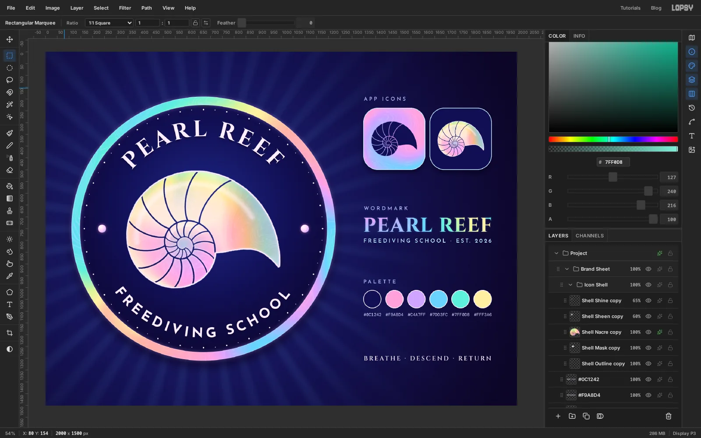

1. Choose **View → Show Guides** to hide the guides and check the sheet. The emblem and the column should share a top edge at 190 and a bottom edge at 1310.
2. Choose **File → Quick Export PNG** for the sheet.
3. Choose **File → Save Project** to keep every layer, path and text line editable.

Because every iridescent piece was cut from the same hidden `Nacre` layer, you can restyle the whole identity by repainting that one sheet and repeating the copy and paste steps.
