Iridescence is colour that shifts as the angle of the light shifts. It comes from thin layers bouncing light back at slightly different wavelengths, like the rainbow in a film of oil. A rainbow trout's flank does this. Its pink stripe is real pigment, but the gold, green and violet that slide across the scales change as the fish turns.

The trap, and I fell into it on my first attempt here, is painting that as a rainbow. Stripes of saturated colour running the full length of the fish look like a neon sticker. What works is a calm silver-olive fish with a narrow strip of colour across the part of the flank that catches the light.

In this tutorial you'll paint **Rainbow Trout**, a 2000 × 1400 px picture of a trout rising toward the surface of a river. You'll build the water first, cut a real trout out of a photo and paint over it, add a thin-film sheen and a scale pattern, then bake the fish into one layer so you can bend it and light it as a single object.

Along the way you'll use:

- the **Gradient** tool with transparent stops, **Clouds**, **Add Noise**, **Voronoi**, **Oil Paint**, **Emboss**, **Solarize** and **Sunburst**
- **Tilt-Shift Blur**, **Motion Blur**, **Surface Blur**, **Chromatic Aberration** and **Bloom**
- the **Pen** tool, **Path to Selection**, **Feather**, **Shrink** and **Inverse**
- a group with a **Gradient Map** adjustment, **Define Pattern** and **Fill with Pattern** with column stagger
- **layer masks**, **Copy Merged**, **Liquify** and the **Move** tool's scale and rotate handles
- the **Soft Light**, **Overlay**, **Color**, **Screen** and **Multiply** blend modes, plus a **Vignette** adjustment

You'll need a side-on photo of a trout. I used [this public domain photograph by Eric Engbretson, U.S. Fish and Wildlife Service](https://commons.wikimedia.org/wiki/File:Oncorhynchus_mykiss.jpg), and the steps assume it. Open it at full size and copy it, or save it and copy it from your image viewer.

The palette:

- Water `#6FD6C8` → `#2FA3A6` → `#0E5F78` → `#08274A` → `#030819`
- Deep water `#0A3457`, floor glow `#8FE0D0`
- Trout back `#123F4F` / `#2C6F66`, flank `#8A9A55` / `#D69A5A`
- Rose stripe `#DE5C80` / `#E7A4B4`, belly `#B6D6CF` / `#DAD6E8` / `#F4F2F0`
- Thin film `#FF2D8A` → `#FFD23F` → `#3BE8B0` → `#29A8FF` → `#A04BFF`
- Rim light `#CFF6FF`, shade `#07204A`

> **Tip:** Lopsy's blend modes and opacity live in two places. The **✦ effects** button on a layer row opens a drawer with the blend mode list. The percentage on the row is the opacity. Close the drawer when you finish with it, because it covers part of the canvas. Under the Layers panel, **+** is Add Layer, the folder is New Group and the circled rectangle is Add Mask.

## Fill the canvas with deep water

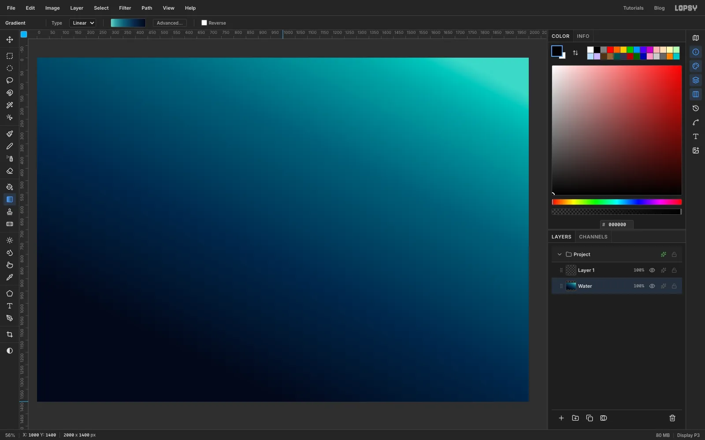

Choose **File → New**, set the size to 2000 × 1400 and choose a White background. Rename the Background layer **Water** by double-clicking its name.

Pick the **Gradient** tool, set the type to **Linear** and click **Advanced…**. Give it five stops, clicking the handle row to add each new one and typing its colour in the **Hex** field:

1. `#6FD6C8` at the far left
2. `#2FA3A6` at about 12%
3. `#0E5F78` at about 36%
4. `#08274A` at about 68%
5. `#030819` at the far right

Click **Done**. Later steps need fewer stops than this: to remove one, select it in **Advanced…** and click **Delete**. Drag from the top edge, about five sixths of the way across, down to the bottom edge, about halfway across. The brightest corner at the top right is where the light will come from, so the rest of the painting will refer back to it.

## Add some murk

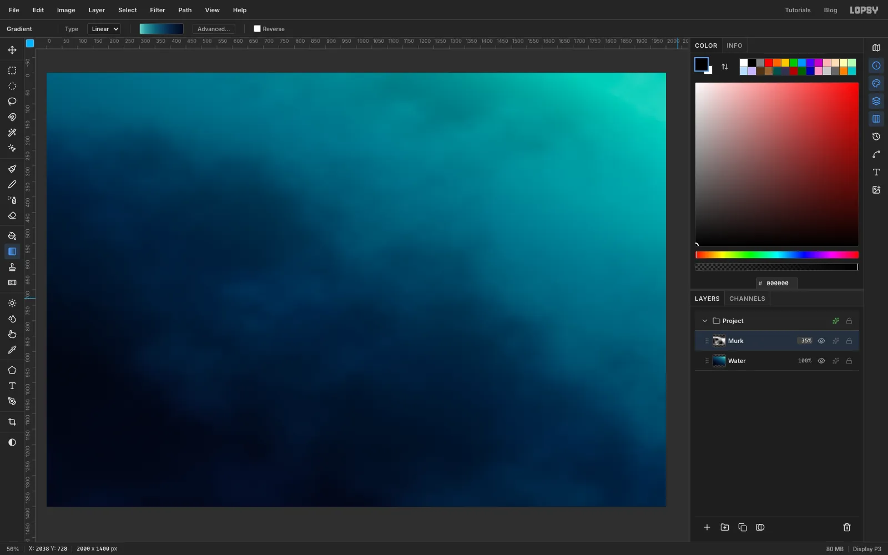

Click the empty **Layer 1** and rename it **Murk**. Run **Filter → Clouds…** with **Scale** 3. Set the layer's blend mode to **Soft Light** and its opacity to 35%.

Real river water is never a clean gradient, and this gives it uneven depth without adding any detail you'd notice.

## Make pebbles with Voronoi

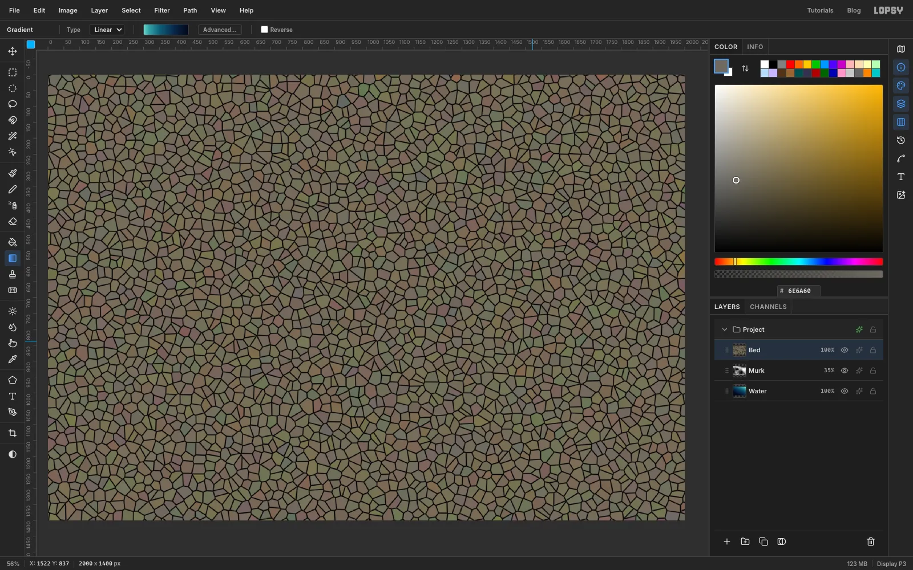

Add a layer above Murk and name it **Bed**. Set the foreground colour to `#6E6A60` and choose **Edit → Fill**.

Now run these filters, one after another:

1. **Add Noise…** with **Amount** 100 and **Color** mode
2. **Gaussian Blur…** with **Radius** 10, which turns the noise into blotches of colour
3. **Hue/Saturation…** with **Saturation** 80
4. **Voronoi…** with **Cells** 46, **Edge Width** 6 and **Seed** 41

Each cell takes one colour from the blotches underneath, so you get a field of stones in different colours.

## Round off the stones

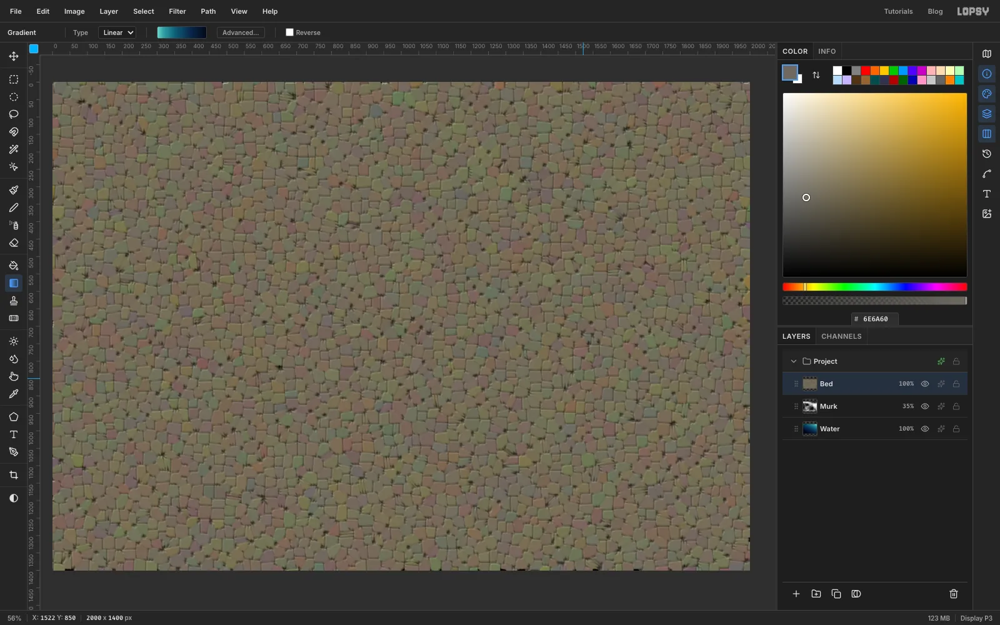

Polygon cells look like crazy paving, so soften them. Run **Oil Paint…** with **Radius** 8 and **Sharpness** 3, then **Gaussian Blur…** with **Radius** 2. Finish with **Emboss…**, **Angle** 60 and **Strength** 35, which lifts the stones and gives them a lit side.

## Lay the riverbed flat

Pick the **Rectangular Marquee** and drag around the entire canvas. Switch to the **Move** tool and drag the square handle at the middle of the top edge straight down, until it's about 900 on the left ruler. The stones squash into wide ovals, which is how a floor looks from a low angle.

Press [[Cmd+D]] to deselect and commit the transform. Then darken the bed with **Brightness/Contrast…**, **Brightness** -22 and **Contrast** 18.

## Build a caustic net

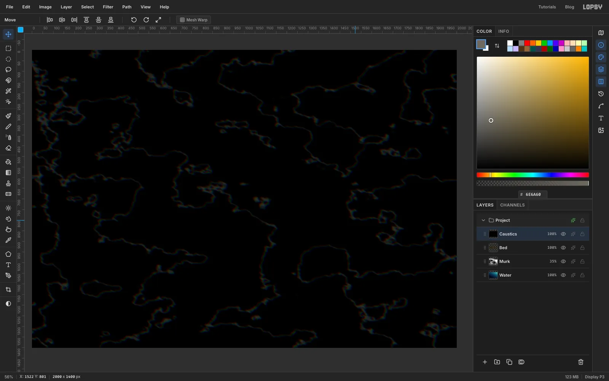

Caustics are the wobbling lines of light that the surface throws onto the bottom of a river. **Solarize** gives them to you almost for free.

Add a layer named **Caustics**. Run:

1. **Clouds…** with **Scale** 10
2. **Solarize…** with **Threshold** 128
3. **Brightness/Contrast…** with **Brightness** 0 and **Contrast** 100
4. **Brightness/Contrast…** again with **Brightness** -30 and **Contrast** 100
5. **Gaussian Blur…** with **Radius** 5
6. **Chromatic Aberration…** with **Amount** 6 and **Direction** 30

Solarize folds the tones over, so a bright crease appears wherever the clouds crossed mid-grey. The two contrast passes burn away everything except those creases, and the aberration splits each line into red, green and blue.

## Lay the light on the stones

Squash the Caustics layer the same way you squashed the bed: marquee the whole canvas, drag the top middle handle down to about 900 with the **Move** tool, and press [[Cmd+D]].

Set the layer to **Screen** at 60%.

## Put the foreground out of focus

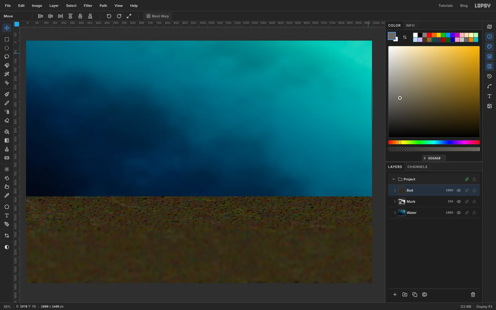

With Caustics still active, choose **Layer → Merge Down** so the lines and stones become one **Bed** layer. Run **Gaussian Blur…** with **Radius** 4.

Then choose **Filter → Tilt-Shift Blur…**. It starts straight away with a sharp band across the middle of the canvas. Set **Blur Radius** to 14 in the small panel and click **Apply**. Since the bed is in the lower part of the picture, this mostly softens its near edge, as a lens focused on the fish would.

## Sink the bed into the water

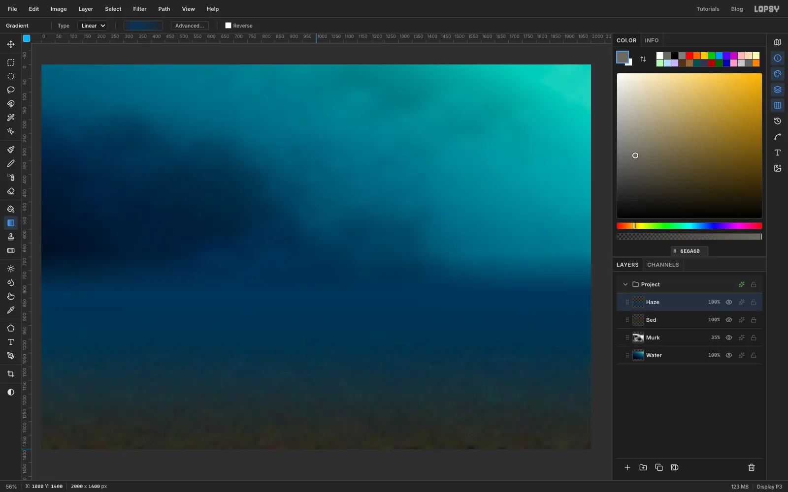

The bed still has a hard top edge, and distant things under water should disappear into blue.

Add a layer named **Haze**. Set up a linear gradient with these stops. Click each stop and set its opacity with the checkered strip under the colour picker:

1. `#0B3D5F` at the far left, fully transparent
2. `#0A3457` at about 22%, fully opaque
3. `#0A3457` at about 46%, 85% opaque
4. `#0A3457` at about 72%, 50% opaque
5. `#071F3A` at the far right, 18% opaque

Drag straight down from a little below the middle of the canvas to the bottom edge. The transparent stop keeps the upper water clear, and the opaque band hides the bed's edge.

## Pool some light on the floor

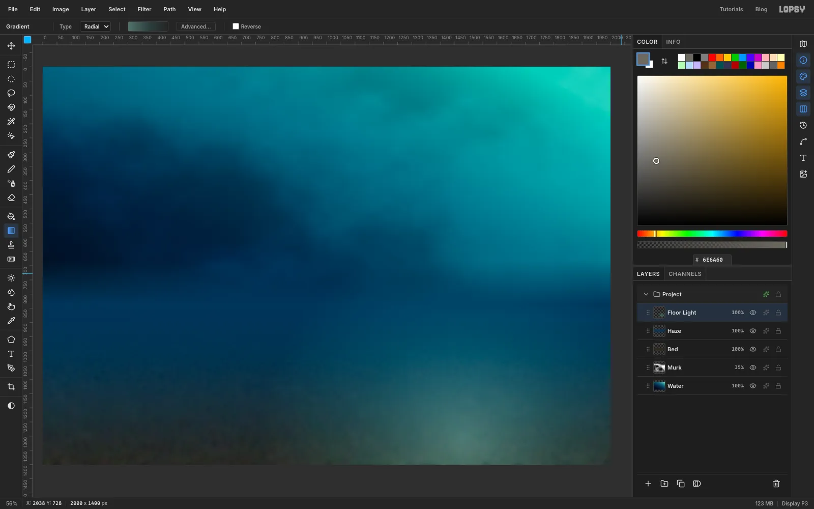

Click the **Bed** layer and run **Hue/Saturation…** with **Saturation** -35. The stones are now duller, as they would be under this much water.

Click **Haze** and add a layer above it named **Floor Light**. Set the gradient type to **Radial** with three stops:

1. `#8FE0D0` at the far left, 42% opaque
2. `#4FB8B0` at about 55%, 16% opaque
3. `#4FB8B0` at the far right, fully transparent

Drag from the floor at about three quarters of the way across the canvas, out past the right edge. Set the layer to **Screen**.

## Bring down the sunbeams

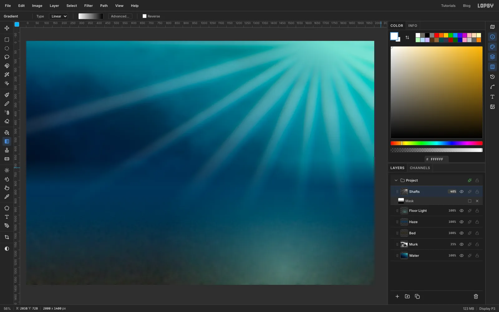

Set the foreground to white and add a layer named **Shafts**. Choose **Filter → Sunburst…** with these values:

- **Rays** 22, **Length** 110, **Width** 26
- **Taper** 50, **Fade** 75, **Softness** 70
- **Center X** 85, **Center Y** 0
- **Jitter** 45, **Seed** 5, **Opacity** 80

Run **Gaussian Blur…** with **Radius** 22, then **Chromatic Aberration…** with **Amount** 9 and **Direction** 0. That gives each ray a faint spectral edge.

The rays shouldn't reach the floor at full strength. Click **Add Mask** at the bottom of the Layers panel, then click the new mask thumbnail to edit it. Set a linear gradient from white to black, and make both stops fully opaque, because they keep the opacity you gave the last gradient. Drag straight down from about 30% of the way down the canvas to about 70%.

Click the layer row to leave mask editing. Set the layer to **Screen** at 40%.

## Paste in the trout

Everything so far has been background. With Shafts active, click **New Group** and name the group **Trout**. With the group selected, press [[Cmd+V]] to paste your photo.

Lopsy fits an oversized paste to the canvas, so the photo lands across the full width, in a new layer inside the group. Rename the layer **Photo** and press [[Cmd+D]].

## Turn the photo into paint

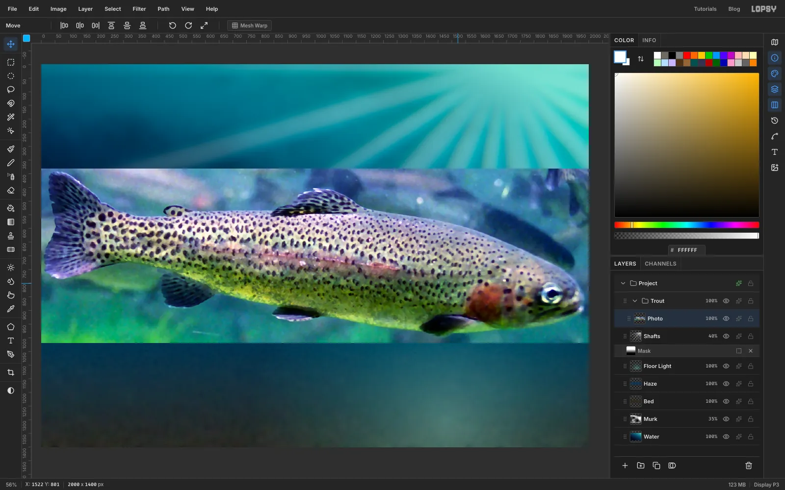

Run **Surface Blur…** with **Radius** 5 and **Threshold** 28, which removes the grain and keeps the spots crisp. Then run **Oil Paint…** with **Radius** 2 and **Sharpness** 1.2.

Do this before cutting the fish out. If you run Oil Paint on a cut-out, its edge grows little whiskers all along the outline.

## Trace the fish with the Pen

Pick the **Pen** tool and click your way around the fish, placing an anchor about every half centimetre on screen and closer together around the fins. Start at the nose, go along the back, around the dorsal fin and the small adipose fin, around the tail, then back along the belly and the three lower fins.

Click on the first anchor to close the path. The outline in the picture has about 130 anchors, so allow a few minutes. Stay very slightly inside the fish, because any background you include will show as a halo against the dark water.

## Cut it out

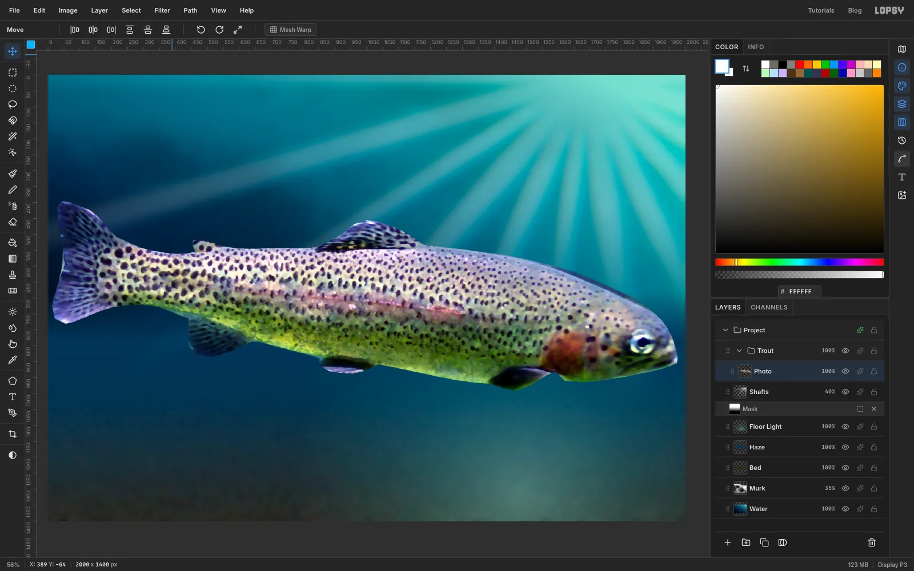

Open the **Paths** panel from the panel toolbar, select your path, and click **Path to Selection**. Then:

1. **Select → Shrink…** by 2
2. **Select → Feather…** by 1
3. **Select → Inverse**
4. Press [[Delete]]
5. Press [[Cmd+D]]

Back in the Paths panel, click **Delete Path**. You're finished with this path, and leaving it selected would mean your next Pen click could split it instead of starting a new one.

## Calm the photo down

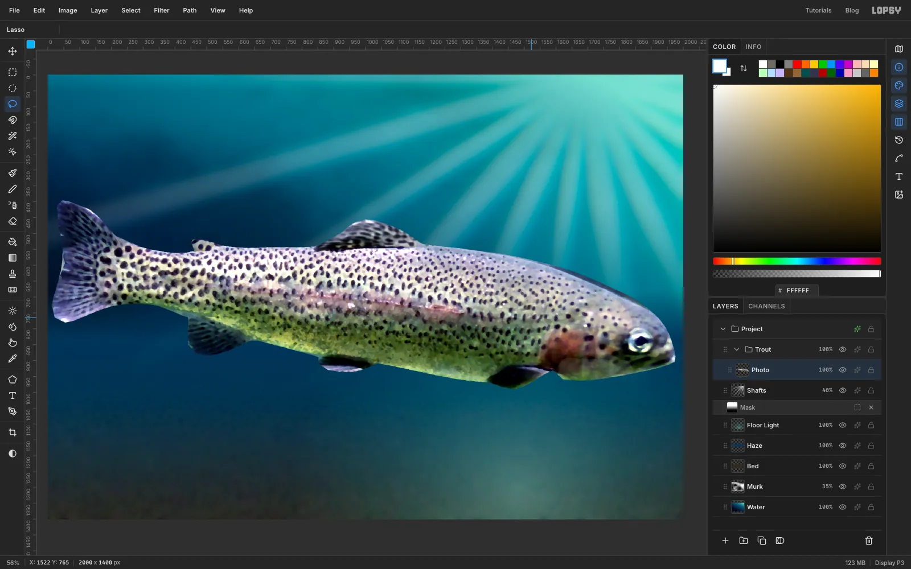

The colour you add later needs a quiet base to sit on. With **Photo** active, run **Hue/Saturation…** with **Saturation** -35 and **Brightness/Contrast…** with **Brightness** 2 and **Contrast** 14.

Pick the **Dodge/Burn** tool, leave it on Dodge, and set **Exposure** to 16 and **Size** to 70. Make one stroke along the lower jaw, from behind the head toward the chin, so the head doesn't turn into a dark blob.

The dorsal fin's busy spots will fight with everything else, so lasso around that fin with the **Lasso**. Choose **Select → Feather…** by 3, then run **Hue/Saturation…** with **Saturation** -50 and **Gaussian Blur…** with **Radius** 4. Press [[Cmd+D]].

## Lay down the body colours

Add a layer above Photo named **Bands**. Hold [[Cmd]] and click the **Photo** thumbnail to select the fish's shape. The active layer stays on Bands.

Set a linear gradient, all stops fully opaque:

1. `#123F4F` at the far left
2. `#2C6F66` at 20%
3. `#8A9A55` at 38%
4. `#D69A5A` at 47%
5. `#DE5C80` at 54%
6. `#E7A4B4` at 62%
7. `#B6D6CF` at 74%
8. `#DAD6E8` at 88%
9. `#F4F2F0` at the far right

Start just above the back, halfway along the fish. Drag down to just below the belly, tilting the drag very slightly so it's square to the body. Press [[Cmd+D]]. Set the layer to **Color** at 60%, so the spots and shading all stay where the photo put them.

## Start the thin film

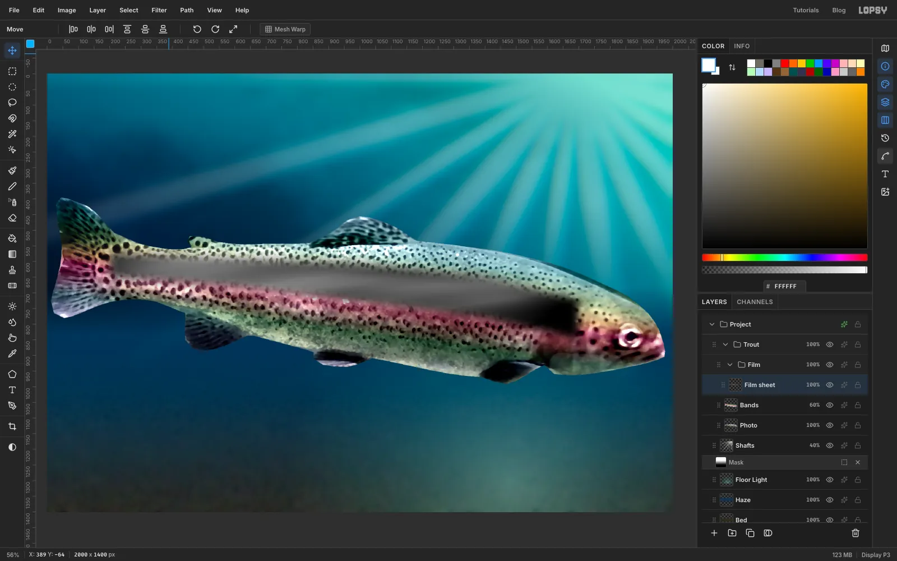

Here's the iridescence. With Bands active, click **New Group** and name it **Film**. Click **Add Layer** and name the new layer **Film sheet**. It goes inside the group.

Run:

1. **Clouds…** with **Scale** 3
2. **Solarize…** with **Threshold** 128
3. **Motion Blur…** with **Angle** 172 and **Distance** 300
4. **Motion Blur…** again with the same values
5. **Brightness/Contrast…** with **Brightness** 8 and **Contrast** 45

The blur stretches the clouds along the length of the fish. Trim the sheet to the fish: [[Cmd]]-click the **Photo** thumbnail, choose **Select → Inverse**, press [[Delete]] and press [[Cmd+D]].

Now keep only a strip of it. With the **Pen**, click a long, narrow shape along the upper flank, from just ahead of the tail to behind the head, about a third of the body deep. Close it by clicking the first anchor. In the Paths panel click **Path to Selection**, then **Select → Feather…** by 30, **Select → Inverse**, [[Delete]] and [[Cmd+D]]. Delete the path.

## Map the greys to a spectrum

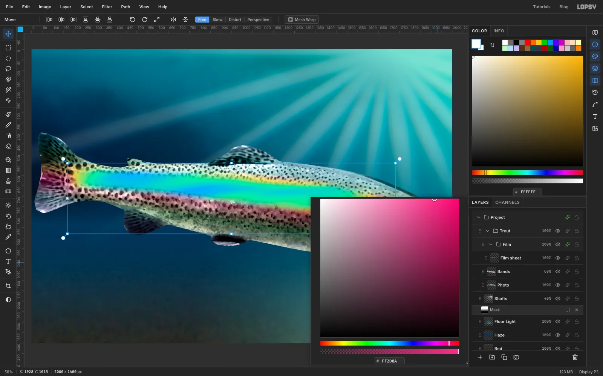

Click the **Film** group row and open its effects drawer with the ✦ button. Click **Add Adjustment** and choose **Gradient Map**. Click the handle row to add stops, typing each colour in the **Hex** field:

1. `#FF2D8A` at the far left
2. `#FFD23F` at 17%
3. `#3BE8B0` at 34%
4. `#29A8FF` at 50%
5. `#A04BFF` at 67%
6. `#FF2D8A` at 84%
7. `#FFD23F` at the far right

Each grey value now picks a hue, so the streaks turn into bands of colour that shift along the body. It looks awful at this stage, but the next step fixes that.

## Sink the sheen into the fish

With the drawer still open, set the Film group's blend mode to **Overlay**. Close the drawer and set the group's opacity to 62%.

Overlay keeps the fish's own light and dark, so the spots stay crisp and the colour only appears on the mid-tones.

## Draw one scale

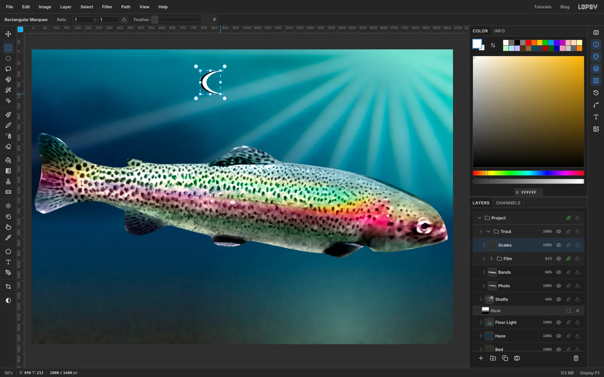

Click the arrow on the Film row to collapse it, then click the row and click **Add Layer**, so the new layer lands beside the group and not inside it. Name the layer **Scales**.

You're about to draw in the empty water at the top of the canvas, and it'll be cleaned up afterwards. Pick the **Elliptical Marquee** and draw an ellipse about 190 wide and 110 tall. Set the foreground to black and choose **Edit → Fill**.

Press [[Shift+Right]] once to move the outline 10 px to the right without moving any pixels. Set the foreground to white and fill again. Press [[Shift+Right]] twice more, then press [[Delete]]. You're left with a thin crescent, black on its outer edge and white just inside, like a scale's edge catching the light.

Press [[Cmd+D]], then use the **Rectangular Marquee** to select exactly the left half of the shape, from the top to the bottom of the crescent, ending at its tips. Choose **Edit → Define Pattern**.

## Tile it across the canvas

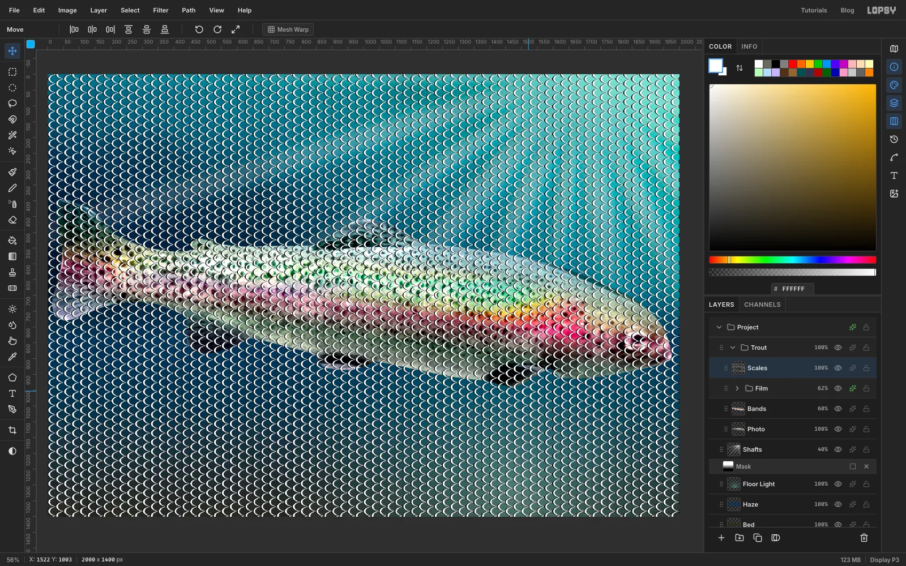

Marquee around the crescent, press [[Delete]], and press [[Cmd+D]].

Choose **Edit → Fill with Pattern…**. Set **Scale** to 26 and **Column Stagger** to 50, then click **Apply**. Stagger shifts every other column by half a tile, so the crescents overlap the way real scales do.

The photo's fish tilts down to the right, so the sheet should too. Marquee the whole canvas, switch to the **Move** tool, and drag the round rotate handle just outside a corner clockwise by about 8 degrees. Press [[Cmd+D]].

## Trace the body

A trout's fins and head have no scales. Use the **Pen** to click a rough outline around just the body, from behind the gill back to where the tail begins, keeping out the fins. Close it by clicking the first anchor.

## Clip the scales to the fish

Click **Path to Selection**, then **Select → Feather…** by 8, **Select → Inverse**, [[Delete]] and [[Cmd+D]]. Delete the path.

The outline you just drew runs slightly past the fish here and there, so trim to the real shape. [[Cmd]]-click the **Photo** thumbnail, choose **Select → Inverse**, press [[Delete]] and press [[Cmd+D]].

Set the layer to **Overlay** at 26%.

## Paint the stripe and the belly

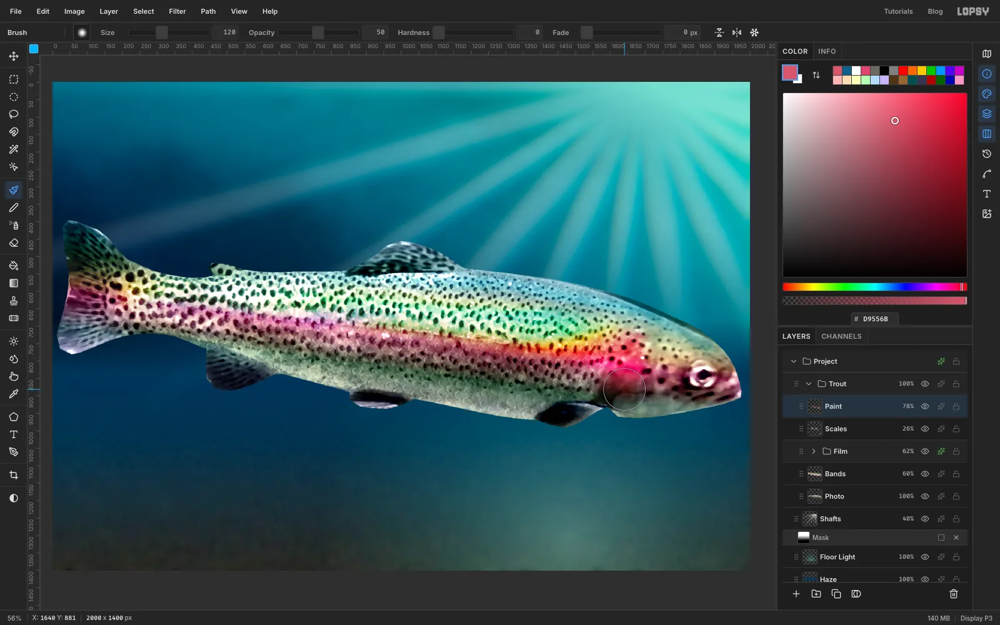

Add a layer named **Paint**, set it to **Soft Light** at 78%, and [[Cmd]]-click the **Photo** thumbnail so your strokes stay on the fish.

Pick the **Brush**. Open the Brushes modal from the tip thumbnail at the left of the options bar, click the **Soft Round** preset and close the modal with its ✕. Set **Size** and **Opacity** in the options bar, changing them for each of these strokes:

1. `#E0466F`, Size 60, Opacity 85: along the middle of the fish, from near the tail to just behind the gill
2. White, Size 110, Opacity 60: along the lower flank, from below the back of the fish to behind the pectoral fin
3. White, Size 80, Opacity 70: along the underside of the head to the chin
4. `#0E5F88`, Size 60, Opacity 80: along the top of the back, from the tail to the head
5. `#D9556B`, Size 120, Opacity 50: one short stroke on the gill plate

Press [[Cmd+D]].

## Darken the back

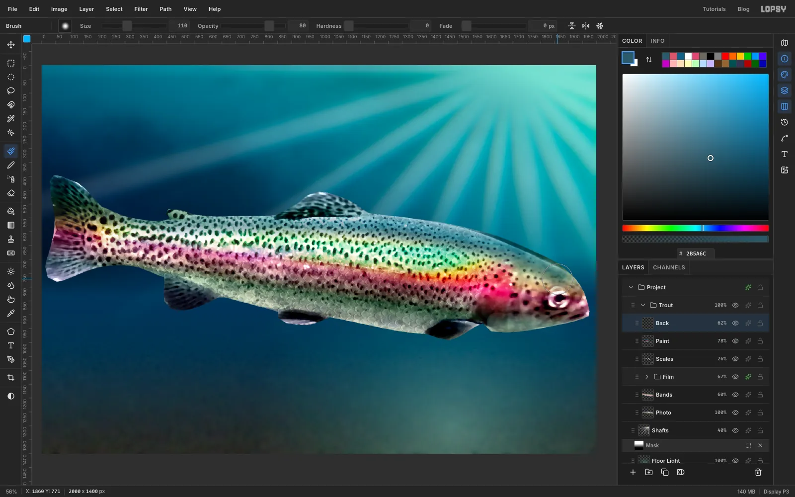

Add a layer named **Back**, set it to **Multiply** at 62%, and [[Cmd]]-click the **Photo** thumbnail. Open the Brushes modal and pick **Soft Round** if it isn't active. With **Size** 110, **Opacity** 80 and the colour `#2B5A6C`, paint one long stroke along the back from the tail to the top of the head. Press [[Cmd+D]].

A dark top makes the flank look brighter, and the sheen needs that contrast.

## Finish the eye and the gill

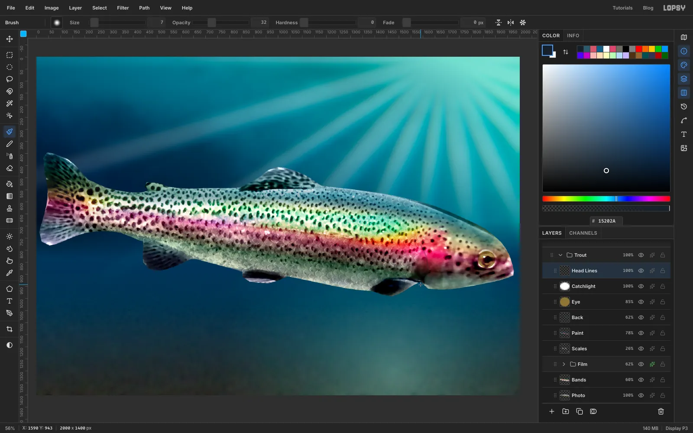

Add a layer named **Eye**. With the **Elliptical Marquee**, select a circle just covering the eye, about 70 px across. Fill it with `#8F7434`, press [[Cmd+D]], and set the layer to **Multiply** at 85%. This turns the photo's silver ring to old gold without losing its structure.

Add a layer named **Catchlight**. Select a tiny ellipse, about 10 px across, at the upper left of the pupil. Fill it with white and press [[Cmd+D]].

Add a layer named **Head Lines** and [[Cmd]]-click the **Photo** thumbnail. Keep the Soft Round preset, set **Size** 7 and **Opacity** 32, and with the colour `#15202A` paint one curved line down the back edge of the gill plate. Press [[Cmd+D]].

## Colour the fins

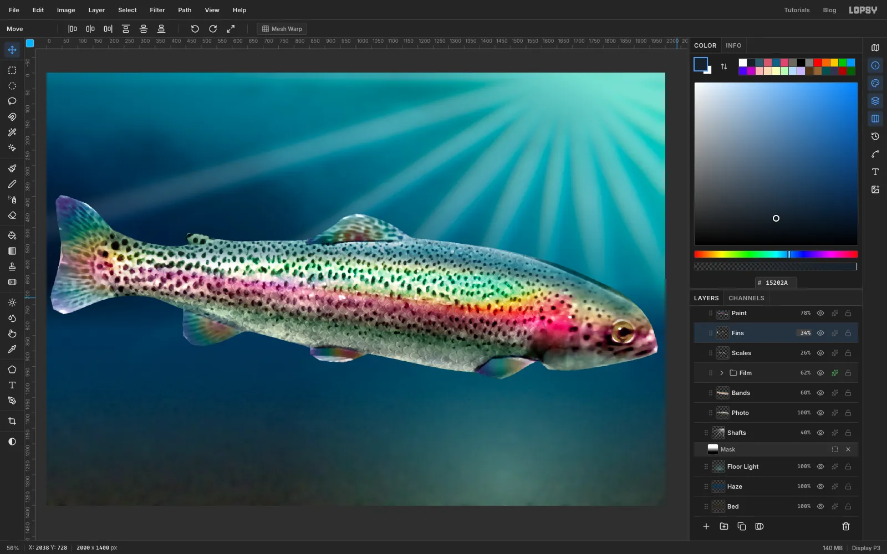

Click the **Scales** layer and add a layer above it named **Fins**. Set a radial gradient, all stops fully opaque: `#FF3D9A` at the far left, `#FFD95C` at 30%, `#49E6C2` at 55%, `#4A8BFF` at 80% and `#B04DFF` at the far right.

For each fin in turn, tail, dorsal, anal, pelvic and pectoral:

1. Draw around it with the **Lasso**
2. **Select → Feather…** by 3
3. Drag the **Gradient** from where the fin joins the body out to its tip
4. Press [[Cmd+D]]

Your lasso will have strayed past the fish in places, so trim it: [[Cmd]]-click the **Photo** thumbnail, **Select → Inverse**, [[Delete]], [[Cmd+D]]. Set the layer to **Screen** at 34%.

## Paint the fin rays

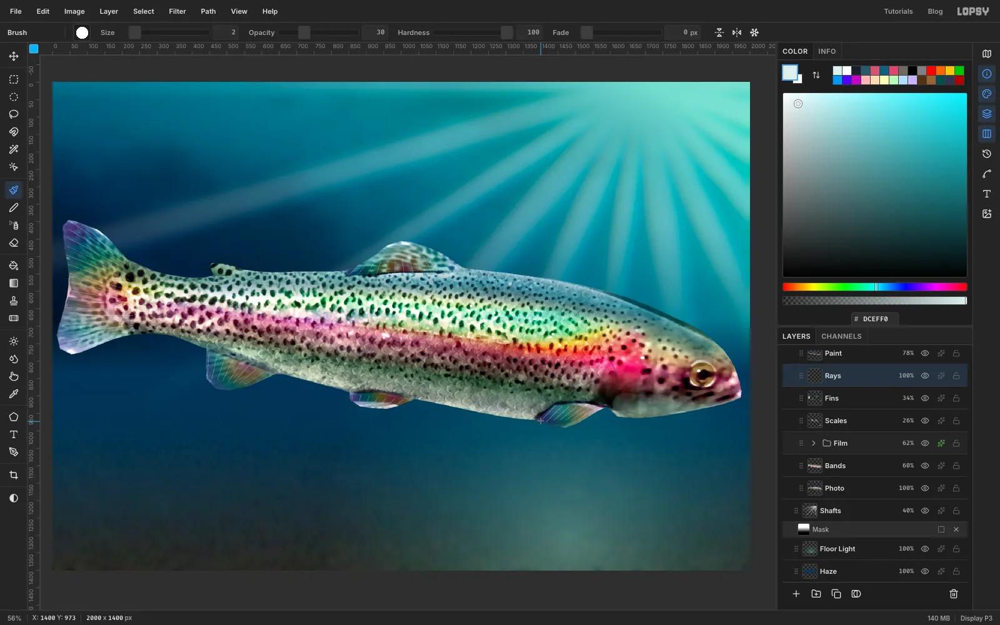

Add a layer named **Rays** and [[Cmd]]-click the **Photo** thumbnail. Open the Brushes modal, click the **Hard Round** preset and close the modal. Set **Size** to 2 and **Opacity** to 30 in the options bar. Set the colour to `#DCEFF0`.

Paint thin lines from the base of each fin out to its edge, fanning them slightly: about 15 on the tail, 12 on the dorsal and 8 on each of the others. Press [[Cmd+D]]. This takes a while, but it's what makes a fin look like a fin and not a smudge.

## Copy the whole fish

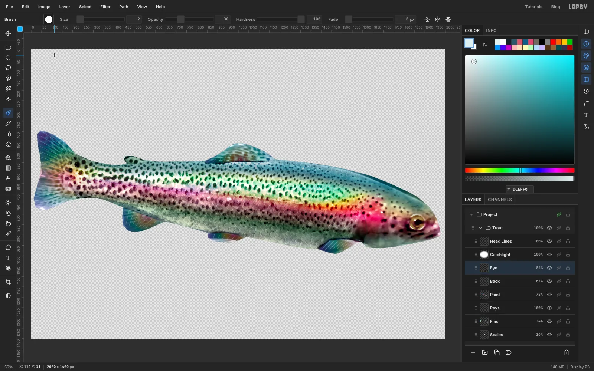

From here on you'll bend and light the fish as one object, so flatten a copy of it.

Hide **Water**, **Murk**, **Bed**, **Haze**, **Floor Light** and **Shafts** with their eye icons, so only the Trout group is visible. Make sure nothing is selected, then choose **Edit → Copy Merged**.

## Paste it as one layer

Show those six layers again. Hide the **Trout** group, collapse it with its arrow and click its row. Press [[Cmd+V]], and rename the new layer **Trout Baked**. The hidden group stays as your editable original.

Press [[Cmd+D]], then tidy the edge: [[Cmd]]-click the **Trout Baked** thumbnail, **Select → Shrink…** by 2, **Select → Feather…** by 1, **Select → Inverse**, [[Delete]], [[Cmd+D]].

Now make the fins fade into the water. Pick the **Eraser**, set **Size** to 60 and **Opacity** to 11, and make one light pass along the outer edge of each fin.

## Scale the fish down

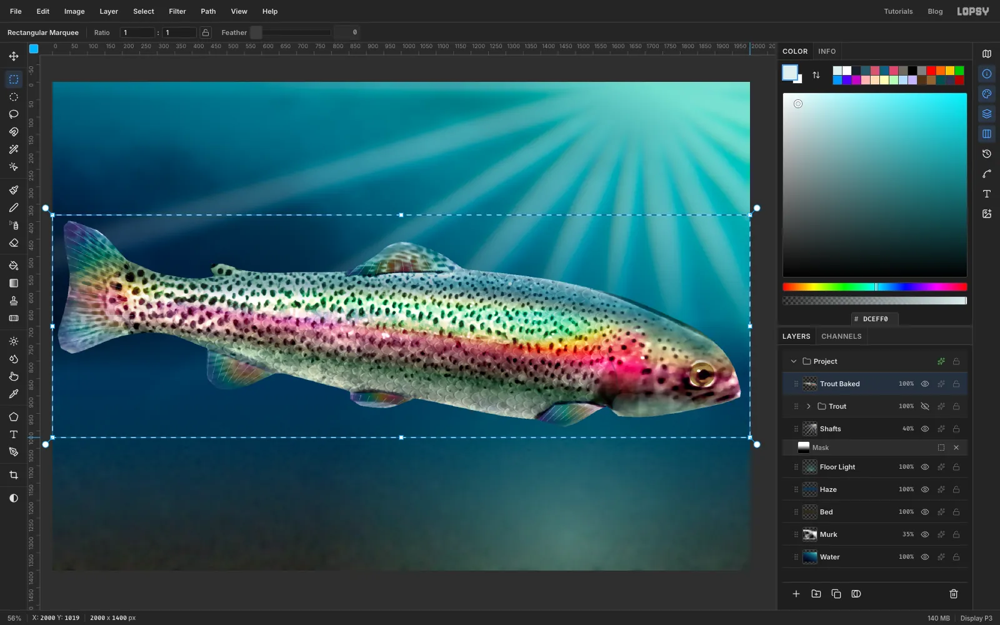

With the **Rectangular Marquee**, select the band of the canvas holding the fish, edge to edge. Switch to the **Move** tool, hold [[Cmd]] and drag the bottom-right corner handle up and to the left until the box is about 1600 px wide. [[Cmd]] keeps the proportions. Press [[Cmd+D]].

## Point it at the light

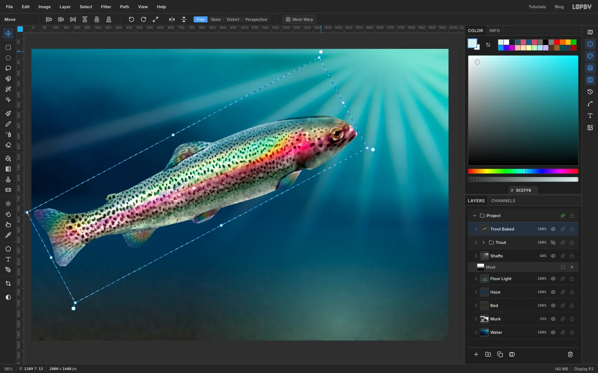

Marquee tightly around the smaller fish. With the **Move** tool, hover just outside the top-right corner until the rotate handle appears, and drag it counter-clockwise by about 28 degrees. Press [[Cmd+D]].

## Move it into place

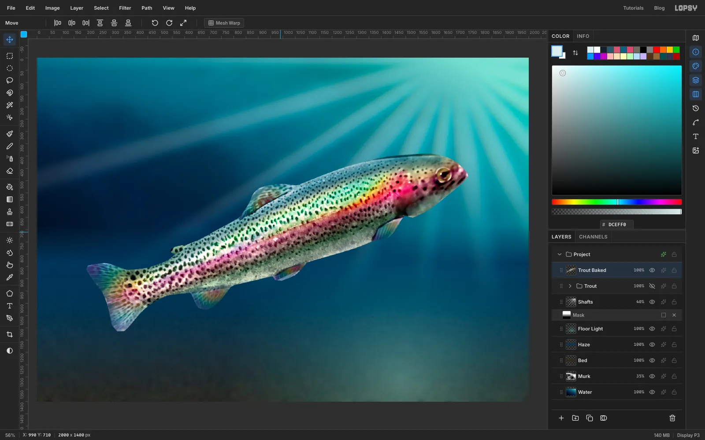

With nothing selected, drag the fish with the **Move** tool, about 190 px right and 70 px down. Its nose should sit almost directly under the point where the rays meet, which is what makes it look like it's rising toward the light.

## Bend the body with Liquify

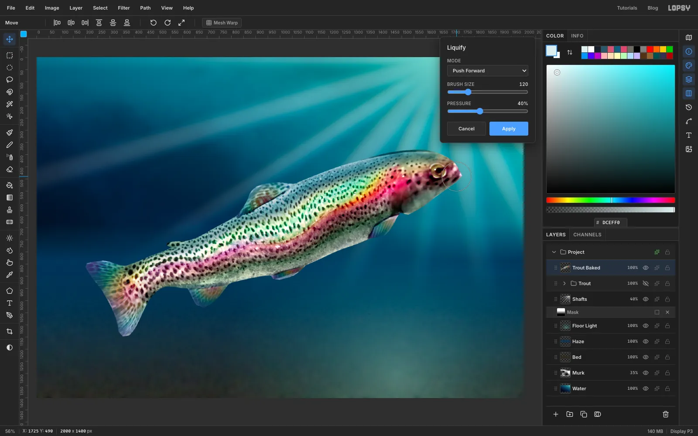

A photo of a fish is always a bit stiff, so give it some movement. Choose **Filter → Liquify…**. The mode starts on **Push Forward**. Make these short drags, setting **Brush Size** and **Pressure** first:

1. Size 500, Pressure 70: in the middle of the body, push down and to the right by about 80 px
2. Size 500, Pressure 36: on the head, push up and to the left by about 60 px
3. Size 420, Pressure 70: just ahead of the tail, push up and to the left by about 60 px
4. Size 420, Pressure 70: on the tail, push down and to the right by about 80 px
5. Size 120, Pressure 40: on the tip of the snout, push down and to the left by about 30 px, to blunt it

Click **Apply**.

## Put the fish in the water

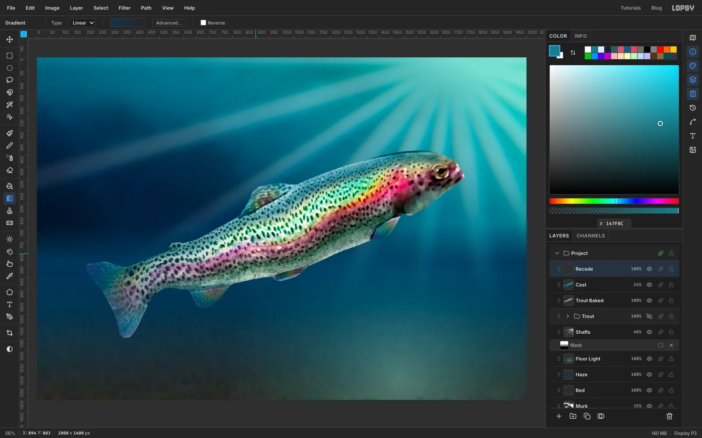

At this point the fish looks pasted on, because everything else is seen through water and it isn't.

Add a layer above Trout Baked named **Cast**. [[Cmd]]-click the **Trout Baked** thumbnail, fill with `#147F8C` and press [[Cmd+D]]. Set the layer to **Soft Light** at 24%.

Add a layer named **Recede** and [[Cmd]]-click the thumbnail again. Set a linear gradient with two stops, both `#0A3C60`: the left one 62% opaque and the right one fully transparent. Drag from the tail to the middle of the fish. Press [[Cmd+D]]. The tail is further from the light, so now it drops back into the blue.

## Light the back edge

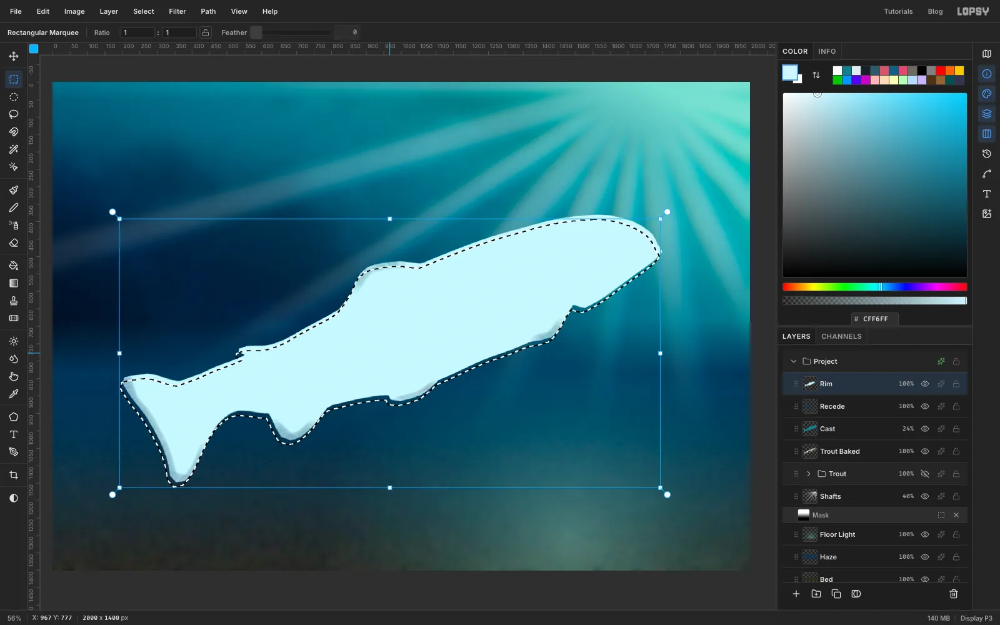

Add a layer named **Rim**, [[Cmd]]-click the **Trout Baked** thumbnail, and fill with `#CFF6FF`. The fish turns into a pale silhouette for a moment.

Pick the **Rectangular Marquee**. Press [[Left]] 7 times and [[Down]] 14 times, which moves just the outline and leaves the pixels alone. Then choose **Select → Feather…** by 7, press [[Delete]] and press [[Cmd+D]].

Only a thin crescent of pale colour survives along the edges facing the light. Set the layer to **Screen** at 42%.

## Shade the belly

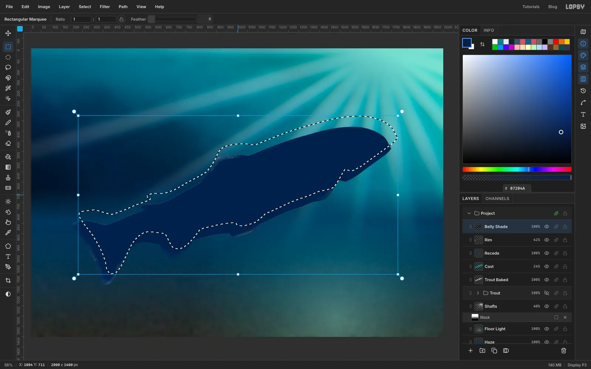

Do the same thing on the opposite side. Add a layer named **Belly Shade**, [[Cmd]]-click the **Trout Baked** thumbnail, and fill with `#07204A`.

With the **Rectangular Marquee**, drag the outline about 30 px right and 52 px up. Choose **Select → Feather…** by 30, press [[Delete]] and press [[Cmd+D]]. Set the layer to **Multiply** at 62%.

## Add the mouth

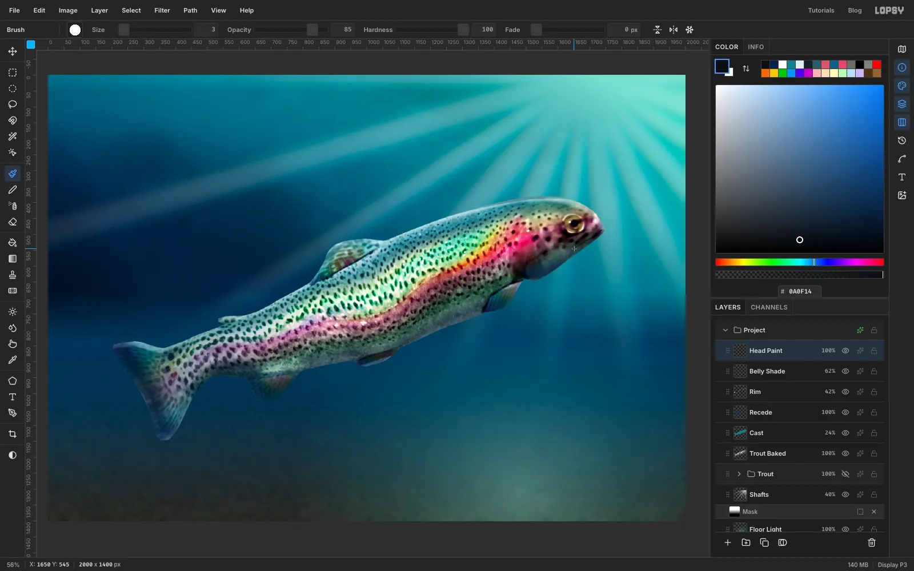

Add a layer named **Head Paint** and [[Cmd]]-click the **Trout Baked** thumbnail.

Pick the Soft Round preset, then set **Size** 70 and **Opacity** 45 in the options bar. With the colour `#07204A`, make one short stroke across the throat to bring it back into shadow.

Switch to the Hard Round preset, then set **Size** 3 and **Opacity** 85 in the options bar, with the colour `#0A0F14`, and paint the mouth as one thin line from the tip of the snout back along the lower jaw. Press [[Cmd+D]].

Click the eye icons on **Cast**, **Rim** and **Belly Shade** off and on to see what each one is doing.

## Add the surface

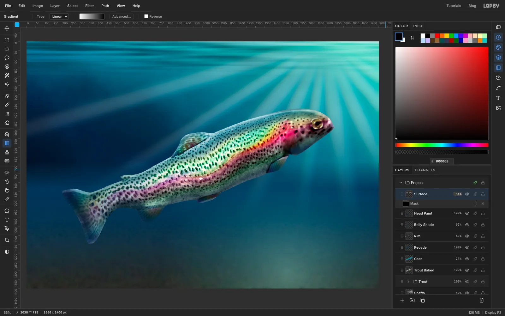

Click **Head Paint** and add a layer above it named **Surface**. Run:

1. **Clouds…** with **Scale** 14
2. **Motion Blur…** with **Angle** 0 and **Distance** 300
3. **Brightness/Contrast…** with **Brightness** 2 and **Contrast** 30
4. **Gaussian Blur…** with **Radius** 9

Marquee the whole canvas. With the **Move** tool, drag the bottom middle handle up until the layer fills only the top 15% of the canvas. Press [[Cmd+D]].

Click **Add Mask** and click the mask thumbnail. With a linear white-to-black gradient, both stops fully opaque, drag from near the top of the canvas down to the bottom of the streaks, so they don't end in a hard line. Click the layer row, and set the layer to **Overlay** at 34%.

## Colour the highlight

Where all those screens stack up, the corner bleaches toward a dull, slightly peach white. Add a layer named **Surface Tint**. Set a radial gradient with two stops, both `#38D8CF`: the left one fully opaque, the right one fully transparent. Drag from the top of the canvas where the rays meet out past the right edge.

Set the layer to **Color** at 72%. The brightness doesn't change, but the highlight turns a clean teal.

## Blow a few bubbles

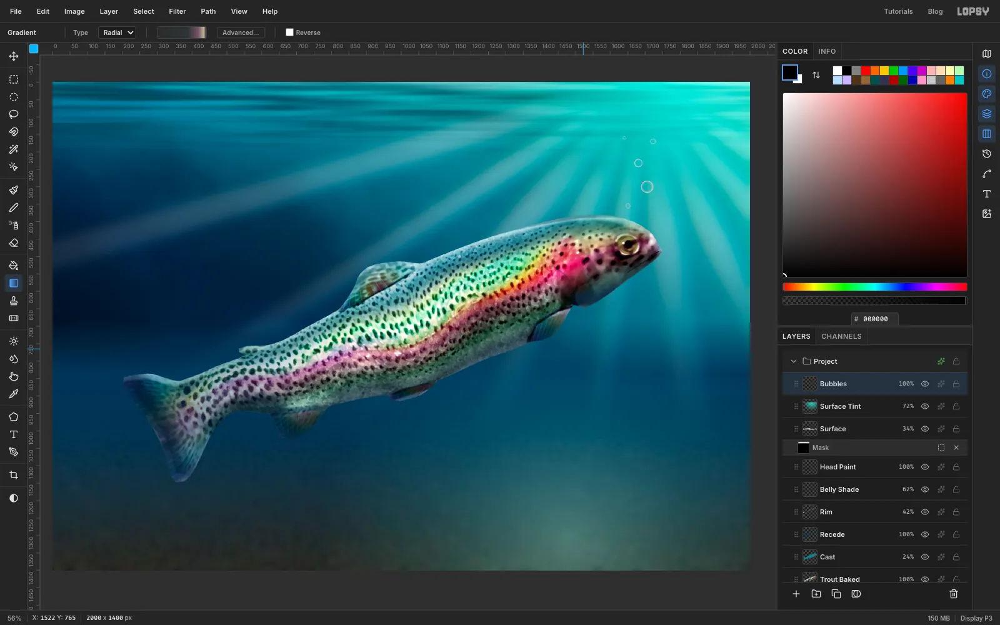

Add a layer named **Bubbles**. Set a radial gradient with these stops:

1. White at the far left, 3% opaque
2. `#7FE8FF` at 62%, 8% opaque
3. `#FF9FD8` at 84%, 38% opaque
4. `#FFF2C0` at 95%, 70% opaque
5. White at the far right, fully transparent

With the **Elliptical Marquee**, select a small circle above the fish's head. Drag the **Gradient** from its centre to its edge, then press [[Cmd+D]]. Repeat for five bubbles of different sizes, from about 35 px across down to 10 px, in a loose wandering column.

Then run **Gaussian Blur…** with **Radius** 1 so they sit in the water.

## Scatter drifting specks

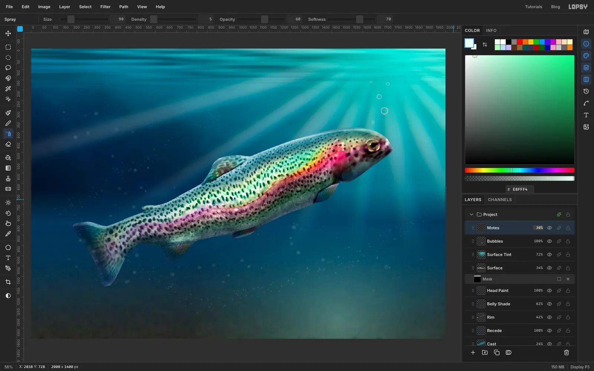

Add a layer named **Motes** and set the foreground to `#E8FFF4`. Pick the **Spray** tool with **Size** 240 and **Density** 3, and make one long, wandering pass through the lower and left parts of the water, keeping away from the fish's head so nothing competes with the eye. Then set **Size** to 90 and **Density** to 5 for a second pass with finer specks.

Run **Gaussian Blur…** with **Radius** 2. Set the layer to **Screen** at 30%.

## Let the highlights bloom

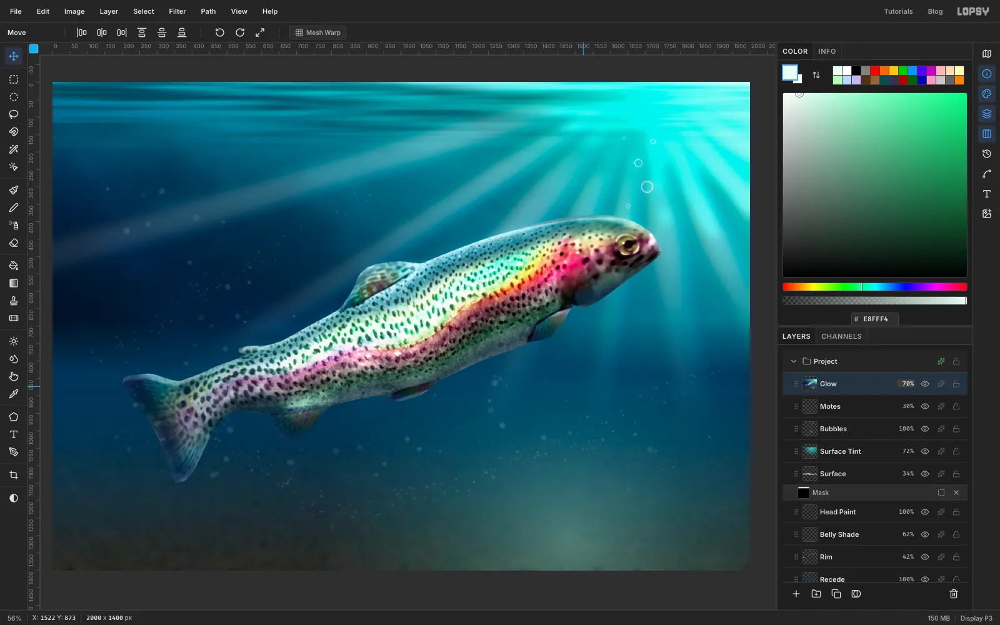

With Motes active and nothing selected, choose **Edit → Copy Merged** and press [[Cmd+V]]. Rename the new layer **Glow** and press [[Cmd+D]].

Run **Filter → Bloom…** with **Threshold** 66, **Soft Knee** 50, **Radius** 42 and **Intensity** 45. Set the layer's opacity to 70%. The flank's sheen now spills slightly past its edges, as light does in water.

## Add a vignette and export

Click the **Project** row at the top of the Layers panel and open its effects drawer with the ✦ button. Click **Add Adjustment**, choose **Vignette** and set it to 32. Close the drawer.

Save your work with **File → Save Project** and export it with **File → Quick Export PNG**.

The idea works on any shiny subject, whether it's a beetle, a starling or a soap bubble. Start with a quiet base, give it a narrow strip of colour, and let the light on the shape do the rest.
