Film art departments often paint **environment key frames** in isometric: there's no vanishing point, so every building reads like a tidy scale model. This tutorial paints one for *The Long Dune*, a made-up desert film. The set is the **Oasis Waystation**, a sandstone caravan stop at dusk. It has a sunken spring, shade sails, palms and a parked sand yacht, and the ribs of a buried hull in the far dunes hint at the story. You'll finish the sheet the way a concept artist hands one over, with callouts, a title strip and palette chips.

The main trick is to **draw a facade flat, then transform it onto the wall**. You'll draw windows, a doorway, an awning and even a live text sign straight-on, then push each into place with the Move tool's **Skew** and **Distort** modes.

Everything follows the 2:1 isometric rule. **Level edges climb 1 px for every 2 px across**, and vertical edges stay vertical. Some steps give positions in document pixels. Hover the canvas and read the **X** and **Y** at the bottom left of the window to find them. The main corners are:
- **Plaza top:** back (960, 338), right (1506, 611), front (960, 884) and left (414, 611). The block is 29 px thick.
- **Hall roof:** (960, 159), (1155, 257), (986, 341) and (791, 244). Its walls drop to (791, 449), (986, 546) and (1155, 462).
- **Gatehouse roof:** (1012, 510), (1168, 588), (999, 673) and (843, 595). Its walls drop to (843, 735), (999, 813) and (1168, 728).
- **Spire:** centred on x 1246, standing on the plaza at y 572.

Gradients come up in almost every step. In the Gradient tool's **Advanced…** editor, click the bar to add a stop. Select a stop to set its colour with the hex field, and its **opacity** with the checkered bar under the colour picker. In this tutorial "`#E2A9A2` at the 14% point" means a stop's position along the bar, and "at 70% opacity" means its transparency.

Palette:

- Dusk sky `#A688B0` → `#E2A9A2` → `#EFC79A` → `#E2A878` → `#D9975F` → `#C98352`
- Sandstone top `#F3D6A8`, lit wall `#E6AE76`, shaded wall `#8F6577` / `#6E4B63`
- Shade sails `#A04A2C` / `#D4943A`, cast shadow `#6A4A78`
- Spring water `#105A68` → `#1F9AA0` → `#7FE0D2`, cupola `#3FB7AE`
- Palms `#3F6B4E` / `#6E9A52`, lamplight `#FFB547` / `#FFE6A8`
- Title strip `#21172E`, cream type `#F6E6CC`, callout ink `#2E1E30`

## Paint the dusk sky

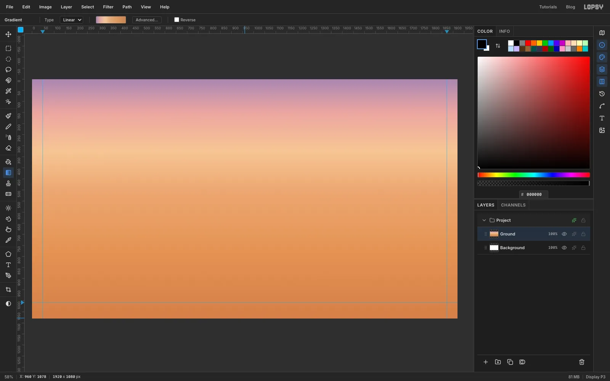

1. Create a **1920 × 1080 px** document with a white background, and rename `Layer 1` to `Ground`.
2. Click the top ruler at x **48** and x **1872**, and the left ruler at y **1008**, to drop three guides: two side margins and the top of the title strip.
3. Pick the **Gradient** tool, open **Advanced…** and set six stops:
   - `#A688B0` at the start
   - `#E2A9A2` at the 14% point
   - `#EFC79A` at the 30% point
   - `#E2A878` at the 48% point
   - `#D9975F` at the 72% point
   - `#C98352` at the end
4. Drag from the top of the canvas straight down to the bottom.

The violet top is what makes it dusk. Without it, the sky and the sand would be the same orange.

## Shade the far dune

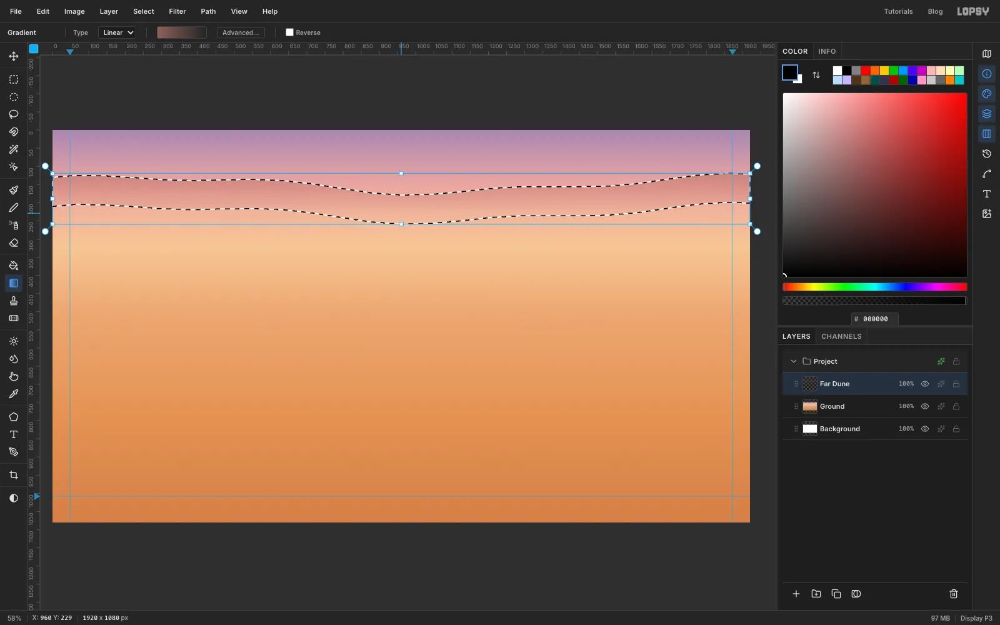

The sun sits low behind the scene, so you see the shaded side of every dune.

1. Add a layer named `Far Dune`.
2. With the **Lasso**, trace a gently wavy crest across the whole frame at about y 150. Come back about 80 px lower to close the band.
3. Set the gradient to `#B97A70` at **70% opacity** fading to the same colour at **0% opacity**. Drag from the crest straight down, past the bottom of the band.

## Raise the ribs of the buried hull

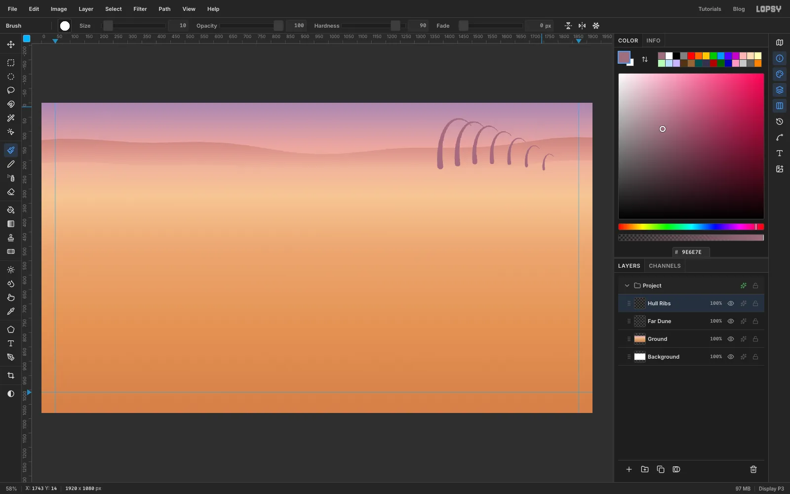

1. Add a layer named `Hull Ribs` and set the foreground to `#9E6E7E`.
2. Pick the **Brush** and set **Hardness** to **90**.
3. Click the brush tip thumbnail at the left of the options bar to open the **Brushes** panel. On its **Shape** tab, set **Taper** to a little more than the length of the rib you're about to paint, so the stroke thins to a point.
4. Paint seven ribs at the top right, starting near x 1390 and spacing them 60 px apart. Start each one at about y 245 (the middle dune you'll add in a moment will hide their feet). Sweep each up and curl it over to the right. Make the first rib about 200 px tall at **Size 22**, and make each one after it smaller, down to about 60 px tall at **Size 10**.
5. Set **Taper** back to 0, then run **Filter → Gaussian Blur…** at **1.5** to push the ribs into the distance.

## Bury the rib feet with a mask

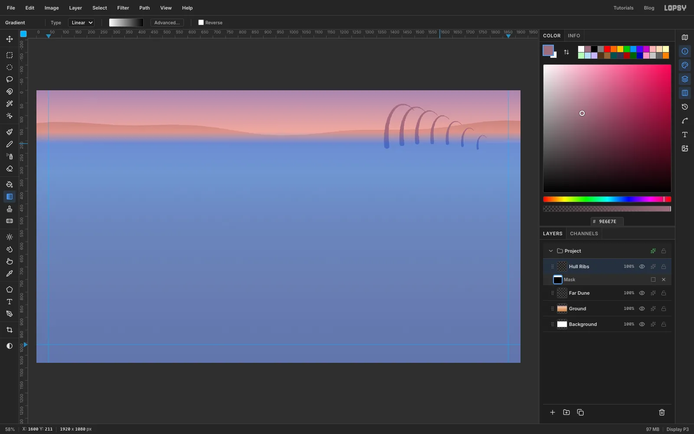

1. Click **Add Mask** at the bottom of the Layers panel.
2. Click the small mask thumbnail that appears under the layer to start editing the mask.
3. Set the gradient to plain white fading to black. Drag it from about 50 px above the rib feet down to the feet.
4. Click the layer's name to go back to editing its pixels.

The ribs now sink into the sand instead of standing on it.

## Add the near dunes and their bright crests

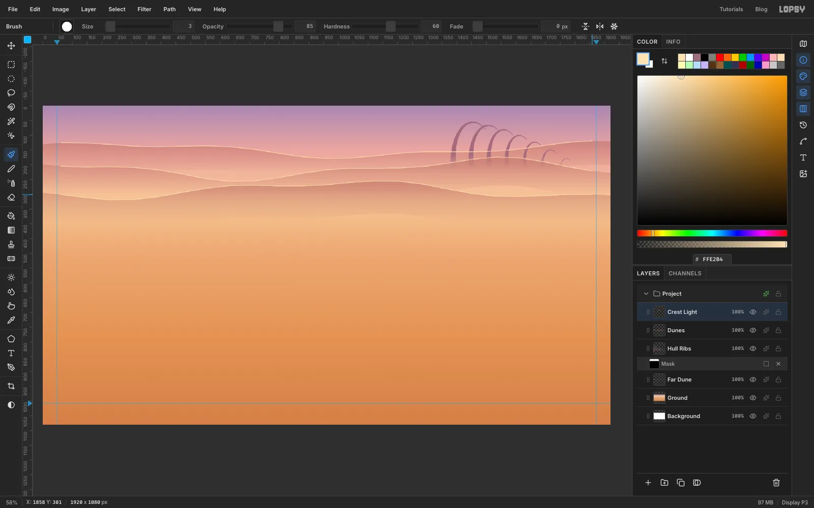

1. Add a `Dunes` layer and repeat the lasso and gradient for two more bands. Put the middle dune's crest at about y 215 and the near dune's at about y 285, each band a little deeper than the last.
2. Add a `Crest Light` layer. Set the **Brush** to **Size 3**, **Hardness 60**, **Opacity 85** and `#FFE2B4`.
3. For each crest, click at the left edge, then [[Shift]]-click along the ridge to the right edge. This leaves a thin rim of back-light on each dune.

## Lay the path and the plaza block

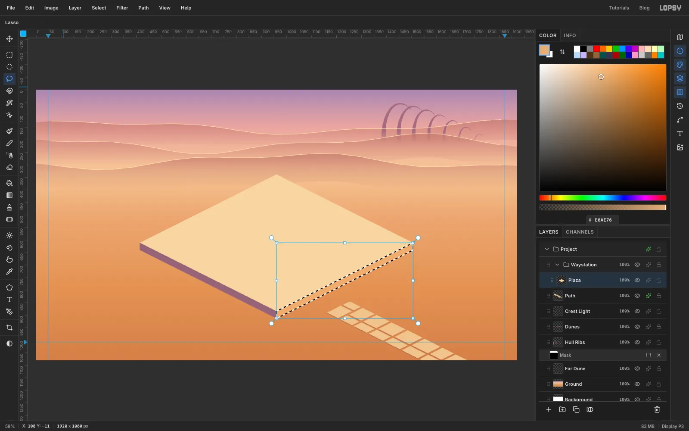

1. Add a `Path` layer. Lasso two rows of flagstones that start at about (1210, 830) and run down to the bottom-right corner, every edge on the 2:1 slope. Hold [[Shift]] to add each stone, then fill them all with **Edit → Fill** in `#EBC594`.
2. Click the **effects** button (the sparkle icon) on the layer's row and add a **Drop Shadow** in `#8A5A48`: **Offset X −2**, **Offset Y 2**, **Blur 2**, **Opacity 45**.
3. Click **New Group** at the bottom of the Layers panel, name it `Waystation`, and add a `Plaza` layer inside it.
4. Lasso the top diamond using the corners listed above, and fill it `#F3D6A8`.
5. Lasso the left face, 29 px deep, and fill it `#8F6577`. Then lasso the right face and fill it `#E6AE76`.

## Light the plaza and cut the stairs

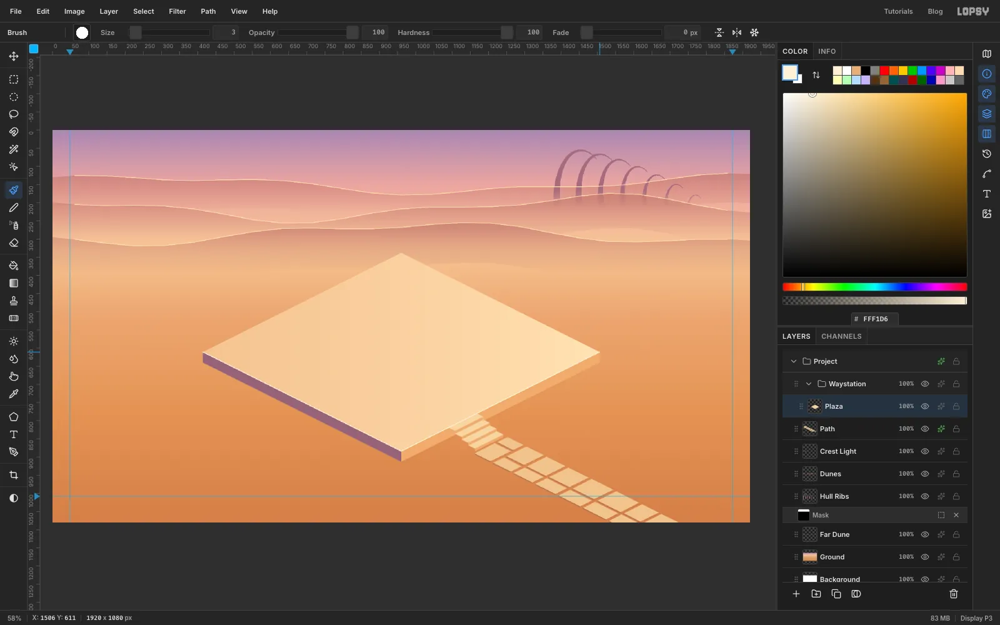

1. Lasso the top diamond again. Drag a gradient from `#FFE7BE` at 75% opacity to `#E8B98A` at 55% opacity, from the right corner to the left corner. The light comes from the back right.
2. Where the path meets the right face, lasso four steps, each lower and further out than the last. Fill the treads `#F3D6A8` and the risers `#E6AE76`.
3. Brush a 3 px `#FFF1D6` lip along the two front edges: click the left corner, then [[Shift]]-click the front corner and the right corner.

## Rule the flagstone joints

1. Add a `Flagstones` layer and set the brush to `#C9946A`, **Size 2**, **Opacity 55**.
2. Draw straight lines across the top, parallel to each pair of sides and about 55 px apart. Click on one edge, then [[Shift]]-click the opposite edge.

## Sink the spring pool

1. Add a `Spring` layer. Lasso a diamond of coping a little larger than the pool, and fill it `#FBE6C0`.
2. Only the two far inner walls show, and they make the pool read as sunk 23 px into the plaza. Fill the back-left wall `#6E4B63` and the back-right wall `#B07A5A`.
3. Add a `Water` layer and lasso the water surface at (700, 531), (869, 615), (674, 713) and (505, 628).
4. Fill it with a gradient from the back corner to the front corner: `#105A68`, then `#1F9AA0` at the 55% point, then `#7FE0D2`.

## Give the water depth

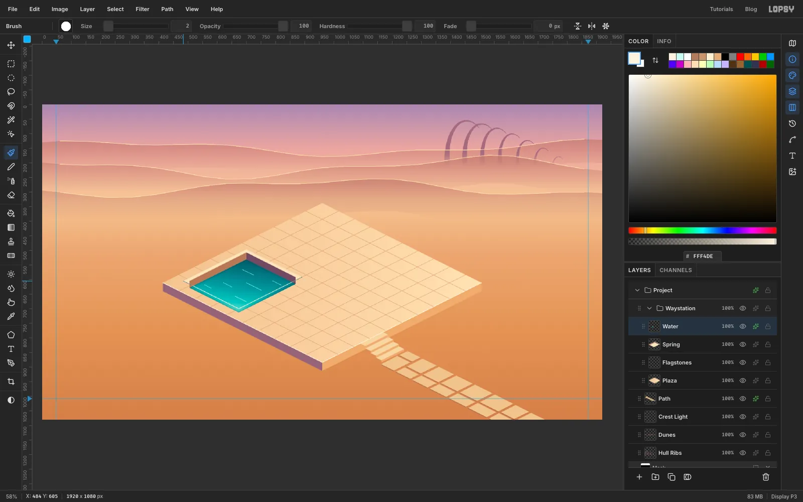

1. Deselect with [[Cmd+D]], then give `Water` an **Inner Glow** in `#0B3F4E` with **Size 14** and **Opacity 70**. It darkens the water where it meets the walls.
2. Brush a few short `#C8FFF4` ripple dashes at **Size 2** and **Opacity 70**, parallel to the pool's left edge.
3. On `Spring`, brush a 2 px `#FFF4DE` lip along the coping's front edges.

## Raise the main hall

1. Add a `Hall` layer and lasso the roof using the corners listed above. Fill it `#F3D6A8`.
2. With the roof still selected, drag a gradient from `#F6DCB0` at the back right to `#D2A586` at the front left, so it falls into shade.
3. Lasso the left wall and drag a gradient from `#6E4B63` at the bottom to `#8F6577` at the top.
4. Lasso the right wall and drag `#C98A5E` at the bottom to `#E6AE76` at the top.
5. Brush a few faint roof joints in `#B98A6A` at **Opacity 35**.

## Draw the windows flat

Lassoing slanted arches by hand is hard. Draw them straight-on instead.

1. Add a `Hall Windows` layer and set the foreground to `#FFB547`.
2. Over the left wall, lasso an upper row of four small arches, each about 23 × 44 px. Lasso a lower row of two small arches and a tall door, about 52 × 96 px. Hold [[Shift]] to add each one. Line them up with the wall's **left** edge as if the wall weren't slanted at all.
3. Fill them all at once with **Edit → Fill**.

## Skew the windows onto the wall

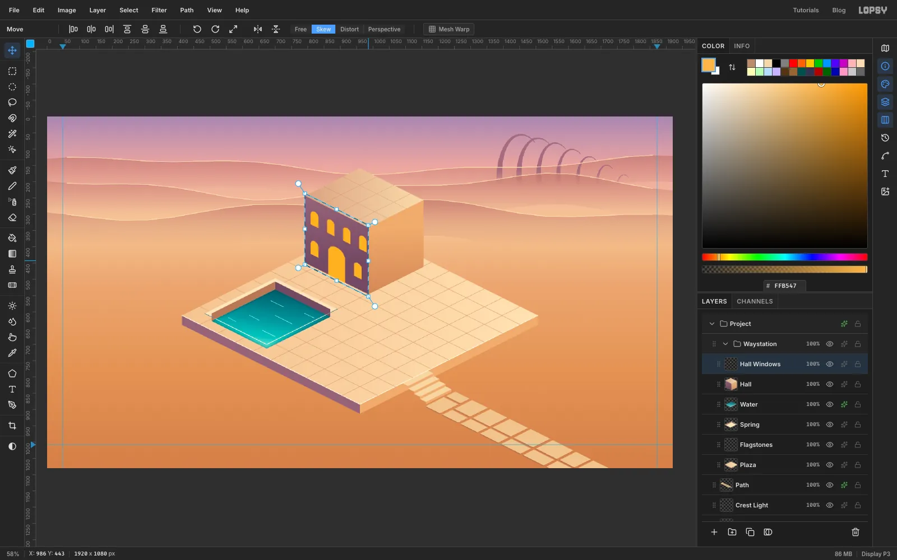

1. Draw a **Rectangular Marquee** from the left wall's left edge (x 791) to its right edge (x 986), tall enough to hold every window.
2. Switch to the **Move** tool and pick **Skew** in the options bar.
3. Drag the handle in the middle of the right edge **down** by half the box's width, about 97 px. The left edge stays pinned, so every arch now climbs at the wall's 1:2 slope.
4. Press [[Cmd+D]] to commit. Then give the layer an **Outer Glow** in `#FFB547` with **Size 16** and **Opacity 55**.

## Skew the other wall's windows up

On the sunlit side, the windows read as dark recesses.

1. Add a `Hall Windows R` layer. Draw five flat arches in `#4B2E3E`, lined up with the right wall's left edge at x 986.
2. Marquee from x 986 to x 1155 and switch to **Skew**. Drag the right-middle handle **up** by half the width, about 85 px.
3. Press [[Cmd+D]].

## Build a row of battlements by copy and paste

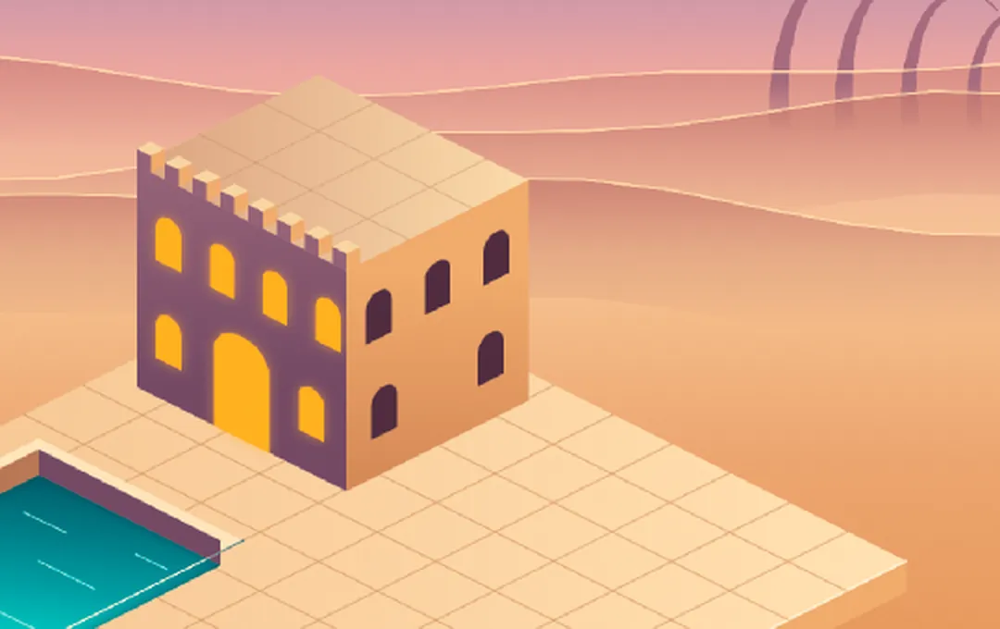

1. Add a `Battlements` layer. At the roof's front corner, lasso one little merlon: a box whose two side faces are each 13 px wide and 16 px tall. Fill its top `#F3D6A8`, its left face `#8F6577` and its right face `#E6AE76`.
2. Deselect, then press [[Cmd+A]], [[Cmd+C]] and [[Cmd+V]] to paste a copy in place.
3. With the **Move** tool, use the arrow keys to nudge the copy **26 px left and 13 px up**. That's one isometric step along the edge. Choose **Layer → Merge Down**.
4. Do it again with the two-merlon row, nudging it 52 px left and 26 px up. Then do the four-merlon row, nudging it 104 px left and 52 px up. Each paste doubles the row, so you end up with eight merlons.
5. For the right edge, marquee just the corner merlon, then copy and paste it. Nudge each copy one more step (**26 px right and 13 px up**) than the last, and merge as you go.

## Copy the rows across the roof

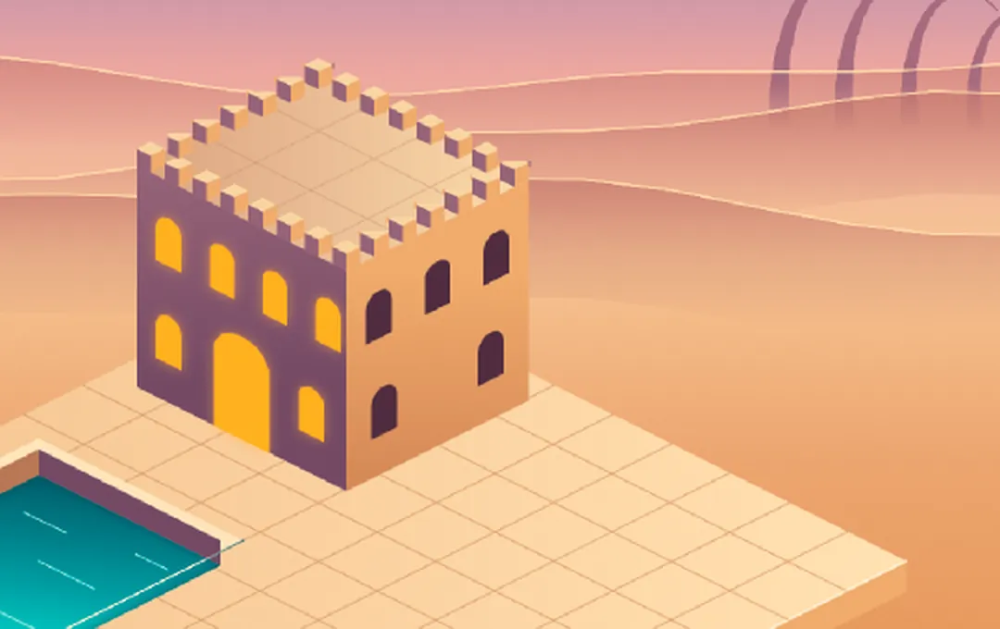

The back edges need merlons too. Copy both front rows **before** pasting either one, so neither copy picks up the other.

1. Marquee the left row without its corner merlon, then copy and paste it.
2. Click `Battlements` again, marquee the right row without its corner, then copy and paste it.
3. Nudge this second paste **182 px left and 91 px up** and merge it down.
4. Click the first paste, nudge it **156 px right and 78 px up**, and merge it.

## Shade the spire like a cylinder

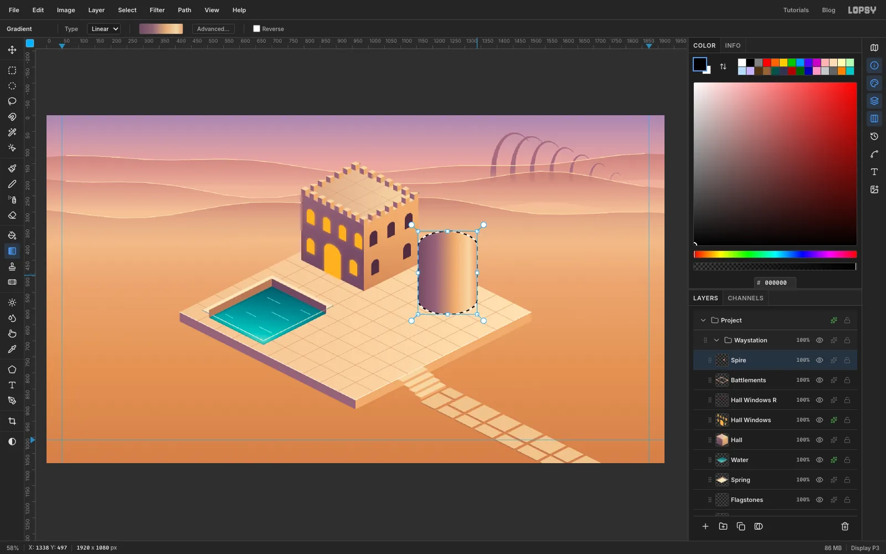

A circle in 2:1 isometric is an ellipse twice as wide as it is tall.

1. Add a `Spire` layer and select the lower drum's outline. You can lasso it, or build it exactly:
   1. Click with the **Elliptical Marquee** (without dragging) and type the corners of a 184 × 92 px ellipse centred at (1246, 406).
   2. [[Shift]]-drag a rectangle from that ellipse's left and right ends down to y 572.
   3. [[Shift]]-add a second 184 × 92 ellipse centred at (1246, 572).
2. Drag a gradient straight **across** the drum from left to right with five stops: `#6E4B63`, `#8F6577` at the 30% point, `#E6AE76` at 62%, `#F3D6A8` at 86%, and `#E2A472`. A side-to-side gradient is what makes a flat shape read as round.
3. Select a thin balcony disc 228 px wide on top and fill it with the same gradient. Fill its top ellipse `#F3D6A8`.
4. Shade a narrower upper drum, 140 px wide, the same way. It rises to y 273.

## Gild the dome

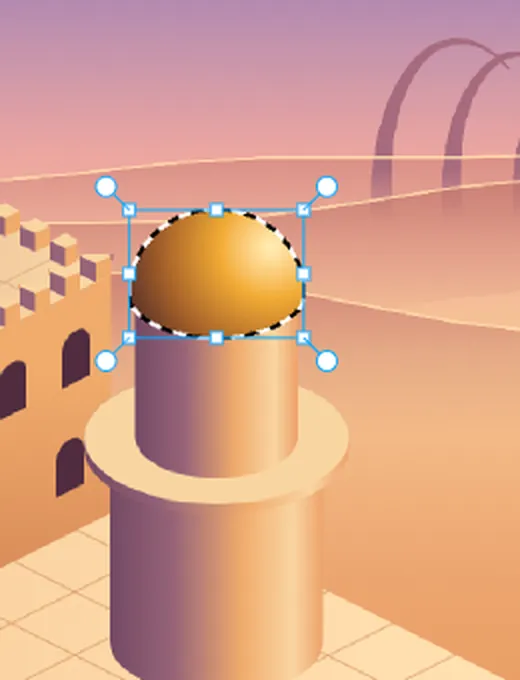

1. Lasso a half-ellipse dome on top of the upper drum.
2. Set the gradient **Type** to **Radial**, with four stops: `#FFF0C0`, `#E8AE4E` at the 35% point, `#9A6234` at 75%, and `#5E3A2C`.
3. Drag from the dome's upper right outward, about 120 px.

## Add copper vanes, slits and a beacon

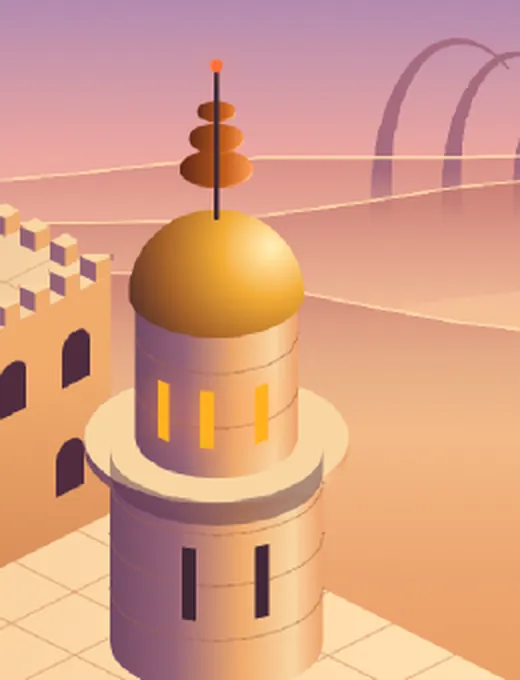

1. Lasso three thin, shrinking ellipses stacked above the dome. Fill each with a copper gradient dragged across it: `#5A2C1C`, `#B8642F` at the 55% point, `#F0A060` at 85%, and `#FFD9A8`. Repeat each one 2 px higher to give it a lit top.
2. Draw the mast with the brush in `#3A2A36` at **Size 5**: click on the dome top, then [[Shift]]-click about 120 px above it.
3. On a `Spire Details` layer:
   - Brush curved sandstone courses around the drums in `#9C6650` at **Opacity 50**.
   - Fill a band of `#4A2E44` at 45% opacity just under the balcony for its shadow.
   - Fill two dark `#3E2836` slits in the lower drum.
4. On a `Spire Lights` layer, fill three amber slits in the upper drum.
5. Click a 12 px `#FF7A45` dot at the mast tip. Give the layer an **Outer Glow** in `#FF9A50` with **Size 34** and **Opacity 85**.

## Raise the gatehouse

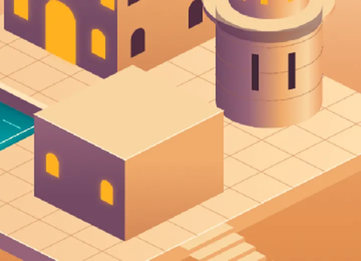

1. Add a `Gatehouse` layer and lasso its roof and two walls from the corners listed above. Use the same roof colour and wall gradients as the hall, then brush a pale `#FFF1D6` lip along its front edges.
2. Add a `Gate Windows` layer and draw two small arched windows on the shaded left wall in `#FFB547`. Lasso them following the wall's slope, or draw them flat and Skew them down as you did for the hall.
3. Give the windows an **Outer Glow** in `#FFB547` with **Size 14** and **Opacity 55**.

## Light the gatehouse doorway

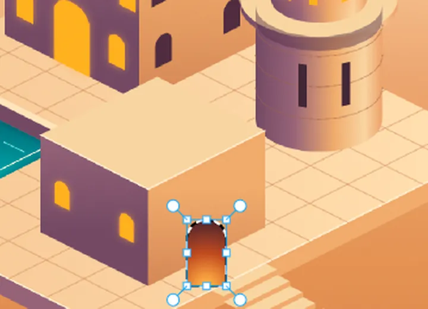

1. Add a `Gate Arch` layer. Lasso a flat arch about 57 px wide and 96 px tall, lined up with the right wall's left edge.
2. Fill it with a **Radial** gradient dragged from the bottom centre upward: `#FFC260`, `#B4522E` at the 45% point, and `#2E1C2A`.
3. Marquee the right wall from x 999 to x 1168. **Skew** the right-middle handle up by half the width, as you did for the hall, and press [[Cmd+D]].
4. Give the arch an **Outer Glow** in `#FFB547` with **Size 18** and **Opacity 70**.
5. Click `Water` and add a `Door Light` layer. Lasso a fan on the plaza in front of the door. Fill it with `#FFC46A`, fading from 90% opacity at the door to 0% about 90 px out, and set the layer's blend mode to **Screen**.

## Draw the awning flat

1. Add an `Awning` layer. Marquee a rectangle 83 × 40 px whose top-left corner sits on the wall just above the arch.
2. Fill it `#F6E6CC`.
3. Select every other eighth of it, using [[Shift]] to add each stripe, and fill the stripes `#B4502E`.
4. Marquee the whole rectangle, switch to **Move**, and pick **Distort**.

## Distort the awning onto the wall

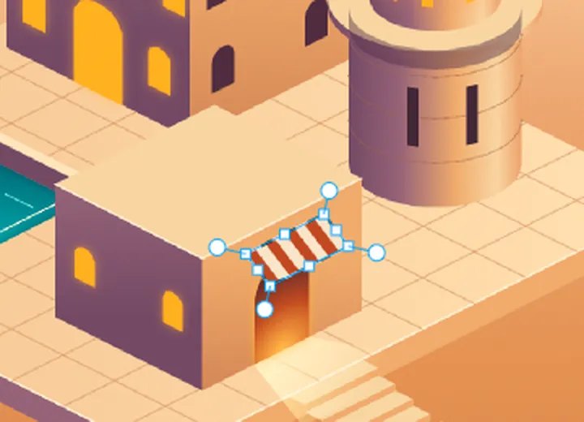

In **Distort** mode, each corner handle moves on its own.
1. Drag the **top-right** corner up about 42 px, along the wall's slope, so the top edge hugs the wall.
2. Drag the **bottom-left** and **bottom-right** corners so each ends up about 26 px right of its top corner and 34 px below it. The canopy now juts out from the wall and tips forward.
3. Press [[Cmd+D]], then add a **Drop Shadow** in `#4A2E44`: **Offset X −6**, **Offset Y 10**, **Blur 5**, **Opacity 45**.

## Crown the gatehouse with a cupola

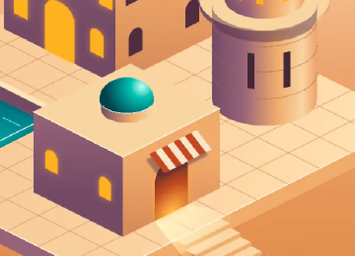

1. On a `Cupola` layer, select a short drum about 88 px wide in the middle of the roof. Shade it across with `#6E4B63`, `#E6AE76` at the 60% point, and `#F3D6A8`.
2. Lasso a dome on top. Fill it with a radial gradient dragged from its upper right: `#C8FFF0`, `#3FB7AE` at the 35% point, `#17646C` at 80%, and `#0E3E4A`.
3. Brush a thin `#D6FFF6` highlight along the front of the dome's rim.

## Skew a live text sign onto the wall

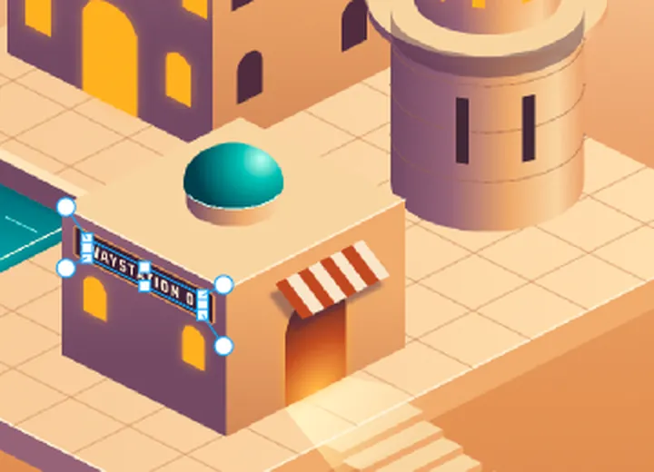

1. On a `Signboard` layer, marquee a flat 130 × 26 px board above the two small windows. Fill it `#3A2236` and **Skew** it down like the windows. Add a 2 px **Stroke** effect in `#D89A62`.
2. Click a raster layer before you change any text settings, because they restyle whichever text layer is active.
3. Pick the **Text** tool and set **Saira Condensed**, **Bold**, **Size 15** in `#F6E6CC`. Click the **T** button in the right-hand panel strip to open the **Text** panel, and set **Letter spacing** to **2**.
4. Click in empty canvas at the top of the frame, type `WAYSTATION 07`, and click the ✓ to commit.
5. With the **Move** tool, pick **Skew** in the options bar. Drag the text's right-edge handle down by half its width. The text stays live and editable.
6. Use the arrow keys to nudge it down until it sits centred on the board.

## Select every shadow at once

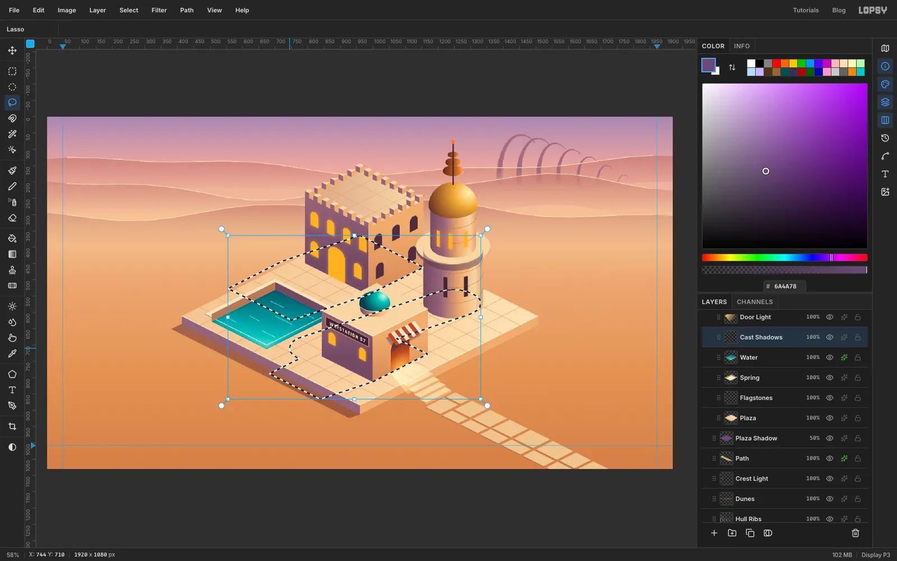

The sun is low at the back right, so every shadow falls **down and to the left**, running with the isometric axis.

1. Click `Water` and add a `Cast Shadows` layer, so the shadows sit under the buildings.
2. Lasso the hall's shadow. Start at its base corners and run out down-left about 1.2 times the wall height.
3. [[Shift]]-lasso the gatehouse's shadow, then the spire's.
4. Set the foreground to `#6A4A78`.

Building all three into one selection means the overlaps won't come out darker.

## Soften the shadows and multiply them

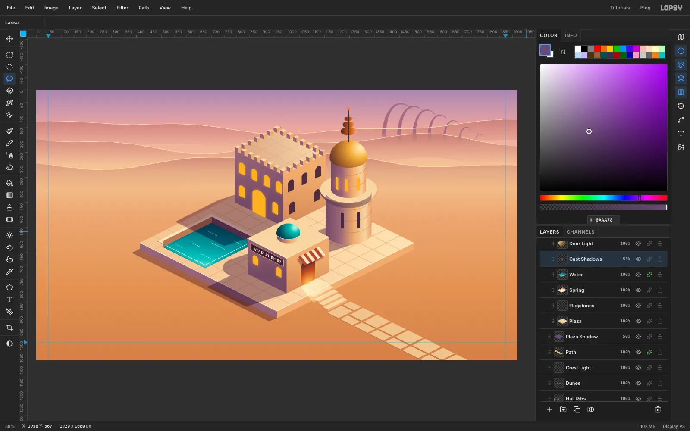

1. Choose **Edit → Fill**, deselect, and run **Gaussian Blur** at **2**.
2. Set the layer's blend mode to **Multiply** and its opacity to **55%**.
3. Click `Path` and add a `Plaza Shadow` layer for the block's own short shadow on the sand. Fill it the same way and set it to **Multiply** at **50%**.

## Hang the shade sails

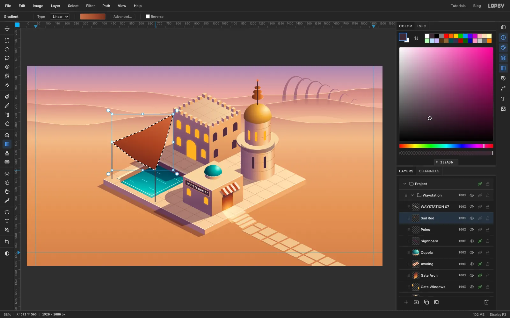

1. On a `Poles` layer, brush two 5 px `#3E2A36` poles: one from (460, 608) up to (460, 413), and one from (694, 732) up to (694, 563).
2. On a `Sail Red` layer, lasso a triangle from the hall's top-left corner to both pole tops, letting each edge sag a little. Fill it with `#C76E46`, `#A04A2C` at the 60% point, and `#723020`, dragged from the hall corner to the front pole.
3. On a `Sail Gold` layer, lasso a triangle from the hall's front edge to the front pole and the gatehouse corner. Fill it with `#EDBE72`, `#D4943A` and `#A0661E`, then set the layer to **94%** opacity.

Keep the sails muted. If they're the most saturated things in the frame, they steal the eye from the gatehouse.

## Cast coloured shade under the sails

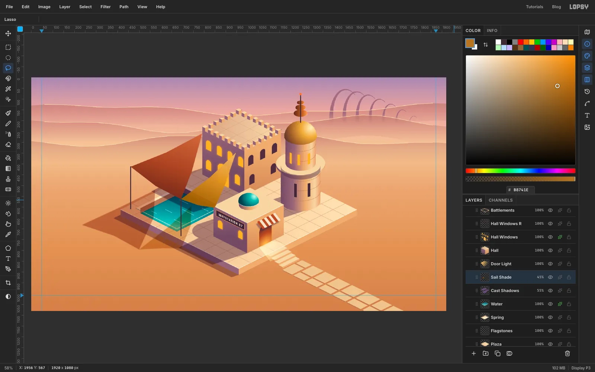

1. Click `Cast Shadows` and add a `Sail Shade` layer.
2. Lasso where each sail's shadow lands, down-left of the sail. Fill the terracotta sail's shadow `#93391F` and the saffron one's `#B8741E`.
3. Blur the layer at **3**, then set it to **Multiply** at **45%**.

Sunlight through dyed canvas throws a tinted shadow, not a grey one.

## String the lights

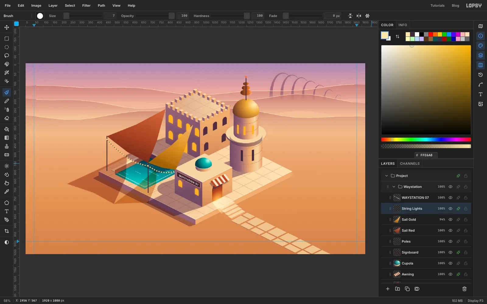

1. Add a `String Lights` layer. Brush a sagging 2 px `#3E2A36` wire from the back pole to the front pole and on to the gatehouse's front corner.
2. Set the brush to **Size 7** in `#FFE6A8`. In the Brushes panel, set **Spacing** to its maximum, **200%**.
3. Paint over the same curves. The wide spacing turns each stroke into a row of separate bulbs.
4. Put **Spacing** back where it was. Give the layer an **Outer Glow** in `#FFB547` with **Size 12** and **Opacity 80**.

## Paint the back palm

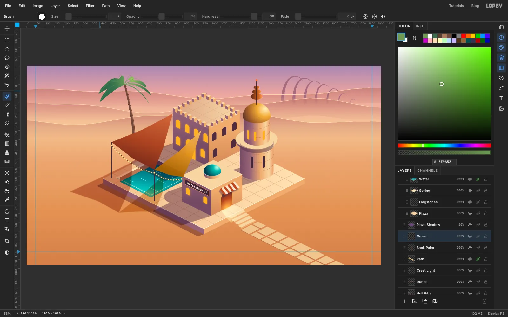

1. Click `Path` so the palm sits behind the plaza, and add a `Back Palm` layer.
2. Paint the trunk in one stroke, curving gently up from the sand at about (583, 400). Use an 18 px `#6E4A3E` brush with **Taper** set to about twice the trunk's length, so it narrows a little toward the top.
3. Add a 3 px `#B07A5C` sunlit edge down its right side, and a few short `#5A3C30` growth rings.
4. On a `Crown` layer, [[Shift]]-lasso nine drooping leaf shapes fanning out from the trunk top, and fill them `#3F6B4E`.
5. Drag a radial gradient over the crown from `#B9D978` at 85% opacity to transparent, starting at its upper right.
6. Brush faint `#6E9A52` midribs at **Opacity 50**.

## Copy the crown and flip it

1. Collapse the `Waystation` group with its arrow, click its row, and click **New Group**. Name the new group `Oasis`.
2. Add a `Palm Trunks` layer and paint two more trunks on the sand at the left: one at about (258, 614) and one at about (375, 776).
3. Marquee the back palm's crown on `Crown` and press [[Cmd+C]]. Click `Palm Trunks` and press [[Cmd+V]]. Rename the paste `Crown 1`.
4. Marquee the paste, switch to **Move**, and click **Flip Horizontal** in the options bar. Press [[Cmd+D]].

## Scale the copy down

Marquee the crown again. Hold [[Cmd]] and drag the bottom-right corner handle inward until the crown is about **82%** of its size. [[Cmd]] keeps the proportions. Press [[Cmd+D]].

## Tilt it and set it on its trunk

1. Marquee the crown again. Drag just outside a corner handle to rotate it about **8°**, then press [[Cmd+D]].
2. Use the arrow keys to nudge it until its centre sits on the trunk top.
3. Repeat the copy for `Crown 2` on the front palm. This time skip the flip, scale it to **70%** and rotate it **−10°**.

Copying one crown and varying its flip, scale and tilt keeps the three palms related without looking stamped.

## Squash a crown into its shadow

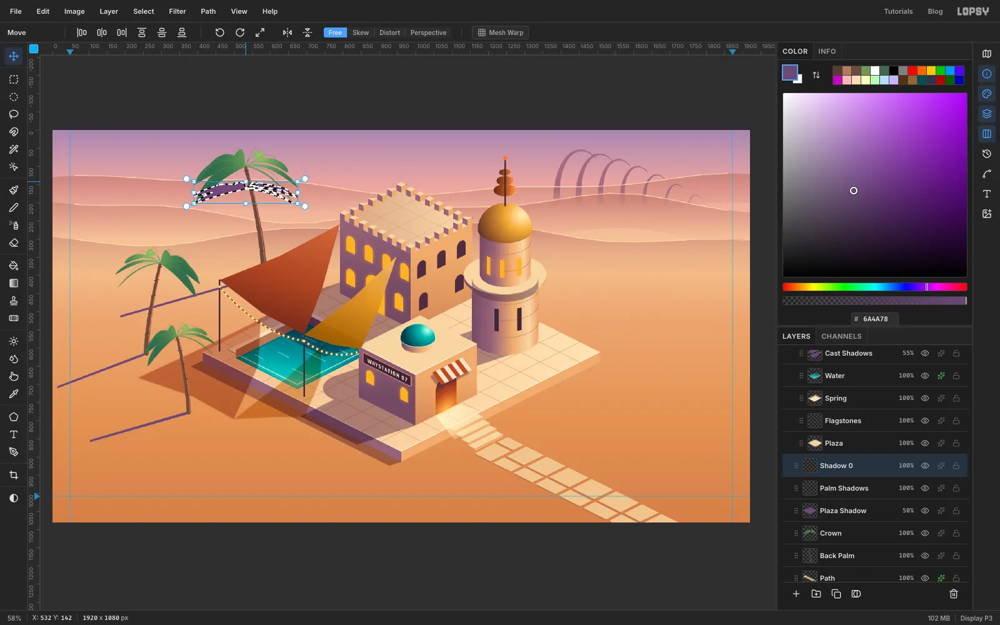

A palm's shadow should look like a palm.

1. Click `Plaza Shadow` and add a `Palm Shadows` layer. Lasso a thin band for each trunk's shadow, starting **exactly at the trunk base** and running down-left. Fill the bands `#6A4A78`.
2. For each crown, add a temporary layer (the name doesn't matter, because it gets merged).
3. [[Cmd]]-click that crown's thumbnail in the Layers panel to load its shape as a selection, and fill it `#6A4A78`.
4. With the **Move** tool, drag the top handle down until the shape is about 40% of its height. Press [[Cmd+D]].

## Place the palm shadows

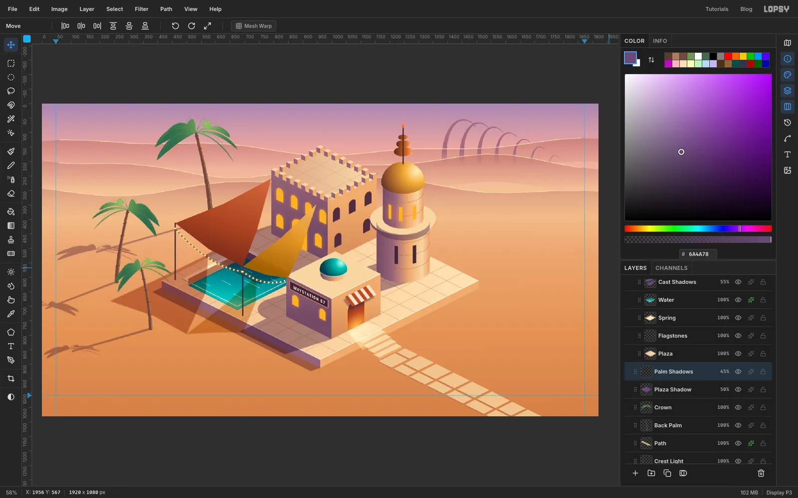

1. Nudge each squashed crown to the end of its trunk's shadow band, then choose **Layer → Merge Down** to merge it into `Palm Shadows`.
2. Blur `Palm Shadows` at **2** and set it to **Multiply** at **45%**.

## Dig the garden bed and the spillway

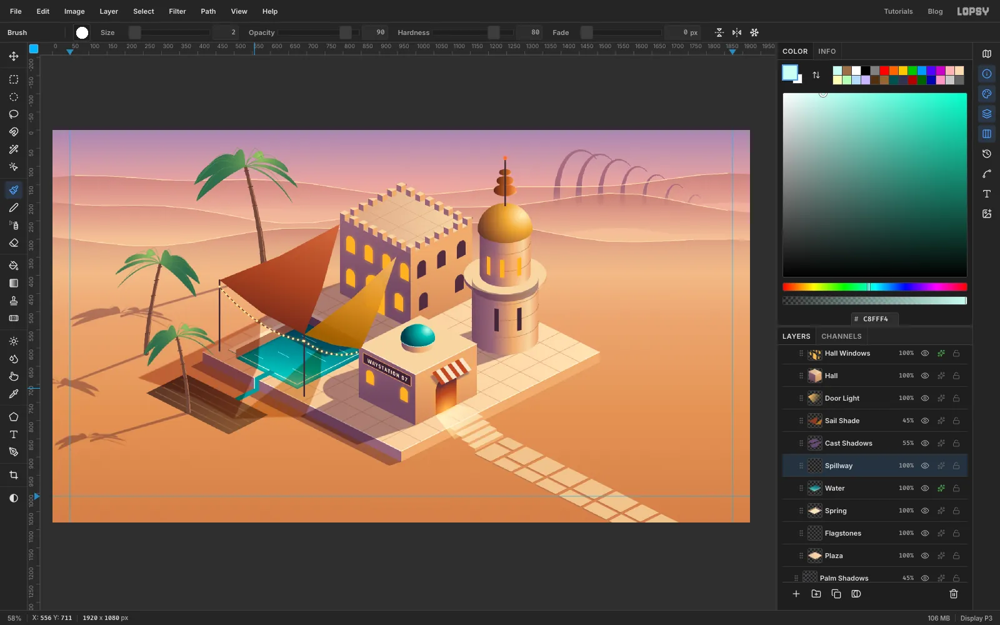

1. Click `Plaza Shadow` and add a `Garden Bed` layer. Lasso a diamond on the sand in front of the plaza's left face. Fill it with a gradient from `#5A3A2C` to `#7E5638`, and brush four `#9A6E48` furrows across it.
2. On a `Channel` layer, lasso a narrow strip of water from the plaza edge to the bed, and fill it `#1F9AA0`.
3. Click `Water` and add a `Spillway` layer. Lasso the channel across the plaza top and the waterfall down the left face, and fill both the same blue.
4. Brush a 2 px `#C8FFF4` highlight down the fall.

## Plant the bed

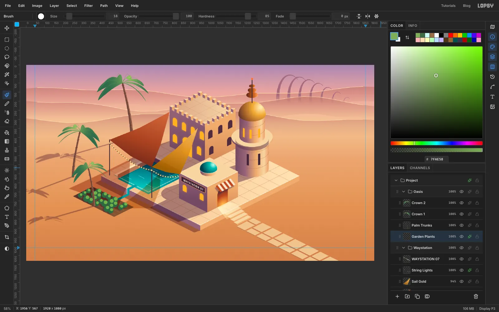

1. Click `Palm Trunks` and add a `Garden Plants` layer.
2. Click round dabs along each furrow with the brush in `#3C6A44`, varying **Size** from 28 to 40. Then click smaller `#7FAE58` dabs up and to the right of each one for their lit tops.
3. Add a **Drop Shadow** in `#3A2236`: **Offset X −7**, **Offset Y 3**, **Blur 3**, **Opacity 50**.
4. Drag the layer down below `Palm Trunks` by the dotted handle at the left of its row. The front palm's trunk now stands in front of the plants, so its shadow starts where you can see it meet the ground.

## Build the sand yacht's frame

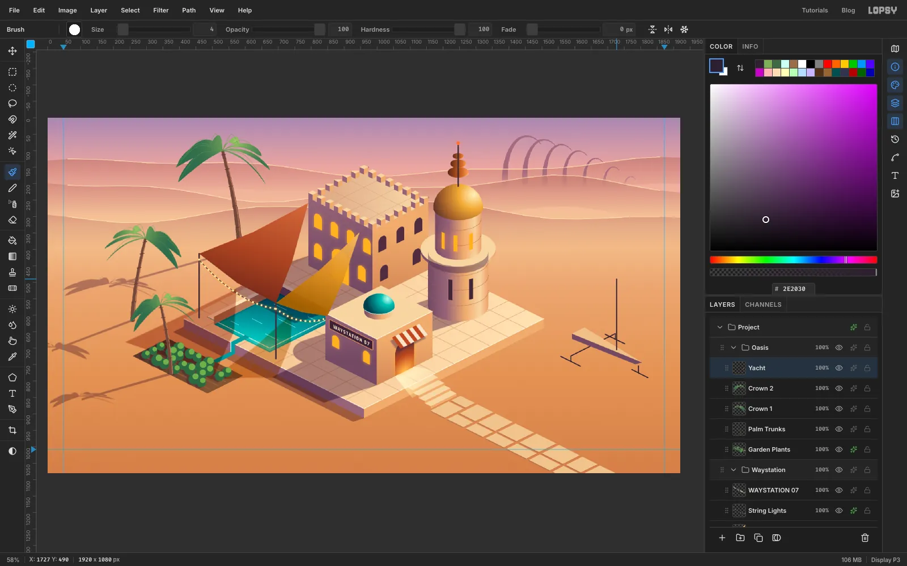

1. Click `Crown 2` and add a `Yacht` layer.
2. Brush the struts, a crossbeam and three skis in 4 px `#2E2030`, centred around (1708, 734).
3. Lasso the hull, about 220 px long with its bow pointing down-right along the 2:1 slope. Fill its side `#6E4B63` and its deck `#E8C08E`.
4. Brush the mast straight up from just ahead of the middle of the deck, about 215 px tall.

## Rig the sails and ground the yacht

1. Lasso the mainsail from the mast top down to the end of the boom. Fill it with a gradient from `#FFF4DA` to `#E6B98C`.
2. Lasso the jib from the mast to the bow and fill it from `#E77B45` to `#93391F`. Brush the boom.
3. Click `Crown 2` again and add a `Yacht Shadow` layer below the yacht. Lasso the shadows of the hull and both sails, falling down-left like everything else. [[Shift]]-add a small contact patch under each ski.
4. Fill them `#6A4A78`, and brush a thin shadow for the mast.
5. Blur the layer at **3** and set it to **Multiply** at **45%**. The contact patches stop the yacht from floating.

## Line the path with lanterns

The lanterns stand in three mirrored pairs, one post on each edge of the path at even steps.

1. On a `Lantern Shadows` layer, brush a short shadow running down-left from each post position. Set it to **Multiply** at **50%**.
2. On a `Lantern Posts` layer, brush each post 4 px wide and about 65 px tall in `#3A2830`. Lasso a small dark plinth at each base.
3. On a `Lamps` layer, click an 11 px `#FFE6A8` dot at the top of each post. Add two more on the gatehouse wall, either side of the door.
4. Give `Lamps` an **Outer Glow** in `#FFAA3C` with **Size 26** and **Opacity 85**.

## Comb the sand with the wind

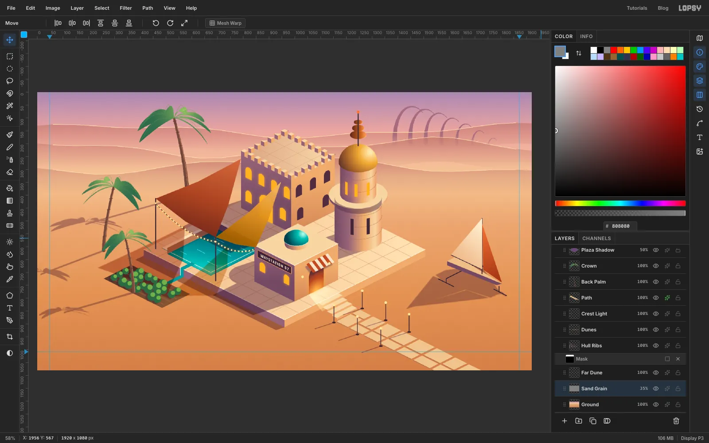

1. Click `Ground` and add a `Sand Grain` layer. Fill it with mid-grey `#808080`.
2. Run **Filter → Add Noise…** at **60**, with **Mono** and **Gaussian** selected.
3. Run **Filter → Motion Blur…** at **Angle 153** and **Distance 24** to streak the grain along the wind.
4. Set the layer to **Overlay** at **35%**.
5. Add a `Drifts` layer, run **Filter → Clouds…** at **Scale 3**, and set it to **Soft Light** at **22%** for broad patches of light and shade.

## Push the dunes back with haze

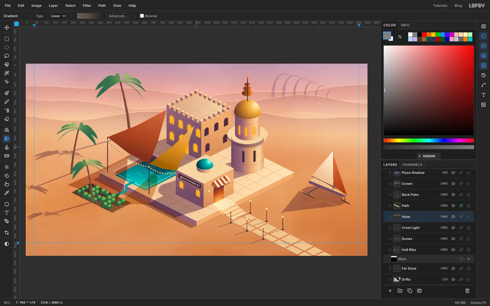

1. Click `Crest Light` and add a `Haze` layer.
2. Drag a gradient from the top of the canvas down to about y 470. Use `#F2C8B8` at 35% opacity, then `#F8D7BE` at 20% opacity at the halfway point, then fully transparent.

Distant things lose contrast, so the dunes and ribs fall back behind the waystation.

## Light the dust with a low sun

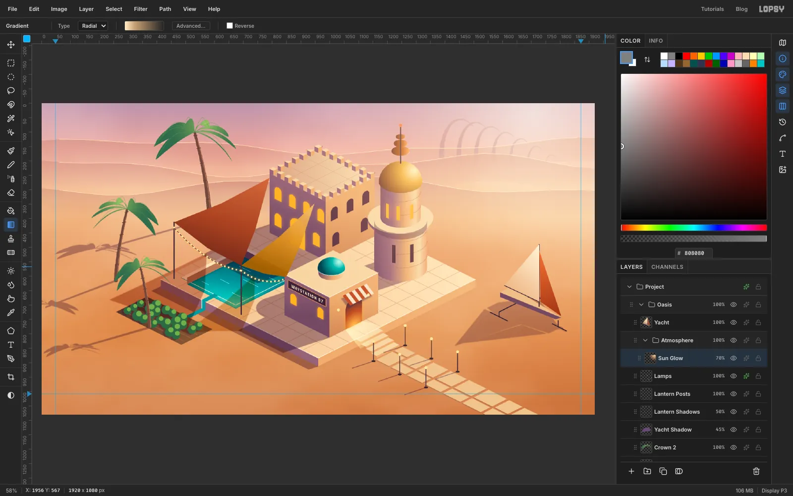

1. Click `Lamps` and click **New Group**. Name the group `Atmosphere`.
2. Add a `Sun Glow` layer and set a **Radial** gradient with three stops:
   - `#FFF0C8` at the start
   - `#FFC98A` at 75% opacity at the 25% point
   - `#FF9A6A` at 0% opacity at the end
3. Drag from (1700, 40) to about the middle of the frame.
4. Set the layer to **Screen** at **70%**.

## Add drifting dust and dusk shade

1. Add a `Dust` layer, run **Clouds** at **Scale 7**, and set it to **Screen** at **14%**.
2. Add a `Foreground Shade` layer. Drag a `#6A4A82` gradient from 60% opacity at the bottom edge to 0% at about y 720.
3. Set it to **Multiply**. The near sand sinks into dusk and the eye moves up to the buildings.

## Drag the Atmosphere group to the top

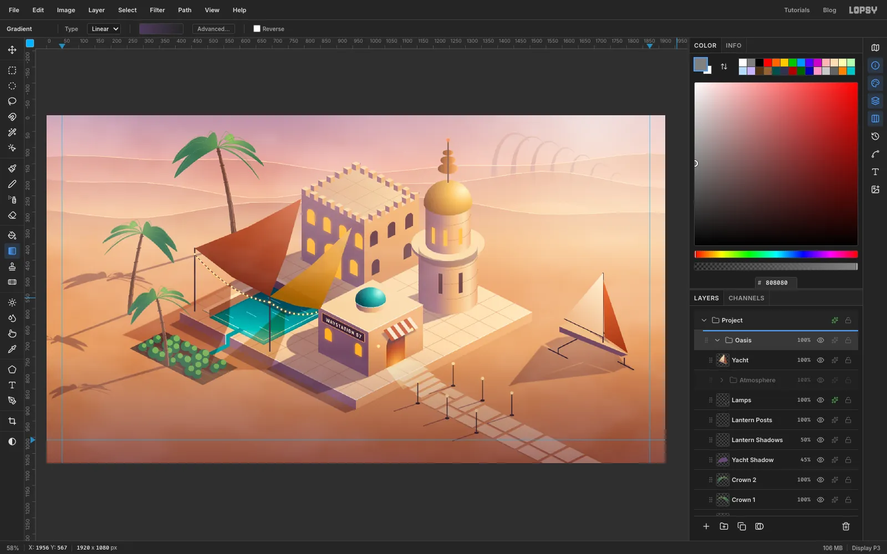

Because `Lamps` was active, `Atmosphere` was created inside `Oasis`. It needs to sit over everything instead.

1. Collapse `Atmosphere` and `Waystation` with their arrows, so the `Oasis` row is close by.
2. Drag the dotted handle at the left of the `Atmosphere` row up onto the **top half** of the `Oasis` row.
3. As you drag, move a little to the left. Moving left takes the row out one level, and the blue indicator line shows where it will land.
4. Let go. `Atmosphere` is now the topmost group.

> **Tip:** You can also skip the drag. Collapse `Oasis`, click its row, and click **New Group**: a group made with a collapsed group selected lands beside it, not inside it.

## Grade the whole frame

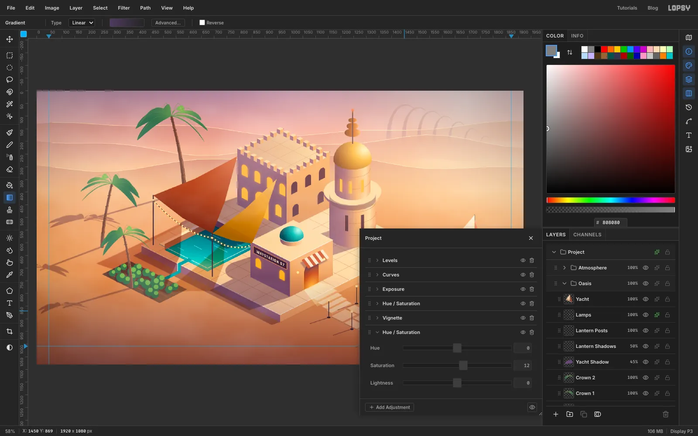

1. Choose **Layer → Adjustment Layer…** and click **Got it**. The drawer opens on the `Project` group, which already holds four neutral nodes: Levels, Curves, Exposure and Hue / Saturation.
2. Click **Add Adjustment → Vignette** and set it to **35**.
3. Raise the **Saturation** of a Hue / Saturation node to **12**. You can use the one that's already there or add a fresh one, as in the screenshot.

These nodes grade everything at once and stay editable.

## Set the title strip and palette chips on the grid

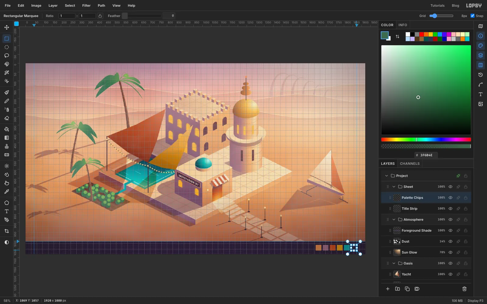

1. Click `Dust` and click **New Group**. Name it `Sheet` and add a `Title Strip` layer inside it. Drag the group to the top, as you did with `Atmosphere`.
2. Click once (without dragging) with the **Rectangular Marquee** to open the exact-corners dialog. Enter **From** 0, 1008 and **To** 1920, 1080, then fill the strip `#21172E`.
3. Add a `Palette Chips` layer and choose **View → Show Grid**. At the right end of the options bar, set **Grid** to **8px** and make sure **Snap** is ticked.
4. Drag six 32 px squares between y 1028 and 1060, with 8 px gaps, ending at the right guide. They snap exactly onto the grid. Fill them `#C98352`, `#8F6577`, `#B4502E`, `#D4943A`, `#1F9AA0` and `#3F6B4E`.
5. Choose **View → Show Grid** again to hide the grid. Give the chips a 1 px `#F6E6CC` **Stroke**.

## Type the title and slug

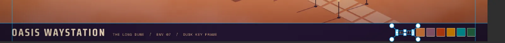

Click `Palette Chips` before each new text, so the Text settings don't restyle the previous one.

1. Set **Saira Condensed**, **Bold**, **Size 42**, **Letter spacing 5**, `#F6E6CC`. Type `OASIS WAYSTATION` in empty canvas and commit it. Nudge it so its left edge sits on the 48 px margin, centred in the strip.
2. Set **Space Mono** at **Size 14**, **Letter spacing 1**, `#D7B48E`. Type `THE LONG DUNE  /  ENV 07  /  DUSK KEY FRAME`, then nudge it about 36 px right of the title, on the same baseline.
3. Set **Space Mono** at **Size 12**, `#EBCFAE`, and type `PALETTE`. Place it 16 px left of the first chip, centred on the strip.

## Draw the callout leaders

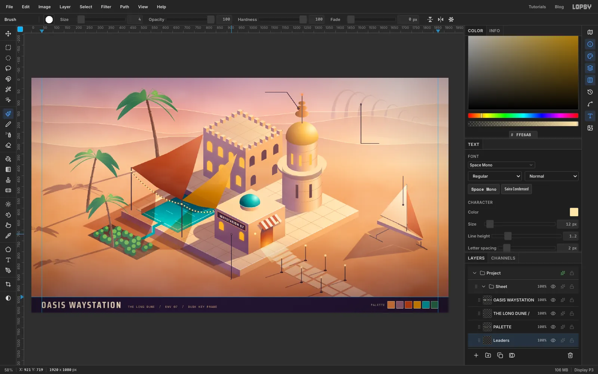

1. Add a `Leaders` layer and pick the **Pencil** at **Size 2** in `#2E1E30`.
2. For each callout, click on the feature, then [[Shift]]-click an elbow and an end point to draw a straight two-part leader:
   - **Spire:** from the vanes up and left into the sky above the hall.
   - **Hull:** from a rib straight down, then right to x 1600.
   - **Yacht:** from the mainsail straight up.
   - **Gatehouse:** from the shaded wall straight down to about y 926.
3. With the **Brush**, click a 9 px ink dot at each feature end, then a 4 px `#FFE6A8` dot on top.

## Label the callouts

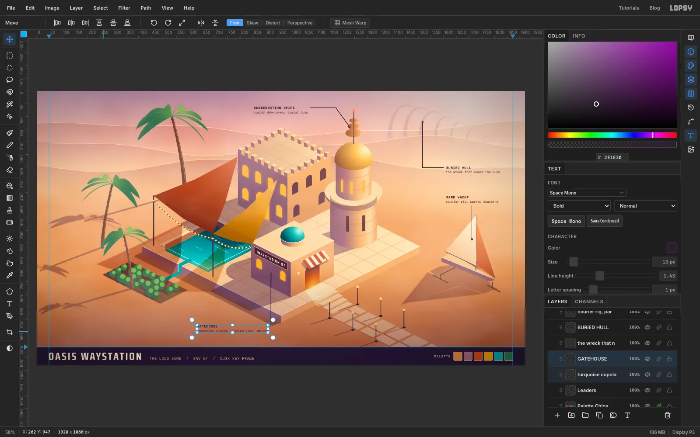

Each label is a **Space Mono Bold 13** heading with letter spacing 1, in `#2E1E30`. Under it, 9 px below, goes a **Space Mono 12** note.
- **Condensation Spire:** `CONDENSATION SPIRE` with *copper dew-vanes, signal lamp*. Its right edge sits 10 px before its leader's end.
- **Buried Hull:** `BURIED HULL` with *the wreck that named the dune*, starting at x 1610.
- **Sand Yacht:** `SAND YACHT` with *courier rig, parked downwind*, also starting at x 1610, sitting just above its leader.
- **Gatehouse:** `GATEHOUSE` with *turquoise cupola, painted sign, awning*, ending right where its leader turns. Keep it at least 48 px above the strip.

To move a heading and its note together, click one row and [[Cmd]]-click the other, then nudge them with the arrow keys. Leave 40 px or more between every label and the artwork.

## Rotate a production credit up the margin

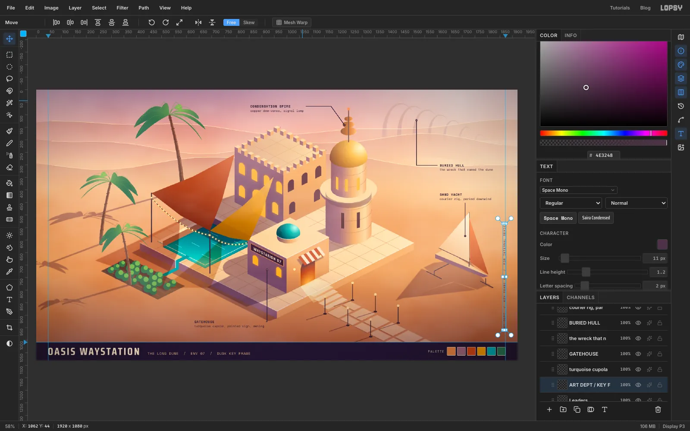

1. Type `ART DEPT  /  KEY FRAME 07  /  FOR INTERNAL REVIEW` in **Space Mono 11**, **Letter spacing 2**, `#4E3248`.
2. With the **Move** tool, click **Rotate 90° CCW** in the options bar. The text stays live.
3. Nudge it so it ends on the right guide, about 50 px above the strip.

Save with **File → Save Project**, then choose **File → Quick Export PNG** to export the key frame.
