Isometric illustration draws a scene from above and to one side with no vanishing point, so every edge that's parallel in real life stays parallel on the page. It's a favourite for maps, product explainers and small-business flyers because it reads like a toy model: friendly, tidy and easy to understand at a glance.

In this tutorial you'll make a flyer for *Paddle Quay*, a made-up kayak and paddleboard rental shop on a harbour. The picture is a floating block of quay and water, cut open at the front like an aquarium, with a boathouse, a kayak rack and a jetty on it.

The trick that makes this manageable is that **you never draw a slanted shape by hand.** Every wall, floor and sign is drawn flat and square-on, where it's easy, and then transformed into place:

- **Walls** are drawn as a plain rectangle, then **Skewed**: drag the right edge's handle up or down by exactly half the rectangle's width.
- **Floors** (paving, deck planks, kayaks, the paddleboard) are drawn flat, **rotated 45°**, then **squashed to half their height**.

Both moves give the same 2:1 slope (two pixels across for every one down), which is the standard angle for isometric pixel-style art. On this flyer one step along the floor is 70 px across and 35 px down, and one step of height is 78 px straight up.

The flyer is 1600 × 2240 px. Along the way you'll use:

- **guides**, exact-corner marquees and **Select → Inverse**
- **Define Pattern** for five tiles and **Fill with Pattern** with **Row Stagger** and offsets
- the Move tool's **Skew** mode and its **rotate** and **scale** handles, on pixels and on live text
- the **Pen** tool with **Path to Selection** for the faces you can't skew
- the **Gradient**, **Brush** and **Pencil**, with [[Shift]]-click straight lines
- **Add Noise**, **Motion Blur**, **Brightness/Contrast**, **Hue/Saturation** and **Gaussian Blur**
- **Duplicate Layer**, **Copy** and **Paste**, an [[Option]]-drag copy, **Flip Horizontal** and **Merge Down**
- **Drop Shadow**, **Stroke** and **Outer Glow**, and **Multiply** and **Overlay** layers
- the **Shape** tool's click-to-size dialog for rounded cards
- groups that you move and rotate as one piece
- live text in **Dela Gothic One** and **Outfit**

The palette is warm cream and peach paper with coral, navy and teal, and sunshine yellow as the accent:

- Paper `#F6EEDD`, sun disc `#FADFC2`, grid lines `#EBC39C`
- Coral `#EE6A50` / `#C44E3A`, navy `#1F2C55` / `#2C3E73`, roof blue `#34508C`, trim `#FFF6E8`
- Water `#46C3C4` → `#2A9DAE`, front cutaway `#2AA9B3` → `#145C75`, side cutaway `#1A7A8B` → `#0C3F52`
- Sand `#E3C48E`, paving `#EFDAB0`, brick `#B08A5A`, wood `#D79B5D` / `#A86B3A` / `#7F4E29`
- Kayak yellow `#F7C548`, pines `#6CC48C` / `#3F9466`, ripples `#C9F1EC`

When a step just says *navy*, use `#1F2C55`. *Trim* or *white* means `#FFF6E8`, *coral* means `#EE6A50` and *yellow* means `#F7C548`.

> **Tip:** This tutorial gives positions in document pixels, because isometric shapes only fit together if their corners land in the right places. The status bar at the bottom of the window shows the pointer's X and Y. For a selection with exact corners, pick the **Rectangular Marquee** and click once on the canvas without dragging while nothing is selected: a dialog opens where you can type the corners.

> **Tip:** Name every layer as you make it by double-clicking its name. Later steps pick layers by name.

> **Note:** Shortcuts are written for a Mac. On Windows use [[Ctrl]] wherever it says [[Cmd]], and [[Alt]] for [[Option]].

## Set up the paper and the sun disc

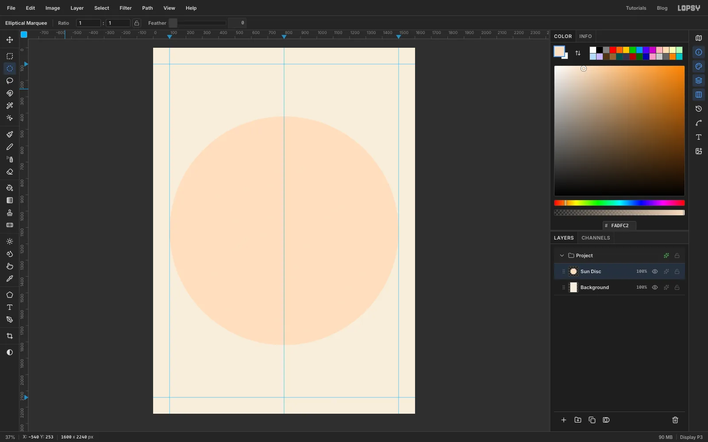

Open [Lopsy](/) and create a new document **1600** wide by **2240** tall.

1. Select **Background**, set the foreground colour to `#F6EEDD` and choose **Edit → Fill**.
2. Click the top ruler at `100`, `800` and `1500`, and the left ruler at `100` and `2140`, for the margins and the centre line.
3. Rename **Layer 1** to `Sun Disc`. With the **Elliptical Marquee** from the toolbox, make an exact-corner circle from `100, 420` to `1500, 1820` and fill it with `#FADFC2`. Deselect with [[Cmd+D]].

## Draw one tile of isometric grid

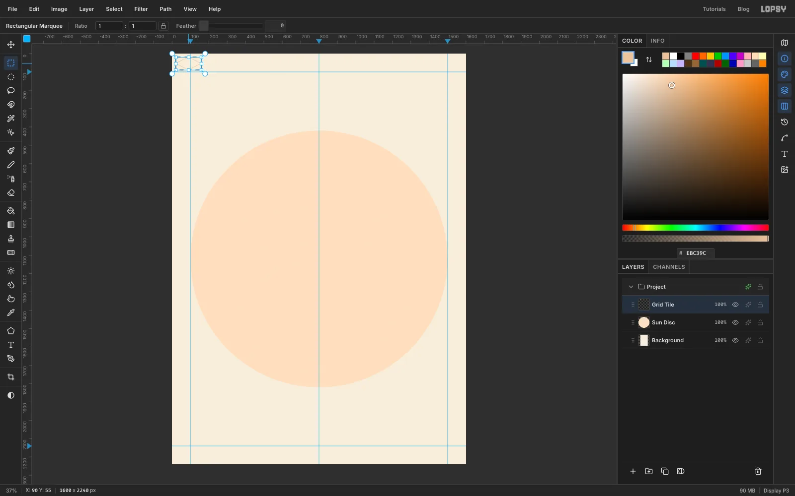

The disc gets a faint isometric grid, the kind of graph paper isometric illustrators sketch on. You only have to draw one diamond of it.

1. Click **Add Layer** and name it `Grid Tile`.
2. Pick the **Pencil** ([[N]]), set **Size** to `2` and the colour to `#EBC39C`.
3. Click at `20, 55`, then hold [[Shift]] and click at `90, 20`, `160, 55`, `90, 90` and back at `20, 55`. [[Shift]]-click draws a straight line from the last point, so you get a diamond 140 px wide and 70 px tall.
4. Make an exact-corner selection from `20, 20` to `160, 90`, a box exactly around the diamond, and choose **Edit → Define Pattern**.
5. Deselect and delete the **Grid Tile** layer with the bin button. The pattern stays.

## Fill the disc with the grid

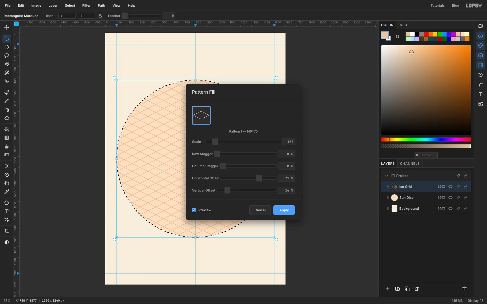

1. Select **Sun Disc**, click **Add Layer** and name the new layer `Iso Grid`. It lands just above the disc.
2. [[Cmd]]-click the **Sun Disc** thumbnail to select the disc's shape.
3. Choose **Edit → Fill with Pattern…** and click the diamond.
4. Set **Horizontal Offset** to `71` and **Vertical Offset** to `14`. That slides the grid so one of its corners lands at `730, 920`, which is where the back corner of the harbour block will go, so the block sits on the grid.
5. Click **Apply**, deselect, and set the layer's opacity to `35%`.

## Make four texture tiles

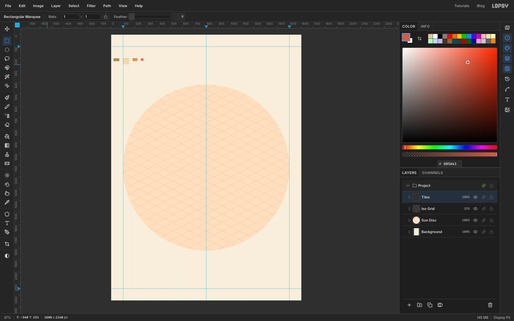

Four more patterns will texture the brick quay, the paving, the jetty and the boathouse walls. Make a new layer called `Tiles` and fill each small rectangle with exact-corner selections:

1. **Brick**, 48 × 24: fill `20, 200` to `68, 224` with `#B08A5A`. Then fill a 3 px strip along its top (`20, 200` to `68, 203`) and down its left side (`20, 200` to `23, 224`) with the mortar colour `#8F6E45`.
2. **Paving**, 50 × 50: fill `100, 200` to `150, 250` with `#EFDAB0`, with 4 px joints of `#D7BC8A` along the top and left.
3. **Plank**, 40 × 24: fill `180, 200` to `220, 224` with `#D79B5D`, with a 3 px gap of `#7F4E29` along the top.
4. **Batten**, 21 × 20: fill `250, 200` to `271, 220` with coral `#EE6A50`, with a 3 px stripe of `#D85A43` down the left.

Select each tile with an exact-corner marquee and choose **Edit → Define Pattern**. Do them in this order, so they line up in the pattern picker the same way. Then delete the **Tiles** layer.

> **Tip:** Patterns aren't saved in the project file. If you close Lopsy and come back, define them again before the steps that use them.

## Paint the front cutaway flat

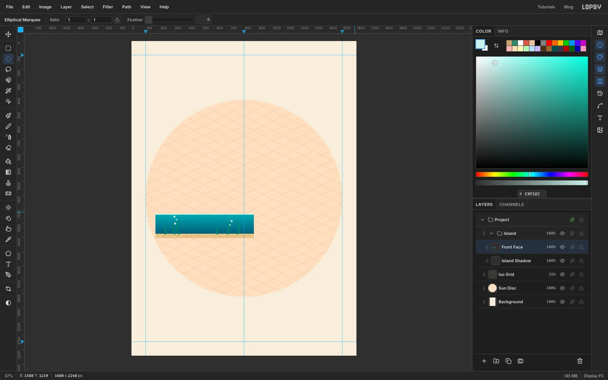

The front of the block is cut open to show the water. Draw it flat first.

1. Select **Iso Grid**, click **New Group** and name the group `Island`. Every layer of the harbour goes in this group.
2. With the group selected, click **Add Layer** and name it `Island Shadow`. It stays empty until near the end, but the island's shadow has to sit under everything else, so its layer comes first.
3. Click **Add Layer** again and name the new layer `Front Face`.
4. Select from `170, 1231` to `870, 1403`. Pick the **Gradient** tool ([[G]]), set a linear gradient from `#2AA9B3` to `#145C75`, and drag straight down from the top of the selection to `1372`.
5. Fill a sandy seabed from `170, 1372` to `870, 1403` with `#E3C48E`, and a thin 5 px highlight along the very top with `#C9F1EC` for the water's surface.
6. Pick the **Brush** ([[B]]) at size `9` with `#2F8A6A` and draw six wavy strands of seaweed up from the sand, 55 to 100 px tall. Dab a few pebbles along the sand in `#C9A46C`.
7. For bubbles, [[Shift]]-drag a few small circles with the **Elliptical Marquee** above two of the strands, fill them with `#C9F1EC`, choose **Select → Shrink…** by `2` and press [[Delete]]. That leaves thin rings.

## Skew the front face into place

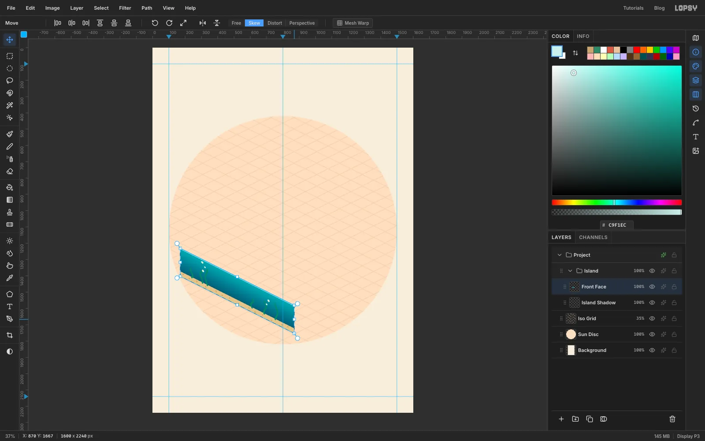

1. Select the whole rectangle again, from `170, 1231` to `870, 1403`.
2. Pick the **Move** tool ([[V]]) and click **Skew** in the options bar.
3. Grab the handle in the middle of the right edge and drag it **straight down by 350 px**, half the rectangle's 700 px width. In Skew mode the edge follows the pointer exactly, so watch the status bar: you're dragging from about Y `1317` to `1667`.
4. Deselect with [[Cmd+D]] to apply the transform.

The left edge stays put and the right edge drops, so the top edge now runs down at the isometric slope. The seaweed stays upright, just as it should.

## Paint the side cutaway flat

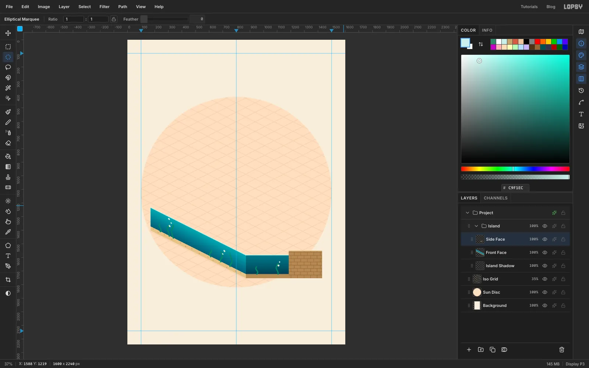

The right side of the block shows water at the front and the quay's brick wall at the back. It's in shade, so it's darker than the front.

Add a layer named `Side Face` and paint on it:

1. Select from `870, 1581` to `1185, 1722` and drag a linear gradient from `#1A7A8B` at the top to `#0C3F52` at the bottom.
2. Fill the seabed below it, `870, 1722` to `1185, 1753`, with `#B08E5C`, and a 4 px surface line along its top with `#C9F1EC`. The top 31 px above the water stay empty: that's the air between the water and the quay.
3. Select the brick part, `1185, 1550` to `1430, 1753`, choose **Edit → Fill with Pattern…**, pick the brick, set **Row Stagger** to `50` so the rows are offset like real brickwork, and click **Apply**.
4. Fill a 6 px cap of `#D7BC8A` along the top of the brick.
5. Add two strands of seaweed and a couple of bubbles in the water part, as before.

## Skew the side face up

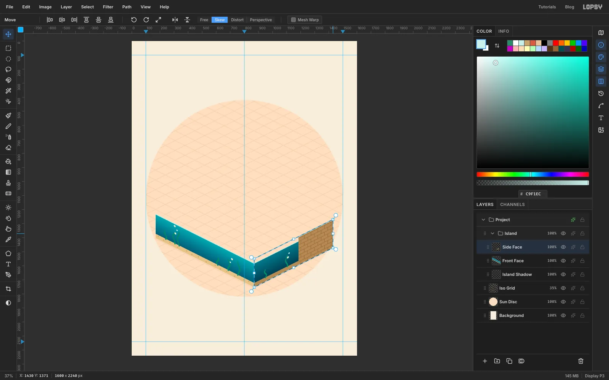

Select the whole side, `870, 1550` to `1430, 1753`, switch to the **Move** tool in **Skew** mode and drag the middle-right handle **straight up by 280 px**, half of its 560 px width. Deselect.

The two faces now meet at the front corner, `870, 1581`, and the block has its shape.

## Lay the water surface with the Pen

The water's surface is a parallelogram. You can't make that with a marquee, but the **Pen** tool ([[P]]) does it in four clicks.

1. Add a layer named `Water` above **Side Face**.
2. With the **Pen**, click at `485, 1074`, `1185, 1424`, `870, 1581` and `170, 1231`, then click the first point again to close the path.
3. In the **Paths** panel, click **Path to Selection**, then **Delete Path**.
4. Drag a linear gradient from `#46C3C4` at the back edge to `#2A9DAE` at the front, roughly from `835, 1249` to `520, 1406`. Deselect.

## Add the quay wall

A narrow strip of wall shows between the water and the quay above it.

1. Add a layer named `Quay Wall`. Select `485, 1043` to `1185, 1074` and fill it with the brick pattern, **Row Stagger** `50`.
2. Choose **Filter → Brightness/Contrast…** and set **Brightness** to `30`. This face catches the light, so it's paler than the shaded side.
3. Fill a 6 px coping stone of `#F8E9C9` along its top.
4. Select the strip again and **Skew** it: drag the middle-right handle down `350` px. Deselect.

## Pave the quay flat

Now the floor. Floors use the rotate-and-squash method, and that needs the flat drawing at a particular size: **99 px per grid step** (70 × √2, so that it shrinks back to 70 × 35). The quay is 10 steps long and 3½ steps deep, so the flat rectangle is 990 × 347 px.

1. Add a layer named `Quay Top`. Select `305, 400` to `1295, 747`, anywhere empty will do.
2. Fill it with the paving pattern, **Row Stagger** `50`.
3. Fill a 22 px kerb of `#F8E9C9` along the bottom, from `305, 725` to `1295, 747`, with a 2 px line of `#D7BC8A` just above it.

## Rotate the paving 45°

1. Select the rectangle again, `305, 400` to `1295, 747`.
2. Pick the **Move** tool. Hold [[Cmd]] and drag the rotation handle just outside the top-right corner clockwise. [[Cmd]] snaps the angle in 15° steps, so stop at **45°**.
3. Deselect with [[Cmd+D]].

> **Tip:** Deselect before the next step. While a transform is still live, its handles stay tilted with the rotation, and a squash would stretch along the tilted box instead of straight down.

## Squash the paving to half height

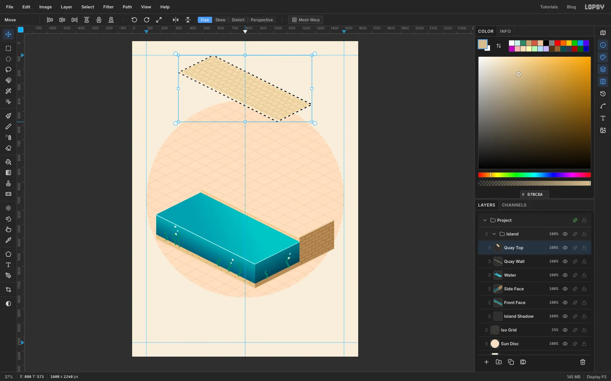

1. [[Cmd]]-click the **Quay Top** thumbnail. The selection's box is upright again and about 945 px square.
2. Grab the handle in the middle of the **bottom** edge and drag it **straight up by half the box's height**, about 473 px. Without [[Cmd]] only the height changes.
3. Deselect.

The band is now an isometric floor: its long edge runs down at the same 2:1 slope as the walls.

## Move the paving onto the block

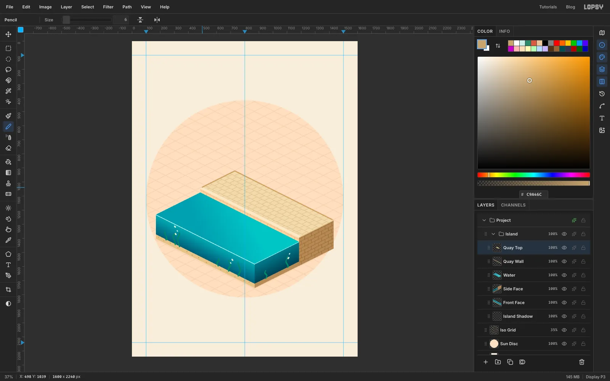

1. Drag the paving with the **Move** tool until its top corner is at `730, 920`. That puts its front-left corner at `485, 1042` and its right corner at `1430, 1270`, exactly on top of the quay wall and the brick side. Use the arrow keys for the last few pixels.
2. Pick the **Brush** at size `6` with `#C9A46C`. Click at `1420, 1268`, just inside the right corner, [[Shift]]-click at `730, 923` and [[Shift]]-click at `498, 1039`, stopping short of the kerb. This coping line marks the two back edges, so the paving doesn't fade into the grid behind it. Keep it a few pixels inside the corners: the brush's round ends would otherwise poke past them.

## Add ripples and foam

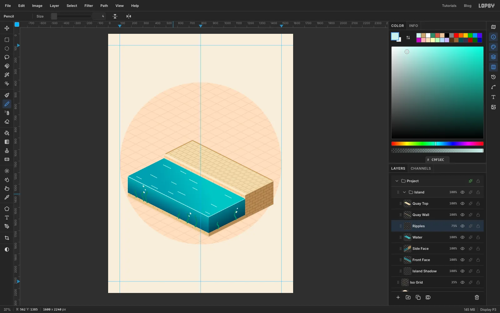

1. Select **Water** and add a layer above it named `Ripples`.
2. With the **Brush** at size `6` and `#C9F1EC`, click at `485, 1074` and [[Shift]]-click at `1185, 1424` for a line of foam along the wall.
3. Switch to the **Pencil** at size `4` and draw a dozen short dashes over the water, each 40 to 70 px long. Click, then [[Shift]]-click about 60 px right and 30 px down, so every dash follows the floor slope.
4. Set the layer's opacity to `75%`.

## Texture the jetty planks

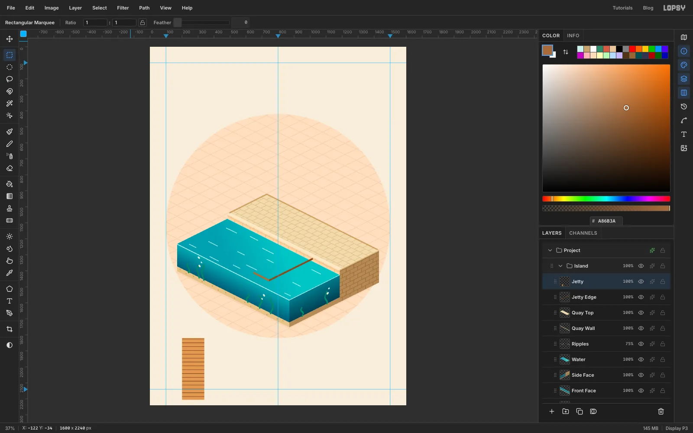

The jetty is 1.4 steps wide and 3.9 steps long, so its flat drawing is 139 × 386 px. Draw it at the bottom left of the page, out of the way.

1. Select **Quay Top** and add two layers: `Jetty Edge` first, then `Jetty` above it.
2. On **Jetty**, select a patch **wider** than the deck, from `160, 1820` to `379, 2206`, and fill it with the plank pattern.
3. Choose **Filter → Add Noise…** with **Amount** `14` and **Mono**, then **Filter → Motion Blur…** with **Angle** `0` and **Distance** `30`. The noise smears into wood grain.
4. Blur also softens the edges of whatever you blur, which is why the patch is wider. Trim it to the real size: select `200, 1820` to `339, 2206`, choose **Select → Inverse** and press [[Delete]].

## Turn the planks into a jetty

1. Rotate and squash the planks exactly as you did the paving: select them, [[Cmd]]-rotate 45°, deselect, [[Cmd]]-click the thumbnail, and drag the bottom handle up by half the height.
2. Move the deck so its top corner is at `919, 1269` and its left corner at `646, 1405`. Its back end now butts against the quay wall.
3. Select **Jetty Edge** and use the **Pen** and **Path to Selection** to fill the deck's thickness, a 12 px band under each outer edge:
   - **Side** `#7F4E29`: `1017, 1318`, `744, 1454`, `744, 1466`, `1017, 1330`.
   - **End** `#A86B3A`: `646, 1405`, `744, 1454`, `744, 1466`, `646, 1417`.
4. Select **Jetty** and add a layer named `Pilings`. Each post is an 18 px wide bar standing on a point of the deck's edge: the left half `#D79B5D`, the right half `#7F4E29`, and a small `#E8B57A` ellipse 18 × 9 px on top. Each bar is centred on the X given here and runs from its top down to its foot.
   - **Four outer posts** reach down into the water: X `930` from Y `1327` to `1383`, X `835` from `1375` to `1431`, X `744` from `1420` to `1476`, and X `646` from `1371` to `1427`.
   - **Two inner posts**, on the far side of the deck, stop at the deck: X `832` from `1278` to `1313`, and X `737` from `1326` to `1360`.
5. On **Ripples**, add a ring around the foot of each outer post: an ellipse 40 × 20 px with a smaller one [[Option]]-dragged out of its middle, filled with `#C9F1EC`.

## Draw the boathouse's long wall flat

The boathouse is a box 3.6 steps long and 2.5 deep. Its long wall faces the water, so it's lit, and it's 252 × 180 px flat.

1. Select **Pilings** and add a layer named `Boathouse L`.
2. Select `597, 877` to `849, 1057` and fill it with the batten pattern.
3. Fill an 8 px white trim of `#FFF6E8` along the top and a 10 px plinth of `#B9483A` along the bottom.
4. **Door:** fill a navy rail from `655, 931` to `817, 937`, a white frame from `657, 941` to `769, 1057` and the dark opening inside it, `665, 949` to `761, 1057`, with `#1F2C55`.
5. **Sliding panel:** fill `737, 945` to `811, 1057` with trim, then `743, 951` to `805, 1051` with `#C44E3A`, and draw a white X brace across it with the **Pencil** at size `5`.
6. **Life ring:** a white ring 28 px across at `627, 985`, left of the door. Make a circle, [[Option]]-drag a smaller one out of its middle, and fill.

## Skew the long wall

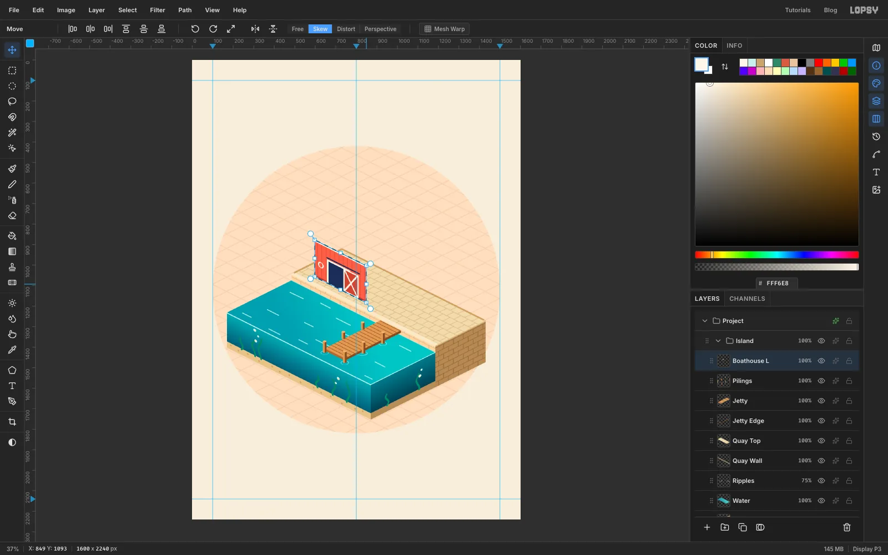

Select `597, 877` to `849, 1057`, switch to **Skew** and drag the middle-right handle **down by 126 px**, half of 252. Deselect.

The door, the trim and the ring all slant with the wall, and their verticals stay vertical.

## Draw the gable wall flat

The short end wall is in shade, and it has a triangular gable on top.

1. Add a layer named `Boathouse R`.
2. With the **Pen**, click `849, 1183`, `849, 1003`, `937, 917`, `1024, 1003` and `1024, 1183`, close the path and choose **Path to Selection**.
3. Fill it with the batten pattern, then choose **Filter → Brightness/Contrast…** with **Brightness** `-15` to put it in shade. Deselect.
4. Fill a 10 px plinth of `#9E3D30` along the bottom.
5. **Round window:** fill a circle 46 px across at `937, 985` with trim, a 32 px circle inside it with `#2C3E73`, and draw a white cross with the **Pencil** at size `3`.

## Skew the gable wall up

Select `849, 917` to `1024, 1183`, switch to **Skew** and drag the middle-right handle **up by 88 px**, half of 175. Deselect.

The round window becomes a tilted ellipse, which is exactly how a round window looks on an isometric wall.

## Put on the roof

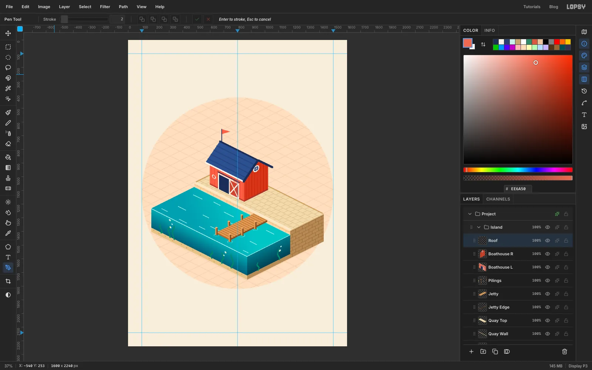

1. Add a layer named `Roof`. With the **Pen**, click the four corners of the front roof slope: `670, 741` and `950, 881` along the ridge, then `846, 1036` and `566, 896` along the eave. Close it, choose **Path to Selection**, fill with `#34508C` and deselect.
2. **Shingles:** with the **Pencil** at size `4` in `#2C3E73`, draw four lines across the roof, parallel to the ridge, spaced evenly between the ridge and the eave. Click on the left edge of the roof and [[Shift]]-click the matching point on the right edge.
3. **Eave and ridge:** a size `8` trim line along the eave from `566, 896` to `846, 1036`, and a size `9` navy `#1F2C55` line along the ridge.
4. **Barge boards:** size `12` navy lines from the ridge's end, `950, 881`, down to `846, 1036` and down to `1056, 931`. They cover the end of the roof and frame the gable.
5. **Pennant:** a navy line 95 px straight up from `684, 748`, and a small coral `#EE6A50` triangle flying from its top.

## Draw one pine tree

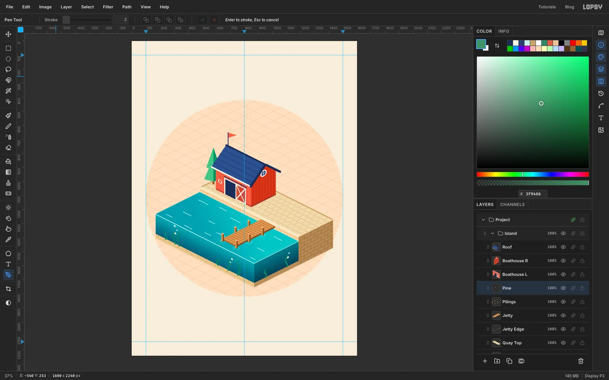

Isometric trees are easiest as cones: two stacked triangles, light on the left where the sun hits and dark on the right.

1. Select **Pilings** and add a layer named `Pine`. It goes under the boathouse, so the house can stand in front of the trees.
2. **Trunk:** a 14 × 40 px bar standing on `580, 1020`, half `#A86B3A` and half `#7F4E29`.
3. **Lower tier:** with the **Pen**, fill the left half with `#6CC48C`. Click the tip, 190 px above the ground point, then the left corner, 36 px above the ground and 66 px to the left, then the middle point, straight under the tip and 16 px lower than the corners, so the bottom of the cone looks round. Fill the right half the same way with `#3F9466`, using the right corner.
4. **Upper tier:** the same again, smaller and higher: the tip 262 px above the ground, the corners 120 px above it and 50 px out to each side.

## Duplicate and resize the pines

1. Choose **Layer → Duplicate Layer**, rename the copy `Pine 2`, and drag it with the **Move** tool so its trunk stands at `751, 952`, behind the boathouse.
2. [[Cmd]]-click its thumbnail and drag the top-right handle up and out a little to make this pine taller. It should peek well above the roof ridge. Deselect.
3. Duplicate it again, name it `Pine 3`, and drag it to the far right of the quay, with the trunk at `1342, 1265`.
4. With **Pine 3** selected, choose **Layer → Merge Down** twice, and rename the result `Pines`.

## Stack some crates

1. Select **Roof** and add a layer named `Crate A`. With the **Pen** and **Path to Selection**, fill a small isometric cube half a step on each side, standing at the front-left corner of the quay:
   - **Top** `#EAB97F`: `552, 991`, `586, 1009`, `552, 1026`, `516, 1009`.
   - **Left side** `#D79B5D`: the edge from `516, 1009` to `552, 1026`, and the same edge 39 px lower.
   - **Right side** `#A86B3A`: the edge from `552, 1026` to `586, 1009`, and the same edge 39 px lower.
2. Draw a few `#7F4E29` slat lines across the sides with the **Pencil** at size `3`.
3. **Duplicate Layer**, name it `Crate B`, and press [[Up]] 39 times with the **Move** tool (or [[Shift+Up]] 3 times and [[Up]] 9 times) to stack it on top.
4. Click **Crate A**, [[Cmd]]-click its thumbnail, press [[Cmd+C]] and [[Cmd+V]]. Name the pasted layer `Crate C` and move it 38 px right and 19 px down with the arrow keys ([[Shift]] + arrow moves 10 px), so it sits beside the bottom crate.

## Copy a bollard with Option-drag

1. Add a layer named `Bollards`. Draw a short navy post at `912, 1238`, just left of the jetty: a 24 × 28 px bar, the left half `#2C3E73` and the right half `#1F2C55`, with a 24 × 12 px ellipse at its foot in navy and one on top in `#4A64A8`.
2. Draw a marquee around it with a little room to spare.
3. With the **Move** tool, hold [[Option]] and drag it along the quay edge to `1126, 1349`. [[Option]] leaves the original behind and moves a copy. Deselect.

## Light a lamp at the end of the jetty

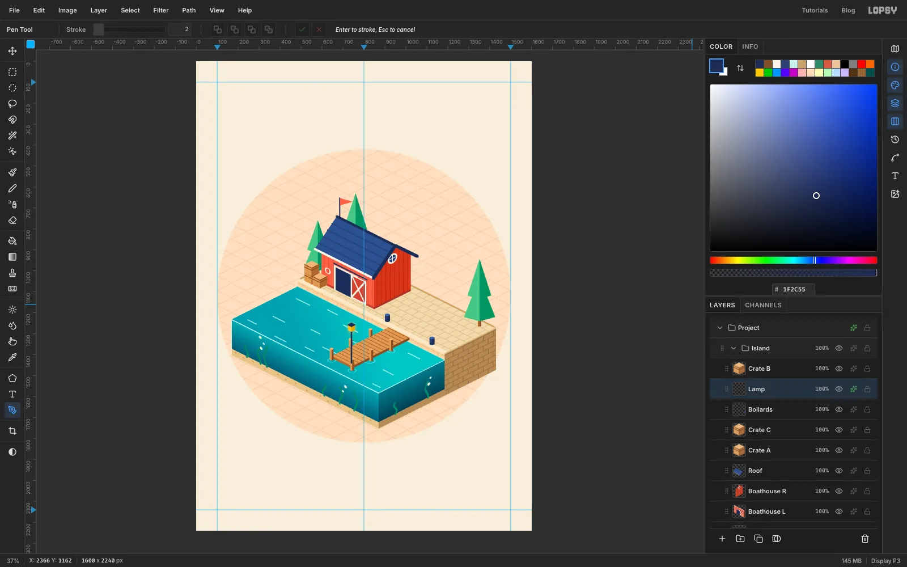

1. Add a layer named `Lamp`. With the **Brush** at size `7` and navy, click at `740, 1439` on the deck and [[Shift]]-click at `740, 1283`, straight above it.
2. Draw the lantern on top of the post as a tiny cube, the same way as the crates, with the **Pen**:
   - **Top** `#FFF1B8`: `740, 1249`, `757, 1258`, `740, 1266`, `724, 1258`.
   - **Left side** `#F7C548`: `724, 1258`, `740, 1266`, `740, 1291`, `724, 1283`.
   - **Right side** `#E0A93A`: `740, 1266`, `757, 1258`, `757, 1283`, `740, 1291`.
   - **Cap**, navy: a slightly wider diamond, `740, 1247`, `762, 1258`, `740, 1268`, `719, 1258`.
3. Open the layer's **effects** (the ✦ on its row), turn on **Outer Glow**, and set **Size** `45`, **Opacity** `70` and **Glow color** `#FFD66B`.

## Cut a kayak shape from two circles

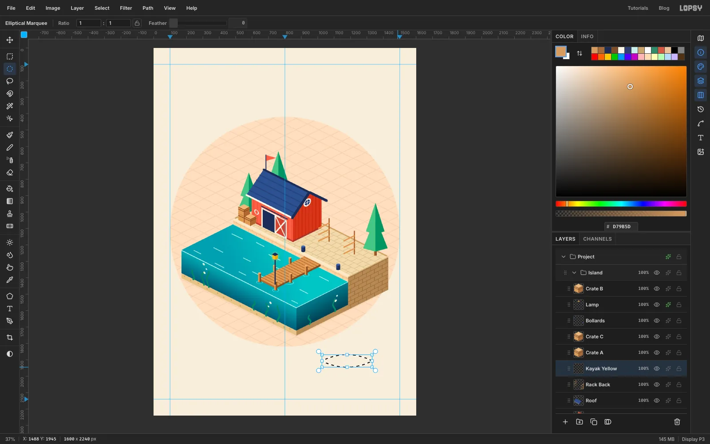

A kayak seen from above is a long, pointed lens. That's exactly what two big overlapping circles have in common.

1. Select **Roof** and add a layer named `Rack Back`. With the **Brush** at size `7` in `#A86B3A`, draw two posts straight up: from `1070, 1177` and from `1224, 1254`, each 137 px tall. Add three crossbars to each post in `#D79B5D` at size `6`, starting 31, 70 and 109 px above the post's foot and running 64 px left and 32 px down. On the first post that's from `1070, 1146` to `1006, 1178`, then 39 px higher each time.
2. Add a layer named `Kayak Yellow` above it.
3. With the **Elliptical Marquee**, drag a circle from `858, 1869` to `1488, 2499`. Most of it hangs off the bottom of the page, which is fine: only its top matters.
4. Hold [[Shift]] and [[Option]] together and drag a second circle from `858, 1315` to `1488, 1945`. [[Shift]]+[[Option]] keeps only the overlap: a lens 300 px long and 76 px wide, centred on `1173, 1907`.

## Decorate the kayak

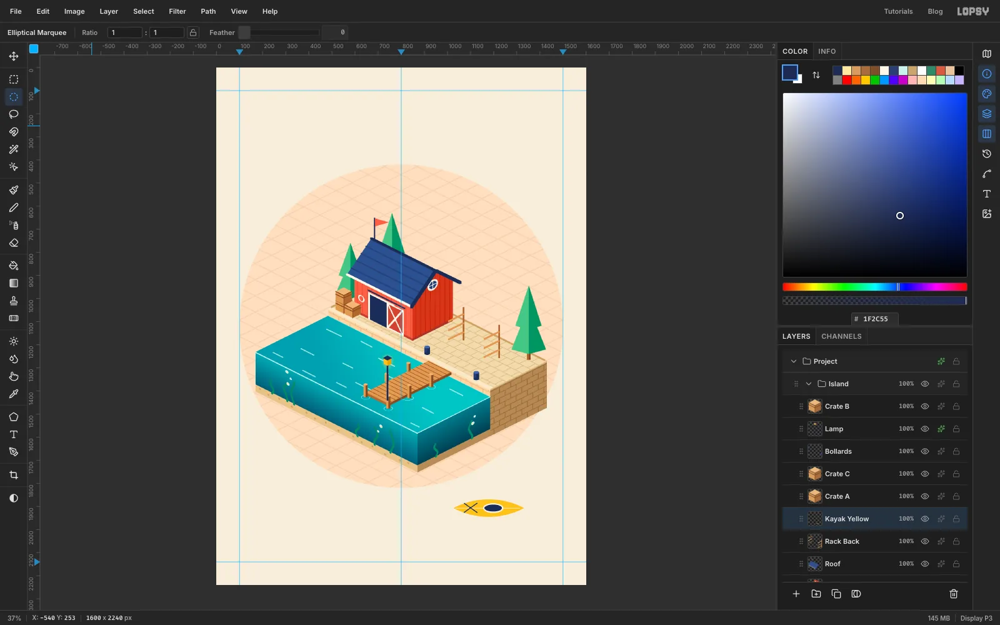

1. Fill the lens with `#F7C548` and deselect.
2. Draw a pale `#FFE7A0` line along its middle with the **Pencil** at size `3`, stopping just short of both tips.
3. Draw an X of deck bungees near the front in navy at size `3`.
4. **Cockpit:** fill an ellipse 88 × 42 px a little behind the middle with trim, and a 76 × 30 px ellipse inside it with navy.

## Rotate and squash the kayak

1. Draw a marquee around the kayak with **10 px of room** on every side. The tips are anti-aliased, and a marquee drawn tight to them leaves a 1 px sliver behind when you rotate.
2. Rotate it 45° with [[Cmd]] held, deselect, [[Cmd]]-click the thumbnail and drag the bottom handle up by half the box's height, just like the paving.
3. Give it a hull: open its effects and add a **Drop Shadow** with **Offset X** `0`, **Offset Y** `12`, **Blur** `0`, **Opacity** `80` and **Shadow color** `#1F2C55`. With no blur, the shadow reads as the dark side of the hull below the deck.
4. Move it so its centre is at `1115, 1183`, resting on the lowest crossbars.

## Make the other kayaks with Hue/Saturation

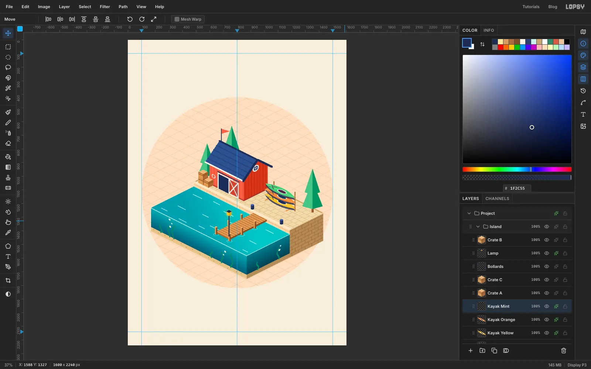

1. Choose **Layer → Duplicate Layer** and name it `Kayak Orange`. Choose **Filter → Hue/Saturation…**, set **Hue** to `-18` and click **Apply**. Press [[Up]] 39 times to lift it onto the middle crossbars.
2. With **Kayak Orange** still selected, duplicate it, name the copy `Kayak Mint`, and use **Hue** `105` with **Saturation** `-45`. Lift it another 39 px.

The drop shadow copies along with each layer, so every kayak keeps its hull.

## Add the front posts of the rack

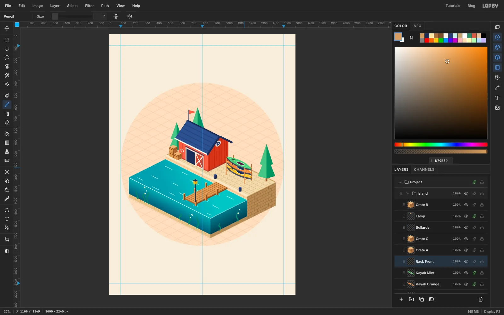

Add a layer named `Rack Front` above the kayaks. With the **Brush** at size `7` in `#D79B5D`, draw the two front posts straight up from `1006, 1209` and `1160, 1286`, each 137 px tall. Now the kayaks sit *inside* the rack, behind its front posts and in front of the back ones.

## Flip a kayak onto the water

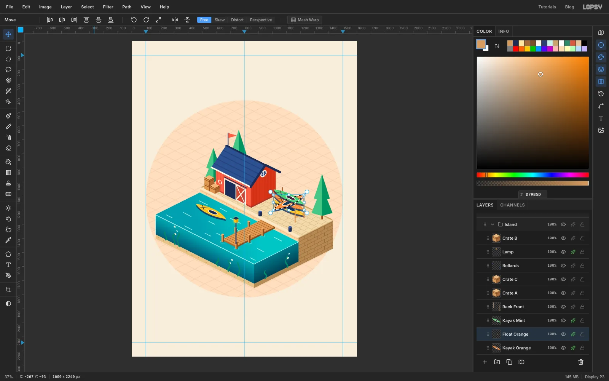

1. Select **Kayak Yellow**, duplicate it, name it `Float Yellow`, and drag it down onto the water so its centre is at about `562, 1209`.
2. Select **Kayak Orange**, duplicate it and name it `Float Orange`. [[Cmd]]-click its thumbnail, pick the **Move** tool and click **Flip Horizontal** in the options bar. A kayak running along one floor axis now runs along the other one.
3. Deselect and drag it to about `950, 1453`, beside the jetty.

## Make a paddleboard

1. Add a layer named `Paddleboard`. Make a pill 300 × 70 px: select the rectangle `1035, 1990` to `1265, 2060`, then pick the **Elliptical Marquee** and [[Shift]]-drag a circle at each end, from `1000, 1990` to `1070, 2060` and from `1230, 1990` to `1300, 2060`. [[Shift]] adds each circle to the selection.
2. Fill it with trim. With the **Rectangular Marquee**, [[Shift]]+[[Option]]-drag a thin rectangle from `990, 2019` to `1310, 2031` to keep only where it crosses the board, and fill that with coral for a stripe. Fill a navy `#2C3E73` deck pad in the middle, `1105, 2000` to `1195, 2050`.
3. Rotate and squash it like the kayak, give it a **Drop Shadow** with **Offset X** `0`, **Offset Y** `7`, **Blur** `0`, **Opacity** `45` and navy, and move it onto the water at about `510, 1334`.

## Add a paddle and a wake

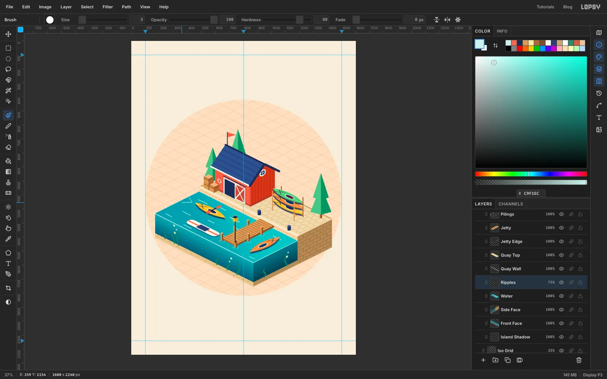

1. Add a layer named `Paddles`. With the **Pencil**, draw a navy shaft at size `6` across the yellow kayak's cockpit, along the other floor axis: about 80 px long, going down and to the left. Draw a short coral stroke at size `14` at each end for the blades.
2. On **Ripples**, draw a V of wake behind the kayak's stern with the **Brush** at size `5`: two short lines spreading out from the back tip.

## Cast the shadows

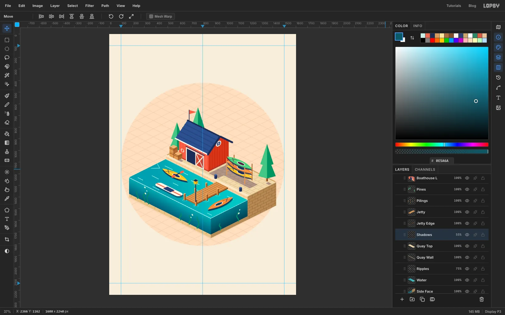

The light comes from the upper left, so shadows fall to the right.

1. Select **Quay Top** and add a layer named `Shadows` above it. That's above the paving, so shadows can fall on it, but under everything standing on it.
2. With the **Pen** and **Path to Selection**, fill these shapes with `#7C6E98`: a strip on the paving to the right of the boathouse (`1024, 1095`, `1066, 1154`, `930, 1223`, `849, 1182`), a strip under the rack, a small one to the right of the crates and a short one to the right of the far pine's trunk. Keep them on the paving: the next step pushes every shadow a little down and right, and anything near the edge would slide off it.
3. [[Cmd]]-click the **Float Yellow**, **Float Orange** and **Paddleboard** thumbnails one at a time and fill each shape on the **Shadows** layer with dark teal `#0E5A6A`. Deselect.
4. Press [[Right]] 6 times and [[Down]] 14 times with the **Move** tool to push the shadows off their objects.
5. Choose **Filter → Gaussian Blur…** with **Radius** `4`. Set the blend mode to **Multiply** in the effects drawer and the opacity to `55%`.

## Float the island

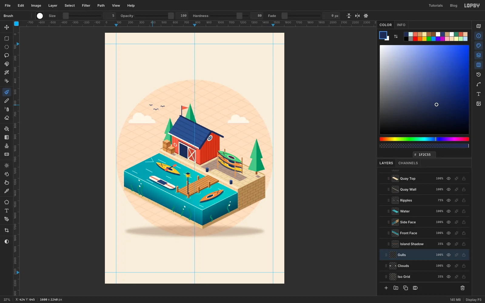

1. Select the empty **Island Shadow** layer you made at the start, at the bottom of the group. Fill an ellipse 1240 × 96 px centred on `800, 1772` with warm brown `#7A5A40`, blur it with **Gaussian Blur** at **Radius** `30` and set the opacity to `35%`. The block now hovers.
2. Select **Iso Grid** and add a layer named `Clouds` outside the group. Each cloud is a pill 240 × 56 px with two circles [[Shift]]-added on top: one 108 px across, overlapping the pill's top a little left of centre, and a smaller 80 px one to its right. Fill it with trim, then [[Shift]]+[[Option]]-drag a rectangle over its lower half and fill that part with `#F4D9C4` for a flat shaded underside. Centre one cloud's pill at `330, 800`, and make a second at 80% of the size centred at `1190, 800`.
3. Add a layer named `Gulls` and draw three small navy "m" shapes with the **Brush** at size `5` in the sky at the upper left.

## Set the headline and extrude it

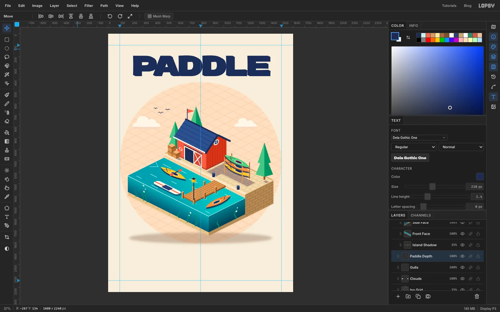

The headline gets an isometric extrusion that steps down and to the right, the same 2:1 direction as the floor.

1. Select **Gulls**. Pick the **Type** tool ([[T]]), choose **Dela Gothic One** at **Size** `230` and navy. Click in an empty spot, type `PADDLE`, press [[Tab]] to finish and name the layer `Paddle Depth`.
2. Move it so the word is centred at `800, 272`.
3. Click **Rasterize Layer** at the bottom of the Layers panel.
4. Now build the depth: choose **Layer → Duplicate Layer**, press [[Right]] twice and [[Down]] once with the **Move** tool, then choose **Layer → Merge Down**. Do this ten times in all. Each round adds a copy 2 px right and 1 px down, so the extrusion ends up 20 px right and 10 px down.

> **Tip:** Text options restyle whichever text layer is selected. Always click a non-text layer before you start a new piece of type.

## Put the coral face on top

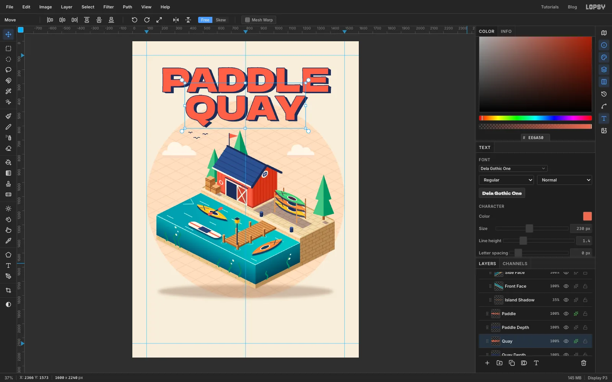

1. Select **Paddle Depth**. Type `PADDLE` again in **Dela Gothic One** `230`, this time in coral `#EE6A50`, in an empty spot, and name it `Paddle`.
2. Move it so it's centred at `800, 272` too, exactly on top of where the navy word started. The extrusion now shows only below and to the right.
3. Add a **Stroke** effect with **Width** `4` and **Stroke color** `#1F2C55`.
4. Now the second line. Select **Gulls** again and type `QUAY` in **Dela Gothic One** `230`, navy, in an empty spot. Name it `Quay Depth` and centre it at `800, 492`.
5. Rasterize **Quay Depth** and give it the same ten rounds of duplicate, nudge and **Merge Down**.
6. Select **Quay Depth**, type `QUAY` again in coral, name it `Quay`, centre it at `800, 492` and add the same navy **Stroke**.

## Skew a sign onto the gable

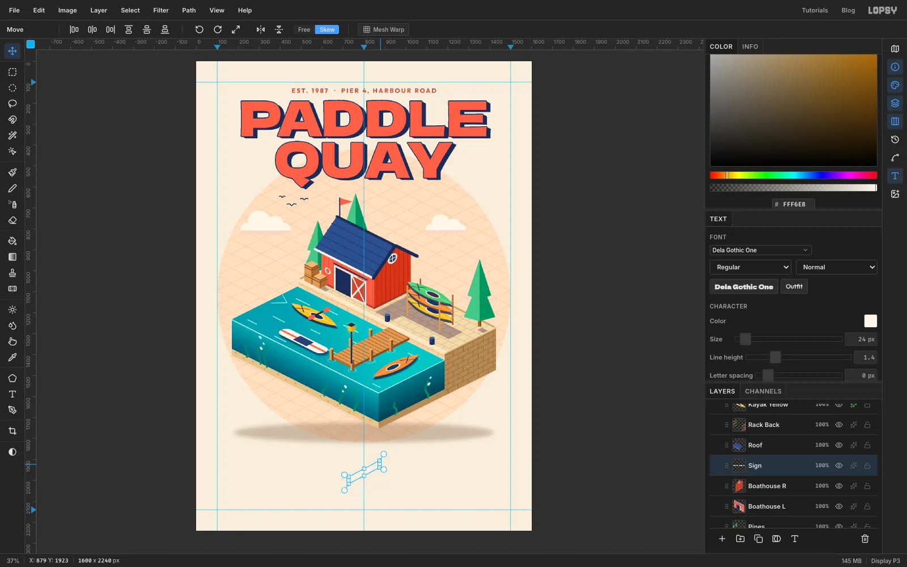

Live text can be skewed too, and it stays editable.

1. Select **Boathouse R**. Type `RENTALS` in **Dela Gothic One** at **Size** `24` in trim colour, in an empty spot, and name it `Sign`.
2. With the **Move** tool, click **Skew** in the options bar. Drag the middle-right handle of the text's box **up by half the box's width**.
3. Move the sign onto the gable wall, centred below the round window. Its baseline now climbs at the same slope as the wall, and the letters stand upright.

## Add the kicker, subhead and price cards

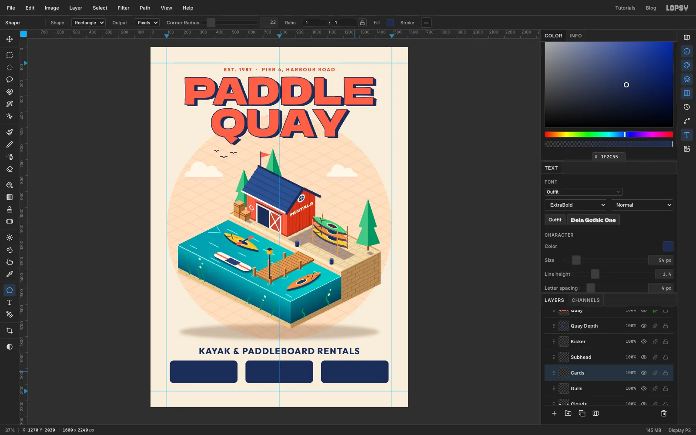

1. Select **Gulls** and type `EST. 1987  ·  PIER 4, HARBOUR ROAD` in **Outfit**, **Bold** (700), **Size** `30`, colour `#C44E3A`. Name it `Kicker`, set **Letter spacing** to `6` in the **Text** panel and centre it at `800, 142`.
2. Select **Gulls** again and type `KAYAK & PADDLEBOARD RENTALS` in **Outfit**, **Extra Bold** (800), **Size** `54`, navy, with **Letter spacing** `4`. Name it `Subhead` and centre it at `800, 1890`.
3. Select **Gulls** and add a layer named `Cards`. Set the foreground colour to navy, then pick the **Shape** tool ([[U]]). Set **Shape** to **Rectangle**, **Output** to **Pixels** and **Corner Radius** to `22`.
4. Click once without dragging at `330, 2020`. A dialog asks for the size: type **Width** `420`, **Height** `140`, and press [[Enter]]. The card is centred on the click. Do the same at `800, 2020` and `1270, 2020`, so the three cards span `120`–`540`, `590`–`1010` and `1060`–`1480`.
5. Add a **Drop Shadow** with **Offset X** `9`, **Offset Y** `9`, **Blur** `0`, **Opacity** `100` and **Shadow color** `#EE6A50`. A hard coral offset gives the cards the same chunky, printed feel as the headline.

## Write the prices and the details

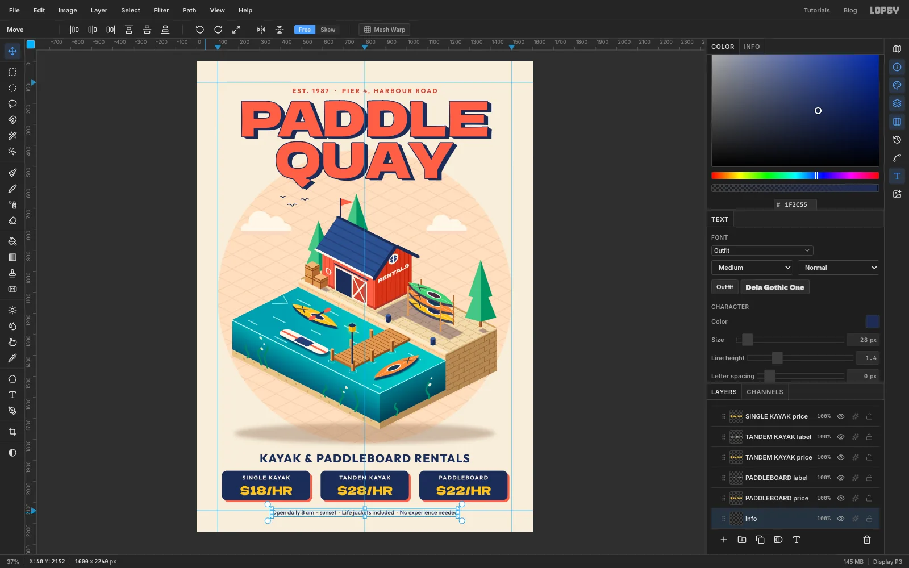

The cards read `SINGLE KAYAK` / `$18/HR`, `TANDEM KAYAK` / `$28/HR` and `PADDLEBOARD` / `$22/HR`, centred at X `330`, `800` and `1270`. For each card, select **Cards** before you type:

1. The name in **Outfit Bold** `26`, trim colour, **Letter spacing** `4`, centred 38 px above the card's middle (at Y `1982`).
2. The price in **Dela Gothic One** `54`, yellow, centred 24 px below the middle (at Y `2044`). Together they sit optically centred in the card, with the same margin above the name as below the price.

Finally, select **Cards** once more and type `Open daily 8 am – sunset  ·  Life jackets included  ·  No experience needed` in **Outfit Medium** (500) `28`, navy, centred at `800, 2150`.

## Make the offer badge

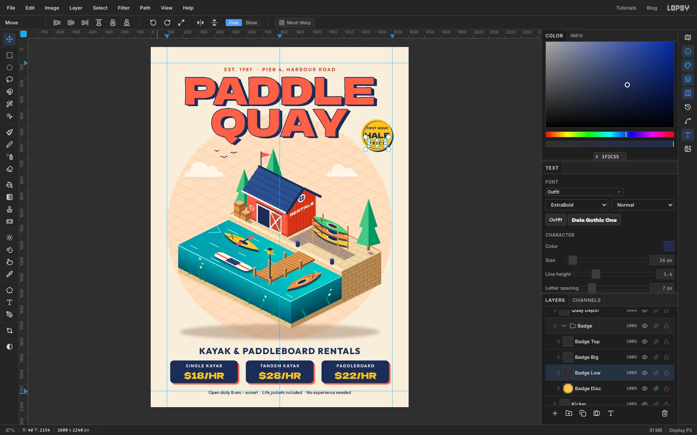

1. Select **Kicker**, click **New Group** and name it `Badge`. Add a layer inside it named `Badge Disc`.
2. Fill a circle 196 px across centred on `1405, 548` with yellow, far enough out that it clears the peach sun disc's edge instead of just touching it.
3. Add a navy ring 10 px inside the badge's edge: select a circle 176 px across on the same centre, [[Option]]-drag a 168 px circle out of its middle, and fill with navy.
4. Add a **Drop Shadow**: **Offset X** and **Y** `7`, **Blur** `0`, **Opacity** `100`, navy.
5. Select **Badge Disc** before each line, and type `FIRST HOUR` (**Outfit Extra Bold** `20`, **Letter spacing** `2`), `HALF` (**Dela Gothic One** `45`) and `PRICE` (**Outfit Extra Bold** `26`, **Letter spacing** `7`), all in navy and centred on the badge's centre line, at Y `504`, `550` and `597`. Name them `Badge Top`, `Badge Big` and `Badge Low`. Navy on yellow keeps the offer readable; coral on yellow would be too faint.

## Tilt the badge as a group

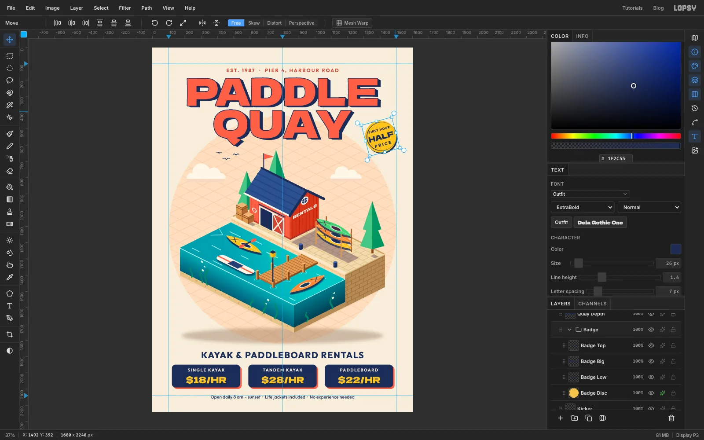

Select the **Badge** group itself, not a layer inside it. With the **Move** tool, hold [[Cmd]] and drag the rotation handle at the top-right corner anticlockwise to **-15°**, then press [[Enter]]. The disc and all three lines turn together, and the text is still live.

## Add print grain

1. Select **Paddle**, the topmost layer, and click **Add Layer**. Name it `Grain`. It's now the top layer, outside every group, so the grain covers the headline too.
2. Choose **Select → All**, fill it with mid-grey `#808080` and deselect.
3. Choose **Filter → Add Noise…** with **Amount** `22`, **Mono** and **Gaussian**.
4. Open its effects drawer, set the blend mode to **Overlay**, and set the opacity to `50%`. Mid-grey vanishes in Overlay, so only the speckle is left, like ink on uncoated paper.

## Nudge the island and export

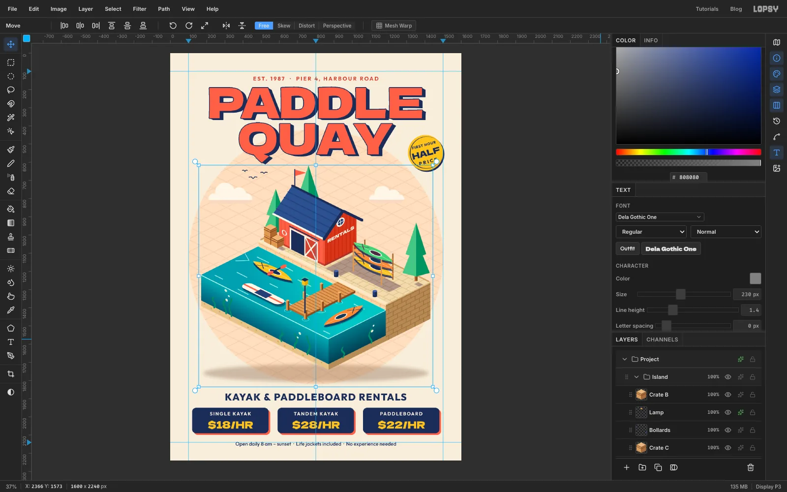

The island sits a little close to the subhead. Select the **Island** group, pick the **Move** tool and press [[Shift+Up]] once and [[Up]] twice: the whole harbour moves 12 px up together, shadows, sign and all.

Choose **File → Save Project** to keep every layer and the live text editable, then **File → Quick Export PNG** for the finished flyer.
