**Kawaii** (かわいい, "cute") is the Japanese aesthetic behind Hello Kitty, Rilakkuma and thousands of bakery signs. The look is easy to recognise: soft pastel colours, round shapes, thick dark outlines, and faces on everything, from cakes to cookies. The faces are tiny dot eyes with a white catchlight, a little mouth set low, and pink blush ovals on the cheeks. Flat colour with one simple highlight and one simple shadow keeps it graphic.

In this tutorial you'll make a 1500 × 2000 px grand-opening poster for **Neko Pâtisserie**, an imaginary cat-themed pastry shop. ("Neko" is Japanese for cat.) It has:

- a pink gingham background made from a tiny pattern tile, and a striped awning with scalloped edges
- a cream halo with a ring of polka dots, painted in one click with Radial Symmetry
- a cat-faced strawberry cake on a mint cake stand, drawn with selections, the Pen tool and the Stroke effect
- three macarons, one drawn by hand and two pasted copies recoloured with the Magic Wand and Hue/Saturation
- sticker-style title type, a speech bubble, a paw cookie, sparkles, hearts and a ribbon banner

The tools you'll use:

- **Define Pattern** and **Fill with Pattern**, the **Rectangular** and **Elliptical Marquee**, the **Lasso** and the **Pen** tool
- the **Brush** with **Radial Symmetry**, and **Shift**-click straight lines
- the **Shape** tool's rounded rectangles and ellipses with their own fill and stroke
- the **Stroke** and **Drop Shadow** layer effects, and the **Multiply** and **Overlay** blend modes
- **Copy** and **Paste**, the **Magic Wand**, **Hue/Saturation**, **Gaussian Blur** and **Add Noise**
- the **Move** tool's scale and rotate handles, on single layers, on several layers at once, and on live text
- groups, guides and the **Text** tool, including colouring a single character

The only font is **Mochiy Pop One**, a free, rounded Japanese Google Font in Lopsy's font picker. It covers both the Latin letters and the Japanese tagline.

The palette:

- Cocoa outline `#4A2C2A`, eyes `#3B2523`, cream `#FFF6E9`, halo `#FFF8E6`
- Gingham `#FFF3F1` → `#F9CDD7` → `#F3AFC1`
- Strawberry `#F0596E` / `#C93F58` / `#9E2E44`, leaf `#7CC793`
- Frosting `#FBC3D1` / `#F6A5BA` / `#EC7F9C`, blush `#FF8FA8`, stand shadow `#E9A0AE`
- Mint `#9EDCC8` / `#72C4AC`, sponge `#FFE9C9` / `#F2C99B`
- Lavender `#C9B5F2` / `#9479CF`, butter `#FFE08A`, cookie `#E8B57E` / `#DDA066`

> **Tip:** Positions are written as `x, y` in document pixels, and the status bar at the bottom left shows the cursor's position as you move. With **nothing selected**, a click with a marquee tool (without dragging) opens a small dialog where you type the two corners, such as `0, 0` to `80, 80`. If something is already selected, that click just deselects, so press [[Cmd+D]] first. When a step says to **Shift-add** or **Alt-subtract** a shape, hold the key and drag from the first corner to the second. Key names are Mac keys. On Windows and Linux use Ctrl for Cmd, except when you hold Cmd on a transform handle: there Lopsy reads the Windows key.

## Make a gingham pattern tile

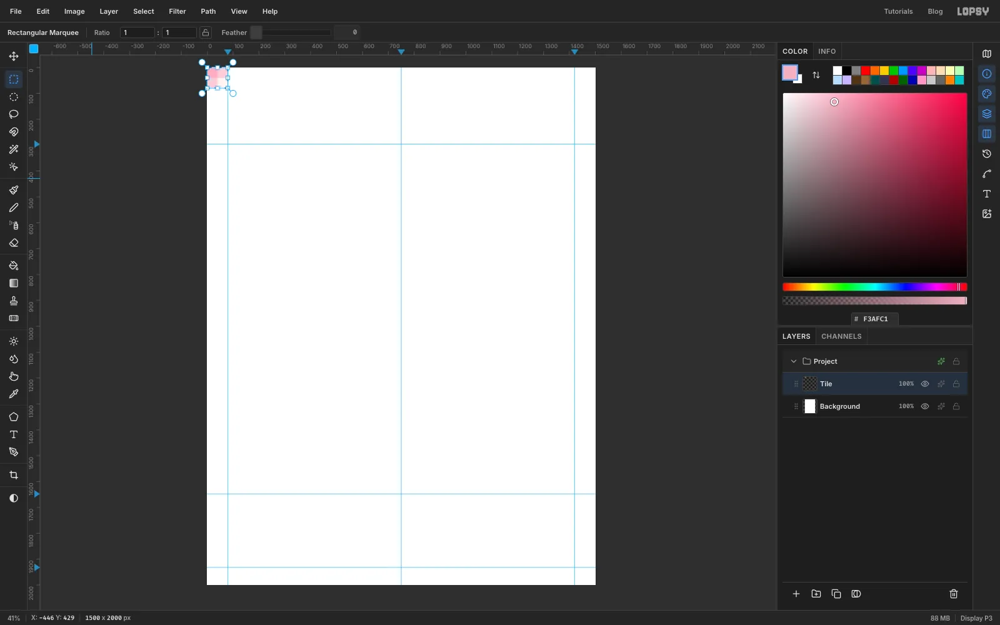

Gingham is two sets of stripes crossing, darker where they overlap. You'll draw one 80 px repeat and let Lopsy tile it.

1. Open [Lopsy](/). In the **New Document** dialog, set **Width** to `1500` and **Height** to `2000`, then click **Create**. Delete the empty `Layer 1` with the bin button at the bottom of the Layers panel.
2. Click the top ruler at **80**, **750** and **1420** to drop vertical guides for the margins and the centre line. Click the left ruler at **296**, **1648** and **1932** for the tagline, the banner and the bottom margin. Then turn off **View → Snap to Guides**, so the small shapes you draw near the guides don't jump onto them.
3. Click **Add Layer** (+) and name the layer `Tile`. With the **Rectangular Marquee** ([[M]]), click once on the canvas and enter `0, 0` to `80, 80`. Type `FFF3F1` in the Color panel's hex field and choose **Edit → Fill**.
4. Press [[Cmd+D]], click once and enter `0, 0` to `40, 80`, and fill it with `#F9CDD7`. Deselect again, select `0, 0` to `80, 40` and fill that with `#F9CDD7` too. Finally deselect, select the overlap, `0, 0` to `40, 40`, and fill it with the darker `#F3AFC1`.
5. Deselect, select the whole tile again (`0, 0` to `80, 80`) and choose **Edit → Define Pattern**.

## Fill the background with gingham

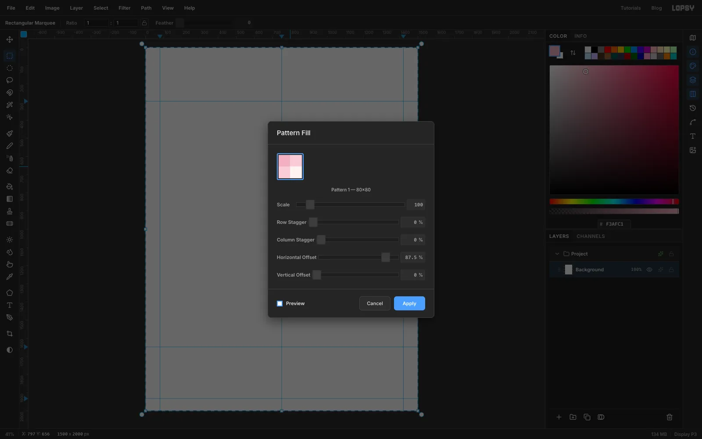

1. Press [[Cmd+D]], then delete the `Tile` layer. The pattern is saved, so you don't need the layer any more.
2. Click `Background`, press [[Cmd+A]] to select everything, and choose **Edit → Fill with Pattern…**.
3. Click the gingham tile. Set **Horizontal Offset** to `87.5` % and leave **Vertical Offset** at `0`. The offset slides the checks 70 px sideways, so a dark column ends right on the centre guide, behind the middle of the cake.
4. Click **Apply** and press [[Cmd+D]].

## Draw the halo and its dot ring

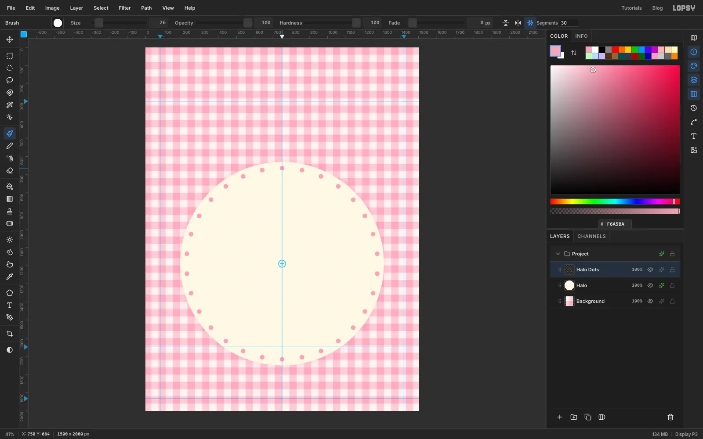

A pale disc behind the hero separates it from the busy gingham.

1. Add a layer named `Halo`. With the **Elliptical Marquee**, click once and enter `190, 630` to `1310, 1750`, a 1120 px circle. Fill it with `#FFF8E6` and press [[Cmd+D]].
2. Open the layer's effects (the **fx** button on its row) and turn on **Drop Shadow**: **Offset X** and **Offset Y** `0`, **Blur** `60`, **Opacity** `35`, colour `#EC7F9C`. That's a soft pink glow rather than a shadow.
3. Add a layer named `Halo Dots`. Pick the **Brush** ([[B]]) and set **Size** `26` and **Hardness** `100`.
4. Click the **Radial Symmetry** button in the options bar and set **Segments** to `30`. Hold [[Cmd]] and click the centre of the circle (`750, 1190`) to move the symmetry centre there.
5. Set the colour to `#F6A5BA` and click **once** near the top of the circle, about 34 px inside its edge (`750, 664`). Thirty dots appear around the ring.
6. Click **Radial Symmetry** again to turn it off.

## Build the striped awning

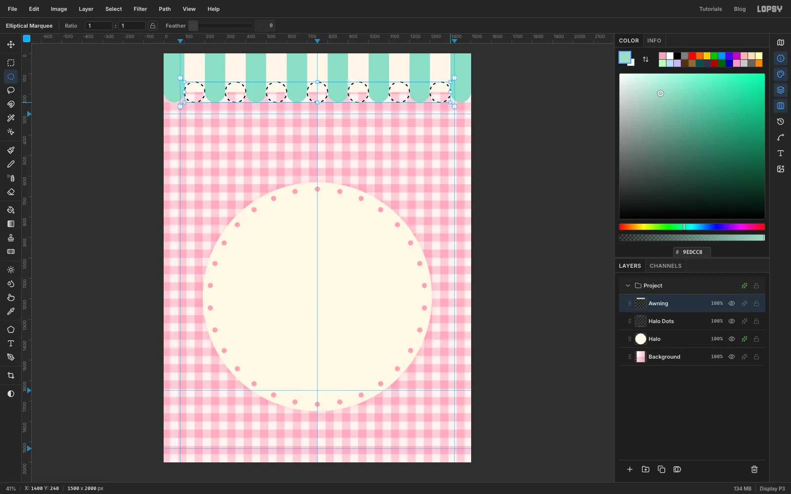

1. Add a layer named `Awning`. With the **Rectangular Marquee**, select `0, 0` to `100, 20` and fill it with `#9EDCC8`. Deselect, select `100, 0` to `200, 20` and fill it with `#FFF6E9`. Deselect, select both (`0, 0` to `200, 20`) and choose **Edit → Define Pattern**.
2. Deselect, select `0, 0` to `1500, 190` and choose **Edit → Fill with Pattern…**. Pick the new stripe tile, set both offsets to `0`, and click **Apply**. You now have 100 px stripes, starting with mint at the left edge. Press [[Cmd+D]].
3. Now hang a scallop under each stripe. With the **Elliptical Marquee**, drag a 100 px circle under the first mint stripe, from `0, 140` to `100, 240`, so its centre sits on the stripes' bottom edge. Hold [[Shift]] and drag the same circle under every other mint stripe, 200 px further right each time (`200, 140` to `300, 240`, then `400, 140` to `500, 240`, and so on). Fill the selection with `#9EDCC8`.
4. Press [[Cmd+D]] and do the same under the cream stripes (`100, 140` to `200, 240`, `300, 140` to `400, 240`, and so on), then fill with `#FFF6E9`.

## Outline the awning

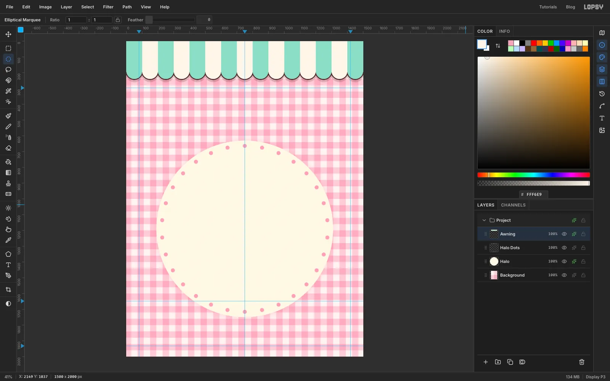

The thick dark outline is what makes everything look kawaii. You'll add it as a layer effect, so it follows the shape exactly.

1. Press [[Cmd+D]]. Open the `Awning` layer's effects and turn on **Stroke**: **Width** `6`, colour `#4A2C2A`.
2. Turn on **Drop Shadow**: **Offset X** `0`, **Offset Y** `14`, **Blur** `6`, **Opacity** `22`, colour `#4A2C2A`.

The stripes inside don't get outlined, only the edge of the whole shape, which is just what an awning needs.

## Draw the cake stand

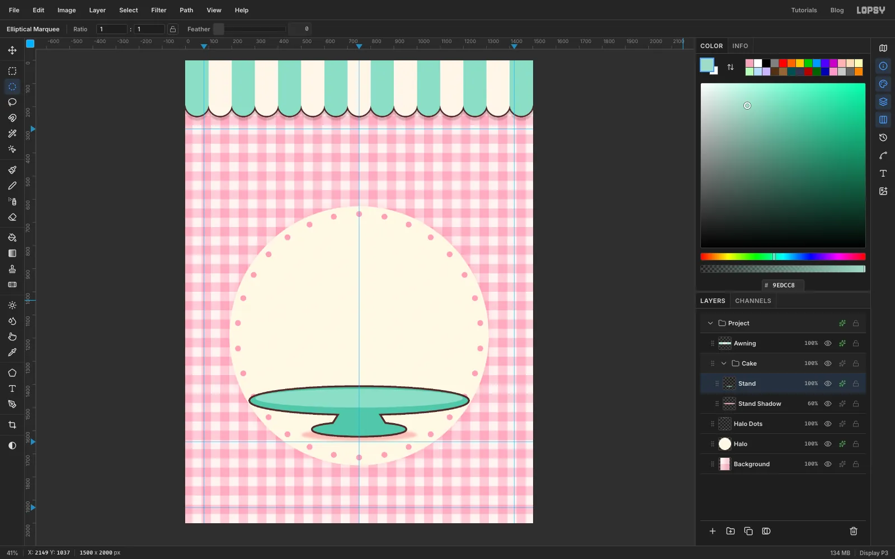

You'll draw the cake full size and scale it down a touch later, once the title is in.

1. Click `Halo Dots` and click **New Group** (the folder button). Name it `Cake`. New layers you add now go inside it.
2. Add a layer named `Stand Shadow`. Select an ellipse from `500, 1592` to `1000, 1644`, fill it with `#E9A0AE` and press [[Cmd+D]]. Choose **Filter → Gaussian Blur…** with **Radius** `14`, set the layer's blend mode to **Multiply** and drag its opacity slider to **60%**.
3. Add a layer named `Stand`. Select the plate as an ellipse from `280, 1412` to `1220, 1528`. Hold [[Shift]] and drag the foot from `550, 1566` to `950, 1622`. Fill with the darker mint `#72C4AC`.
4. Pick the **Pen** tool ([[P]]) and click four corners for the neck: `625, 1592`, `680, 1505`, `820, 1505`, `875, 1592`, then click the first point again to close it. In the **Paths** panel, click **Path to Selection**, delete the path, and fill with `#72C4AC`.
5. Press [[Cmd+D]], select the top of the plate as an ellipse from `302, 1420` to `1198, 1500`, and fill it with the light mint `#9EDCC8`. Deselect and give the layer a **Stroke** of `8` in `#4A2C2A`.

## Draw the sponge and shade it

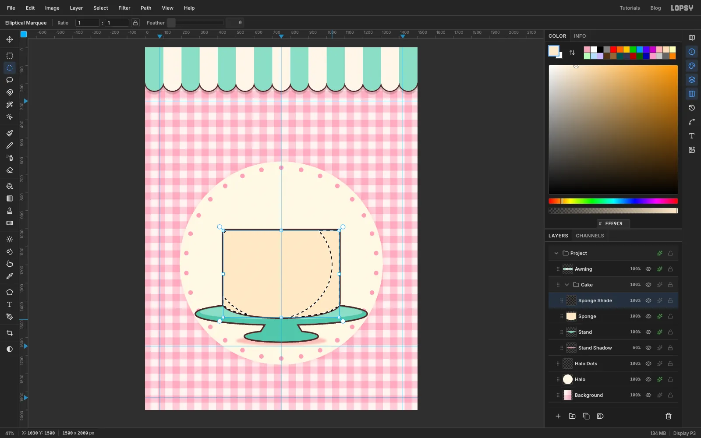

1. Add a layer named `Sponge`. Select a rectangle from `430, 1010` to `1070, 1410`, then Shift-add an ellipse from `430, 1330` to `1070, 1490` for the round bottom. Fill with `#FFE9C9`, deselect and add a **Stroke** of `8` in `#4A2C2A`.
2. Add a layer named `Sponge Shade`. [[Cmd]]-click the `Sponge` thumbnail to load its shape as a selection.
3. With the **Elliptical Marquee**, hold [[Alt]] and drag an ellipse from `370, 900` to `1030, 1500`. It's offset a little to the left, so subtracting it leaves a crescent along the right side and bottom.
4. Fill the crescent with `#F2C99B`, deselect, set the layer to **Multiply** and its opacity to **60%**.
5. Add a layer named `Sponge Shine`. With a hard white **Brush** of size `16`, drag a gentle curve down the left side of the cake, just inside the outline, from below the drips to just above where the bottom starts to curve. Set the layer's opacity to **70%**.

## Select the frosting and its drips

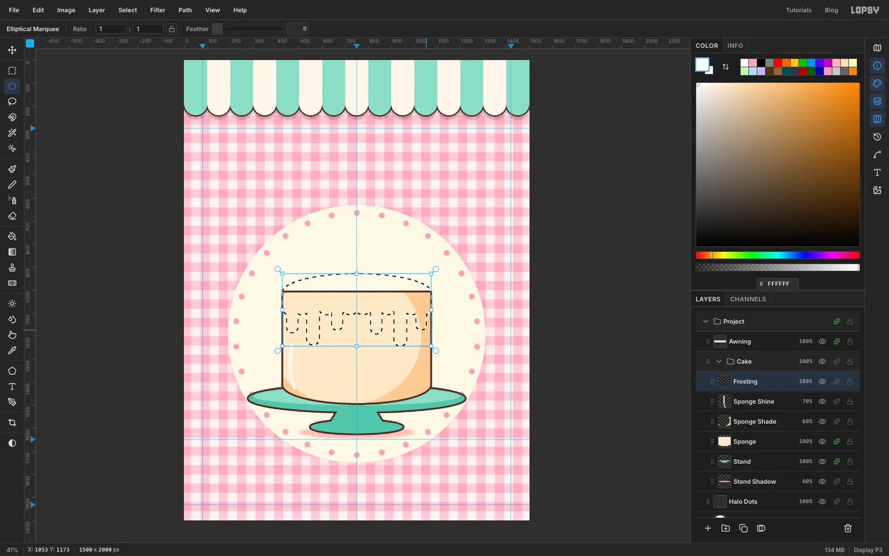

The frosting is one selection built from many small pieces. Hold [[Shift]] while dragging every piece after the first, so each one adds to the selection.

1. Add a layer named `Frosting`. With nothing selected, click once with the **Elliptical Marquee** and enter `426, 928` to `1074, 1092` for the top.
2. Shift-add a rectangle from `426, 1010` to `1074, 1085`. That's the band down the sides.
3. Shift-add twelve small ellipses, each about 56 px wide and 44 px tall, side by side along the bottom edge of the band (y 1085), from one side of the cake to the other. They give the band a soft, wavy edge.
4. Add six drips. For each one, Shift-add a narrow rectangle from the band down to the drip's end, then a circle the same width centred on its end. Use these centres, ends and widths: x 470 ending at y 1160, 50 px wide; x 560, 1210, 56; x 665, 1150, 48; x 835, 1165, 50; x 940, 1215, 56; x 1030, 1150, 46. Uneven lengths look more natural.

## Fill and outline the frosting

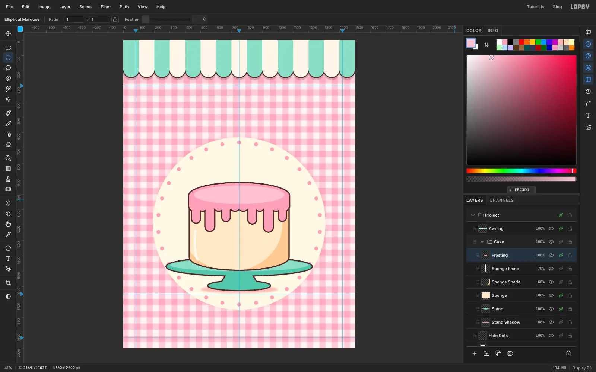

1. Fill the selection with `#F6A5BA`.
2. Press [[Cmd+D]], select the top surface as an ellipse from `456, 944` to `1044, 1064`, and fill it with the lighter `#FBC3D1`. A lighter top and a darker side is all the 3D a kawaii cake needs.
3. Deselect and add a **Stroke** of `8` in `#4A2C2A`.

## Add the cat ears

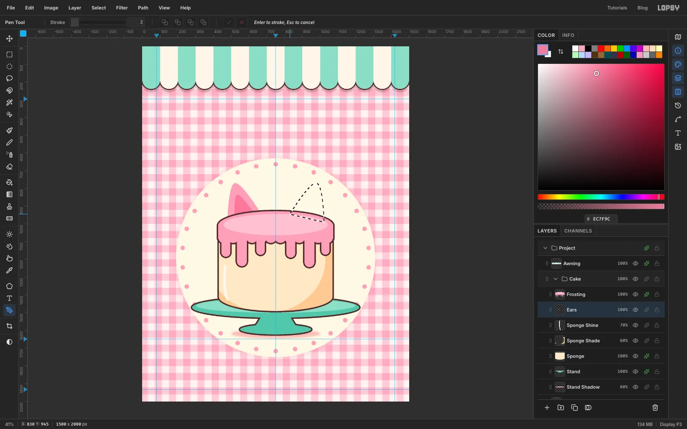

The ears sit *behind* the frosting, so its rim overlaps their bases and they look as if they grow out of the cake.

1. Click `Sponge Shine` and add a layer named `Ears`. It lands between `Sponge Shine` and `Frosting`.
2. With the **Pen** tool, click `478, 990` for the outer base. Press at the tip, `520, 770`, and drag a little to the right to pull out handles; that rounds the tip. Click `670, 945` for the inner base and close the path on the first point. Use **Path to Selection** and fill with `#F6A5BA`.
3. Draw the inner ear the same way, smaller: `518, 960`, tip `534, 835`, `625, 935`. Fill it with `#EC7F9C`.
4. Repeat both for the right ear, mirrored across the centre guide (x becomes 1500 − x): `1022, 990`, tip `980, 770`, `830, 945`.
5. Deselect and add a **Stroke** of `8` in `#4A2C2A`.

## Top it with cream and a strawberry

1. Click `Frosting` and add a layer named `Cream`. Select an ellipse from `680, 944` to `820, 1036`, then Shift-add two smaller ones either side: `654, 970` to `734, 1030` and `766, 970` to `846, 1030`. Fill with white, deselect and add a **Stroke** of `7` in `#4A2C2A`.
2. Add a layer named `Strawberry`. With the **Pen**, press at `690, 875` and drag up a little; press at `750, 852` and drag to the right; press at `810, 875` and drag down a little. Then click `750, 978` without dragging, so the bottom stays pointed, and close the path on the first point. Use **Path to Selection** and fill with `#F0596E`.
3. With the **Pen**, click a five-point star over the top of the strawberry, centred at `750, 860`: ten clicks, alternating the five tips about 46 px out with five inner corners about 20 px out. Close it, use **Path to Selection** and fill with `#7CC793`. Deselect and add a **Stroke** of `7` in `#4A2C2A`.
4. Add a layer named `Seeds`. Click a few dots on the strawberry with a hard **Brush** of size `9` in `#FFE08A`. Then click two eyes in `#4A2C2A` and drag a tiny smile below them with a size `4` brush.

## Give the cake a face

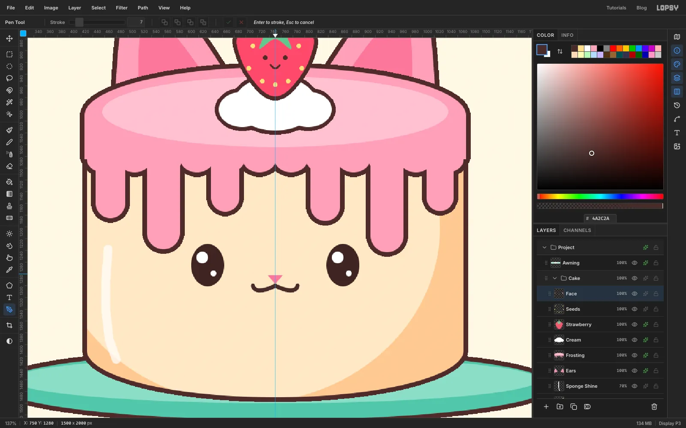

1. Add a layer named `Face`. Select an ellipse from `607, 1229` to `663, 1301` for the left eye and fill it with `#3B2523`. Deselect, then do the same from `837, 1229` to `893, 1301` for the right eye.
2. Add catchlights in white with the **Elliptical Marquee**: a 20 px circle above and left of each eye's centre, and a 10 px one below and right. These two dots make the eyes look shiny and alive.
3. With the **Pen**, click a small downward triangle for the nose: `737, 1282`, `763, 1282`, `750, 1297`. Make it a selection and fill with `#EC7F9C`.
4. For the "ω" mouth, press [[Cmd+D]], set the colour to `#4A2C2A` and the Pen's **Stroke** to `7`. Press at `712, 1300` and drag down and to the right to curve the first loop. Click `750, 1300` without dragging so the middle stays a sharp point. Press at `788, 1300` and drag up and to the right. Press **Enter** to stroke the path, then delete it in the Paths panel.

## Add blush and whiskers

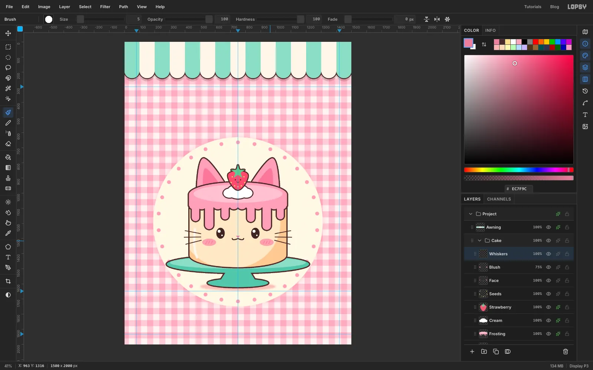

1. Add a layer named `Blush`. Select an ellipse from `514, 1301` to `606, 1349` and Shift-add one from `894, 1301` to `986, 1349`. Fill with `#FF8FA8`, deselect, and drag the layer's opacity to **75%**.
2. Add a layer named `Whiskers`. Pick a hard **Brush** of size `6` in `#4A2C2A`. Click at the start of a whisker, then [[Shift]]-click its end to draw a straight line. Draw three on each side, starting just inside the cheek and fanning out past the cake's edge: the top one tilting up, the middle one level, the bottom one tilting down, each about 110 px long.
3. With a size `5` brush in `#EC7F9C`, Shift-click three short diagonal ticks on each blush. It's a classic kawaii touch.

## Draw a macaron

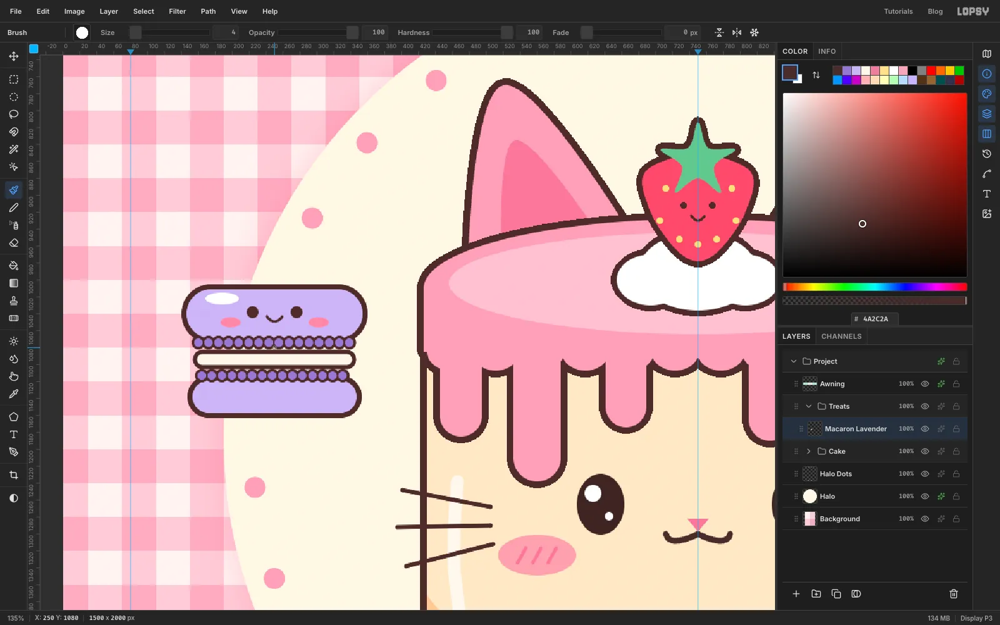

The macarons use the **Shape** tool, which draws rounded rectangles with their own fill and outline. A shape grows outward from its centre, so you press at the centre and drag to the bottom-right corner.

1. Collapse the `Cake` group, click it and click **New Group**. Name the group `Treats` and add a layer named `Macaron Lavender`.
2. Pick the **Shape** tool ([[U]]). Set **Shape** to **Rectangle** and **Output** to **Pixels**. Click the **Fill** swatch and type `FFF6E9`; click the **Stroke** swatch and type `4A2C2A`; set **Width** to `5` and **Corner Radius** to `9`. For the filling, press at `250, 1094` and drag to `344, 1103` (188 × 18 px).
3. Change the fill to `C9B5F2`, **Width** to `6` and **Corner Radius** to `22`, and draw the bottom shell from `250, 1138` to `350, 1160`. Set **Corner Radius** to `32` and draw the taller top shell from `250, 1040` to `357, 1072`. The bigger radius gives it a domed look.
4. Now the ruffled "feet" that every macaron has. Pick a hard **Brush** of size `17`, open the Brushes window (the brush-tip button at the left of the options bar) and set **Spacing** to `70` %. In `#4A2C2A`, click at `160, 1074` and Shift-click at `340, 1074`, along the bottom edge of the top shell. Then set the brush to size `11` and spacing `108` %, switch to `#9479CF`, and Shift-click the same line. The small dabs land on the big ones' centres, so you get a row of outlined beads. Repeat both passes along the top of the bottom shell, from `164, 1113` to `336, 1113`.
5. Add a face on the top shell. Select a small ellipse from `168, 1015` to `208, 1029` and fill it with white for the shine. Click two eyes with a size `14` brush in `#4A2C2A` at `224, 1038` and `276, 1038`. Select two blush ovals, `186, 1044` to `210, 1056` and (Shift-added) `290, 1044` to `314, 1056`, and fill them with `#FF8FA8`. Finish with a tiny smile between the eyes, drawn with a size `4` brush.

## Copy the macaron and recolour it

1. Press [[Cmd+D]]. With the **Rectangular Marquee**, select around the macaron, from `132, 1000` to `368, 1170`. Press [[Cmd+C]] and then [[Cmd+V]]. The copy lands on a new layer in the same place. Rename it `Macaron Mint` and deselect.
2. Pick the **Magic Wand** ([[W]]). Set **Tolerance** to `70` and untick **Contiguous**. Click the top shell, then [[Shift]]-click one of the beads in the feet. Every lavender pixel is selected, but not the brown outlines, the cream filling, the blush or the shine.
3. Choose **Filter → Hue/Saturation…**. Set **Hue** to `-99`, **Saturation** to `-6` and **Lightness** to `-2`, and click **Apply**. Lavender turns mint, and the face stays the same.
4. Deselect, click `Macaron Lavender` and repeat for a third copy named `Macaron Butter`, this time with **Hue** `144`, **Saturation** `55`, **Lightness** `-2`.

## Move, scale and tilt the copies

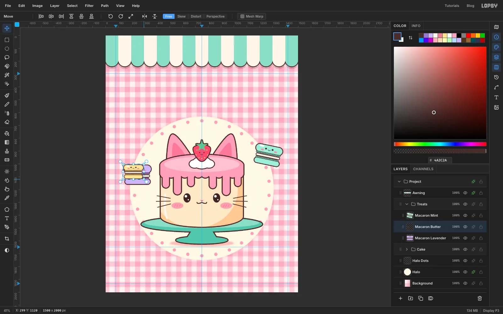

1. Press [[Cmd+D]], click `Macaron Mint`, and with the **Move** tool ([[V]]) drag it to the right of the cake, centred at about `1265, 930`.
2. Draw a marquee around it, then switch back to the **Move** tool. A small round rotate handle sits just outside each corner of the box. Drag the top-right one clockwise to tilt the macaron about **12°**. Press **Enter**, then [[Cmd+D]].
3. Click `Macaron Butter`, draw a marquee around it and switch back to the **Move** tool. Hold [[Cmd]] and drag the bottom-right corner handle inward to scale it to about **72%**. Press **Enter** and [[Cmd+D]]. Drag it down to the lower left, centred at about `190, 1335`, and tilt it **10°** clockwise the same way.
4. Tilt `Macaron Lavender` **14°** anticlockwise where it is.

## Scale the hero down and make room

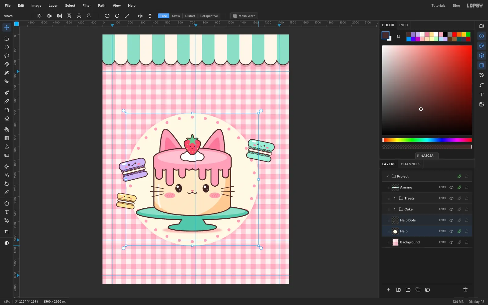

The cake needs a little more space below for the banner, so you'll shrink it and its halo together.

1. Collapse both groups. Click `Halo` and Shift-click `Cake` in the Layers panel, so `Halo`, `Halo Dots` and `Cake` are all selected. Make sure nothing is selected on the canvas. With the **Move** tool, one transform box goes around all three.
2. Hold [[Cmd]] and drag the bottom-right corner handle in to about **95%**. Press **Enter**.
3. Drag the three layers so the halo is centred on the 750 guide, with its centre at about y 1212. Then click the `Treats` group and drag it straight down about **22 px**, so the macarons keep their places around the cake.
4. Click `Halo Dots`. Delete the dots that the title, the banner and the paw cookie will cover: select `520, 640` to `980, 742` and press **Delete**, deselect, select `500, 1638` to `1000, 1690` and press **Delete**, deselect, then select `1222, 1136` to `1272, 1184`, press **Delete** and deselect.

## Set the title in sticker type

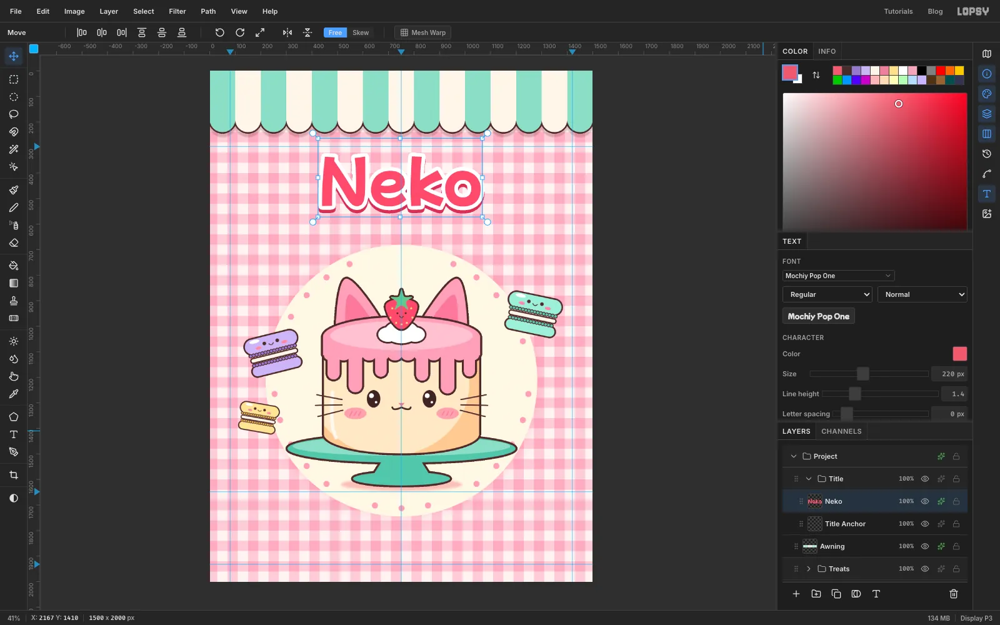

1. Click `Awning` and click **New Group**. Name it `Title` and add an empty layer named `Title Anchor`. New text is created above whatever layer is active, and if that's a text layer, the Text options restyle it instead. A plain raster layer avoids that.
2. Pick the **Text** tool ([[T]]). Choose **Mochiy Pop One** in the font picker, set the size to `220` and the colour to `#F0596E`. Click in the empty space above the halo, type `Neko` and press [[Tab]] to finish.
3. With the **Move** tool, drag it until it's centred on the 750 guide, with the middle of the letters at about y 432. Use the arrow keys for the last few pixels.
4. Open its effects. Add a **Stroke** of `15` in white, and a **Drop Shadow** with **Offset X** `0`, **Offset Y** `13`, **Blur** `1` and **Opacity** `100` in `#C93F58`. The 1 px blur keeps the hard shadow's edge smooth.

## Add the second line, the tagline and a tilt

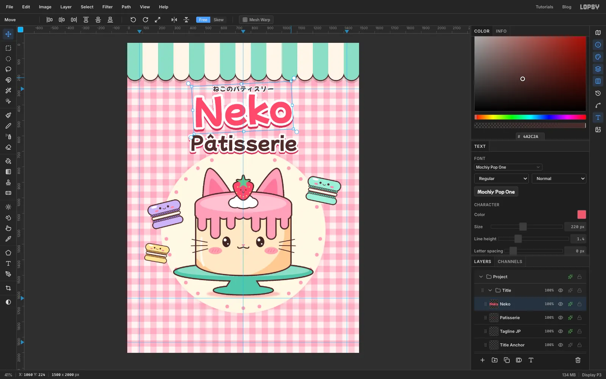

1. Click `Title Anchor`. With the **Text** tool, click below `Neko` and type `Pâtisserie` in Mochiy Pop One, size `116`, colour `#4A2C2A`, letter spacing `2`. Rename the layer `Patisserie` and centre it below `Neko`, at about y 642. Give it a white **Stroke** of `11` and the same crimson **Drop Shadow** with **Offset Y** `9`.
2. Click `Title Anchor` again. Click with the **Text** tool between the awning and `Neko`, and paste `ねこのパティスリー` ("cat pâtisserie") at size `40`, letter spacing `4`, in `#4A2C2A`. Rename it `Tagline JP`, centre it on the 296 guide and give it a white **Stroke** of `5` so it stays readable on the gingham.
3. Click `Neko` and pick the **Move** tool. Live text gets its own transform box without a marquee. Drag the small round rotate handle just outside its top-right corner anticlockwise to tilt it about **3°**, and press **Enter**. A slight tilt makes the sign feel hand-placed.

## Make a speech bubble

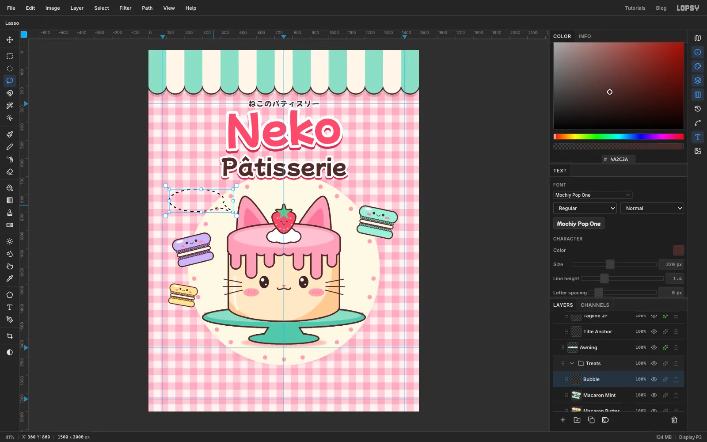

1. Expand `Treats`, click `Macaron Mint` and add a layer named `Bubble`.
2. With the **Pen**, click three corners for the tail: `360, 860`, the tip at `470, 898`, and `395, 835`. Close it and use **Path to Selection**. The tip stops about 20 px short of the cat's ear, so the two outlines don't touch.
3. With the **Elliptical Marquee**, Shift-add the bubble from `116, 770` to `420, 894`.
4. Fill with white, deselect and add a **Stroke** of `6` in `#4A2C2A`.

## Write "nyaa~♡" with a red heart

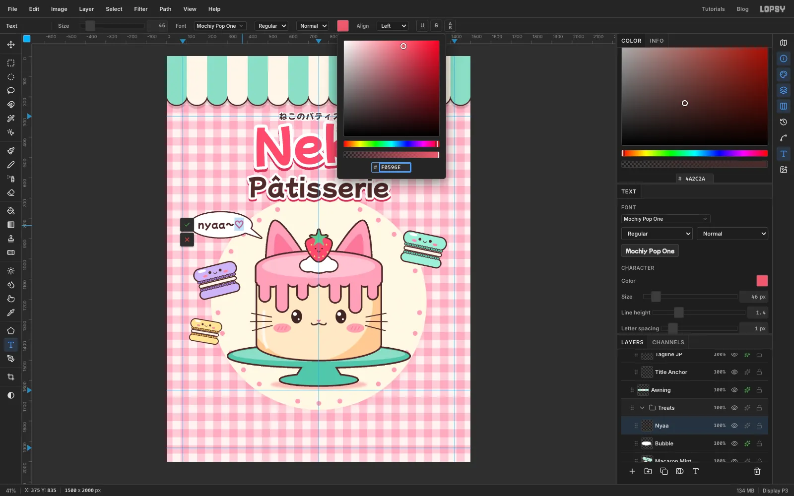

1. Click `Bubble` and pick the **Text** tool. Set Mochiy Pop One, size `46`, colour `#4A2C2A`. Click inside the bubble, type `nyaa~` and paste a `♡` after it (copy it from this page). Press [[Tab]], rename the layer `Nyaa` and centre it in the bubble.
2. With the **Text** tool, click into the text near its end and press [[End]]. Press [[Shift+Left]] once to select the heart.
3. Click the **Text color** swatch in the options bar and type `F0596E`. Only the heart turns red. Click the swatch again to close it, then click the **Move** tool to finish editing.

## Bake a paw cookie

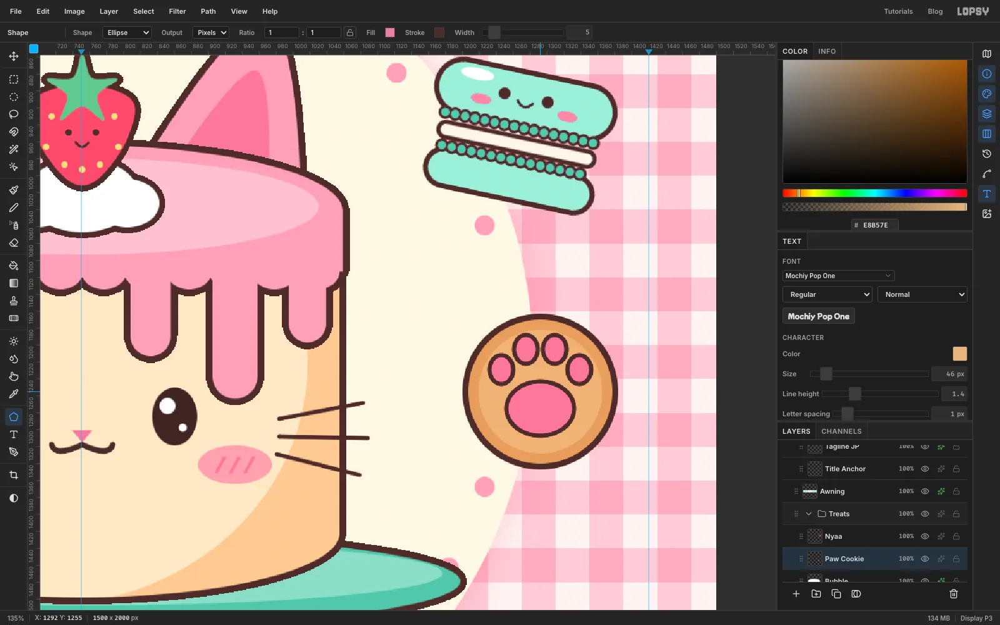

1. Click `Bubble` and add a layer named `Paw Cookie`. Select a circle from `1200, 1163` to `1384, 1347` and fill it with `#4A2C2A`. Deselect, select `1207, 1170` to `1377, 1340` and fill it with `#DDA066`, then deselect, select `1219, 1182` to `1365, 1328` and fill it with `#E8B57E`. These nested fills give a baked-in outline and a toasted rim without any effects.
2. Press [[Cmd+D]]. Pick the **Shape** tool with **Shape** set to **Ellipse**, fill `#EC7F9C`, stroke `#4A2C2A`, **Width** `5`.
3. For the big pad, press at `1292, 1275` and drag to `1332, 1307`. Add four toes, each pressed at its centre and dragged 14 px right and 17 px down: centres `1246, 1229`, `1275, 1205`, `1309, 1205` and `1338, 1229`.

## Scatter sparkles and hearts

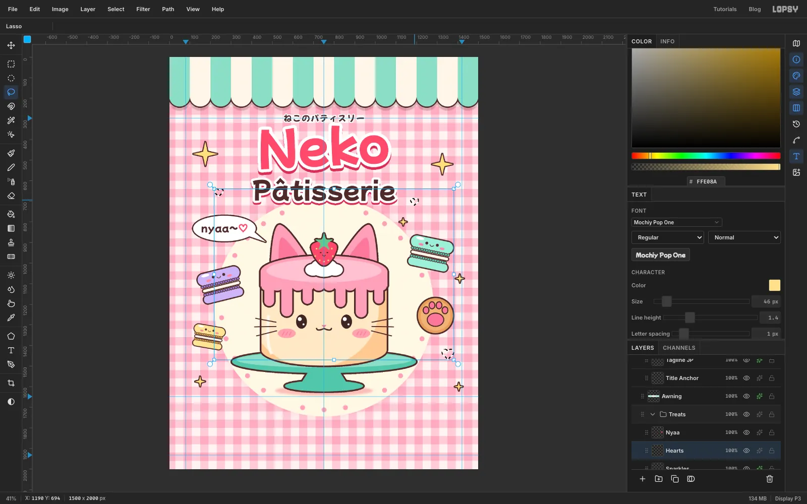

Two big sparkles frame the title. The rest are small, so they don't compete.

1. Add a layer named `Sparkles`. With the **Pen**, click eight points round a centre for a four-point sparkle: the four tips straight up, right, down and left, and between each pair of tips an inner corner about a quarter as far from the centre. Close the path, use **Path to Selection** and fill with `#FFE08A`.
2. **Path to Selection** replaces the selection, so draw and fill each sparkle in turn. Make the first two big, beside the title: about 120 px tall centred at `175, 470`, and about 105 px tall at `1325, 520`. Then add four small ones, 40 to 50 px tall: by the right ear, right of the mint macaron, at the bottom left and at the bottom right. Deselect and add a **Stroke** of `5` in `#4A2C2A`.
3. Add a layer named `Hearts`. With the **Lasso**, draw a heart about 45 px wide left of `Pâtisserie`: start in the dip at the top, loop round the left bump, down to the point, and back up round the right bump. Shift-draw two more: a smaller one right of the title, and a bigger one, about 60 px wide, below the paw cookie. Fill with `#F0596E`, deselect and add a **Stroke** of `5` in `#4A2C2A`.

## Cut the ribbon's tails

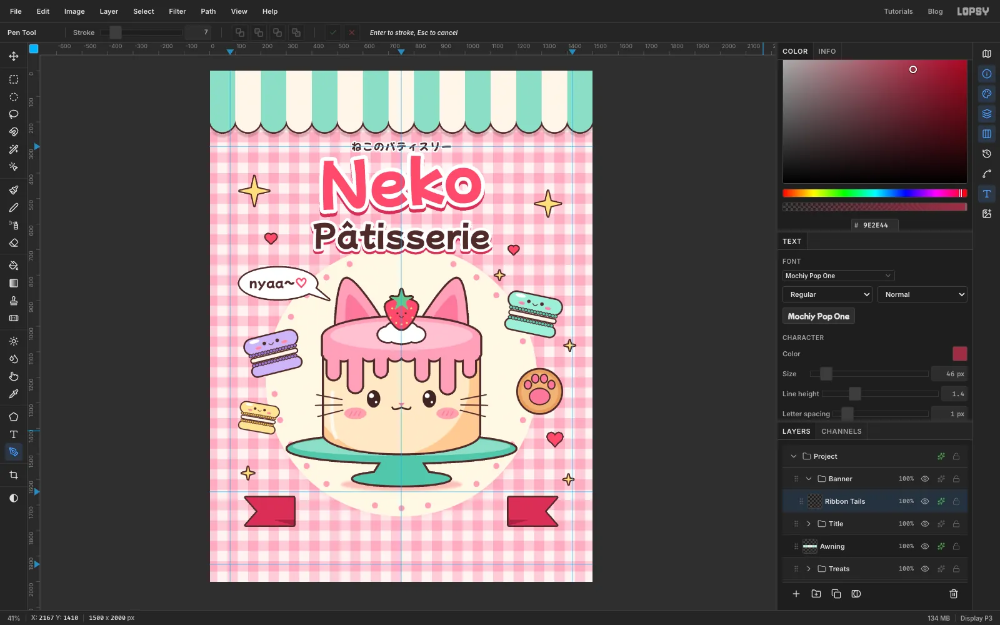

1. Collapse `Treats` and `Title`. Click `Title`, make a **New Group** named `Banner`, and add a layer named `Ribbon Tails`.
2. With the **Pen**, click the left tail as five corners: `140, 1670`, `330, 1670`, `330, 1780`, `140, 1780`, and a notch at `188, 1725`. Close it, make it a selection and fill with `#C93F58`. Draw the right tail as its mirror image (x becomes 1500 − x) and fill it the same way.
3. Draw the two small folds where the band will tuck in, as triangles from `250, 1758` to `330, 1758` to `330, 1780` and the mirror on the right. Fill them with the darker `#9E2E44`.
4. Deselect and add a **Stroke** of `6` in `#4A2C2A`.

## Add the ribbon band and its stitching

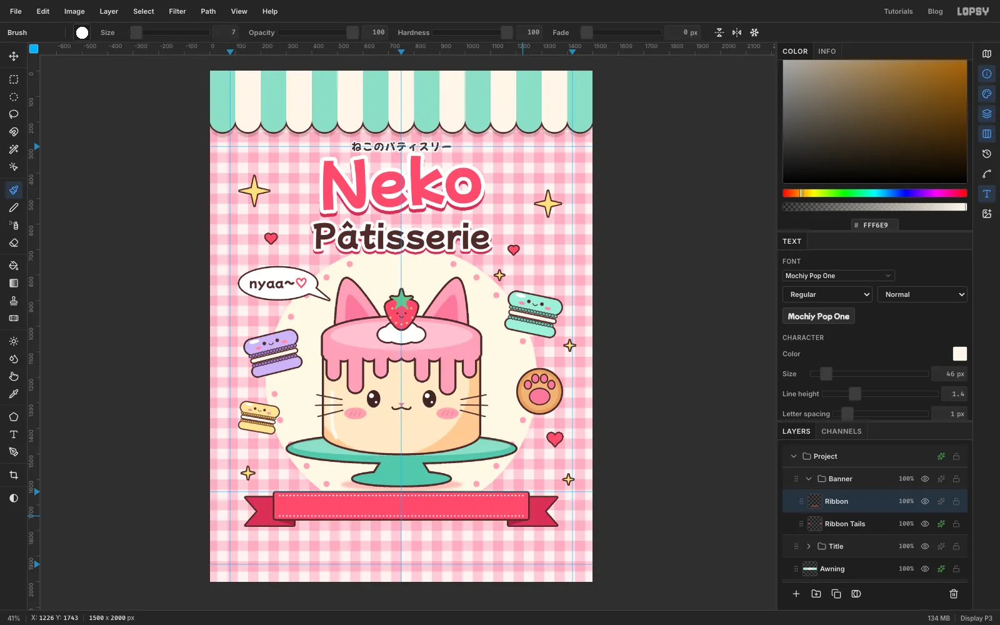

1. Add a layer named `Ribbon`. With the **Shape** tool set to **Rectangle**, fill `#F0596E`, stroke `#4A2C2A`, **Width** `6`, **Corner Radius** `8`, press at `750, 1703` and drag to `1250, 1758` for a 1000 × 110 px band. Its ends cover the inner ends of the tails.
2. For stitching, pick a hard **Brush** of size `7` and set **Spacing** to `260` % in the Brushes window, so the dabs separate into dots. In `#FFF6E9`, click at `274, 1663` and Shift-click at `1226, 1663`. Draw a second row the same way at y 1743.
3. With the **Text** tool, type `GRAND OPENING · NOV 22` in Mochiy Pop One, size `50`, letter spacing `4`, colour `#FFF6E9`. Centre it in the band, between the two stitch rows.

## Add the info pill

1. Click `Ribbon` and add a layer named `Info Pill`. Draw a **Rectangle** shape with fill `#FFF6E9`, stroke `#4A2C2A`, **Width** `5` and **Corner Radius** `60`, pressing at `750, 1876` and dragging to `1230, 1932` (960 × 112 px). The big radius rounds the ends into a pill.
2. Type `12 Mochi Lane · open daily 10 – 6` at size `30` in `#4A2C2A` and centre it at about y 1855.
3. Click `Info Pill` again and type `first 100 guests get a free kitty macaron`, then paste a `♡` at the end. Use size `24` in `#C93F58` and centre it at about y 1899, so both lines have the same space above and below them.

## Finish with a paper grain

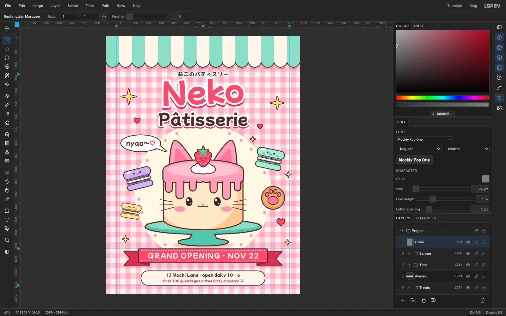

1. Collapse `Banner`, click it, and add a layer named `Grain`. It sits above everything.
2. Press [[Cmd+A]], fill with `#808080` and deselect.
3. Choose **Filter → Add Noise…**, set **Amount** to `40`, choose **Mono**, and click **Apply**.
4. Set the layer's blend mode to **Overlay** and drag its opacity down to **10%**. Overlay leaves the mid-grey invisible, so only a faint printed texture shows over the flat colours.

Save your work with **File → Save Project**, and use **File → Quick Export PNG** for the finished poster. If you'd like to see how the layers and groups fit together, open the project from the **Follow along** box at the top of this page and click through the Layers panel.
