Kawaii (Japanese for "cute") art turns everyday things into tiny characters. They get round shapes, soft pastels, big shiny eyes and a blush on the cheeks. Iron-on patches suit the style well, because embroidery likes simple shapes with thick outlines.

In this tutorial you'll design a patch for an imaginary frozen yogurt shop called **Froyo Club**. It's a *die-cut* patch: instead of a plain circle or rectangle, the edge follows the outline of the artwork. The design has:

- a scalloped cloud badge with sparkles and a heart
- a stacked soft-serve swirl with sprinkles, a cherry and a spoon
- a smiling paper cup
- a ribbon banner with the shop's name

At the end you'll add the parts that make it look like thread instead of a sticker: a satin-stitched border, raised fills, a darker cut edge and a soft shadow on lilac fabric.

The canvas is **1600 × 1600** px. You don't need any photos.

The tools you'll use:

- the **Elliptical** and **Rectangular Marquee**, including their exact-size dialog, [[Shift]] to add and [[Alt]] to subtract
- [[Cmd]]-click on a layer thumbnail to load its shape as a selection, plus **Select → Grow / Shrink / Feather / Inverse**
- the **Pen** tool, **Path to Selection** and Pen strokes
- the **Shape** tool's rounded rectangles
- the **Move** tool's scale and rotate handles, its **Distort** mode and **Flip Horizontal**
- **Copy**, **Paste** and **Merge Down**
- the **Brush** and **Pencil**, and **Edit → Fill**
- **Add Noise**, **Gaussian Blur**, **Motion Blur**, **Brightness/Contrast**, **Emboss** and **Sunburst**
- live text in the Google font **Cherry Bomb One**
- layer effects (**Stroke**, **Inner Glow** and **Drop Shadow**), the **Overlay** blend mode, and groups

The palette is candy-shop pastel, with one dark plum for every outline:

- Fabric `#B9A8DF`, vignette `#8F79C4`
- Sky badge `#BFE4F3`
- Outline plum `#4A2B4D`
- Strawberry `#FFAFC9`, shade `#F286AB`, fold lines `#E94B8A`
- Cream `#FFFBF2`
- Mint `#8FDCC2`
- Butter `#FFE38E`, ribbon tail `#F2C55C`, fold `#D9A23F`
- Lavender `#C6B2F7`, sprinkle blue `#8CCBF0`
- Cherry `#FF4F72`, leaf `#5DB57A`, blush `#FF8DB0`
- Border pink `#EC5896`, cut edge `#A8195E`, satin light `#FF8FC0`, satin dark `#C21F6E`

Some habits that will save you trouble:

- To set a colour, type its hex code into the **Hex** field of the Color panel.
- Every outline in this design is a **Stroke** layer effect: **6 px**, **Outside**, in plum `#4A2B4D`. You'll open it from the effects button (✦) on a layer's row. Whenever a step says "give it the outline", that's what it means.
- Press [[Cmd+D]] to deselect after every fill, so the next tool isn't clipped by an old selection.
- After **Path to Selection**, click **Delete Path** in the Paths panel, so the next Pen click starts a new path.
- New layers appear directly above the active layer. Click the right layer before you click **Add Layer**.
- Most shapes here are placed with the marquee's exact-size dialog: click once on the canvas with the **Rectangular** or **Elliptical Marquee** (without dragging) and type the **From** and **To** corners. For anything you place by hand, the status bar shows the cursor's X and Y, and zooming in helps with small pieces.

> **Tip:** On a wide-gamut (Display P3) screen, Lopsy reads typed hex codes as P3 colours. These codes were picked as P3 values. On an sRGB screen the patch comes out a touch less vivid.

> **Note:** Shortcuts are written for a Mac. On Windows use [[Ctrl]] wherever it says [[Cmd]].

## Set up the canvas and centre guides

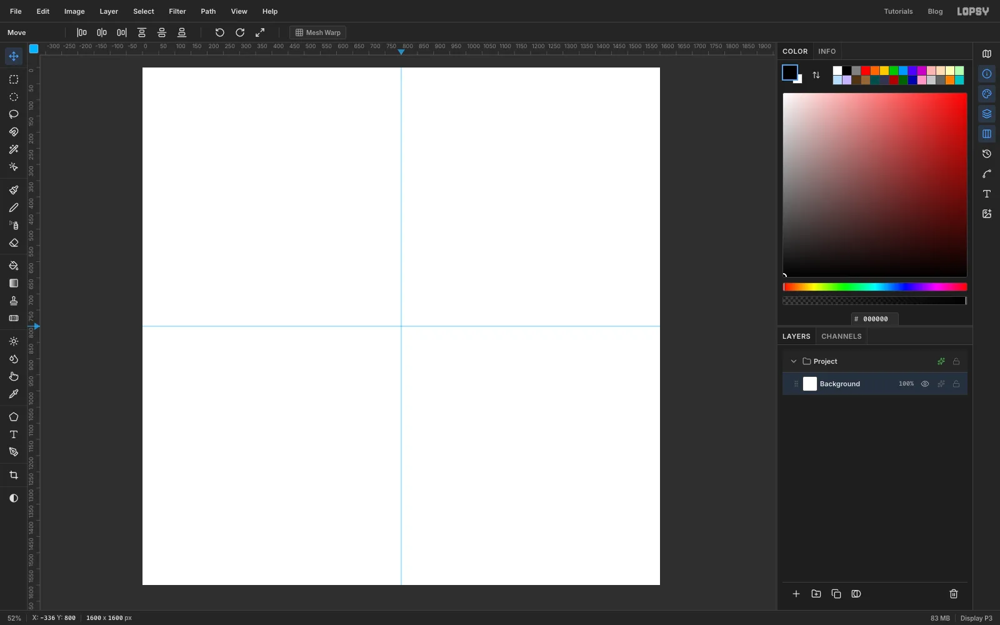

Choose **File → New**, keep the units on **Pixels**, and make the document **1600 × 1600**. Delete the empty *Layer 1* with the trash button under the Layers panel.

Click the top ruler at **800** to drop a vertical guide, and the left ruler at **800** for a horizontal one. They cross at the centre of the canvas, and almost everything in the patch is centred on that vertical line. **Snap to Guides** is on by default, so shapes drawn from the centre will lock onto it.

## Make the lilac twill fabric

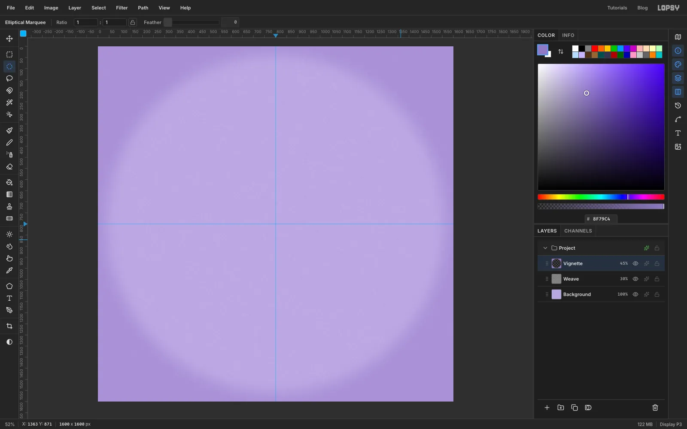

The patch will sit on a lilac jacket, so start with the fabric.

1. Click *Background*, set the colour to `#B9A8DF` and choose **Edit → Fill**.
2. Click **Add Layer** and name it *Weave*. Fill it with grey `#808080`.
3. Run **Filter → Add Noise…** with **Amount 60**, **Mono** and **Gaussian**.
4. Run **Filter → Motion Blur…** with **Angle 45** and **Distance 14**. The specks stretch into diagonal threads, like twill.
5. Run **Filter → Brightness/Contrast…** twice, each time with **Contrast 100**, so the threads stand out.
6. Open the layer's effects drawer, set the blend mode to **Overlay**, then click the percentage on the row and set the opacity to **30%**.

Now darken the edges a little. Add a layer called *Vignette* and fill it with `#8F79C4`. Click once on the canvas with the **Elliptical Marquee** (don't drag) to open its exact-size dialog, and enter **From 40, 40** and **To 1560, 1560**. Choose **Select → Feather…** with **60**, press [[Delete]], then deselect. Set the layer to **45%** opacity.

## Draw the scalloped badge

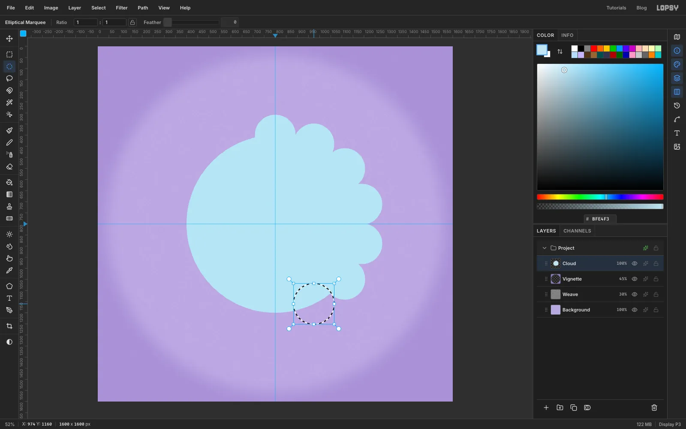

Add a layer called *Cloud* and set the colour to sky blue `#BFE4F3`. With the **Elliptical Marquee**, click once on the canvas and enter **From 400, 400** and **To 1200, 1200**. Choose **Edit → Fill**. That's an 800 px circle in the middle.

The scallops are 14 circles, each **184 px** across, centred on the big circle's edge. Make each one with the dialog, then **Edit → Fill** it before making the next. Enter these **From** corners, and add 184 to both numbers for the **To** corner:

1. 708, 308 (12 o'clock)
2. 882, 348
3. 1021, 459
4. 1098, 619
5. 1098, 797
6. 1021, 957
7. 882, 1068
8. 708, 1108 (6 o'clock)
9. 534, 1068
10. 395, 957
11. 318, 797
12. 318, 619
13. 395, 459
14. 534, 348

Neighbouring bumps just overlap, so the edge becomes a row of soft scallops.

## Outline the badge

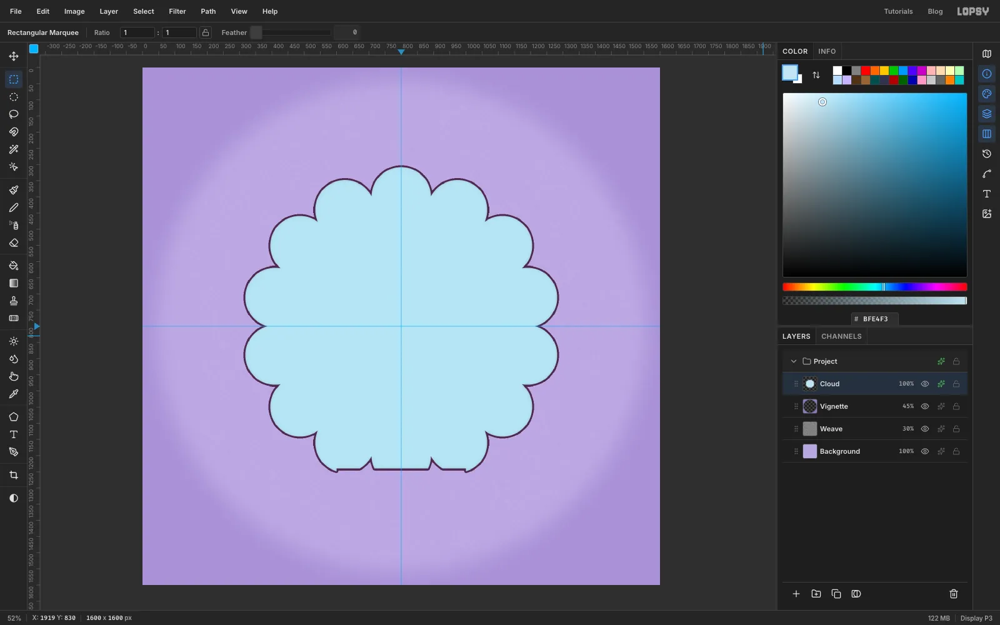

Deselect.

The bottom bump would peek out under the banner later, so flatten it now. Drag a rectangular marquee from about **600, 1240** to **1000, 1310** and press [[Delete]].

Give the layer the outline (Stroke, 6 px, plum). In the same effects drawer, turn on **Inner Glow** in plum `#4A2B4D` with **Size 16** and **Opacity 18%**. The darker rim makes the fill look padded, like dense embroidery.

## Draw a sparkle with the Pen

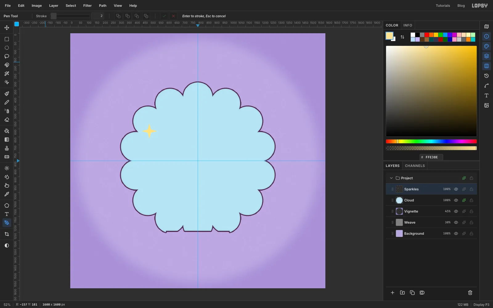

Add a layer called *Sparkles*. Pick the **Pen** and click these eight points in order to make a four-point star around **496, 614**. The tips are 48 px from the centre and the inner corners are 14 px away:

**496, 566** → **506, 604** → **544, 614** → **506, 624** → **496, 662** → **486, 624** → **448, 614** → **486, 604**

Click the first point again to close the path.

Open the **Paths** panel, click **Path to Selection**, then **Delete Path**. Fill the selection with butter yellow `#FFE38E` and deselect.

## Copy the sparkle and shrink the copies

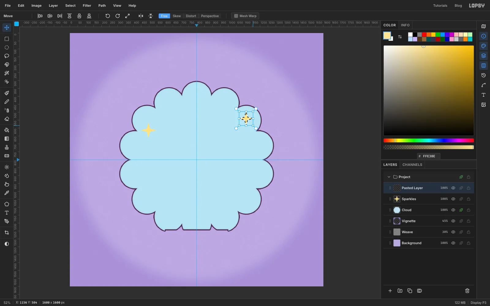

You need four more sparkles in smaller sizes. For each one:

1. Drag a marquee snugly around the first sparkle, press [[Cmd+C]], then [[Cmd+V]]. The copy is pasted in place on a new layer. It arrives selected, with the **Move** tool already active.
2. Drag the copy to where the new sparkle goes.
3. Hold [[Cmd]] and drag the bottom-right corner handle inwards to shrink it evenly. Watch the size against the first sparkle.
4. Press [[Enter]], deselect, and choose **Layer → Merge Down** to put it back on *Sparkles*.

Make them a little smaller near the upper right (around **1112, 540**), about half size on the right edge (**1176, 708**) and on the left (**444, 792**), and about three-quarters size at the lower right (**1128, 940**).

## Add dots and a mint heart

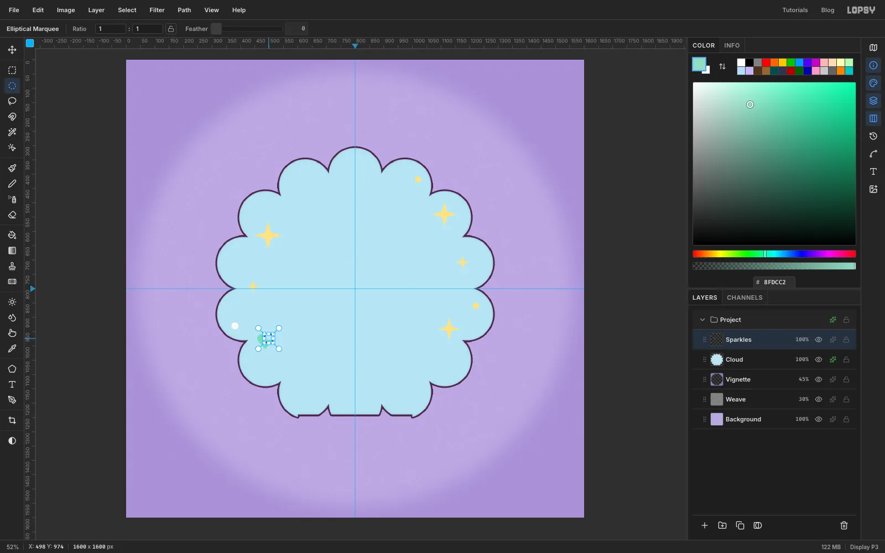

Still on *Sparkles*, add three little dots with the Elliptical Marquee and **Edit → Fill**: a **24 px** cream `#FFFBF2` dot at the lower left (**380, 930**), and **20 px** and **22 px** butter dots at the upper right (**1020, 418**) and on the right (**1222, 860**).

Then build a mint `#8FDCC2` heart from three simple shapes, filling each one as you go:

1. With the **Pen**, click a triangle with corners at **458, 979**, **514, 979** and **486, 1012**. Close it, use **Path to Selection** and **Delete Path**, and fill it.
2. With the Elliptical Marquee's dialog, make a 32 px circle from **458, 958** to **490, 990** and fill it.
3. Make a second circle from **482, 958** to **514, 990** and fill it.

The two circles round off the top of the triangle into a heart.

## Outline the confetti

Deselect and give the *Sparkles* layer the outline. The 6 px plum line is the same weight as the badge's, so the small pieces belong to the same family. Keeping one outline weight everywhere is a big part of the kawaii look.

## Build the spoon upright

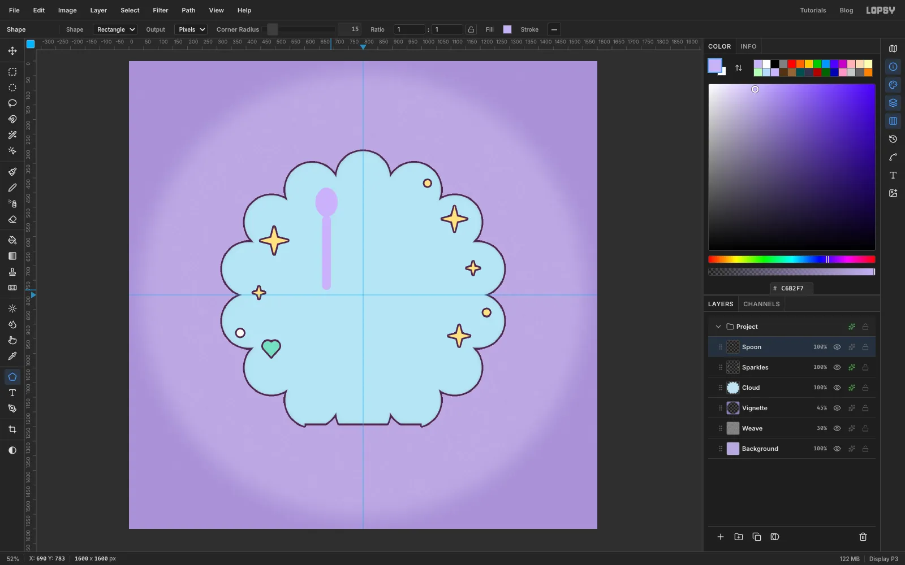

Add a layer called *Spoon*. It's easier to draw the spoon straight and tilt it afterwards.

1. Draw the bowl with the Elliptical Marquee's dialog, from **637, 433** to **713, 533**, and fill it with lavender `#C6B2F7`. Deselect.
2. Pick the **Shape** tool. Set **Shape** to **Rectangle**, **Corner Radius** to **15**, and the **Fill** swatch to `#C6B2F7`. Shapes draw from the centre out, so press at **675, 656** and drag to **690, 783**. This makes a 30 × 254 px handle that runs down from the bowl.

## Tilt the spoon

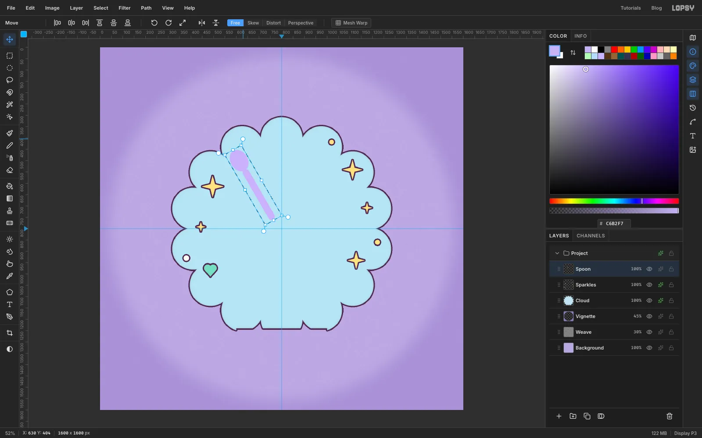

Drag a marquee around the whole spoon. Switch to the **Move** tool, hold [[Cmd]], and drag one of the round rotation handles just outside the box's corners. With [[Cmd]] held, the rotation snaps in 15° steps. Turn it anticlockwise by two steps, **30°**. The bowl should lean out to the upper left, with the handle pointing down towards the middle of the badge.

Press [[Enter]] to apply, deselect, and give the spoon the outline.

## Stack the soft-serve tiers and draw the tip

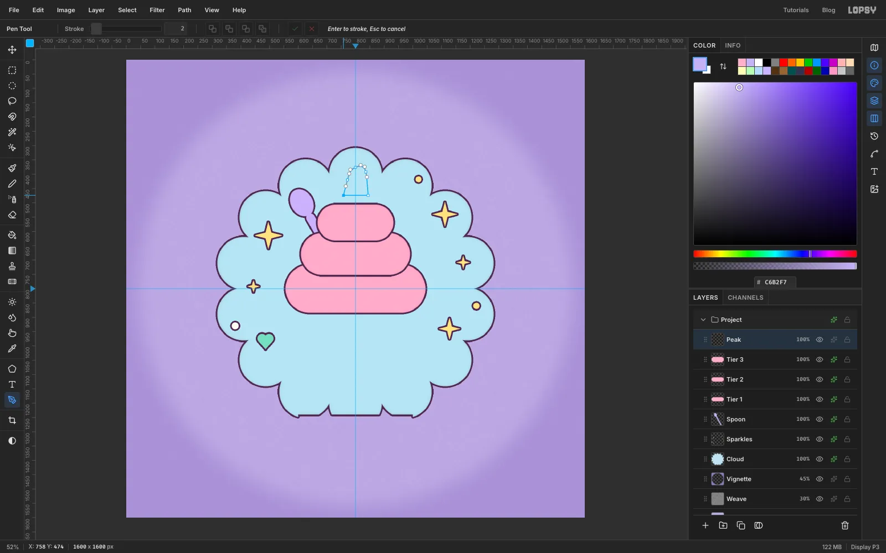

Soft serve is a stack of rounded coils. Each coil is a pill: a rectangle with fully rounded ends, on its own layer.

Select the **Shape** tool, choose **Rectangle**, and set the **Corner Radius** to **200**. Lopsy limits the radius to half the shorter side, so every rectangle becomes a pill. Set the **Fill** to strawberry `#FFAFC9`.

For each tier, click **Add Layer**, then press at the centre and drag out to the bottom-right corner:

- *Tier 1*: centre **800, 800** (the guide crossing), drag to **1044, 884**. That's 488 × 168 px.
- *Tier 2*: centre **800, 679**, drag to **990, 752**.
- *Tier 3*: centre **800, 569**, drag to **932, 632**.

Give each tier the outline and an **Inner Glow** in plum at **Size 12**, **Opacity 22%**.

The curled tip goes *behind* the top tier, so draw it next. Add a layer called *Peak* and draw a closed **Pen** path:

- Click a corner at **758, 474**.
- Drag from **772, 420** upwards.
- Drag from **800, 376** to the right to round the top.
- Drag from **836, 392** downwards.
- Click a corner at **844, 474**, then click the first point to close.

It's a soft dollop leaning a little to the left. Its bottom will be hidden by the last tier.

## Top it with a fourth tier

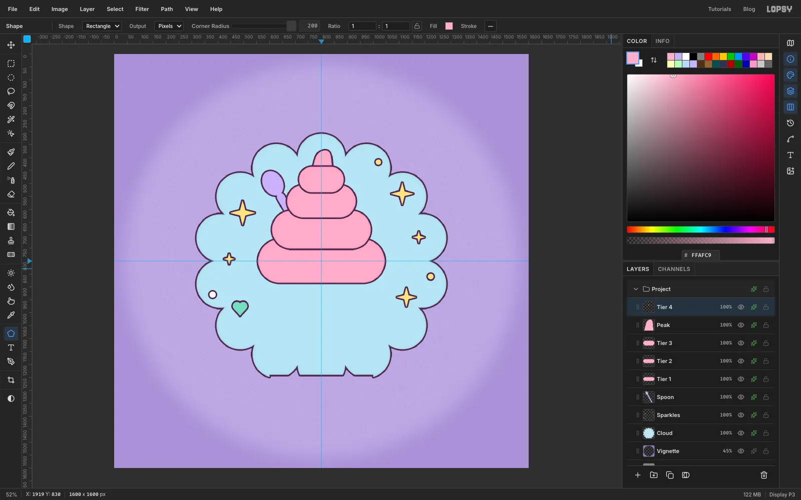

Use **Path to Selection** and **Delete Path**, fill the *Peak* with strawberry, and deselect. Give it the outline and an Inner Glow of **Size 8**, **Opacity 22%**.

Add *Tier 4* above *Peak* with the same Shape settings: centre **800, 485**, dragged to **886, 534**. Give it the outline and the same Inner Glow as the other tiers.

## Shade the underside of each tier

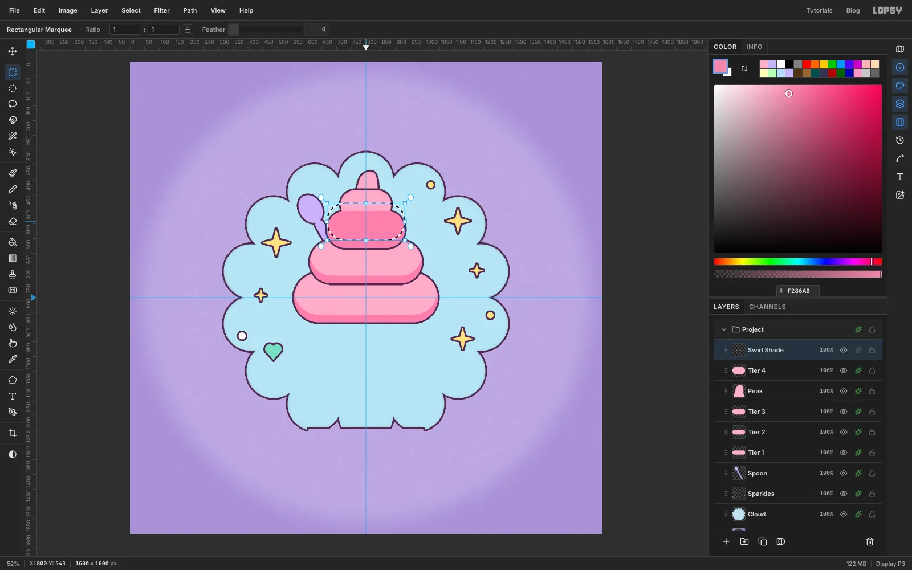

Add a layer called *Swirl Shade* above *Tier 4*. Each tier gets a darker crescent along its bottom:

1. [[Cmd]]-click the *Tier 1* thumbnail to load its shape as a selection.
2. Fill it with `#F286AB`.
3. Pick the **Rectangular Marquee**, press inside the selection and drag it straight **up about 26 px**. Dragging inside a selection with a marquee tool moves the outline, not the pixels.
4. Press [[Delete]]. Only a thin crescent at the bottom of the tier is left.
5. Deselect, then repeat for *Tier 2*, *Tier 3* and *Tier 4*.

## Add the fold lines

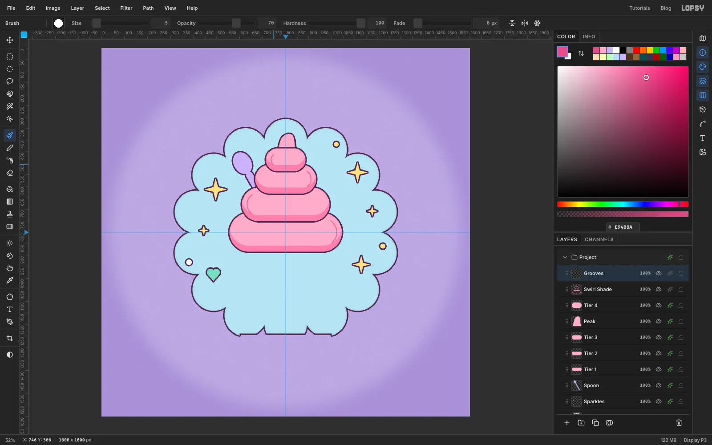

A real swirl wraps around, so each coil has a fold where it tucks under. Add a layer called *Grooves*.

[[Cmd]]-click *Tier 1*'s thumbnail, then [[Cmd+Shift]]-click *Tier 2*, *Tier 3*, *Tier 4* and *Peak* to add them. Choose **Select → Shrink…** with **8**, so the lines can't touch the outlines.

Pick the **Brush** at **Size 5**, **Opacity 70%**, in `#E94B8A`. Inside each tier, draw one short curved stroke that follows the curve of a rounded end, about 22 px in from the edge. Alternate the sides: right end on *Tier 1*, left on *Tier 2*, right on *Tier 3*, left on *Tier 4*. The zig-zag reads as one coil spiralling up. Deselect when you're done.

## Add the shine

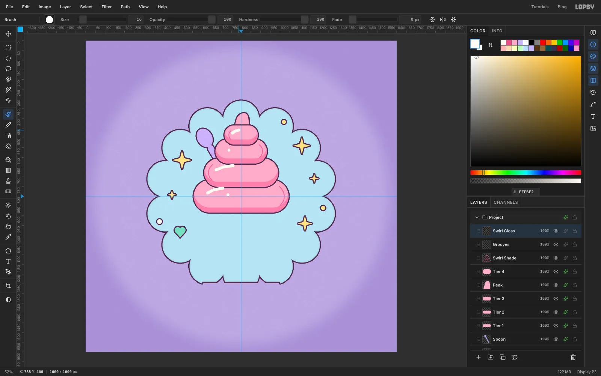

Add a layer called *Swirl Gloss*. Set the **Brush** back to **Opacity 100%**, **Size 16**, in cream `#FFFBF2`.

Paint a short curved dash across the upper left of each tier, keeping it clear of the outlines and seams. Vary them so they don't look copied:

- *Tier 1*: a dash plus a dot just past its end
- *Tier 2*: a longer dash
- *Tier 3*: only a dot
- *Tier 4*: a short dash

Click once for a dot.

## Scatter the sprinkles

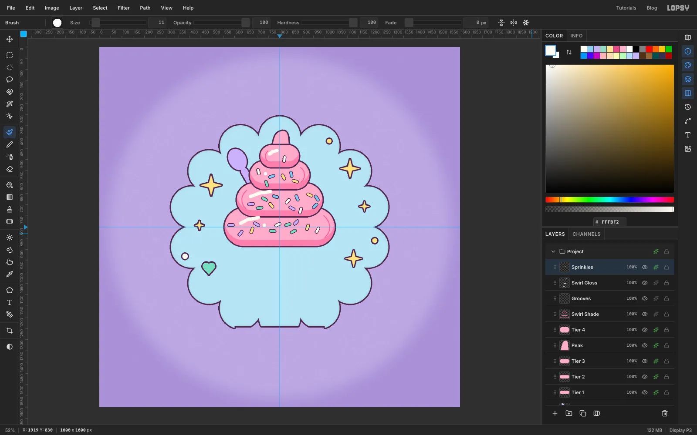

Add a layer called *Sprinkles*. Load the four tiers as one selection ([[Cmd]]-click *Tier 1*, then [[Cmd+Shift]]-click the others) and **Shrink** it by **14**.

Set the **Brush** to **Size 11**, **Hardness 100**. Paint about 30 short strokes, each about 18 px long and at a random angle. Use five colours, about six sprinkles each: butter `#FFE38E`, mint `#8FDCC2`, lavender `#C6B2F7`, blue `#8CCBF0` and cream `#FFFBF2`.

Keep every sprinkle whole and on one tier. Don't let them cross a seam, a fold line or a shine mark, and leave space at the top right for the cherry. Deselect and give the layer a **3 px** plum Stroke.

## Put a cherry on top

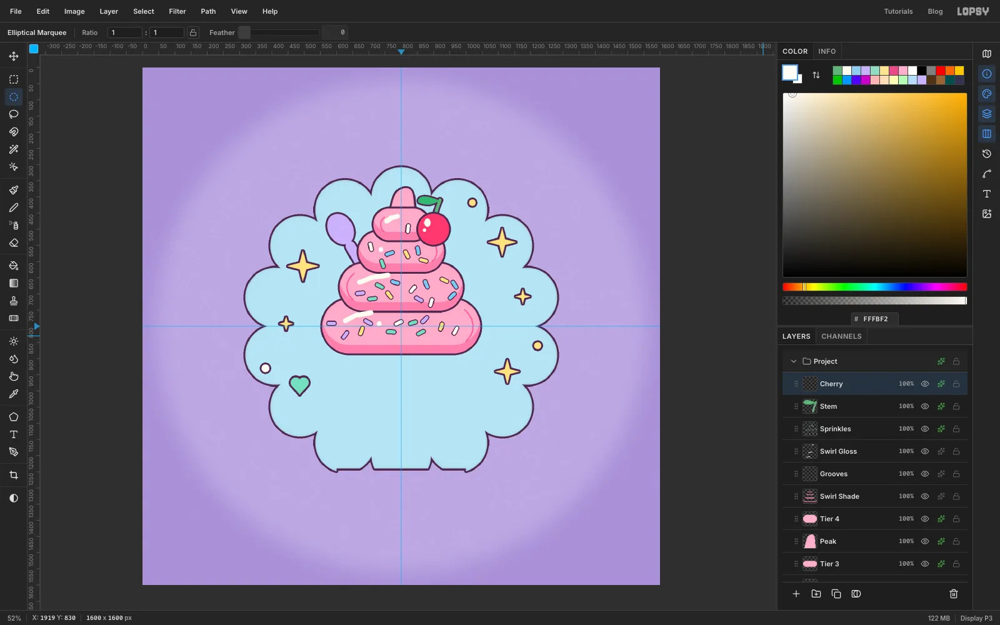

Add a layer called *Stem* and set the colour to leaf green `#5DB57A`. Pick the **Pen** and set **Stroke** in its options bar to **10**. Press at **904, 462** and drag up a little, then press at **920, 410** and drag up and to the right. Press [[Enter]] to stroke the path, then click **Delete Path**.

Now a leaf pointing left from the top of the stem. With the Pen:

1. Press at the left tip, **856, 404**, and drag up and to the right a little to curve the top edge.
2. Click (don't drag) the right tip at **918, 412**, so it stays pointed.
3. Press at **880, 424** and drag to the left to curve the underside.
4. Click the first point to close it.

Use **Path to Selection** and **Delete Path**, fill it green, deselect, and give the layer a **5 px** plum Stroke.

Add a layer called *Cherry*. With the Elliptical Marquee's dialog, draw a circle from **852, 452** to **948, 548** and fill it with `#FF4F72`. For the shine, fill a cream oval from **871, 467** to **891, 493** at its upper left, and a tiny dot from **867, 498** to **877, 508** below it. Deselect and give it the outline.

## Make the paper cup

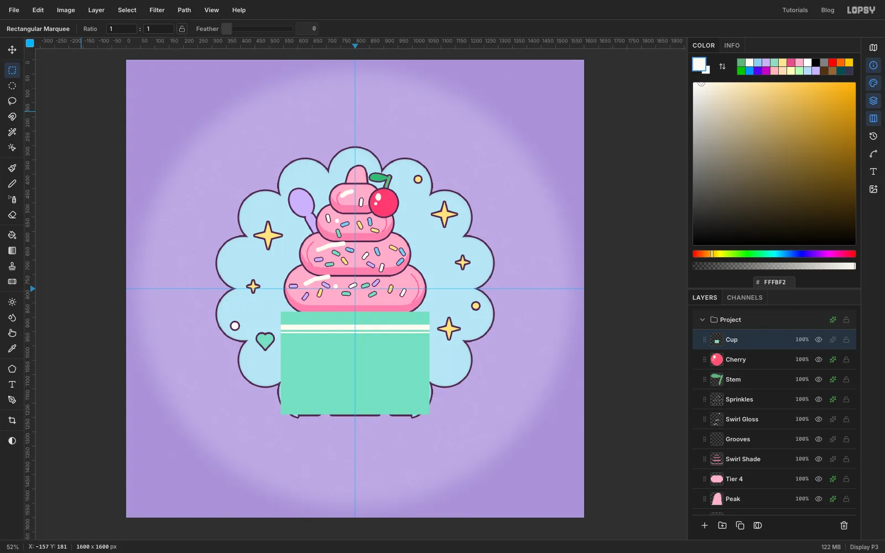

Click *Cherry*, then add a layer called *Cup*. Use the exact-size dialog of the **Rectangular Marquee** for a box from **540, 880** to **1060, 1240**, and fill it with mint `#8FDCC2`.

Paper cups have a printed band. Set the colour to cream, make a selection from **540, 926** to **1060, 944** and fill it. Then make a thin strip from **540, 951** to **1060, 956**, fill that too, and deselect.

## Taper the cup with Distort

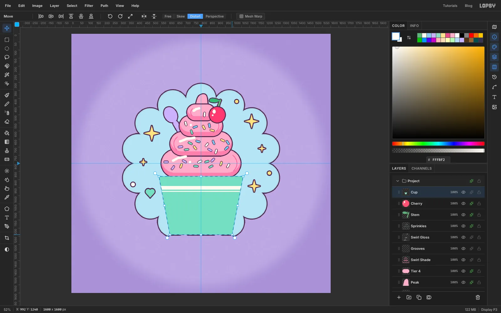

Select the cup again (**540, 880** to **1060, 1240**) and switch to the **Move** tool. In the options bar, click **Distort**. In this mode each corner handle moves on its own.

Drag the bottom-left corner handle **68 px** to the right and the bottom-right corner **68 px** to the left. The cup now narrows towards its base, and the cream band follows the new shape. Press [[Enter]], click **Free** to leave Distort mode, and deselect.

Give the cup the outline and an Inner Glow in plum (**Size 14**, **Opacity 20%**).

## Add the rim

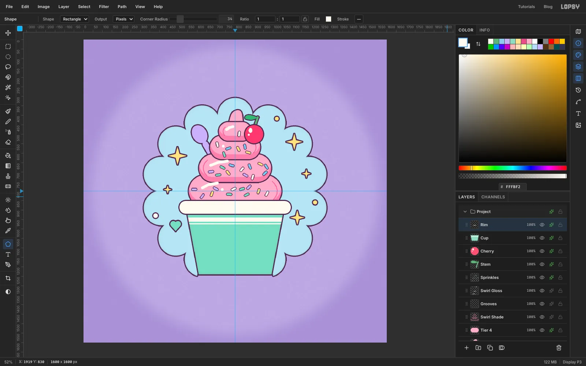

Add a layer called *Rim*. With the **Shape** tool (Rectangle, **Corner Radius 34**, Fill cream), press at **800, 886** and drag to **1094, 920**. The rim covers the bottom edge of the swirl, so the swirl looks like it sits inside the cup. Give it the outline.

## Draw the face

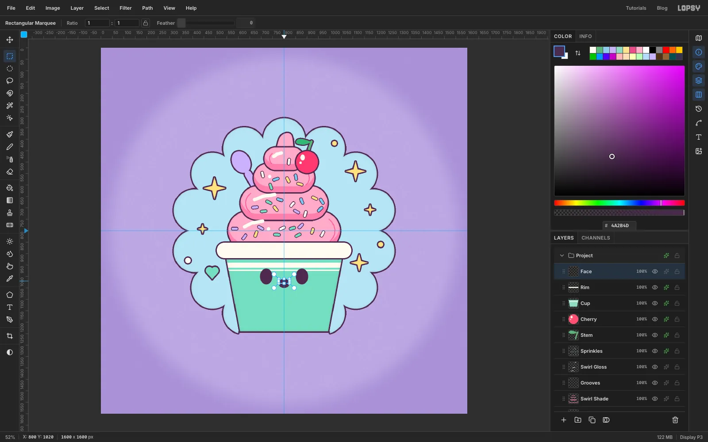

Add a layer called *Face*. Kawaii faces sit low and wide, with the eyes far apart.

1. **Eyes:** with the Elliptical Marquee's dialog, fill a plum oval from **695, 965** to **749, 1035**, then a second from **851, 965** to **905, 1035**.
2. **Mouth:** fill a plum oval from **776, 1010** to **824, 1050**. Switch to the **Rectangular Marquee**, make a selection over its top half from **776, 1010** to **824, 1030**, and press [[Delete]]. A half-moon smile is left.
3. **Tongue:** back on the Elliptical Marquee, fill a small `#FF8DB0` oval from **789, 1036** to **811, 1048**.
4. **Eye shine:** in each eye, fill a **20 px** cream circle at the upper right and a **10 px** cream circle at the lower left.

Deselect.

## Add the blush

Add a layer called *Blush*. Draw two **72 × 34 px** ovals, centred on **664, 1050** and **936, 1050**, and fill them with `#FF8DB0`. Deselect.

Pick the **Pencil** at **Size 4** in cream. On each cheek, draw three short slanted lines about 15 px apart: click at the bottom of each line, then [[Shift]]-click at its top.

## Draw a ribbon tail

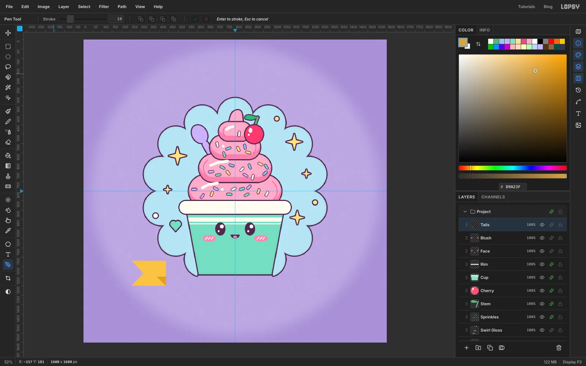

Add a layer called *Tails*. With the **Pen**, click these corners to make a strip with a V-notch cut into its end: **435, 1168**, **435, 1300**, **255, 1300**, **315, 1234**, **255, 1168**. Then close the path. Use **Path to Selection**, **Delete Path**, and fill it with `#F2C55C`.

Draw a small Pen triangle at **385, 1252**, **435, 1252** and **435, 1300**, and fill it with the darker `#D9A23F`. This is the fold where the banner bends back into the tail.

## Mirror the tail

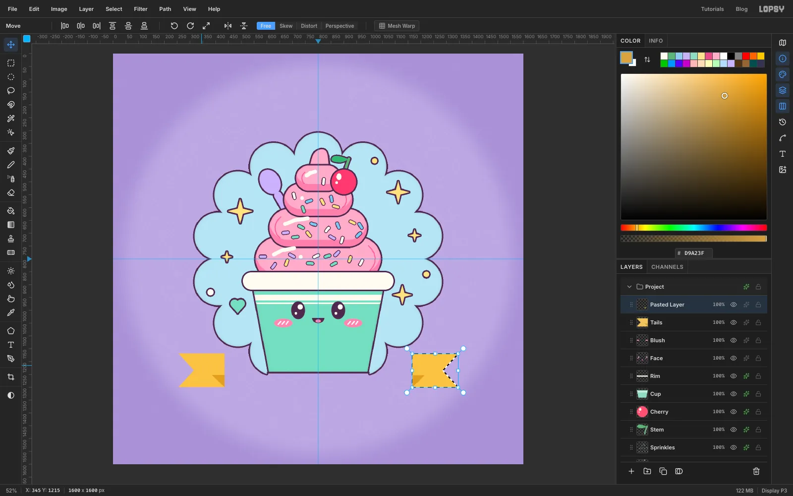

Drag a marquee around the tail and its fold, then copy and paste. The paste comes in selected with the **Move** tool active. Click **Flip Horizontal** in the options bar.

Drag the flipped copy about **910 px** to the right, so it mirrors the first tail across the centre guide. Its pointed ends should finish at about **x 1345** (check the status bar), level with the first tail. Deselect, choose **Layer → Merge Down**, and give *Tails* the outline.

## Add the banner

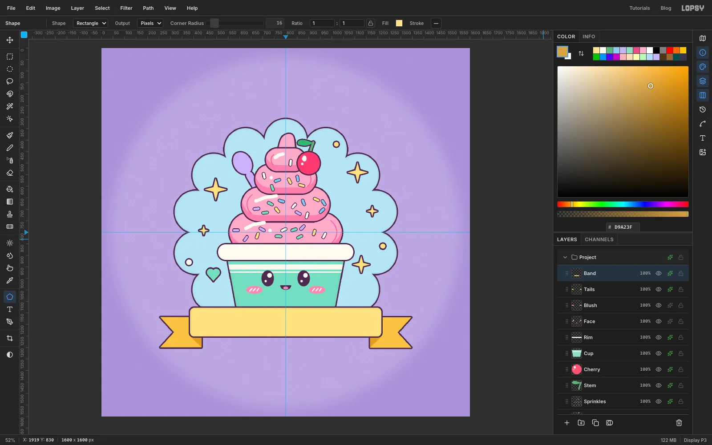

Add a layer called *Band*. With the **Shape** tool (Rectangle, **Corner Radius 16**, Fill `#FFE38E`), press at **800, 1190** and drag to **1215, 1252**. The 830 × 124 px band covers the bottom of the cup and the inner ends of both tails.

Give it the outline and an Inner Glow in plum (**Size 10**, **Opacity 20%**).

## Set the title

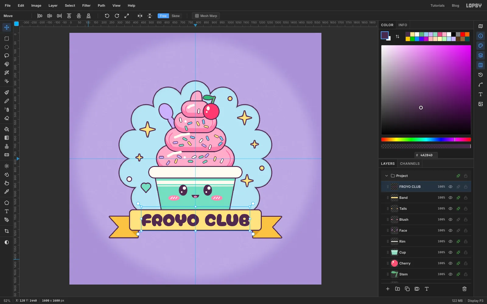

Pick the **Text** tool. Choose the Google font **Cherry Bomb One** at **110 px**, in plum. Click in an empty spot below the patch, type **FROYO CLUB** and press [[Tab]] to finish.

Switch to the **Move** tool and drag the text onto the banner. Pink alignment lines appear as you drag. Let go when the line shows the text centred on the band. Then nudge it with the arrow keys until the gaps above and below the letters match. They come out about 24 px each, with roughly 74 px of yellow at each end. The rounded letters echo the pill-shaped tiers and the scallops.

## Select the die-cut silhouette

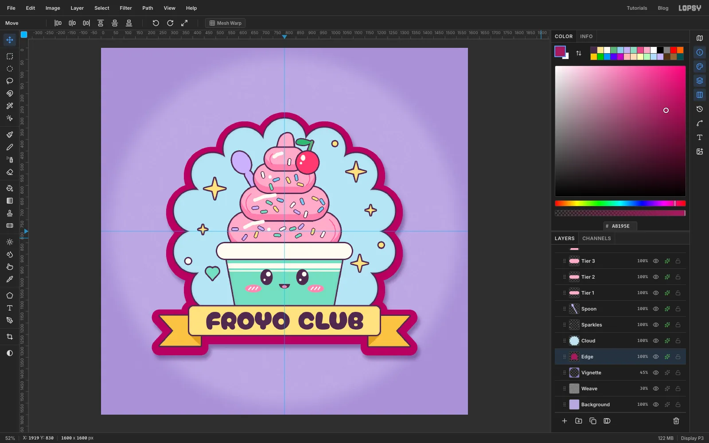

The cut edge and border go under everything, so click *Vignette* and add a layer called *Edge*.

[[Cmd]]-click the *Cloud* thumbnail, then [[Cmd+Shift]]-click *Tails*, *Band*, *Stem* and *Cherry* to add them. Choose **Select → Grow…** with **34**. This is the silhouette the patch would be cut along.

Fill it with dark `#A8195E` and deselect. Switch to the **Move** tool and press the down arrow **7** times. This darker sliver under the bottom edge is the thickness of the patch. Add a **Drop Shadow** to *Edge*: **Offset X 10**, **Offset Y 18**, **Blur 24**, **Opacity 45%**, in `#3B2160`.

Now add a layer called *Border* above *Edge* and make the same selection again (Cloud plus the four layers, then **Grow 34**). Fill it with border pink `#EC5896` and deselect.

## Stitch the satin border

On *Border*, add an **Inner Glow** in white (**Size 10**, **Opacity 25%**) and a **3 px** plum Stroke as a crisp keyline around the cut edge.

Satin stitch lays threads straight across the border. You can fake that with rays from the centre of the patch:

1. Add a layer called *Satin*.
2. [[Cmd]]-click the *Border* thumbnail. Then [[Cmd+Alt]]-click *Cloud*, *Tails*, *Band*, *Stem* and *Cherry* to subtract them. Only the border ring is left.
3. Fill it with `#FF8FC0`.
4. Set the colour to `#C21F6E`. Run **Filter → Sunburst…** with **Rays 120**, **Length 100** and **Width 16**, leaving **Center X** and **Center Y** at **50**.
5. Run Sunburst twice more. The dialog resets each time, so enter **Rays 120**, **Length 100** and **Width 16** again, with **Rotation 1**, then **Rotation 2**. That gives 360 thin rays, all crossing the border at roughly a right angle.
6. Deselect, and set the layer to **Overlay** at **60%**.

## Add the badge's fill stitches

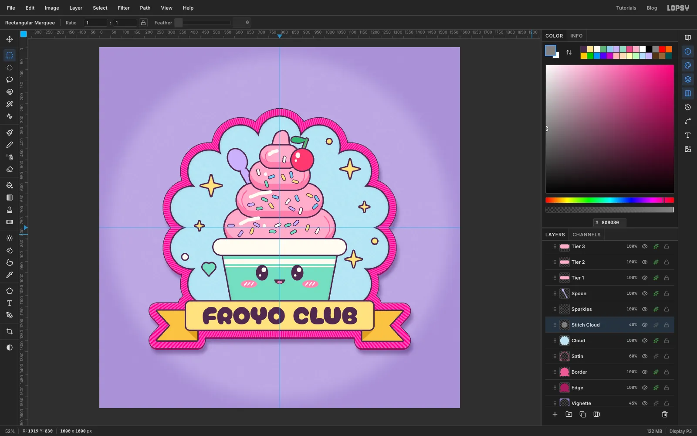

Embroidered fills are made of long parallel stitches. You'll make three thread textures, each running in its own direction.

Click *Cloud*, then click **Add Layer** and name it *Stitch Cloud*. It sits right above the badge, so everything else in the design covers it. Fill it with grey `#808080` and run:

1. **Add Noise** **100**, **Mono**, **Gaussian**
2. **Gaussian Blur** with **Radius 2**, so the threads are thicker than single pixels
3. **Motion Blur** with **Angle 45**, **Distance 16**
4. **Brightness/Contrast** with **Contrast 100**, twice
5. **Emboss** with **Angle 135**, **Strength 40**

Now trim it to the badge. [[Cmd]]-click the *Cloud* thumbnail, choose **Select → Inverse**, press [[Delete]], and deselect. Set the layer to **Overlay** at **40%**.

## Stitch the swirl and cup

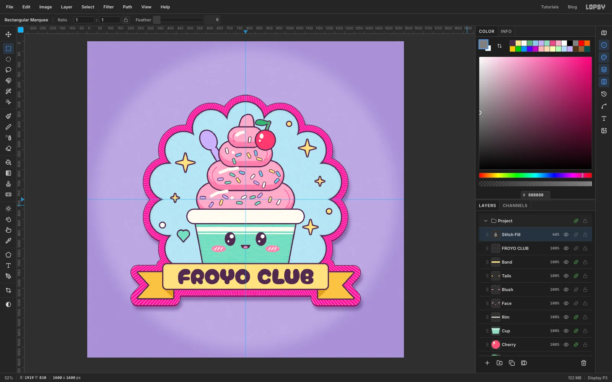

These threads have to sit on top of the art, so click *FROYO CLUB* (the top layer), then **Add Layer** and name it *Stitch Fill*. Make the same texture, but with the Motion Blur at **Angle 0**, so the threads run across the coils.

For the selection, [[Cmd]]-click *Tier 1*. Then [[Cmd+Shift]]-click *Tier 2*, *Tier 3*, *Tier 4*, *Peak*, *Cup*, *Rim*, *Spoon* and *Cherry*. [[Cmd+Alt]]-click *Band* to take out the part of the cup behind the banner, then [[Cmd+Shift]]-click *FROYO CLUB* so the letters get horizontal threads too. Inverse, Delete, deselect, and set it to **Overlay 40%**.

## Satin-stitch the ribbon

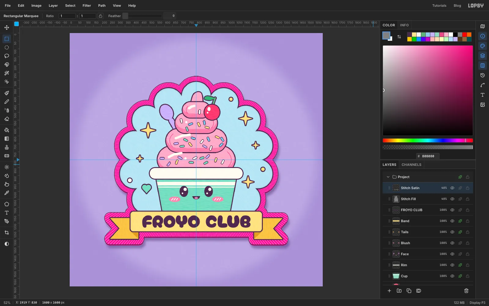

Add one more layer above it, *Stitch Satin*, with the Motion Blur at **Angle 90**. A ribbon is usually satin-stitched across its width, so these threads run up and down.

Select *Band* plus *Tails*, then [[Cmd+Alt]]-click *FROYO CLUB* to keep the letters out. Inverse, Delete, deselect, and set it to **Overlay 40%**.

## Group the layers

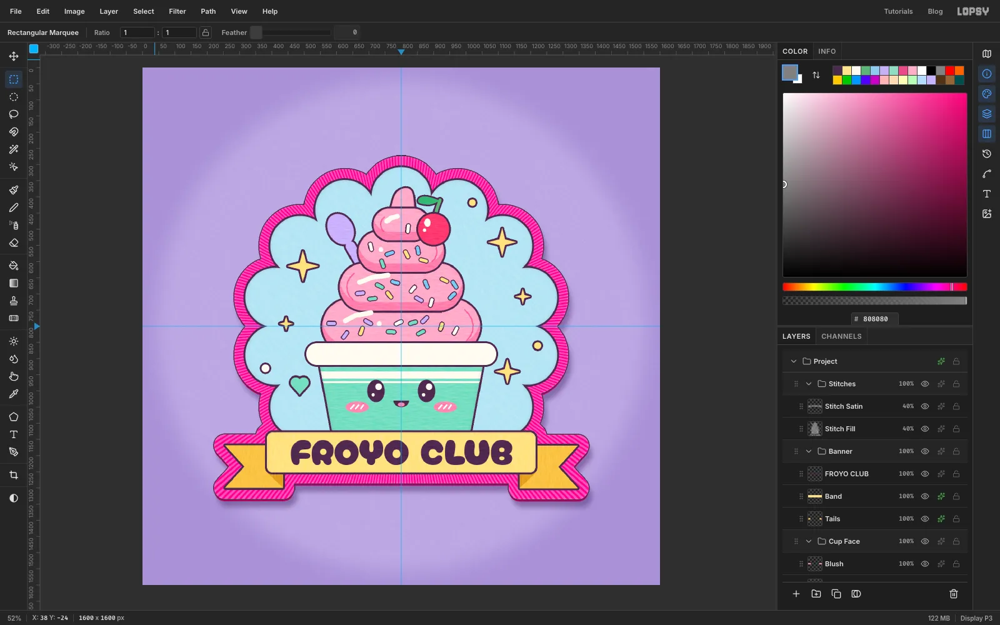

Tidy the stack into groups. For each group, click its bottom layer, [[Shift]]-click its top layer, choose **Layer → Group Layers**, and double-click the new group to rename it:

- *Froyo*: *Spoon* up to *Cherry*
- *Cup Face*: *Cup* up to *Blush*
- *Banner*: *Tails* up to *FROYO CLUB*
- *Stitches*: *Stitch Fill* and *Stitch Satin*

Now you can move a whole part at once. Click the *Cup Face* group and drag with the Move tool to try a different height, then press [[Cmd+Z]] to put it back.

## Export the patch

Press [[Cmd+0]] to fit the canvas and check the whole patch. Look for anything touching that shouldn't: sprinkles on seams, shine dots on outlines, or decorations closer than about 20 px to the scalloped edge.

Choose **File → Quick Export PNG** to save the image. Use **File → Save Project** to keep the layers, so you can try other flavours later, like a mint swirl in a pink cup.
