Kawaii ("cute") illustration comes down to a few rules: soft pastel colours, round shapes, one warm outline colour around everything, and little faces with rosy cheeks. In this tutorial you'll make **Dewdrop Greenhouse**, a 1200 × 1600 poster for a spring plant swap. You'll build a glass greenhouse and give it a cast of plant characters, then frame them with an arched title and a sticker-style banner.

Almost every shape is a selection filled with a flat colour. The kawaii look comes from three layer effects: **Stroke** for the outlines, **Inner Glow** for soft shading and **Drop Shadow** for a chunky sticker edge. Along the way you'll also use Pattern Fill, the Pen tool, Radial Symmetry, a brush you define yourself and text bound to a path.

Name your layers as you go. The finished file has about 60 of them, sorted into groups, one per character.

The palette:

- Paper `#FFF3E4`, polka dots `#FFCFDB`
- Outline `#5A3A33` (every outline, face and shadow)
- Glass `#E8F9EF` → `#B5E5CB`, mint hem `#A9E2C4`, banner `#78C9A2`
- Leaf `#7ACB8E`, leaf dark `#4E9F6C`, cactus shade `#2F7D52`, succulent `#9ED6AE` / `#C9EDD2`
- Terracotta `#F5A98A`, rim `#E5866A`, wood `#EDBF86` / `#D9A066`
- Pink `#FF8DAF`, blush `#FF9DB7`, bubblegum `#FFC0D1`, berry `#E2638B`
- Lavender `#CDB9F3` / `#B29BE6`, butter `#FFE296` / `#F7C85E`
- Sky `#D4F1FF` → `#A9DFF8` → `#62BDEB`

## Start a cream canvas with two guides

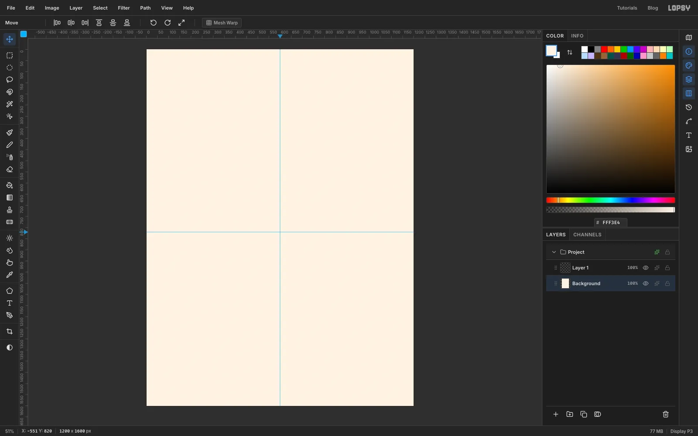

Open [Lopsy](/). In the **New Document** dialog, choose **Pixels**, type `1200` × `1600` and click **Create**.

Click the **Background** row, set the foreground colour to `#FFF3E4` in the Color panel and choose **Edit → Fill**.

Click the top ruler at **600** to drop a vertical guide down the centre. Then click the left ruler at **820** for a horizontal guide. That line is where the greenhouse's round roof meets its straight walls, and you'll come back to both guides often.

## Make a polka-dot tile

Add a layer called `Dot Tile`. Pick the **Shape** tool and set Shape to **Ellipse**, Output to **Pixels**, the fill to `#FFCFDB` and the stroke to none (click the stroke swatch, then **Remove stroke**).

A click without a drag opens the **Shape Size** dialog, and the new shape is centred on the spot you clicked. Watch the X / Y readout in the status bar and click about 50 px in from both the top and left edges, then type `22` × `22`. The dot now sits in the middle of the canvas's top-left 100 px square.

With the **Rectangular Marquee**, select exactly that 100 × 100 px square, from the canvas corner to 100, 100 on the readout. Choose **Edit → Define Pattern**, then deselect with [[Cmd+D]] and delete the `Dot Tile` layer. The pattern is saved, so you don't need the layer any more.

## Fill the background with staggered dots

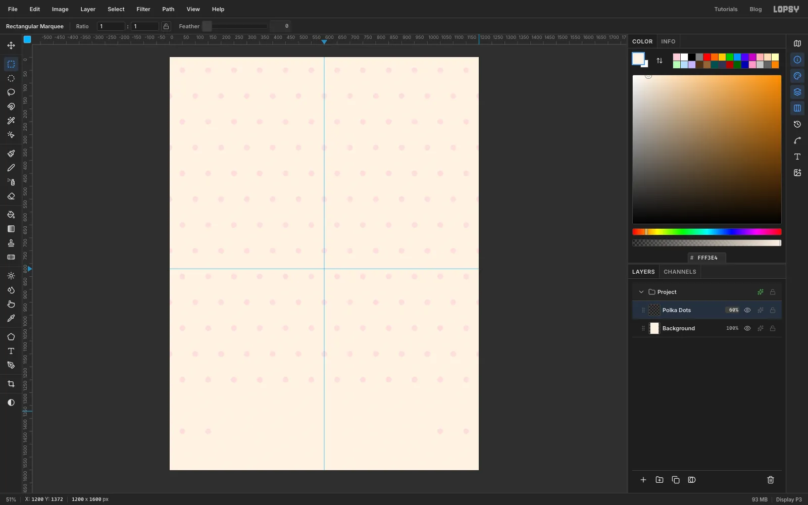

Click the empty `Layer 1` and rename it `Polka Dots`. Choose **Edit → Fill with Pattern…**, pick your dot pattern and set **Row Stagger** to `50`%. Every other row then shifts by half a tile, which gives the classic polka-dot layout. Click **Apply**.

A few clean-ups keep the dots out of the way of the text later. Marquee the bottom row of dots and press [[Delete]]. Delete the row about 250 px above the bottom too, because it would peek out under the banner. In the row between those two, delete everything except the dots at the far left and right, which clears space for the date line. Finally, lower the layer's opacity to 60%.

## Add a scalloped hem

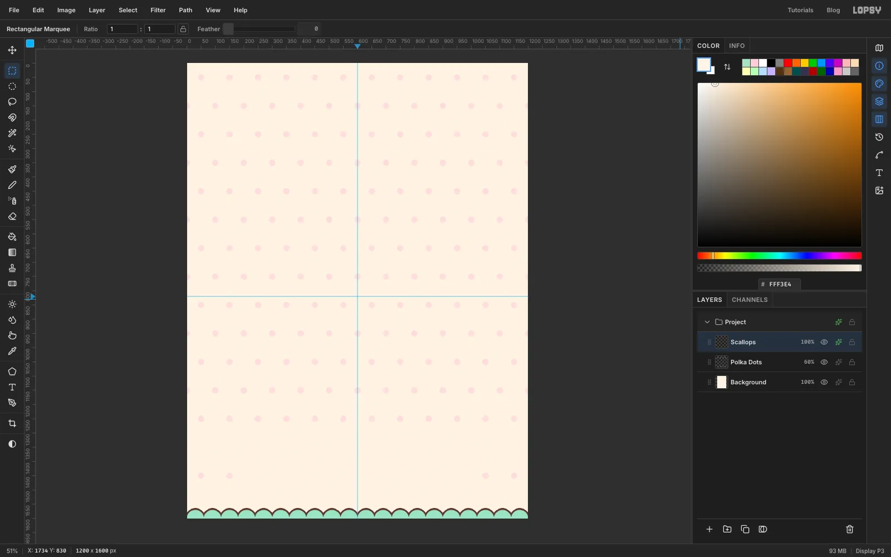

Scallops are another pattern. Add a layer called `Scallop Tile`. With the Shape tool, set the fill to `#A9E2C4`, click 30 px in from the left edge and 40 px down from the top, and make a `60` × `60` circle.

Marquee the 60 × 40 px strip at the very top-left corner of the canvas. Only the top half of the circle is inside it. Choose **Edit → Define Pattern**, deselect and delete the layer.

Add a layer called `Scallops`. Marquee a 40 px band across the full width at the bottom of the canvas and choose **Edit → Fill with Pattern…** with the new scallop pattern. Deselect, open the layer's effects (the sparkle icon on its row) and turn on **Stroke** with the colour `#5A3A33` and a Width of `6`.

> **Tip:** Pattern Fill lines its tiles up with the top-left corner of the canvas. Start the band on a multiple of the tile height (1560 is 39 × 40) so the bumps land whole.

## Select the greenhouse arch

Add a layer called `Greenhouse`. Pick the **Elliptical Marquee**. Marquees drag from corner to corner, so start 380 px left of the centre guide and 380 px above the horizontal guide, and drag down and right until the readout shows a 760 × 760 circle. Its middle lands exactly on the cross where your guides meet.

> **Tip:** For exact numbers, click once with the marquee instead of dragging, and type the corners into the dialog that opens.

Now switch to the **Rectangular Marquee**, hold [[Shift]] and drag a rectangle the same width as the circle. Start where the circle's left edge meets the horizontal guide, and end below its right edge, about 360 px above the bottom of the canvas. Shift adds the rectangle to the circle, so you get one arched-window selection.

## Fill the glass and outline it

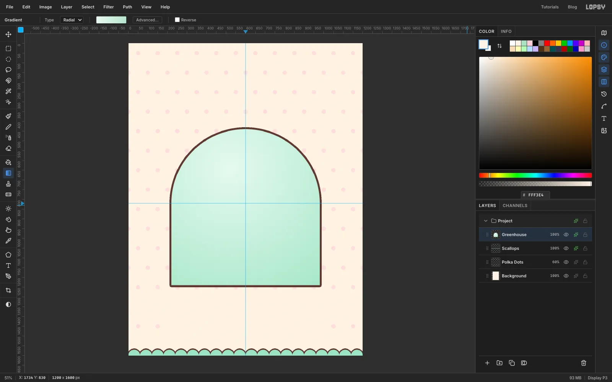

Keep the selection. Pick the **Gradient** tool, set the type to **Radial** and click **Advanced…**. Use two stops, `#E8F9EF` and `#B5E5CB`, and click **Done**. Drag from a little up and left of the arch's centre out to its bottom-right corner. Because the selection is active, the gradient stays inside the arch.

Deselect, open the layer's effects and turn on **Stroke** in `#5A3A33` with a Width of `10`. This is the thickest outline in the piece, because the greenhouse frames everything else.

## Add the glass shine and window bars

First add the glass shine. Add a layer called `Shine` and, with the **Lasso**, draw a long slanted band in the upper-left pane. Hold [[Shift]] and draw a thinner band beside it, then fill both with white. Deselect, set the layer's blend mode to **Screen** in the effects panel and lower its opacity to 70%.

Next, add a layer called `Glazing`. Pick the **Brush**, set Size `14` and Hardness `100`, and set the foreground to white. Click above the roof on the centre guide, then [[Shift]]-click below the floor of the greenhouse to paint a straight bar. Add two more vertical bars halfway between the centre and each wall. Then do the same horizontally, once along the spring-line guide and once halfway between it and the floor. Let the bars run past the frame, because you'll trim them in the next step.

For the curved bar, keep `Glazing` as the active layer and pick the **Pen** tool and set **Stroke** to `14` in the options bar. Click-drag three anchors along an arch about two thirds the size of the roof. Start on the spring-line guide on the left, put one at the top and finish on the guide on the right. Drag each one's handle along the curve. Press [[Enter]] to stroke the path in white.

Turn on **Stroke** for the `Glazing` layer, in `#5A3A33` with Width `4`. In the **Paths** panel, select the arch path and click **Delete Path**, since you don't need it any more.

## Trim the bars to the glass

[[Cmd]]-click the `Greenhouse` layer's thumbnail to load its shape as a selection. Choose **Select → Inverse**, so everything *outside* the glass is selected, and press [[Delete]] with the `Glazing` layer active. Deselect.

> **Tip:** This is a good moment to test undo. Press [[Cmd+Z]] three times and [[Cmd+Shift+Z]] three times, and the bars come back trimmed exactly as before.

## Add a wooden shelf

Click the `Glazing` row and add a layer called `Shelf`. Pick the **Shape** tool and switch Shape to **Rectangle**. Set Corner Radius to `14`, the fill to `#EDBF86`, the stroke to `#5A3A33` and the stroke Width to `8`. Click near the bottom of the greenhouse and make it `700` × `36`. It should run almost wall to wall, about 70 px above the floor.

To give the shelf a front edge, add a layer called `Shelf Edge`. [[Cmd]]-click the `Shelf` thumbnail, then choose **Select → Shrink…** and enter `5`, which keeps you inside the outline. Pick the **Rectangular Marquee**, hold [[Alt]] and drag a rectangle over the top half of the shelf to subtract it. Fill what's left with `#D9A066`.

## Start the cactus with one selection

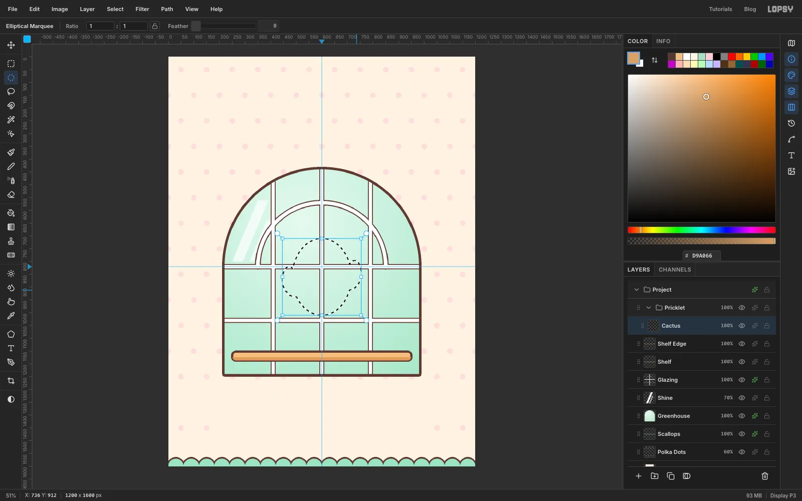

Every character gets its own group. Click the `Shelf Edge` row, click **New Group** in the Layers panel and name the group `Pricklet`. Add a layer inside it called `Cactus`.

With the **Elliptical Marquee**, drag a tall oval about 230 × 300 px, with the centre guide running down its middle and its bottom about 140 px above the shelf. Then hold [[Shift]] and add the arms. Each arm is a tall, narrow oval about 50 × 100 px that sticks out of the side of the body, plus a short, wide oval that joins it to the body lower down. Make the right arm sit a little higher than the left, so the cactus looks like it's waving.

## Colour, shade and outline the cactus

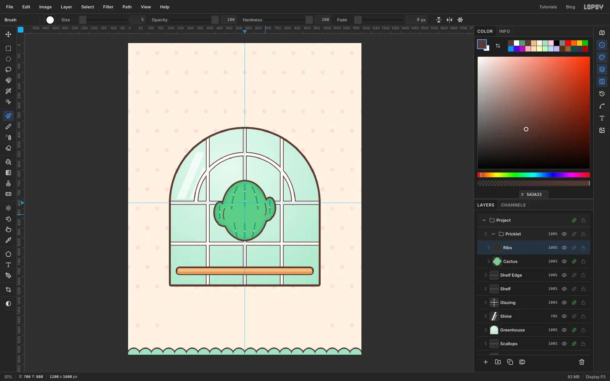

Fill the selection with `#7ACB8E` and deselect. In the effects panel, turn on:

1. **Inner Glow** in `#2F7D52`, Size `34`, Opacity `45`. This darkens the edges, which makes the body look round.
2. **Stroke** in `#5A3A33`, Width `8`.

Add a layer called `Ribs`. With the Brush at Size `7` in `#4E9F6C`, draw short curved ribs. Leave a clear band across the body level with the arms, because that's where the face goes, and draw ribs above and below it. Draw one rib down each arm too. Switch the colour to white and click a few spine dots along the ribs.

To keep the ribs inside the cactus, [[Cmd]]-click the `Cactus` thumbnail, choose **Select → Inverse** and press [[Delete]]. Deselect. Finally, with the Brush at Size `5` in `#5A3A33`, draw a short curved seam on the body where each arm joins it.

## Pot the cactus

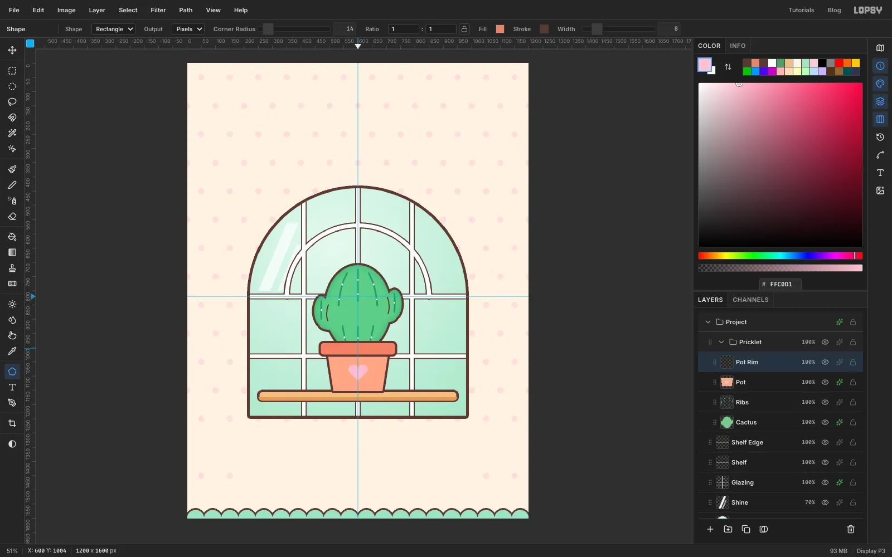

Add a layer called `Pot` above the ribs. With the **Lasso**, draw a tapered trapezoid under the cactus, wider at the top. Its top edge should cover the bottom of the cactus, and its bottom should rest on the shelf. Fill it with `#F5A98A` and give it a **Stroke** in `#5A3A33`, Width `8`.

For the decal, lasso a small heart in the middle of the pot and fill it with `#FFC0D1`.

Add a layer called `Pot Rim`. With the Shape tool (Rectangle, Corner Radius `14`, fill `#E5866A`, stroke `#5A3A33`, Width `8`), click on the top of the pot and make it `268` × `48`, so it overhangs both sides.

## Grow a flower with Radial Symmetry

Add a layer called `Flower`. Pick the **Brush**, set Size `32` and the colour `#FF8DAF`. In the options bar, click **Radial Symmetry** (the snowflake) and set **Segments** to `5`.

[[Cmd]]-click the top of the cactus to move the symmetry centre there. Then drag a short stroke, about 30 px, straight up from the centre. Lopsy repeats it five times around the centre, which gives five round petals.

Turn Radial Symmetry off again. Switch to `#FFE296`, set Size `22` and click once in the centre of the flower. Give the layer a **Stroke** in `#5A3A33` with Width `5`.

## Give Pricklet a face

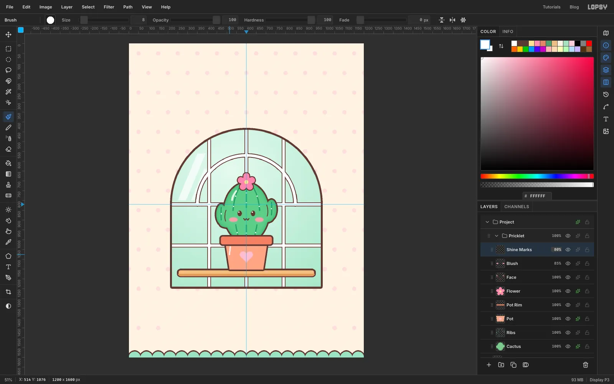

Add a layer called `Face`. With the **Shape** tool (Ellipse, fill `#5A3A33`, no stroke), click to make two eyes, each `22` × `28`. Place them on either side of the centre guide, a little below the middle of the body. Then switch the Brush to white at Size `8` and click once up and left of each pupil for the catch-lights.

For the mouth, set the Brush to Size `6` in `#5A3A33` and draw two tiny dips side by side between the eyes, which makes a little "ω".

Blush goes on its own layer, `Blush`. Drag a small flat oval under each eye with the Elliptical Marquee, holding [[Shift]] for the second one. Choose **Select → Feather…** with `4`, fill with `#FF9DB7` and lower the layer to 85%.

Last, add a `Shine Marks` layer. Use a white Brush at Size `10` to draw a short curve on the cactus's upper-left shoulder, and one at Size `8` down the left side of the pot. Set the layer to 80%.

## Draw a leaf with the Pen tool

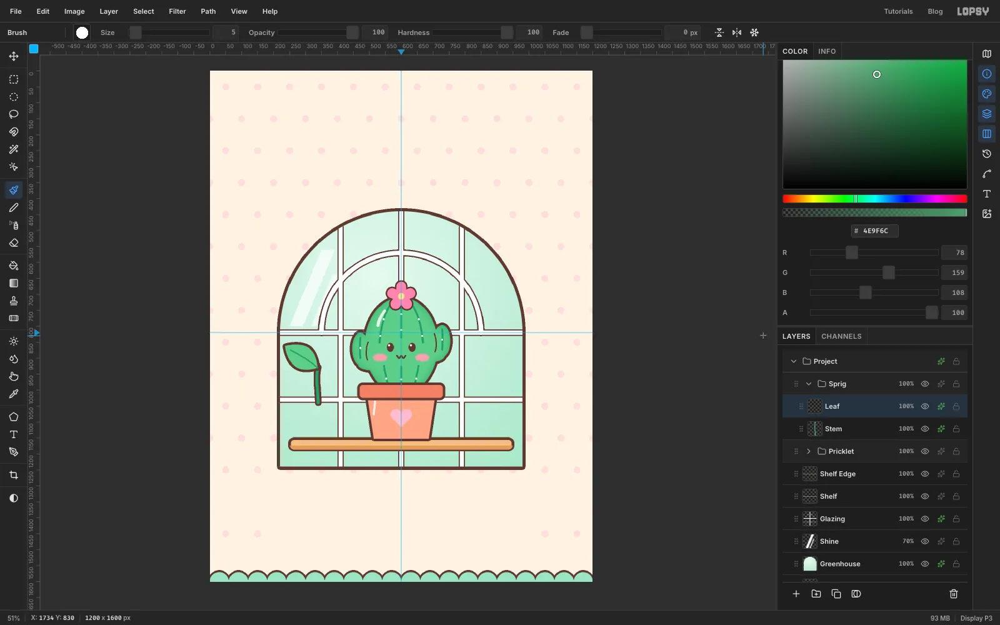

Collapse the `Pricklet` group, select it and click **New Group** again. Call the new group `Sprig`.

Add a layer called `Stem`. With the Brush at Size `10` in `#4E9F6C`, draw a slightly wavy stem about 130 px tall, starting roughly 100 px above the shelf, about halfway between the left wall and the cactus. The mug will hide its base. Give it a **Stroke** in `#5A3A33`, Width `6`.

Add a layer called `Leaf`. Pick the **Pen** tool and draw a closed leaf with four anchors:

1. Click at the top of the stem (the leaf's base).
2. Click-drag on the upper side, halfway along, pulling the handle towards the tip.
3. Click at the tip, up and to the left.
4. Click-drag on the lower side, pulling the handle back towards the base.
5. Click the first anchor again to close the path.

In the **Paths** panel, select the path and click **Path to Selection**. Fill it with `#7ACB8E`, deselect and delete the path. Draw a vein down the middle with the Brush at Size `5` in `#4E9F6C`, then add a **Stroke** of `8` in `#5A3A33`.

## Mirror, scale and tilt a second leaf

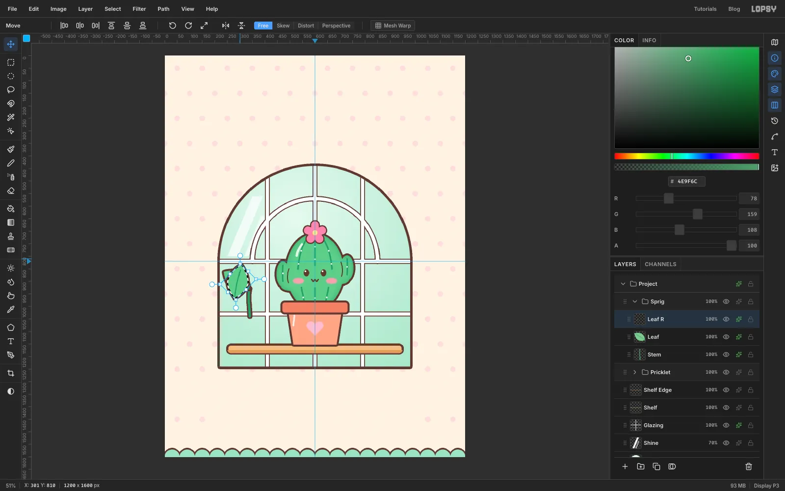

Choose **Layer → Duplicate Layer**, click the `Leaf copy` row and rename it `Leaf R`. Marquee around the leaf and pick the **Move** tool, then work in this order:

1. Click **Flip Horizontal** in the options bar.
2. Hold [[Cmd]] and drag the bottom-right corner handle out to about 110%.
3. Move the pointer just outside the top-right corner until the cursor turns into a rotate arrow, then drag anticlockwise about 45°, so the leaf points up rather than sideways.
4. Press [[Cmd+D]] to commit.

Do it in that order: flip first, then scale and rotate.

## Slide the leaf into place and add the mug

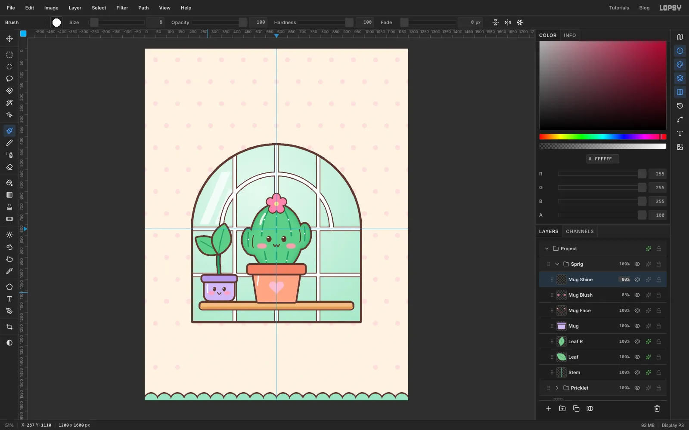

With the Move tool still active, drag `Leaf R` so its base meets the top of the stem, next to the first leaf. Keep its tip clear of the window bars and the cactus.

Add a layer called `Mug`. With the Shape tool (Rectangle, fill `#CDB9F3`, stroke `#5A3A33`, Width `8`):

- Set Corner Radius to `28`, then click under the stem, about 55 px above the top of the shelf, for a `140` × `108` body. Its bottom then rests on the shelf.
- Change the fill to `#B29BE6` and the radius to `14`, and click on the body's top edge for a `164` × `34` band that covers the stem's base.

Then give the mug a face the same way you did the cactus's:

- `Mug Face`: two `16` × `20` eyes with white catch-lights, and a small smile drawn with the Brush at Size `5`.
- `Mug Blush`: feathered by `4` and set to 85%.
- `Mug Shine`: a white stroke down the mug's left side, at 80%.

## Paint a succulent rosette

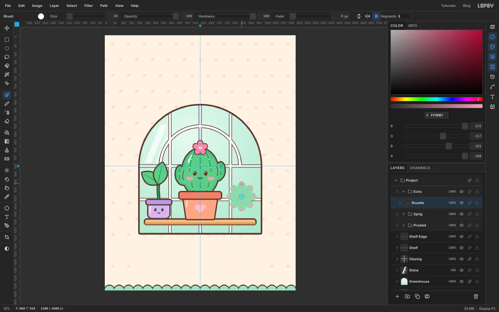

Collapse `Sprig`, select it and make a new group called `Echo`. Add a layer called `Rosette`.

Turn **Radial Symmetry** back on, set **Segments** to `8` and [[Cmd]]-click where the rosette's centre should go: halfway between the cactus pot and the right wall, about 160 px above the shelf. Set the Brush to Size `50` in `#9ED6AE` and drag a short stroke, about 60 px, straight up from the centre: eight fat petals appear. Switch to `#FF9DB7`, Size `20`, and click once at the tip of the top petal to give every petal a pink tip.

Give the layer a **Stroke** of `7` in `#5A3A33`.

## Finish the succulent and its bowl

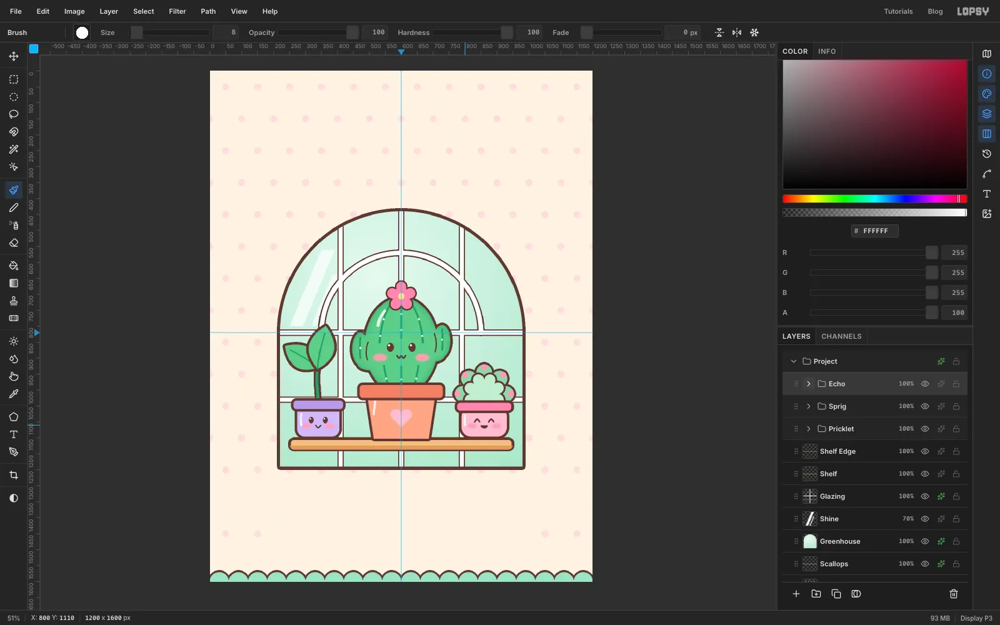

Add a layer called `Rosette Inner`. With Radial Symmetry still on, set the Brush to Size `36` in `#C9EDD2` and drag a stroke from the centre out between two of the outer petals. Turn Radial Symmetry off and give this layer a **Stroke** of `6`.

Add a layer called `Bowl` and use the Shape tool again:

- A `150` × `100` rectangle with Corner Radius `34` in `#FFC0D1`. Click just above the shelf, under the rosette, so the bowl covers the rosette's lower petals.
- A `178` × `32` rim in `#FF8DAF`, with Corner Radius `14`. Click on the bowl's top edge so the rim straddles it.

Both get the 8 px brown stroke.

On `Bowl Face`, draw two happy closed eyes as small upside-down U shapes with the Brush at Size `6`. For an open smile, lasso a small half circle and fill it with `#5A3A33`. Add `Bowl Blush` (feathered by `4`, 85%) and a white `Bowl Shine` at 80%.

## Define a heart-shaped brush

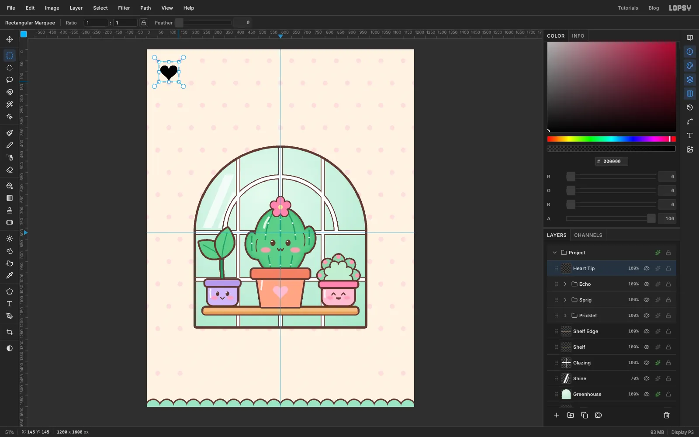

Collapse `Echo` and select it. Add a scratch layer called `Heart Tip` and draw a heart about 80 px wide in an empty corner. Lasso it carefully, or build it from two overlapping circles ([[Shift]]-added with the Elliptical Marquee) plus a lassoed V underneath. Fill it with black.

Marquee around the heart and choose **Edit → Define Brush…**. Name it `Heart Leaf` when asked. Lopsy uses black as full paint, so the brush tip is a solid heart. Deselect and delete the scratch layer.

## Hang a string-of-hearts

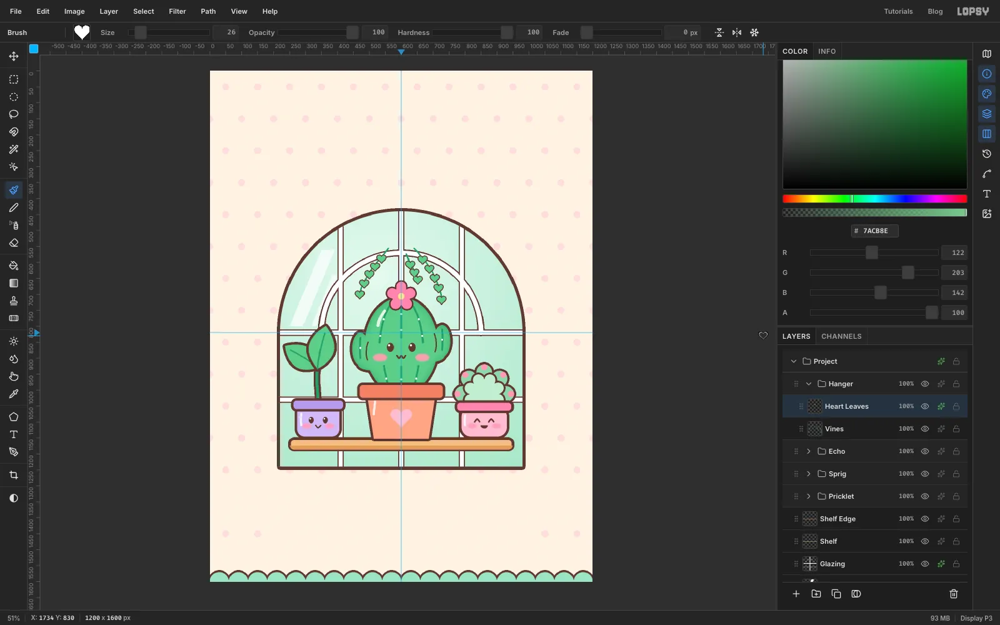

Make a new group called `Hanger` and add a layer called `Vines`. With a normal round Brush at Size `5` in `#4E9F6C`, draw three trailing vines. They all start where the inner arch meets the centre bar, which is where the hanging pot will sit. Sweep one down to the left and two to the right, making the outer right one the longest. End them all well above the cactus flower.

Add a layer called `Heart Leaves`. With the Brush tool active, click **Open brush presets**. Your `Heart Leaf` tip is already selected at the end of the list, so close the dialog. Set Size to `26` and the colour to `#7ACB8E`, then click along each vine, every 30–40 px, to place one heart per click. Give the layer a **Stroke** of `3` in `#5A3A33`.

## Make a bowl from two selections

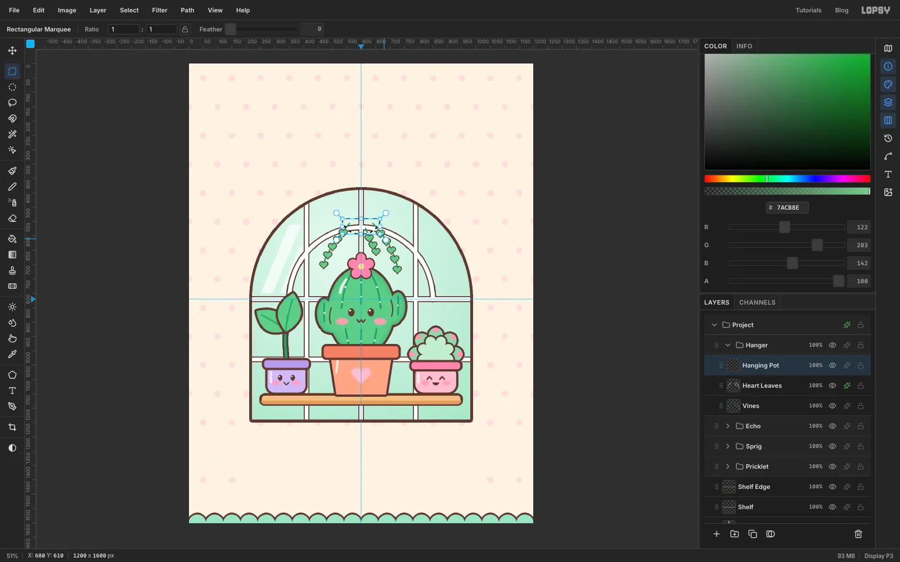

Add a layer called `Hanging Pot`. With the **Elliptical Marquee**, drag an ellipse about 130 × 110 px with the centre guide down its middle and its centre where the vines start. Then switch to the **Rectangular Marquee**, hold [[Shift]]+[[Alt]] and drag a rectangle over the lower half of it. Shift+Alt **intersects** the two, so only the bottom half of the ellipse stays selected: a bowl.

Fill it with `#FFE296` and give the layer a **Stroke** of `8`.

## Rim and ropes for the hanging pot

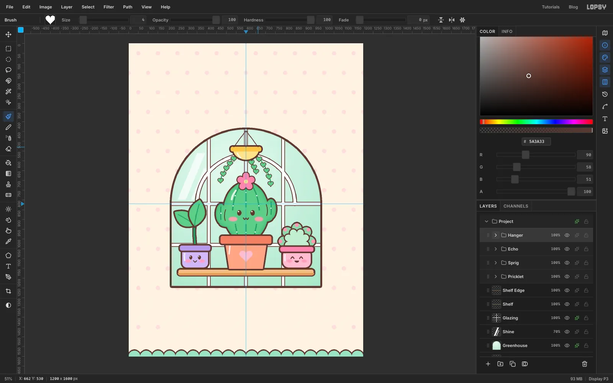

On the same layer, use the Shape tool and click on the bowl's flat top edge to add a `156` × `24` rim in `#F7C85E` with Corner Radius `10` and **no** stroke. The layer's Stroke effect outlines the bowl and rim together, so a shape stroke on top would make the rim's outline twice as thick.

Leave this pot without a face. Six faces would crowd the poster, and the cactus should be the star. Instead, add a short white shine stroke on a `Hanging Shine` layer.

Add a layer called `Ropes`. With the Brush at Size `4` in `#5A3A33`, draw each rope separately: click at the dome's peak, then [[Shift]]-click the rim's left end. Repeat from the peak to the middle of the rim, and from the peak to its right end.

## Float a happy cloud

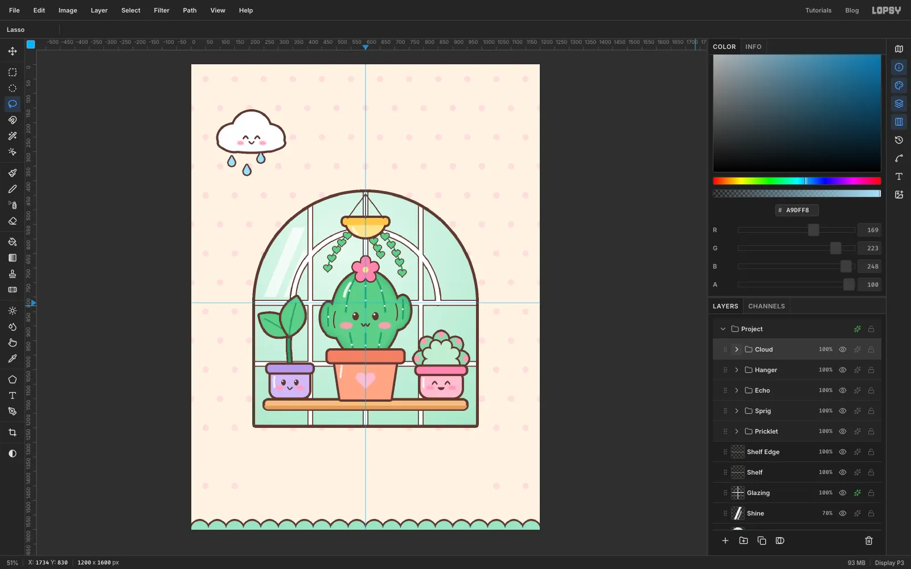

Collapse `Hanger`, select it and make a group called `Cloud`. Add a layer called `Cloud Body`.

In the top-left corner, with the **Elliptical Marquee**, drag one ellipse and [[Shift]]-add three more. The whole cloud is about 240 × 150 px:

- two puffs about 100 px across, one on each side;
- a taller 125 px puff in the middle;
- a wide 220 × 60 oval along the bottom to give it a flat base.

Fill with white. Add an **Inner Glow** in `#BFE4F7` (Size `22`, Opacity `30`) for a hint of blue shade, and a **Stroke** of `8`.

On a `Cloud Face` layer, use the Brush at Size `6` in `#5A3A33` for two happy closed-eye arcs and a small smile. Add `Cloud Blush` the same way as the cactus's blush (feathered by `4`, 85%). Under it, on a `Raindrops` layer, lasso three small teardrops in `#A9DFF8` and give them a **Stroke** of `5`. Keep the right-hand drop well away from where the title will go.

## Build Dewdrop, the mascot

Make a group called `Dewdrop` and add a layer called `Drop`. In the top-right corner, lasso a teardrop about 150 px wide: a round bottom that narrows to a point at the top.

With the selection active, choose the **Gradient** tool (Linear) with three stops: `#D4F1FF`, `#A9DFF8` at 55% and `#62BDEB`. Drag from the top-left of the drop to its bottom-right. Deselect and add a **Stroke** of `8`.

On a `Gloss` layer, lasso a slim tilted oval on the drop's upper left and fill it white, then click a small white dot above it. On `Drop Face`, add `18` × `24` eyes with catch-lights and a small open half-circle mouth. Put the blush on its own `Drop Blush` layer at 85%.

## Tilt the whole group

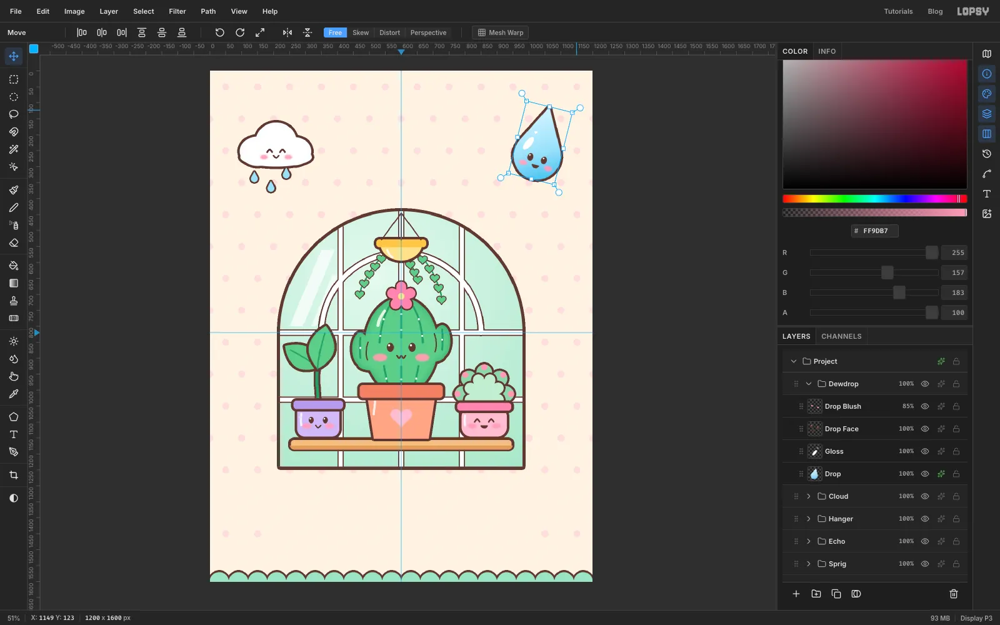

Click the `Dewdrop` group row and make sure nothing is selected. With the **Move** tool, handles appear around everything in the group. Drag the rotation arrow outside the top-right corner clockwise by about 14°, so the drop leans jauntily to the right. Press [[Cmd+D]] to commit.

The gloss, face and blush all turn together, because the transform applies to the group. Try [[Cmd+Z]] and [[Cmd+Shift+Z]]: the tilt undoes and redoes as a single step.

## Scatter sparkles with copy and paste

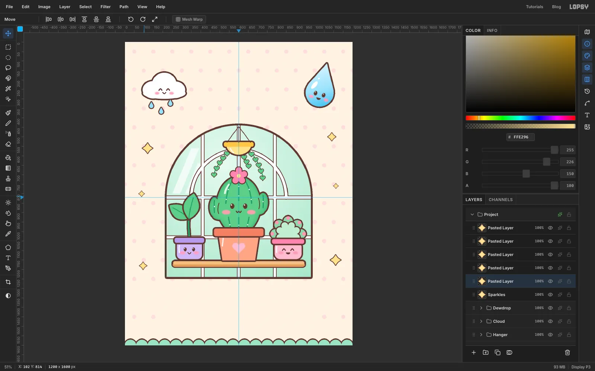

Collapse `Dewdrop` and add a top-level layer called `Sparkles`. On the left of the canvas, about 60 px across, lasso a four-point star with concave, pinched sides like a twinkle, and fill it with `#FFE296` and add a **Stroke** of `4`. Click **Rasterize Layer Style** in the effects panel, so the outline becomes real pixels that copy along with the star.

To make more, marquee the sparkle, then press [[Cmd+C]] and [[Cmd+V]]. The copy pastes on a new layer in the same spot. Drag it with the Move tool to a new place, then [[Cmd]]-drag a corner handle to make some copies smaller. Place five copies around the outside of the greenhouse, keeping them clear of the title and the faces.

When they're all placed, click the top pasted layer and press [[Cmd+E]] (Merge Down) until they're all back on `Sparkles`.

## Set the kicker

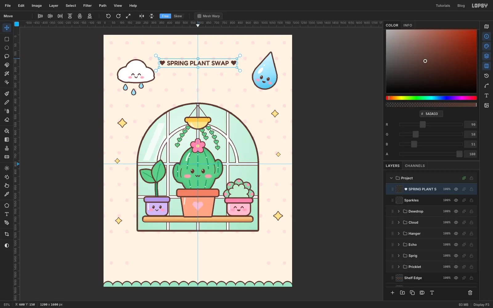

Click the `Sparkles` row first, so the text options don't restyle an existing text layer. Pick the **Text** tool. In the options bar choose **Fredoka**, set the weight to **SemiBold**, Size to `40` and Align to **Center**. Set the colour to `#5A3A33`.

Click on the centre guide near the top and type `♥ SPRING PLANT SWAP ♥`. Press [[Tab]] to commit. Then nudge it with the arrow keys until it sits centred between the cloud and the drop.

## Type the title and draw its arc

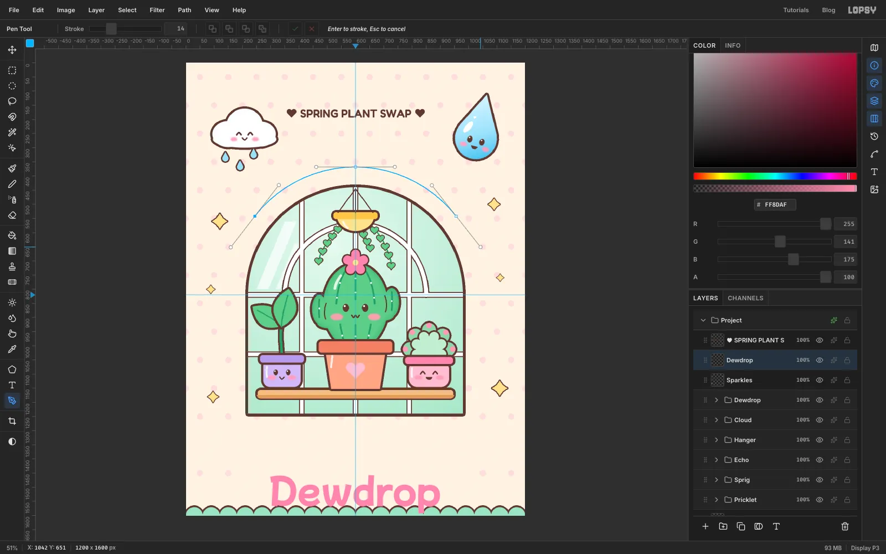

Click `Sparkles` again. Set the font to **Mochiy Pop One** at Size `122`, colour `#FF8DAF`, and click in empty canvas near the bottom to type `Dewdrop`. It's parked there for now.

Pick the **Pen** tool and draw the arc the title will follow. It should be centred on the same point as the greenhouse roof, about 70 px further out. Click-drag three anchors: one on the left above the roof, one above the peak and one on the right. Drag each handle along the curve. Click the **✓** (Commit path) button instead of pressing [[Enter]], because you want a path to bind to, not a stroke.

## Bend the title along the path

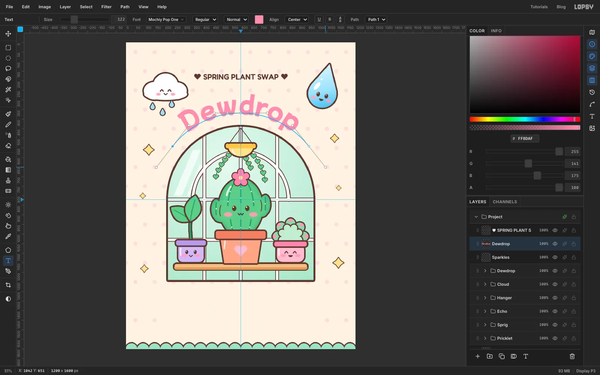

Click the `Dewdrop` **text** layer (the one with the T, not the `Dewdrop` group that holds the mascot), then pick the **Text** tool. In the options bar, open the **Path** dropdown and choose your arc. The letters jump up and flow along the curve, centred because the alignment is still **Center**.

In the **Paths** panel, click the selected path again to deselect it, which hides its blue outline.

## Make the title a sticker

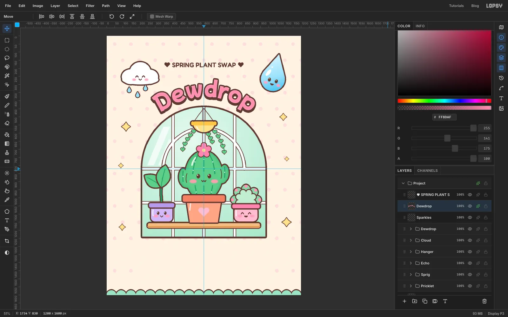

Open the title's effects and turn on:

1. **Stroke** in `#5A3A33`, Width `8`.
2. **Drop Shadow** in `#5A3A33` with Offset X `0`, Offset Y `9`, Blur `0`, Spread `0` and Opacity `100`. A hard shadow with no blur gives that chunky sticker edge.
3. **Inner Glow** in `#FFE3EC`, Size `12`, Opacity `55`, for a glossy candy look.

Check that the letters keep a steady gap above the dome all the way round. If the descender of the "p" comes close to the roof, redraw the arc a little further out or drop the Size to about `116`. The heavy outline and shadow make the word look slightly off-centre, so pick the **Move** tool and nudge it about 12 px to the right with the arrow keys. The nudge sticks even though the text follows a path.

## Build the GREENHOUSE banner

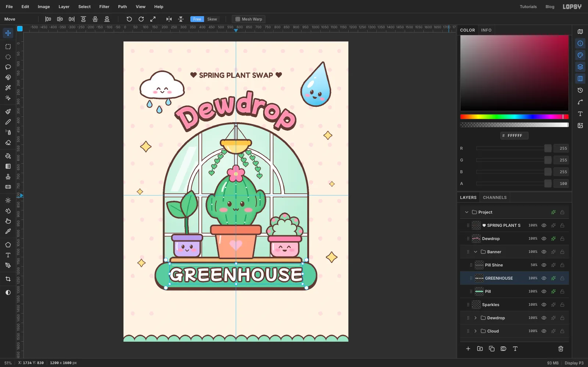

Click `Sparkles` and make a new group called `Banner`. Add a layer called `Pill`. Use the Shape tool (Rectangle, Corner Radius `68`, fill `#78C9A2`, stroke `#5A3A33`, Width `8`) and click on the centre guide just under the shelf to make it `860` × `136`. A radius of half the height turns the rectangle into a pill. Its top edge should overlap the bottom of the shelf. Add a **Drop Shadow** like the title's (Offset Y `10`, Blur `0`, Opacity `100`).

On a `Pill Shine` layer, [[Shift]]-click a white 6 px Brush line just inside the pill's top edge and set the layer to 50%.

Click `Pill`, set the Text tool to **Mochiy Pop One** at `78` in white, and type `GREENHOUSE` on the pill. Open the **Text** panel and set **Letter spacing** to `4`, so the outlined letters don't run together. Centre it on the pill with the arrow keys, then add a **Stroke** of `7` in `#5A3A33`.

## Tilt the banner group

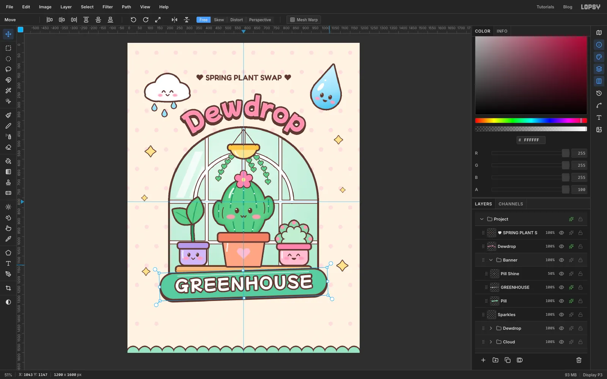

Click the `Banner` group row with nothing selected. With the **Move** tool, rotate it about 2° anticlockwise, so the right end rises a little, and press [[Cmd+D]]. The text stays live and editable even after the group is rotated.

Collapse `Banner`.

## Add the event details

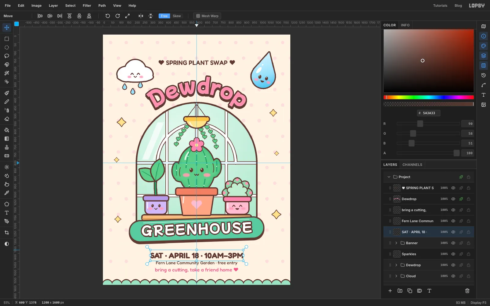

The letter spacing you set on GREENHOUSE carries over to new text. With the `Banner` group selected and the Text tool active, open the **Text** panel and set **Letter spacing** back to `0`.

Create the three lines from the bottom up, so each new click lands in empty canvas rather than on the line you just made. Use **Fredoka** with Align **Center** for all of them:

1. `bring a cutting, take a friend home ♥`: Medium, `32`, `#E2638B`.
2. `Fern Lane Community Garden · free entry`: Medium, `28`, `#5A3A33`.
3. `SAT · APRIL 18 · 10AM–3PM`: Bold, `50`, `#5A3A33`.

Centre each on the guide. Put the date about 60 px below the banner, the venue about 45 px under the date, and the tagline about 45 px under that, so there's roughly the same space above the date as below the tagline.

## Finish with shadows and grain

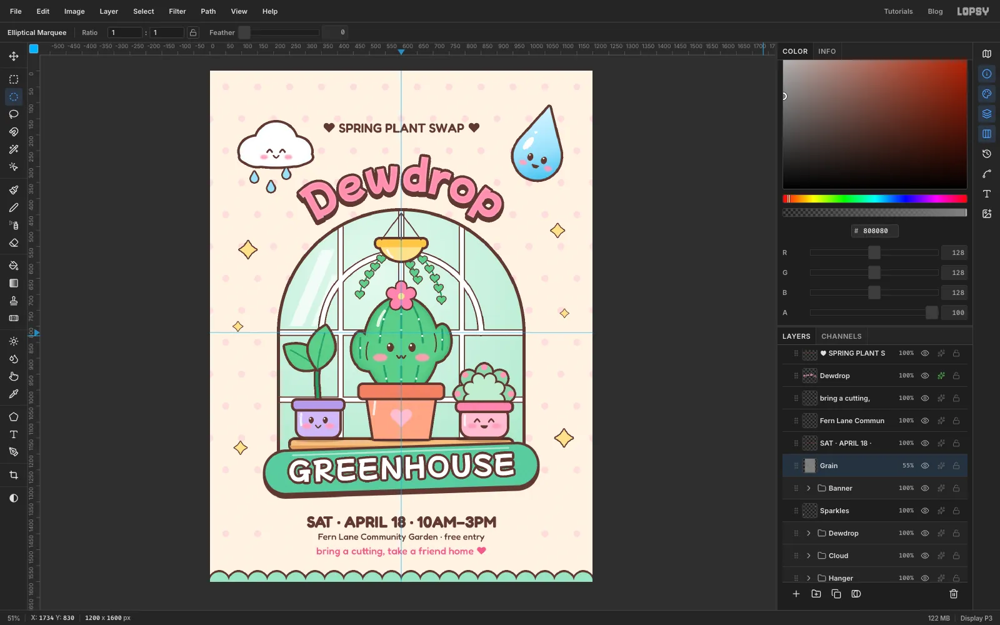

Click `Shelf Edge` and add a layer called `Pot Shadows`. With the Elliptical Marquee, drag a thin flat oval at the base of each pot, holding [[Shift]] to add the second and third. Fill with `#5A3A33` and run **Filter → Gaussian Blur…** at `4`. Set the blend mode to **Multiply** and the opacity to 30%.

For grain, click the `Banner` group and add a layer called `Grain`. It lands above the banner but under the text layers, so the type stays crisp. Fill it with `#808080` and run **Filter → Add Noise…** with Amount `40` and Mode **Mono**. Set the blend mode to **Overlay** and the opacity to 55%. Mid grey disappears in Overlay, so only the speckle shows, and it makes the flat pastels look printed.

Save with **File → Save Project**, and export with **File → Quick Export PNG**.
