Kinetic artists in the 1950s and 60s wanted pictures that wouldn't sit still. Bridget Riley got there with stripes, Jesús Rafael Soto with thin lines hung in front of other lines, and Carlos Cruz-Diez with colours that seem to change as you walk past. A whirling dervish is a perfect subject for them: a dancer whose whole practice is turning.

This tutorial makes the cover of a made-up novel, *Whirling Dervish*, by a made-up author. Three simple ideas do the work:

- **Moiré from two Sunbursts.** Two identical sets of rays with their centres slightly apart interfere with each other, and ghostly rings appear that neither layer contains.
- **A real watercolour.** Richard Morris Hunt painted this [dancing dervish](https://commons.wikimedia.org/wiki/File:Dancing_dervish_-_R.M.H._LCCN2018645998.jpg) in the 19th century, and it's in the public domain. A group Gradient Map turns his brown and green washes into molten vermilion and keeps every brush mark.
- **Difference-blended ghosts.** Flat cyan copies of the figure, rotated around the waist, flip the colours of the rays beneath them. Where two copies overlap they cancel, which gives you op-art checkers for free.

Download the watercolour from Wikimedia Commons before you start. Use a version around 2000 px wide. It needs to be at least 1600 px wide, because smaller images aren't enlarged and the positions below won't line up.

The document is **1600 × 2400 px**, a 6 × 9 inch jacket at about 267 dpi.

The palette:

- Ground bone `#F1E8D6`, ink `#111014`
- Figure map `#0E0B10` → `#4A0F12` → `#E2340F` → `#F58A12` → `#FFF0CF` → `#FFF9EC`
- Ghost cyan `#00FFFF`
- Type echoes `#00D8E0`, `#E2340F`
- Grain `#808080`

A few habits save trouble throughout:

- **Exact-corners marquee.** With nothing selected, click once on the canvas with the Rectangular Marquee [[M]] and a small dialog asks for the corners. This tutorial uses it whenever a position matters. If anything is selected, the click just deselects, so press [[⌘D]] first.
- **Transforms need the Move tool.** Draw the marquee, press [[V]], then use the handles. `⌘`-drag a corner to scale evenly. Drag the circle just outside a corner to rotate, and the rotation turns around the centre of the marquee.
- **[[⌘D]] commits.** Enter doesn't commit a transform.
- **Read positions off the status bar.** The bottom-left corner shows the cursor's X and Y in document pixels, so you can check where things have landed.
- **Blend modes live in the effects drawer.** Click the effects button on a layer's row to open it. The opacity control is the percentage on the row itself.

## Set up the page

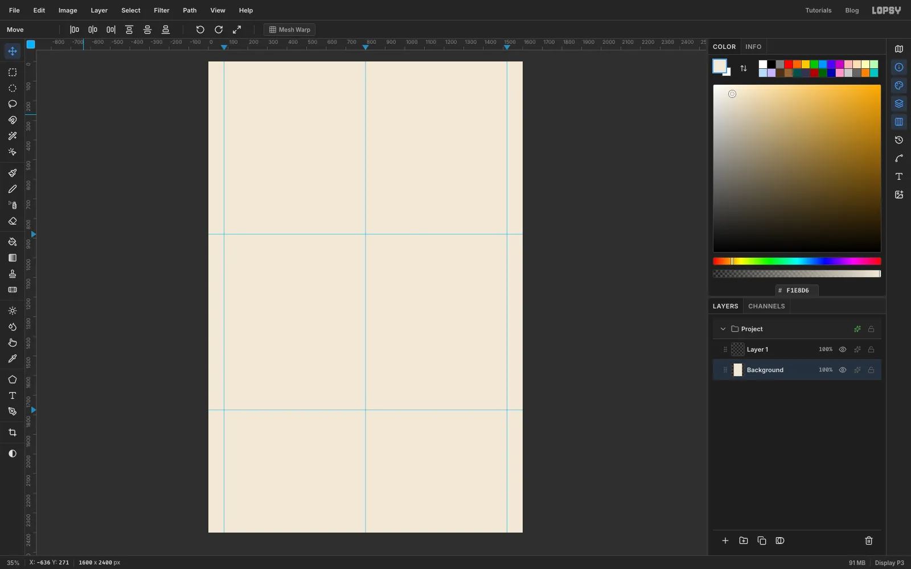

1. Choose **File → New** and create a **1600 × 2400** pixel document.
2. Click the top ruler at **80**, **800** and **1520** to drop three vertical guides. The outer two are your type margins.
3. Click the left ruler at **880** and **1775** to drop two horizontal guides. The dancer's waist goes where 880 crosses the centre line, and the title band starts at 1775.
4. Click the **Background** row in the Layers panel.
5. Set the foreground colour to `#F1E8D6` by typing it into the Hex box in the Color panel.
6. Choose **Edit → Fill**.

## Draw the first sunburst

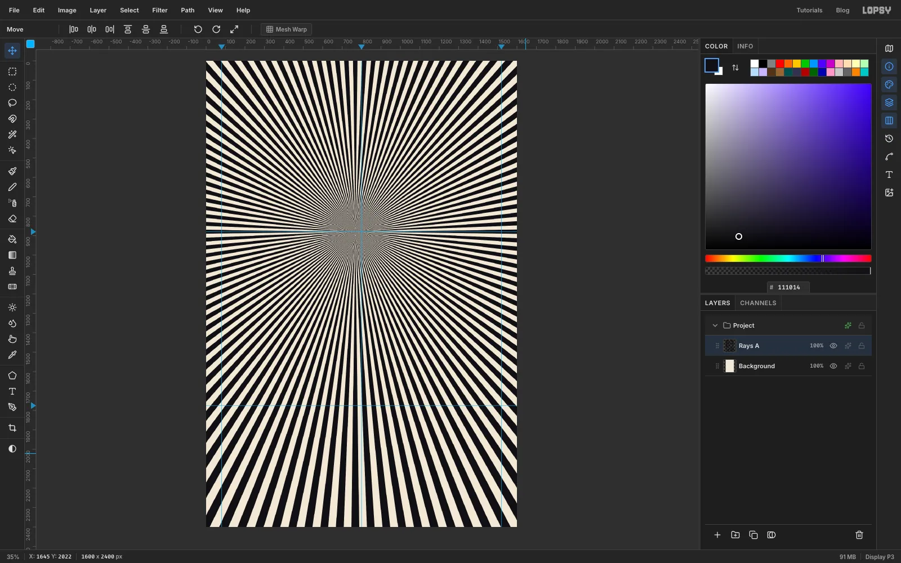

1. Click **Layer 1** and rename it **Rays A** by double-clicking its name.
2. Set the foreground colour to `#111014`.
3. Choose **Filter → Sunburst…** and set **Rays** 120, **Length** 150, **Width** 50, **Center X** 48 and **Center Y** 36.67.
4. Leave everything else at its default and click **Apply**.

Center Y 36.67 puts the burst on your 880 guide. Center X 48 puts it 32 px left of the page centre.

## Add the second sunburst to make moiré

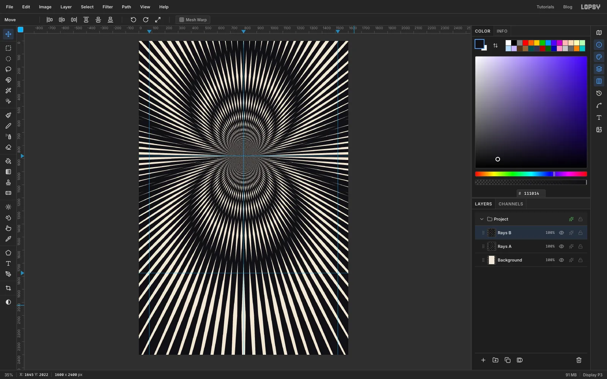

1. Click **Add Layer** at the bottom of the Layers panel and rename the new layer **Rays B**.
2. Choose **Filter → Sunburst…** again. The dialog goes back to its defaults every time it opens, so enter everything again: **Rays** 120, **Length** 150, **Width** 50, **Center X** 52 and **Center Y** 36.67.
3. Click **Apply**.

The two bursts are now 64 px apart, and big dark rings swell up around the centre. Nothing painted them. They come from the rays drifting in and out of step, the same effect you get when you look through two window screens. Rays that fall on top of each other leave bone showing, and rays that fall side by side close the gap to black.

If you want to see the effect change, undo the filter and run it again with a different Center X. Closer centres make wider rings.

## Bring in the watercolour

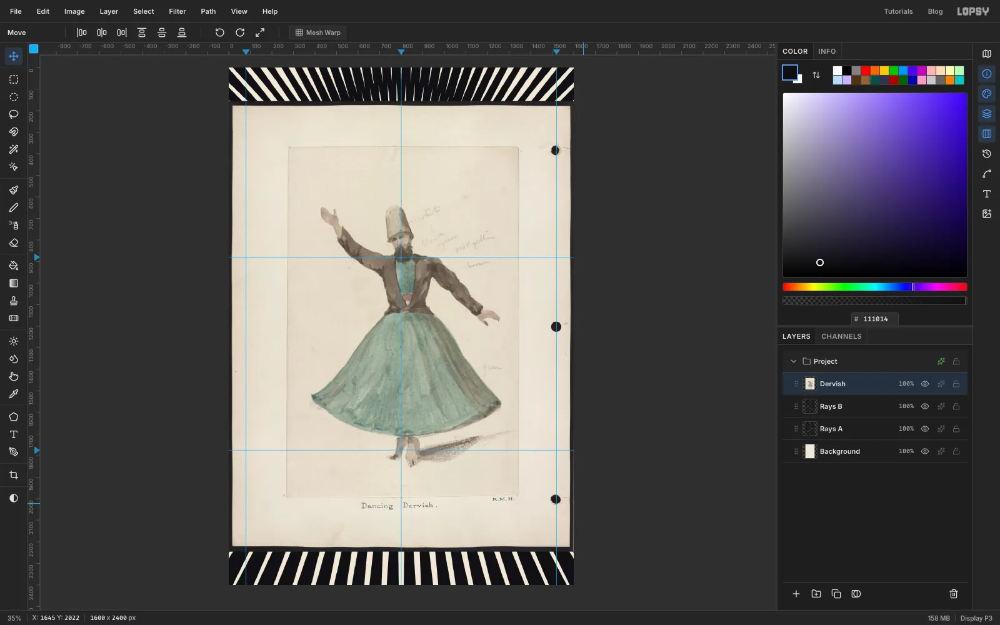

1. Drag the downloaded image from your file browser onto the canvas. Lopsy shrinks it to fit the page width and puts it on a new layer above Rays B.
2. Rename the layer **Dervish**.
3. Press [[⌘D]] to deselect.
4. Press [[M]] and click once on the canvas. In the dialog, enter **From** 300, 400 and **To** 1320, 1960, then press Enter. This marks the inner sheet of the album page.
5. Choose **Select → Inverse**, press [[Delete]], then press [[⌘D]].

The punched holes, the caption and the outer mount are gone, leaving a pale rectangle with the dancer on it.

## Select the paper with a blurred helper

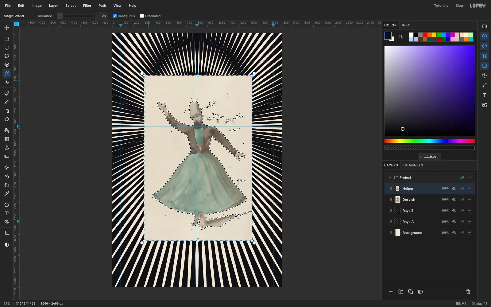

Old paper is grainy, and a Magic Wand on grain leaves hundreds of tiny holes. Selecting on a blurred copy fixes that, because the selection stays behind when the copy is deleted.

1. Choose **Layer → Duplicate Layer** and rename the copy **Helper**.
2. Choose **Filter → Surface Blur…** and set **Radius** 12 and **Threshold** 40. Click **Apply**.
3. Press [[W]] for the Magic Wand. Set **Tolerance** to 24, tick **Contiguous**, and click the paper near the top-left corner of the sheet.
4. Click the trash can at the bottom of the Layers panel to delete **Helper**. The selection stays.
5. Click the **Dervish** row, press [[Delete]], then press [[⌘D]].

The figure now stands on the rays, with a scatter of pencil notes around it and its brown cast shadow on the ground.

## Lasso away the pencil notes and shadow

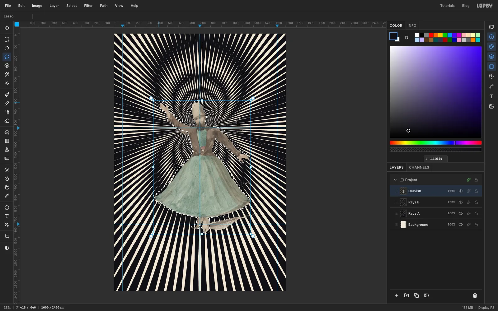

1. Press [[L]] for the Lasso.
2. Draw one loop around the whole dancer, staying about 10 px outside the figure. Stay close wherever the pencil lines come near it, beside the cap and at the shoulder on the right.
3. At the feet, run the lasso straight down the right side of the right foot, so the brown shadow stays outside the loop.
4. Choose **Select → Inverse**, press [[Delete]], then press [[⌘D]].

## Scale up the dancer

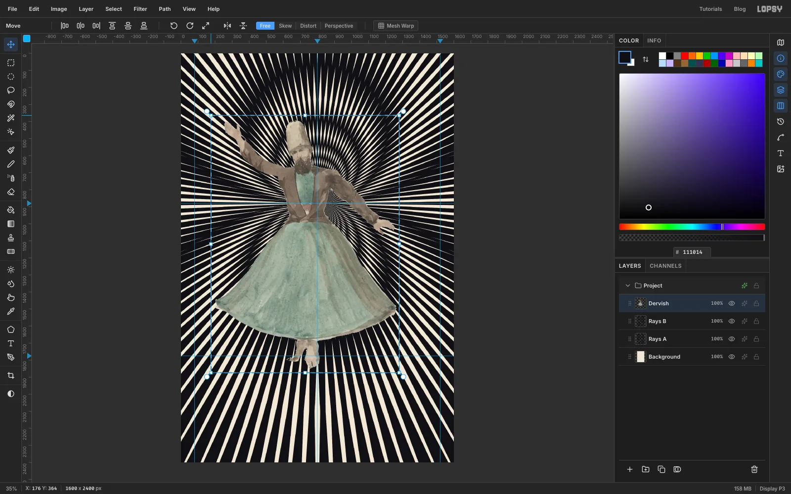

1. Press [[M]] and click once on the canvas. Enter **From** 360, 616 and **To** 1280, 1874, then press Enter.
2. Press [[V]] for the Move tool.
3. Hold `⌘` and drag the top-left corner handle up and to the left until the box grows by a fifth. The corner should end up near **X 176, Y 364**.
4. Press [[⌘D]] to commit.

## Seat the waist and shave the edge

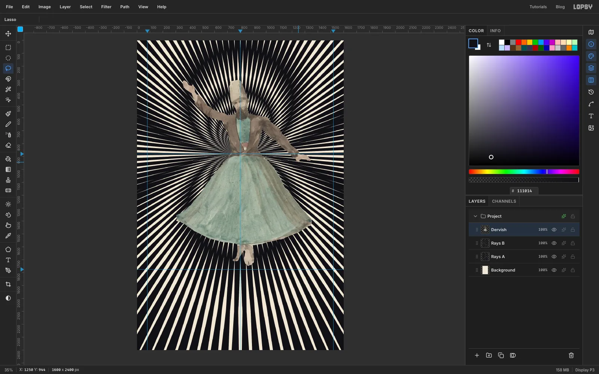

1. With the Move tool still active, drag the dancer so the place where the belt meets the skirt sits on the crossing of the 880 and 800 guides. The feet should stop a little above the 1775 guide.
2. Now take off the pale paper halo. Hold `⌘` and click the **Dervish** thumbnail in the Layers panel to select the figure.
3. Choose **Select → Shrink…** and enter **8**.
4. Choose **Select → Grow…** and enter **5**.
5. Choose **Select → Inverse**, press [[Delete]], then press [[⌘D]].

Shrinking further than you grow removes 3 px all round and rounds off any thin shards. It may also leave a crumb or two floating near the fingertips. If you see one, lasso it and press [[Delete]].

## Recolour the figure with a Gradient Map

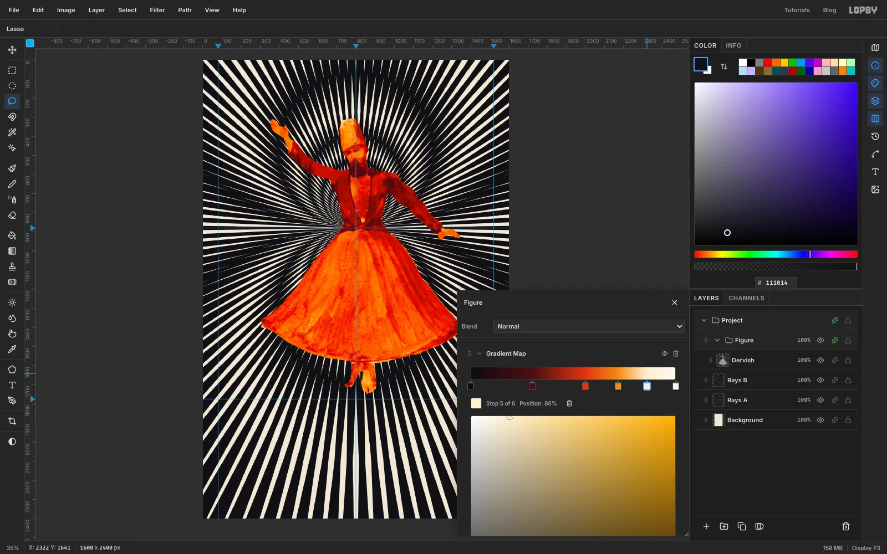

1. With **Dervish** active, choose **Layer → Group Layers**. Rename the new group **Figure**.
2. Click the effects button on the **Figure** row to open its drawer.
3. Click **Add Adjustment** and choose **Gradient Map**.
4. Click the black stop on the left end of the bar and type `0E0B10` into the Hex box below the colour picker. The drawer is tall, so scroll it if you can't see the box. Click the white stop on the right end and type `FFF9EC`.
5. Click the bar about 30% of the way along to add a stop, and type `4A0F12` for it.
6. Add a stop about 56% along and type `E2340F`.
7. Add a stop about 72% along and type `F58A12`.
8. Add a stop about 86% along and type `FFF0CF`.
9. Close the drawer.

The dark coat goes to oxblood, the green skirt lands on vermilion, and the mottled watercolour turns into something like a flame.

## Lift the cap and the face

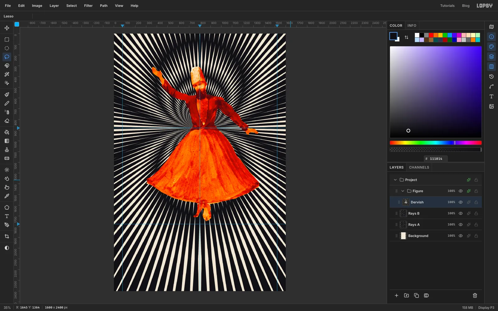

The Gradient Map reads brightness, so small changes to the painting move a colour along the ramp. The paint is still on the Dervish layer, so that's where these changes go.

1. Click the **Dervish** row.
2. Press [[L]] and draw a loop around the cap. Go well outside it at the top and sides, since nothing is there to affect, and run along the underside of the brim.
3. Choose **Filter → Brightness/Contrast…**, set **Brightness** to 7 and click **Apply**. Press [[⌘D]].
4. Lasso the face between the brim and the top of the beard.
5. Choose **Select → Feather…** and enter **3**.
6. Open **Filter → Brightness/Contrast…** again, set **Brightness** to 7 and click **Apply**. Press [[⌘D]].
7. Lasso the dark blot of pigment on the shoulder on the right, choose **Select → Feather…** and enter **20**. Apply **Brightness** 10 and press [[⌘D]].

Go gently here. At Brightness 15 the face blows out to a white strip that looks like a bandit's mask.

## Round the cap and find the eyes

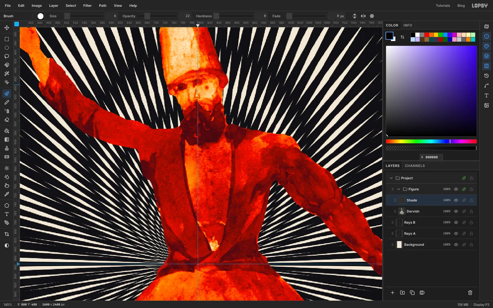

1. Hold `⌘` and scroll over the head to zoom in. The old sheet has a pinhole in the cap, a dark speck about two-thirds of the way down, near the middle. Press [[S]] for the Clone Stamp and set **Size** to 22. Hold `Alt` and click clean paint just to the left of the pinhole, then click once on the pinhole.
2. With **Dervish** still active, click **Add Layer** and rename the new layer **Shade**. It lands inside the Figure group, directly above Dervish.
3. Set the foreground colour to `#000000`.
4. Hold `⌘` and click the **Dervish** thumbnail to select the figure.
5. Press [[L]]. Hold `Shift` and `Alt` and draw the same loop around the cap as before. Together, those keys keep only the overlap, so the selection is now exactly the cap.
6. Press [[B]] for the Brush. Set **Size** 120, **Hardness** 0, **Opacity** 34. Paint one stroke down the right side of the cap.
7. Set **Size** 70, **Opacity** 18. Paint one stroke down the left side. Press [[⌘D]].
8. Set **Size** 14, **Hardness** 0, **Opacity** 32 and click once on each eye.
9. Set **Size** 6, **Opacity** 22 and draw one short stroke down the side of the nose.
10. Choose **View → Fit to Screen**.

Black on this layer doesn't stay black. It passes through the Gradient Map with everything else, so a 34% black stroke comes out as a deeper orange.

## Select just the skirt

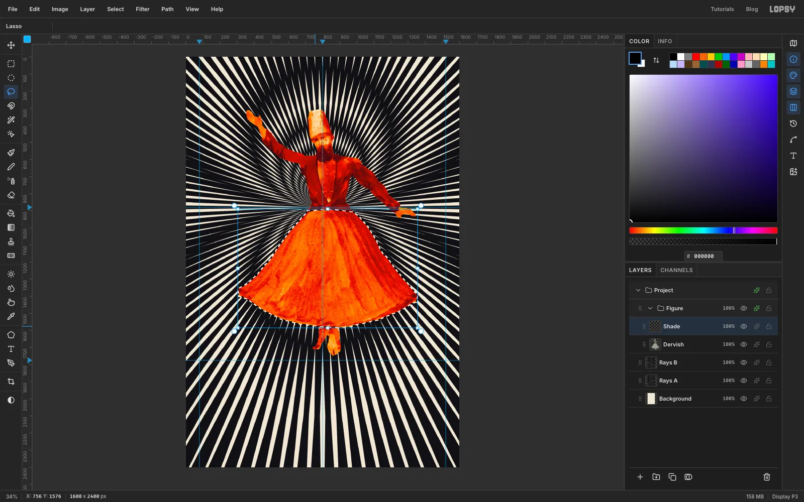

1. Hold `⌘` and click the **Dervish** thumbnail.
2. Press [[L]]. Hold `Alt` and draw a big loop around everything above the skirt: both arms and hands, the torso, the cap. Run the bottom of the loop along the top of the skirt, under the belt. `Alt` subtracts this from the selection.
3. Still holding `Alt`, draw a second loop around the legs and feet, running along the hem. That's subtracted too.

You should have marching ants around the skirt and nothing else.

## Pleat the skirt with more sunbursts

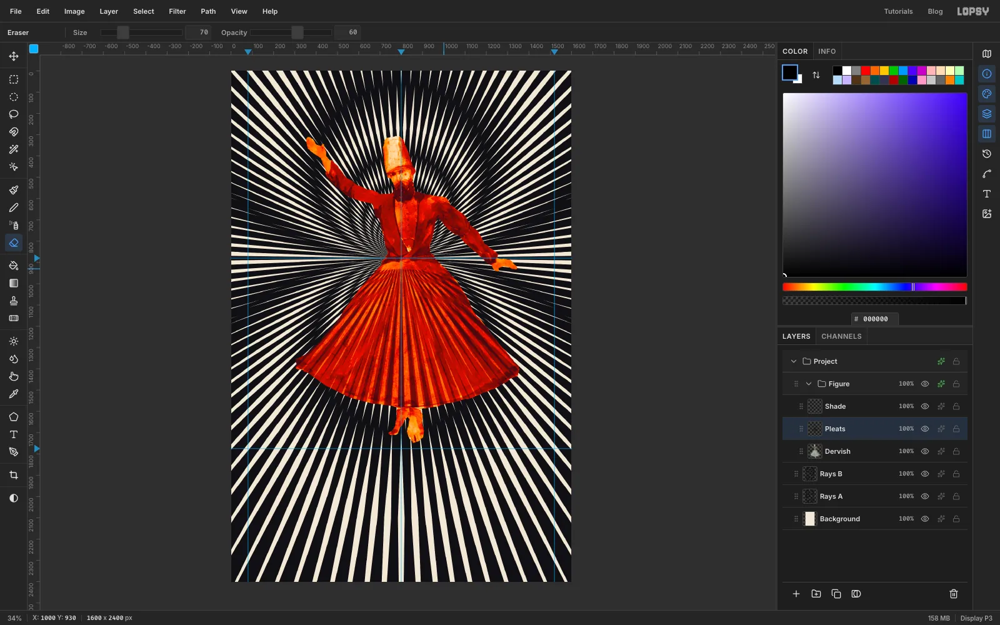

1. Click the **Dervish** row and click **Add Layer**. Rename the new layer **Pleats**. It sits between Dervish and Shade, and your selection is still live.
2. Keep the foreground colour at black.
3. Choose **Filter → Sunburst…** and set **Rays** 72, **Length** 150, **Width** 50, **Opacity** 26, **Center X** 50, **Center Y** 36.67. Click **Apply**.
4. Open **Filter → Sunburst…** again and enter the same values, except **Center Y** 34.17. That's 60 px above the waist, so the two bursts drift apart as they go down the skirt. Click **Apply**.
5. Press [[⌘D]].
6. The pleats start with a ruler-straight edge at the belt, so soften it. Press [[E]] for the Eraser, set **Size** 70 and **Opacity** 60, and draw one stroke across the top of the pleats, along the belt.

Two offset bursts give the skirt its own small moiré, and the pleats echo the rays behind the dancer.

## Make a clean silhouette

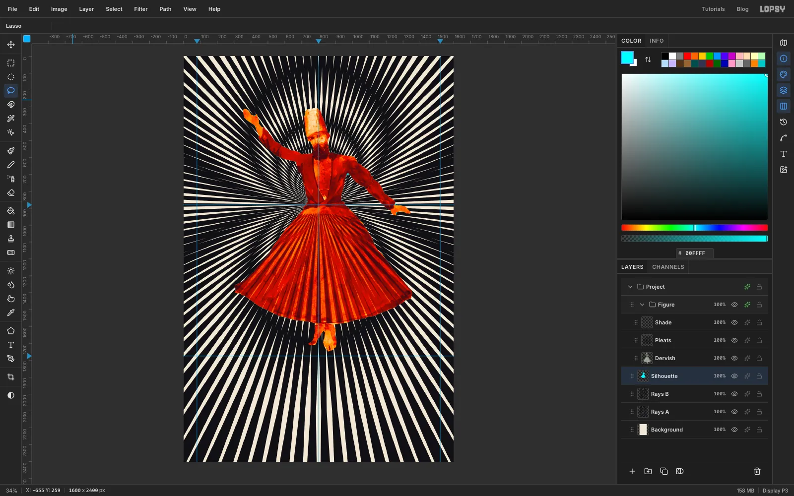

The ghosts come from one flat shape, so it's worth smoothing it first. A nick that you'd never notice on the painting shows up clearly in flat cyan.

1. Hold `⌘` and click the **Dervish** thumbnail.
2. Choose **Select → Grow…** and enter **10**. This closes the nicks.
3. Choose **Select → Shrink…** and enter **20**. This removes the bumps.
4. Choose **Select → Grow…** and enter **10**. The shape is back to its original size, with smooth curves.
5. Press [[L]], hold `Alt` and draw a loop around the legs and feet, running along the hem. Ghosts with feet look like stray scraps.
6. Click the **Rays B** row, then click **Add Layer**. Rename the new layer **Silhouette**. It sits above the rays and below the Figure group.
7. Set the foreground colour to `#00FFFF`.
8. Choose **Edit → Fill** and press [[⌘D]].

## Rotate the first ghost around the waist

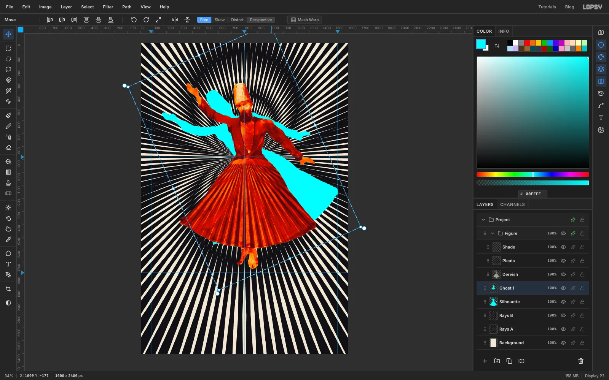

1. With **Silhouette** active, choose **Layer → Duplicate Layer** and rename the copy **Ghost 1**.
2. Press [[M]] and click once on the canvas. Enter **From** 200, 20 and **To** 1400, 1740, then press Enter. The centre of this box is exactly the waist, so the rotation will turn around the waist too.
3. Press [[V]].
4. Drag the circle outside the top-right corner anticlockwise, by about **24°**. There's no angle readout, so check the cyan cap: its top should land near **X 550, Y 354**.
5. Press [[⌘D]].

## Switch the ghost to Difference

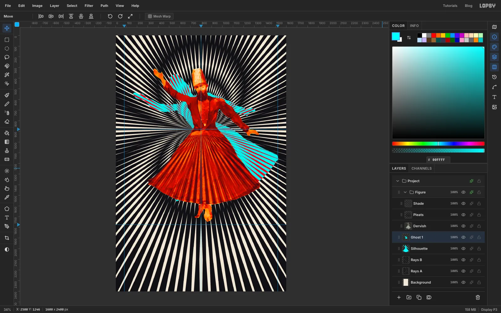

With **Ghost 1** active, open its effects drawer, set the blend mode to **Difference**, then close the drawer.

Difference subtracts the two colours. Over black, cyan stays cyan. Over bone, which is high in red and also in green and blue, the green and blue get subtracted away and what's left is a strong red. That's where the electric red and cyan stripes come from.

This is why the cyan has to be exactly `#00FFFF`. At full strength, Difference undoes itself: bone goes to red and back to bone, and black goes to cyan and back to black. With a softer cyan, the overlaps come out dirty pink.

## Add two more ghosts, smaller as they go

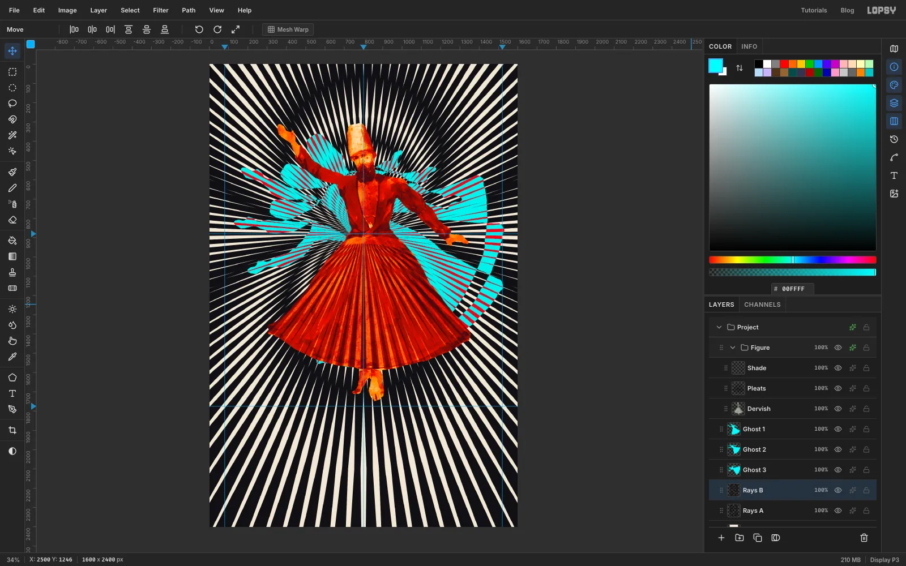

Each ghost gets a little smaller, as if it's falling behind the dancer.

For **Ghost 2**:

1. Click the **Silhouette** row and choose **Layer → Duplicate Layer**. Rename the copy **Ghost 2**.
2. Press [[M]], click once on the canvas and enter the same corners: **From** 200, 20 and **To** 1400, 1740.
3. Press [[V]]. Hold `⌘` and drag the top-left corner handle inward to about **X 272, Y 123**. That's 94% of the size.
4. Press [[⌘D]]. Scaling from a corner pulled the waist away from the guides, so drag the layer back: about 36 px left and 52 px up.
5. Enter the same corners with the marquee again. Press [[V]] and rotate anticlockwise by about **47°**, until the top of the cap lands near **X 391, Y 516**.
6. Press [[⌘D]] and set the blend mode to **Difference**.

For **Ghost 3**, repeat the steps with these changes:

- Drag the corner to about **X 344, Y 226** for 88% of the size.
- Drag the layer back about 72 px left and 103 px up.
- Rotate by about **70°**, until the top of the cap lands near **X 315, Y 716**.

Then tidy up:

1. Click the **Silhouette** row and delete it with the trash can.
2. Look just below the hem of the real skirt. If slivers of cyan peek out, click **Ghost 1**, lasso from inside the skirt down past the slivers, press [[Delete]] and press [[⌘D]]. The part of the lasso over the skirt is hidden anyway.

## Lay down the title band

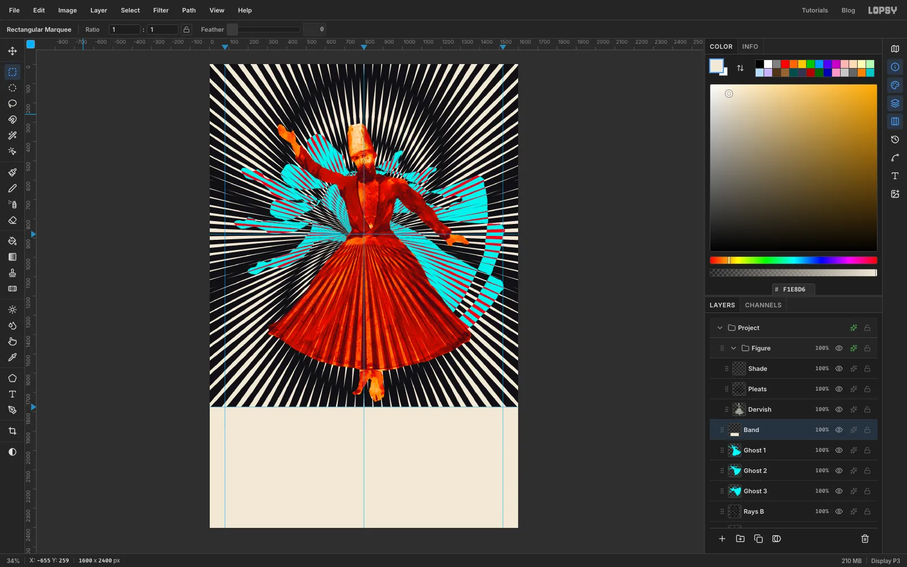

1. Click the **Ghost 1** row. It's the top ghost, and the band needs to go above all of them.
2. Click **Add Layer** and rename the new layer **Band**.
3. Press [[M]], click once on the canvas and enter **From** 0, 1775 and **To** 1600, 2400.
4. Set the foreground colour to `#F1E8D6`.
5. Choose **Edit → Fill** and press [[⌘D]].

The band is the same colour as the bone rays, so the rays look like they're fanning out of it.

## Add an even ink keyline

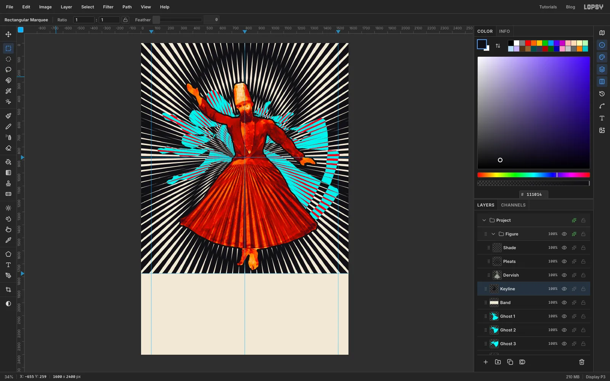

1. Hold `⌘` and click the **Dervish** thumbnail.
2. Choose **Select → Grow…** and enter **14**.
3. Choose **Select → Shrink…** and enter **4**. That closes the nicks and leaves a 10 px border.
4. With **Band** still active, click **Add Layer** and rename the new layer **Keyline**. It lands right under the Figure group and above all three ghosts.
5. Set the foreground colour to `#111014`.
6. Choose **Edit → Fill** and press [[⌘D]].

The order matters here. If a Difference ghost sits above the Keyline, it turns the ink cyan and you get a sticker-like glow along the arm.

## Set the type

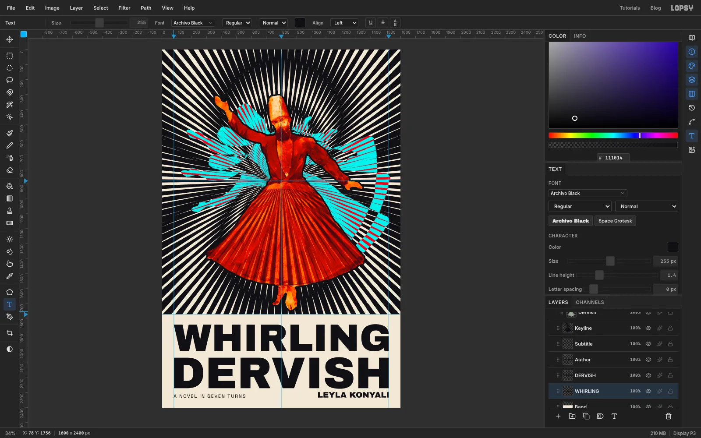

Clicking with the Text tool on or very near existing type edits that type instead of starting a new layer. So create the bottom row first and work upward. Text options also restyle whatever text layer is active, so click the **Band** row before you set up each new line.

1. Click **Band**. Press [[T]]. Click the T icon in the right-hand rail to open the Text panel. Pick **Space Grotesk**, **Size** 32, and in the Text panel set **Letter spacing** to 5 and **Align** to left. The foreground colour sets the text colour, so make sure it's still `#111014`.
2. Click at the left guide, near **Y 2301**, and type `A NOVEL IN SEVEN TURNS`. Press [[Tab]] to finish, and rename the layer **Subtitle**.
3. Click **Band**. Press [[T]]. Pick **Archivo Black**, **Size** 54, **Letter spacing** 0. Click around **X 1043, Y 2278** and type `LEYLA KONYALI`, then press [[Tab]]. Rename the layer **Author**. Press [[V]], then nudge it with the arrow keys so its right edge sits on the 1520 guide.
4. Click **Band**. Press [[T]]. Keep Archivo Black and set **Size** 298. Click around **X 58, Y 1962** and type `DERVISH`, then press [[Tab]].
5. Click **Band**. Press [[T]] and set **Size** 255. Click around **X 78, Y 1756** and type `WHIRLING`, then press [[Tab]].

Both title lines are sized to run exactly from guide to guide. Check that the top of WHIRLING sits about 65 px below the top of the band, that there's about 40 px between the two lines, and that the bottom row sits on a shared baseline about 66 px above the page edge.

## Spin the title with colour echoes

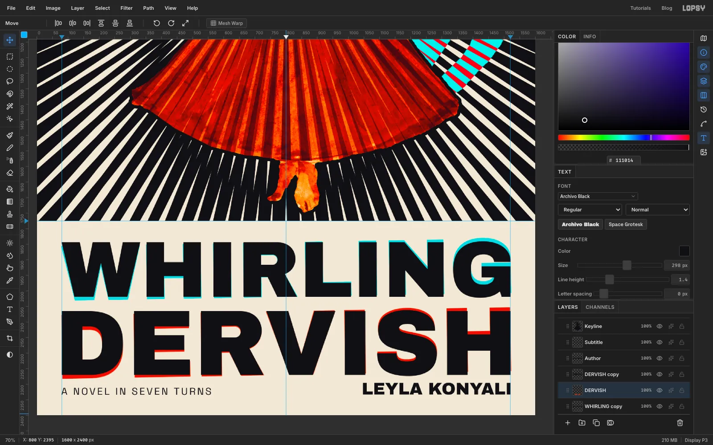

1. Click the **WHIRLING** row and choose **Layer → Duplicate Layer**. The copy lands above and stays as ink.
2. Click the original **WHIRLING** row below it.
3. Open its effects drawer, tick **Color Overlay** and set the colour to `#00D8E0`. Close the drawer.
4. Click the T icon (Rasterize Layer) at the bottom of the Layers panel. Then open the effects drawer again, click **Rasterize Layer Style** and close it. The layer is now plain cyan pixels, ready to rotate.
5. Press [[M]], click once on the canvas and enter corners about 12 px outside the word, for example **From** 67, 1828 and **To** 1532, 2033.
6. Press [[V]] and drag the rotation circle at the top-right corner upward by about 13 document pixels, which is only 4 or 5 on screen at fit zoom and works out at about **1° anticlockwise**. Watch Y in the status bar as you drag. Press [[⌘D]].
7. Repeat with **DERVISH**, using `#E2340F`, corners **From** 68, 2049 and **To** 1532, 2285, and the same 1° anticlockwise turn.

Rotating both the same way keeps it reading as one spin. Rotating them in opposite directions makes the echoes collide at the left end, between the two lines.

## Shrink a silhouette for the strip

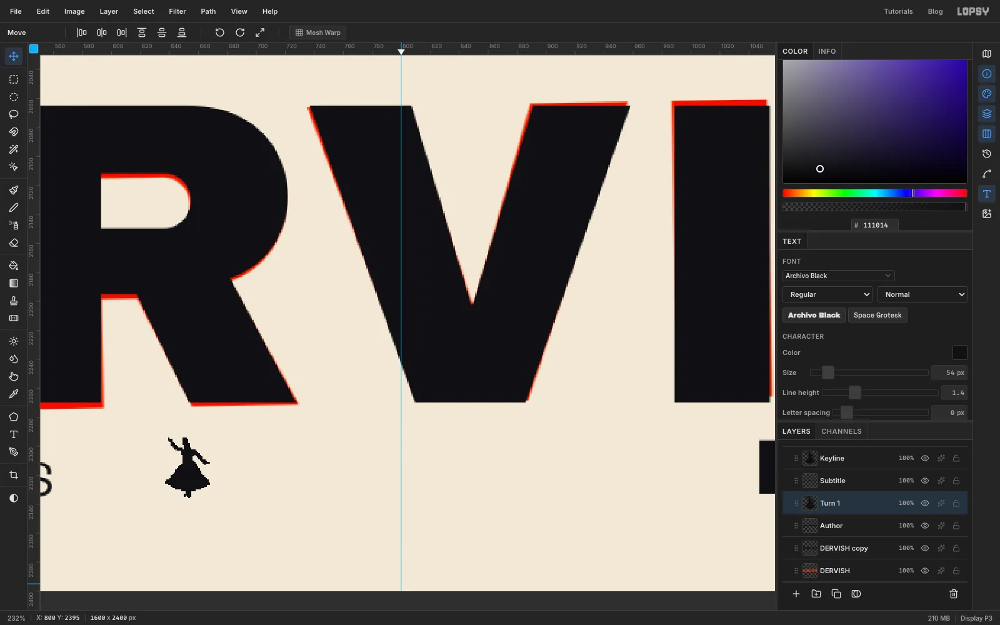

The subtitle says seven turns, so a row of seven tiny figures can show them.

1. Click the **Keyline** row. Press [[M]], click once on the canvas and enter **From** 250, 240 and **To** 1370, 1760.
2. Press [[⌘C]], then [[⌘D]].
3. Click the **Author** row and press [[⌘V]]. The copy pastes in place. Rename it **Turn 1** and press [[⌘D]].
4. Draw the same marquee again with the same corners, then press [[V]].
5. Hold `⌘` and drag the top-left corner handle almost all the way to the bottom-right corner, until the figure is about 32 px wide and 44 px tall. Press [[⌘D]].
6. Drag the tiny figure down to the bottom row, centred near **X 652, Y 2315**.
7. Hold `⌘` and scroll over the row to zoom in until the figure is easy to see.

## Turn the seven figures

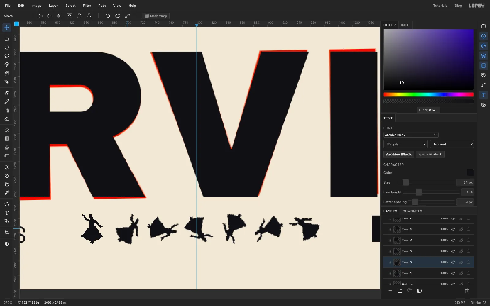

Seven equal turns would be about 51° each. There's no angle readout, but holding `⌘` while you rotate snaps to 15° steps, so these use the closest snaps.

1. Click **Turn 1** and choose **Layer → Duplicate Layer**. Rename the copy **Turn 2**.
2. Press [[M]] and click once on the figure. Enter a square about 68 px across, centred on the figure: **From** 618, 2281 and **To** 686, 2349.
3. Press [[V]]. Hold `⌘` and drag the rotation circle clockwise to **45°**. Press [[⌘D]].
4. Drag the figure 50 px to the right.
5. Repeat from **Turn 1** for each of the others, moving each one another 50 px along. Rotate them **105°**, **150°**, **210°**, **255°** and **315°**.
6. Click the topmost Turn row and choose **Layer → Merge Down** six times, so all seven become one layer. Rename it **Seven Turns**.
7. Choose **View → Fit to Screen**.

At full size only the first figure clearly reads as a dancer. That's fine. It's a small printer's ornament, not a sentence.

## Add paper grain and finish

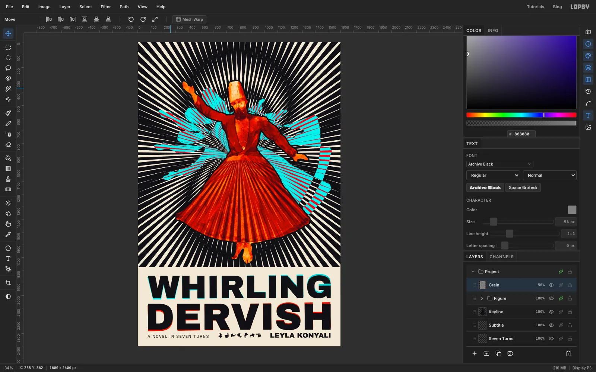

Right now the watercolour figure looks hand-made and everything else looks digital. A little grain puts them on the same paper.

1. Click the arrow on the **Figure** row to collapse the group, then click the **Figure** row itself.
2. Click **Add Layer** and rename the new layer **Grain**. Because the group is collapsed, the new layer lands above it, at the top of the stack.
3. Set the foreground colour to `#808080`.
4. Choose **Edit → Fill**.
5. Choose **Filter → Add Noise…**, set **Amount** to 100, choose **Mono** and click **Apply**.
6. Set the layer's blend mode to **Overlay** and its opacity to **50%**.
7. Choose **View → Show Guides** to turn the guides off.
8. Save with **File → Save Project**, then export with **File → Quick Export PNG**.

Overlay barely touches pure cyan, so the ghosts stay clean while the bone, the ink and the figure pick up a fine tooth.

Look at it small before you call it finished. The title and the red figure should jump out even at the size of a thumbnail in an online shop. The subtitle and strip can disappear at that size, but the author's name should stay readable. If you want another project with a strong silhouette over a loud field, try the [retro-futurist book cover](/tutorials/retro-futurist-book-cover/) next.
