*Kinetic art* is art that moves, or looks like it does. In 1935 Marcel
Duchamp printed his *Rotoreliefs*, cardboard discs of off-centre circles
that seem to swell into cones when you spin them on a record player.
Alexander Calder hung balanced arms of painted metal from the ceiling and
let the air move them. In 1961 the Stedelijk Museum gathered this work into
a show called *Bewogen Beweging* ("moving movement"). Its poster was a black
sheet of white dots.

In this tutorial you'll borrow all three ideas for **Gyre Nocturne**, a
poster for an imaginary one-night show of kinetic sculpture. You'll build it
at **1800 × 2400 px** (3:4). Along the way you'll use:

- **Define Pattern**, **Fill with Pattern** and **Lens Distortion** for a dot field that bulges
- the Elliptical Marquee's exact-corners dialog to stack nine off-centre circles into a Rotorelief
- the **Move** tool's rotation handles on a duplicate, with the **Lighten** blend mode, for a spin ghost
- **Copy Merged**, **Radial Blur** and **Gaussian Blur** for a glow
- the **Shape** tool's path output, **Stroke Path** and the **Eraser** inside a selection for an orbit that passes behind the disc
- brush dabs at falling opacity for a stroboscopic trail
- Shift-click brush lines, rotated pendants, **Motion Blur** and **Drop Shadow** for a Calder mobile
- **Color Overlay** on duplicated text for misregistered type
- **Unbounded**, **Outfit** and **Space Mono**, with letter spacing in the Text panel and a text layer rotated 90°
- **Add Noise** on an Overlay layer for print grain

The palette:

- Night ground `#0E1124`, halo blue `#2F45C8` → `#1B2463`
- Cream `#EDE4CF`, wire `#D9D2C2`
- Ink `#14131C`
- Vermilion `#E8432A`
- Saffron `#F2B531`
- Cobalt `#2F55D4`
- Shadow `#04050C`

New layers always appear above the layer you've selected, so before each
section you'll click a layer at the right place in the stack.

A few habits the steps rely on:

- To add a layer, click **Add Layer** (+) at the bottom of the Layers panel. Double-click a layer's name to rename it.
- "Fill it with cream" means set the foreground colour to cream, then choose **Edit → Fill**. The fill follows the current selection.
- The **Move** tool doesn't snap to guides. Drag close, then zoom in and finish with the arrow keys ([[Shift]]+arrow moves 10 px at a time).

> **Tip:** Most circles in this poster are made with the **Elliptical
> Marquee**'s exact-corners dialog. Pick the Elliptical Marquee, make sure
> nothing is selected ([[Cmd+D]]), and click the canvas without dragging. A
> dialog opens where you type **From X / Y** and **To X / Y** in pixels,
> and the ellipse fills that box. The Rectangular Marquee works the same
> way. Whenever a step says "select From … to …", switch to the marquee
> first and deselect, or the click won't open the dialog.

## Fill the night ground

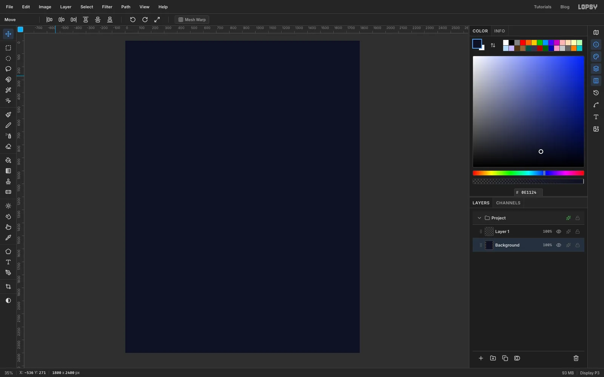

Choose **File → New**, enter **1800 × 2400**, and click **Create**. Click
the *Background* row, set the foreground colour to `#0E1124`, and choose
**Edit → Fill**.

This near-black navy is the "wall" everything hangs on. It's dark enough for
the cream and saffron to glow, but it isn't pure black, so the shadows you
add later still show.

## Draw a single dot and save it as a pattern

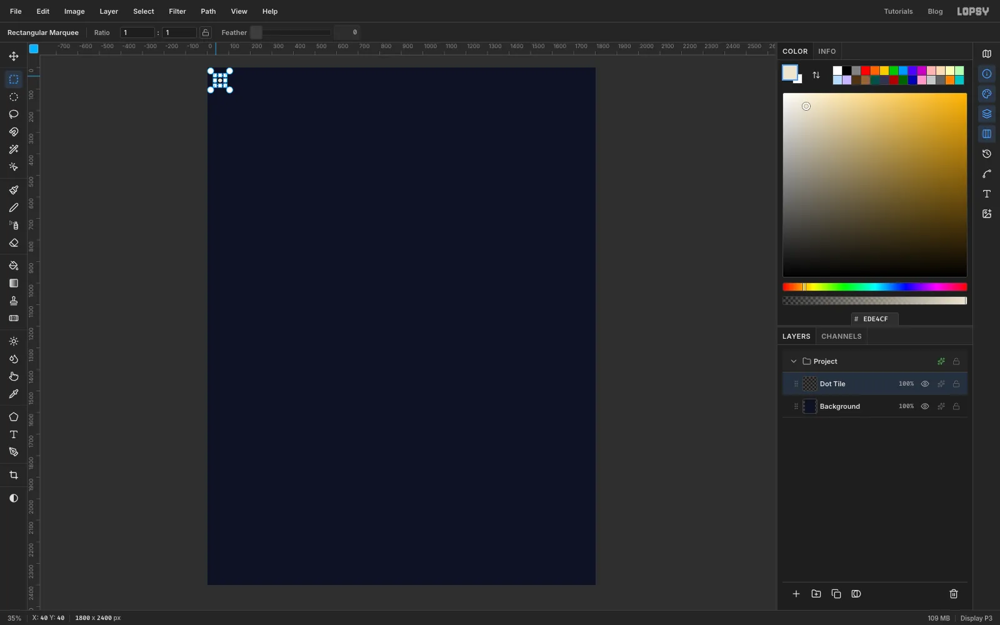

Click *Layer 1* and rename it *Dot Tile*. Zoom in on the top-left corner,
because this dot is only 18 px across. Pick the **Elliptical Marquee**,
click the canvas without dragging, and enter **From 51, 51** and **To 69,
69**. Fill it with cream `#EDE4CF`.

Now switch to the **Rectangular Marquee** and make a 48 px square around the
dot, **From 36, 36** to **84, 84**. Choose **Edit → Define Pattern**. The
selection decides the tile, so the dot is centred in a 48 px cell.

Deselect with [[Cmd+D]] and delete the *Dot Tile* layer with the trash
button. The pattern stays.

## Fill the page with dots

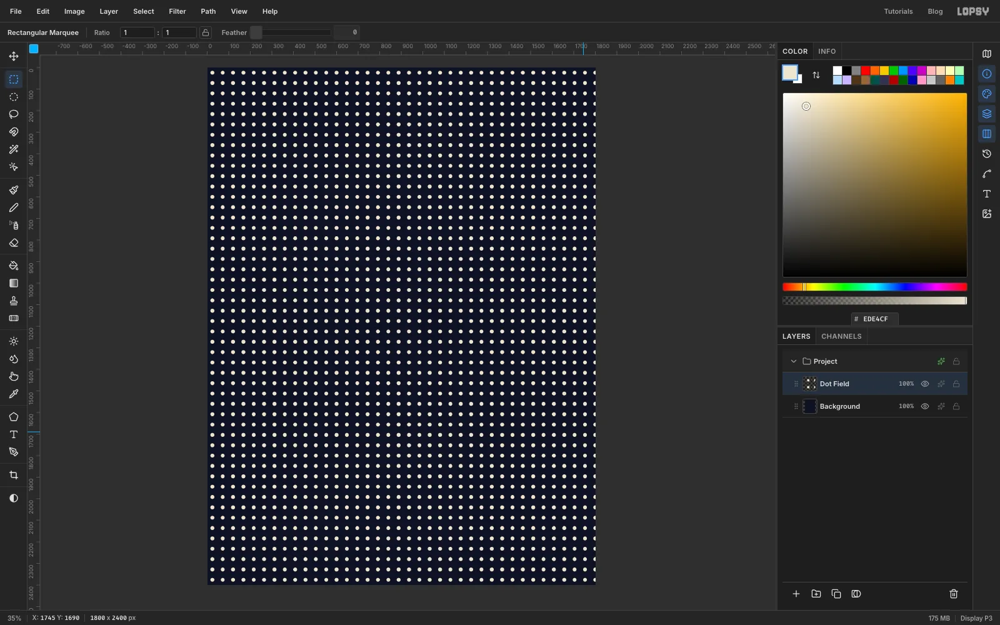

Click *Background* and add a new layer called *Dot Field*. Choose **Edit →
Fill with Pattern…**, pick your dot tile, leave **Scale** at 100%, and click
**Apply**. The whole page fills with a regular grid of dots, like the
Bewogen Beweging poster.

## Bulge the grid with Lens Distortion

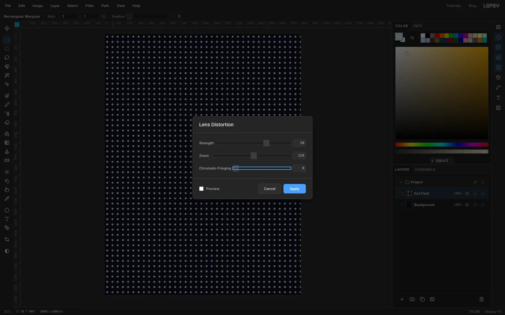

Choose **Filter → Lens Distortion…** and set **Strength** to **38** and
**Zoom** to **128**. Positive strength is barrel distortion, so the dots
swell in the middle of the page and shrink toward the edges, as if a sphere
is pushing through the grid. Zoom pulls the edges back in, so the corners
don't go transparent. Click **Apply**.

Set the layer's opacity to **26%**. The dots should be a texture, not a
pattern that fights the artwork.

## Knock the dots out behind the type

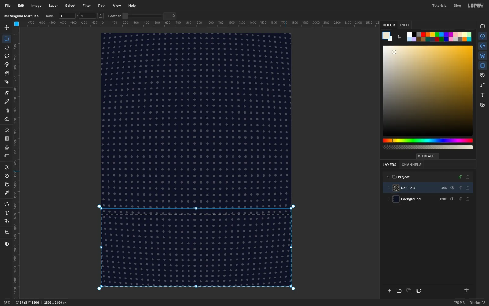

Small type and dots the same size as its strokes don't mix. With the
exact-corners dialog, select the rectangle **From 0, 1720** to **1800,
2400**. Choose **Select → Feather…**, enter **60**, and press [[Delete]].
The dots fade out across the bottom of the page instead of stopping at a
hard edge.

Do the same for a narrow strip on the left margin, where a vertical
tagline will go: **From 85, 650** to **160, 1270**, **Feather 20**, then
[[Delete]]. Deselect.

## Set up a radial halo gradient

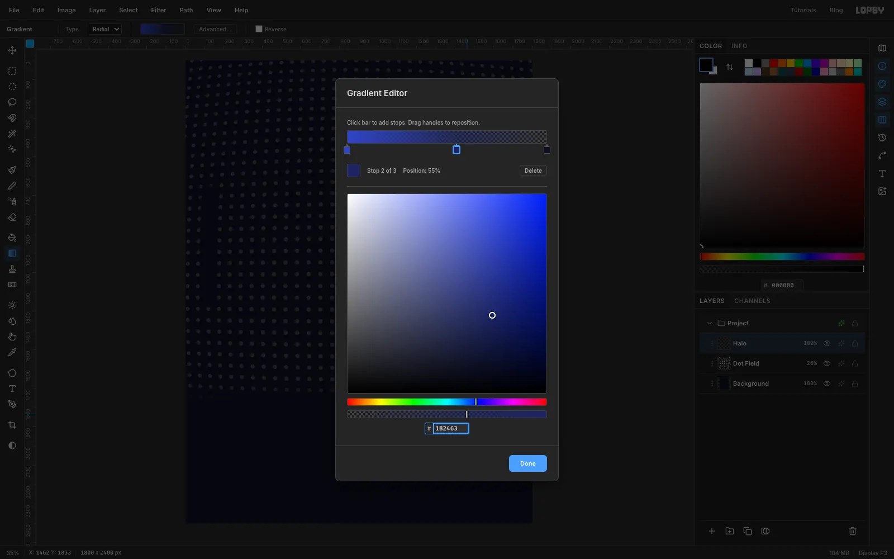

Add a new layer called *Halo* above *Dot Field*. Pick the **Gradient**
tool, set **Type** to **Radial**, and click **Advanced…** to open the
Gradient Editor. Set three stops:

1. at the left end, `#2F45C8` at full opacity
2. at 55%, `#1B2463` at 60% opacity (click the bar to add it)
3. at the right end, `#0E1124` at 0% opacity

Click **Done**.

## Drag the halo out from the centre

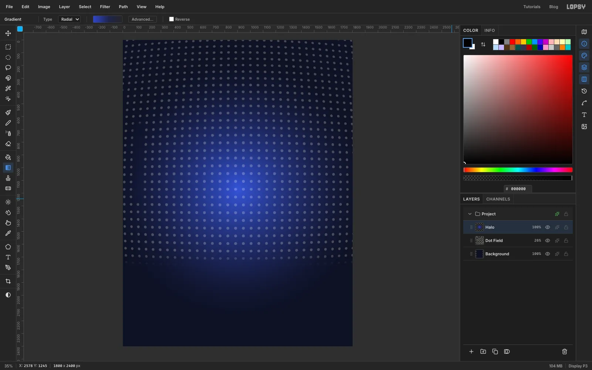

The disc will be centred at **900, 1170**, a little above the middle of the
page. Drag the gradient from that point straight out to the right, about
1000 px (to the canvas edge and beyond). Set *Halo* to **Screen**, so it
lights the dots and the ground instead of covering them.

## Make the disc

Click **New Group** in the Layers panel and name the group *Rotorelief*.
Add a layer inside it called *Disc*.

With the exact-corners dialog, make a circle **From 410, 680** to **1390,
1660**. That's a radius of 490 around 900, 1170. Fill it with cream
`#EDE4CF` and deselect.

## Stack the first off-centre circles

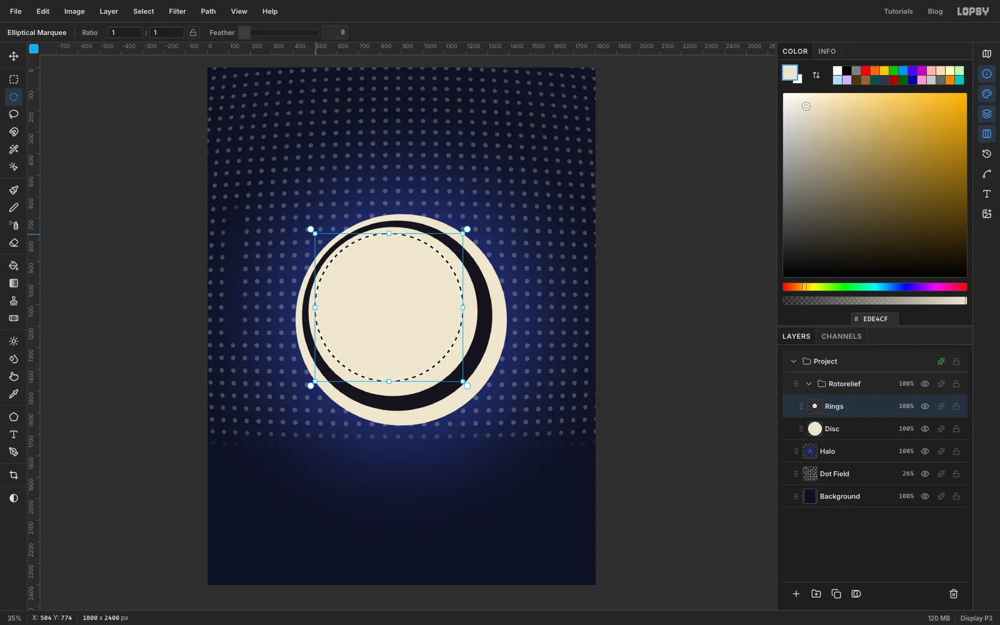

A Rotorelief is a set of circles that shrink while their centres drift to
one side. Add a layer called *Rings* above *Disc*. You'll draw nine circles
on it with the Elliptical Marquee, each filled over the one before. Press
[[Cmd+D]] after every fill, or the next click won't open the dialog.

Start with **From 440, 710** to **1322, 1592** and fill it with ink
`#14131C`. For each next circle, **add 30 to both From values and take 68
off both To values**. That makes each circle 98 px smaller and moves its
centre up and to the left. So the second is **From 470, 740** to **1254,
1524** (cream), and the third is **From 500, 770** to **1186, 1456**
(vermilion `#E8432A`).

## Finish the Rotorelief

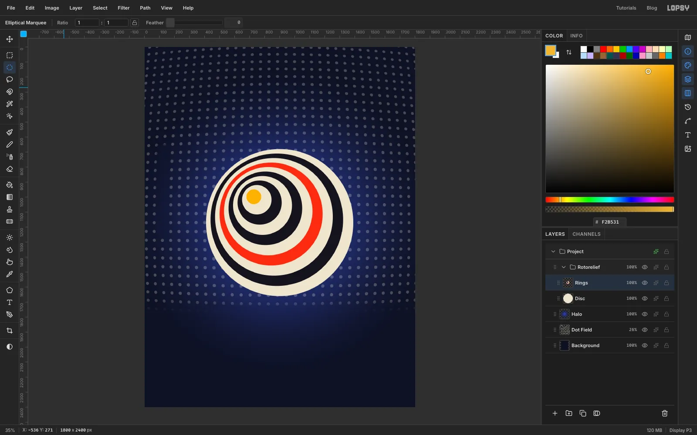

Keep going with the same rule. The full colour order, outside in, is:

1. ink
2. cream
3. vermilion
4. cream
5. ink
6. cream
7. ink
8. cream
9. saffron `#F2B531`

The last circle runs **From 679, 949** to **777, 1047**. Deselect.

The bands are thin at the upper left and thick at the lower right, so the
flat disc reads as a cone pointing away from you. That's the illusion
Duchamp's discs made when they spun.

## Add a misprinted shadow

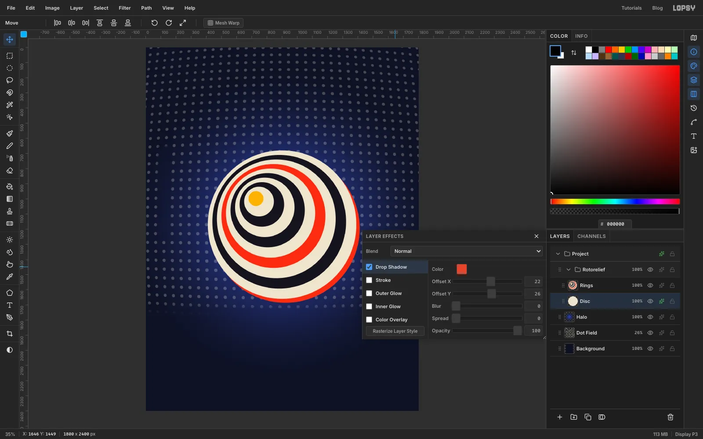

Click *Disc*, open its effects, and turn on **Drop Shadow**. Set:

- **Offset X 22**, **Offset Y 26**
- **Blur 0**, **Spread 0**, **Opacity 100**
- the colour to vermilion `#E8432A`

A hard coloured offset looks like a screen print where the red plate
slipped. It also gives the disc a crescent of depth on the lower right.

## Rotate a copy of the rings

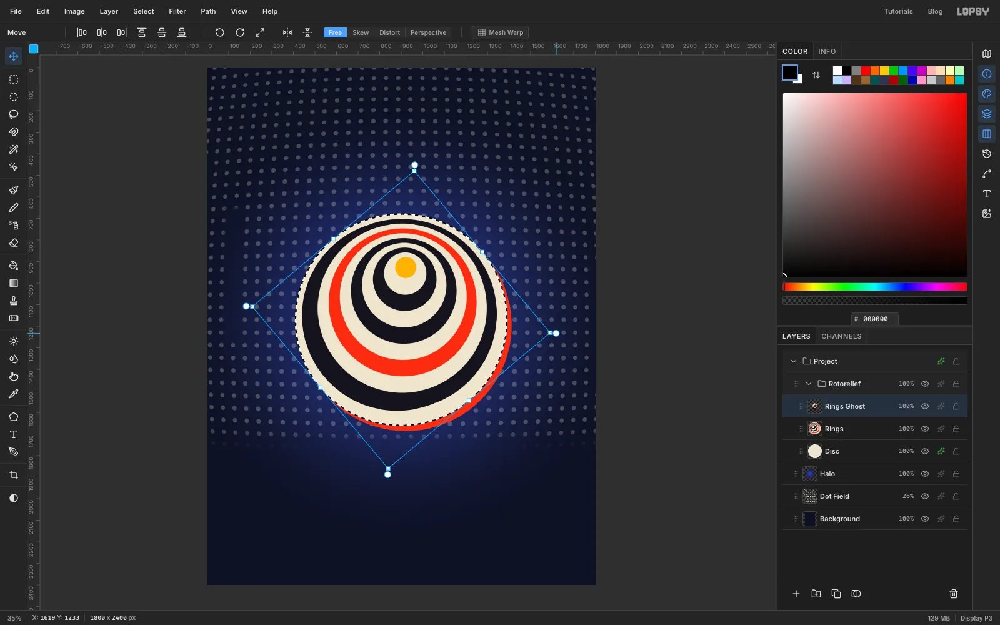

Click *Rings*, click **Duplicate Layer**, and name the copy *Rings Ghost*.
With the Elliptical Marquee, select the disc's circle again (**From 410,
680** to **1390, 1660**), so the transform box is centred on the disc.

Pick the **Move** tool. Hover just outside the top-right corner of the box,
where the cursor turns into the rotate cursor, and drag clockwise about **50°**. Because the
rings are off-centre, turning them moves the cone sideways, like a single
frame of the disc spinning. Press [[Cmd+D]] to commit.

## Blend the ghost on Lighten

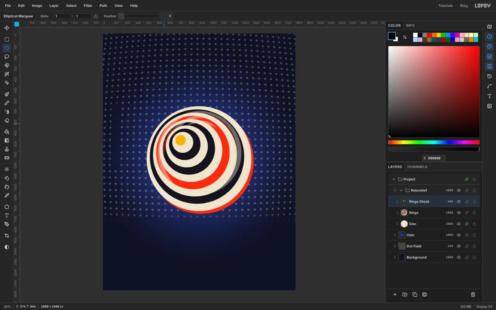

Set *Rings Ghost* to **Lighten** at **40%**. Lighten only shows the ghost
where it's lighter than the rings underneath, so pale arcs appear across the
dark bands without darkening anything.

Keep the ghost to the outer rings. Switch back to the Elliptical Marquee and
select the circle **From 570, 840** to
**1230, 1500** (radius 330 around the disc centre), press [[Delete]], and
deselect. The middle of the disc stays crisp.

## Copy the disc and blur it outward

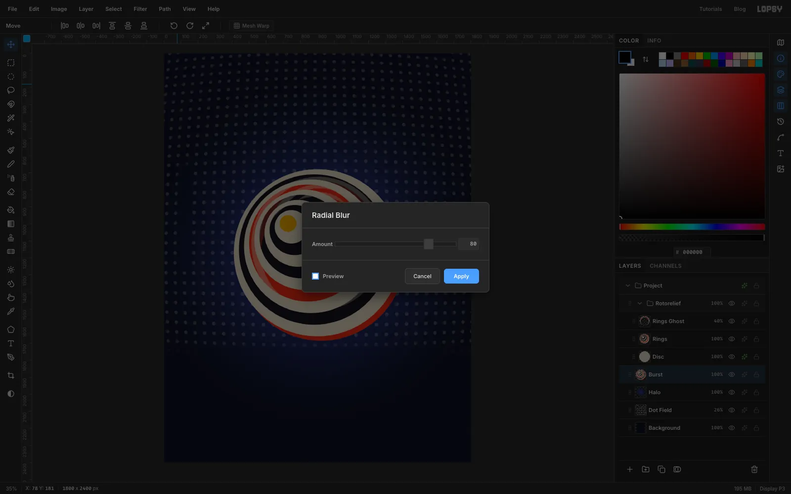

Click *Halo*, then use the Elliptical Marquee to select a circle slightly bigger than the disc, **From
380, 650** to **1420, 1690**. Choose **Edit → Copy Merged** ([[Cmd+Shift+C]])
and paste with [[Cmd+V]]. The flattened copy lands in place, above *Halo*
and below the group. Rename it *Burst* and deselect.

Choose **Filter → Radial Blur…** with **Amount 80**. Radial Blur zooms
toward the centre of the canvas, which is only 30 px below the disc centre,
so the disc's colours streak outward into an even corona. Then run **Filter → Gaussian Blur…** with **Radius 14** to soften
the bright rim. Set *Burst* to **Screen** at **35%**.

## Put a clean hub on top

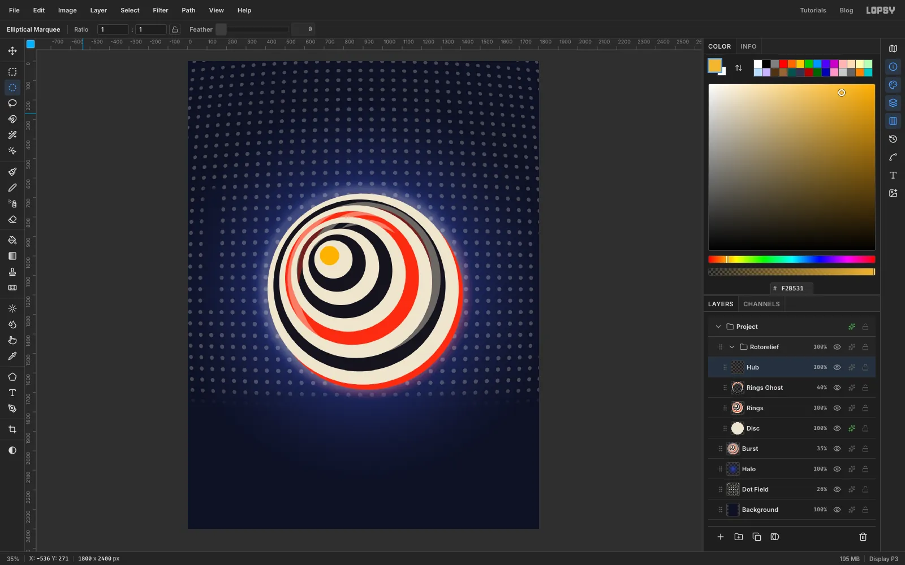

Click *Rings Ghost* and add a layer called *Hub* above it. The paste
switched you to the Move tool, so pick the Elliptical Marquee again and
select **From 679, 949** to **777, 1047**, the same box as the ninth circle, and fill it
with saffron. Even where the ghost passes over the middle, the hub stays a
solid saffron dot. Deselect.

## Draw the orbit as an ellipse path

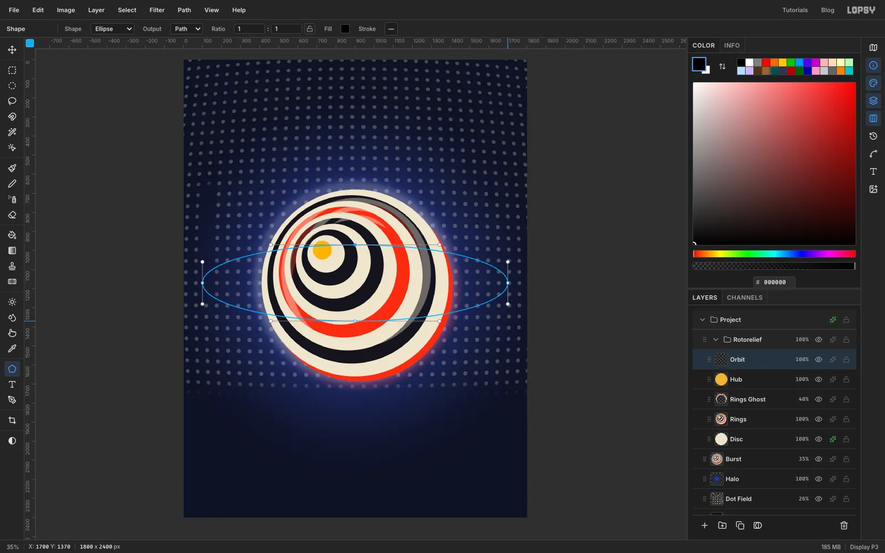

With *Hub* selected, add a layer called *Orbit*, so it sits at the top of the *Rotorelief* group. Pick the
**Shape** tool, set the shape to **Ellipse** and **Output** to **Path**.
Shapes draw from the centre out, so press on the disc centre (**900,
1170**) and drag down and to the right to **1700, 1370**. You get a path
1600 px wide and 400 px tall. Nothing is painted yet.

## Stroke the path

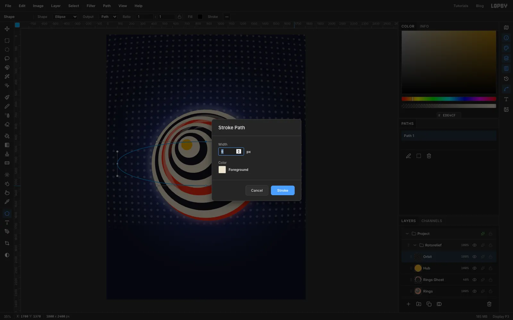

Set the foreground to cream. Open the **Paths** panel from the panel
toolbar on the right; your new path is already selected. Click **Stroke
Path**, enter a **Width** of **6**, and press [[Enter]]. The ring is painted
onto *Orbit*.

Click the path row again to deselect it, so its blue outline stops drawing,
then close the Paths panel.

## Tilt the orbit

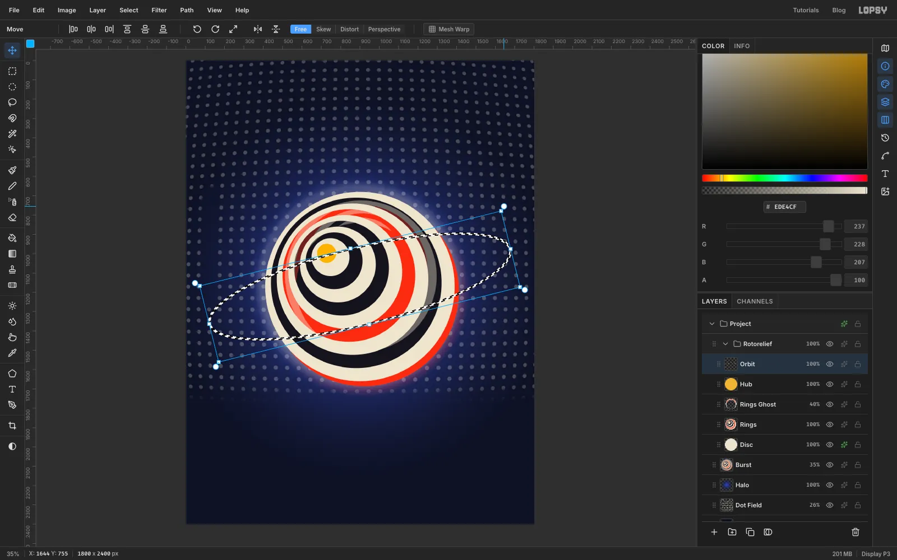

[[Cmd]]-click the *Orbit* thumbnail to select its pixels. With the **Move**
tool, hover just outside the top-right corner until the rotate cursor shows, and drag counter-clockwise about **14°**.
The left end drops and the right end rises, like the rings of Saturn seen
from slightly above. Press [[Cmd+D]].

## Erase the back of the orbit

The orbit should pass in front of the disc at the bottom and behind it at
the top. [[Cmd]]-click the *Disc* thumbnail to select the disc, then click
the *Orbit* row. Pick the **Eraser** at **Size 70** and drag along the part
of the ring that crosses the upper half of the disc.

The eraser only works inside the selection, so the ring vanishes exactly at
the disc's edge, and the parts outside the disc are untouched. Deselect.

## Paint a stroboscopic trail

With *Orbit* selected, add a layer called *Trail*. Pick the **Brush**, open the
brush settings, and set **Hardness 100**. Set the colour to saffron.

The satellite will sit on the front of the orbit at about **389, 1444**,
travelling to the right. Click the first dab on the orbit about 55 px
behind that spot (to its left), then each next one about 45 px further back
along the ring. Make each smaller and fainter than the last by changing
**Size** and **Opacity** in the options bar between clicks:

1. **Size 58**, **Opacity 50%**
2. **Size 50**, **Opacity 32%**
3. **Size 44**, **Opacity 18%**
4. **Size 38**, **Opacity 9%**

It reads like a chronophotograph: the same object caught several times as
it moves. Set the brush opacity back to 100% when you're done.

## Add the satellite

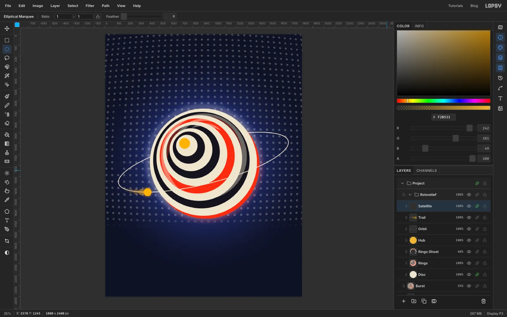

Add a layer called *Satellite* above *Trail*. With the Elliptical Marquee, select **From 353, 1408** to
**425, 1480** and fill it with saffron. Deselect, open the layer's effects,
and turn on **Outer Glow** with **Size 40**, **Opacity 70** and a saffron
colour.

The ball sits clear of the disc's rim, so it doesn't look as though it's
touching the edge.

## Bend the mobile's arms

Collapse the *Rotorelief* group and click it. Click **New Group**, name it
*Mobile*, and add a layer inside it called *Wires*.

Pick the **Brush** at **Size 6**, **Hardness 100**, in wire `#D9D2C2`.
Calder's arms are never straight, so draw each one as a single slow drag
with a gentle upward bow. A slight wobble looks hand-made, but if you'd
rather have perfect curves, draw each arm with the **Pen** (click the
left tip, drag at the peak to pull out a handle, click the right tip) and
use **Stroke Path** at width 6, as you did for the orbit.

1. the top arm, from **600, 214** rising to about **1090, 122** and down to **1545, 182**
2. the middle arm, from **250, 372** up to about **600, 300** and down to **980, 334**
3. the bottom arm, from **820, 474** up to about **1000, 428** and down to **1190, 452**

## Hang the arms on drop wires

Each arm hangs from the tip of the one above it. With the same brush, click
and then [[Shift]]-click to draw three straight wires:

- from the top edge at **1240, 0** down to the top arm (about **1240, 122**)
- from the top arm's left tip (**600, 214**) down to the middle arm (**600, 300**)
- from the middle arm's right tip (**980, 334**) down to the bottom arm (**980, 430**)

Set the brush **Size** to **14** and click once at the bottom of each wire.
This adds a small knot where each arm balances.

## Cut and rotate the first pendant

Add a layer called *Pendants* above *Wires*. With the Elliptical Marquee,
select **From 1447, 176** to **1663, 328** and fill it with vermilion. It hangs from the top
arm's right tip.

With the selection still active, pick the **Move** tool and turn the
rotation handle about **20°** clockwise, so the pendant tilts like a leaf
catching the air. Press [[Cmd+D]].

## Hang the other pendants

On the same layer, add two more pendants. Each time, switch to the
Elliptical Marquee, select, fill, then rotate with the Move tool and press
[[Cmd+D]]:

- cobalt `#2F55D4`, **From 168, 386** to **324, 506**, rotated about **24°** counter-clockwise, on the middle arm's left tip
- saffron, a circle **From 778, 476** to **862, 560**, on the bottom arm's left tip (a circle doesn't need rotating, so just deselect)

The cream pendant, nearest the bottom arm's pivot, should hang still
while the others swing, so give it its own layer: add *Cream Leaf*, select
**From 1124, 462** to **1284, 578**, fill it with cream, and rotate it
about **34°** clockwise. These are Calder's colours: red, blue, yellow and
white.

## Give the pendants a swing echo

Click *Pendants* and click **Duplicate Layer**. The copy sits on top. Click
the *original* underneath and rename it *Swing*.

On *Swing*, run **Filter → Motion Blur…** with **Angle 0** and **Distance
70**. With the **Move** tool, nudge it **34 px** to the left with the arrow
keys ([[Shift]] moves 10 px at a time). Set it to **45%**. Rename the copy
on top back to *Pendants*.

The sharp pendants now drag a soft smear behind them, as if they're swaying
to the right. The cream one, on its own layer, stays still.

## Cast shadows on the wall

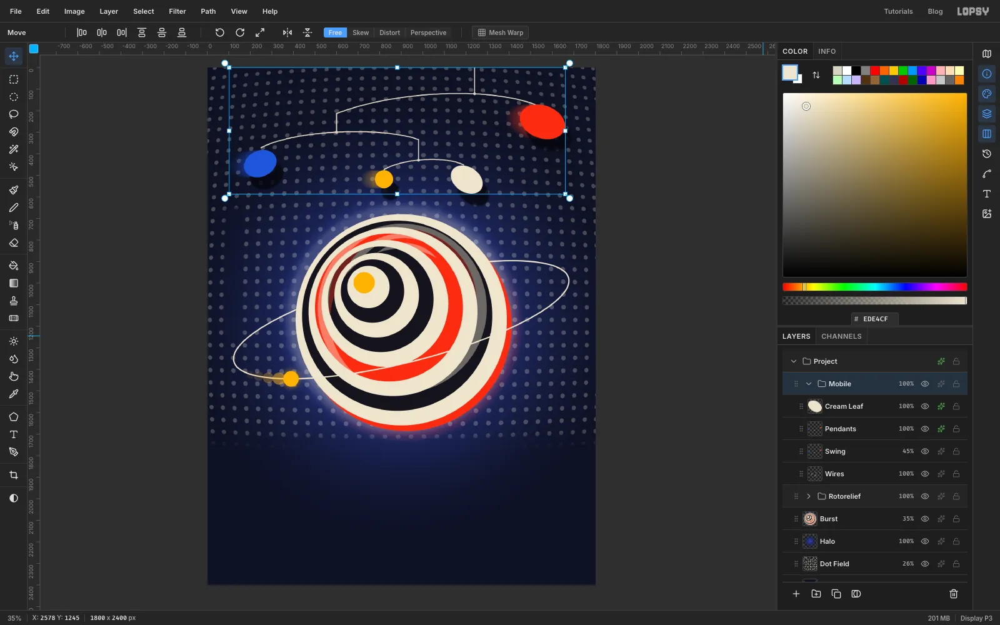

A real mobile throws shadows on the wall behind it. Click *Pendants*, open
its effects, and turn on **Drop Shadow**:

- **Offset X 30**, **Offset Y 56**
- **Blur 10**, **Spread 0**, **Opacity 80**
- colour `#04050C`

Do the same on *Cream Leaf*. Leave the wires without shadows. Thin shadows
of thin lines read as a second set of wires.

> **Tip:** to reposition the whole mobile later, click the *Mobile* group
> row and nudge it with the Move tool. Every wire, pendant, echo and shadow
> moves together.

## Type the title

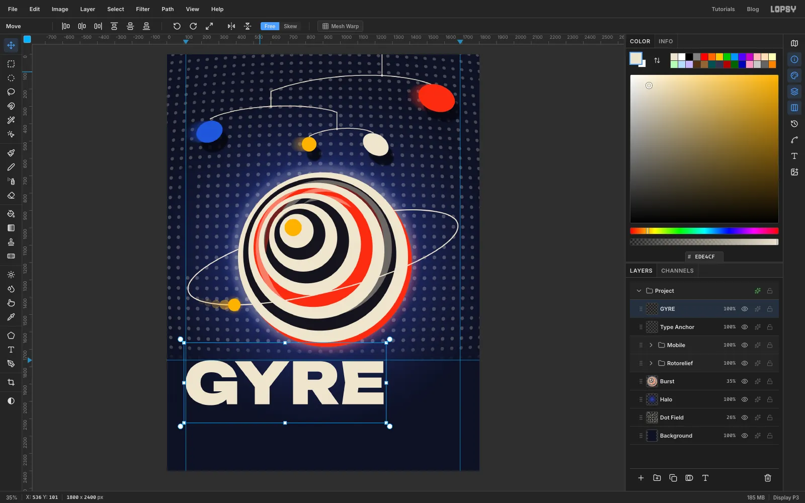

Collapse *Mobile*. Click the top ruler at **110** and **1690** to drop two
vertical margin guides, and the left ruler at **1762** for the top of the
title.

Click *Mobile* and add an empty layer called *Type Anchor*. Clicking it
before each new piece of text keeps the Text tool's settings from restyling
the last text layer.

With *Type Anchor* selected, pick the **Text** tool and set the font to
**Unbounded**, **Black**, **Size 330**, cream. Click in an empty area and
type **GYRE**, then click **Commit text**. With the **Move** tool, drag it
so its left edge sits on the 110 guide and its cap tops on the 1762 guide,
finishing with the arrow keys.

## Misregister the title

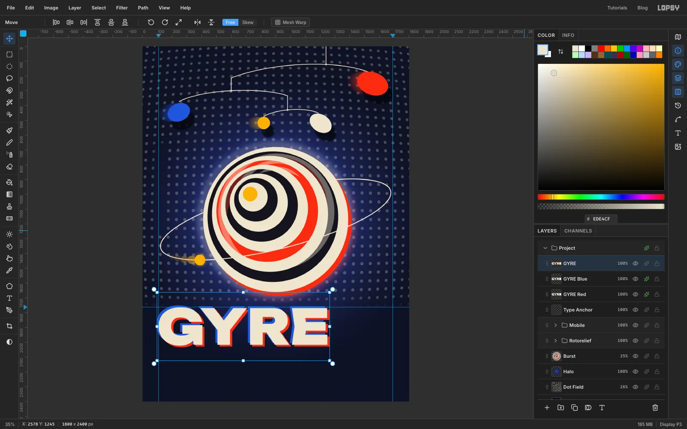

Click **Duplicate Layer** twice, so there are three GYRE layers. Name the
bottom one *GYRE Red* and the middle one *GYRE Blue*, and name the top one
*GYRE*.

- *GYRE Red*: add a **Color Overlay** in vermilion, then with the Move tool nudge it **14 px right** and **12 px down**.
- *GYRE Blue*: add a **Color Overlay** in cobalt, then nudge it **14 px left** and **12 px up**.

The cream letters now vibrate between two offset colour plates, like a
three-colour print with a loose registration.

## Track NOCTURNE to the title's width

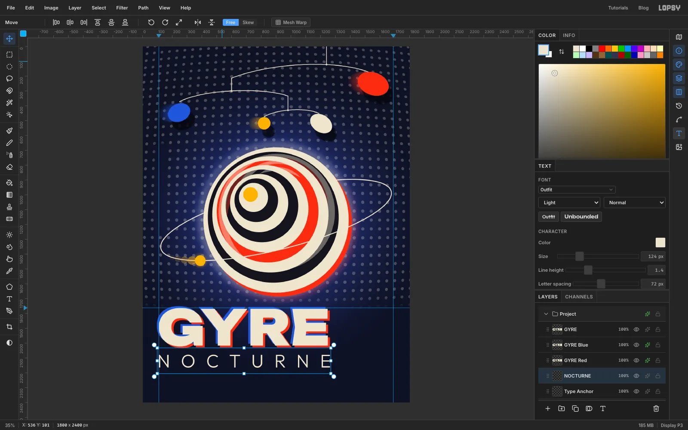

Click *Type Anchor*. Set the Text tool to **Outfit**, **Light**, **Size
124**, and type **NOCTURNE**. Commit it.

Open the **Text** panel from the panel toolbar and raise **Letter spacing**
until NOCTURNE ends where the red E of GYRE ends. Here that's **72 px**.
Move it so its left edge is on the 110 guide and its top sits **56 px**
below the bottom of GYRE.

Click *Type Anchor* and set **Letter spacing** back to **0** in the Text
panel, or the next text you type inherits the wide spacing.

## Build the info column

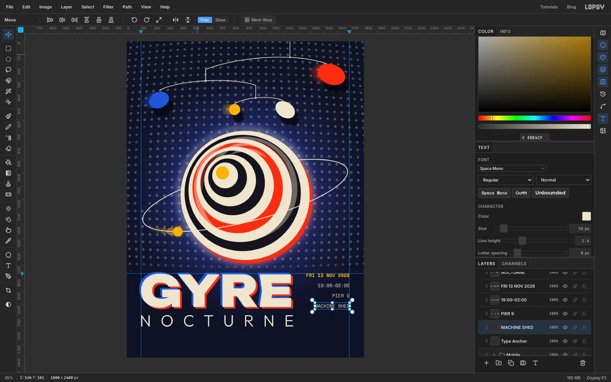

The info column sits to the right of GYRE and spans exactly its cap height.
Make four separate text layers in **Space Mono** at **Size 36**, clicking
*Type Anchor* before each one. Set **Align** to **Right** in the Text
options and click on the 1690 guide each time: point text set to Right uses
the click point as its right edge.

1. **FRI 13 NOV 2026**, **Bold**, saffron
2. **19:00–02:00**, **Regular**, cream
3. **PIER 9**, Regular, cream
4. **MACHINE SHED**, Regular, cream

Then nudge each line up or down. Put the first line's top on the 1762
guide and the last line's baseline on GYRE's baseline. Space the two middle
lines evenly between them, about **78 px** apart.

## Add the rule and the footer

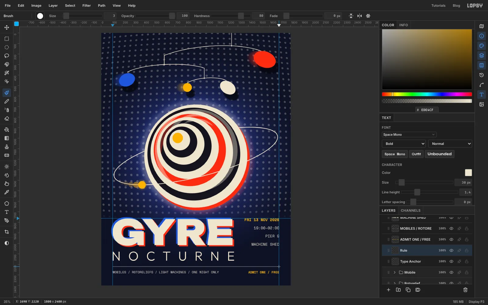

Click *Type Anchor*, set **Align** back to **Left**, and type the footer in
**Space Mono Regular**, **Size 30**, cream: **MOBILES / ROTORELIEFS /
LIGHT MACHINES / ONE NIGHT ONLY**. Then set **Align** to **Right**, click
on the 1690 guide, and type **ADMIT ONE / FREE** in **Bold** saffron at
the same size.

Leave **56 px** under NOCTURNE, then put a rule there. Add a layer called
*Rule*, pick the **Brush** at **Size 3** in cream, click on the 110 guide
and [[Shift]]-click on the 1690 guide. Move the footer **40 px** below the
rule, with the first line on the left guide and *ADMIT ONE / FREE* on the
same line at the right.

The bottom margin now matches the 110 px side margins.

## Turn the tagline on its side

Click *Type Anchor*, set **Align** back to **Left**, and type **KINETIC SCULPTURE AFTER DARK** in **Space
Mono Bold**, **Size 28**, saffron. In the Text panel, give it **3 px** of
letter spacing.

Pick the **Move** tool. Text layers get rotation handles without a
selection. Hold [[Cmd]] and drag a corner rotation handle counter-clockwise
until the line stands upright. [[Cmd]] snaps the angle to 15° steps, so it
lands exactly on 90°. The text stays editable.

## Seat the tagline on the margin

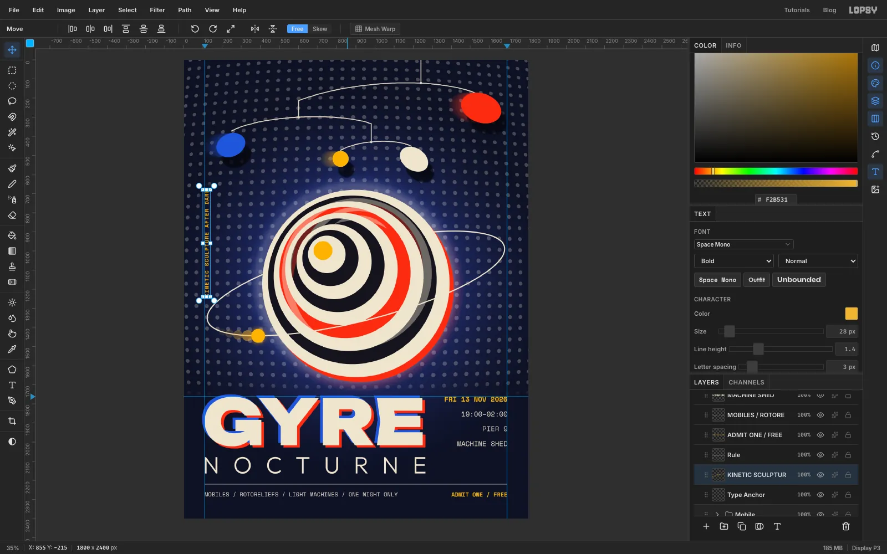

Move the tagline so it sits on the **110** guide, with its top level with
the top of the disc at **y 680**. It now reads bottom to top up the same
margin as GYRE, NOCTURNE, the rule and the footer. It sits in the strip you
cleared of dots, and well clear of the orbit's left end.

## Add print grain

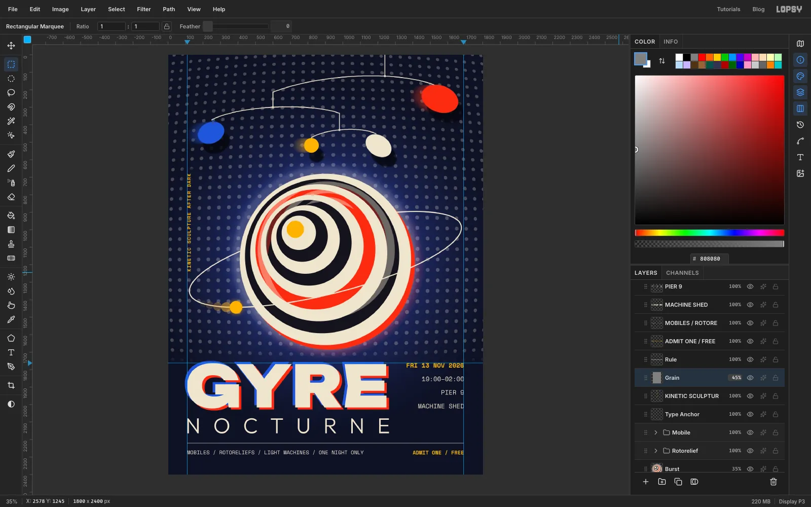

Every text layer was created just above *Type Anchor*, so the tagline is the
lowest of them. Click the tagline layer and add a layer called *Grain*. It
lands above the artwork and the tagline but under the rest of the type, so
the small letters stay clean. Select the whole canvas, fill it with `#808080`, and deselect. Run
**Filter → Add Noise…** with **Amount 30**, **Mono** and **Gaussian**. Set
*Grain* to **Overlay** at **45%**. The grey disappears and leaves a fine
grain over the artwork.

Hide the guides with **View → Show Guides**, save with **File → Save
Project**, and choose **File → Quick Export PNG**.
