Chrome is a mirror bent into a shape. It doesn't have a colour of its own.
It shows its surroundings in hard bands: a pale crest where it faces the
sky, a sharp dark line where the horizon would be, and a glint where the sun
hits. Liquid metal adds one more idea. It flows, so it has beads, drips and
a meniscus where it meets more of itself.

In this tutorial you'll paint **Dragonfly Rising**, a 1600 × 2000 px digital
painting. A dragonfly made of mercury climbs out of a mercury pond at sunset,
still joined to the water by a thin pulled strand. The dragonfly starts as a
real photo: a CC0 photo of a male *Crocothemis servilia* by Jeevan Jose on
Wikimedia Commons. Two tricks turn it into metal. A **Curves** adjustment with
a wave-shaped curve folds the greys into chrome bands. A **Gradient Map** on
the same group then tints those bands with the sunset colours. Along the way you'll use
layer masks, Emboss ripples, Skew, Copy Merged, Mesh Warp and the Pen tool.

The palette:

- Sky `#0E1230` → `#2E2558` → `#7A3A6E` → `#D96B5E` → `#F5A96A` → `#FFE2A6`
- Sun `#FFF3D2`, glow `#FFB070`
- Ridge `#1B1431`, reeds `#0A0918`
- Pool map `#07081A` → `#241F4A` → `#6A3A6E` → `#C9636A` → `#F2A46C` → `#FFE8B4`
- Chrome map `#06061A` → `#2A2352` → `#7E4A7E` → `#DB8A78` → `#FFDDB4` → `#FFFFFF`
- Wing film `#7FE6FF` → `#B79CFF` → `#FF9BD2` → `#FFE48C` → `#8CFFC8`

> **Tip:** Everything that turns into chrome is painted in **greys**. The
> groups' adjustments do the colouring, so you only ever think about light and
> dark while you paint.

## Paint a sunset sky and set up guides

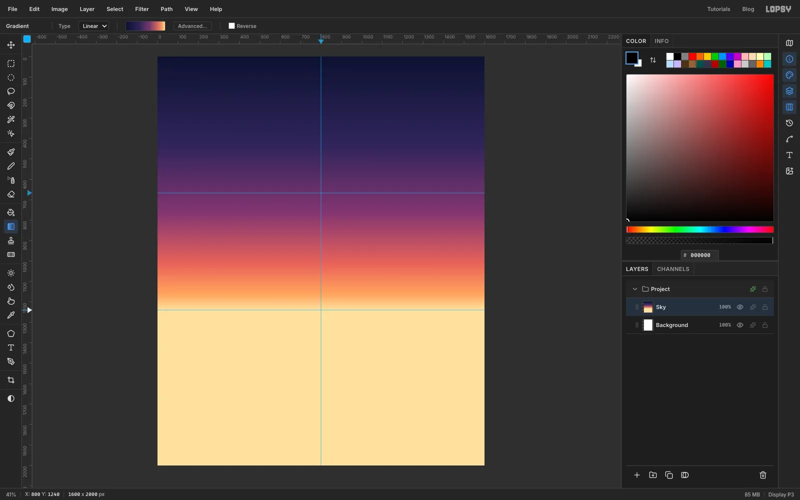

Choose **File → New** and create a **1600 × 2000** pixel document with a white
background. Click the left ruler about three fifths of the way down the canvas
(at 1240 px) to drop the horizon guide. Click it again a third of the way down
(667 px); it's a thirds line for judging where the wings sit later. Then
click the top ruler in the middle (800 px) for a centre line.

Double-click **Layer 1** and rename it *Sky*. Pick the **Gradient** tool, keep
**Type** on **Linear**, click **Advanced…** and set six stops:

- `#0E1230` at 0%
- `#2E2558` at 35%
- `#7A3A6E` at 62%
- `#D96B5E` at 82%
- `#F5A96A` at 94%
- `#FFE2A6` at 100%

Drag straight down from the top edge to the horizon guide. Below the horizon
the gradient stays pale gold. The pond will cover that part.

## Streak some clouds across it

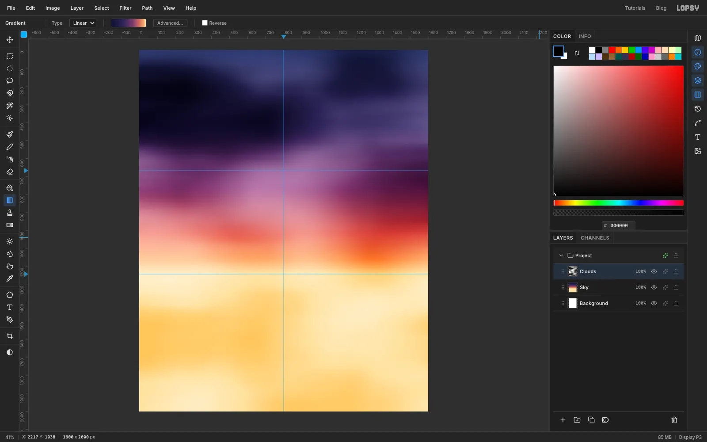

Add a layer named *Clouds*. Run **Filter → Clouds…** with **Scale 5**. Then
run **Filter → Motion Blur…** with **Angle 0** and **Distance 400**, which
pulls the blobs into long, flat sunset streaks.

Open the layer's effects (the sparkle button on its row) and set the **Blend**
mode to **Soft Light**. The grey streaks now only lighten and darken the sky
under them.

## Fade the clouds with a layer mask

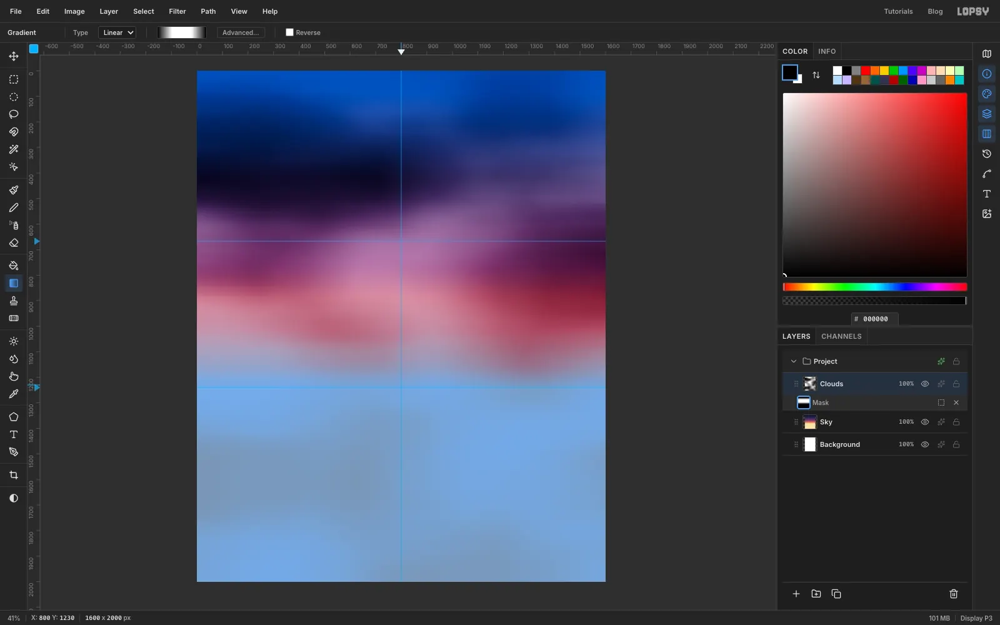

Click **Add Mask** at the bottom of the Layers panel, then click the mask
thumbnail under the Clouds row to edit it. The canvas turns blue while you're
in mask mode. That's normal.

With the **Gradient** tool, set four stops: black at 0%, white at 30%, white
at 70% and black at 100%. Drag from just below the top edge down to the
horizon. The clouds now fade out at the top of the sky and in the bright glow
at the horizon. Click the Clouds layer name to leave mask mode, and lower its
opacity to **70%**.

## Set the sun on the horizon

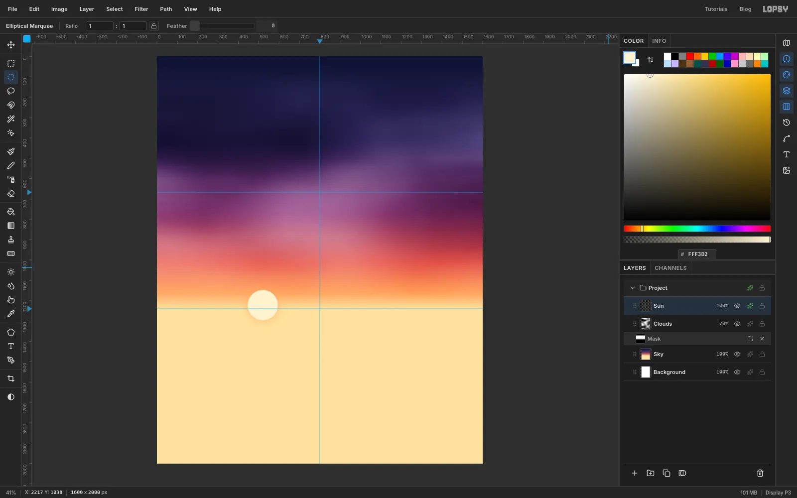

Add a layer named *Sun* and set the foreground colour to `#FFF3D2`. With the
**Elliptical Marquee**, drag a circle about 150 px across. Centre it just
above the horizon guide, about a third of the way in from the left. Choose
**Edit → Fill**, then **Select → Deselect**.

Open the layer's effects and turn on **Outer Glow**. Set **Size** to **140**,
**Opacity** to **85** and the colour to `#FFB070`. Only the top half of the
sun will show once the pond is in.

## Cut a low ridge along the horizon

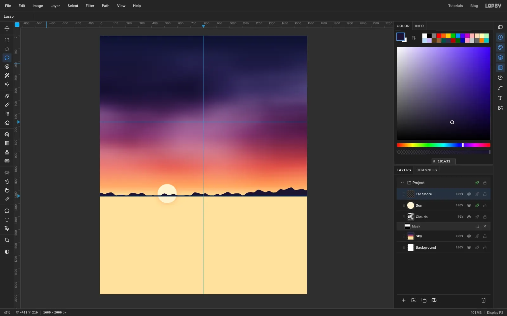

Add a layer named *Far Shore* and set the foreground to `#1B1431`. With the
**Lasso**, draw a gently bumpy ridge along the horizon. Start off the left
edge, keep it low near the sun, and let it climb a little toward the right.
Then come back along the bottom just under the guide. Fill it and deselect.

## Start the pond with a snapped marquee

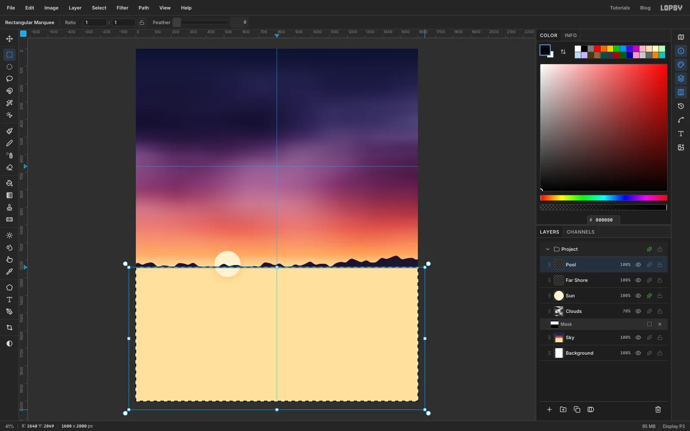

Add a layer named *Pool*. With the **Rectangular Marquee**, start the drag
just under the horizon guide and outside the left edge. Drag past the bottom
right corner. **Snap to Guides** pulls the top edge onto the horizon, so the
water meets the ridge exactly.

## Paint the water in greys and mirror the ridge

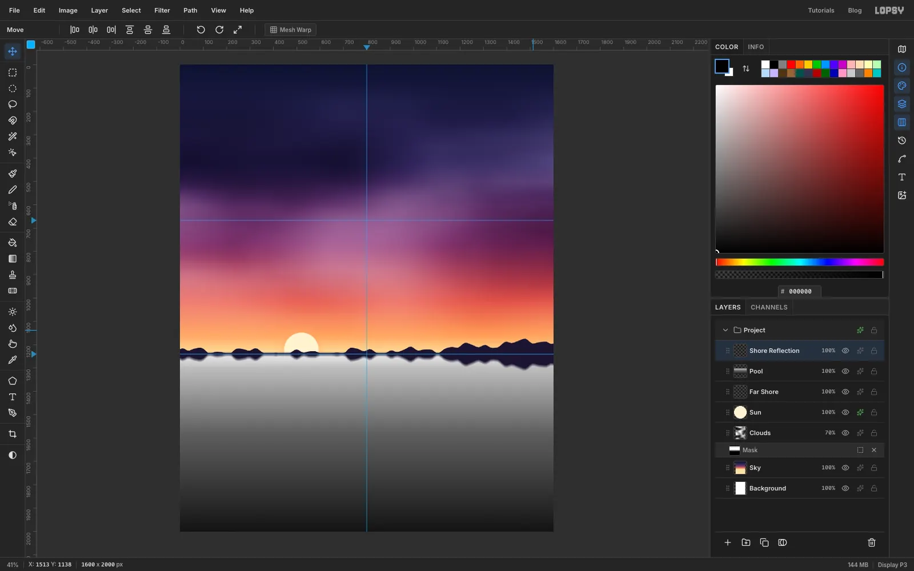

With the marquee still active, make a linear gradient with these stops:
`#EDEDED` at 0%, `#BDBDBD` at 8%, `#5E5E5E` at 45% and `#141414` at 100%.
Drag from the horizon to the bottom edge, then deselect. Near the horizon the
water reflects the bright sky. Closer to you it reflects the dark sky
overhead.

Now the ridge's reflection. Click **Far Shore**, press [[Cmd+A]] and
[[Cmd+C]], deselect, click **Pool**, and press [[Cmd+V]]. Rename the paste
*Shore Reflection* and choose **Image → Flip Vertical**. Pick the **Move**
tool and nudge the copy with [[Shift+↓]] or [[Shift+↑]] until the upside-down
ridge hangs from the horizon line, touching the real one. Finish with **Filter → Motion Blur…** at
**Angle 90**, **Distance 14** to soften it like water.

## Scatter sun glitter under the sun

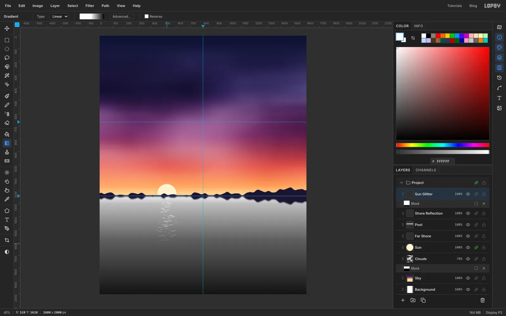

Add a layer named *Sun Glitter* and pick the **Brush** with white. Under the
sun, paint short horizontal flecks: click, then [[Shift]]-click a little to
the right. Keep them tiny (size 2–3) and tightly bunched just under the
horizon. Make them a little longer, larger (size 4–5) and more spread out as
you come down the water. Vary the **Opacity** between about 35% and 100% as
you go. Around a hundred flecks looks right.

Run **Filter → Motion Blur…** at **Angle 0**, **Distance 14**, then
**Filter → Gaussian Blur…** with **Radius 1.5**. Click **Add Mask**, then
click the new mask thumbnail so you're painting on the mask. Drag a gradient
(white, white at 45%, black) from the horizon to about a fifth of the way up
from the bottom, so the glitter dies out before the deep water. Click the
layer name to leave mask mode.

## Group the pond and colour it with a Gradient Map

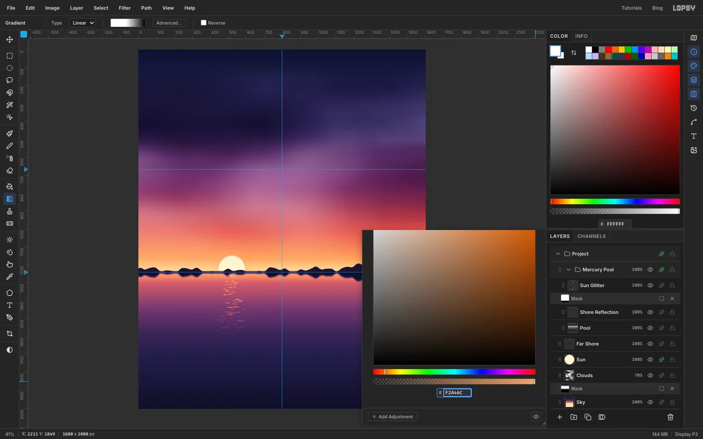

Click **Sun Glitter**, [[Shift]]-click **Pool** to select all three pond
layers, and choose **Layer → Group Layers**. Rename the group *Mercury Pool*.

Open the group's effects. Groups show an adjustment stack instead of layer
effects. Click **Add Adjustment → Gradient Map** and set six stops:
`#07081A` at 0%, `#241F4A` at 30%, `#6A3A6E` at 55%, `#C9636A` at 75%,
`#F2A46C` at 90% and `#FFE8B4` at 100%. Every grey in the group now maps to a
sunset colour, so the water picks up the sky.

## Give the water more polish with Curves

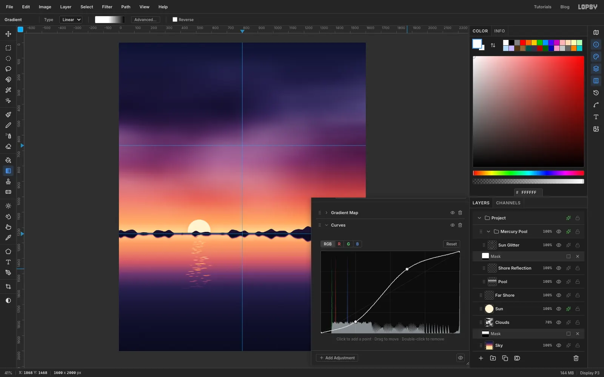

Click **Add Adjustment → Curves**. Click the curve a quarter of the way along
and drag that point a little down. Then click about 60% of the way along and
lift it a little. This gentle S makes deeper darks and brighter mids, which
reads more like polished metal than calm water.

## Draw ripple rings with a radial gradient

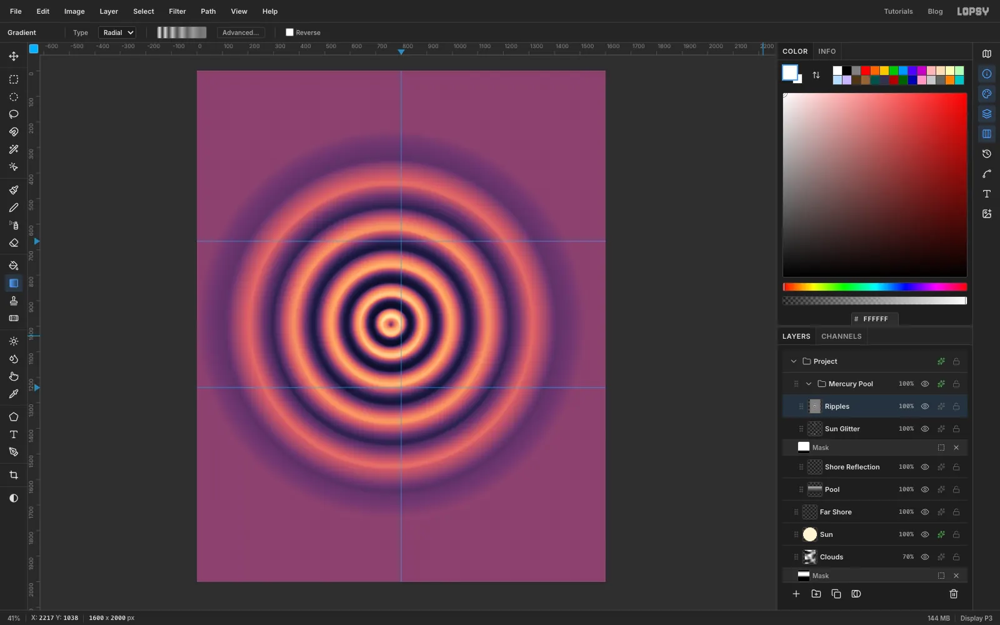

With **Mercury Pool** selected, add a layer named *Ripples*. It goes inside
the group. Set the Gradient tool to **Radial** and click **Advanced…**. Set
twelve stops that swing from light to dark and settle toward mid grey at the
edge:

- `#808080` at 0%, `#E6E6E6` at 5%, `#2A2A2A` at 10%
- `#D8D8D8` at 16%, `#3A3A3A` at 23%, `#C8C8C8` at 31%
- `#4C4C4C` at 40%, `#B4B4B4` at 50%, `#606060` at 61%
- `#9C9C9C` at 73%, `#727272` at 86%, `#808080` at 100%

Start the drag just left of the centre line, halfway down the canvas. Drag
right to just inside the right edge. Then run **Filter → Emboss…** with
**Angle 90** and **Strength 60**, which turns the bands into lit crests and
troughs.

## Squash the rings flat into perspective

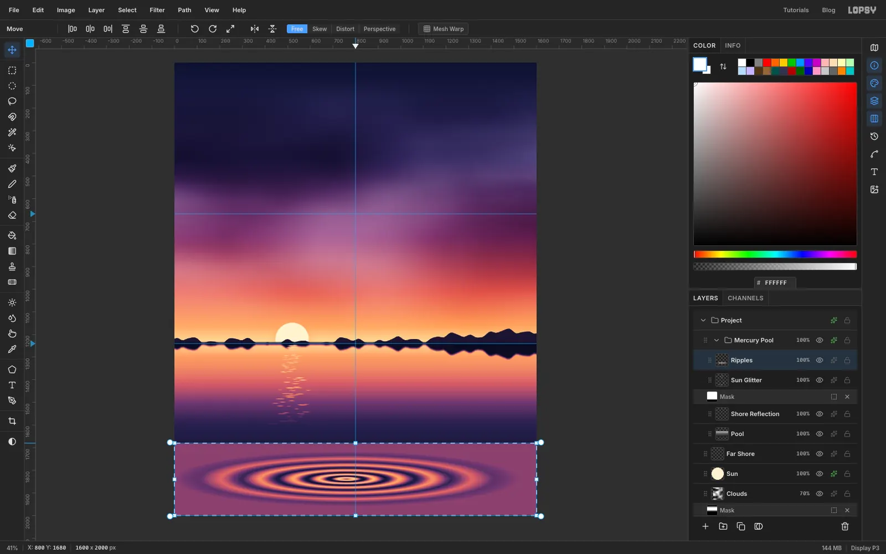

Press [[Cmd+A]] and pick the **Move** tool. Drag the top-middle handle down
until the box is only about a sixth of the canvas tall, then press
[[Cmd+D]]. Seen from a low angle, circles on water become long thin ellipses.

Nudge the band up with [[Shift+↑]] until the centre of the rings sits about
200 px below the horizon, just left of the centre line. The mercury
strand will land there later.

## Blend the ripples into the water

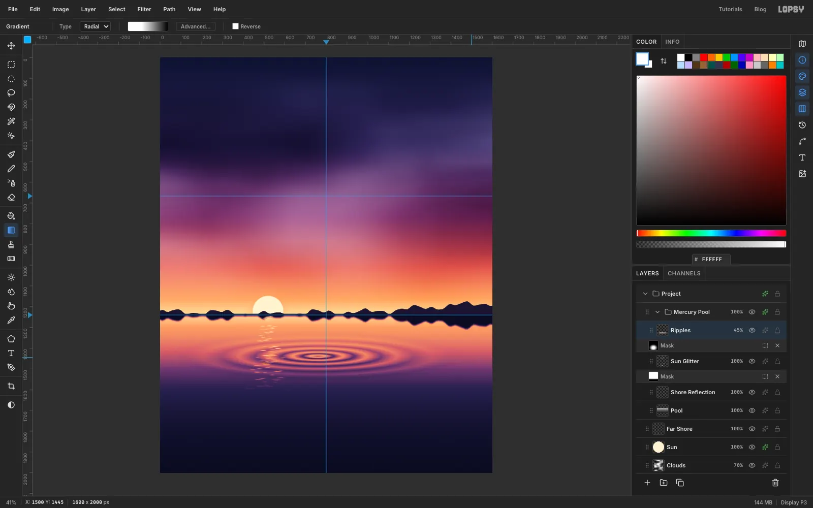

Set the Ripples layer's blend mode to **Overlay** and its opacity to **45%**.
The mid grey disappears and only the crests and troughs remain. Because the
layer is inside the group, the Gradient Map colours the ripples too.

Click **Add Mask** and then the new mask thumbnail. The Gradient tool is
still on **Radial**; set three stops: white, white at 35%, black. Drag from the
centre of the rings most of the way to the right edge, so the rings fade as
they spread, then click the Ripples name to leave mask mode.

## Paste the reference photo

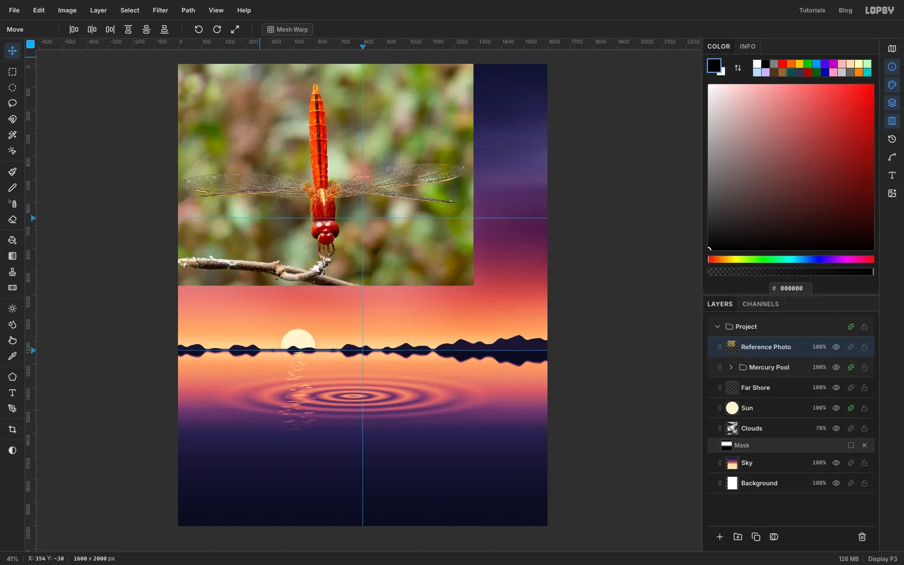

Collapse the **Mercury Pool** group with its arrow and click it, so the next
layer lands above the group rather than inside it. Open the photo's page on
Wikimedia Commons ([Crocothemis servilia male by
kadavoor](https://commons.wikimedia.org/wiki/File:Crocothemis_servilia_male_by_kadavoor.jpg)),
open the **1280 px** preview, right-click it and copy the image. Back in
Lopsy, press [[Cmd+V]]. Lopsy drops it in the top-left corner.
Rename it *Reference Photo*.

This photo works well because it's symmetrical, with the wings flat out to
the sides. Turned upside down, it becomes a dragonfly climbing with its tail
hanging down.

## Lasso the body

Zoom in and use the **Lasso** to trace the head, thorax and abdomen. Go round
the big eyes and leave the legs and the twig behind. A dragonfly in flight
tucks its legs in, so you won't miss them. Press [[Cmd+C]] then [[Cmd+V]]. The
copy pastes in place on its own layer. Rename it *Body*.

## Lasso the wings

Click **Reference Photo** again. Lasso the left pair of wings, then hold
[[Shift]] and lasso the right pair to add it. Stop each shape at the edge of
the body. Copy and paste, and rename the new layer *Wings*.

## Make the wings a little smaller

The photo's wings are long for a dragonfly climbing straight up.
[[Cmd]]-click the Wings thumbnail to select its pixels, pick the **Move**
tool, and [[Cmd]]-drag the bottom-right corner handle inward until the wings
are about 85% of their width. Holding [[Cmd]] keeps the proportions. Then drag
inside the box to centre the wings on the body again, and press [[Cmd+D]].

## Check the cut-outs and delete the photo

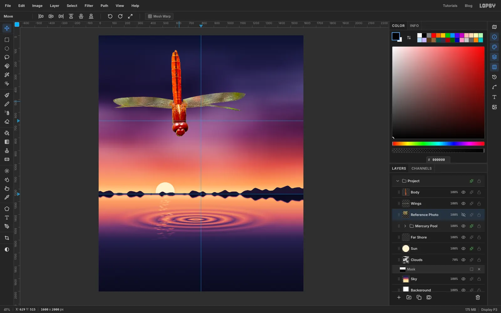

Click the eye on **Reference Photo** to hide it and check both cut-outs. If
anything is missing, show the photo again and fix the selection. When you're
happy, select **Reference Photo** and click **Delete Layer**.

## Turn the dragonfly upside down

Click **Wings** and [[Shift]]-click **Body** so both are selected. With the
**Move** tool, click **Rotate 90° CW** in the options bar twice. Both layers
turn together around their shared centre, so the head now leads upward.

## Scale it up

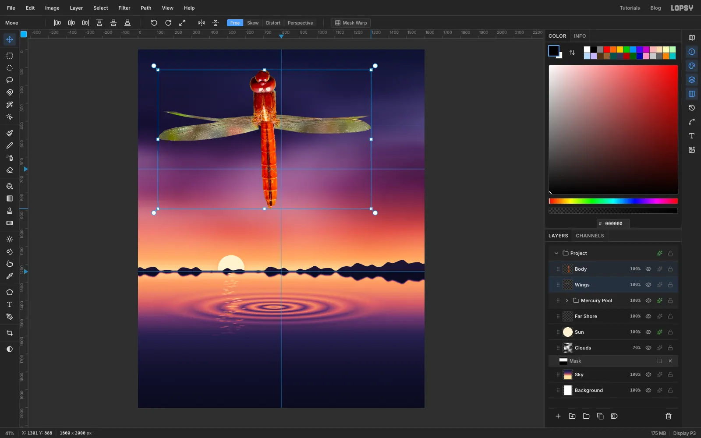

With both layers still selected, [[Cmd]]-drag the bottom-right corner handle
outward until the dragonfly is about 15% bigger. The wings should span most
of the canvas width.

## Tilt it into a climb

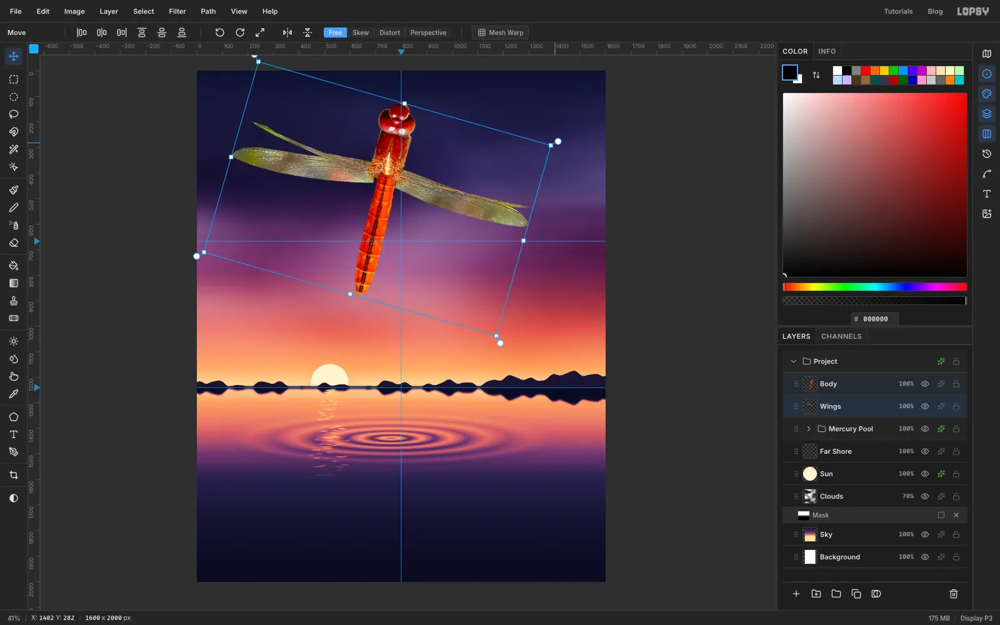

Drag the round rotation handle just outside the top-right corner clockwise,
about 16°, so the head leans right. Then drag inside the box to move the
dragonfly so the body sits a little right of centre, with the head about an
eighth of the way down. The rotate, scale and tilt all happen on the same
two-layer box, so don't deselect in between. Press [[Enter]] to commit it
(with no marquee involved, Enter is the commit key here). The tilt turns a static cross into a
diagonal that runs from the pond up to the head.

## Lift the wings with Skew

The tilt drops the right wing. Click **Wings**, and with the **Rectangular
Marquee**, drag a box around the right wings, from just right of the body to
the right edge. Pick the **Move** tool, click **Skew** in the options bar, and
drag the right edge handle up until the right wingtips come up about level
with the wing roots. The box's left side stays pinned, so the roots stay on
the body while the tips rise. Press [[Cmd+D]] to commit.

Then box the left wings, from the left edge of the canvas to the body, and
lift the left edge handle just a touch. The tilt already raised that side. The two sides now bank
as if the dragonfly were turning into its climb.

## Turn the body grey and melt its texture

Select **Body** and choose **Filter → Desaturate**. Run
**Filter → Surface Blur…** with **Radius 20** and **Threshold 60**, twice.
Finish with **Filter → Gaussian Blur…** at **Radius 2**. Liquid metal has no
fine texture, so smooth everything except the big shapes.

## Remove the face above the eyes

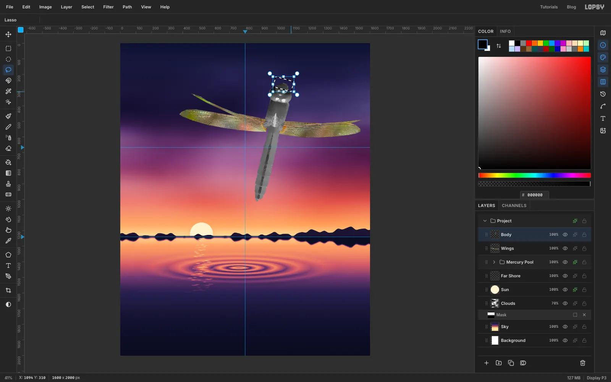

In the photo the face hangs below the eyes. Upside down, it pokes up above
them. Lasso around it and press [[Delete]], then deselect.

## Smudge, burn and soften the thorax

Pick the **Smudge** tool (**Size 56**, **Strength 80**) and drag three strokes
down the thorax, from the eyes to the waist, to melt the leftover hairy
detail. Switch to the **Dodge** tool, set **Mode** to **Burn**, **Size 50**,
**Exposure 35**, and brush once over the brightest spot where a wing meets
the thorax.

To soften the thorax without blurring its outline, [[Cmd]]-click the Body
thumbnail and choose **Select → Shrink…** by **8**. Then hold [[Shift]] and
[[Alt]] and lasso around the thorax to keep only the overlap. Choose
**Select → Feather…** by **4**, run **Gaussian Blur** at **Radius 6**, and
deselect.

## Fold the greys into chrome with a Curves wave

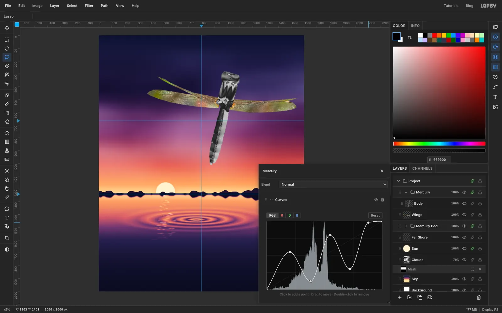

With **Body** selected, choose **Layer → Group Layers** and rename the group
*Mercury*. Open its effects and click **Add Adjustment → Curves**. Click on the
curve to add a point and drag it into place, five times, to make a wave:

- at a fifth of the way along, lift it a little above halfway
- at about 40%, pull it almost to the bottom
- just past halfway, push it high
- at about 70%, pull it down to a third
- near the right end, push it nearly to the top

A normal curve keeps light and dark in order. A wave folds them over, so one
smooth grey ramp turns into several bright and dark bands. That banding is
what makes a surface read as chrome.

## Map the chrome to the sunset

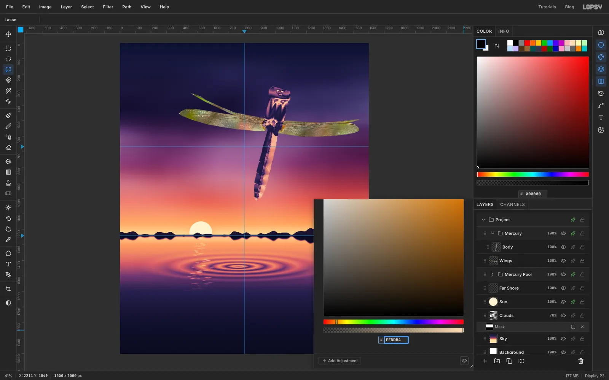

Click **Add Adjustment → Gradient Map** in the same drawer and set six stops:
`#06061A` at 0%, `#2A2352` at 22%, `#7E4A7E` at 45%, `#DB8A78` at 66%,
`#FFDDB4` at 84% and `#FFFFFF` at 100%. The chrome now reflects the same
indigo, mauve and coral as the sky around it.

## Paint the body's round form

Add a layer named *Body Form* above Body, inside the Mercury group.
[[Cmd]]-click the Body thumbnail so you can only paint inside the body. The
sun is low on the left, so with the **Brush**:

- paint a white stroke (size 34) down the left third of the thorax, and a
  black one (size 30) down its right third
- do the same on the abdomen with sizes 12 and 11

Run **Gaussian Blur** at **Radius 5**, deselect, and set the layer to
**Overlay**. The Curves wave turns these soft shades into the crisp bands of a
polished cylinder.

## Add speculars and segments

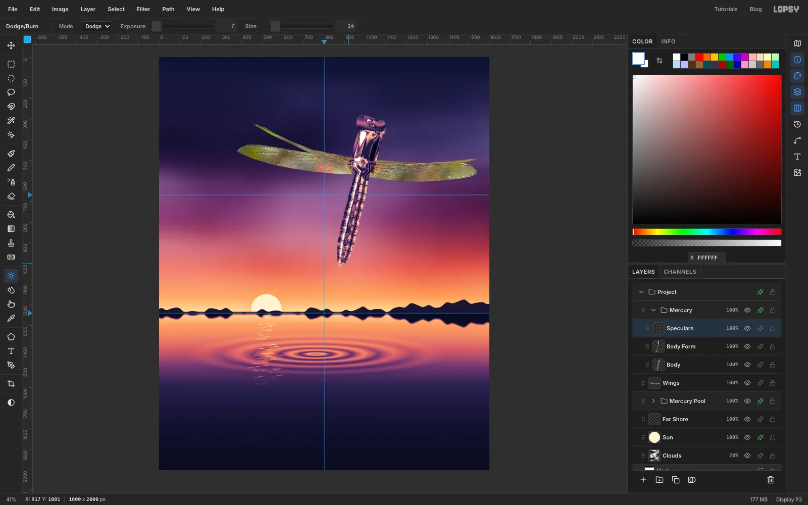

With **Body Form** active, add a layer named *Speculars*. It lands inside
the Mercury group, above Body Form. Paint one thin white line (size 4) down
the left side of the abdomen. Pure white stays white through the Curves wave, so
it reads as the sun's glint.

For the segment rhythm, click **Body** and pick the **Dodge** tool. In
**Burn** mode (**Size 7**, **Exposure 16**), stroke across every other ring of
the abdomen, following the tilt. Then switch to **Dodge** (**Size 14**,
**Exposure 7**) and stroke just below each groove. Keep these subtle: the
wave exaggerates every small change.

## Turn the wings into silver veins

Select **Wings** and run **Filter → Desaturate**, then **Filter → Find
Edges**. The smooth green background turns black and only the veins stay
bright. Run **Filter → Brightness/Contrast…** with **Brightness 20** and
**Contrast 45**, and set the layer to **Screen**, which drops the black.

The dense honeycomb at the wing roots gets too bright. Erase it back with a
big, soft **Eraser** (size 90, **Opacity 45**). Run **Gaussian Blur** at
**Radius 1** to calm the venation. Do one pass with a 160 px eraser at 35%
over the right wingtip, so the wings don't outshine the body. Set the layer
to **80%**.

## Add an iridescent film

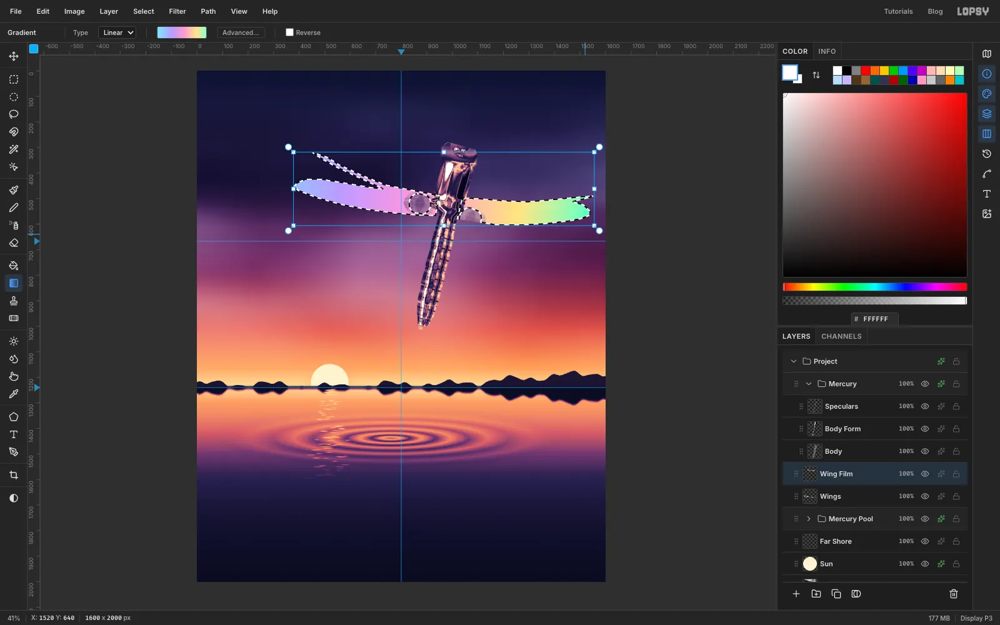

[[Cmd]]-click the Wings thumbnail and add a layer named *Wing Film*. Make a
linear gradient: `#7FE6FF`, `#B79CFF` at 30%, `#FF9BD2` at 55%, `#FFE48C` at
80% and `#8CFFC8` at 100%. Drag it across the wings from the left tip to the
right tip. Deselect, set the layer to **Overlay** and **60%**. The membranes
pick up a soap-film shimmer while the veins stay silver.

## Lasso the mercury strand

Collapse the **Mercury** group, click it, and add a layer named *Strand*. With
the **Lasso**, draw the column of liquid that joins the tail to the water:

- start inside the tail tip, about 30 px wide
- curve down in a gentle S to the centre of the ripples
- pinch it in and out twice on the way, for beads of liquid about to break
- in the last quarter, flare it out in a concave curve to a base about 230 px
  wide
- close it with a shallow curved edge, like an ellipse seen from the side

## Shade the strand like a polished rod

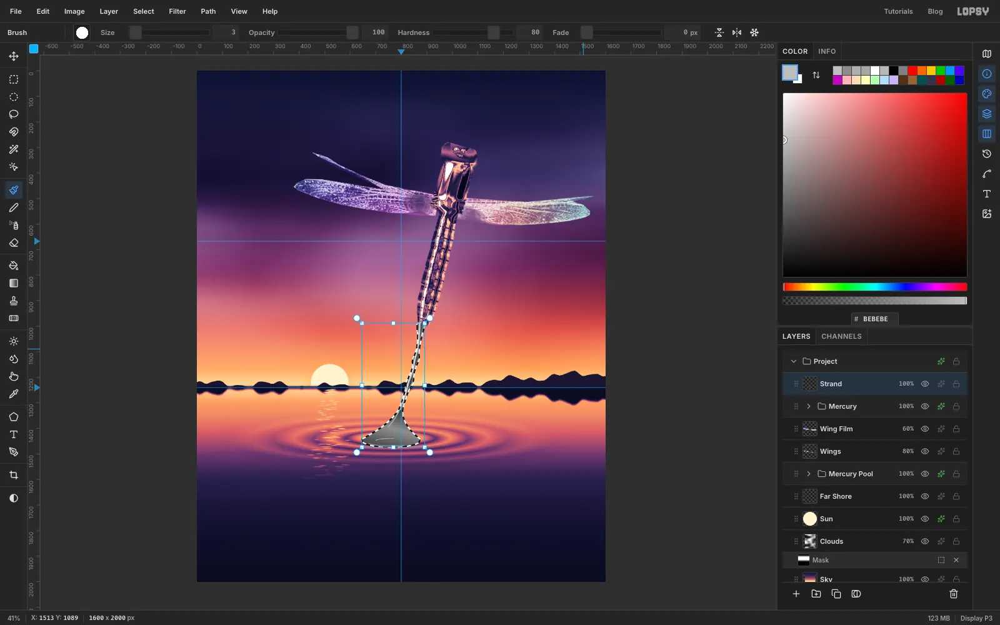

Keep the selection. Make a linear gradient: `#505050`, `#3A3A3A` at 70%,
`#8E8E8E` at 86% and `#4E4E4E` at 100%. Drag it from the tail tip to the base.
The flare catches some sky where it curves up.

With the **Brush**:

- paint a light grey (`#B8B8B8`, size 8) stroke down the left third of the
  column, then a thin white line (size 3) just inside its left edge
- paint a mid grey rim (`#A6A6A6`, size 3) along the right edge
- on the base, brush a soft `#B0B0B0` curve up its sunny left side, a darker
  `#8A8A8A` arc along its front lip, and a short `#BEBEBE` ring where the base
  turns up into the column

Blur at **Radius 1.5** and deselect. Then run a big (70 px), soft **Eraser** at
**65%** along the bottom edge, so the base melts into the water instead of
standing on it.

## Pinch off a teardrop

Add a layer named *Droplets*. Just below and left of the upper bead, lasso a
small teardrop with its point up, about 22 px across. Make a linear gradient
for a chrome sphere:

- `#F2F2F2`, `#A8A8A8` at 42%, `#8C8C8C` at 50%
- `#1C1C1C` at 58%, `#2E2E2E` at 82%, `#B8B8B8` at 100%

Drag it from the point to the bottom. The sudden drop at 50–58% is the
horizon reflected in the drop. Add a tiny white dot on its lower left, facing
the sun.

## Copy and scatter the falling drops

Drag a small marquee round the teardrop, press [[Cmd+C]] and [[Cmd+V]].
[[Cmd]]-drag the copy's corner handle in to shrink it, drag it to a spot below
the first drop, and press [[Cmd+D]]. Choose **Layer → Merge Down** to fold it
back into Droplets.

Repeat four times. Make each drop smaller as it falls, and spread
them a little either side of the strand. Finish with **Filter → Motion
Blur…** at **Angle 90**, **Distance 8**, so they streak as they fall.

## Give it chrome eyes

Add a layer named *Eyes*. Start with the right eye. Drag an elliptical
marquee circle over it, about 90 px across, and fill it with a top-to-bottom
gradient: `#F4F4F4` at 0%, `#A8A8A8` at 60% and `#8A8A8A` at 100%. That is the sky
side of the dome.

Hold [[Shift]] and [[Alt]] and drag a wider, flatter ellipse whose top edge
crosses the middle of the eye. This keeps only the overlap: the lower part of
the eye, with an arched top. Fill it with a gradient dragged from the middle of
the eye to its bottom: `#1C1C1C` at 0%, `#303030` at 70% and `#B4B4B4` at
100%. On a sphere the reflected horizon wraps
round as a curve, not a ruler line. Drag the same circle again with the **Elliptical
Marquee** and blur it at **Radius 1.5**. Then repeat for the left eye. Doing
the right eye first matters: the left eye is painted on top where they
overlap, so it reads as the nearer dome.

With the **Brush**, click a soft white specular (size 15, **Hardness 0**) on
the lower left of each eye, facing the sun. Then set **Hardness** back to 100
and stroke a thin `#D8D8D8` rim (size 3) along each eye's upper-right edge.

## Map the liquid with the same palette

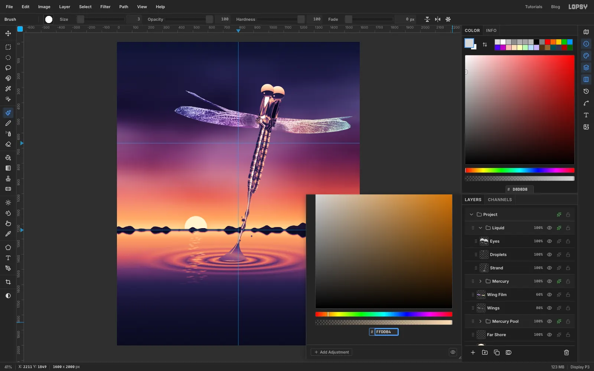

Click **Eyes**, [[Shift]]-click **Strand**, choose **Layer → Group Layers**
and rename the group *Liquid*. Add a **Gradient Map** with the same six chrome
stops as the Mercury group, but no Curves wave. Simple shapes like drops and
rods look cleaner without the extra folds.

## Copy just the dragonfly

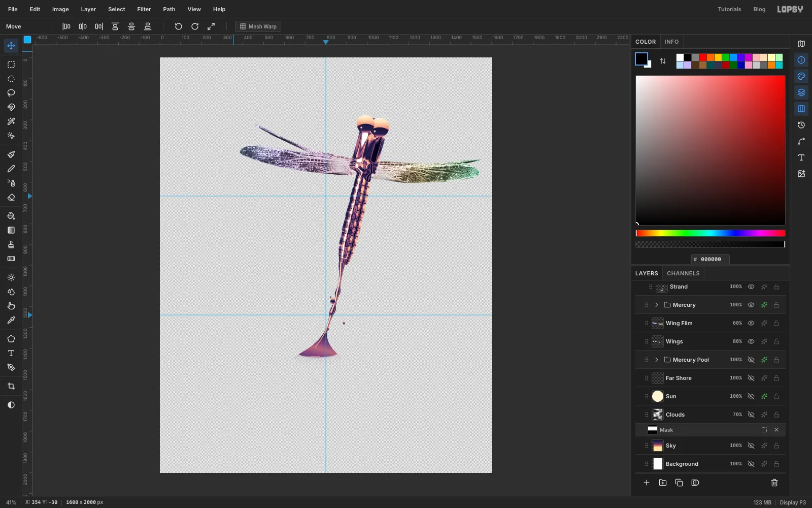

Click the eye icons on **Mercury Pool**, **Far Shore**, **Sun**, **Clouds**,
**Sky** and **Background** to hide the scenery. Choose
**Edit → Copy Merged** ([[Shift+Cmd+C]]), which copies everything that's
visible as one picture. Turn the scenery back on.

## Flip it into the water

Click **Mercury Pool** (still collapsed) and press [[Cmd+V]]. Rename the paste
*Reflection* and choose **Image → Flip Vertical**. With the **Move** tool,
nudge it with [[Shift+↓]] or [[Shift+↑]] until the upside-down meniscus
touches the real one at the water line. Objects reflect about the point where
they meet the water, not about the horizon. Run **Motion Blur** at
**Angle 0**, **Distance 4** to blur it a little sideways.

## Wobble the reflection with Mesh Warp

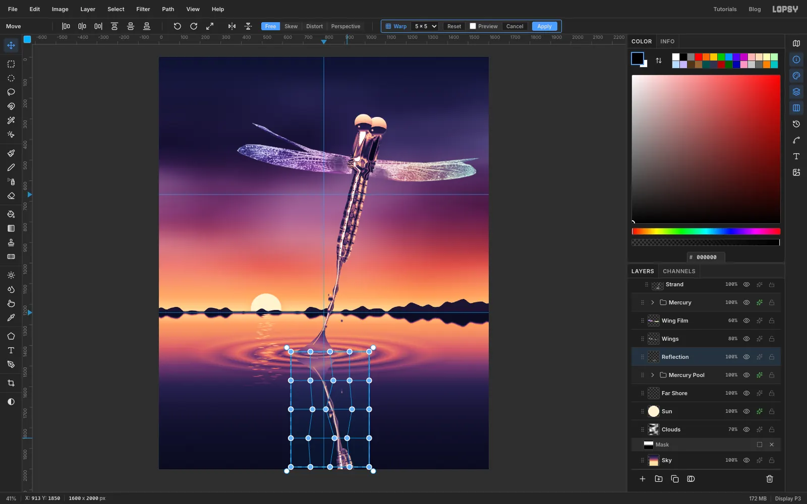

Drag a marquee around the reflection, from the meniscus to the bottom edge.
With the **Move** tool, click **Mesh Warp** and set the grid to **5 × 5**.
Drag the inner points a little left and right, alternating as you go down, so
the reflection snakes as if the rings were moving under it. Click **Apply**
and deselect.

## Fade the reflection into the deep water

Set Reflection to **68%**. Click **Add Mask**, click the mask thumbnail, and
drag a linear gradient from white at the water line to `#5A5A5A` at the
bottom edge. Click the layer name to leave mask mode. The reflection is clear near the
meniscus and gets darker with depth, but it still fills the bottom of the
picture.

## Draw cattail stems with the Pen

Collapse **Liquid**, click it, and add a layer named *Reeds*. Set the
foreground to `#0A0918`. Pick the **Pen** tool and set **Stroke** to **9**.

For each stem, click on the bottom edge, then click-and-drag where the stem
should end to bend it. Press [[Enter]] to stroke the path. Draw two stems on
the left, well clear of the sun glitter, and two on the right. Make them
different heights.

## Add leaves and cattail heads

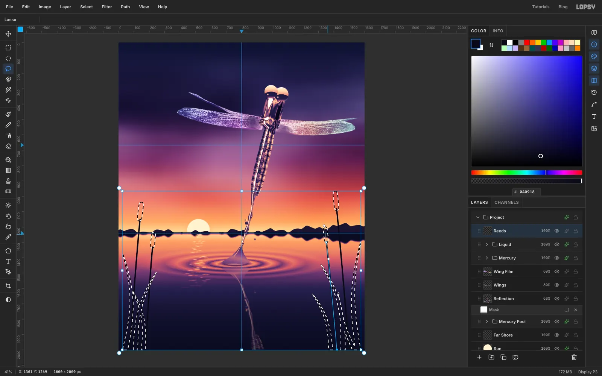

With the **Lasso**, draw long tapering leaf blades rising from the bottom
corners. Hold [[Shift]] to add each new blade, and lean them different ways.
Add a narrow capsule at the top of each stem for the cattail heads. Fill and
deselect. Then use the **Pencil** at size 3 to [[Shift]]-click a short spike
above each head.

## Warm the sun with a haze

Click **Sun** and add a layer named *Sun Haze*. Make a **Radial** gradient with
three stops, setting each stop's opacity with the bar under the colour picker:

- position 0%: `#FFD9A0`, opacity 60%
- position 35%: `#FF9E70`, opacity 22%
- position 100%: `#FF7A60`, opacity 0% Drag
from the centre of the sun outward about 460 px and set the layer to
**Screen**. Because the haze sits under Far Shore and the pond, the ridge and
the water cut the glow off cleanly at the horizon.

## Bloom the highlights

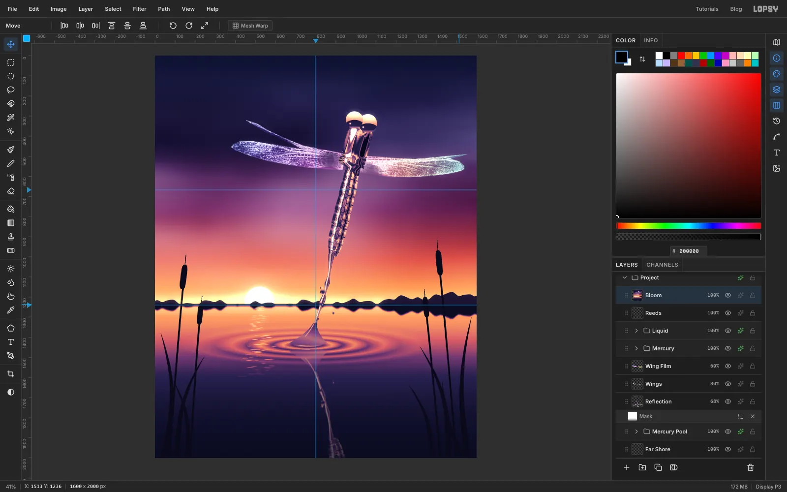

Click **Reeds**, the top layer. Choose **Edit → Copy Merged**, press
[[Cmd+V]], and rename the paste *Bloom*. Run **Filter → Bloom…** with
**Threshold 82**, **Soft Knee 30**, **Radius 36** and **Intensity 35**.

Keep it subtle. Too much bloom turns the wings into white smears and washes
out the sunset.

## Finish with grain and a vignette

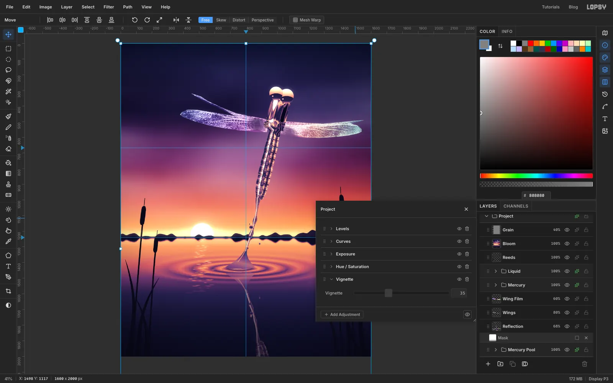

Add a layer named *Grain*. Fill it with `#808080`, run
**Filter → Add Noise…** at **Amount 14** with **Mono** and **Gaussian**, and
set it to **Overlay** at **40%**.

Choose **Layer → Adjustment Layer…**. It opens the adjustments for the whole
document (the top **Project** group). Dismiss the tip with **Got it**. Leave
the four default adjustments (Levels, Curves, Exposure, Hue / Saturation)
alone, click **Add Adjustment → Vignette** and set it to **35**. The darker corners keep
the eye on the dragonfly. Export it with **File → Quick Export PNG**.
