Liquid metal is chrome that has started to move. It still needs the hard
reflections that make chrome read as metal: a bright crest, a dark band
where the horizon would be, and a coloured bounce from whatever is nearby.
On top of that it sags. It drips, pools and splashes.

In this tutorial you'll make **Ouroboros Engine**, a 1600 × 1600 px album
cover for the fictional band HALO VESPER. A chrome serpent bites its own tail
around an eclipsed sun. The bottom of the ring melts into drips that fall
into a mercury pool, and the pool reflects the whole scene. You'll use
radial gradients for the chrome, a layer mask to blend the head into the
body, Liquify for the drips, Copy Merged and a squash transform for the
reflection, and a Pen-drawn circle for the motto.

The palette:

- Night sky `#241D3E` → `#110E1F` → `#040308`
- Corona `#FFF4D6` → `#FFC15A` → `#FF6A1F` → `#A8200E`
- Chrome tube `#0E1016` → `#DDE6F2` → `#FFFFFF` → `#7F8EA6` → `#241C18` → `#A9B3C2`
- Fire bounce `#FF7A2A`, serpent eye `#FF6A1F`
- Type `#DDE3EA` / `#C3CAD6`, motto cream `#F5E6D8`, footer `#A8A8BC`

## Paint a night sky

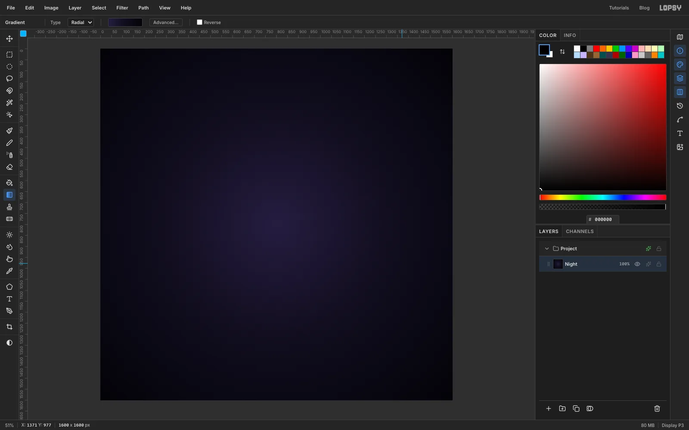

Choose **File → New**, set the unit to **Pixels**, and create a
**1600 × 1600** document. Double-click **Background** in the Layers panel and
rename it *Night*.

Pick the **Gradient** tool, set **Type** to **Radial**, and click
**Advanced…** to set three stops:

- `#241D3E` at 0%
- `#110E1F` at 45%
- `#040308` at 100%

Drag from the centre of the canvas straight down, past the bottom edge. Then
run **Filter → Add Noise…** with **Amount 4**, **Mono** and **Gaussian**.
The grain keeps the large dark areas from banding.

## Add centre guides and a layer of smoke

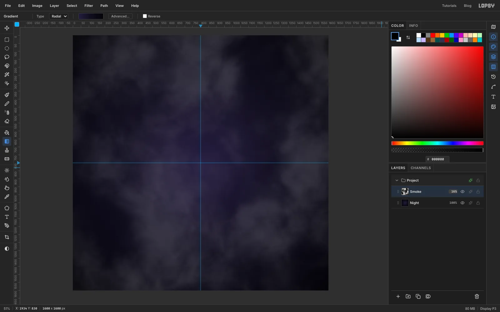

Click the top ruler at **800** and the left ruler at **800**. That gives you
two guides crossing at the exact centre, and everything in the ring is built
around that point.

Click **Add Layer** and name the new layer *Smoke*. Run **Filter → Smoke…**
with **Scale 5** and **Turbulence 60**. Open the layer's effects drawer, set
the blend mode to **Screen**, and lower the layer to **16%** opacity. The
smoke should only just be visible.

## Build the corona

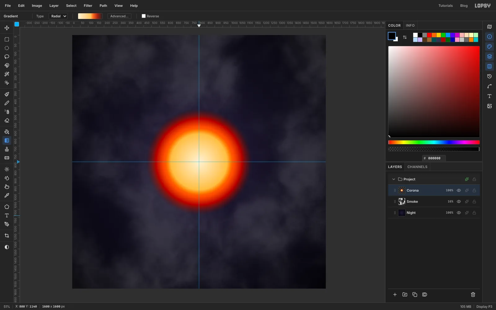

Add a layer called *Corona*. With the **Elliptical Marquee**, drag out a
circle about 680 px across, centred where the guides cross. For an exact
circle, click once without dragging and type **From 460, 460** and
**To 1140, 1140** in the dialog that opens. Choose **Select → Feather…** and
enter **30**.

Set up a radial gradient with five stops:

- `#FFF4D6` at 0%
- `#FFC15A` at 52%
- `#FF6A1F` at 62%
- `#A8200E` at 80%
- `#3A0A08` at 100%, with its opacity dragged to 0

Drag from the centre straight down to the edge of the selection, then press
[[Cmd+D]] to deselect.

## Add soft rays

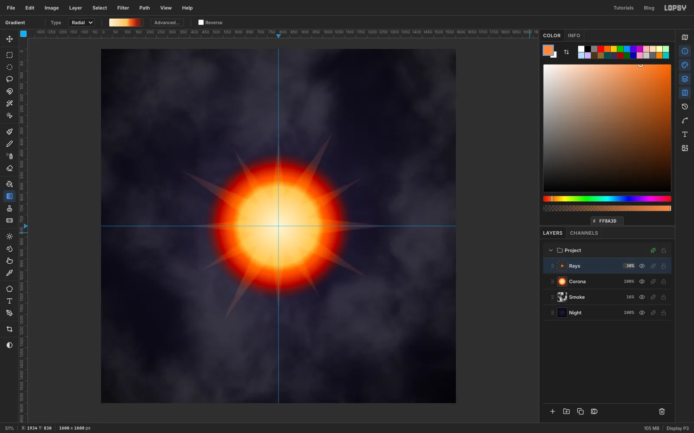

Add a layer called *Rays* and set the foreground colour to `#FF8A3D`. Run
**Filter → Sunburst…** with **Rays 12**, **Length 45**, **Width 40**,
**Taper 100**, **Fade 70** and **Jitter 30**.

Thin hairline rays look like scratches at album-cover size, so soften these
with **Filter → Gaussian Blur…** at **4**. Set the layer to **Screen** at
**30%**. You want broad, soft wedges of light.

## Eclipse it with a moon

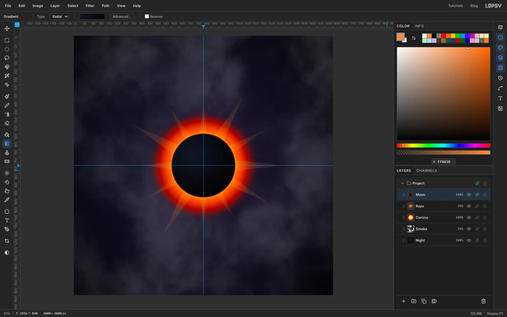

Add a layer called *Moon*. Make a circle about 400 px across, centred on the
guides. The marquee dialog with **From 602, 602** and **To 998, 998** gives an
exact one.

A flat black disc looks dead, so fill it with a radial gradient instead:
`#121626` → `#07080D` (65%) → `#030304`. Drag from slightly above-left of the
centre outwards, so the faint "earthshine" sits off-centre.

Deselect. In the effects drawer, add an **Inner Glow**
(`#FF7A2A`, Size 16, Opacity 80) and an **Outer Glow** (`#FFB05A`, Size 26,
Opacity 70). Those give the moon the hot rim of a real eclipse.

## Lasso the serpent's body

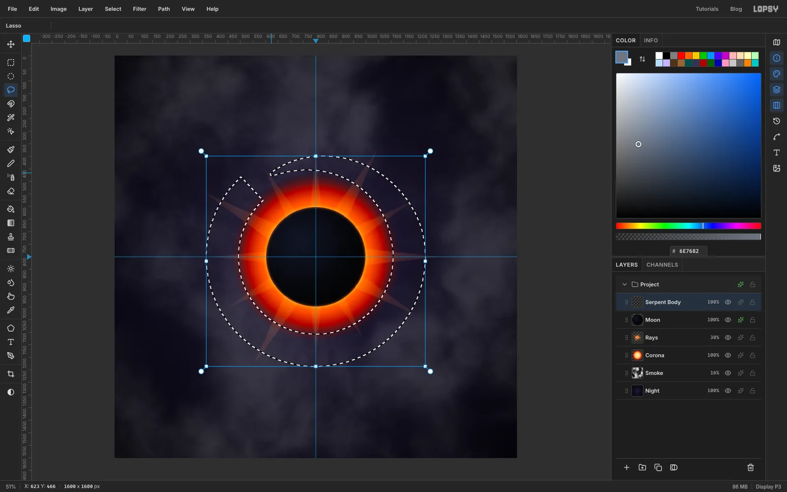

Add a layer called *Serpent Body*, just above *Moon*. The body is a ring
about 128 px thick that starts as a fine tail at about 11 o'clock, thickens
over the first third of the circle, and stays full width the rest of the
way round. It's easiest to build from two circles:

1. With the **Elliptical Marquee**, make a circle about 870 px across, centred on the guides (the dialog: **From 365, 365**, **To 1235, 1235**).
2. Hold [[Alt]] and drag a second circle about 615 px across from the same centre to cut out the middle.
3. Hold [[Alt]] and lasso a long sliver off the outer edge, from about 11 o'clock round to about 2 o'clock, so the ring narrows to a point at 11 o'clock. Also trim a matching sliver off the inner edge there, so the tail tapers from both sides.

Fill it with any mid grey, such as `#6E7682`. The colour gets replaced by
chrome in a moment. Deselect.

## Lasso the head over the tail

Add a layer called *Serpent Head* above the body. The head sits on the ring
at about 10 to 11 o'clock and points clockwise at the tail. It's about
270 px long and about 175 px deep at the skull, a little wider than the
body. With the **Lasso**:

1. Start on the outer edge of the ring at the back of the neck.
2. Swell out round the skull, then run along the top jaw to a narrow snout just past the tail tip.
3. Cut back in about 100 px for the gape, and out again to the tip of the lower jaw, so the jaws make a thin V around the tail.
4. Run back under the chin to the inner edge of the ring.

The tail should be thicker than the gape, so the jaws look as if they're
biting down on it. Fill the head with the same grey and deselect.

## Turn the body into chrome

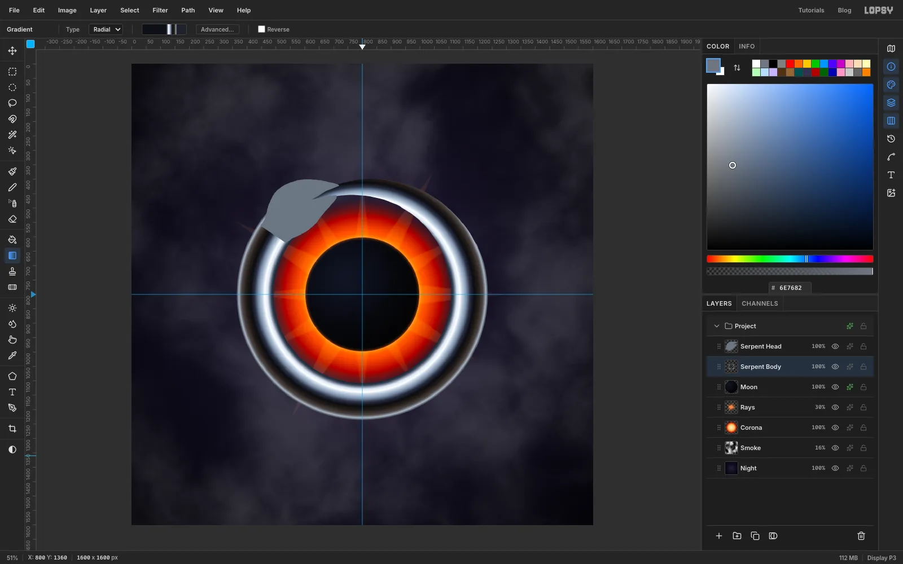

Select the *Serpent Body* layer and [[Cmd]]-click its thumbnail to load its
shape as a selection. Set up a **Radial** gradient with stops that run
across the thickness of the tube. You'll drag it 560 px, so 1% is about
5.6 px: the tube's inner edge sits at 55% and its outer edge at 78%.

- `#0E1016` at 0% and 55%
- `#3A4458` at 56%, `#DDE6F2` at 59%
- `#FFFFFF` at 61% (the hot crest)
- `#C5D2E2` at 62%, `#7F8EA6` at 65%
- `#2A3040` at 67%, `#0B0C11` at 69%
- `#241C18` at 72%, `#4C4846` at 75%
- `#A9B3C2` at 77% (a thin rim light)
- `#20232B` at 78% and 100%

Drag from the centre of the guides straight down **560 px**. The bands now
follow the ring all the way round, so the tube looks round from every side.
Deselect.

## Give the head a curved horizon

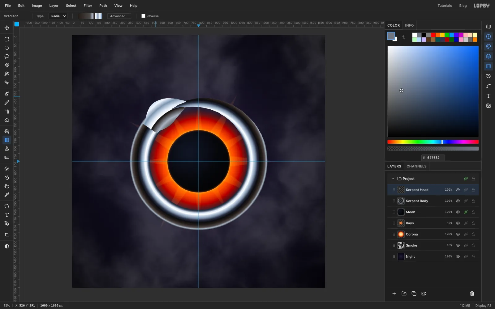

Select *Serpent Head* and [[Cmd]]-click its thumbnail. A straight horizon
line across a rounded skull looks like two flat slabs, so the head gets a
**radial** gradient whose centre is far below the jaw. That bends its
horizon line into an arc that follows the skull.

Use these stops:

- `#241C18` at 0%, `#4C4846` at 50%, `#A9B3C2` at 60%, `#241C18` at 69%
- `#07080C` at 70.5% (the horizon), `#FFFFFF` at 71.5%
- `#DDE6F2` at 76%, `#7F93AE` at 83%, `#F4F8FD` at 90%, `#B9CEE8` at 96%
- `#3A5277` at 100% (a deeper blue at the very top of the skull)

Start inside the ring, about 300 px from the jaw towards the moon, and drag
outwards through the top of the skull, about 420 px in total. The horizon
should land just above the jaw. Deselect.

## Blend the neck with a layer mask

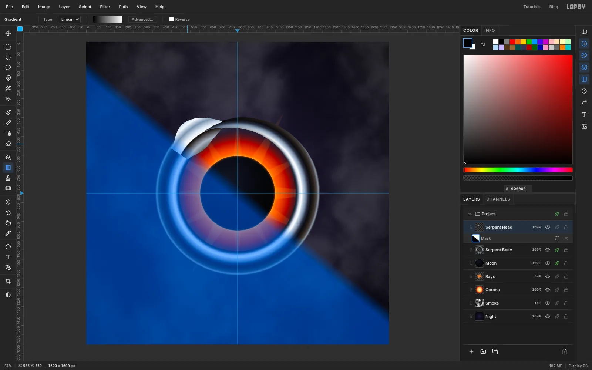

The body runs on under the back of the head, so the join can be blended
instead of cut. With *Serpent Head* still selected, click **Add Mask** at the
bottom of the Layers panel. Then click the new mask thumbnail under the
layer row to edit the mask.

Set up a **Linear** gradient from black `#000000` to white `#FFFFFF`. Drag it
along the neck, from where the head starts to about 65 px towards the snout.
The back of the head now fades into the body's chrome. Click the layer row
to leave mask edit mode.

## Shade the head and add the eye

Give the body and the head an **Inner Glow** in near-black `#04050A`: Size
30 on the body and Size 20 on the head, both at 80% opacity. A dark edge
glow rounds the tube off. Add a **Drop Shadow** to the head (Offset X 6,
Offset Y 10, Blur 16, Opacity 75) so it sits on top of the tail.

Add a layer called *Eye*. Lasso a small slanted oval on the upper side of the
skull, fill it with `#FF6A1F`, then lasso a thin vertical slit inside it and
fill that with `#120404`. Give the layer an **Outer Glow** (`#FF8A3D`, Size 18,
Opacity 90).

Add a layer called *Head Lines*. With the Lasso, draw thin slivers that are
pointed at both ends and about 5 px wide in the middle:

- a brow above the eye
- a short jaw crease running back from the corner of the mouth
- a tiny nostril near the snout

Fill them with dark steel `#1A1D2A` and set the layer to **75%**. Tapered
marks look carved. Uniform lines look drawn on.

## Melt the bottom of the ring with Liquify

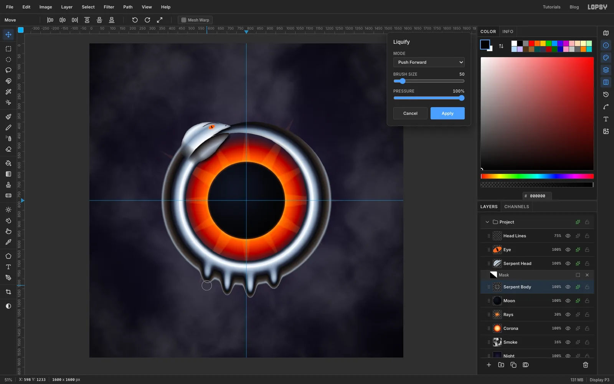

Select *Serpent Body* and open **Filter → Liquify…**. Set **Mode** to
**Push Forward**, **Brush Size** to **50** and **Pressure** to **100%**.

At four points spread across the bottom of the ring, slightly left of
centre (about 5, 6, 7 and 7:30),
drag straight down from just inside the tube. For a longer drip, start the
next drag a little lower down the drip you just made. Do two passes for the
outer drips and three for the middle ones, so they're different lengths.
Keep the melt to the bottom only, because gravity pulls it there. Click
**Apply**.

## Light the metal with the world

Real chrome reflects its surroundings: sky above and ground below. Add a
layer called *World Light* and [[Cmd]]-click the *Serpent Body* thumbnail.
Drag a **Linear** gradient from the top of the ring to the bottom of the
drips:

- `#CFE3FF` at 0%
- `#7F93AE` at 45%
- `#10131A` at 47%
- `#3A2A20` at 55%
- `#8A6A4E` at 100%

Deselect, and set the layer to **Overlay** at **55%**. Now the top of the
ring catches sky and the bottom catches ground.

## Bounce the fire onto the inner lip

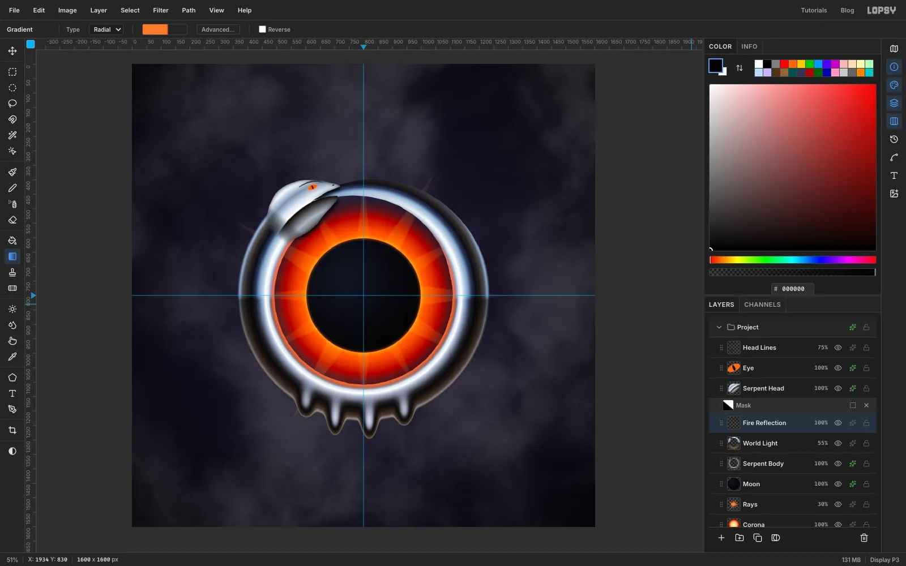

Metal facing a fire picks up its colour, and leaving that out is the
quickest way to make chrome look like plastic.

Add a layer called *Fire Reflection* and [[Cmd]]-click the body thumbnail
again. Set up a radial gradient:

- `#FF7A2A` at 0% and 53.5%
- `#FF6A2A` at 56%, at 85% opacity
- transparent from 58.5% to 100%

Drag it from the centre down **560 px**, the same as the chrome, so the orange
lands exactly on the inner lip. Deselect and set the blend mode to **Screen**.

## Add specular highlights

Add a layer called *Specular* and set the foreground to white. Pick the
**Brush**, click the tip preview in the options bar to open the Brushes
panel, and on the **Shape** tab set **Size 4**, **Hardness 100** and
**Taper 80**. Taper is a distance: the stroke starts full width and thins to
nothing over 80 px, so each stroke becomes a short, pointed highlight. Paint
two strokes along the white crest of the tube, one on the left and one on
the upper right, starting where you want the highlight to be brightest.

Then set **Size 12**, **Hardness 0**, **Opacity 70** and **Taper 0**.
Paint a short stroke down the middle of each drip, stopping well short of
the tip. Blur the layer slightly with **Gaussian Blur 1.5**, and set it to
**85%**.

## Pour a mercury pool

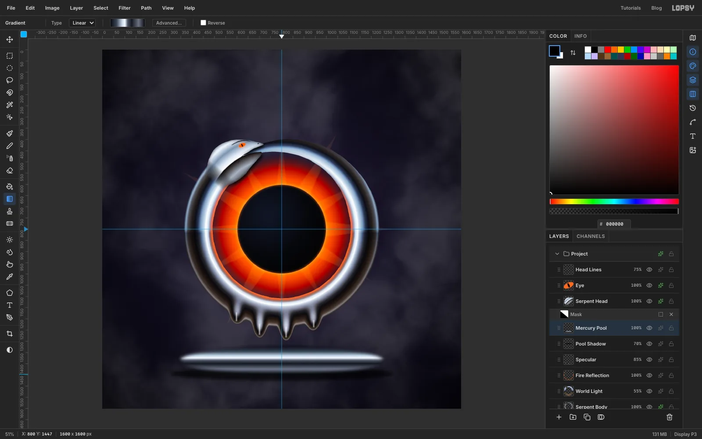

Add a layer called *Pool Shadow*. Draw a flat elliptical marquee about
1000 × 60 px, centred under the ring, about 150 px below the drips. Fill it with
black, blur it with **Gaussian Blur 20**, and set it to **Multiply** at
**70%**.

Add a layer called *Mercury Pool* above it. Draw an ellipse about 900 ×
124 px, centred on the vertical guide, with its top edge about 25 px below
the longest drip and its centre about 60 px above the shadow's. **Feather**
it by **16**. A hard edge
reads as a glass disc rather than liquid. Drag a linear gradient from the
top of the ellipse to the bottom with dark and light bands:

- `#0A0C12` at 0%
- `#3B4656` at 18%
- `#C9D8EA` at 34%
- `#F7FBFF` at 42%
- `#4A5263` at 50%
- `#15171D` at 62%
- `#6B7385` at 82%
- `#0A0B0F` at 100%

## Copy the scene and squash it into a reflection

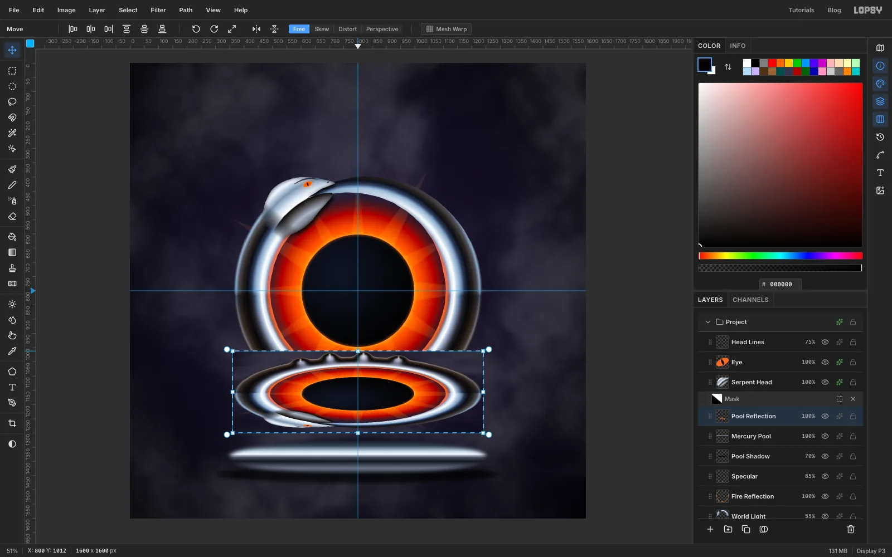

Draw a rectangular marquee around the whole ring, drips included. Choose
**Edit → Copy Merged**, then **Edit → Paste**, and rename the pasted layer
*Pool Reflection*. Choose **Image → Flip Vertical**.

Draw the same marquee around the flipped copy and switch to the **Move**
tool. Drag the **top-middle handle** down until the copy is about 30% of its
original height.

## Slide the reflection into the pool

Drag the squashed copy down from inside the selection until its top edge
sits on the far edge of the pool. Press [[Cmd+D]]: Lopsy applies a
transform when you deselect.

Run **Filter → Motion Blur…** with **Angle 0** and **Distance 3**. That gives
the mirror image a slight liquid shimmer. To trim it to the pool:

1. [[Cmd]]-click the *Mercury Pool* thumbnail.
2. Choose **Select → Inverse** and press [[Delete]].
3. Deselect.

Lower the layer to **55%**.

## Draw ripples where the drip lands

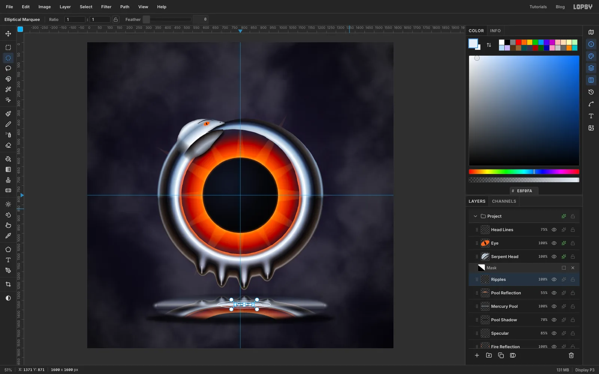

Add a layer called *Ripples* and set the foreground to `#E8F0FA`. Make three
rings directly under the longest drip, starting with the largest:

1. Draw an elliptical marquee about 280 × 40 px, centred under the drip.
2. Choose **Edit → Fill**.
3. Choose **Select → Shrink…** by **2** and press [[Delete]]. That leaves a 2 px ring.
4. Repeat with marquees about 184 and 100 px wide. Keep each one flattened to the same proportion as the pool.

Doing the biggest ring first means each Delete only clears the inside of
the ring you've just filled. Deselect and lower the layer to **60%**.

## Drop a bead and splash it

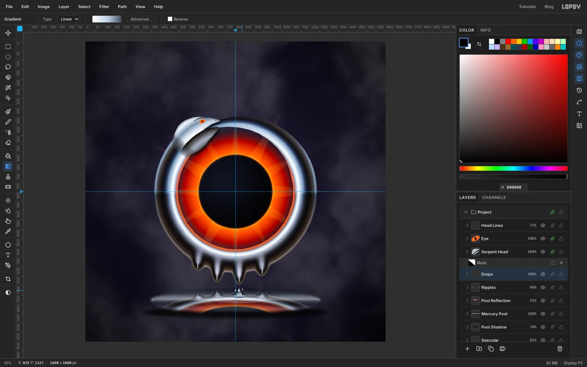

Add a layer called *Drops*. Lasso a small teardrop (about 18 × 30 px) just
below the longest drip, with the point at the top. Fill it with a radial
gradient that runs white → `#C4D7EC` → `#3A4250` → `#9FB2C8` → `#15171D`, so
it reads as a tiny chrome bead.

Where the drop meets the pool, lasso a low splash about 70 px wide with
rounded lobes, not spikes. Fill it with a vertical gradient from white
through `#B9CBE0` to `#4A5466`. Add two tiny oval droplets just above the
splash, and give them the same gradient.

## Organise the layers into groups

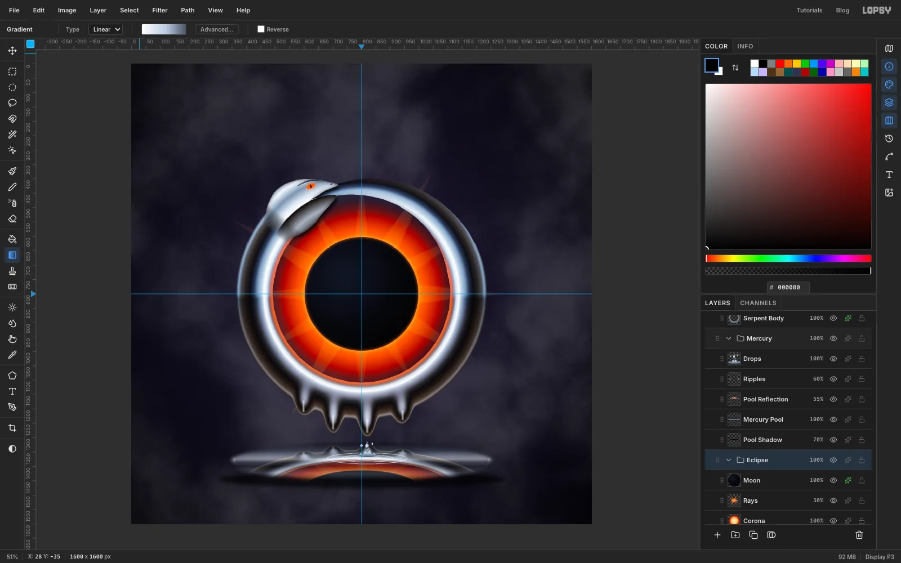

Click *Serpent Body*, then [[Cmd]]-click *World Light*, *Fire Reflection*,
*Specular*, *Serpent Head*, *Eye* and *Head Lines*. Choose **Layer → Group
Layers** and name the group *Ouroboros*. Do the same with *Pool Shadow*,
*Mercury Pool*, *Pool Reflection*, *Ripples* and *Drops* to make a *Mercury*
group, and with *Corona*, *Rays* and *Moon* to make an *Eclipse* group.

Selecting a group and using the Move tool now moves everything in it
together, which is handy if you want to nudge the whole pool up or down.

## Set the title stack

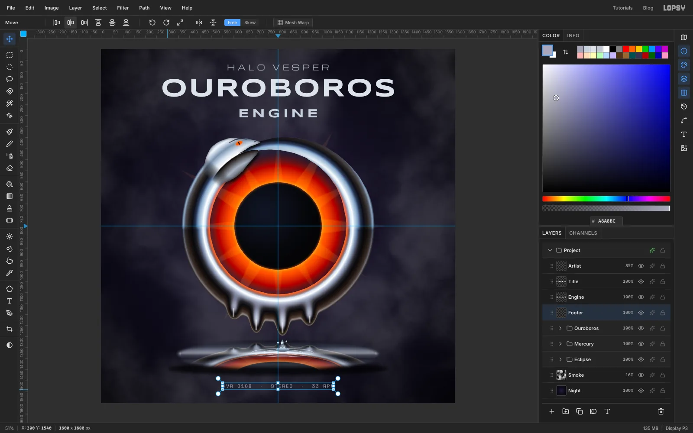

Collapse the three groups. Text options restyle whichever text layer is
active, so for **each** line:

1. Click the *Ouroboros* group row, so no text layer is active.
2. Set the foreground colour, then pick the **Text** tool and set the font, weight and size in the options bar.
3. Click in empty canvas, type, and press [[Tab]].
4. Set the **Letter spacing** in the **Text** panel, and rename the layer as given below.
5. With the Move tool, click **Align center horizontally** in the options bar, then nudge the line into place with the arrow keys.

The lines, top to bottom:

- **HALO VESPER** (layer *Artist*): *Michroma*, size **34**, `#C3CAD6`, letter spacing **12**. Put its cap top 70 px from the top edge and lower the layer to **85%**.
- **OUROBOROS** (layer *Title*): *Syncopate* **Bold**, size **116**, `#DDE3EA`, letter spacing **6**. Leave about 38 px between it and the artist name.
- **ENGINE** (layer *Engine*): *Syncopate* **Bold**, size **56**, `#C9D2DD`, letter spacing **14**. Make it big enough to read as half of the album title, not as a credit.
- **HVR 0108 · STEREO · 33 RPM** (layer *Footer*): *Space Mono*, size **21**, `#A8A8BC`, letter spacing **4**. Sit it 70 px above the bottom edge so the top and bottom margins match.

## Chrome the title and melt one letter

Add a layer called *Title Chrome* above *Title* and [[Cmd]]-click the
*Title* thumbnail. Drag a linear gradient from the top of the capitals to
the baseline:

- `#F4F8FF` at 0%
- `#A9C4E2` at 30%
- `#FFFFFF` at 47%
- `#20232B` at 52% (the horizon)
- `#4A4038` at 62%
- `#BFB2A2` at 82%
- `#EEF1F5` at 100%

Deselect. With *Title Chrome* active, open **Liquify** with a **Brush Size**
of **18**, and drag down twice from the bottom of the second R's left leg.
Make one deliberate drip about 30 px long rather than several specks. Paint
a 4 px white brush highlight down it on the same layer, then give
*Title Chrome* a **Drop Shadow** (Offset Y 8, Blur 14, Opacity 80).

Repeat the gradient on a new *Engine Chrome* layer over ENGINE, so the
whole title shares one material.

## Draw a circle with the Pen for the motto

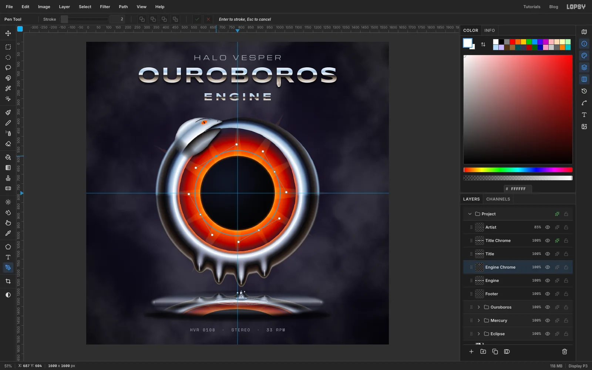

Text on a path starts at the path's first anchor, so the motto's seam goes
wherever you start the circle. Starting under the head keeps it away from
12 o'clock, where people read first.

Choose the **Pen** tool. You need four anchors evenly spaced on a circle
about 452 px across around the moon: at about 11, 2, 5 and 8 o'clock,
starting at 11 o'clock under the head. At each anchor, press and drag along
the circle's tangent in the clockwise direction to pull out smooth handles.
Handles about 0.55 × the radius (here about 125 px) make a true circle.
Click the first anchor to close the path. Don't press [[Enter]], because
that strokes the path onto the active layer.

## Put the motto on the circle

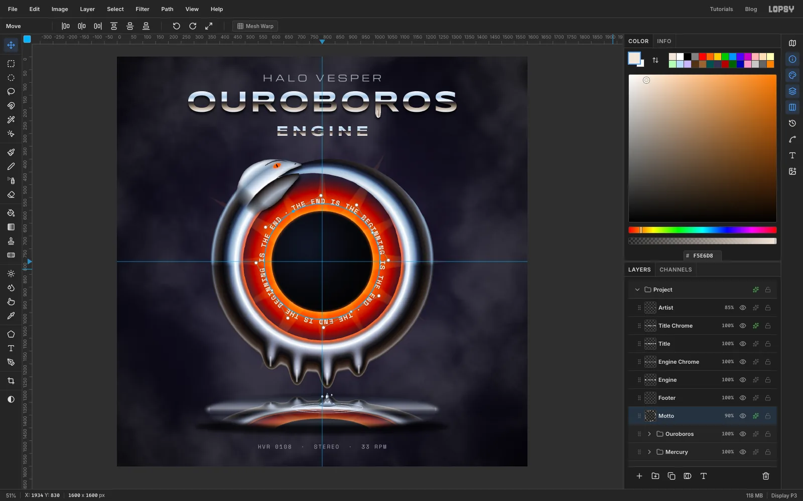

Click the *Ouroboros* group row and set the foreground to `#F5E6D8`. With the
**Text** tool set to *Space Mono* **Bold** at size **28**, click in empty canvas
and type the phrase `THE END IS THE BEGINNING IS THE END · ` two times in a
row, then press [[Tab]]. Rename the layer *Motto*.

In the options bar, set **Path** to the circle you just drew. In the **Text**
panel, set **Letter spacing** to about **1.6** so the run fills the circle
with an even ` · ` at the seam. Add a 4 px black **Outer Glow** (Opacity 85).
It keeps the cream letters legible on the brightest parts of the corona.
Lower the layer to **90%**.

## Add two glints

Add a layer called *Glints* above *Title Chrome*. Make a four-point star
about 68 px across with thin arms: lasso a tall thin diamond, then hold
[[Shift]] and lasso a wide thin diamond across it. Fill it white, and add a
10 px white dot in the middle. Place it on the crest of the ring at the upper right. Give
it an **Outer Glow** (`#E6F2FF`, Size 16, Opacity 80) and set the layer to
**Screen**.

To make the second glint:

1. Marquee around the star, then copy and paste it.
2. Marquee the pasted copy and drag it onto the top-left curve of the first O in the title.
3. [[Cmd]]-drag a corner handle to shrink it by about a fifth, press [[Cmd+D]], and choose **Layer → Merge Down**.

Finally, marquee the ring glint and drag the **rotation handle** about 20°,
so its arms follow the tube, then press [[Cmd+D]]. Two glints in one style
look like reflections. More than two start to look like stickers.

## Finish with a vignette

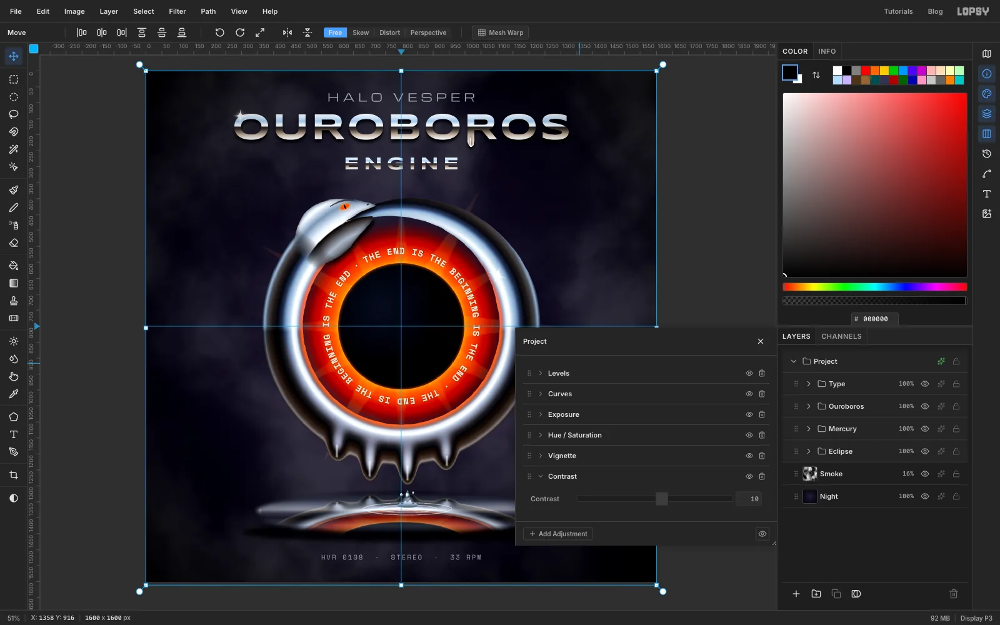

Select *Artist*, *Glints*, *Title Chrome*, *Title*, *Engine Chrome*,
*Engine*, *Footer* and *Motto*, and group them as *Type*. Choose
**Layer → Adjustment Layer…**. A note explains that Lopsy uses group
adjustments; click **Got it**, and the adjustments drawer opens on the
Project group. It already lists Levels, Curves, Exposure and
Hue / Saturation at neutral settings, so leave those alone. Click **Add
Adjustment** and add a **Vignette** at **60** and a **Contrast** of **10**. The vignette darkens the empty bands at the sides,
so they frame the ring instead of reading as dead space.

Save with **File → Save Project** and export with **File → Quick Export PNG**.
