Around 1890, Jules Chéret's Paris workshop was printing circus and theatre
posters as colour lithographs. Each ink was drawn on its own stone and the
stones were printed one after another, so the posters share a look: a few
flat inks on cream paper, a black "key" line around everything, tone made
from grain and from *crachis* (ink spattered off a brush) rather than smooth
blends, and bold lettering on a curve.

This card borrows all of it for a French season's greeting. A fox in a party
hat balances on a circus ball and juggles five baubles in front of a big
yellow sun. *Joyeuses Fêtes* arches over the top, and *et Bonne Année !* is
written underneath, next to the printer's marks you'd find in the margin of a
proof. The card is **1500 × 2100 px**, a 5 × 7 inch shape, and everything is
drawn in Lopsy. You don't need any photos.

The tools you'll use:

- guides, and the **Rectangular** and **Elliptical Marquee** snapping to them
- the **Gradient** tool, on a layer and on a **layer mask**
- **Filter → Sunburst…** and **Filter → Texture…**
- the **Spray** tool for spatter, kept inside selections
- the **Lasso**, with [[Shift+Alt]] to keep only the part of a shape that sits inside another selection, and [[Cmd]]-click on a layer thumbnail to load its shape
- the **Brush**, **Eraser**, **Pencil** and **Clone Stamp**
- the **Shape** tool for circles and the frame, and the **Pen** for two curves
- **Text** bound to a path, in three Google fonts: **Alfa Slab One**, **Yesteryear** and **Old Standard TT**
- the **Move** tool's rotate and scale handles on a marquee, on a pasted layer and on a whole group
- copy and paste, **Duplicate Layer** and **Flip Horizontal**
- **Stroke**, **Drop Shadow** and **Color Overlay** layer effects, the **Soft Light** blend mode and the document's **Hue / Saturation** adjustment

The palette is four inks and black on cream paper, plus a few tints:

- Paper `#F0E4C8`
- Vermilion `#D4452B`
- Chrome yellow `#F2B632`
- Prussian blue `#1F3A6B`, mid blue `#3F6C9E`, ray blue `#7FA6CF`
- Key black `#1B1A1E`
- Sky `#16305F` → `#2F5E94` → `#8FB3C4` → `#F3DCA0` → `#F7D98C`
- Spatter navy `#0F2247`, snow shade `#6F8FB8`, ball shadow `#4F74A6`

> **Tip:** On a wide-gamut (Display P3) screen, Lopsy reads typed hex codes as P3 colours, so the inks look a little stronger than they would on an sRGB screen.

> **Note:** Shortcuts are written for a Mac. On Windows use [[Ctrl]] wherever it says [[Cmd]].

A few things you'll repeat a lot:

- **Positions.** The status bar at the bottom shows the pointer's **X** and **Y** in pixels. When a step gives a position, watch those numbers as you move. Close is good enough everywhere: this is a hand-drawn print.
- **Fill a shape.** Set the foreground colour, make a selection, choose **Edit → Fill**, and press [[Cmd+D]] to deselect.
- **Keep a shape inside another.** Make the first selection, then draw the second while holding [[Shift+Alt]]. Only the overlap stays selected.
- **Layer effects, blend mode and opacity.** The sparkle button on a layer's row opens its effects drawer, with the effects in a list and the **Blend** dropdown at the top. Click the percentage on the row to change the layer's opacity.

## Set up the card and its guides

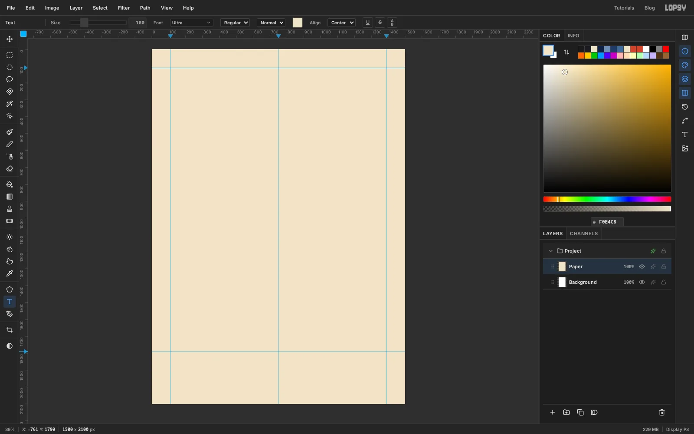

Choose **File → New**, set the units to **Pixels**, and make the document **1500** wide and **2100** high with a white background.

Double-click *Layer 1* in the Layers panel and rename it *Paper*. Set the foreground colour to paper `#F0E4C8`, press [[Cmd+A]], choose **Edit → Fill** and press [[Cmd+D]].

Now mark out the picture panel. Click the top ruler to drop vertical guides at **110**, **750** and **1390**, then click the left ruler for horizontal guides at **110** and **1790**. A guide lands where you click, so watch the readout next to the pointer. The panel leaves a deep margin at the bottom for the greeting.

## Roll a sky into the panel

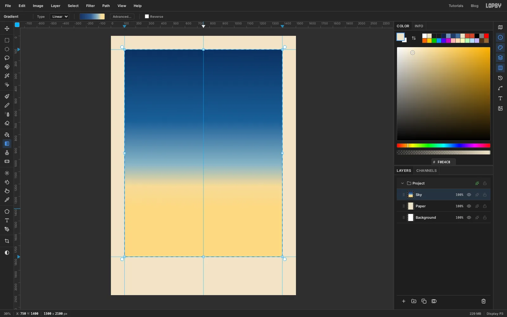

Printers sometimes loaded one roller with two inks so that they blended across the sheet. That is the one smooth blend on this card.

Click **Add Layer** and name the layer *Sky*. Pick the **Rectangular Marquee** and drag from just outside the top-left corner of the panel to just outside the bottom-right corner. The edges snap onto the guides.

Pick the **Gradient** tool, set **Type** to **Linear** and click **Advanced…**. Set the two end stops to `#16305F` and `#F7D98C`, then click the bar to add three stops between them: `#2F5E94` a little left of the middle, `#8FB3C4` at about three-quarters and `#F3DCA0` shortly after it. Click **Done**.

Drag straight down the centre guide from the top of the panel to about **y 1400**, where the horizon will be. Press [[Cmd+D]].

## Fan out the rays

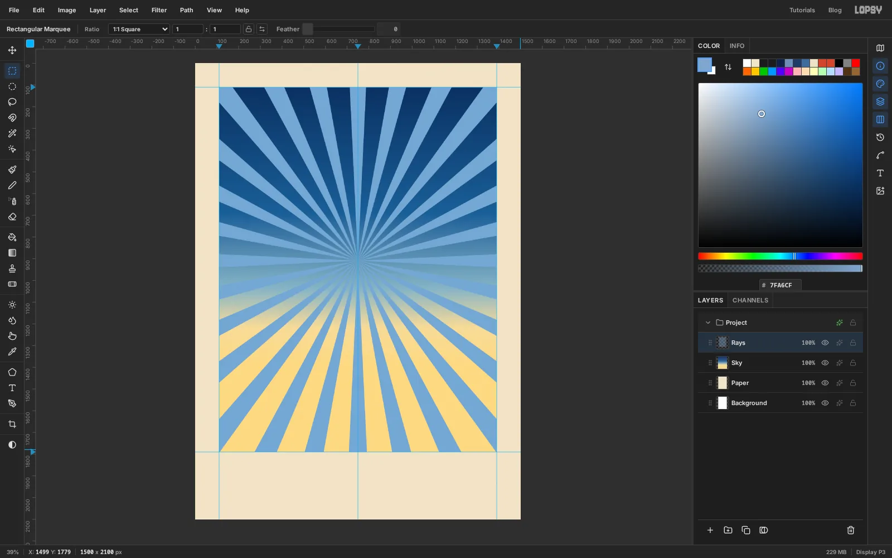

Add a layer called *Rays*. Select the panel again with the Rectangular Marquee, and set the foreground to ray blue `#7FA6CF`.

Choose **Filter → Sunburst…**. Set **Rays** to **28**, **Width** to **42** and **Center Y** to **43**, and leave **Center X** at **50**. That puts the centre where the sun will sit. Click **Apply** and deselect.

## Fade the rays toward the horizon

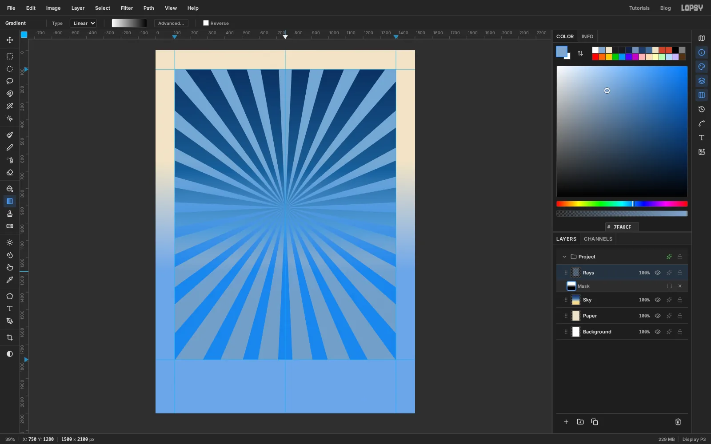

The rays should die away into the yellow glow at the bottom. With *Rays* active, click **Add Mask** in the Layers panel toolbar. Lopsy switches to editing the mask straight away.

Pick the **Gradient** tool, open **Advanced…** and delete the three middle stops (click one, then the delete button). Set the left stop to white `#FFFFFF` and the right stop to black `#000000`. Drag down the centre guide from about **y 640** to about **y 1280**. White keeps the rays and black hides them, and the blue tint on the canvas shows the hidden part.

Click the *Rays* row to leave the mask, then click its percentage and lower the opacity to **55%**.

## Add the sun

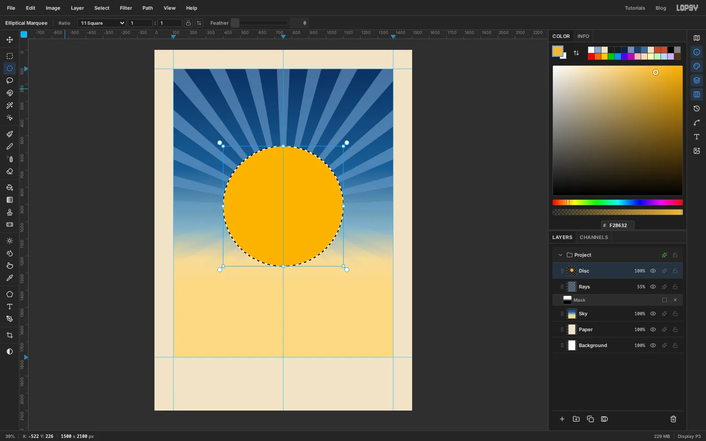

Add a layer called *Disc*. Pick the **Elliptical Marquee** and click once on the canvas without dragging. A dialog asks for the corners of the box the ellipse fits in: type **From 400, 560** and **To 1100, 1260** and press [[Enter]]. That is a circle 700 px across, centred on the middle guide. (You can also drag it by hand. Holding [[Cmd]] keeps it round.) Fill it with chrome yellow `#F2B632` and deselect.

Open the layer's effects drawer, tick **Stroke**, set **Width** to **6** and the colour to key black `#1B1A1E`. This is the key line, and almost every shape on the card gets the same one.

## Cut a row of pines

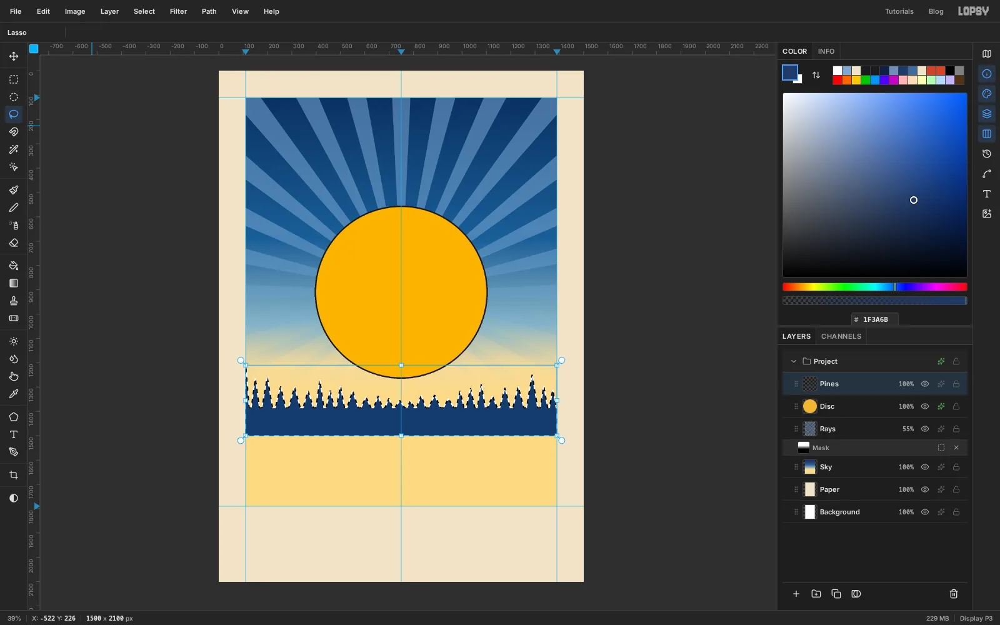

Add a layer called *Pines* and set the foreground to Prussian blue `#1F3A6B`.

Select the panel with the Rectangular Marquee. Then pick the **Lasso**, hold [[Shift+Alt]] and draw a long zigzag of pointed trees: start outside the panel on the left at about **y 1500**, zigzag across between **y 1385** at the feet and anywhere from **y 1250** to **y 1350** at the tips, and finish outside the panel on the right. Make the trees tall at the edges and short in the middle, where the fox will stand. Because you held [[Shift+Alt]], only the part inside the panel stays selected.

Choose **Edit → Fill** and deselect.

## Lay down the snow

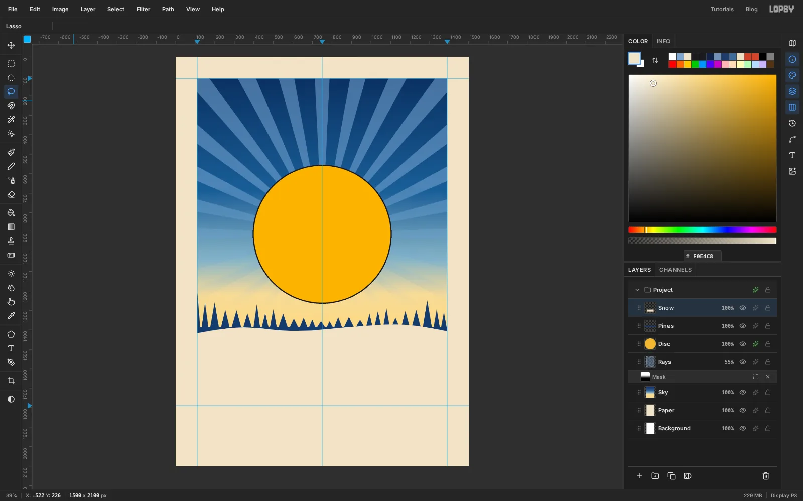

In a lithograph, white is just the paper showing through. Add a layer called *Snow*, select the panel, and with the Lasso and [[Shift+Alt]] draw a shape that covers everything below the trees: a gently rolling top edge between **y 1365** and **y 1425**, then down and around outside the panel. Fill it with paper `#F0E4C8` and deselect.

## Spatter the top of the sky

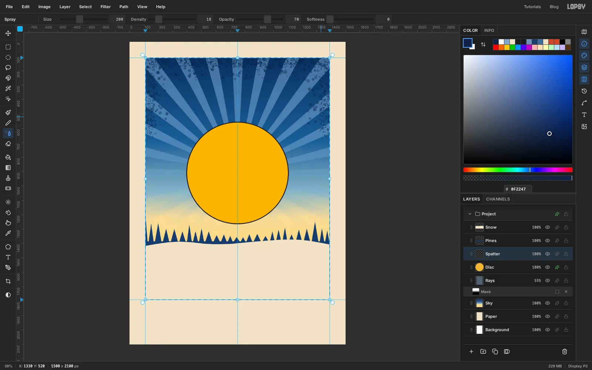

Click *Disc* and add a layer called *Spatter*, so it sits under the trees. Select the panel, so nothing lands in the margin.

Pick the **Spray** tool and set the foreground to spatter navy `#0F2247`. Real spatter comes in mixed sizes, so spray twice:

1. **Size 90**, **Density 40**, **Opacity 80**, **Softness 0**. Drag once along the top edge of the panel, then down each side to about **y 620**.
2. **Size 200**, **Density 18**, **Opacity 70**. Go along the top again and a short way down each side. The dots are bigger and more scattered.

Deselect.

## Spatter the snow

Click *Snow* and add a layer called *Snow shade*. Hold [[Cmd]] and click the *Snow* thumbnail to load its shape as a selection, so the spray stays on the snow.

Set the foreground to snow shade `#6F8FB8` and spray in three passes with **Softness 0**, dragging in gentle waves from side to side:

1. **Size 70**, **Density 40**, **Opacity 85**: along the top of the snow just under the trees, along the bottom edge, and two short bands at mid-height on the left and right.
2. **Size 140**, **Density 30**, **Opacity 80**: over the top band again, and along the bottom left and bottom right.
3. **Size 240**, **Density 14**, **Opacity 75**: a loose pass over the same places for a few big drops.

Leave the middle clear for the ball, and press [[Cmd+D]] when you're done.

## Spray a shadow for the ball

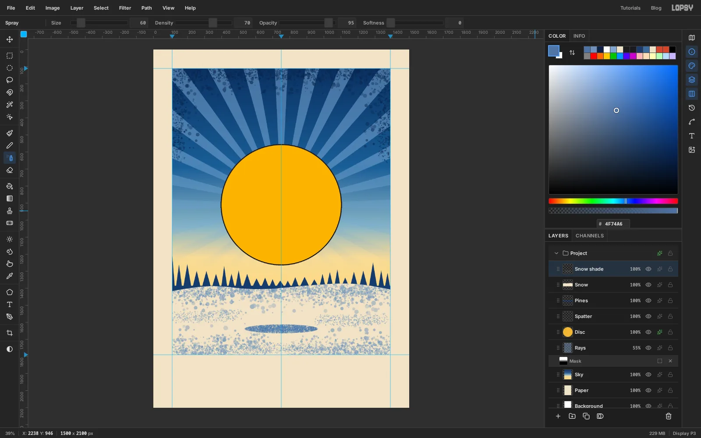

Still on *Snow shade*, pick the Elliptical Marquee and drag a wide, flat oval from about **535, 1612** to **965, 1664**. Set the Spray to **Size 60**, **Density 70**, **Opacity 95** and the foreground to `#4F74A6`, and go back and forth across the oval four times until it is nearly solid. Deselect.

## Draw two stars and stamp three more

Add a layer called *Stars*. With the Lasso, draw a four-pointed sparkle about 70 px tall at around **250, 700**: four long points with shallow dips between them. Fill it with paper. Draw a slightly smaller one at around **1250, 640**.

Pick the **Clone Stamp** and set **Size** to **100**. Hold [[Alt]] and click the middle of the first star to set the source, then click once at about **1215, 930**. [[Alt]]-click the second star and click once at about **300, 1010**, then [[Alt]]-click it again and click at about **215, 420**. Each click stamps a whole star.

## Let it snow

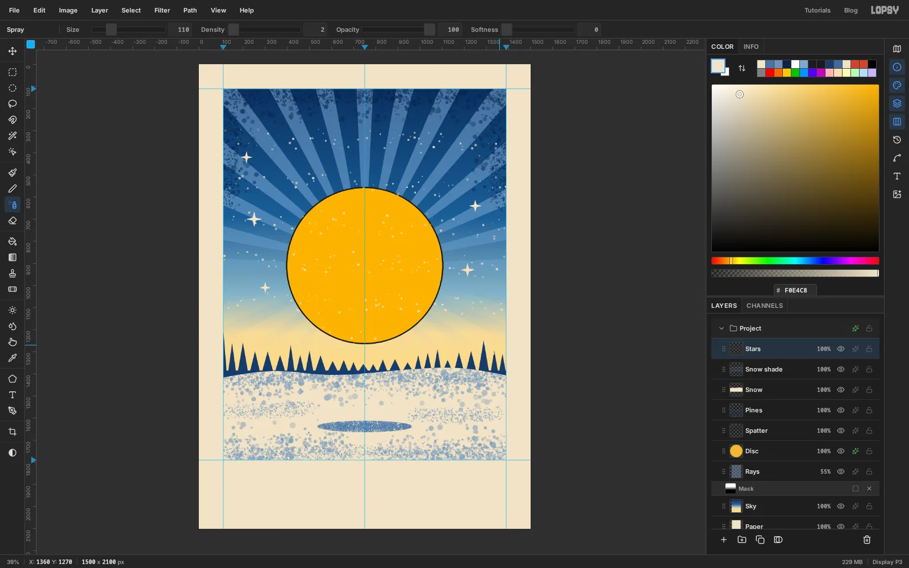

Still on *Stars*, select the panel. Set the Spray to **Size 110**, **Density 2**, **Opacity 100** and the foreground to paper. Drag six quick lines across the sky from left to right, about 180 px apart, from just under the top spatter down to the pine tips. With the density this low, each pass leaves a thin trail of flakes. Deselect.

## Make the groups, the ball and the tail

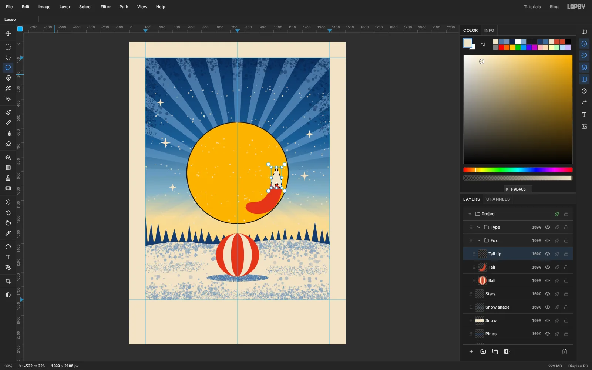

The type will sit on top of everything and the fox just below it. With *Stars* active, click **New Group** and name the group *Type*. Click *Stars* again, click **New Group** and name this one *Fox*. It lands between *Stars* and *Type*. Layers you add while a group, or a layer inside it, is active go into that group.

With *Fox* active, add a layer called *Ball*. Using the Elliptical Marquee's exact dialog (click without dragging), fill three shapes on it, all centred on **750, 1480**:

1. a circle 300 px across in vermilion `#D4452B` (From **600, 1330** To **900, 1630**)
2. an upright oval 200 px wide in paper (From **650, 1330** To **850, 1630**)
3. a narrower oval 90 px wide in vermilion (From **705, 1330** To **795, 1630**)

That gives the ball its stripes.

Add a layer called *Tail*. With the Lasso, draw a fat comma to the right of where the body will be. Start where the hip will be, at about **810, 1150**. Run right along the bottom to about **985, 1175**, swing up the outside through **1060, 1000** to a sharp point at **1020, 870**, then come back down the inside through **965, 1060** and **905, 1110** to the start. The tail is about 90 px thick. Fill it with vermilion.

Add a layer called *Tail tip*. [[Cmd]]-click the *Tail* thumbnail, then with the Lasso and [[Shift+Alt]] circle the top third of the tail, drawing the lower edge as a zigzag with three teeth at about **y 1000**. Fill with paper and deselect.

## Draw the legs, body and belly

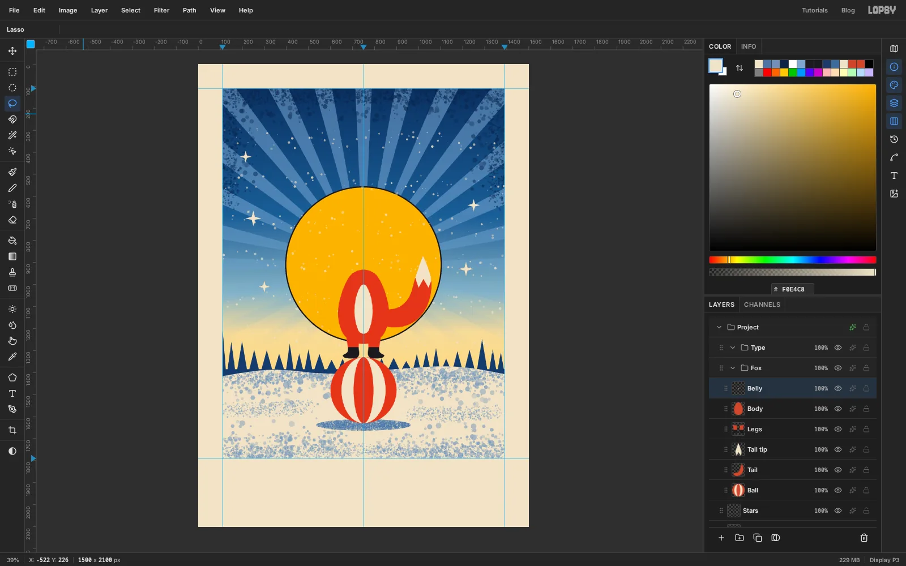

Each part goes on its own layer, in this order, so the key line can go around each one. Draw them with the Lasso and fill them.

1. *Legs*. Two vermilion legs, one each side of the centre guide with a 40 px gap between them. Each is a simple block about 60 px wide, from **y 1210** down to **y 1297**: the left one runs from about **x 668** to **730**, the right one from **770** to **832**. Under each, draw a black foot from **y 1285** down to the top of the ball at about **y 1337**: a rounded boot shape about 80 px wide, with its toe pushed outward, away from the centre.
2. *Body*. A vermilion pear, symmetrical about the centre guide. Start at the left of the neck (**700, 933**), bulge out to the widest point at about **640, 1145**, curve in under the hips to the bottom at **750, 1277**, and mirror that up the right side through **860, 1145** to the neck at **800, 933**. It overlaps the tops of the legs.
3. *Belly*. A tall paper-coloured oval down the middle of the body, about 80 px wide, from **y 990** to **y 1225**.

## Brush in the arms

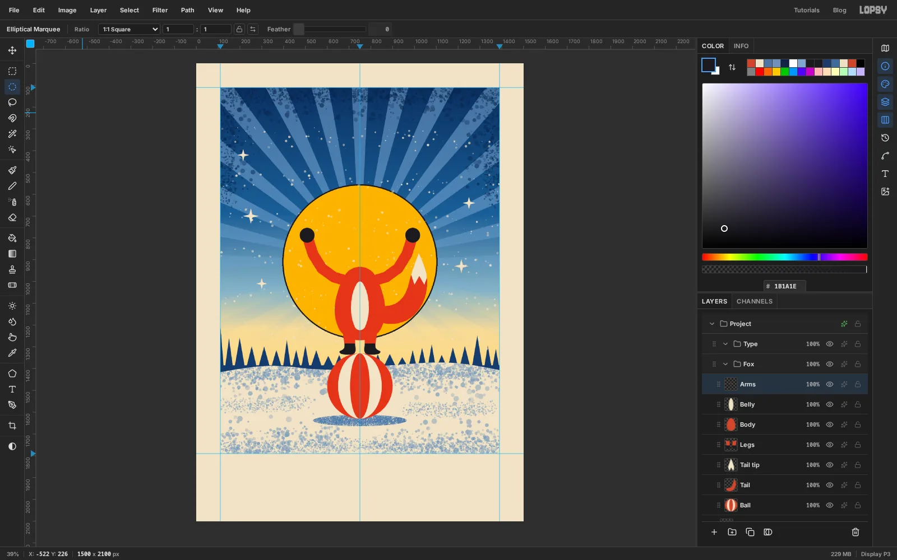

Add a layer called *Arms*. Pick the **Brush**, set **Size** to **50** and **Hardness** to **100**, and paint in vermilion. The arms go up and out in a shallow curve, like a letter V with a bend at the elbows.

For the left arm, start at the shoulder at about **688, 997**, sweep out through the elbow at about **575, 940**, and finish at **512, 803**. For the right arm, do the same from **812, 997** through **925, 940** to **988, 803**.

Then give each arm a round black paw. With the Elliptical Marquee's exact dialog, fill a circle From **474, 754** To **542, 822** on the left, and From **958, 754** To **1026, 822** on the right.

## Add the ruff and the head

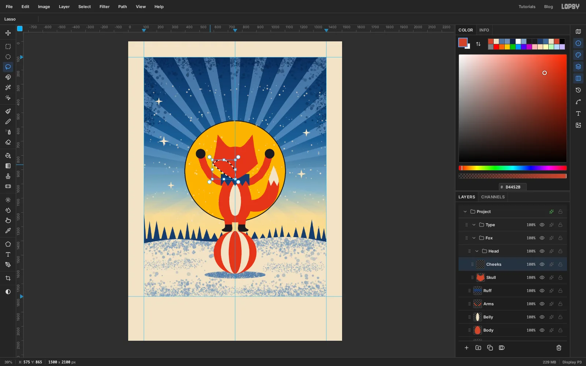

Add a layer called *Ruff* and, with the Lasso, draw a blue collar across the neck. The top edge is straight, from **650** to **850** at **y 930**. The bottom edge is a zigzag: five points reaching down to **y 1015**, with the notches between them coming back up to about **y 977**. Fill it with Prussian blue.

Click **New Group** and name it *Head*, so the head can be tilted later as one piece. Inside it, add a layer called *Skull* and draw the head with the Lasso, working clockwise and keeping it symmetrical about the centre guide:

1. Start at the tip of the left ear, **628, 653**, and come down the inside of the ear to about **700, 747**.
2. Cross the top of the head in a shallow dip (**750, 735** on the guide) to **800, 747**, and go up to the tip of the right ear at **872, 653**.
3. Come down the outside of that ear to about **888, 775**, then out to a sharp cheek point at **910, 857**.
4. Slope in along the jaw through **848, 913** and **790, 953** to a narrow chin at **750, 970**.
5. Mirror the jaw, cheek point (**590, 857**) and ear up the left side.

Fill it with vermilion.

Add a layer called *Cheeks*. [[Cmd]]-click the *Skull* thumbnail, then hold [[Shift+Alt]] and lasso the lower left of the face. Start outside the left cheek point, rise to about **645, 823**, dip slightly as you cross to the centre guide at about **y 910** (this edge passes just under where the eye will go), run down the guide past the chin, and loop back outside the jaw. The selection is clipped to the head. Fill it with paper, then do the same on the right. The two patches meet in a V between the eyes.

## Give it a face and a party hat

Add a layer called *Face*. Everything on it is key black except the glints:

- With the Lasso, a triangle inside each ear, leaving a red rim around it. The left one has corners at about **640, 687**, **684, 745** and **628, 761**.
- Two upright oval eyes with the Elliptical Marquee's exact dialog: From **677, 802** To **707, 844**, and From **793, 802** To **823, 844**. They sit on the red, just above the cream cheeks.
- An oval nose on the centre guide, at the bottom of the cream V: From **726, 931** To **774, 963**.
- A small paper-coloured glint in the upper right of each eye, about 10 × 12 px.

Add a layer called *Hat*. With the Lasso, draw a tall triangle in Prussian blue between the ears: the base runs from **698** to **804** at **y 752**, and the tip is at **751, 588**. Then, with the marquees' exact dialogs, fill a paper-coloured brim across its base (Rectangular, From **692, 732** To **810, 756**) and a paper-coloured pompom on its tip (Elliptical, From **724, 553** To **778, 607**).

## Put a key line around everything

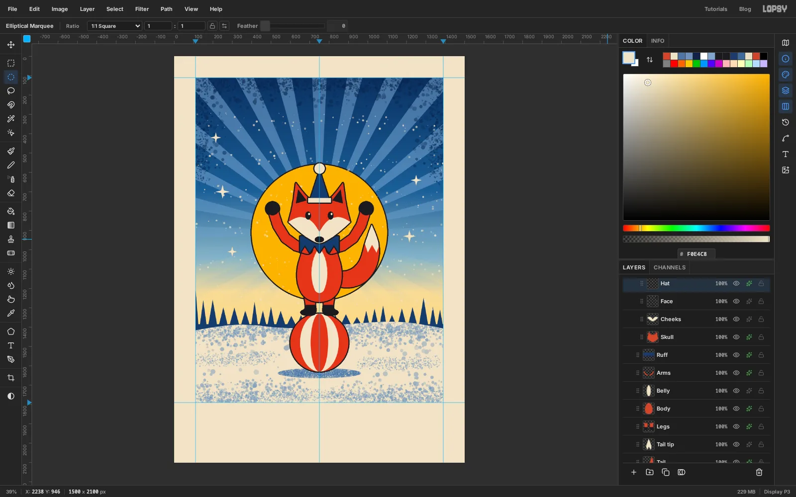

Open the effects drawer on each of these layers and add the same **Stroke** you gave the sun, **Width 6** in key black: *Ball*, *Tail*, *Legs*, *Body*, *Arms*, *Ruff*, *Skull* and *Hat*. Leave *Belly*, *Cheeks*, *Tail tip* and *Face* without one, so they stay as flat patches inside the outlines.

## Tilt the head

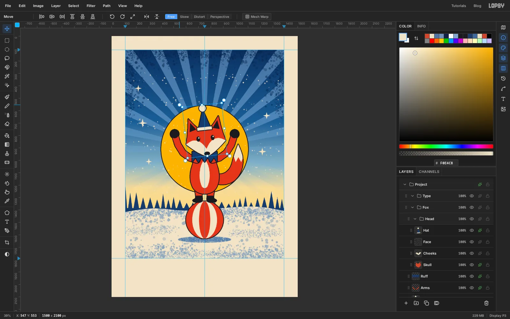

Click the *Head* group in the Layers panel and pick the **Move** tool. With nothing selected, the handles frame everything in the group. Move the pointer just outside the top-left corner, where the round rotate handle is, and drag it a short way down and to the left. The head turns anticlockwise. Stop when the pompom has moved about 20 px to the left, which is a turn of about 6°. Press [[Cmd+D]] to commit.

Press [[Cmd+Z]] and then [[Cmd+Shift+Z]] to compare the two poses. The tilted head looks up at the baubles.

## Draw the path of the baubles

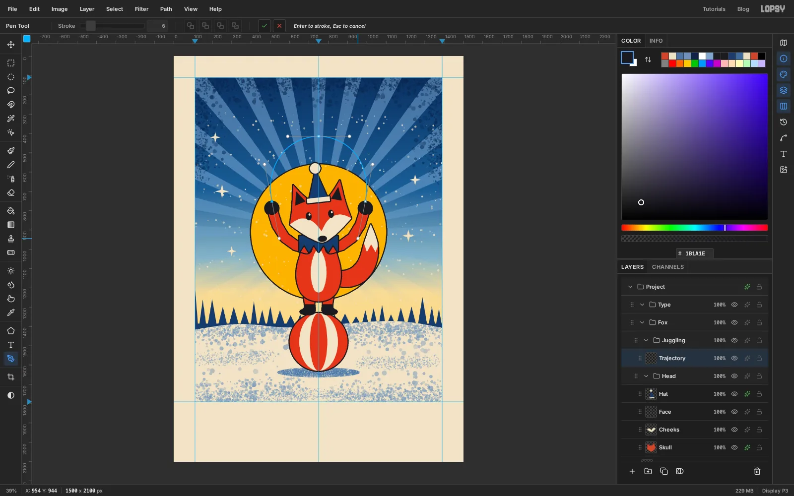

Click the *Fox* group, click **New Group** and name it *Juggling*. Inside it, add a layer called *Trajectory*.

The baubles travel along one tall arch from paw to paw, peaking above the hat. Pick the **Pen**, set **Stroke** to **6** and the foreground to key black. Dragging as you place a point pulls out curve handles:

1. Press just above the left paw at about **508, 752** and drag up to about **470, 560**.
2. Press at the top of the arch, **750, 415**, and drag right to about **910, 415**.
3. Press just above the right paw at **992, 752** and drag down to about **954, 944**.

Press [[Enter]] to stroke the curve onto the layer.

## Break the arc into dashes

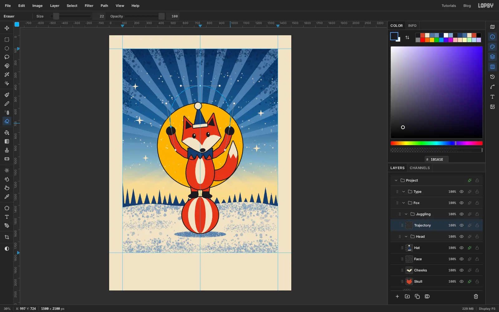

Pick the **Eraser**, set **Size** to **22**, and click along the arc at even intervals, leaving a dash between each click. About ten clicks on each half does it. The Pen's blue outline stays on screen while you work, which helps you aim. It doesn't export, and you can hide it by clicking the path's row again in the **Paths** panel.

## Draw the first bauble

Black dashes get lost against the dark sky. Open the effects drawer on *Trajectory*, tick **Color Overlay** and set its colour to paper.

Add a layer called *Bauble 1*. Pick the **Shape** tool and choose **Ellipse**. Click the **Fill** swatch and set it to vermilion, click the **Stroke** swatch and set it to key black, and set **Width** to **6**. The shape grows outward from where you press. Press at the top of the arch (**750, 415**), hold [[Cmd]] to keep it round, and drag down and to the right until the status bar reads about **796, 461**. The circle is about 92 px across.

Give it a cap with the Rectangular Marquee's exact dialog: fill a black rectangle From **736, 351** To **764, 373**, then a paper-coloured one inside it From **741, 356** To **759, 369**. Finish with a small upright paper-coloured oval on the upper left as a highlight (Elliptical, From **725, 387** To **739, 411**).

## Add a banded bauble

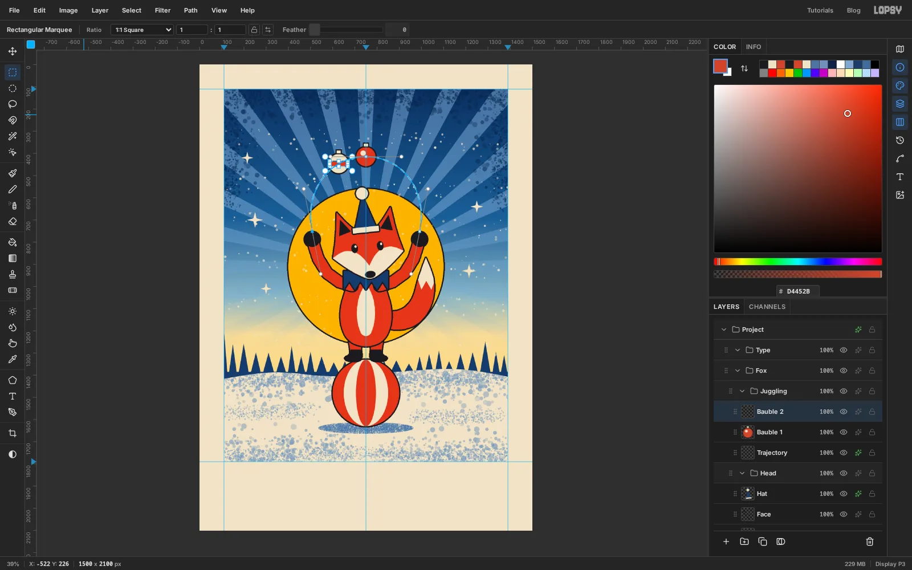

Add *Bauble 2*. Change the Shape tool's fill to paper and draw the same size circle on the arch, pressing at about **627, 446**. Add the same cap, 123 px to the left and 31 px lower than the first one.

For the band, select a circle just inside the bauble's outline with the Elliptical Marquee's exact dialog (From **586, 405** To **668, 487**). Then pick the Rectangular Marquee, hold [[Shift+Alt]] and drag a strip across the middle, from about **577, 435** to **677, 459**. Only the part of the strip inside the circle stays selected. Fill it with vermilion and deselect.

## Add a blue bauble and tumble them

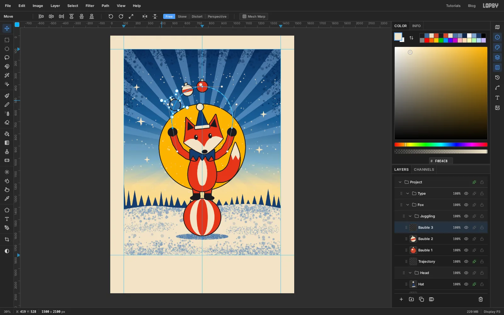

Add *Bauble 3* in mid blue `#3F6C9E`, pressing at about **523, 567**, with a cap and a highlight.

Baubles in the air shouldn't all sit upright. Click *Bauble 2*, drag a Rectangular Marquee around the whole bauble, pick the **Move** tool and drag the round rotate handle anticlockwise until the cap points to about eleven o'clock (roughly 14°), leaning away from the fox. Press [[Cmd+D]]. Do the same to *Bauble 3*, turning it further, until its cap points to about ten o'clock.

## Duplicate and flip the other side

Click *Bauble 2* and choose **Layer → Duplicate Layer**. Rename the copy *Bauble 4*. With the Move tool, drag it straight across to the matching spot on the right, at about **873, 446**. Pink lines appear when it lines up with its twin. Choose **Image → Flip Horizontal** so it leans the other way.

Do the same with *Bauble 3* to make *Bauble 5* at about **977, 567**.

## Ring the baubles with a cream halo

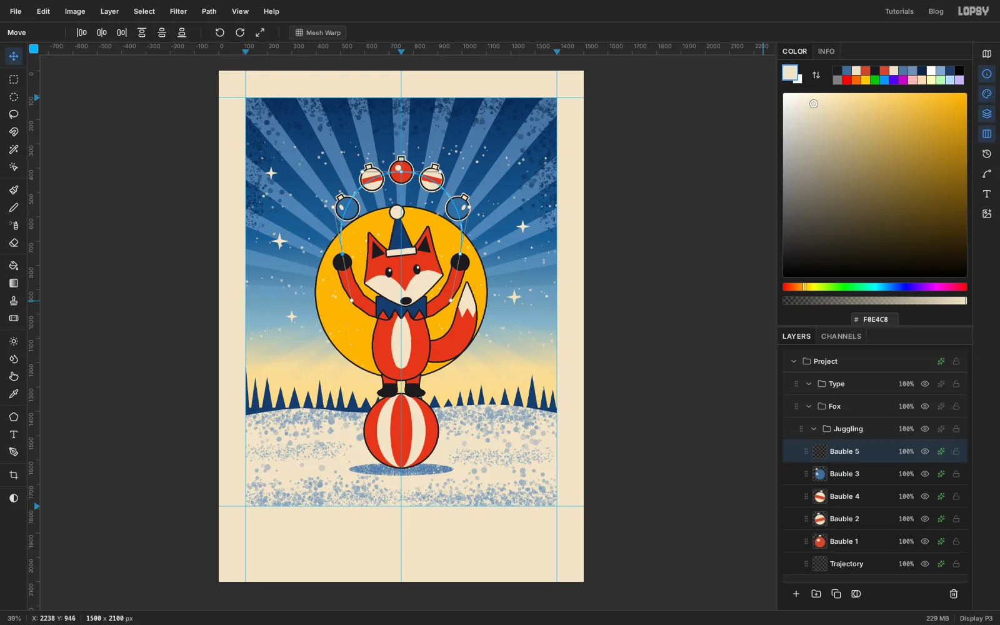

The black outlines disappear against the navy sky. A thin ring of bare paper around each bauble lifts it off the background. On each of the five bauble layers, add a **Stroke** effect with **Width 4** in paper.

## Drop a bauble in the snow

Click *Bauble 1*, press [[Cmd+A]] and [[Cmd+C]], then [[Cmd+D]]. Click *Stars* (below the *Fox* group) and press [[Cmd+V]]. The copy arrives as *Pasted Layer*, in the same place and already selected. Rename it *Fallen red*.

Pick the Move tool and drag the rotate handle clockwise until the cap points to about two o'clock, then press [[Cmd+D]]. Drag the bauble down to the snow at about **1165, 1640**, to the right of the ball.

## Add a second one and shrink it

Copy *Bauble 3* the same way, click *Stars* again and paste, and rename the layer *Fallen blue*. Turn it anticlockwise until its cap points left and slightly up, commit, and drag it to about **1010, 1700**, a little in front of the red one.

To make it a little smaller, drag a marquee around it, pick the Move tool, hold [[Cmd]] to keep the proportions and drag a corner handle inward by about 20 px. Press [[Cmd+D]].

## Wrap a gift

Click *Fallen blue* and add a layer called *Gift*. Build it from rectangles with the Rectangular Marquee's exact dialog, at the left of the snow:

1. a vermilion box, From **262, 1582** To **388, 1686**
2. a Prussian blue lid across the top, a little wider than the box, From **250, 1556** To **400, 1590**
3. a paper-coloured ribbon down the middle of both, From **314, 1556** To **336, 1686**

With the Lasso, add two small paper-coloured triangles above the lid for the bow. They meet at the top of the ribbon and open upward like rabbit ears, about 40 px tall. Give the layer the 6 px black **Stroke**.

Drag a marquee around the whole gift and turn it slightly anticlockwise with the Move tool, so that it leans to the left (about 8°). Press [[Cmd+D]].

## Draw an arc for the title

Click the *Type* group and pick the **Pen**. The title follows a wider, flatter arch above the baubles. Place three points, dragging each one as before:

1. Press at **235, 520** and drag up to about **310, 360**.
2. Press at **750, 278** and drag right to about **990, 278**.
3. Press at **1265, 520** and drag down to about **1340, 680**.

This time click the **✓** (*Commit path*) button in the options bar instead of pressing [[Enter]]. The path is saved without being stroked.

## Set the title on the arc

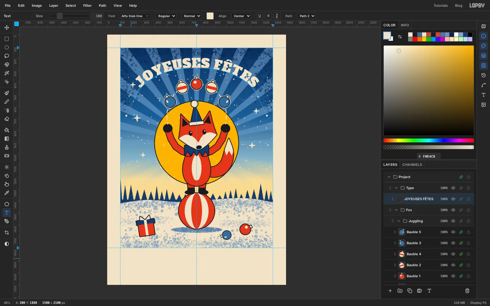

Click the *Type* group again so that no text layer is active. Pick the **Text** tool, choose **Alfa Slab One** from the font list and set **Size** to **108**. Set the foreground to paper.

Click in the empty margin under the panel, type `JOYEUSES FÊTES` and press [[Tab]] to commit. (On a Mac, type Ê with [[Option+I]] then [[Shift+E]]. On Windows, use the on-screen keyboard or copy it from here.) In the options bar, open the **Path** dropdown and choose **Path 2** (Path 1 is the baubles' arch). Then set the **Align** dropdown beside it to **Center**. The words move up onto the arc with equal space at both ends.

## Give the title a key line and a shadow

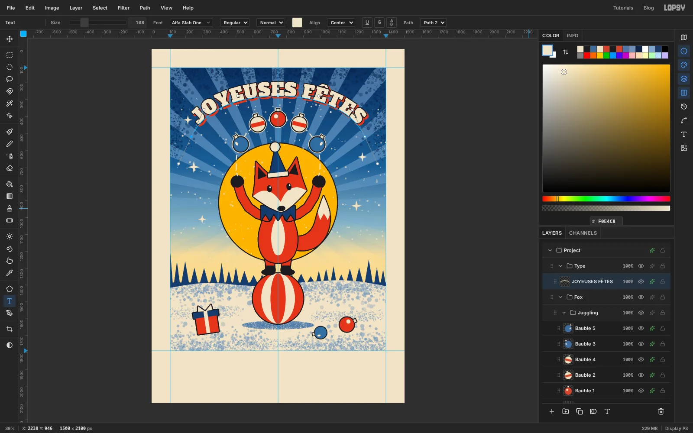

Open the title's effects drawer:

1. Tick **Stroke**: **Width 5**, key black.
2. Tick **Drop Shadow**: **Offset X 9**, **Offset Y 9**, **Blur 0**, **Opacity 100**, colour vermilion.

With no blur, the shadow is a second, solid printing of the letters. Check the gaps: the letters should clear the frame guide at the top and the caps of the baubles underneath by a similar amount. If they don't, change the **Size** by a few points.

## Write the greeting

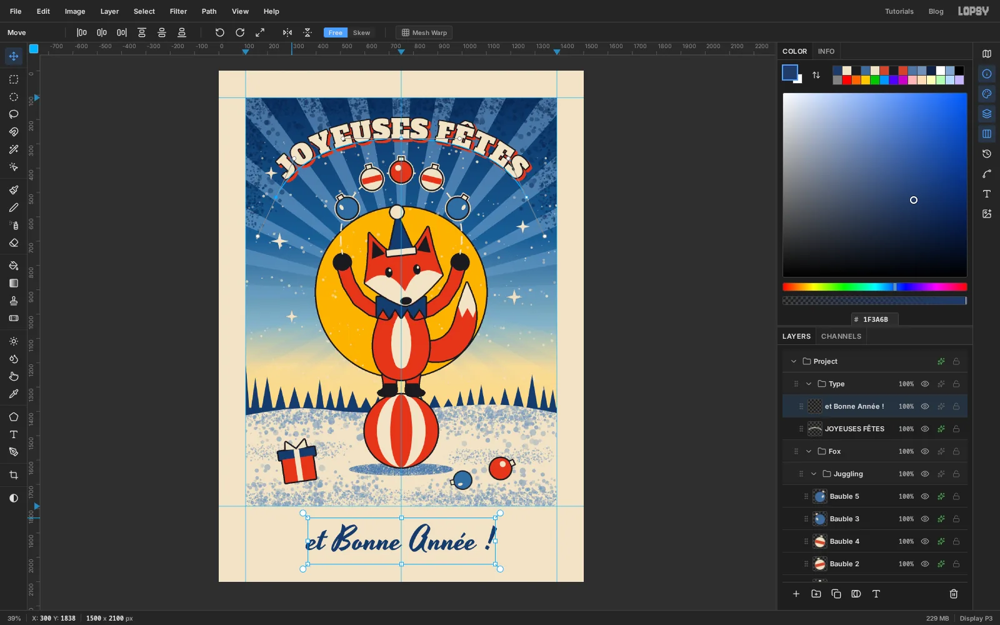

Click the *Type* group. With the Text tool, set the **Align** dropdown back to **Left**, choose **Yesteryear**, set **Size** to **136** and the foreground to Prussian blue. Click in the bottom margin at about **300, 1838**, type `et Bonne Année !` and press [[Tab]].

Pick the **Move** tool and click **Align center horizontally** in the options bar. Then press [[Shift+↑]] once to lift the line 10 px. It should sit about 60 px below the panel, with room underneath for the small print.

> **Tip:** Always click the group (or any layer that isn't text) before starting a new piece of text. If a text layer is active, changing the font or size restyles that layer instead.

## Add the printer's line and a plate number

Lithographs carried the printer's name in the margin. Click *Type*, choose **Old Standard TT** at **Size 30**, click at about **300, 2006** and type `LITH. J. FABRE & FILS · LYON`. Commit, and centre it with **Align center horizontally**.

Click *Type* again and add `Pl. XII` at **110, 2006**, so its left edge lines up with the panel. Both lines share a baseline about 55 px above the bottom of the card.

## Frame the panel

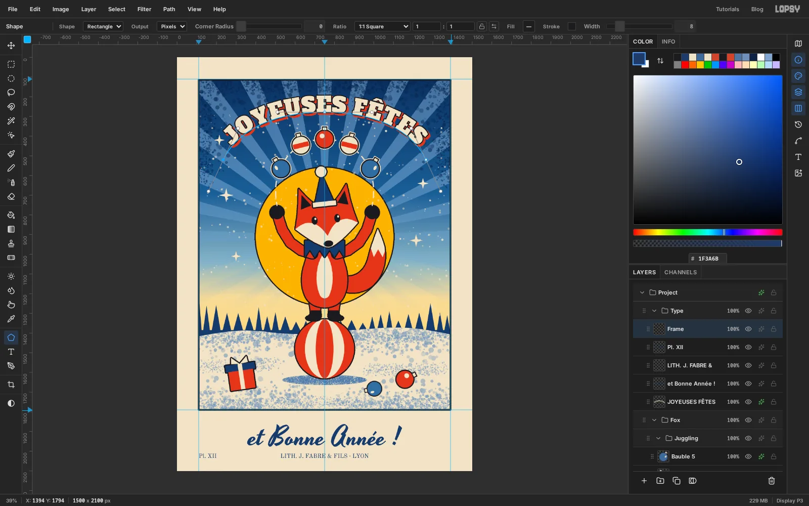

Click *Type* and add a layer called *Frame*. Pick the **Shape** tool and choose **Rectangle**. Click the **Fill** swatch and choose **Remove fill**, keep the black stroke, and set **Width** to **8**.

Press on the centre guide halfway down the panel (**750, 950**) and drag to the bottom-right corner of the panel. The corner snaps to the guides, and the frame covers the panel's edges.

## Add registration marks and an ink bar

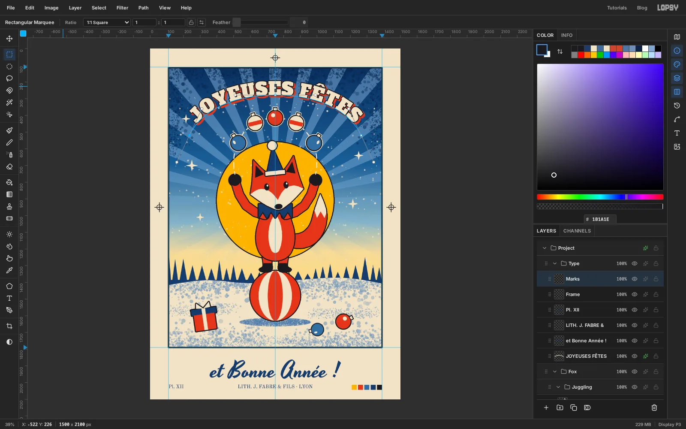

Printers lined up each stone with crosshairs in the margin, and proofed their inks in a row of patches. Add a layer called *Marks*.

Pick the **Pencil**, set **Size** to **3** and the foreground to key black. Click once at **27, 950**, then hold [[Shift]] and click at **83, 950** for a straight line. Do the same from **55, 922** to **55, 978** to make a cross. Repeat in the right margin around **1445, 950** and in the top margin around **750, 55**.

Switch to the **Shape** tool, choose **Ellipse** with no fill and a **3 px** stroke. Press on the centre of each cross, hold [[Cmd]] and drag out about 15 px for a small circle.

Finally, fill five 30 px squares in a row at the bottom right, level with the printer's line. With the Rectangular Marquee's exact dialog, make the first one From **1208, 2014** To **1238, 2044** and move 38 px to the right for each of the others, so the last one ends at the panel's right edge (**x 1390**). Fill them in chrome yellow, vermilion, mid blue, Prussian blue and key black.

## Make a sheet of crayon grain

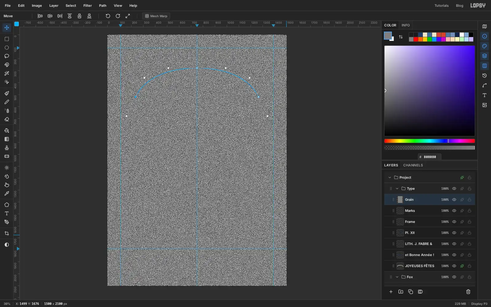

A lithograph stone has a tooth that breaks flat ink into grain. With *Marks* active, add a layer called *Grain*, so it sits on top of everything. Set the foreground to mid grey `#808080`, press [[Cmd+A]], fill and deselect.

Choose **Filter → Texture…**. Pick **Grain**, **Light & Dark** and **Mono**, then set **Amount** to **100**, **Size** to **2.5**, **Detail** to **70** and **Contrast** to **55**. Click **Apply**.

## Blend the grain into the inks

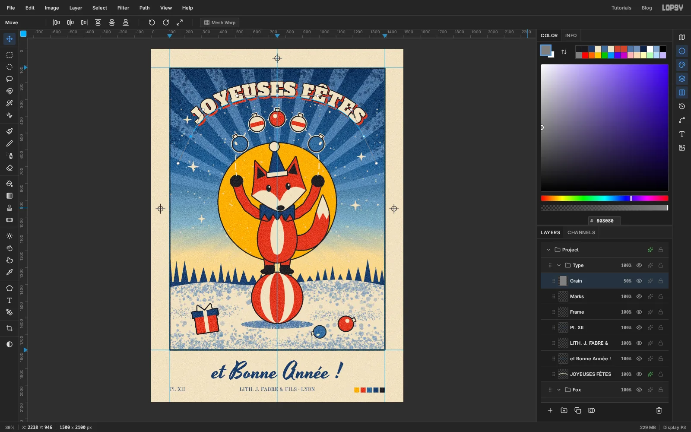

Open the *Grain* layer's effects drawer and set **Blend** to **Soft Light**, then lower the layer's opacity to **50%**. Soft Light leaves mid grey alone and lets the light and dark specks nudge the colours underneath. The flat inks pick up a crayon tooth, the paper gets a faint texture, and the black key line stays almost solid, as it would in print.

## Settle the inks

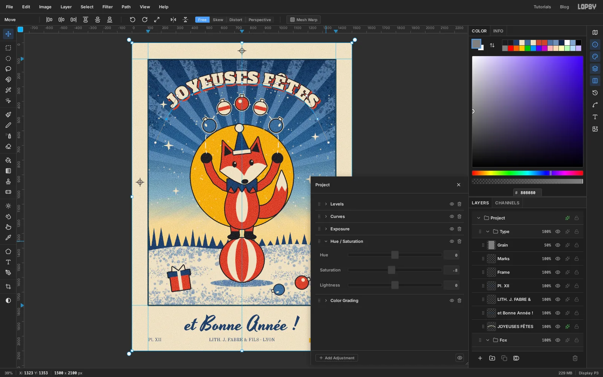

Choose **Layer → Adjustment Layer…** and click **Got it**. New documents come with five adjustments on the *Project* group. Expand **Hue / Saturation** and set **Saturation** to **−8**, which takes the screen brightness off the colours. Close the drawer and click any layer, so the whole document is no longer the active selection.

## Save and export

Choose **File → Save Project** to keep the layers, then **File → Quick Export PNG** for the finished card.

To take it further, change the greeting for another language, swap the baubles for stars or oranges, or duplicate the *Fox* group and scale the copy down for a second performer.
