In the 1890s, Paris print shops turned out colour lithographs by Bonnard, Vuillard and Toulouse-Lautrec. Each colour was drawn on its own limestone, with a greasy crayon or brush, and the stones were printed one after another onto the same sheet. That process gives the style its look:

- big, flat areas of colour, with a few inks reused everywhere
- shading drawn in crayon, so it shows up as grain rather than a smooth gradient
- tilted, Japanese-print tables and busy patterned wallpaper
- a thin dark "key" line that holds the shapes together
- a printed caption under the picture and a small red chop, the printer's stamp

This card uses all of that. A bowl of oranges sits on a gingham cloth in front of a snowy window. A fir bough with a red bow lies at the front, and *Season's Greetings* is printed underneath. The card is 1200 × 1680 px, a 5 × 7 inch shape. Everything is drawn in Lopsy, so you don't need any photos.

The tools you'll use:

- the **Rectangular** and **Elliptical Marquee** (with their exact-size dialogs, and [[Shift]] / [[Alt]] to add and subtract), the **Lasso**, the **Magic Wand** and the **Pen** for straight-edged shapes
- **Select → Shrink / Inverse**, and [[Cmd]]-click on a layer thumbnail to load its shape
- **Edit → Define Pattern** and **Edit → Fill with Pattern…**
- the **Gradient**, **Brush**, **Spray** and **Pencil** tools, the Brush's **Radial Symmetry**, and **Path to Selection**
- **Add Noise**, **Motion Blur**, **Gaussian Blur** and **Threshold**, which together make the crayon grain
- the **Move** tool's **Perspective** mode, scale and rotate handles, plus copy and paste
- layer effects (**Stroke** and **Color Overlay**), the **Multiply** blend mode, groups, and the document's **Hue / Saturation** and **Color Grading** adjustments
- live text in two Google fonts: **Elsie Swash Caps** and **Della Respira**

The palette is five inks on cream paper, plus a few tints of them:

- Paper `#F3E6C8`
- Red `#C7352E`, knot red `#9C2A22`
- Orange `#E8892A`, shadow orange `#C25A1E`
- Olive `#4E6B3A`
- Prussian blue `#2B4A6F`, bowl tint `#B4BFC9`
- Key `#3A3328`
- Wall `#6E5644`, motif `#574334`, stripe `#624C3B`
- Grain `#B59E78`

> **Tip:** On a wide-gamut (Display P3) screen, Lopsy reads typed hex codes as P3 colours. These codes were picked as P3 values. On an sRGB screen they come out a little duller.

> **Note:** Shortcuts are written for a Mac. On Windows use [[Ctrl]] wherever it says [[Cmd]].

Two things you'll repeat a lot:

- **Exact marquees.** Pick the Rectangular or Elliptical Marquee and click once on the canvas without dragging (with nothing selected). A dialog asks for **From** and **To** corners. Type them and press [[Enter]]. For an ellipse, the corners are its bounding box. When a step adds or subtracts a second shape with [[Shift]] or [[Alt]], drag it by hand. The dialog only opens with nothing selected, so the numbers given for those drags are approximate. The **Info** panel shows the pointer position while you drag.
- **Straight-edged shapes.** The Lasso is freehand, so for shapes with long straight sides use the **Pen** ([[P]]). Click each corner, click the first point again to close the shape, then click **Path to Selection** in the **Paths** panel. Delete the path afterwards.
- **Blend mode and opacity.** The sparkle button on a layer's row opens its effects drawer. The **Blend** dropdown at the top of the drawer sets the layer's blend mode. Click the percentage on the layer's row to set its opacity.
- **Crayon grain.** Fill a grey (or a grey gradient), run **Filter → Add Noise…** at **Amount 100** with **Mono** on, then **Filter → Threshold…** at **128**. Dark greys become dense black specks and light greys sparse ones. Then pick the **Magic Wand**, untick **Contiguous**, click any white speck, press [[Delete]] and deselect. Only the black grain is left, ready to be recoloured with a **Color Overlay** effect.

## Set up the card and the wall

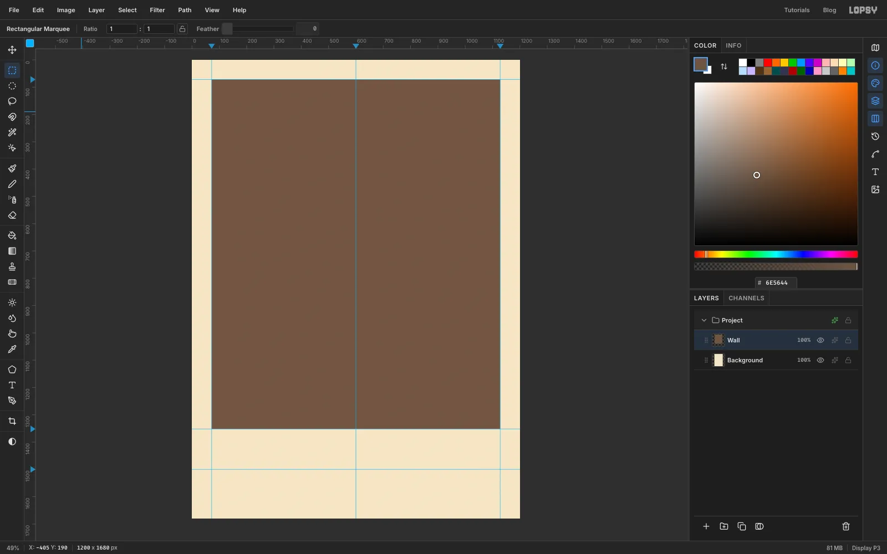

Choose **File → New**, keep the units on **Pixels**, and make the document **1200** wide and **1680** high.

Click the top ruler to drop vertical guides at **72**, **600** and **1128**. Click the left ruler for horizontal guides at **72**, **1352** and **1500**. The outer guides mark the image area, which printmakers call the plate. The caption goes below it, around the guide at y 1500. Then open the **View** menu and turn off **Snap to Guides**, so marquees drawn near a guide don't jump onto it.

Click *Background*, set the foreground to paper `#F3E6C8` and choose **Edit → Fill**. Click *Layer 1* and double-click its name to rename it *Wall*. With the Rectangular Marquee's exact dialog, select from **72, 72** to **1128, 1352**. Fill it with wall `#6E5644` and press [[Cmd+D]].

## Draw a wallpaper tile

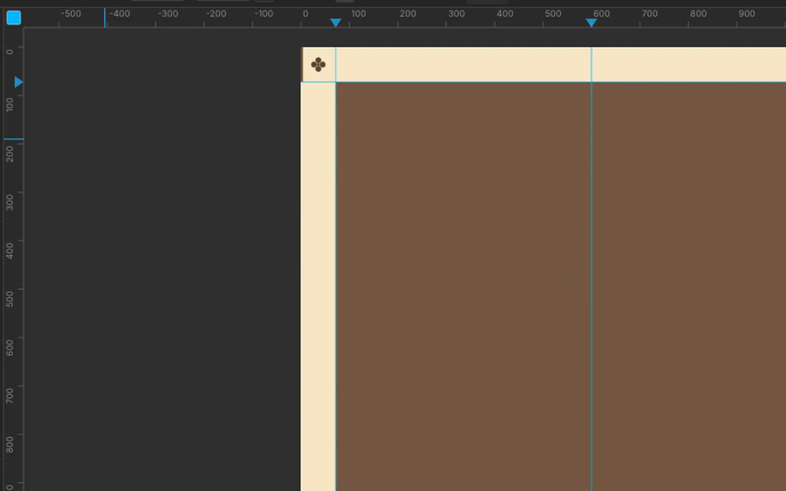

Wallpaper is a small tile repeated, so draw one tile in the empty top-left corner. Click **Add Layer** and name the layer *Tile*.

1. Select from **0, 0** to **4, 72** and fill it with stripe `#624C3B`.
2. With the **Elliptical Marquee**, draw four 12 px circles around the point 36, 36, filling each one with motif `#574334` before you draw the next: **30, 21** to **42, 33**; **39, 30** to **51, 42**; **30, 39** to **42, 51**; and **21, 30** to **33, 42**.
3. Put a 6 px dot in the middle (**33, 33** to **39, 39**) in stripe `#624C3B`.

Deselect when you're done.

## Paper the wall with the pattern

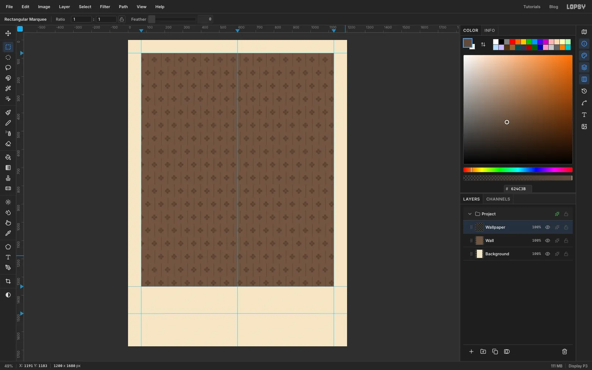

Select the tile, **0, 0** to **72, 72**, and choose **Edit → Define Pattern**. Deselect, then delete the *Tile* layer with the bin button.

Click *Wall* and add a layer called *Wallpaper*. Select the plate again (**72, 72** to **1128, 1352**) and choose **Edit → Fill with Pattern…**. Click your tile, set **Row Stagger** to **50%**, which shifts every other row half a tile sideways like real wallpaper, and click **Apply**. Deselect.

## Shade the wall with crayon grain

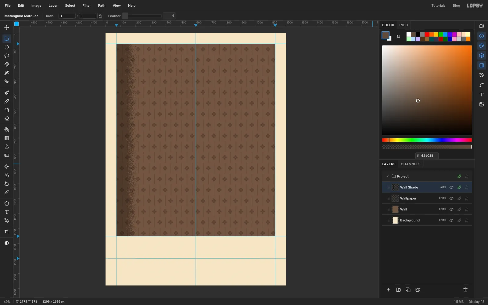

The left of the wall is furthest from the window, so darken it the way a lithographer would, with crayon.

1. Add a layer called *Wall Shade* and select the plate.
2. Pick the **Gradient** tool, set it to **Linear**, and in **Advanced…** make the left stop `#5A5A5A` and the right stop `#C8C8C8`. Drag from the left edge of the plate across to about x 360, then deselect.
3. Run **Add Noise…** (**Amount 100**, **Mono**). Then run **Filter → Motion Blur…** at **Angle 35** and **Distance 10**, so the specks become slanted crayon strokes. Then run **Threshold…** at **128**.
4. Wand away the white as described above.
5. The blur smeared a few strokes past the plate, so select the plate, choose **Select → Inverse**, press [[Delete]] and deselect.

Open the layer's effects drawer and add a **Color Overlay** in key `#3A3328`. Set the layer's **Blend** to **Multiply**, close the drawer, and set the layer's opacity to **40%**.

To tidy up, click *Wall Shade*, [[Shift]]-click *Wall*, choose **Layer → Group Layers**, name the group *Room*, and collapse it with its arrow. With a collapsed group selected, new layers land above the group rather than inside it.

## Paint the night sky and the dusk glow

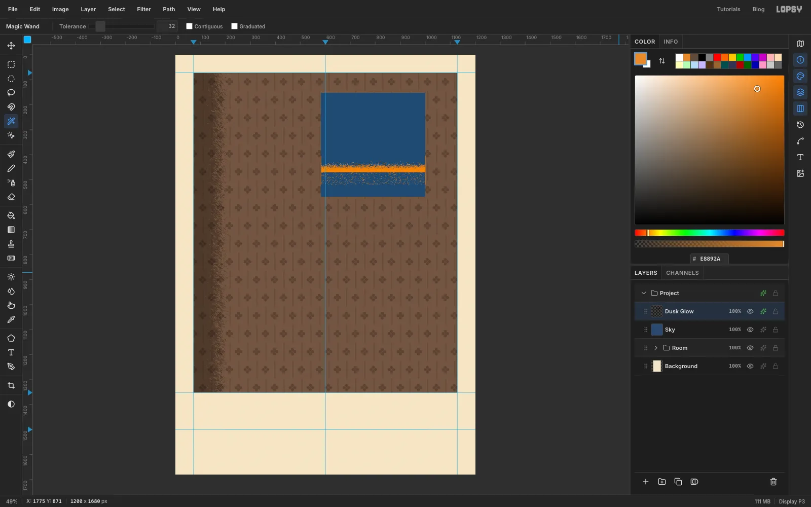

With *Room* selected, add a layer called *Sky*. Select from **582, 152** to **1000, 568** and fill it with Prussian blue `#2B4A6F`.

Add a layer called *Dusk Glow*. Select a strip from **582, 470** to **1000, 520** and fill it with orange `#E8892A`, the last light along the horizon.

Now select the strip just above it, from **582, 404** to **1000, 470**. Drag a linear gradient with the dark stop (`#4A4A4A`) at the bottom of that strip and the light stop (`#D8D8D8`) at its top, and deselect. Make crayon grain from the whole layer, as in the last step, but use **Motion Blur** at **Angle 0** and **Distance 4** for short horizontal strokes. Then add a **Color Overlay** in orange `#E8892A`.

The grain does two things. The gradient turns into a solid orange stripe that frays upwards into the blue. The orange strip below it is lighter than the threshold, so it breaks up into loose speckle that sinks behind the roofs.

## Add the moon and the rooftops

Add a layer called *Moon*. Select a circle from **664, 206** to **720, 262** and fill it with paper `#F3E6C8`.

Add a layer called *Rooftops*. With the **Pen**, click out a town skyline across the bottom of the sky. Include a low roof and a chimney on the left, a long sloping roof, a tall chimney stack in the middle, and a steep gable on the right. Close the shape along the bottom of the sky, turn it into a selection, and fill it with key `#3A3328`.

Make thin slivers along the tops of the sloping roofs the same way and fill them with paper for snow. Then draw five small rectangles (about 14 × 18 px) on the houses and fill them with orange for lit windows. The silhouette covers the bottom of the orange band, so the glow only shows between the roofs.

## Dab in the falling snow

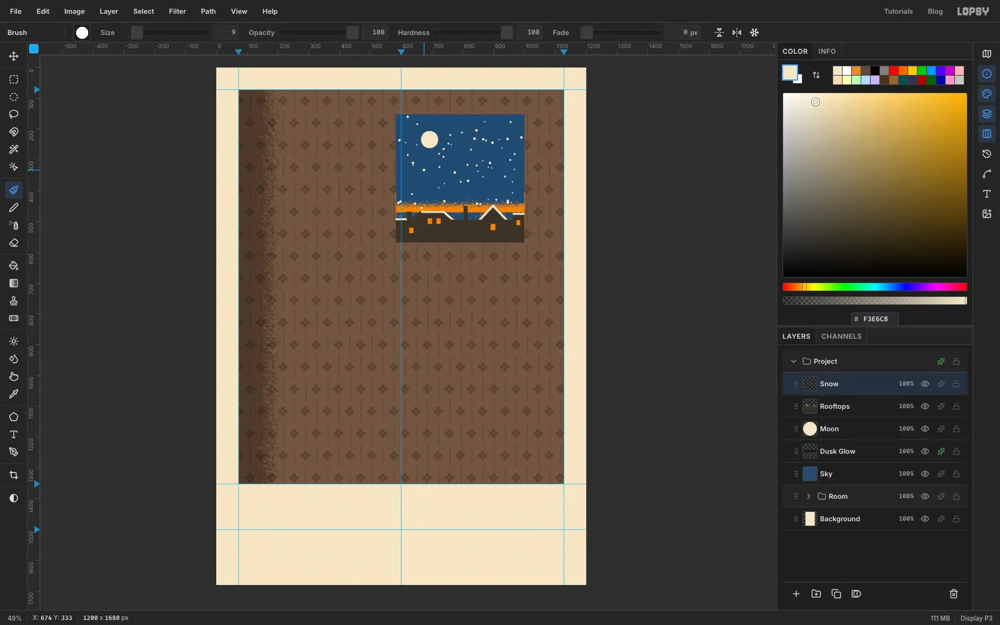

Add a layer called *Snow* and select the sky rectangle again (**582, 152** to **1000, 568**), so stray dabs can't land on the wall.

Pick the **Brush** with **Hardness 100** and set the foreground to paper `#F3E6C8`. Click about twenty single dots across the upper sky at **Size 5**, twenty more at **Size 7**, and twenty at **Size 9**. Scatter them unevenly and keep most of them above the roofs. Deselect.

## Cut the window frame and its panes

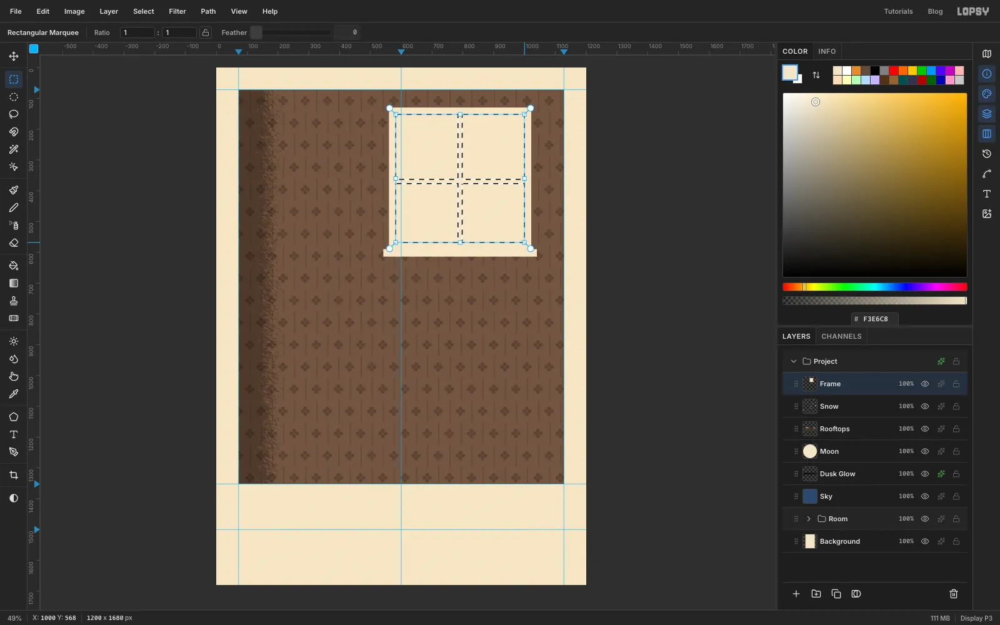

Add a layer called *Frame*. Select **560, 130** to **1022, 590**. Then hold [[Shift]] and drag a second rectangle for the sill, about 18 px wider on each side and 24 px tall, from about **542, 590** to **1040, 614**. Fill with paper `#F3E6C8` and deselect.

Now cut out the glass. Select the top-left pane (**582, 152** to **784, 363**). [[Shift]]-drag over the other three panes to add them, leaving 14 px bars between them:

- **798, 152** to **1000, 363**
- **582, 377** to **784, 568**
- **798, 377** to **1000, 568**

Press [[Delete]] and deselect. That leaves a 14 px cross of glazing bars.

Add a **Stroke** effect to *Frame*: **Width 2** in key `#3A3328`. Click *Frame*, [[Shift]]-click *Sky*, choose **Layer → Group Layers**, name the group *Window*, and collapse it.

## Lay the tablecloth

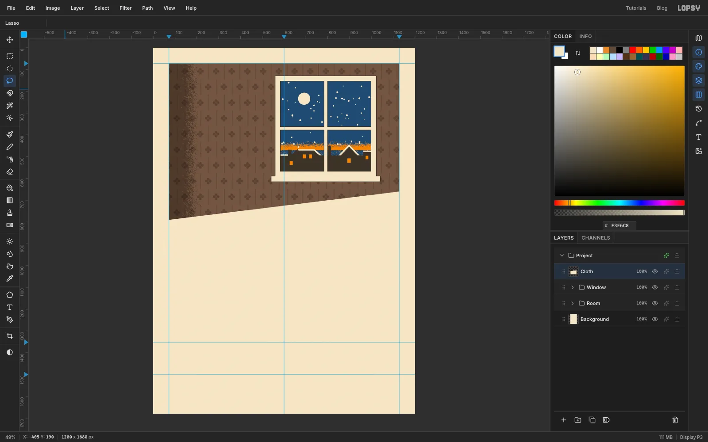

With *Window* selected, add a layer called *Cloth*. Use the **Pen** to draw the table:

1. Click the left plate edge at y 790.
2. Click the right plate edge at y 660.
3. Click the bottom-right and bottom-left corners of the plate, then click the first point to close the shape.

Click **Path to Selection** and delete the path. The back edge tilts about 7°, like the steep, flattened tables in Japanese prints. Fill it with paper `#F3E6C8` and deselect.

## Make a gingham pattern

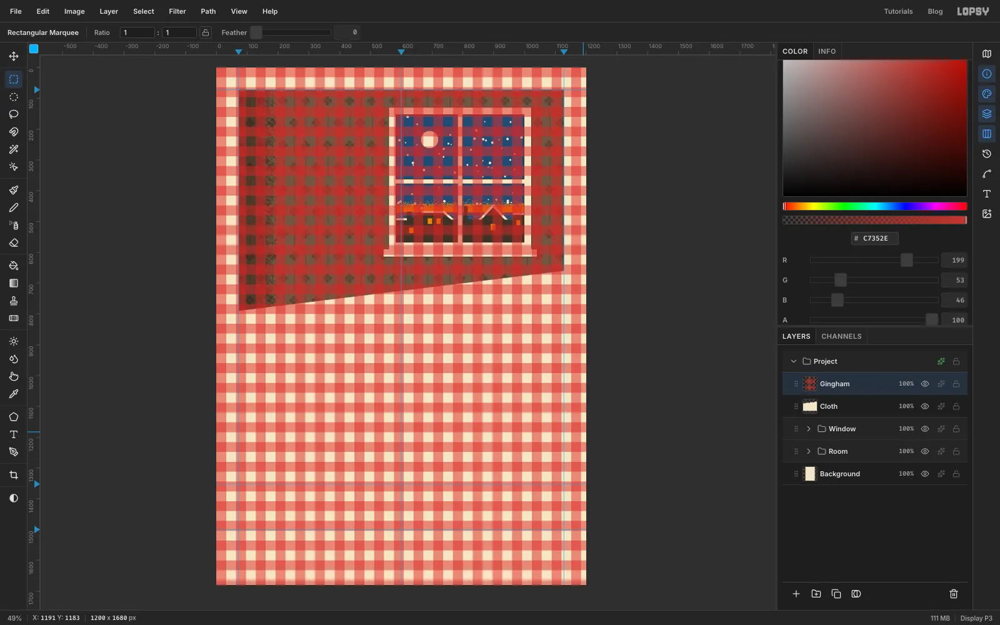

Add a layer called *Gingham Tile*. In the Color panel, set the foreground to red `#C7352E` and its **A** (alpha) to **50**.

1. Fill a tall half tile, **0, 0** to **32, 64**.
2. Fill a wide half tile, **0, 0** to **64, 32**.

Where the two overlap, the colour doubles up to a darker square, just like woven gingham. Set **A** back to **100**. Select **0, 0** to **64, 64**, choose **Edit → Define Pattern**, deselect, and delete the tile layer.

Click *Cloth*, add a layer called *Gingham*, and choose **Edit → Fill with Pattern…** with no selection. Pick the gingham tile, leave the staggers at 0, and click **Apply**. The pattern covers the whole document for now.

## Foreshorten the checks with Perspective

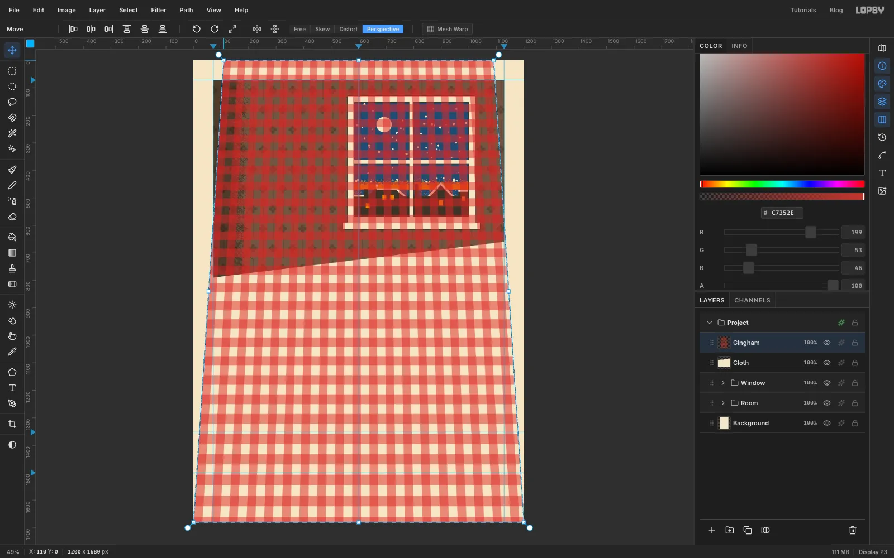

Checks the same size all the way up make the table look like a wall. Press [[Cmd+A]] and pick the **Move** tool ([[V]]). In the options bar, click **Perspective**. Drag the top-left corner handle about 110 px to the right. The top-right corner mirrors it, and the rows of checks shrink towards the top. Press [[Cmd+D]] to commit.

## Turn the gingham to match the table

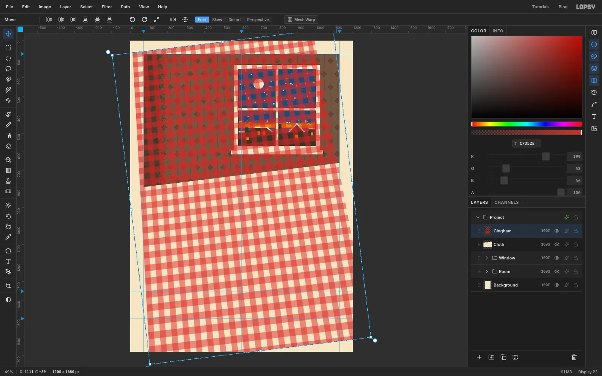

Press [[Cmd+A]] again, and click **Free** in the options bar. Drag the rotation handle just outside the top-right corner a little upwards, about **−7°**, so the rows run parallel to the cloth's back edge. Press [[Cmd+D]].

## Trim the gingham to the table

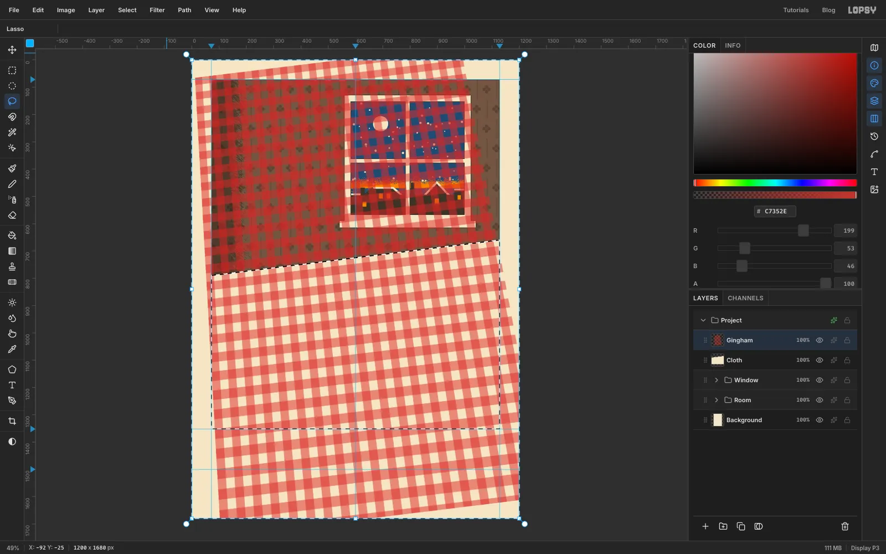

[[Cmd]]-click the *Cloth* thumbnail to load the table shape. Choose **Select → Inverse**, press [[Delete]] and deselect.

Open the effects drawer and set *Gingham*'s **Blend** to **Multiply**, so the cream squares let the cloth show through.

## Shade the cloth with cool grain

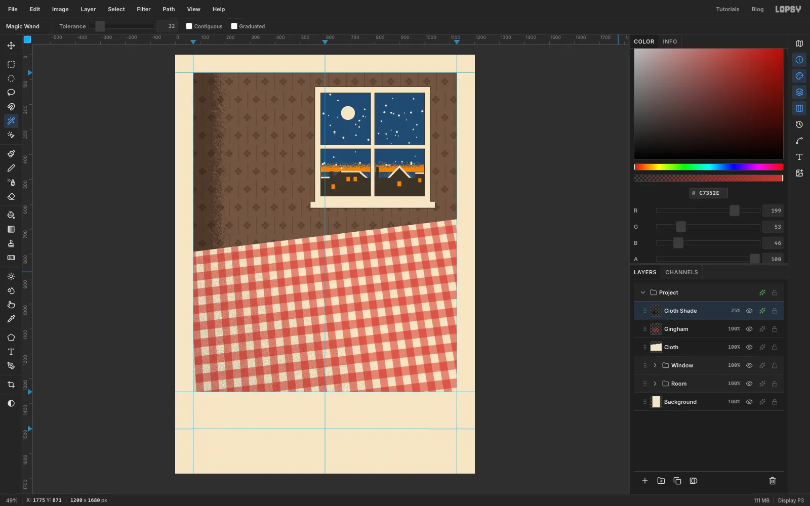

Add a layer called *Cloth Shade* and [[Cmd]]-click the *Cloth* thumbnail again. Drag a linear gradient with the dark stop (`#6E6E6E`) at the bottom-left corner of the plate and the light stop (`#D2D2D2`) up towards the middle of the window sill. Turn it into crayon grain with no motion blur.

Add a **Color Overlay** in Prussian blue `#2B4A6F`, set the layer to **Multiply** at **25%**. Click *Cloth Shade*, [[Shift]]-click *Cloth*, group them as *Table*, and collapse the group.

## Draw the back of the bowl

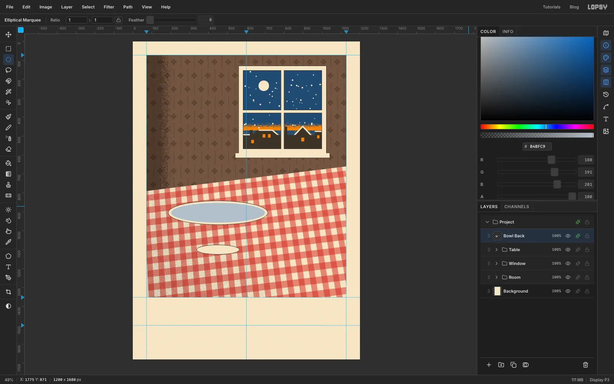

The oranges have to sit *inside* the bowl, so the bowl is built in two layers: the back now, and the front over the oranges later.

With *Table* selected, add a layer called *Bowl Back*.

1. With the **Elliptical Marquee**, select **338, 1076** to **562, 1124** for the foot.
2. [[Shift]]-drag the rim ellipse, from about **188, 843** to **712, 967**.
3. Fill with paper `#F3E6C8`.
4. Select the inside of the mouth, **202, 853** to **698, 957**, and fill it with bowl tint `#B4BFC9`.
5. Deselect and add a **Stroke** of **Width 2** in key `#3A3328`.

## Pile up the oranges

Add a layer called *Oranges*. Every orange is drawn the same way:

1. Select a circle with the Elliptical Marquee.
2. Fill it with key `#3A3328`. Then choose **Select → Shrink…** by **2** and fill with orange `#E8892A`. That leaves a thin key outline.
3. Hold [[Alt]] and drag an equal circle shifted about a quarter of the radius up and to the right. This subtracts most of the orange from the selection and leaves a crescent on the lower left, away from the window. Fill it with shadow orange `#C25A1E` and deselect.

Draw them from the back to the front, so each new orange overlaps the ones behind it:

1. **286, 720** to **458, 892**
2. **440, 712** to **616, 888**
3. the top orange, **370, 634** to **534, 798**
4. **220, 798** to **380, 958**
5. **514, 794** to **682, 962**
6. the front orange, **354, 800** to **538, 984**

## Draw the front of the bowl

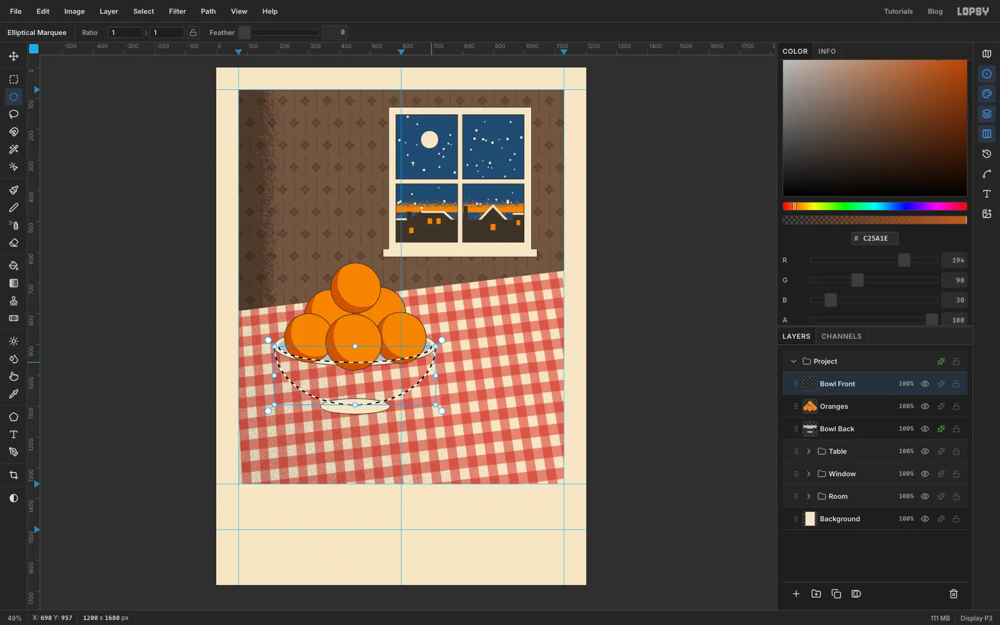

Add a layer called *Bowl Front*, above *Oranges*.

1. Select a tall ellipse from **188, 715** to **712, 1095**.
2. With the Rectangular Marquee, [[Alt]]-drag a box over the whole top half of the ellipse, down to the rim line at y 905, to remove it.
3. With the Elliptical Marquee, [[Alt]]-drag over the mouth (about **202, 853** to **698, 957**) to remove it as well.

What's left is the bowl's body below the front of the rim. Fill it with paper, deselect, and give it the same 2 px key **Stroke**. The oranges now drop into the bowl.

## Paint the blue bowl pattern

Add a layer called *Bowl Pattern* and [[Cmd]]-click the *Bowl Front* thumbnail, so your strokes can't spill off the bowl. Set the foreground to Prussian blue `#2B4A6F` and pick the **Brush** (**Hardness 90**, **Spacing 2**):

1. At **Size 14**, paint a band that follows the curve of the rim, about 25 px below it.
2. At **Size 6**, paint a wavy line under it, about nine waves across.
3. At **Size 9**, click a row of evenly spaced dots below the wave.
4. At **Size 5**, paint one thin line around the bowl just above the foot.

Deselect.

## Spatter shade on the bowl

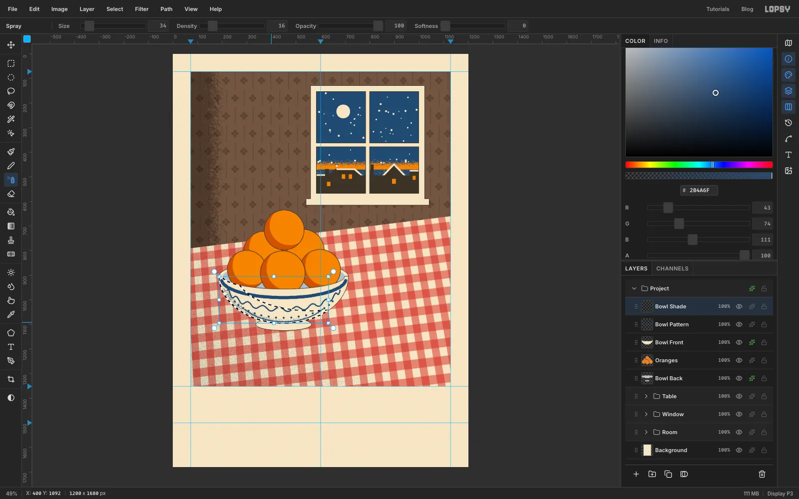

Lautrec shaded with *crachis*: ink flicked off a toothbrush. The **Spray** tool does the same job.

Add a layer called *Bowl Shade*. [[Cmd]]-click the *Bowl Front* thumbnail, then [[Alt]]-drag a big ellipse over the right two-thirds of the bowl to remove it. That leaves a crescent along the lower left.

Pick the **Spray** ([[J]]) at **Size 34**, **Density 16**, **Opacity 100** and **Softness 0**, in Prussian blue. Make two quick passes along the bottom curve, thickest under the bowl and thinning out towards the rim. Deselect and set the layer's **Blend** to **Multiply**.

## Top the pile with leaves

Add a layer called *Leaves*. With the Lasso, draw two pointed leaves from the top of the top orange (about 452, 640). One reaches right to about 534, 630, the other left to about 368, 608. Fill them with olive `#4E6B3A` and deselect.

Paint a midrib down each leaf with a **Size 3** brush in Prussian blue, and a short **Size 7** stem in key. Add a 2 px key **Stroke**.

## Give the peel some grain

Click *Oranges* and add a layer called *Peel Grain*. Select a rectangle covering the whole pile (**180, 600** to **720, 1000**). Fill it with `#AAAAAA`, deselect, and turn it into crayon grain.

Now [[Cmd]]-click the *Oranges* thumbnail to load the pile's shape. Choose **Select → Inverse**, press [[Delete]], and deselect. Add a **Color Overlay** in shadow orange `#C25A1E`, then set the layer to **Multiply** at **70%**. The flat oranges now have a pitted, crayoned peel.

## Copy an orange onto the table

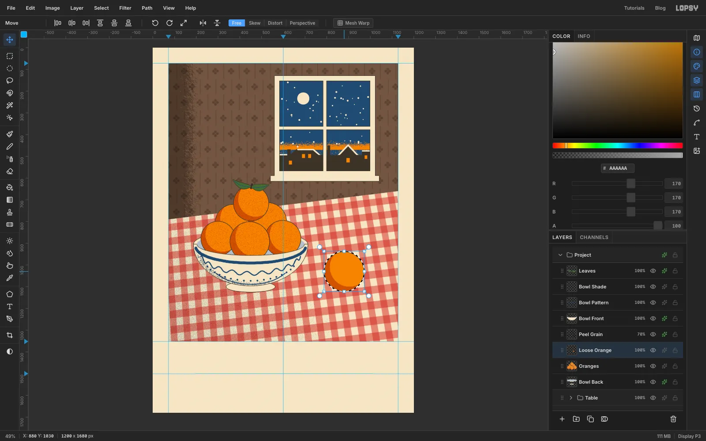

Click *Oranges* and select the front orange with a circle just around its outline (**353, 799** to **539, 985**). Press [[Cmd+C]], then [[Cmd+V]]. The copy lands on a new layer in the same spot, and the Move tool is active. Rename the layer *Loose Orange*.

Drag it out onto the cloth, to the right of the bowl. Its centre should sit at about 880, 1030. Press [[Cmd+D]].

The copy comes from the *Oranges* layer, so it doesn't pick up the peel grain. The smoother skin helps this orange, nearest the window, read as catching more light.

## Scale and turn the loose orange

A pasted copy looks stamped, so change it a little.

1. Draw a marquee just around the loose orange. Hold [[Cmd]] and drag the bottom-right handle about 16 px outwards ([[Cmd]] keeps it round). Press [[Cmd+D]].
2. Marquee it again and drag the corner rotation handle about **16°** anticlockwise. Press [[Cmd+D]].

## Cut an orange in half

Add a layer called *Cut Orange*. It sits in front of the bowl, at about 640, 1200. Use the **Elliptical Marquee** for both ovals.

1. **The side of the peel:** select **544, 1134** to **736, 1298**. Fill it with key, shrink by **2**, and fill with shadow orange.
2. **The cut face:** select **544, 1124** to **736, 1276**. Fill with key, shrink by **2**, and fill with orange (the rind). Shrink by **8** and fill with paper (the pith). Shrink by **5** and fill with orange (the flesh).

Keep that last selection active.

## Draw the segments with Radial Symmetry

Pick the **Brush** at **Size 4** with paper as the foreground. In the options bar, click **Radial Symmetry** and set **Segments** to **10**. [[Cmd]]-click the centre of the cut face to move the symmetry centre there.

Drag one stroke from the centre out to the edge of the flesh. Lopsy repeats it ten times around the centre, and the selection keeps every line inside the flesh. Turn **Radial Symmetry** off again.

Select a small dot in the middle (**630, 1192** to **650, 1208**), fill it with paper and deselect. Then click a few **Size 4** paper flecks on the flesh for juice.

## Ground everything with contact shadows

Without shadows the bowl and the oranges seem to float. Select *Table* and add a layer called *Cast Shadows*, so it sits under everything on the cloth. Select a flat ellipse just left of where each object touches the table:

1. Bowl foot: **304, 1101** to **568, 1127**.
2. Hold [[Shift]] and drag one under the loose orange, from about **782, 1123** to **954, 1145**.
3. Hold [[Shift]] and drag one under the cut orange, from about **534, 1282** to **718, 1302**.

Fill with key `#3A3328`, deselect, and set the layer to **Multiply** at **35%**.

## Lay down the fir stems

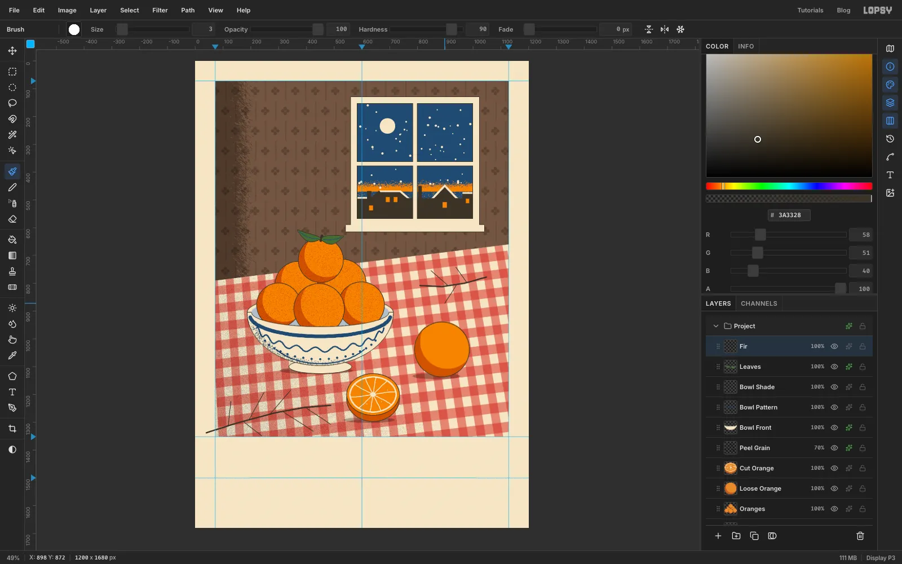

Click *Leaves* and add a layer called *Fir*. Pick the **Brush** (**Hardness 90**) with key `#3A3328` as the foreground.

- **Bough:** at **Size 6**, drag a gently curving stem from just off the left edge at about y 1340 to about 490, 1240. At **Size 3**, add six side twigs. Three angle up and back, and three angle down towards the bottom edge.
- **Sprig:** draw a second, shorter stem lying on the cloth to the right, from about 1050, 778 to 810, 808, with three twigs.

## Draw the needles in two inks

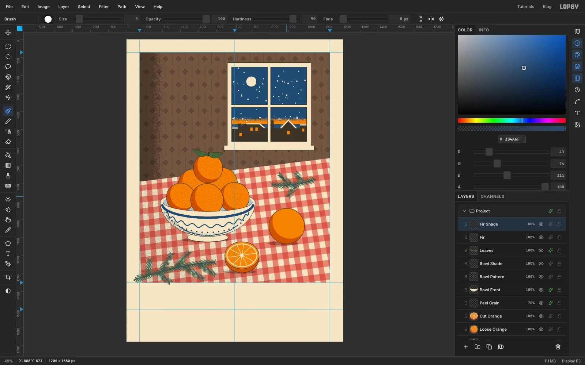

Set the foreground to olive `#4E6B3A` and the brush to **Size 4**. Along every stem and twig, draw short separate strokes, packed close together like the teeth of a comb. Alternate sides, and slope each needle forwards towards the tip of its twig. Make them about 25 px long, a little shorter near the tips.

Add a layer called *Fir Shade*. With Prussian blue at **Size 3**, draw a second set of shorter needles (about 16 px) in the gaps between the olive ones. Set the layer's opacity to **80%**. Two inks laid side by side give the fir its depth.

## Tie a red ribbon with the Pen

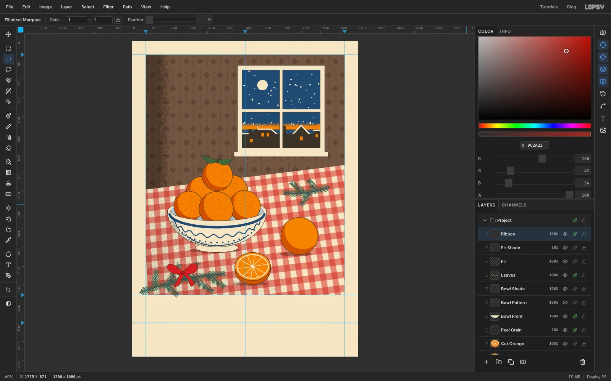

Add a layer called *Ribbon*. Pick the **Pen** ([[P]]). Draw four closed shapes around a knot at about 268, 1236:

- two rounded loops, one reaching up to the left and one up to the right
- two tails that hang down and outwards

For each one, click and drag at each point to curve the line, then click the first point to close it. Open the **Paths** panel and click **Path to Selection**. Fill with red `#C7352E`, delete the path, and deselect.

Fill a small knot ellipse (28 × 22) with `#9C2A22`, then add a 2 px key **Stroke**.

## Group the still life and nudge it

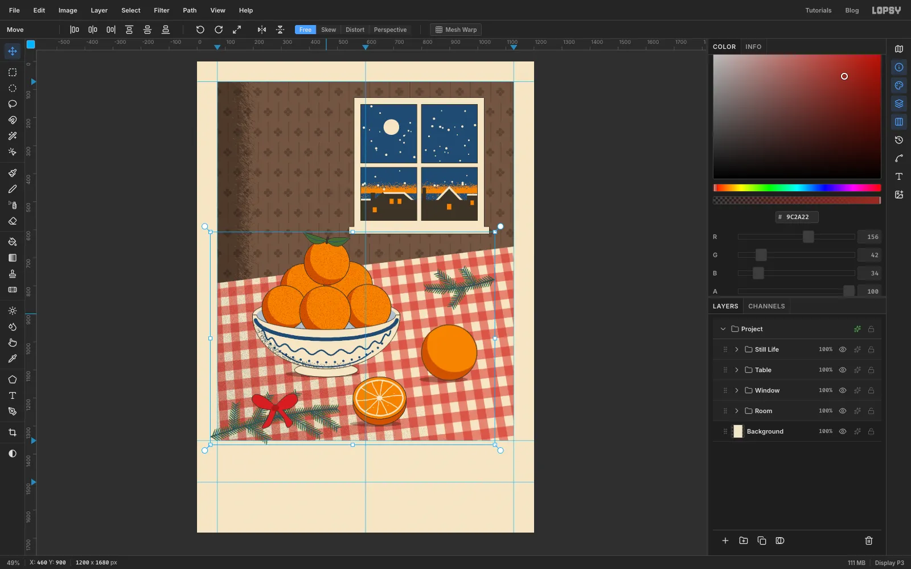

Click *Ribbon*, [[Shift]]-click *Cast Shadows*, and choose **Layer → Group Layers**. Name the group *Still Life* and collapse it.

With the group selected, drag anywhere on the bowl with the **Move** tool to shift the whole arrangement about **10 px** right. Every layer inside moves together.

## Mat the plate and draw the border

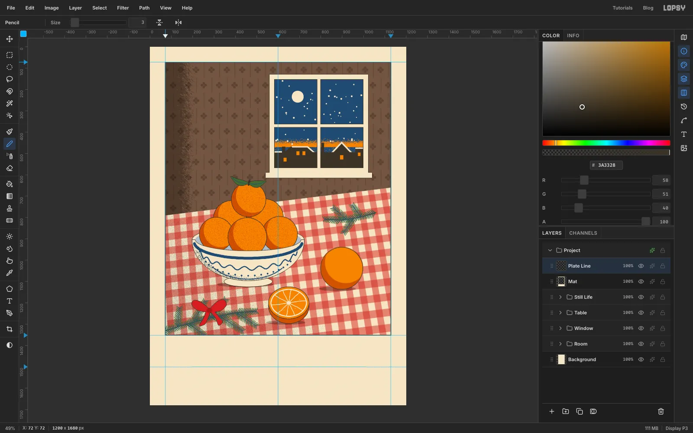

The fir runs off the plate on both sides. Instead of trimming every layer, lay a paper mat over the top.

1. With *Still Life* selected, add a layer called *Mat*.
2. Select the plate (**72, 72** to **1128, 1352**), choose **Select → Inverse**, and fill with paper. Deselect.
3. Add a layer called *Plate Line*. Pick the **Pencil** at **Size 3** with key as the foreground.
4. Click the top-left corner of the plate, then [[Shift]]-click the other three corners and the first one again, for four straight lines.

## Set the caption and kern the apostrophe

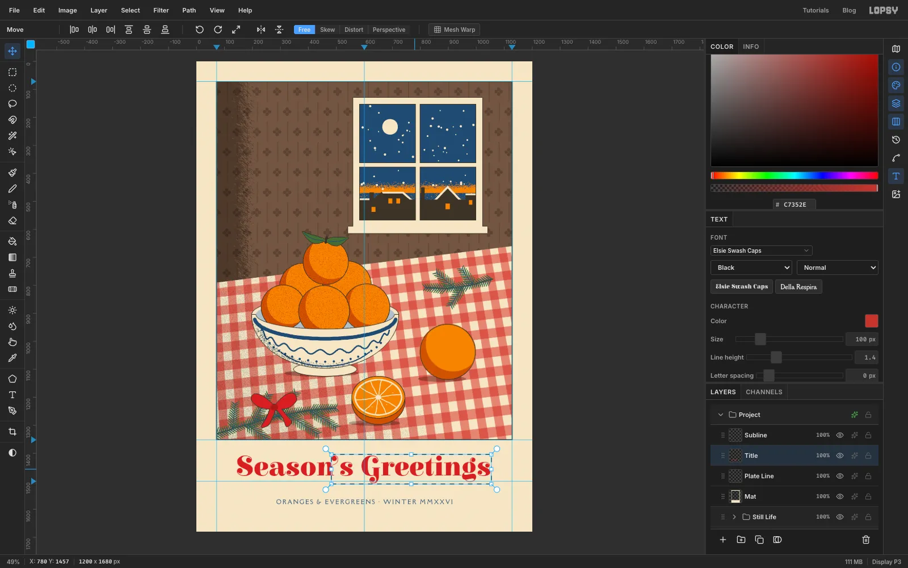

Set the small line first. Once the big title is on the canvas, its text box reaches down to where you'd click for the subline, and the click would edit the title instead.

Pick the **Text** tool ([[T]]). Choose **Della Respira** at **20 px** in Prussian blue. In the **Text** panel, set **Letter spacing** to **4**. Click in the empty margin near the bottom of the card and type `ORANGES & EVERGREENS · WINTER MMXXVI`. Press [[Tab]] to finish, and rename the layer *Subline* (text layers name themselves after their text). Drag it with the **Move** tool so it's centred on the middle guide, with its baseline at about y 1580.

Click *Plate Line*, so the next text doesn't restyle the subline. Pick the Text tool, choose **Elsie Swash Caps**, weight **Black**, at **100 px** in red `#C7352E`. Set **Letter spacing** back to **0**. Click in the caption band and type `Season’s Greetings`, with a curly apostrophe. Press [[Tab]], rename the layer *Title*, then click **Rasterize Layer** at the bottom of the Layers panel.

The swash font leaves loose gaps around the apostrophe, so close them by hand:

1. Draw a marquee from just left of the apostrophe to past the end of the line.
2. With the Move tool, press [[Shift+Left]] once and [[Left]] twice (12 px), then [[Cmd+D]].
3. Do the same from just left of the *s*, moving it 10 px.

## Centre the title

Move the title so it's centred on the middle guide, with the tops of the capitals at about y 1420, so the y 1500 guide runs just through the lower half of the letters. That's 68 px below the plate, which gives the swash capitals room to breathe. Use the arrow keys for the last few pixels.

## Stamp a red chop

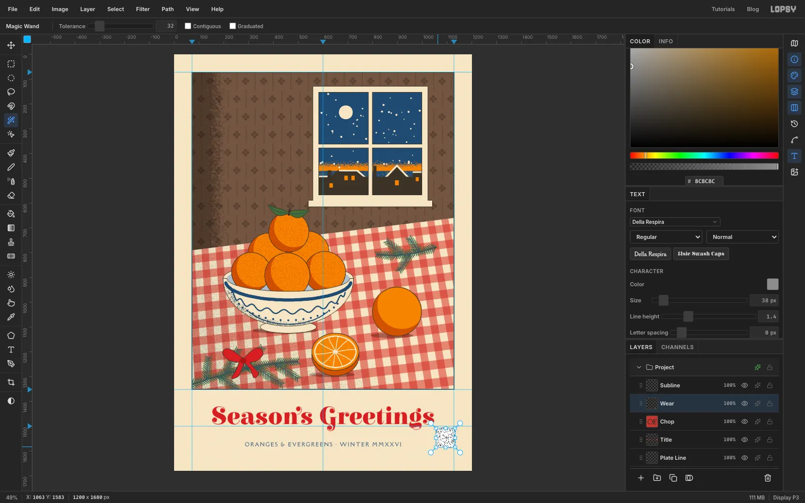

A chop is the small stamp printers pressed into the margin.

1. Click *Title* and add a layer called *Chop*. Fill a square from **1060, 1513** to **1128, 1581** with red. Its right edge lines up with the plate, and its bottom with the subline.
2. Type `OE` in **Della Respira** at **38 px** in any colour, in empty margin, and name the layer *OE*. Rasterize it and move it to the centre of the square.
3. [[Cmd]]-click the *OE* thumbnail, click *Chop*, press [[Delete]], and deselect. Then delete the *OE* layer. The letters are now knocked out of the red.

To wear the edges like a used rubber stamp:

1. Add a layer called *Wear*. Fill a square 6 px larger all round with `#8C8C8C` and deselect.
2. Run **Add Noise** (**100**, **Mono**), **Gaussian Blur** (**2**) and **Threshold** (**124**).
3. Pick the Magic Wand (Contiguous off) and click a black blot.
4. Click *Chop*, press [[Delete]], deselect, and delete *Wear*. The square now has a worn, broken edge and pitted letters.

## Add paper grain to the margin

Click *Subline*, the top layer, and add a layer called *Stone Grain*. Select the plate, choose **Select → Inverse**, and fill with `#A8A8A8`. Deselect and turn it into crayon grain. The grey is light, so only about one pixel in seven turns into a speck.

Add a **Color Overlay** in grain `#B59E78`, then set the layer to **Multiply** at **45%**.

## Settle the inks

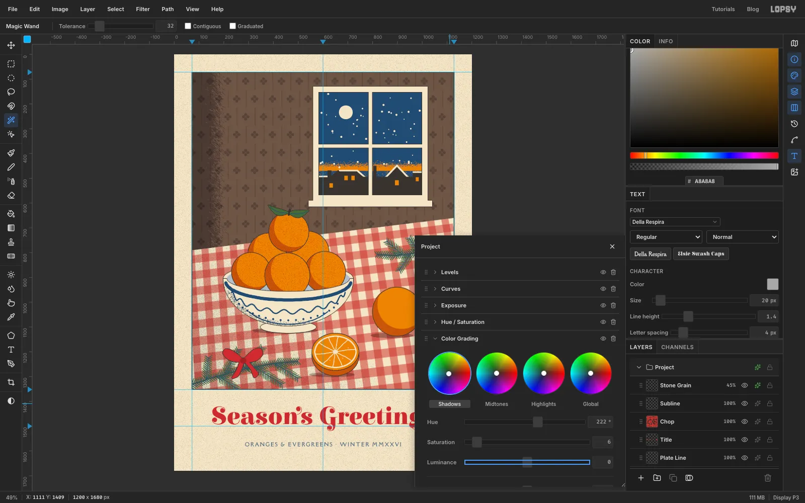

Choose **Layer → Adjustment Layer…** and click **Got it**. New documents come with five adjustments already in the list.

1. Expand **Hue / Saturation** and set **Saturation** to **−8**, so the inks look less like screen colours.
2. Expand **Color Grading**, click **Shadows**, and set **Hue** to **222** and **Saturation** to **6**. This gives the darkest inks a cool cast, like Prussian blue printed under them.

Close the drawer. Choose **File → Save Project** to keep the layers, then **File → Quick Export PNG** for the finished card.
