"Lo-fi" art is the cosy, slightly faded look you see on study-music playlists and relaxing streams. It's almost always dusk or night, often rainy. The palette is muted purples and blues with one warm light, the contrast is low, and the whole thing sits under a layer of grain. This tutorial paints one of those scenes: a heron waiting on a mooring post in a city canal while the rain comes down.

The heron starts as a real photograph. You cut it out, paint it with a filter, and light it so it belongs to the night. Everything else is painted in Lopsy: the sky, the skyline, the lamps, the water and the weather.

You'll need one public domain photo. Download the full-size (1050 × 1400 px) version of [Great Blue Heron](https://commons.wikimedia.org/wiki/File:Great_Blue_Heron_(44450066742).jpg), taken by Patrick Myers for Great Sand Dunes National Park and Preserve (NPS), and save it as `heron.jpg`.

The tools you'll use:

- the **Gradient** tool with its gradient editor, and the **Smudge** tool
- the **Rectangular** and **Elliptical Marquee**, both with their exact-size dialogs, plus [[Shift]] to add to a selection and [[Alt]] to subtract
- the **Brush** (hard and soft), **Pencil**, **Eraser**, **Lasso**, **Magic Wand** and **Dodge** tool
- **Copy Merged**, **Paste**, **Duplicate Layer**, **Flip Vertical** and the **Move** tool's scale and rotate handles
- **Clouds**, **Motion Blur**, **Gaussian Blur**, **Oil Paint**, **Hue/Saturation**, **Brightness/Contrast**, **Add Noise** and **Threshold**
- **Outer Glow** and **Color Overlay** layer effects, a **layer mask**, **groups**, and the **Soft Light**, **Screen** and **Overlay** blend modes
- group adjustments: **Color Grading**, **Highlights & Shadows**, **Hue/Saturation** and **Vignette**

The palette is a rainy dusk with one warm lamp:

- Sky `#1F1A35` → `#4B3D66` → `#8E6680` → `#B88A8F`
- Far skyline `#3E3457`, near skyline `#272039`, quay `#1A1528`
- Lamp `#F2A862`, lamp core `#FFE3B3`, pale window `#F6D9A8`
- Water `#4A3B60` → `#2C2443` → `#120F22`
- Post `#3A2A30`, cap `#4E3A40`, wet wood `#22181F`, warm edge `#9A6A66`
- Moon `#E6D9E4`, ripples `#B98BC9`, heron rim `#F4B070`

> **Tip:** On a wide-gamut (Display P3) screen, Lopsy reads typed hex codes as P3 colours. These codes were picked that way, so they'll look a touch duller on an sRGB screen.

> **Note:** Shortcuts are written for a Mac. On Windows, use [[Ctrl]] wherever it says [[Cmd]]; [[Alt]] is the Option key on a Mac. To set the foreground colour, click the hex field under the colour picker in the **Color** panel, type the code and press [[Enter]]. To rename a layer, double-click its name. Keep the names as you go, because later steps refer to them. Positions are given in canvas pixels. Read them off the rulers, and treat them as rough targets unless a step says otherwise.

## Set up the canvas and paint the sky

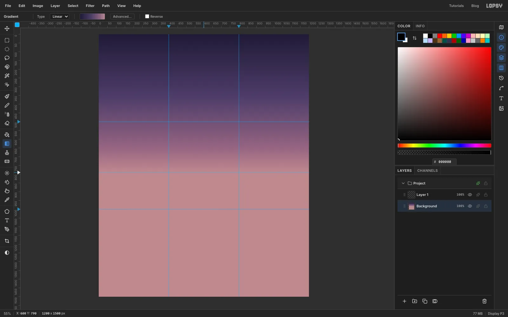

Choose **File → New**, keep the units on **Pixels**, and make the document **1200** wide and **1500** high. A new document has a **Background** layer and an empty **Layer 1** above it. Leave Layer 1 empty at the top of the stack: it becomes the film grain at the very end.

Add five guides by clicking on the rulers: click the top ruler at **400** and **800**, and the left ruler at **500**, **790** and **1000**. The guide at **790** is the horizon, where the far bank meets the water.

Click the **Background** layer. Pick the **Gradient** tool in the toolbox, set it to **Linear** and click **Advanced…**. The editor starts with a stop at each end. Click a stop to select it and type its colour into the **Hex** field, and click on the bar to add a stop there. The editor shows the selected stop's **Position**, so you can check you're close to the percentages below. Set four stops:

- `#1F1A35` at the left end
- `#4B3D66` at 45%
- `#8E6680` at 82%
- `#B88A8F` at the right end

Click **Done**, then drag straight down from the top edge of the canvas to the horizon guide. Everything below the guide gets the last colour, and the water will cover it later.

## Make streaky clouds

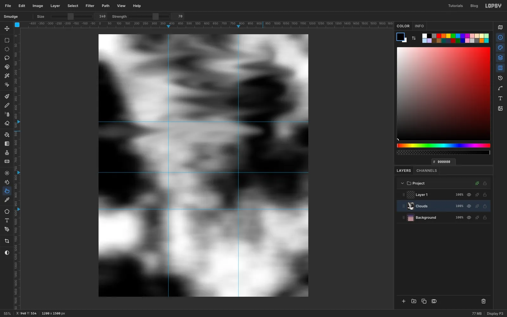

Click **Add Layer** (the **+** under the Layers panel) and name the new layer **Clouds**. Choose **Filter → Clouds…**, set **Scale** to **4** and click **Apply**. Then choose **Filter → Motion Blur…** with **Angle** **0** and **Distance** **80** to stretch the clouds sideways.

Now push them around by hand. Press [[R]] for the **Smudge** tool and set **Size** to **140** and **Strength** to **70** in the options bar. Drag five long, gently wavy strokes from left to right across the sky, from about y 120 down to y 540, roughly 100 px apart. They smear the clouds into brushy bands.

## Blend the clouds into the sky

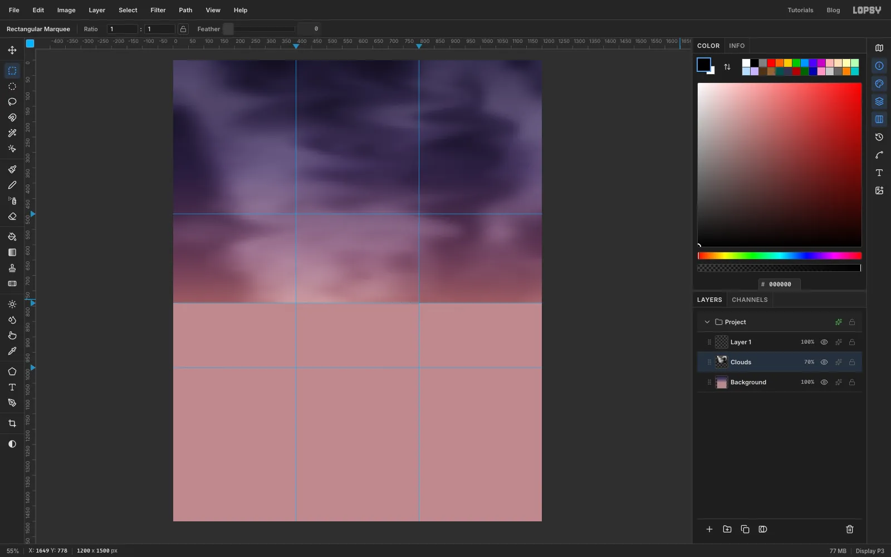

Press [[M]] for the **Rectangular Marquee**, drag a box over everything below the horizon guide (start a little outside the canvas on the left and finish past the bottom-right corner), and press [[Delete]]. Press [[Cmd+D]] to deselect.

Click the sparkle icon at the right end of the Clouds row. That's the layer's effects button, and it opens a drawer. Set **Blend** to **Soft Light** and close the drawer. Click the row's opacity readout and drag the slider to **70%**. The clouds now just shade the gradient instead of covering it.

## Cut a crescent moon

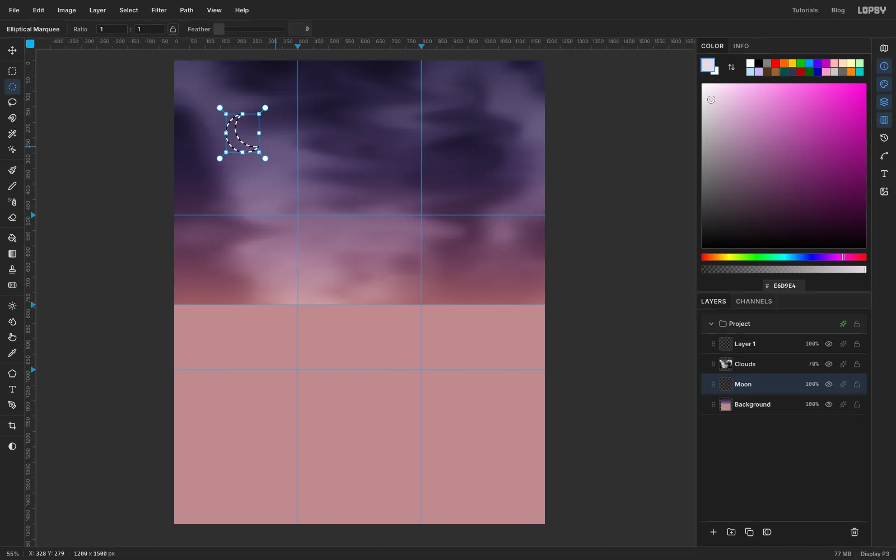

Click the **Background** layer, then click **Add Layer** and name the new layer **Moon**. It lands between Background and Clouds, so the cloud texture will drift across the moon.

Press [[Cmd+D]] so nothing is selected, pick the **Elliptical Marquee**, and click once on the canvas (a click, not a drag). A dialog asks for exact corners: enter **From** 168, 173 and **To** 292, 297 and press [[Enter]]. That's a circle with a radius of 62 px.

Now hold [[Alt]] and drag a second oval, about 130 px across, that overlaps the first but sits up and to the right of it: from about 198, 159 to 328, 279. Holding [[Alt]] subtracts it, which leaves a crescent. Set the foreground to `#E6D9E4` and choose **Edit → Fill**.

## Tilt the moon and give it a glow

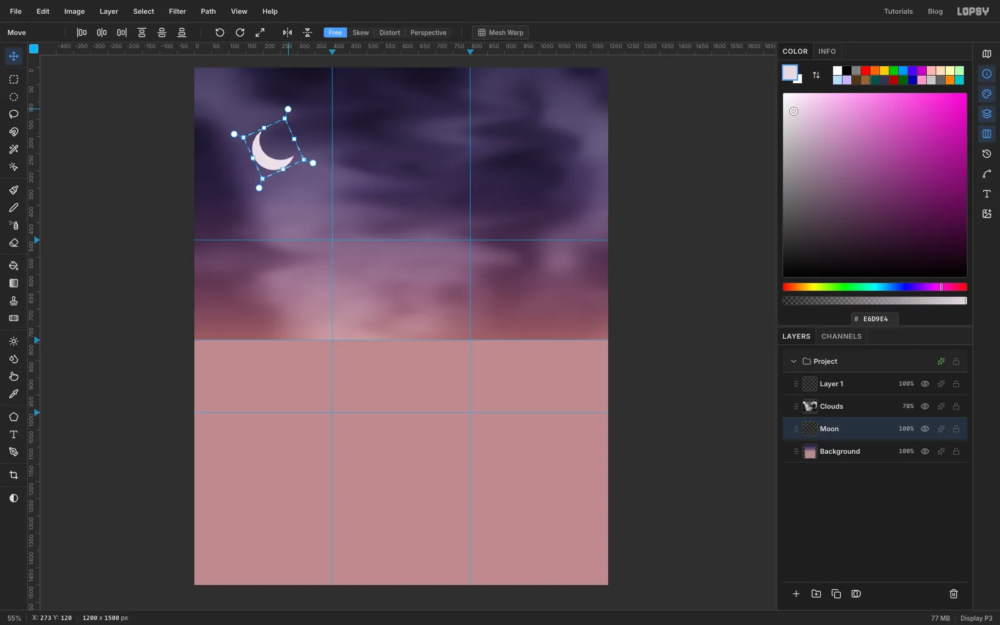

Press [[Cmd+D]], then use the Rectangular Marquee's click-once dialog to select a square around the moon, **From** 164, 169 **To** 296, 301. Press [[V]] for the **Move** tool. Move the pointer just outside the top-right corner of the box until it turns into the rotate cursor, then drag counter-clockwise about **25°**, until the horns of the crescent point up and to the right. Press [[Cmd+D]] to commit.

Open the Moon layer's effects, tick **Outer Glow**, set its colour to `#E6D9E4`, **Size** to **40**, **Spread** to **0** and **Opacity** to **20**, and close the drawer. Lower the layer's opacity to **80%** so the moon doesn't outshine the heron.

Add a layer called **Moon Haze**. Press [[B]] for the **Brush**, open the **Brushes** window from the brush-tip thumbnail in the options bar, and on the **Shape** tab set **Size** **380**, **Hardness** **0** and **Opacity** **35** (leave **Spacing** at 10). Close the window and, with the foreground still `#E6D9E4`, click once on the moon. Open the layer's effects drawer and set **Blend** to **Screen**. One click of a huge soft brush is a quick way to paint light.

## Block in the far skyline

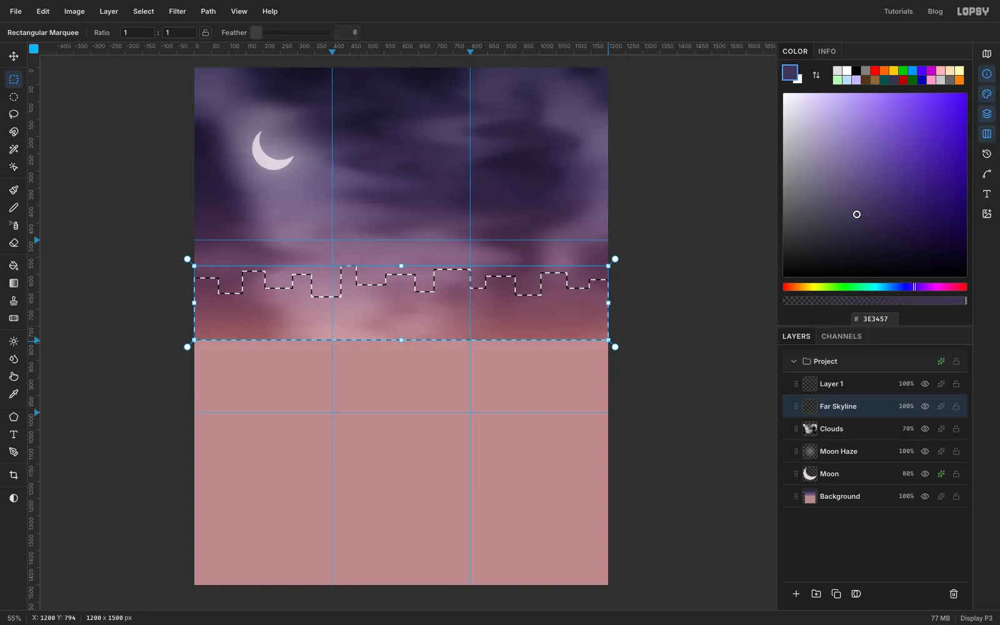

Click the **Clouds** layer first, so the skyline lands above it. New layers always go directly above the active layer. Add a layer called **Far Skyline**.

Press [[M]] for the Rectangular Marquee and drag the first building, from the left edge of the canvas at about y 610 down to just below the horizon guide (about y 794). Then hold [[Shift]] and drag the next building, and keep going all the way across the canvas. [[Shift]] adds each box to the selection. Make them 45–95 px wide, overlapping a little, with tops anywhere between y 575 and y 665, and always finish just below the horizon.

Set the foreground to `#3E3457`, choose **Edit → Fill**, and press [[Cmd+D]]. Then choose **Filter → Gaussian Blur…** with **Radius** **3**. A slight blur pushes the far buildings back into the haze.

## Add the near skyline and a clock tower

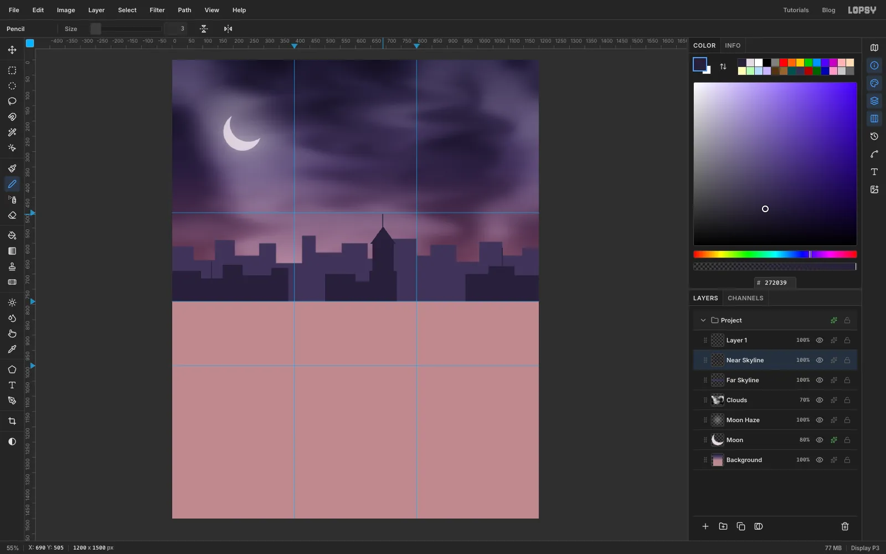

Add a layer called **Near Skyline** and block it in the same way with [[Shift]]-drags, but with darker, shorter blocks (and no blur this time): tops between y 670 and y 725, 50–105 px wide. Leave two gaps, one from about x 380 to x 500 and a wider one from x 735 to x 960, so the far skyline shows through and the heron's neck and the right-hand lamp have clear sky behind them. Also Shift-drag one tall block for the clock tower, from x 655 to x 725, with its top at y 600. Fill with `#272039` and deselect.

For the tower roof, press [[L]] for the **Lasso** and drag a triangle from just left of the tower top, up to a point at x 690, y 545, and back down to just right of the tower top. Choose **Edit → Fill**, then deselect.

For antennas, press [[N]] for the **Pencil** and set **Size** to **3**. Click at the top of a building, hold [[Shift]] and click 50–60 px above it. Add one on the tower's point and one or two elsewhere on the skyline.

## Light the windows

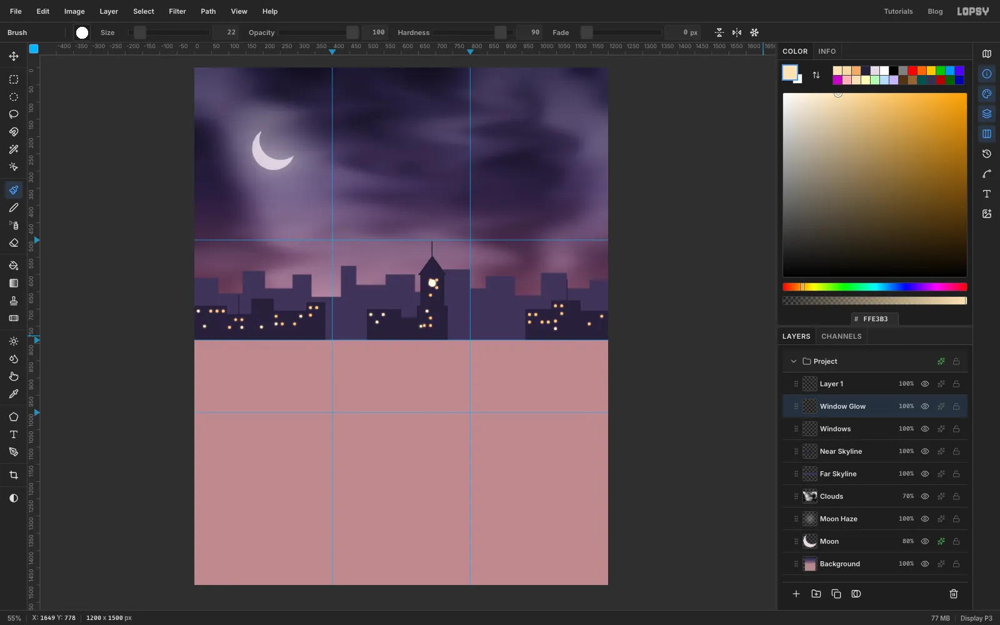

Add a layer called **Windows**. Choose the **Brush** ([[B]]) and in the Brushes window set **Size** **9**, **Hardness** **100** and **Opacity** **100**.

Set the foreground to `#F2A862` and click dots across the near buildings in loose rows about 22 px apart, with about 18 px between dots in a row. Only light about four in every ten window spots, so the buildings look lived in rather than full. Then switch to `#F6D9A8` and add about half as many pale windows in between. Set the brush **Size** to **22**, **Hardness** to **90** and the colour to `#FFE3B3`, and click once in the upper part of the tower for the clock face.

For the glow, choose **Layer → Duplicate Layer**, rename the copy **Window Glow**, run **Filter → Gaussian Blur…** at **Radius** **7**, and set its blend mode to **Screen**.

## Build the quay wall and railing

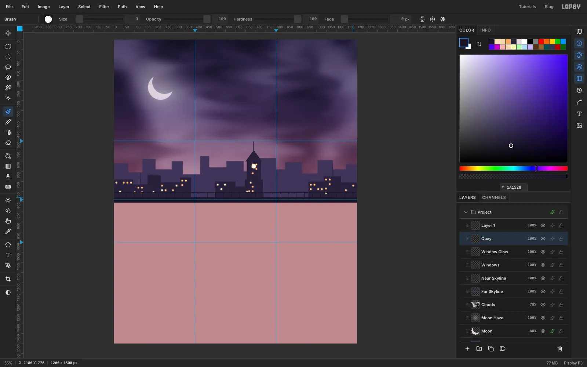

Add a layer called **Quay**. Thin strips that cross a guide can snap flat when you drag them, so use the dialog: press [[Cmd+D]], click once with the Rectangular Marquee and enter **From** 0, 778 **To** 1200, 804. Fill it with `#1A1528` and deselect.

Keep `#1A1528` as the foreground. Choose the **Brush** and set **Size** **3**, **Hardness** **100** and **Opacity** **100**. For the top rail, click at the left edge at y 754, hold [[Shift]] and click at the right edge at the same height. Then add the posts: click on the rail at x 20 and [[Shift]]-click straight down on the quay at y 778. Repeat every 40 px across the canvas.

## Stand two street lamps on the quay

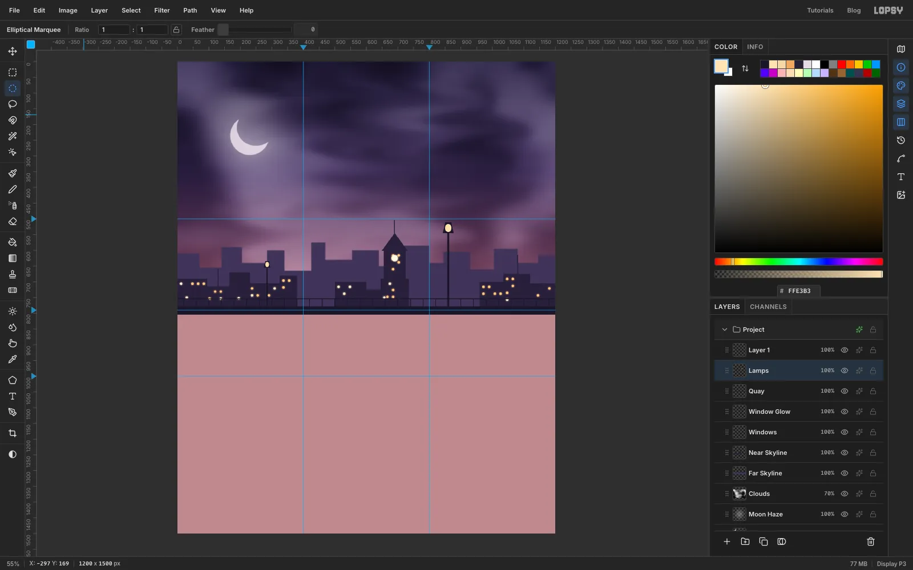

Add a layer called **Lamps**, with the foreground still `#1A1528`.

The big lamp stands at x 860. Set the brush **Size** to **8**, click on the quay at x 860, y 788, and [[Shift]]-click straight up at y 545. For its lantern, zoom in first ([[Cmd]] and scroll over the lamp), then drag the **Lasso** around a small trapezoid sitting on top of the pole, about 20 px wide at the top, 34 px wide at the bottom and 34 px tall, then **Edit → Fill** and deselect. For the glass, use the Elliptical Marquee's click-once dialog to make a 20 × 26 px oval in the middle of the lantern (**From** 850, 516 **To** 870, 542), fill it with `#FFE3B3` and deselect.

Set the foreground back to `#1A1528` and make the second lamp smaller, further away on the left at x 285: a **Size** **5** pole from the quay up to y 655 and a lantern about two thirds the size. Switch to `#FFE3B3` again for its smaller glass.

## Make the lamps glow

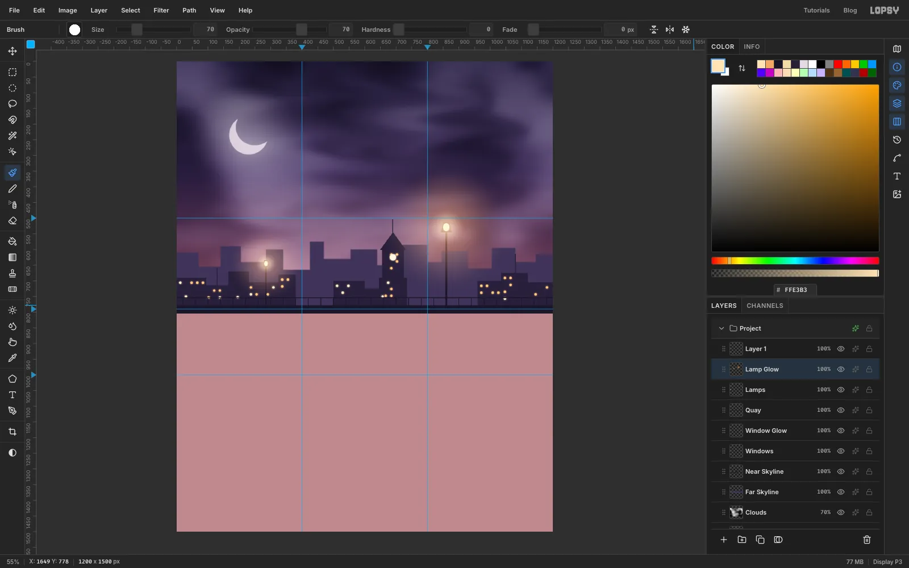

Add a layer called **Lamp Glow**. Set the foreground to `#F2A862` and, in the Brushes window, set **Hardness** **0**, **Size** **420** and **Opacity** **55**. Click once on the big lantern. Set **Size** to **240** and **Opacity** to **50**, and click once on the small lantern.

Now the hot cores. Switch the foreground to `#FFE3B3`, set **Opacity** to **70**, and click once on each lantern again: at **Size** **120** on the big one and **70** on the small one. Set the layer's blend mode to **Screen**.

## Lay down the water

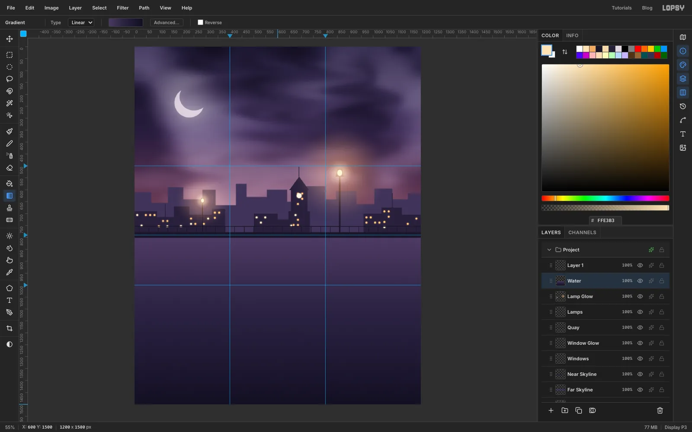

Add a layer called **Water**. Use the Rectangular Marquee's dialog to select from **0, 802** to **1200, 1500**, which is everything below the quay.

Pick the **Gradient** tool and open **Advanced…** again. It remembers the sky's stops, so select each middle stop and click **Delete** until only the two ends are left. Then set three stops: `#4A3B60` at the left end, `#2C2443` at 40% and `#120F22` at the right end. Drag from the top of the selection straight down to the bottom of the canvas, then deselect.

## Copy the skyline and flip it

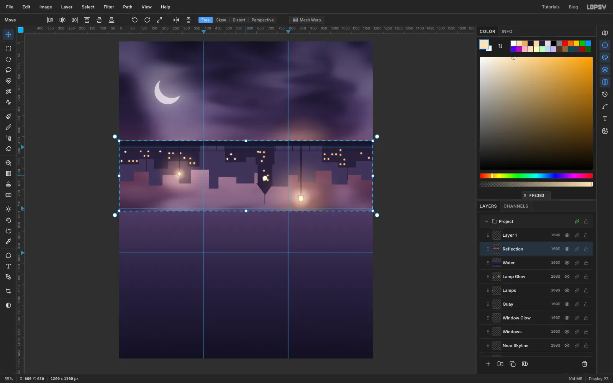

Water reflects whatever is above it, so make the reflection from the painting itself. Select **From** 0, 470 **To** 1200, 802 with the Rectangular Marquee's dialog. That's the band from the lower sky, through the skyline and lamps, down to the quay. Choose **Edit → Copy Merged**, then **Edit → Paste**. The copy is pasted in place on a new layer above Water. Rename it **Reflection**.

The paste leaves the band selected and switches to the **Move** tool, so just click **Flip Vertical** in the options bar. The band turns upside down where it is.

## Drop the reflection onto the water

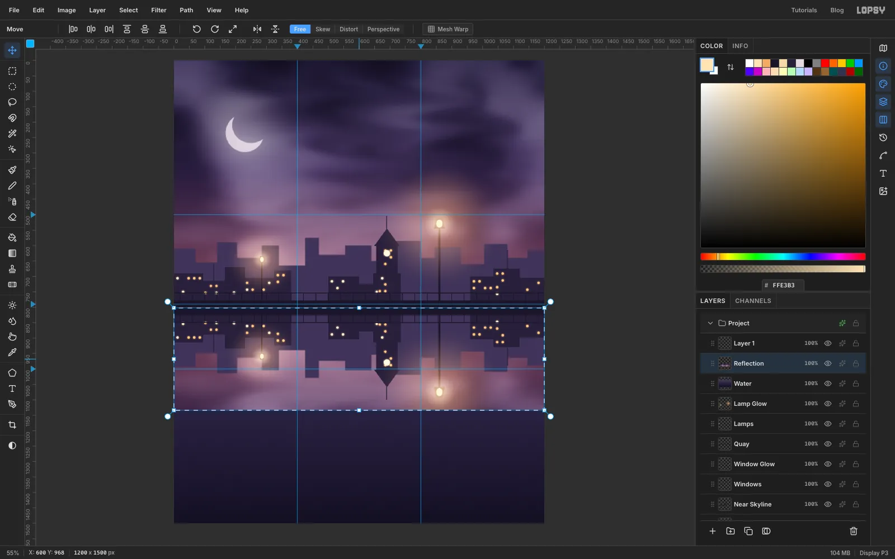

Guides pull a dragged selection towards them, which would stop this band in the wrong place, so open **View** and untick **Snap to Guides**.

Drag inside the selection straight down until the top of the flipped band meets the bottom of the quay at y 802. The quay now sits on its own reflection. Press [[Cmd+D]].

## Soften the reflection

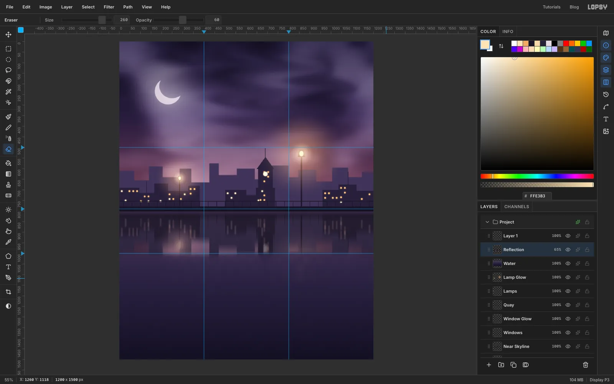

With **Reflection** still active:

1. Choose **Filter → Motion Blur…** with **Angle** **90** and **Distance** **40**. Vertical streaks read as a rippled surface.
2. Choose **Filter → Hue/Saturation…** with **Saturation** **−15** and **Lightness** **−10**. Reflections are always a little darker than what they mirror.
3. Set the layer's opacity to **65%**.
4. Press [[E]] for the **Eraser**, set **Size** to **260** and **Opacity** to **60**, and drag once from left to right along the bottom edge of the reflection, just above y 1130. This takes away the hard line where the copy ends.

## Pull the lamp light down the water

Add a layer called **Lamp Streaks** and set it to **Screen**. With the foreground `#F2A862` and a soft brush (**Hardness** **0**, **Opacity** **45**, **Size** **70**), click on the water just under the big lamp, at about x 860, y 812. Then [[Shift]]-click straight down at y 1290. For the small lamp, use **Size** **40** and **Opacity** **40**, from x 285, y 812 down to y 1060.

Add a layer called **Shimmer** for the sparkle. Set the foreground to `#FFE3B3` and use a hard brush: **Size** **4**, **Hardness** **100**, **Opacity** **85**. Under each lamp, draw short horizontal dashes with a click and a [[Shift]]-click, stacking them every 13–22 px down the streak: about 20–40 px long under the big lamp and 10–20 px under the small one. Under the big lamp, make them a little longer and a little wider apart as you go down, because ripples nearer to you look bigger. Keep the small lamp's dashes short.

Then melt them together: **Filter → Motion Blur…** with **Angle** **90** and **Distance** **28**, then **Filter → Gaussian Blur…** with **Radius** **3**. The dashes turn into soft, broken columns of light.

## Paint a wooden mooring post

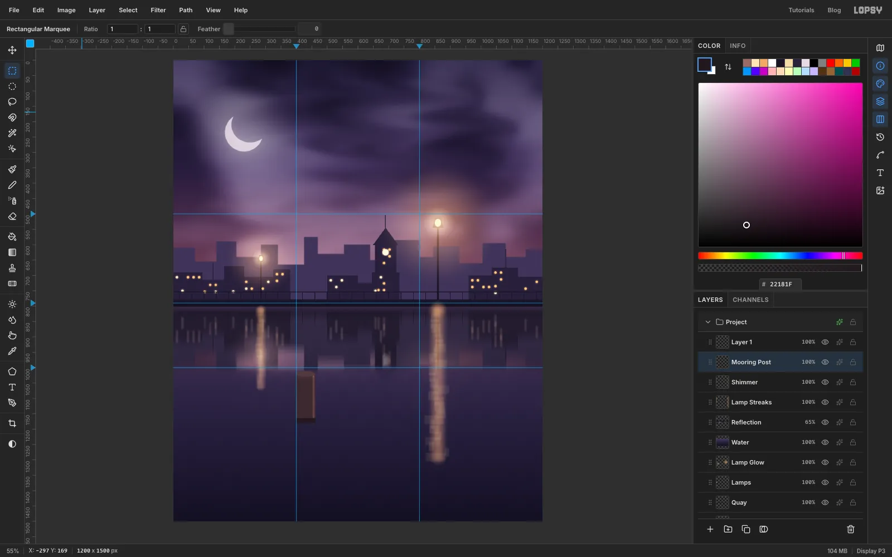

Add a layer called **Mooring Post**. Use the Rectangular Marquee's dialog to select **From** 398, 1020 **To** 462, 1180, fill it with `#3A2A30` and deselect. For the cap, use the Elliptical Marquee's dialog from **398, 1011** to **462, 1029**, fill with `#4E3A40` and deselect.

Give it some wood grain. Select the post below the cap (**398, 1028** to **462, 1180**) and run **Filter → Add Noise…** with **Amount** **30**, **Mono** and **Gaussian**. Then run **Filter → Motion Blur…** with **Angle** **90** and **Distance** **24**. The selection keeps both filters inside the post. Deselect.

The lamp is to the right, so light that side. Set the foreground to `#9A6A66` and choose a soft brush (**Size** **12**, **Hardness** **0**, **Opacity** **45**). Click near the right edge of the post just under the cap and [[Shift]]-click straight down to the bottom. Finally, the wet wood: select **398, 1164** to **462, 1180**, fill it with `#22181F` and deselect.

## Reflect the post and add ripples

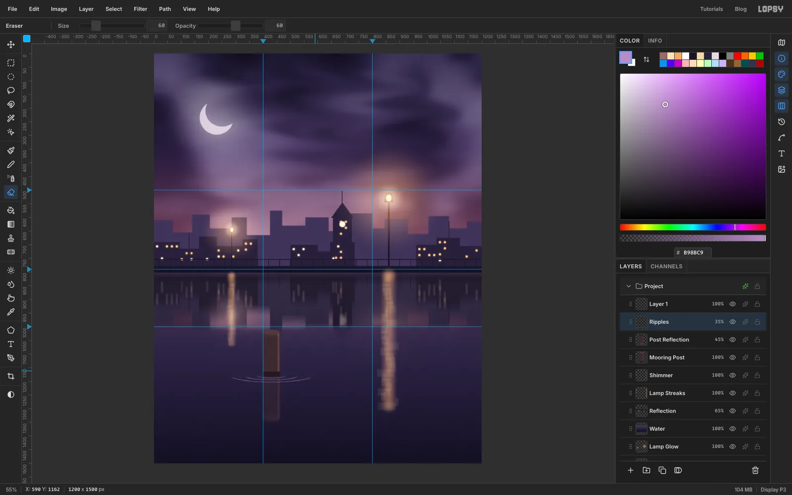

Choose **Layer → Duplicate Layer** and rename the copy **Post Reflection**. Select **From** 396, 1008 **To** 464, 1180 with the dialog, press [[V]] and click **Flip Vertical**, then press [[Cmd+D]]. Run **Filter → Motion Blur…** with **Angle** **90** and **Distance** **18**. With the Move tool, drag the layer straight down until the dark wet band sits just under the waterline at y 1180. The upside-down cap ends near y 1345. Set the layer's opacity to **45%**.

Add a layer called **Ripples** and set the foreground to `#B98BC9`. Each ring is a filled oval with its middle cut out. Do the biggest first, because each fill covers the inside of the ring before it:

1. With the Elliptical Marquee's dialog, select **From** 280, 1156 **To** 580, 1204 and choose **Edit → Fill**.
2. Choose **Select → Shrink…**, enter **3** and click **Apply**, then press [[Delete]] and [[Cmd+D]].
3. Repeat for **330, 1164 → 530, 1196**, then **374, 1171 → 486, 1189**.

Run **Filter → Gaussian Blur…** at **Radius** **1**. Then choose the **Eraser** at **Size** **60**, **Opacity** **60** and drag once along the far (upper) side of the rings to fade them. Set the layer to **35%** opacity.

## Bring in the heron and trace it

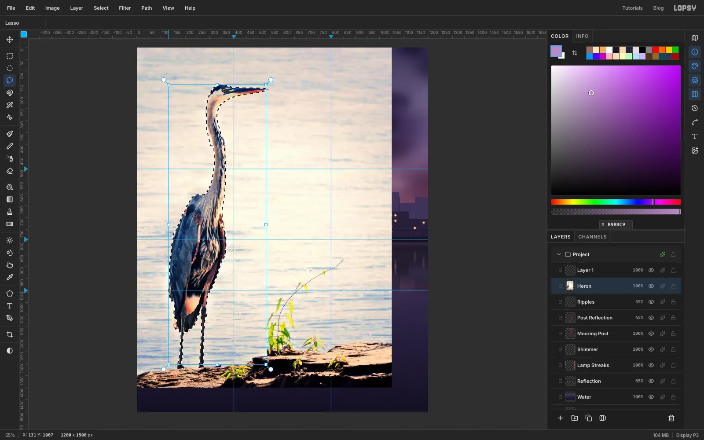

Click the **Ripples** layer, then drag `heron.jpg` from your folder onto the canvas. It arrives as a new layer at its full size in the top-left corner, already selected. Press [[Cmd+D]] and rename the layer **Heron**.

Press [[L]] for the **Lasso** and trace around the bird. Go slowly around the beak and the head, and down the front of the neck, where the pale feathers are close to the colour of the water. Leave out the rock and the plant at the bottom, and stop the trace at the bird's feet. Zoom in for the legs: [[Cmd]] and scroll zooms around the pointer. The bird's edge doesn't have to be perfect, because the oil paint filter will soften it in a moment.

## Cut it out and paint it

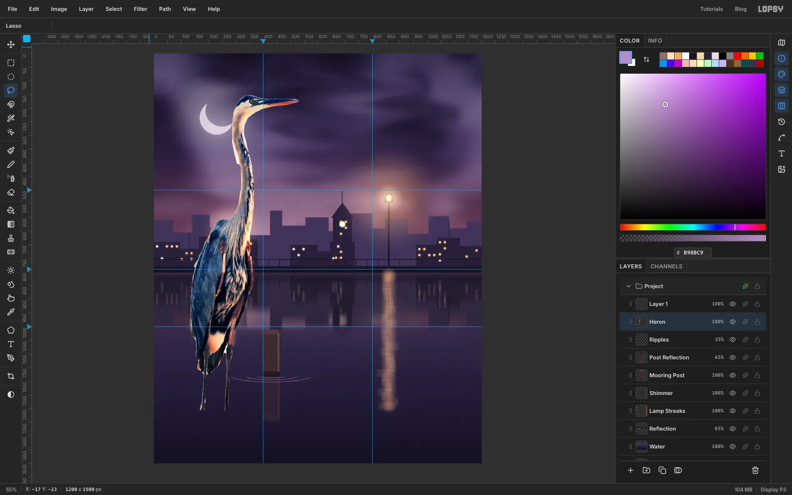

Choose **Select → Inverse**, press [[Delete]], and press [[Cmd+D]]. Only the bird is left.

Run **Filter → Oil Paint…** with **Radius** **4** and **Sharpness** **1.5**. Do this now, while the bird is at full size: when you scale it down, the filter's brush marks shrink with it and look finer.

## Scale the heron down

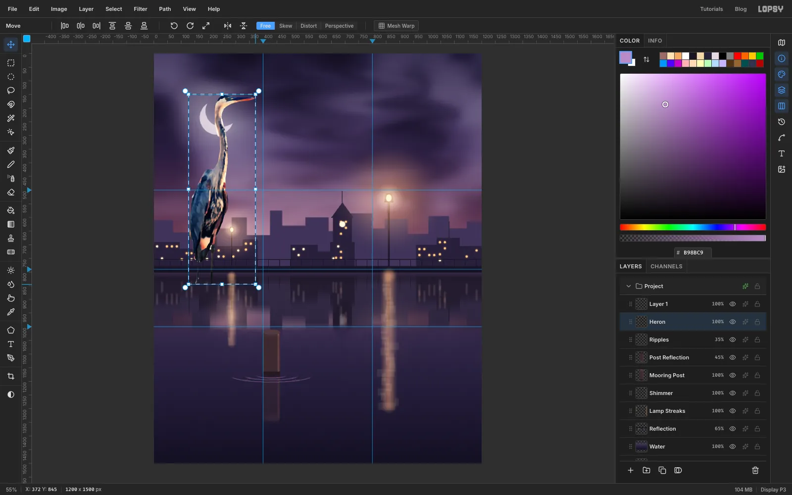

Draw a Rectangular Marquee around the whole heron, with a few pixels to spare: from about 127, 149 to 536, 1309. Press [[V]] for the **Move** tool. Hold [[Cmd]] and drag the bottom-right corner handle up and to the left until the box is about 60% of its size, about 245 px wide. [[Cmd]] keeps the proportions. Release, then press [[Cmd+D]] to commit the scale.

## Stand the heron on the post

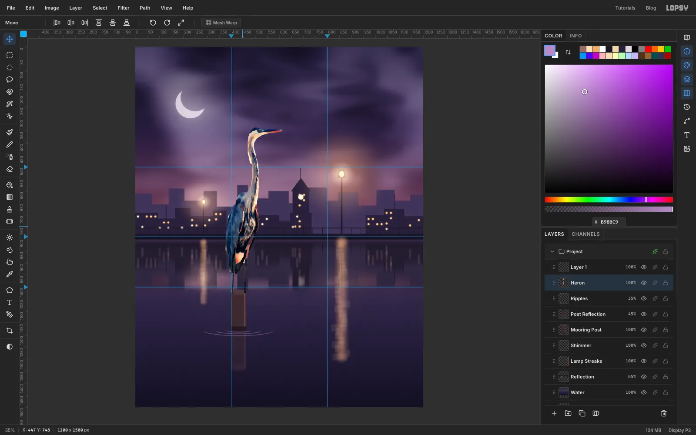

With the Move tool, drag the heron down and to the right until its feet rest on the post's cap at about y 1024, with the left foot over the middle of the post. The head rises into open sky, facing the big lamp, and the gap in the near skyline sits behind its neck and breast. Use the arrow keys for the last few pixels.

## Bring the heron into the night

The photo is lit by daylight, so knock it back:

1. Choose **Filter → Hue/Saturation…** with **Hue** **8**, **Saturation** **−35** and **Lightness** **−18**.
2. Choose **Filter → Brightness/Contrast…** with **Brightness** **0** and **Contrast** **−20**.

The pale thigh feathers at the bottom of the wing still stand out like a blown highlight. Pick the **Elliptical Marquee**, set **Feather** to **10** in the options bar, and drag an oval about 70 × 80 px over that patch. Run **Filter → Hue/Saturation…** with **Saturation** **−60** and **Lightness** **−35**. Deselect and set **Feather** back to **0**, or every later selection will be soft.

Then shade it. Press [[O]] for the **Dodge** tool, set **Mode** to **Burn**, **Exposure** to **35** and **Size** to **60**. Drag one stroke down the left edge of the body and one a little further in. That's the side facing away from the lamp. Switch **Mode** to **Dodge**, set **Exposure** **30** and **Size** **30**, and drag once down the front of the neck, which faces the lamp.

## Add a rim of lamplight

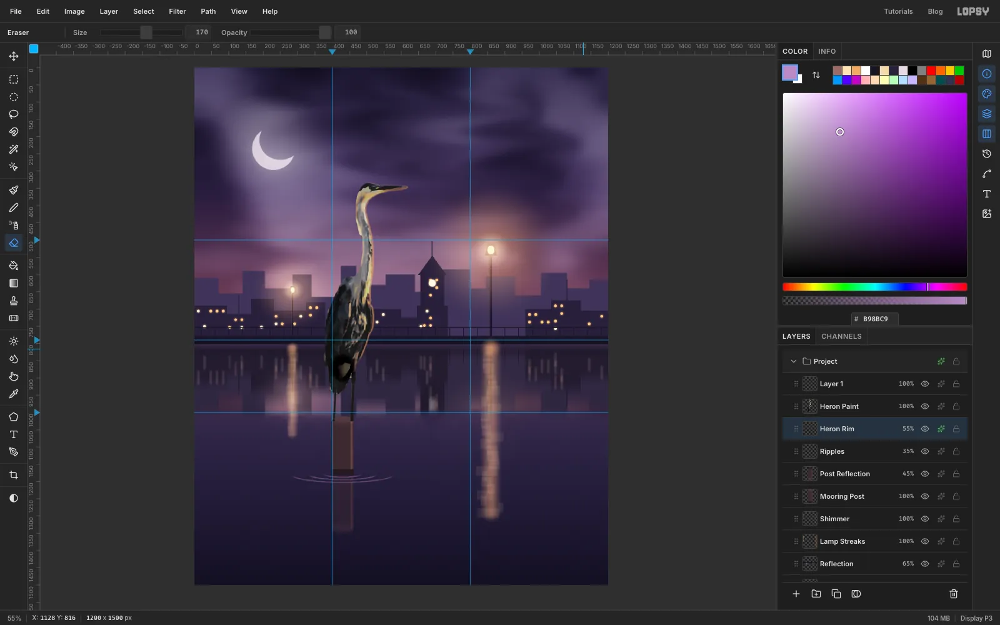

Choose **Layer → Duplicate Layer**. Rename the copy (the top one) **Heron Paint** and the original underneath **Heron Rim**.

Click **Heron Rim**, open its effects and tick **Color Overlay** with the colour `#F4B070`. Close the drawer. Press [[V]] and tap the right arrow key **4** times, so 4 px of orange peeks out on the lamp side of the bird.

That orange also shows on the shadow side, wherever the edge is soft, so erase it there: choose the **Eraser** at **Size** **170** and **Opacity** **100** and drag down through the left third of the bird, from the head to the feet. Keep the eraser circle's right edge short of the neck, so it never reaches the lamp side. Then run **Filter → Gaussian Blur…** at **Radius** **3** and set the layer to **55%** opacity. The rim now reads as light falling on the bird, not as an outline.

## Reflect the heron

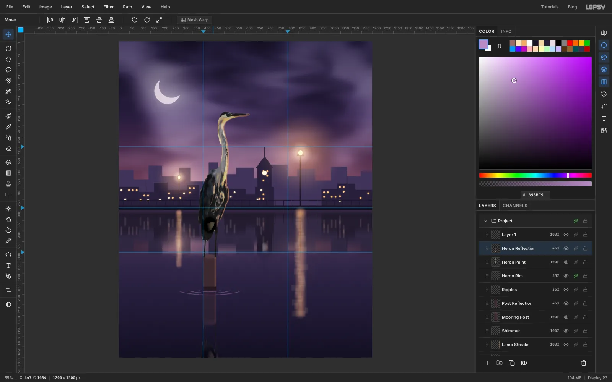

Click **Heron Paint**, choose **Layer → Duplicate Layer**, and rename the copy **Heron Reflection**. Draw a Rectangular Marquee around the heron, press [[V]], click **Flip Vertical** and press [[Cmd+D]].

Run **Filter → Motion Blur…** with **Angle** **90** and **Distance** **14**. Then drag the flipped bird straight down until its feet meet the bottom of the post's reflection, at about y 1340. Most of it hangs off the bottom of the canvas, and that's fine. Set the layer to **45%** opacity.

## Make it rain

With **Heron Reflection** active, add a layer called **Rain**. The rain starts as noise:

1. Set the foreground to `#808080` and choose **Edit → Fill**.
2. Run **Filter → Add Noise…** with **Amount** **100**, **Mono** and **Gaussian**.
3. Run **Filter → Threshold…** and drag **Level** up to about **166**, until only scattered white specks remain on black. Click **Apply**.
4. Press [[W]] for the **Magic Wand**, set **Tolerance** to **10** and untick **Contiguous**. Click on any black part, press [[Delete]], then press [[Cmd+D]]. Only the white specks are left.
5. Run **Filter → Motion Blur…** with **Angle** **78** and **Distance** **46**. Each speck becomes a slanted streak.
6. Set the blend mode to **Screen**.

Add a second layer, **Rain Near**, and do the same with fewer, bigger drops: set the Threshold **Level** to about **174**, and run **Filter → Gaussian Blur…** at **Radius** **2** before the Motion Blur. Use **Angle** **78** and **Distance** **90**. Set it to **Screen** at **70%** opacity.

## Thin the rain over the heron with a mask

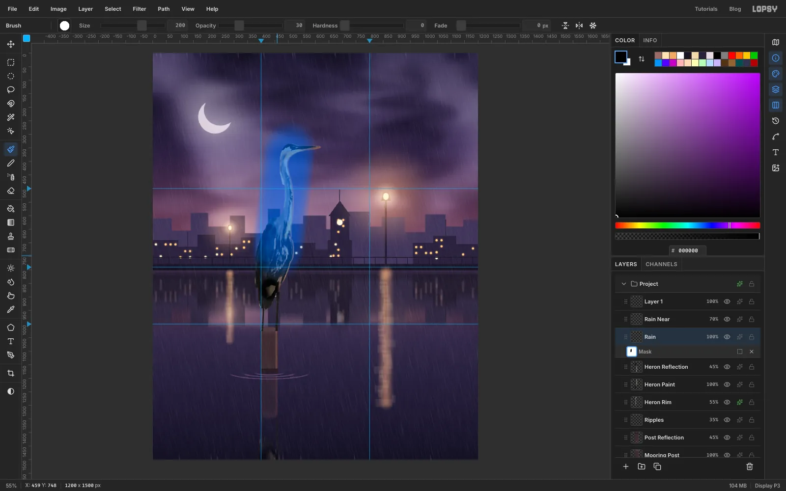

The rain should cross the heron, but a little more lightly so the bird stays easy to read. Click **Rain**, then click **Add Mask** at the bottom of the Layers panel. Click the new mask thumbnail on the row to edit the mask. The canvas shows it in blue.

Set the foreground to black and pick a big soft brush: **Size** **200**, **Hardness** **0**, **Opacity** **30**. Drag one stroke from the heron's head down through the neck to the body. In a mask, the brush hides the layer, so this thins the rain there without removing it.

Click the **Rain Near** layer's name to leave mask editing.

## Scatter a few bokeh lights

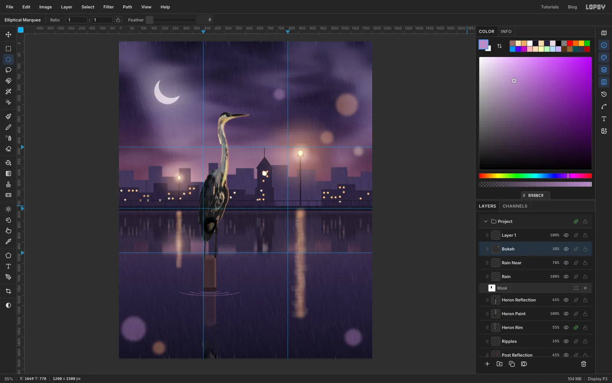

With **Rain Near** active, add a layer called **Bokeh**. Pick the **Elliptical Marquee** and set **Feather** to **14**. For each disc, press [[Cmd+D]], click once for the dialog, enter the corners, and choose **Edit → Fill**:

- around the big lamp in `#F2A862`: **1028, 248 → 1132, 352** and **955, 425 → 1015, 485**
- a small hot one in `#FFE3B3`: **1113, 498 → 1157, 542**
- a lilac one high in the sky in `#B98BC9`: **734, 224 → 786, 276**
- in the bottom corners in `#B98BC9`: **12, 1302 → 128, 1418** and **1070, 1360 → 1150, 1440**
- and one in `#F2A862`: **160, 1420 → 220, 1480**

Deselect, set **Feather** back to **0**, and set the layer to **Screen** at **38%**.

## Group the layers

Tidy the stack into groups. For each group, click the bottom layer, [[Shift]]-click the top one, choose **Layer → Group Layers**, and rename the group:

- **Far Skyline** to **Lamp Glow** → **City**
- **Water** to **Shimmer** → **Water Surface**
- **Mooring Post** to **Heron Reflection** → **Heron & Post**
- **Rain** to **Bokeh** → **Weather**

Click a group's arrow to collapse it. Clouds, Moon and Moon Haze stay at the bottom with the Background, and Layer 1 stays empty on top.

## Grade the whole picture

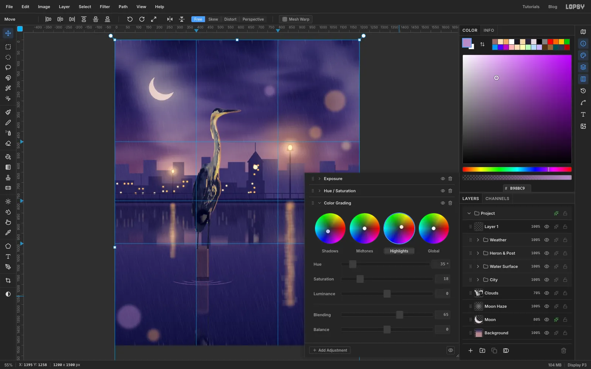

Click the **Project** group's effects button. Because it's a group, the drawer lists **adjustments** instead of layer effects, and these apply to the whole picture. A new document's root group already has a few neutral ones, including **Color Grading**.

Expand **Color Grading**. Click the **Shadows** tab under the wheels and set **Hue** to **235** and **Saturation** to **25**, a slate blue. Click the **Highlights** tab and set **Hue** to **35** and **Saturation** to **18**, a warm amber. Set **Blending** to **65** so the two meet softly in the midtones.

## Lift the blacks and mute the colour

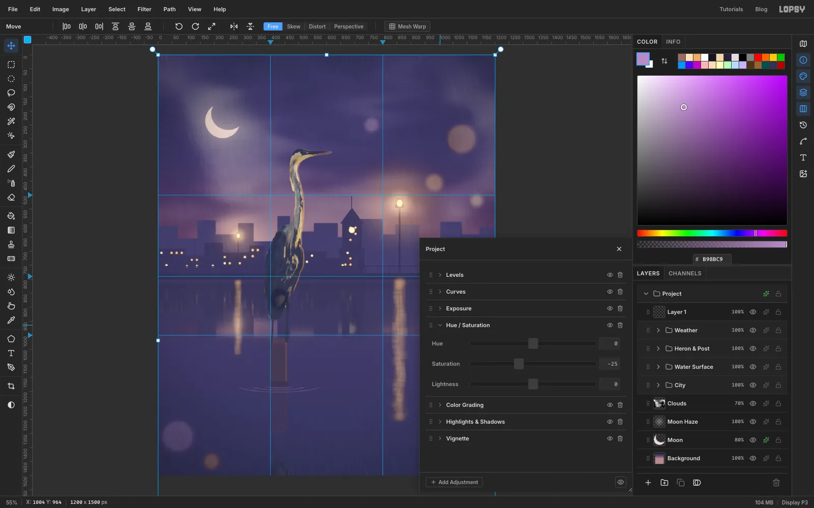

Still in the Project group's drawer:

1. Click **Add Adjustment → Highlights & Shadows** and set **Blacks** to **15**. Lifted, matte blacks are a big part of the lo-fi look.
2. Click **Add Adjustment → Vignette** and set it to **30** to settle the corners.
3. Expand the existing **Hue / Saturation** adjustment and set **Saturation** to **−25**, so the violet stays dusty instead of electric.

Close the drawer.

## Finish with film grain

Click **Layer 1**, the empty layer at the top, and rename it **Grain**. Set the foreground to `#808080`, choose **Edit → Fill**, and run **Filter → Add Noise…** with **Amount** **40**, **Mono** and **Gaussian**. Set the blend mode to **Overlay** and the opacity to **50%**. Mid-grey disappears in Overlay, so only the noise shows, as a fine grain over everything, heron included.

Untick **View → Show Guides** to hide the guides, then **File → Quick Export PNG** to save the picture, and **File → Save Project** to keep the layers.
