*Lowbrow*, or *Kustom Kulture*, is the art of 1950s and '60s hot rod garages. Ed "Big Daddy" Roth drew grinning monsters with bloodshot eyes bursting out of their own cars. Pinstripers painted flames down hoods and fenders. The art ended up on T-shirts, model kits and, of course, patches sewn on to denim jackets.

In this tutorial you'll make **Burnout Tortoise**, a round iron-on patch with a joke built in: a tortoise who *is* a hot rod. He has a chrome supercharger sticking out of his shell, zoomie exhaust pipes, drag slicks for wheels and a big cloud of tyre smoke. The tagline reads "0-60 IN 3 WEEKS".

The patch has three rings:

- a purple **merrowed edge**, the rolled thread border that real patches have
- a black twill **lettering band**, with gold type arched along the top and bottom
- an orange **sunburst field** that the tortoise sits in, with his head breaking out into the band

The canvas is **1500 × 1500** px, and you don't need any photos. Everything is drawn in the app.

The tools you'll use:

- the **Elliptical** and **Rectangular Marquee**, their exact-size dialog, [[Shift]] to add, [[Alt]] to subtract and [[Shift+Alt]] to intersect
- the **Lasso**, [[Cmd]]-clicking layer thumbnails, and **Select → Grow / Shrink / Feather / Inverse**
- the **Pen** tool, and live **text on a path** in the Google fonts **Sancreek** and **Racing Sans One**
- the **Shape** tool's rounded rectangle
- the **Gradient** tool, the **Brush** (with Taper), the **Pencil** and **Dodge / Burn**
- **Sunburst**, **Add Noise**, **Motion Blur**, **Smoke**, **Desaturate**, **Posterize** and **Liquify**
- **Copy**, **Paste**, **Merge Down**, and the Move tool's scale and rotate handles
- layer effects (**Stroke**, **Inner Glow** and **Drop Shadow**), the **Soft Light** and **Overlay** blend modes, a layer mask, and groups

The palette is hot rod loud, with one near-black for every outline:

- Border purple `#7B1FA2`, stitches `#4A0D6B`
- Band black `#121212`, outline `#111111`
- Field orange `#FF8A1F`, rays `#FFB547`, vignette `#D9530A`
- Lettering gold `#F7C948`
- Shell `#1D4F26`, scutes `#9CCB3B` → `#3F7D2A`
- Flames `#E8300E` → `#FF8A1C` → `#FFD23F`, pinstripe `#00B7EB`
- Candy rail `#8E0E14`, highlight `#FFFFFF`
- Skin `#A9C93A`, wrinkles `#6A8A1A`
- Tongue `#FF5C8D`, crease `#B5174E`
- Chrome `#F7F9FA` → `#9AA7AF` → `#27333A` → `#E3EAEE` → `#6F7E87`
- Smoke `#ECE8F0`, smoke shade `#A99CC0`
- Backdrop `#E9E3D6`

Some habits that will save you trouble:

- To set a colour, type its hex code into the **Hex** field of the Color panel.
- Most outlines are a **Stroke** layer effect, **7 px** in `#111111`. You'll open it from the effects button (✦) on a layer's row. When a step says "give it the outline", that's what it means.
- Press [[Cmd+D]] to deselect after every fill, so the next tool isn't clipped by an old selection.
- New layers appear directly above the active layer. Click the right layer before you click **Add Layer**.
- Circles are placed with the marquee's exact-size dialog: click once on the canvas with the **Elliptical Marquee** (don't drag) and type the **From** and **To** corners. For things you draw by hand, the status bar shows the cursor's X and Y.

> **Tip:** On a wide-gamut (Display P3) screen, Lopsy reads typed hex codes as P3 colours. On an sRGB screen the patch comes out a little less vivid.

> **Note:** Shortcuts are written for a Mac. On Windows use [[Ctrl]] wherever it says [[Cmd]].

## Set up the canvas and select the border ring

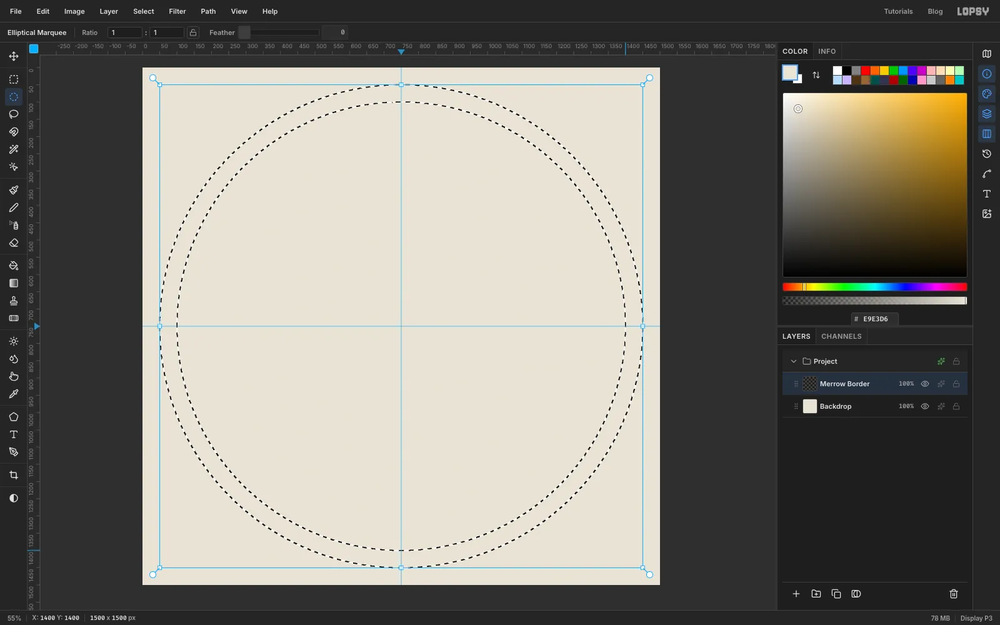

Choose **File → New**, keep the units on **Pixels**, and make the document **1500 × 1500**. Click the top ruler at **750** for a vertical guide, and the left ruler at **750** for a horizontal one. Everything in the patch is centred where they cross.

Rename *Background* to *Backdrop* by double-clicking its name. Select all with [[Cmd+A]], fill it with cream `#E9E3D6` (**Edit → Fill**), then run **Filter → Add Noise…** with **Amount 5** and **Mono** so it looks like card stock. Deselect.

Rename *Layer 1* to *Merrow Border*. With the **Elliptical Marquee**, click once on the canvas and enter **From 50, 50** and **To 1450, 1450**. That's the outside edge of the patch. Now hold [[Alt]] and drag a second circle from **100, 100** to **1400, 1400** to cut the middle out. You're left with a 50 px ring.

## Stitch the merrowed edge

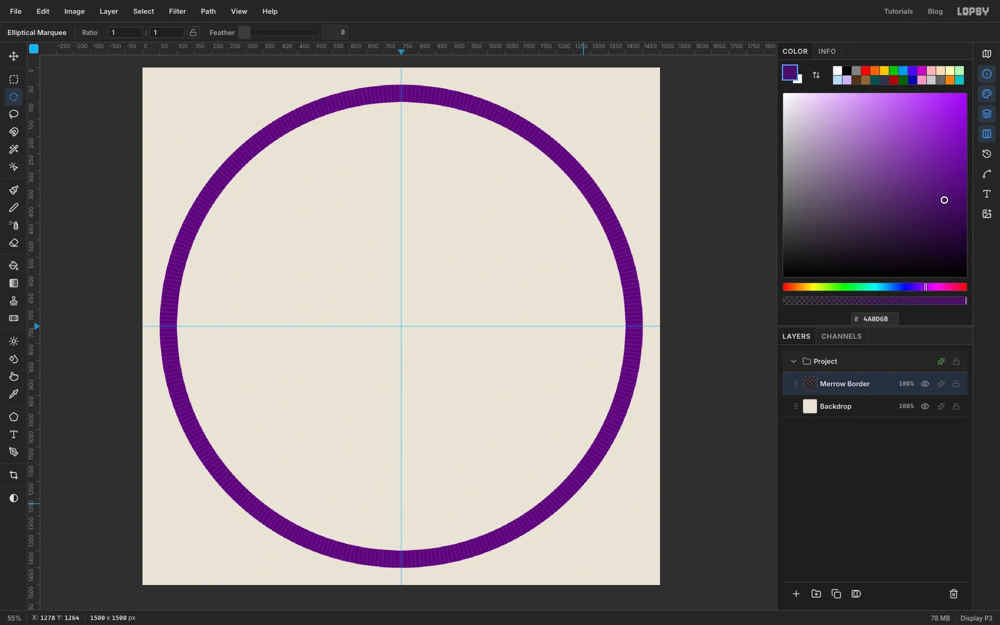

Fill the ring with purple `#7B1FA2`.

A merrowed edge is thread wrapped over and over the rim, so it's covered in tiny lines pointing at the centre. **Filter → Sunburst…** draws exactly that. Set the colour to dark purple `#4A0D6B`, open Sunburst and set **Rays 120**, **Length 100**, **Width 28**, **Softness 30**, **Opacity 85** and **Rotation 0**, then click **Apply**. The selection keeps the rays inside the ring.

120 rays are too few for a patch this big, so run Sunburst twice more with **Rotation 1** and then **Rotation 2**. Each pass fills the gaps between the last one's rays. Deselect.

Lift the patch off the card with a **Drop Shadow**: **Offset X 0**, **Offset Y 12**, **Blur 26**, **Opacity 45%**, colour `#2B2118`.

## Fill the twill lettering band

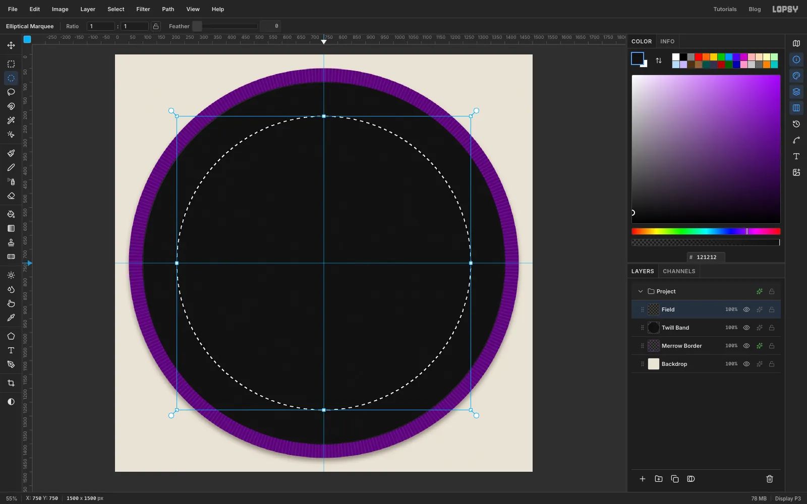

Click **Add Layer** and name it *Twill Band*. With the dialog, select a circle from **98, 98** to **1402, 1402**. It's a couple of pixels bigger than the hole, so no gap shows. Fill it with `#121212`.

To give it a twill weave, run **Filter → Add Noise…** with **Amount 16** and **Mono**, then **Filter → Motion Blur…** with **Angle 45** and **Distance 9**. The specks stretch into diagonal threads. Deselect.

Add a layer called *Field*, and select the circle **222, 222** to **1278, 1278** for the next step.

## Paint the sunburst field

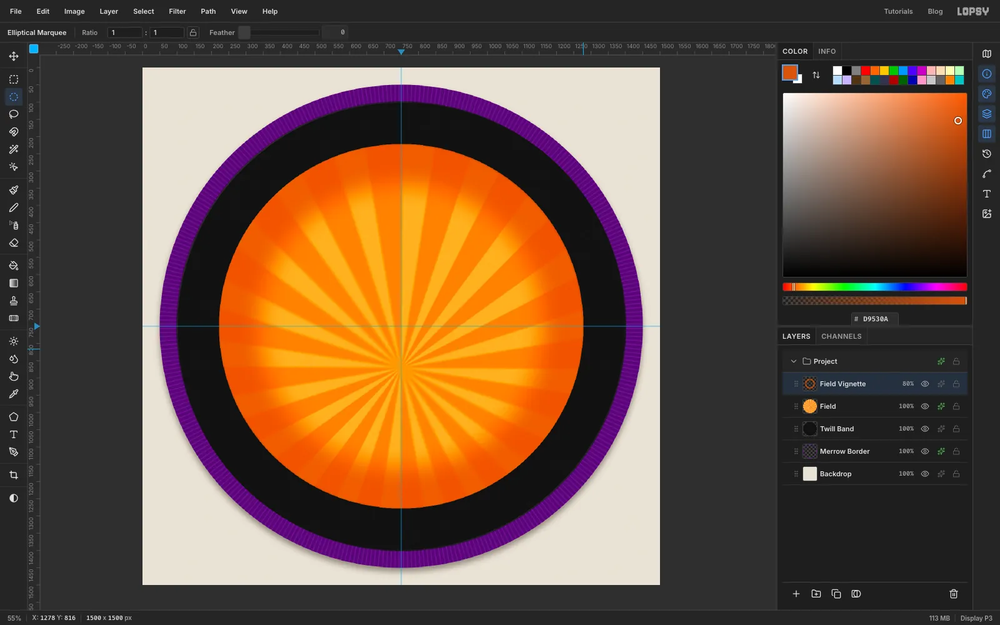

Fill the selection with orange `#FF8A1F`. Set the colour to amber `#FFB547` and run **Sunburst** with **Rays 20**, **Length 100**, **Width 46**, **Rotation 4.5**, **Center X 50** and **Center Y 58**. Moving the centre down a little puts the burst behind where the tortoise's wheels will be.

Give the field the same twill (**Add Noise** 16 Mono, then **Motion Blur** at **Angle 135**, **Distance 10**) so its threads cross the band's. Deselect, and give the layer a **10 px** outline.

Now darken the rim so the middle glows. Add a layer called *Field Vignette*, select the field circle again (**222, 222** to **1278, 1278**) and fill it with `#D9530A`. Select a smaller circle from **340, 340** to **1160, 1160**, choose **Select → Feather…** with **90**, and press [[Delete]]. Deselect and set the layer to **80%** opacity.

## Group the base and draw two arcs with the Pen

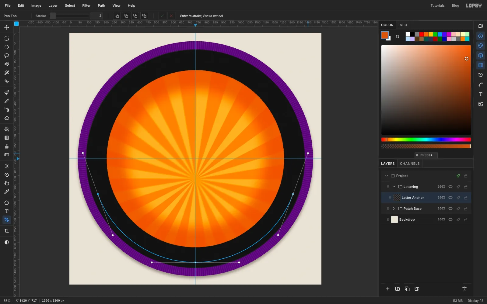

Click *Merrow Border*, [[Shift]]-click *Field Vignette*, and choose **Layer → Group Layers**. Name the group *Patch Base* and collapse it with its arrow.

With *Patch Base* selected, click **New Group** and name it *Lettering*. Then click **Add Layer** and name the new layer *Letter Anchor*. It stays empty. You'll click it before making each line of text, so a new text layer never restyles the previous one.

The lettering sits on two arcs drawn with the **Pen**, both running through the black band. Each arc has three anchors. Press on each anchor and drag along the curve to pull out its handle, so the path bends with the circle:

1. **Top arc.** Start on the left of the band, a little above the horizontal guide (**213, 606**), and drag up along the band (to about **278, 363**). Press at the top centre (**750, 194**) and drag straight right (to **1002, 194**) so the arch is round on top. Press on the right (**1287, 606**) and drag down (to **1352, 849**). Click the **✓ (Commit path)** button.
2. **Bottom arc.** Start on the left, below the guide (**169, 961**), and drag down along the band (to **258, 1206**). Press at the bottom centre (**750, 1368**) and drag right (to **1010, 1368**). Press on the right (**1331, 961**) and drag up (to **1420, 717**). Commit it.

Draw both arcs left to right. Letters always stand on the left-hand side of a path's direction. On the top arc they rise outward, and on the bottom arc they stand inside the curve with their tops toward the centre, so both lines read the right way up.

## Arch the title over the top

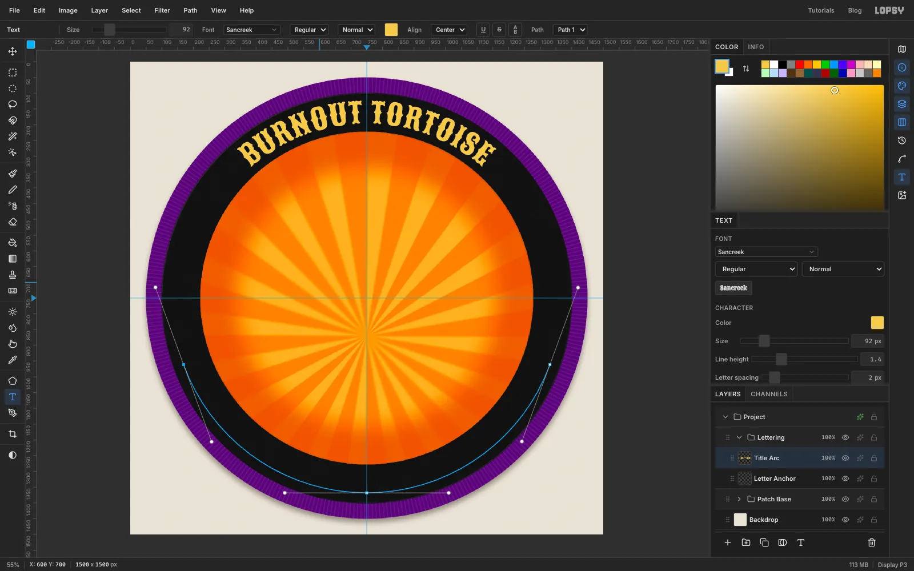

Click *Letter Anchor*. Pick the **Text** tool, choose the font **Sancreek**, set **Size 92** and colour gold `#F7C948`. Click anywhere in the empty orange field and type **BURNOUT TORTOISE**, then press [[Tab]] to commit it. In the **Text** panel, set **Letter spacing** to **2**.

In the options bar, open the **Path** dropdown and choose **Path 1**. The title jumps on to the top arc. Set **Align** to **Center** so it sits in the middle of the arc. Its caps should have about the same gap above (to the purple) as below (to the orange).

## Curve the tagline and add the drop shadows

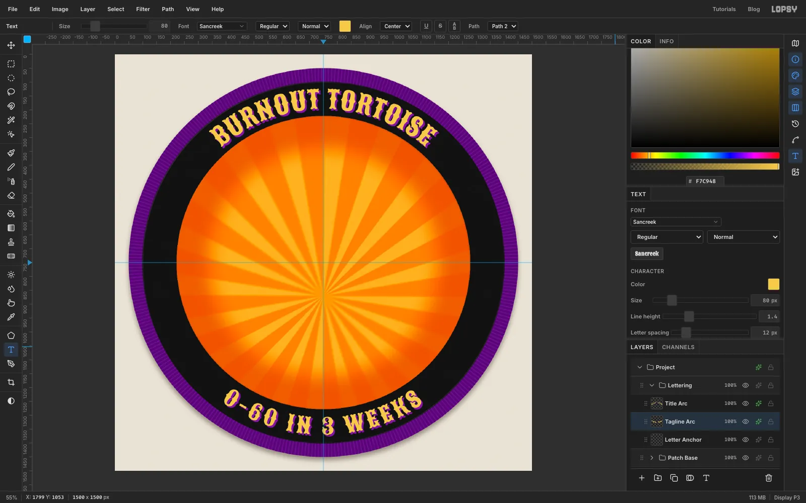

Click *Letter Anchor* again. Make a second text layer in **Sancreek**, **Size 80**, reading **0-60 IN 3 WEEKS**, with **Letter spacing 12**. Bind it to **Path 2** and set **Align** to **Center**. The tagline curves along the bottom of the band, its letters standing inside the curve.

Give each text layer a hard **Drop Shadow** for that sign-painter 3D look: **Offset X 6**, **Offset Y 6**, **Blur 0**, **Opacity 100%**, colour purple `#7B1FA2`.

Finally, click the selected path in the **Paths** panel to deselect it, so its outline stops drawing over the canvas. Don't delete the paths: the text needs them.

## Start the tortoise: ground shadow and shell

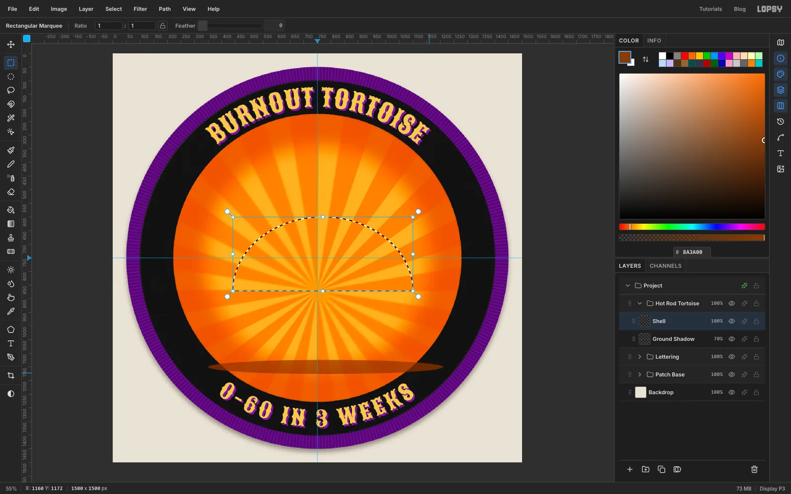

Collapse *Lettering*, select it, and click **New Group**. Name the group *Hot Rod Tortoise*. Every part of the character goes in here.

1. Add a layer called *Ground Shadow*. Drag an ellipse about 860 px wide and 50 px tall centred on **780, 1150**, fill it with `#8A3A00`, and set the layer to **70%**. Patches don't have soft shadows, so keep it flat.
2. Add a layer called *Shell*. Select the ellipse **440, 600** to **1100, 1144** with the dialog. Switch to the **Rectangular Marquee**, hold [[Alt]] and drag a rectangle from **380, 872** (the ellipse's middle) down past its bottom to cut away the lower half. You're left with a dome.

Fill the dome with dark green `#1D4F26`, deselect, and give it the outline.

## Select the shell plates

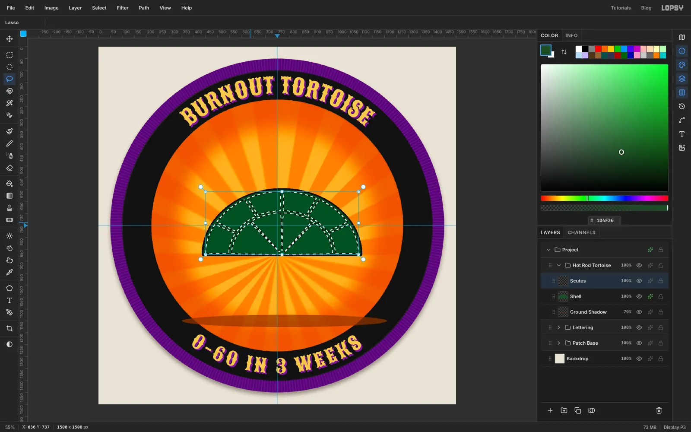

A tortoise shell is made of plates called *scutes*. Add a layer called *Scutes* and draw them with the **Lasso**:

- The outer ring: six curved plates following the dome's edge, each about a sixth of the way round, roughly 90 px deep.
- The middle: four wedge-shaped plates that fill the rest of the dome.

Hold [[Shift]] for every plate after the first so they add together. Leave a gap of about 6 px between neighbours. That dark green gap becomes the groove between the plates. Zoom in to about 200% and trace slowly. The plates don't need to be identical, only the gaps need to stay open.

## Shade the plates

Pick the **Gradient** tool and set it to **Radial**. In **Advanced…**, set the left stop to lime `#9CCB3B` and the right stop to green `#3F7D2A`. Drag from just below the top of the dome (**760, 610**) down to the bottom edge (**760, 900**). Deselect.

Turn on **Inner Glow** on the layer, colour `#173F1D`, **Size 16**, **Opacity 70%**. Each plate now looks padded, like a raised block of satin stitch.

Then pick **Dodge / Burn** in **Dodge** mode, **Size 110** and **Exposure 16**. Drag one slow arc across the upper plates, following the curve of the dome. Light catches the top of the shell.

## Lasso the flame licks

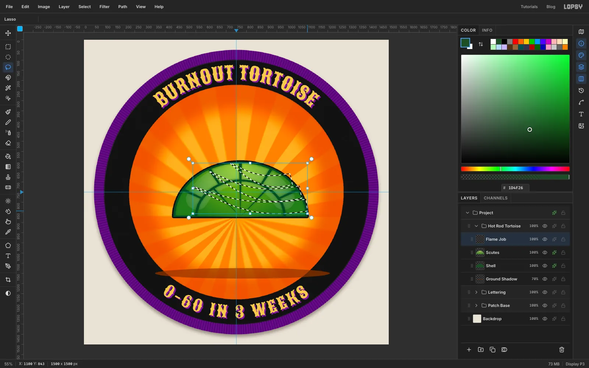

Hot rod flames are *licks*: fat at the front of the car, sweeping back, and tapering to a point that curls upward. Add a layer called *Flame Job* and lasso three of them, holding [[Shift]] for the second and third:

- a short one starting near the top front of the shell, about 300 px long
- a long one in the middle, about 450 px long, curling up at the tip
- the longest one along the bottom of the dome, about 560 px long

Let them start a little outside the shell's front edge. You'll trim the overflow off in the next step.

Pick the **Gradient** tool in **Linear** mode with three stops: red `#E8300E` on the left, orange `#FF8A1C` at the middle, yellow `#FFD23F` on the right. Drag from the back of the shell (**560, 760**) to the front (**1110, 760**), so the flames are hottest at the nose. Deselect.

## Trim the flames to the shell

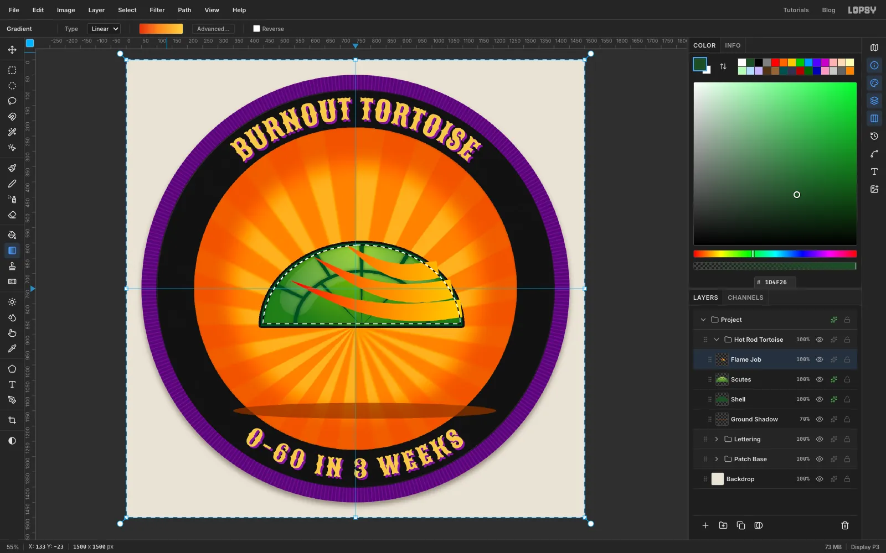

[[Cmd]]-click the *Shell* thumbnail to load the dome as a selection. Choose **Select → Shrink…** with **7**. That keeps the flames off the shell's black outline. Then **Select → Inverse** and press [[Delete]]. Everything outside the dome is gone. Deselect.

Pinstripe the licks: give *Flame Job* a **Stroke** of **4 px** in cyan `#00B7EB`. A thin contrasting line around flames is the pinstriper's signature.

## Add the candy-red rail

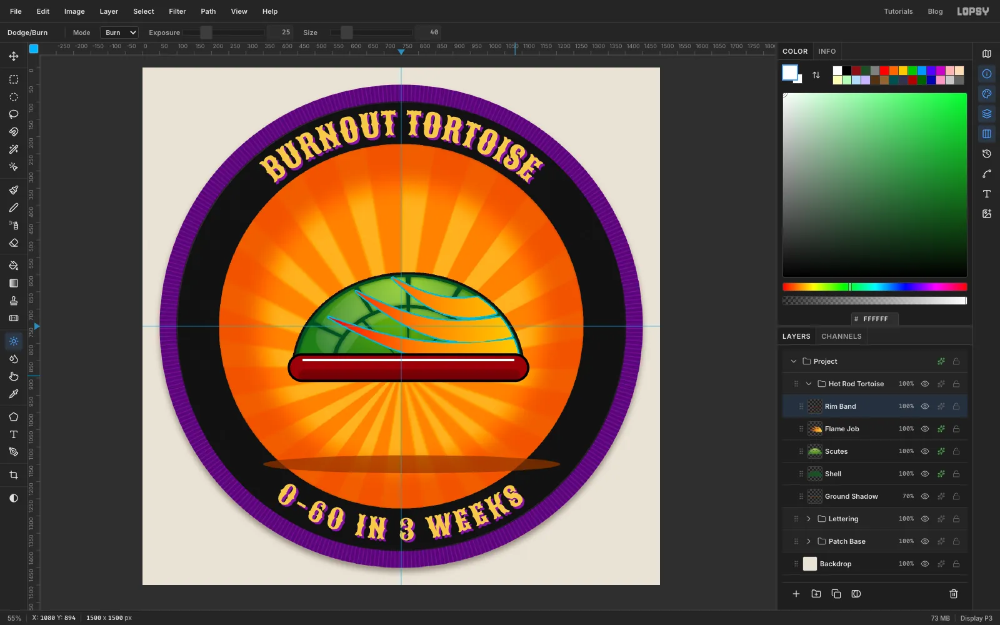

Add a layer called *Rim Band*. Set the colour to `#8E0E14` *before* picking the **Shape** tool, because the Shape tool takes its fill from the foreground colour the first time you use it. Then pick it, set **Shape** to **Rectangle** and **Corner Radius** to **38**, click the **—** next to **Stroke** to switch the stroke on (it starts black), and set its **Width** to **7**.

Shapes draw from the centre. Press at the middle of the dome's base (**771, 870**) and drag to **1118, 908**. You get a rounded bar 76 px tall along the bottom of the shell.

For the candy shine, pick the **Pencil** at **Size 7** in white. Click near the left end of the bar about 15 px below its top, then [[Shift]]-click near the right end. Then use **Burn** at **Size 40**, **Exposure 25** along the bottom of the bar to darken it.

## Build a chrome mag wheel

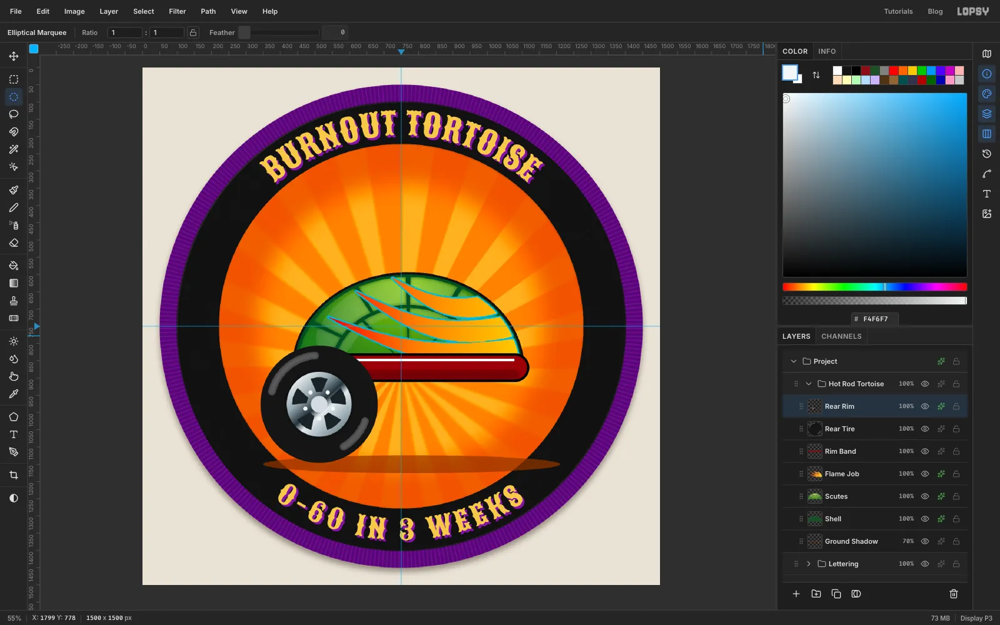

Click *Rim Band* and add a layer called *Rear Tire*. Select the circle **342, 806** to **682, 1146**, fill it with `#151515`, and run **Add Noise** at **6**, Mono. Deselect. Use **Dodge** at **Size 24**, **Exposure 30** to drag two short arcs around the upper-left and right of the sidewall, where light would catch the rubber.

Add a layer called *Rear Rim*. Select the circle **418, 882** to **606, 1070** and fill it with a **Linear** chrome gradient using five stops: `#F7F9FA`, `#9AA7AF`, `#27333A` at the middle, `#E3EAEE`, and `#6F7E87`. Drag it diagonally from the top left of the rim to the bottom right. Those hard light-dark bands are what make metal read as chrome.

Then add the details on the same layer:

1. With the **Lasso** and [[Shift]], draw five rounded wedge-shaped slots spaced evenly around the rim, between about 36 and 78 px from its centre. Fill them with `#1C2226`.
2. Fill a small centre cap, the circle **488, 952** to **536, 1000**, with `#D5DCE0`.
3. With the **Elliptical Marquee**, [[Shift]]-drag five 12 px circles about 42 px from the centre, one between each pair of slots. Fill them with `#F4F6F7` for the lug nuts.

Give *Rear Rim* the outline.

## Letter the sidewall

Racing tyres have raised lettering on the sidewall. Draw a short Pen arc around the top of the tyre: **415, 908** → **437, 877**, then **512, 858** → **550, 858**, then **609, 908** → **631, 940**, and commit it.

Click *Rear Rim*, then make a text layer in **Racing Sans One**, **Size 44**, cream `#F2EEE2`, reading **SLICKS** with **Letter spacing 6**. Bind it to **Path 3** and set **Align** to **Center**. Deselect the path in the Paths panel.

## Merge the wheel and flatten the chrome

With the lettering active, choose **Layer → Merge Down** twice. The text, rim and tyre become one layer. Rename it *Rear Wheel*.

Thread comes in a handful of colours, not smooth gradients. Choose **Filter → Desaturate**, then **Filter → Posterize…** with **Levels 5**. The chrome breaks into flat bands, like satin stitches in five greys. Desaturate first: Posterize rounds red, green and blue separately, so bluish greys would come out teal and lavender.

## Copy the wheel and scale it down

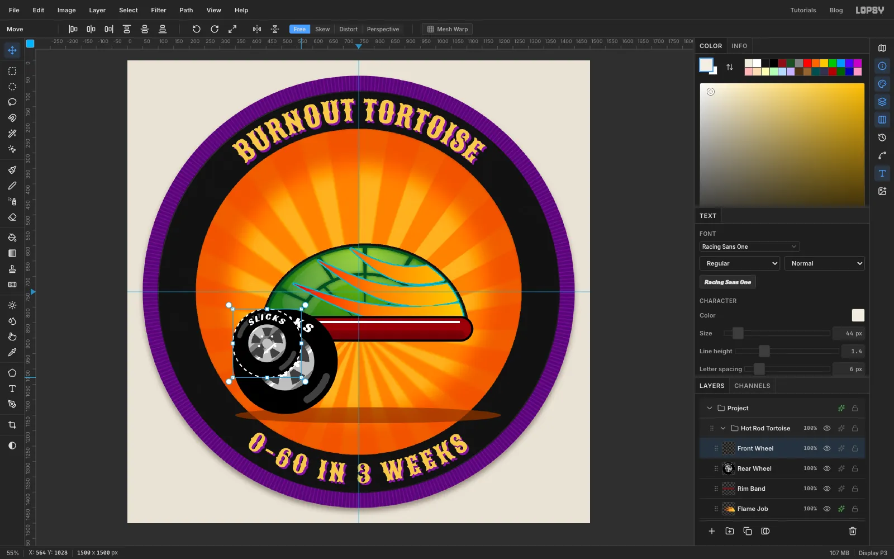

The front wheel is the same wheel, only smaller. With *Rear Wheel* active, drag a rectangular marquee just around the wheel and press [[Cmd+C]], then [[Cmd+V]]. The copy is pasted in place on a new layer. Rename it *Front Wheel*.

Pick the **Move** tool. Hold [[Cmd]] and drag the bottom-right scale handle up and to the left until the copy is about **222 px** across, about two thirds of the original. [[Cmd]] keeps it round. Press [[Enter]] to commit, then deselect.

## Place the front wheel

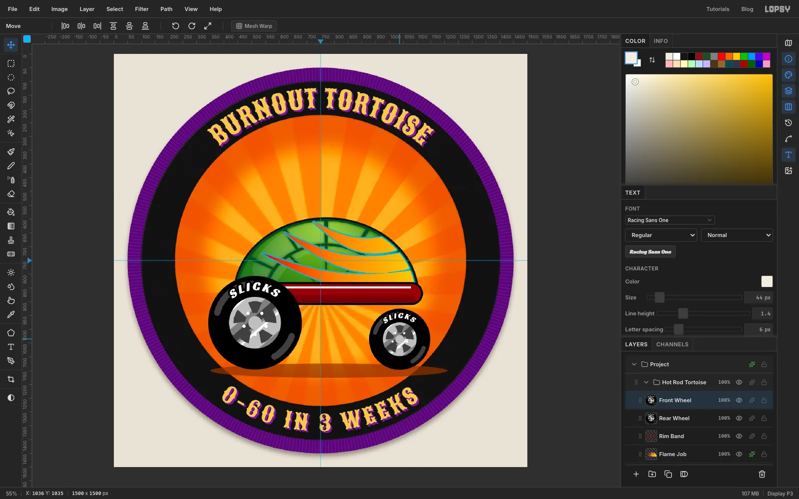

Drag the small wheel to the front of the car with the **Move** tool, so its centre lands around **1036, 1035**. Its bottom should sit on the same ground line as the rear slick (y ≈ 1146). Use the arrow keys for the last few pixels.

Then hang it from the rail. Click *Rim Band* and add a layer called *Front Strut*. Brush a **24 px** stroke in `#3A4148` from the front of the rail straight down to the front wheel's hub, and give it a **6 px** outline. The wheel covers its lower end, so only the piece between the rail and the tyre shows.

## Give him a neck and head

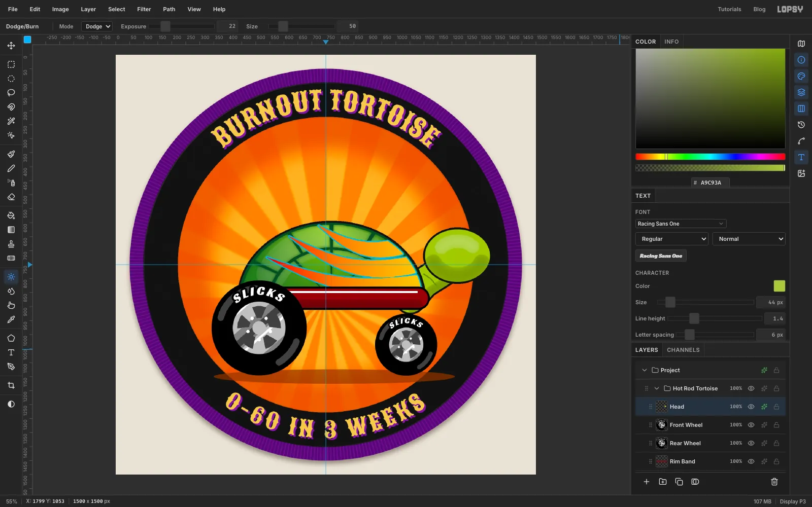

1. Click *Ground Shadow* and add a layer called *Neck*, so the neck sits *behind* the shell. Pick the **Brush** at **Size 104** and **Hardness 100** in skin green `#A9C93A`. Drag one stroke from inside the front of the shell up and to the right, to about **1170, 770**.
2. Use **Burn** (**Size 40**, **Exposure 22**) along the underside of the neck.
3. Paint two short wrinkles across it with a **Size 5** brush in `#6A8A1A`.
4. Give the neck the outline.

Click *Front Wheel* and add a layer called *Head*. Select the ellipse **1104, 624** to **1336, 812** with the dialog. Its front pushes out of the field and into the black band. That's deliberate: a character bursting out of the frame is pure lowbrow. Fill it with skin green, then **Burn** an arc around the jaw and **Dodge** an arc across the forehead, both at **Exposure 22**. Give it the outline.

## Cut a grin full of teeth

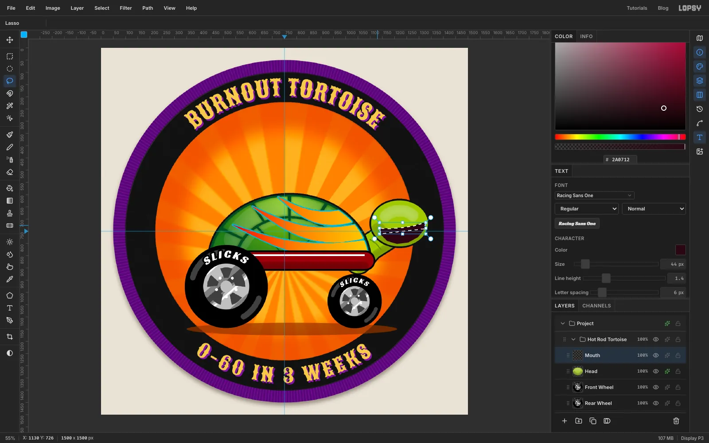

Add a layer called *Mouth* and lasso a wide grin across the lower front of the head, from about **1140, 740** to the nose at **1328, 714**, dipping to about **1210, 800** at the bottom. Fill it with `#2A0712`.

For the teeth, hold [[Shift+Alt]] and lasso a band about 36 px tall across the top of the mouth, wider than the mouth itself. [[Shift+Alt]] keeps only the overlap, so the band is trimmed exactly to the lip. Fill it with ivory `#FFF6DE` and deselect.

Pick the **Pencil** at **Size 4** in `#111111`, and draw five short vertical lines through the ivory band to split it into teeth (click, then [[Shift]]-click). Give the layer the outline. Then dab two nostrils near the tip of the snout with an **11 px** brush.

## Add the tongue and the eyeballs

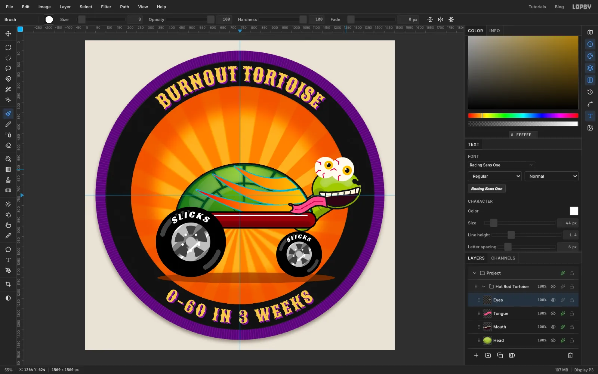

**Tongue.** Add a layer called *Tongue*. Lasso a wavy tongue about 40 px wide. It starts inside the corner of the mouth (**1166, 784**), comes out over the chin, and flaps back in the wind to a rounded tip around **992, 812**. Fill it with `#FF5C8D`. Brush a crease down its middle in `#B5174E` at **Size 5**, then give it the outline.

**Eyes.** Add a layer called *Eyes*:

1. Select the circle **1112, 564** to **1216, 668** with the dialog. Then [[Shift]]-drag a second, slightly bigger circle from **1188, 566** to **1304, 682**, overlapping it.
2. Fill both with `#FFFBEF` and deselect.
3. With a **Size 5** brush in `#D0103A`, paint three bent veins into each eye from the rim inward.
4. Add the irises: a 42 px circle and a 46 px circle in amber `#FFC21A`. Put them off-centre so the eyes look a little crossed: up and to the right in the back eye, forward in the front eye.
5. Select a circle half that size in the middle of each iris and fill it with `#111111` for the pupils.
6. Dab a small white glint on the upper left of each pupil with an **8 px** brush.

## Bulge the eyes with Liquify

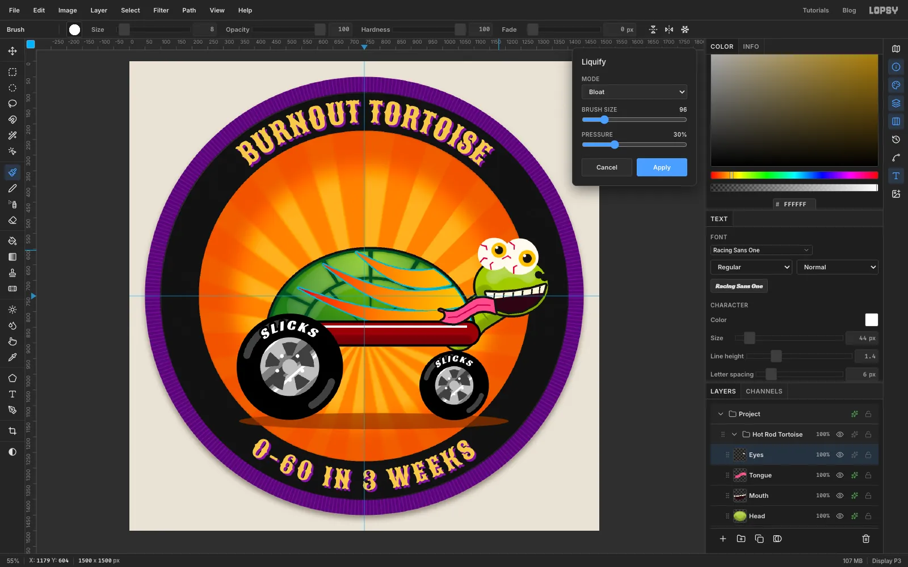

Bloodshot eyes bulging out of their sockets are a Roth trademark. Choose **Filter → Liquify…**, set **Mode** to **Bloat** and **Pressure** to **30%**:

1. Set **Brush Size** to **110** and give the front iris two quick clicks right on its centre.
2. Change the size to **96** and do the same on the back iris.

Each click magnifies what's under the brush centre, so the irises swell and the veins stretch. Don't hold the button down or scrub in circles: every dab compounds, and a dozen of them will blow the iris up until it fills the whole eye. Click **Apply**, then give the layer the outline.

## Throw some sweat

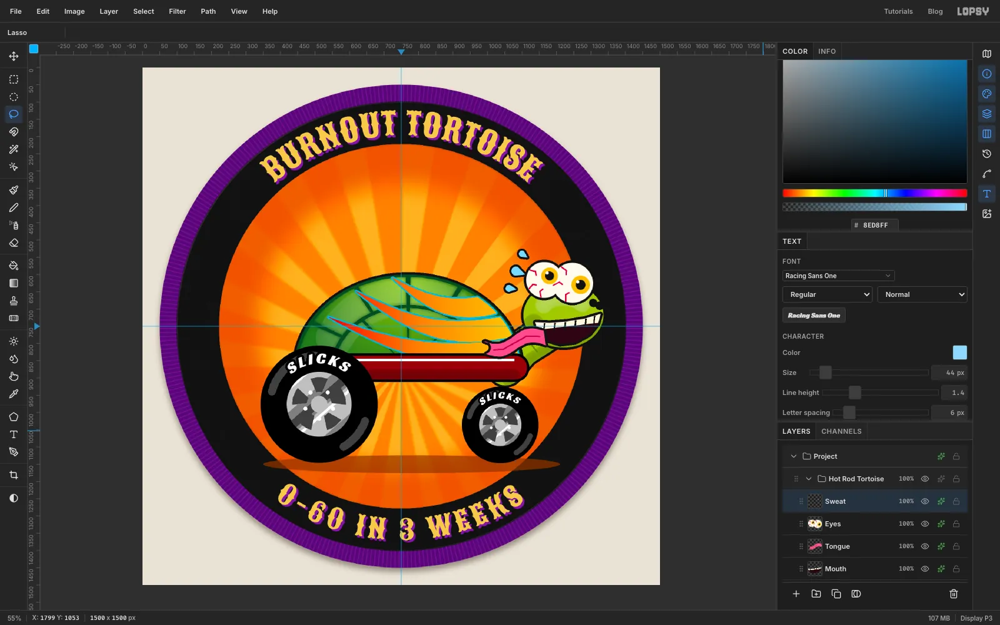

Add a layer called *Sweat*. Lasso three teardrops behind and above the back eye, each a small round blob with a point aimed at the head, as if they've just been flung off. Make the biggest about 26 px across. Fill them with `#8ED8FF` and give them a **6 px** outline.

## Build the blower

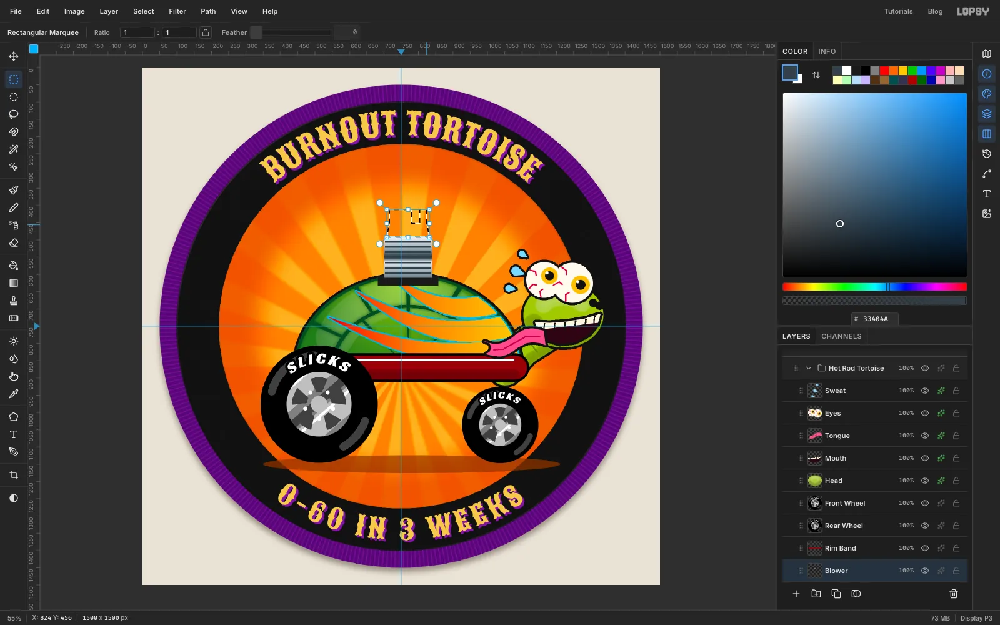

A supercharger, or *blower*, sticking out of the hood is the most hot rod thing there is. Click *Flame Job* and add a layer called *Blower*. Build it from the bottom up:

1. **Flange.** With the **Rectangular Marquee**'s dialog, select **682, 604** to **858, 632** across the top of the shell and fill it with `#1A1A1A`. This is the plate the blower bolts through.
2. **Case.** Select **700, 490** to **840, 610** and fill it with the five-stop chrome gradient, dragged from top to bottom. Then pick the **Pencil** at **Size 5** in `#33404A` and rule horizontal ribs across it every 15 px (click at the left, [[Shift]]-click at the right).
3. **Hat and stacks.** Lasso the injector hat: a trapezoid whose bottom spans the top of the case (**708** to **832** at **y 492**) and narrows to **716** to **824** at **y 452**. Then, with the **Rectangular Marquee**, [[Shift]]-drag three velocity stacks, each 20 px wide, starting at **x 716**, **760** and **804** and rising from the hat to **y 412**.

## Add the stacks' openings and the belt

Fill the hat and stacks with the chrome gradient, dragged diagonally. Then [[Shift]]-drag a flat dark ellipse on the top of each stack and fill them with `#141414`. Those are the openings.

The blower is belt-driven. Lasso a straight band from the front of the case down to a spot on the shell at about **924, 760**, about 32 px wide, and fill it with `#1A1A1A`. Add the two pulleys:

1. Select a 30 px circle at the top end of the belt (**852, 540**) and [[Shift]]-add a 36 px circle at the bottom end.
2. Fill both with the chrome gradient.
3. Select a 12 px circle in the centre of each pulley and fill it with `#1A1A1A` for the hubs.

Deselect, then flatten the metal as before with **Desaturate** and **Posterize** (**Levels 5**). Give the layer the outline.

## Make the zoomie pipes

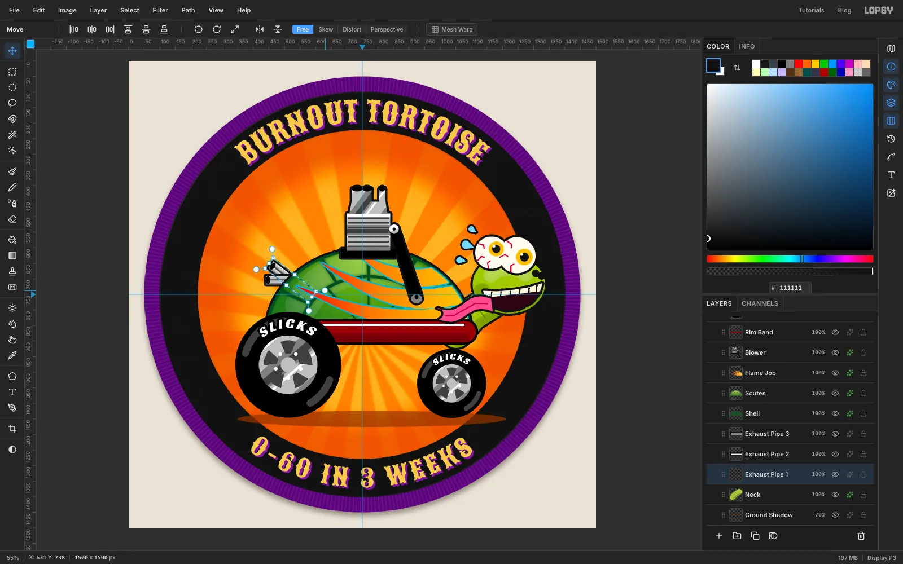

Click *Neck* and add a layer called *Exhaust Pipe 1*, so the pipes tuck in behind the shell.

1. **Draw one pipe.** With the **Rectangular Marquee**'s dialog, select a 160 × 28 px rectangle (**440, 690** to **600, 718**) and fill it with chrome from top to bottom. Fill a small dark ellipse at its left end for the open mouth.
2. **Flatten it.** Run **Desaturate** and **Posterize 5**, then add a **6 px** outline and click **Rasterize Layer Style** in the effects drawer. Baking the outline in means the copies get it too.
3. **Copy it twice.** Draw a marquee around the pipe, press [[Cmd+C]] and [[Cmd+V]], and rename the copy *Exhaust Pipe 2*. Press [[Cmd+V]] again and name that one *Exhaust Pipe 3*. Deselect.

For each pipe, draw a marquee around it, pick the **Move** tool and drag the top-right rotation handle clockwise. The open end lifts up and back:

- *Exhaust Pipe 1*: **38°**
- *Exhaust Pipe 2*: **27°**
- *Exhaust Pipe 3*: **16°**

Press [[Enter]] after each rotation and deselect. Then drag the pipes into a fan coming out of the back of the shell. Their right ends hide behind the dome, and their centres sit around **485, 653**, **435, 712** and **403, 776**.

## Light the exhaust

Click *Exhaust Pipe 3* and add a layer called *Exhaust Flames*. At each pipe's open end, lasso a little three-tongued flame, with the longest tongue straight out along the pipe and two shorter ones splayed either side. Hold [[Shift]] to add them all to one selection.

Fill them with a **Linear** gradient: a near-white core `#FFF8D2` on the left stop, yellow `#FFD23F` a third of the way along, and red `#E8300E` on the right stop. Drag from the pipe ends (about **410, 690**) up and out toward the upper left (about **250, 610**). The pale core is what separates exhaust fire from the orange field behind it. Deselect and give it the outline.

## Select the burnout smoke

A burnout means the rear slick spins in place and pours out smoke. Click *Front Strut* and add a layer called *Burnout Smoke*. Because it sits below *Rear Wheel*, the smoke billows out from *behind* the tyre. With the **Elliptical Marquee**, drag seven overlapping puffs of different sizes, holding [[Shift]] after the first. Bunch them around the back and bottom of the slick, and let them spill into the black band on the left. Keep them inside the purple border.

## Texture the smoke

Fill the puffs with `#ECE8F0`. Keep the selection, add a layer called *Smoke Texture* above it, and run **Filter → Smoke…** with **Scale 6** and **Turbulence 60**. It renders only inside the puffs. Deselect, set the layer's blend mode to **Soft Light**, and choose **Layer → Merge Down** to fold it into *Burnout Smoke*.

## Cel-shade each puff

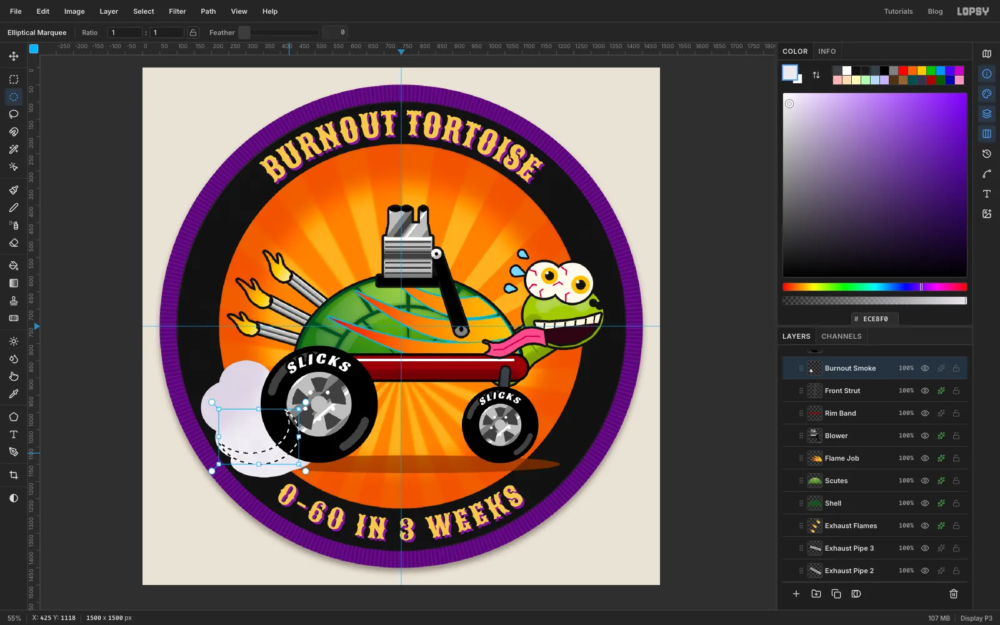

Cartoon smoke is shaded with flat crescents, not soft blurs. For each puff, drag an ellipse just inside its lower-right edge, so the fill can't spill out of the cloud. Then hold [[Alt]] and drag a second ellipse almost the same size, nudged up and to the left by about a quarter of its width. Only a crescent along the lower right is left. Fill it with `#A99CC0`, and move on to the next puff.

When all seven are done, deselect and give the smoke the outline.

## Add speed lines and sparkles

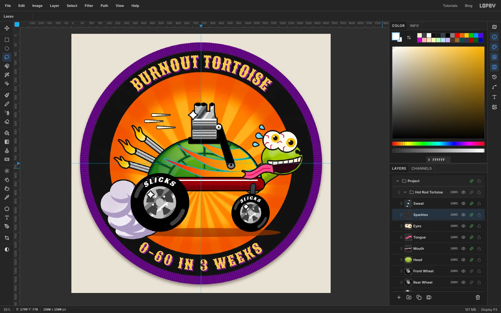

Click *Ground Shadow* and add a layer called *Speed Lines*. In the **Brush** settings, set **Size 14**, **Hardness 100** and **Taper 100**, with the colour cream `#FFF3D6`. Taper thins the stroke from its start, so start each line at the thin end. Draw three horizontal strokes behind the blower, at about **y 470**, **506** and **542**, each starting around **x 430–500** and ending near the case at **x 670**. Give the layer a **4 px** outline.

Click *Eyes* and add a layer called *Sparkles*. Lasso three four-point stars on the chrome: the blower's top corner, the rear rim and the front rim. Fill them white and give them a **5 px** outline.

## Select the whole character

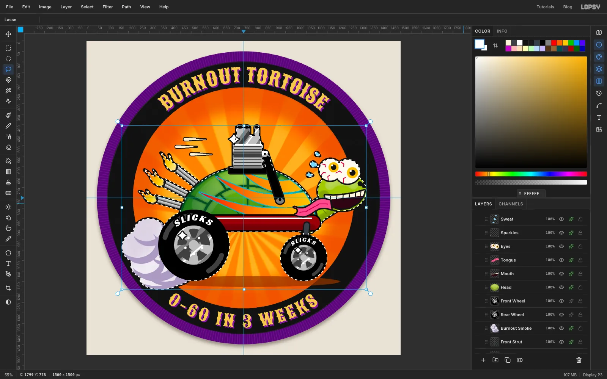

Lowbrow characters wear a heavy black keyline round their whole outline, like a sticker. Click *Ground Shadow* and add a layer called *Keyline*.

[[Cmd]]-click the *Neck* thumbnail. Then [[Cmd+Shift]]-click the thumbnails of every other part to add them:

- the three exhaust pipes and *Exhaust Flames*
- *Shell*, *Blower* and *Rim Band*
- *Front Strut*, *Burnout Smoke* and both wheels
- *Head*, *Mouth*, *Tongue*, *Eyes* and *Sweat*

The marching ants now run round the whole silhouette.

## Fill the keyline

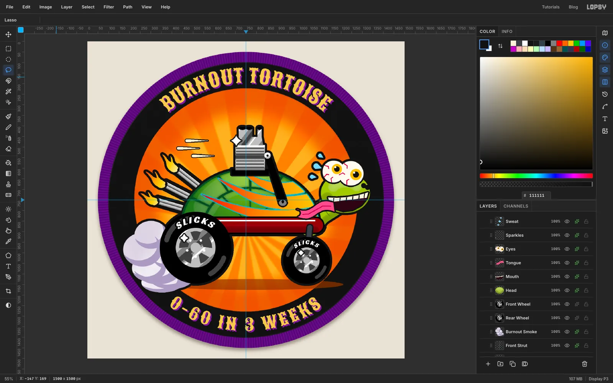

Choose **Select → Grow…** with **10**, fill with `#111111`, and deselect. *Keyline* sits under everything, so only a 10 px rim shows around the outside. Inside the figure the thinner outlines stay as they are, so the outer edge reads boldest.

## Move the whole hot rod at once

Collapse *Hot Rod Tortoise* and click its row. With the **Move** tool, drag anywhere on the character and raise it about 20 px. Every layer in the group moves together, and the ground shadow gets a little more room above the tagline.

## Add a thread sheen

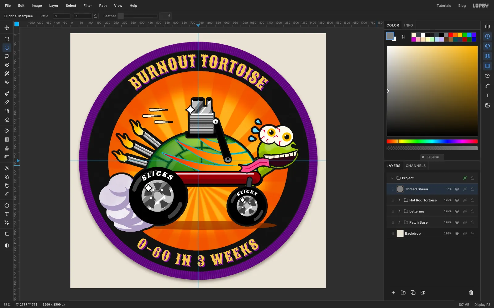

With the group still selected, click **Add Layer** and name the layer *Thread Sheen*. It lands above the group, on top of everything. Select the patch circle (**50, 50** to **1450, 1450**) and fill it with grey `#808080`. Run **Add Noise** at **40** Mono, then **Motion Blur** at **Angle 45**, **Distance 6**. Deselect, set the blend mode to **Overlay**, and set the opacity to **35%**. The highlights now break into fine threads across every colour.

## Fade the speed lines with a mask

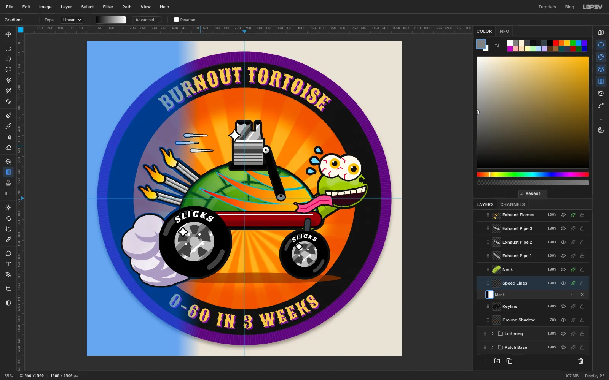

Expand the group and click *Speed Lines*. Click **Add Mask** at the bottom of the Layers panel, then click the new mask thumbnail to edit it. The canvas is tinted blue while you're in mask edit.

Pick the **Gradient** tool, **Linear**, with a black left stop and a white right stop. Drag from the left tips of the speed lines (**430, 500**) about 110 px to the right. The far ends of the lines now fade away. Click the layer's name to leave mask edit.

## Check and export

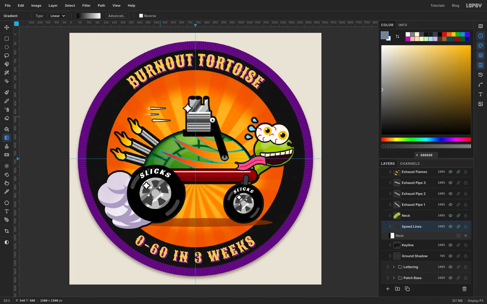

Press [[Cmd+0]] to fit the canvas and look the patch over. Check that nothing important crosses the purple border. At real patch size, about 3.5 inches across, details smaller than about 5 px disappear, so make sure every line will survive.

Choose **File → Quick Export PNG** to save the image, and **File → Save Project** to keep the layers. The project stays fully editable. Try a candy-blue rail, retype the tagline, or swap the tortoise's slicks for whitewalls.
