This tutorial builds a square album cover for an imaginary band, **The Wormwood Society**, and their record **Absinthe Daydream**. The style is **maximalist**: pattern on pattern, saturated jewel tones, three typefaces, ornament in every corner. The finished piece is 1600 × 1600 px, a good working size for a 12-inch sleeve or a streaming thumbnail.

Maximalism isn't the same as clutter. Under all the ornament there's a strict structure: a symmetrical arched window in the centre, one hero object inside it (the glass), plants that frame the window from both sides, and type in fixed slots at the top and bottom. Get that skeleton right and you can keep piling on detail without losing the focal point.

Along the way you'll use:

- **guides**, **groups**, reordering layers by dragging, and moving, scaling, flipping and rotating with the **Move** tool's handles
- the **Brush** with **Radial Symmetry**, and the **Pencil** with [[Shift]]-click straight lines
- the **Pen** tool, **Path to Selection**, and **text on a path**
- the **Rectangular** and **Elliptical Marquee**, the **Lasso**, adding, subtracting and intersecting selections, and **Select → Grow**
- the **Shape** tool's rounded rectangle with a fill and a stroke
- **Sunburst**, **Clouds**, **Halftone**, **Add Noise** and **Hue/Saturation**
- **Stroke**, **Drop Shadow**, **Outer Glow** and **Inner Glow**, the **Overlay** and **Screen** blend modes, and a **Vignette** adjustment

The palette:

- Velvet `#14634A` → `#0E4D3A` → `#06140F`
- Gold `#D9A441`, light gold `#F6D57E`, cream `#F7EBD0`
- Dusk sky `#0F5B57` → `#8E1F5E` → `#D6266E` → `#F59A6B`
- Absinthe `#E2F58A` → `#B8E04A` → `#3E8E2E`, glow `#C8F560`
- Rose `#F27BA6`, fuchsia `#D6266E`, teal `#2EC4A6`
- Wormwood `#5E8A55`, `#7FA06C`, `#9DB88A`, `#C9D9C0`
- Poppy `#7A0F12` → `#C8281C` → `#E8452C` → `#FF8A5B`
- Cartouche `#0B2E24`, ink `#1A0F0A`

> **Tip:** Positions are given as `x, y` in document pixels. The status bar at the bottom left shows where your cursor is. Mac key names are used; on Windows and Linux use Ctrl for Cmd, except where a step says otherwise.

> **Tip:** "Fill" means set the foreground colour in the Color panel's hex field, then choose **Edit → Fill**. Press [[Cmd+D]] to drop a selection before you draw a new one, so the new drag doesn't move the old outline.

> **Tip:** Gradient colours live in the **Gradient Editor**, not the foreground colour. With the Gradient tool picked, click **Advanced…** in the options bar, click a stop to set its colour, click under the bar to add a stop, and drag stops to position them.

> **Tip:** A new layer appears just above the active one, and inside a group if the active row is a group. Each step says which row to click first.

## Set up the canvas and the velvet background

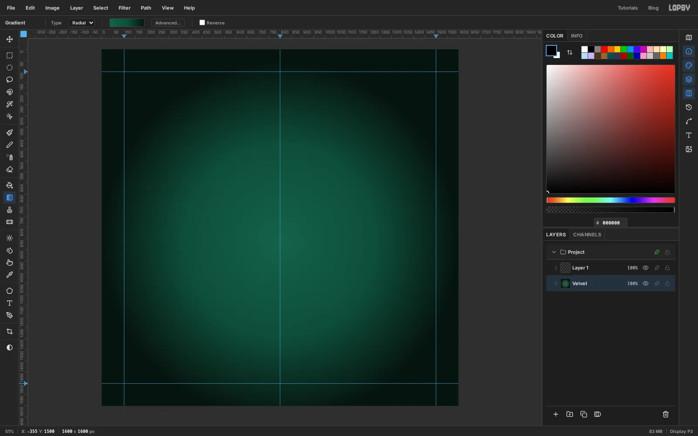

Create a new document `1600` × `1600` px with a white background. Turn on **View → Show Rulers**, then click the top ruler at x `100`, `800` and `1500`, and the left ruler at y `100` and `1500`, to drop five guides. The outer ones mark the margin you'll keep text and badges inside, and the middle one is your centre line.

1. Double-click the `Background` row and rename it `Velvet`.
2. Pick the **Gradient** tool, set **Type** to **Radial**, and in **Advanced…** make three stops: `#14634A` at the left, `#0E4D3A` at about 55% and `#06140F` at the right.
3. Drag from just below the middle of the canvas (`800, 860`) straight down past the bottom edge.

The bright spot sits a little low on purpose. The glass will stand there, and the light should seem to come from it.

## Draw a gold diamond lattice

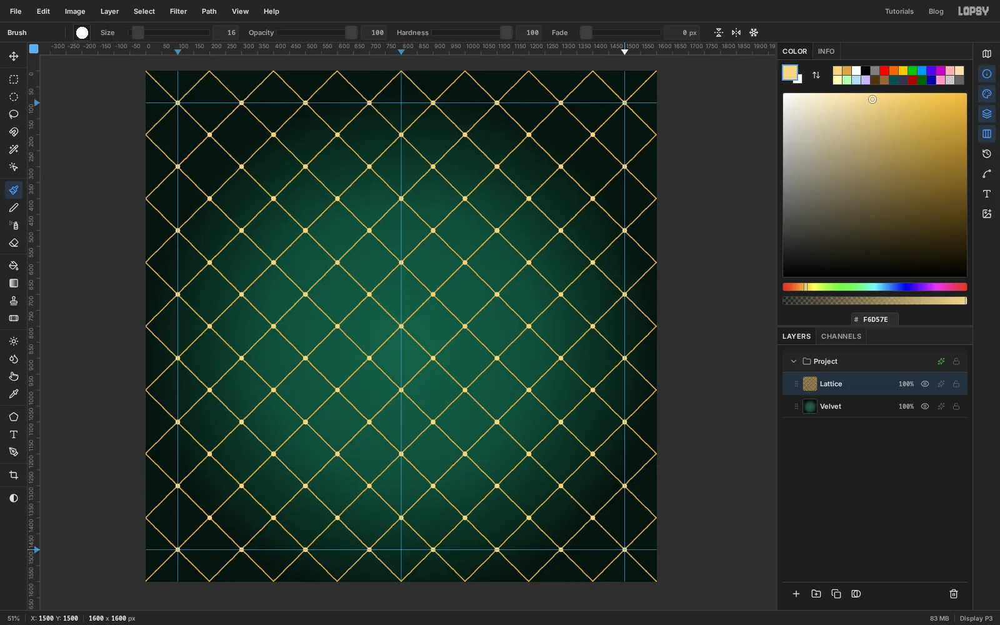

The new document also has an empty `Layer 1`. Rename it `Lattice`.

1. Pick the **Pencil** ([[N]]), set **Size** `3` and the colour to `#D9A441`.
2. Draw 45° lines across the canvas every 200 px. For each line, click where it starts on one edge of the canvas, then hold [[Shift]] and click where it ends on another edge. Shift-click joins the two points with a straight line. Start with lines running down to the right (from `0, 200` to `1400, 1600`, from `0, 400` to `1200, 1600`, and so on, plus their mirror images starting along the top edge), then do the same in the other direction.
3. Switch to the **Brush** ([[B]]), set **Size** `16`, **Hardness** `100` and the colour to `#F6D57E`, and click once on every crossing.
4. Click the opacity on the `Lattice` row and set it to `30%`.

A quiet repeating pattern like this is the bottom layer of every maximalist piece. It fills empty space without asking to be looked at.

## Add sunburst rays

Click **Add Layer** and name it `Rays`. Set the foreground colour to `#B8E04A` and choose **Filter → Sunburst…**:

- **Rays** `32`, **Length** `120`, **Width** `45`, **Fade** `75`
- **Center X** `50`, **Center Y** `50`, **Opacity** `45`

Click **Apply**, then open the layer effects drawer (the ✦ button on the row) and set the blend mode to **Overlay**. Overlay lightens the green under each ray rather than painting flat yellow-green on top of it, so the rays look like light on velvet.

## Select the arched window

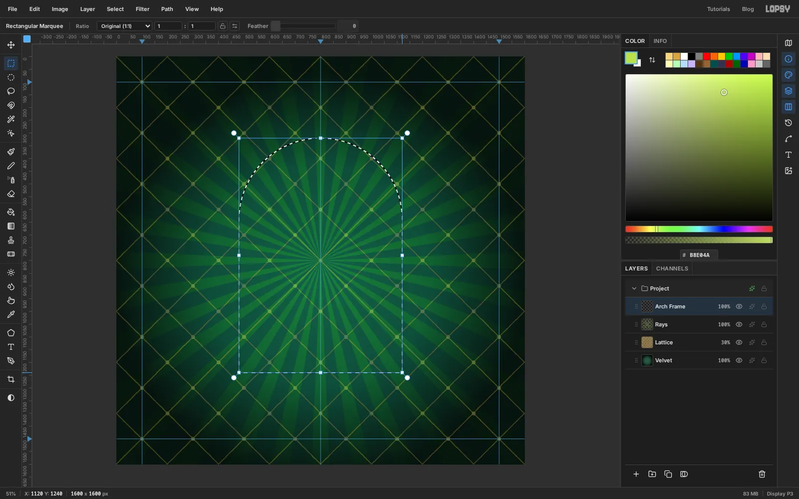

Click **Add Layer** and name it `Arch Frame`.

1. Pick the **Elliptical Marquee** and drag a circle from `480, 320` to `1120, 960`.
2. Pick the **Rectangular Marquee** ([[M]]), hold [[Shift]] and drag from `480, 640` (the circle's left edge, halfway down) to `1120, 1240`. Shift adds the rectangle, and the two shapes merge into an arch.

You'll make this exact selection three more times, so note the numbers.

## Paint the frame and the dusk sky

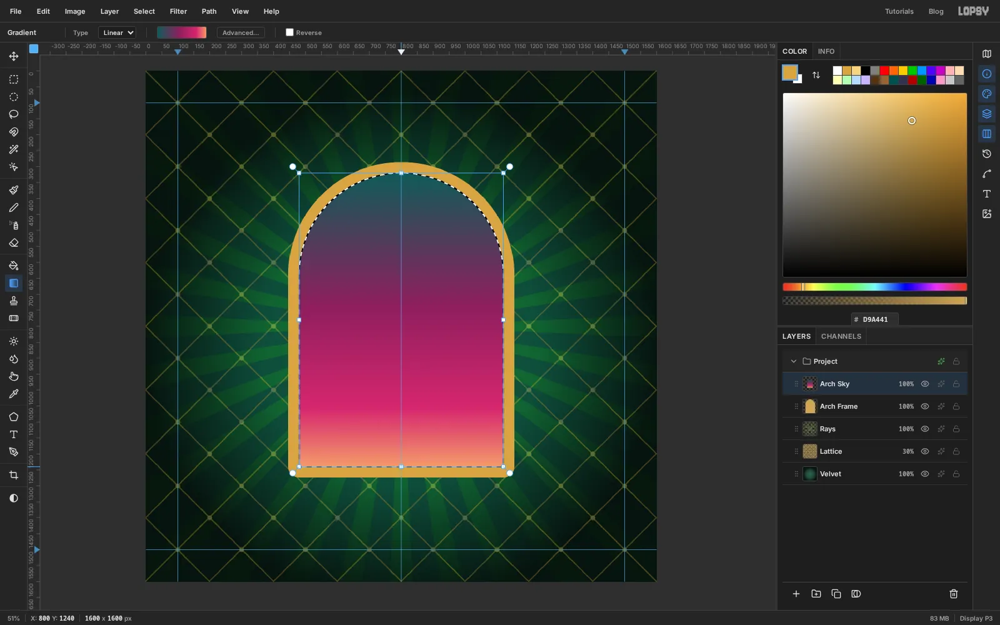

1. With the arch still selected, choose **Select → Grow…**, enter `34` and click **Apply**. Fill with `#D9A441` and press [[Cmd+D]]. That's a solid gold arch, slightly bigger than the window.
2. Click **Add Layer**, name it `Arch Sky`, and make the arch selection again (circle, then [[Shift]]-rectangle).
3. Set up a four-stop linear gradient: `#0F5B57` at the left, `#8E1F5E` at about 45%, `#D6266E` at about 80% and `#F59A6B` at the right. Hold [[Shift]] and drag from the top of the arch (`800, 320`) to its bottom (`800, 1240`).

The gold shows as a 34 px frame around the sky. Press [[Cmd+D]].

## Add halftone clouds

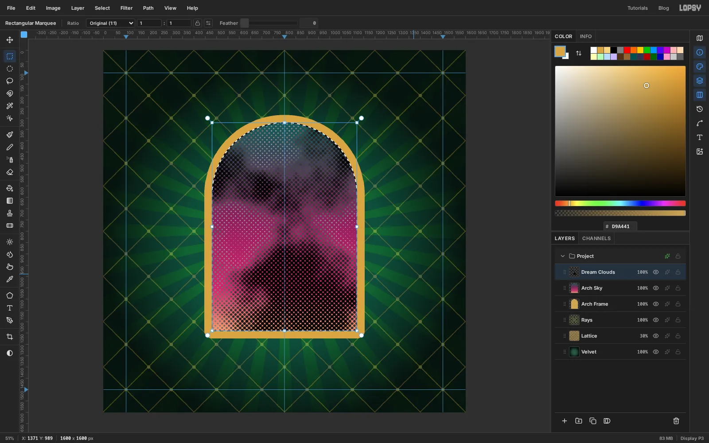

Click **Add Layer**, name it `Dream Clouds`, and make the arch selection again.

1. Choose **Filter → Clouds…** with **Scale** `4`.
2. Choose **Filter → Halftone…** with **Dot Size** `14`, **Angle** `45` and **Softness** `0.5`.
3. Press [[Cmd+D]], set the blend mode to **Screen**, and set the layer opacity to `35%`.

At full strength this looks like a newspaper photo of smoke. At 35% on Screen it becomes a faint printed texture in the sky, the kind of detail people only notice up close.

## Cut a crescent moon

Click **Add Layer** and name it `Moon`.

1. With the **Elliptical Marquee**, drag a circle from `566, 406` to `714, 554`.
2. Hold [[Alt]] and drag a second circle from `602, 385` to `742, 525`. It's subtracted from the first and leaves a crescent.
3. Fill with `#F7EBD0` and press [[Cmd+D]].
4. In the effects drawer, turn on **Outer Glow** with **Size** `40`, **Opacity** `70` and the colour `#F6D57E`.

## Paint the rosette with radial symmetry

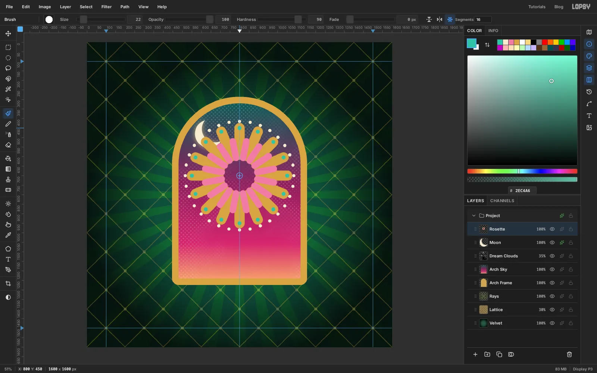

This big flower is the "daydream", a halo behind the glass. **Radial Symmetry** turns one stroke into sixteen.

1. Click **Add Layer** and name it `Rosette`.
2. Pick the **Brush**, click **Radial Symmetry** in the options bar and set **Segments** to `16`.
3. Hold [[Cmd]] and click at `800, 700`. That moves the symmetry centre without painting. On Windows and Linux this needs the Windows (Super) key, not Ctrl: Ctrl+click paints a ring of dabs instead.
4. Set **Hardness** `90` and **Opacity** `100`, then paint four strokes. Each one is copied around the centre:
   - **Gold spokes:** colour `#D9A441`, **Size** `56`. Drag straight up from `800, 590` to `800, 450`.
   - **Pink petals:** colour `#F27BA6`, **Size** `36`. Drag a short stroke between two spokes, from about `818, 607` out to `836, 519`.
   - **Cream dots:** colour `#F7EBD0`, **Size** `18`. Click once just beyond the tip of a spoke (`800, 415`) and once beyond the gap next to it (`856, 420`).
   - **Teal tips:** colour `#2EC4A6`, **Size** `22`. Click once on the end of the top spoke (`800, 450`).
5. Click **Radial Symmetry** again to turn it off.

## Finish the rosette's centre

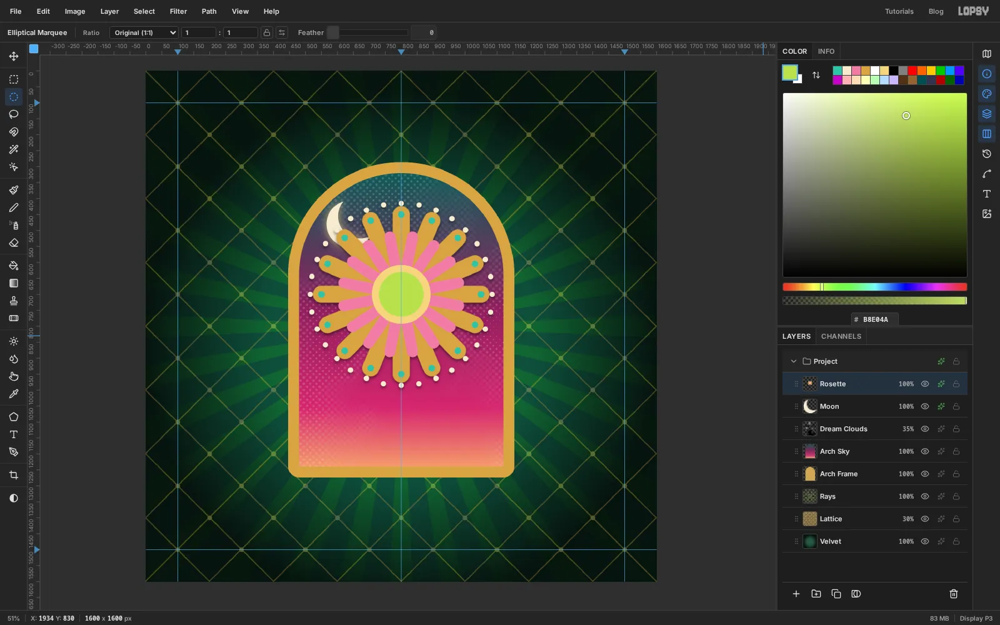

On the same layer, use the **Elliptical Marquee** to drag a circle from `708, 608` to `892, 792` and fill it with `#F6D57E`, then a smaller one from `730, 630` to `870, 770` and fill it with `#B8E04A`. In the effects drawer, turn on **Drop Shadow** with **Offset X** `0`, **Offset Y** `6`, **Blur** `14` and **Opacity** `45`.

## Scale the rosette down

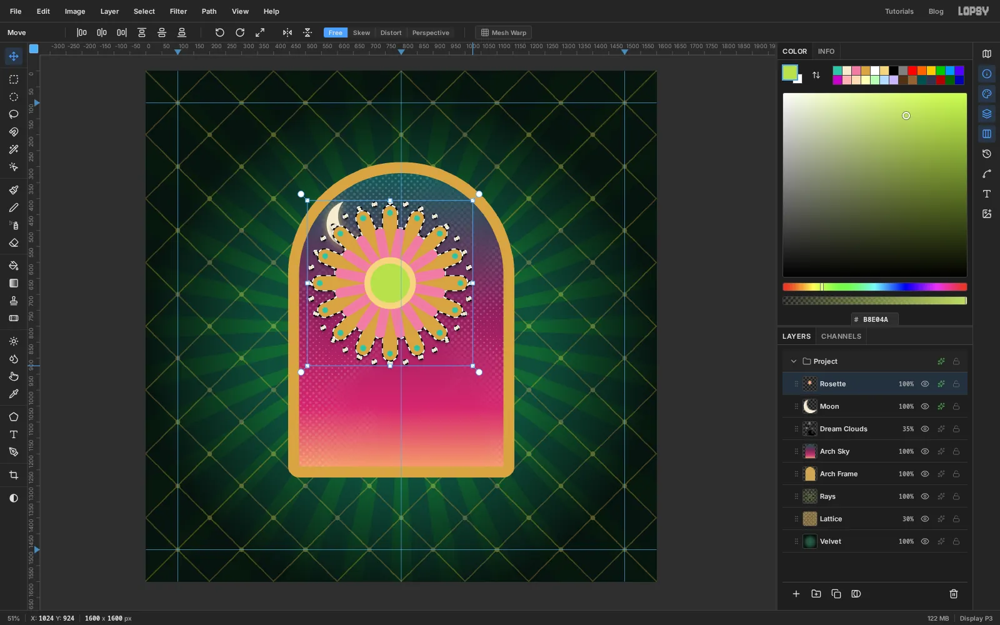

The rosette crowds the arch, so shrink it a little.

1. Hold [[Cmd]] and click the `Rosette` thumbnail in the Layers panel. That selects exactly its pixels.
2. Pick the **Move** tool ([[V]]). Handles appear around the selection.
3. Hold [[Cmd]] and drag the bottom-right corner handle in by about 70 px on each axis. Cmd keeps the proportions, so the rosette scales to about 88%.
4. Scaling pins the opposite corner, so the rosette has drifted up and left. Arrow keys nudge the selection 1 px, and [[Shift]] + arrow nudges 10 px. Press [[Shift+→]] three times and [[→]] five times, then the same with the down arrow, to move it 35 px right and 35 px down so it's centred on `800, 700` again.
5. Press [[Cmd+D]]. Dropping the selection applies the transform.
6. The moon is now half hidden behind the petals. Shrink it the same way to about 75% ([[Cmd]]-click its thumbnail, [[Cmd]]-drag a corner in by about 35 px), and nudge it up and left so it tucks into the upper-left of the arch, clear of both the gold frame and the dot ring.

## Draw the glass with the Pen tool

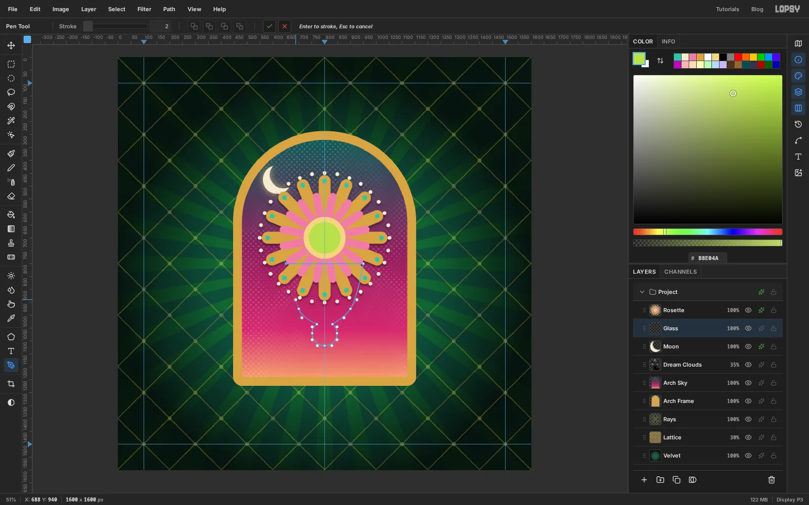

Absinthe is served in a reservoir glass, a tulip-shaped bowl with a little bulb at the bottom that measures the dose. The Pen tool makes a smooth outline easy.

Click the `Moon` row, then **Add Layer**, and name it `Glass`. It lands under the rosette. That's deliberate: you'll draw the glass first and then practise dragging it into place in the layer stack. Pick the **Pen** tool ([[P]]) and place the anchors in this order. A click makes a sharp corner. A drag pulls out curve handles, and the direction you drag is the direction the curve leaves in.

1. Click `650, 800` and `950, 800`: the rim.
2. Drag a short way down and to the left at `900, 975`: the right side of the bowl curves in.
3. Click `830, 1035`, where the bowl meets the reservoir.
4. For the round reservoir, drag down at its right edge (`848, 1070`), drag left at its bottom (`800, 1118`), and drag up at its left edge (`752, 1070`). Short drags of about 25 px are enough.
5. Click `770, 1035`, then drag a short way up and to the left at `700, 975` for the left side of the bowl.
6. Click the first anchor at `650, 800` to close the path.

## Turn the path into a glass shape

1. Open the **Paths** panel (the curve icon in the right-hand panel bar), click `Path 1`, then click **Path to Selection**, the dashed-square button at the bottom of the panel.
2. Pick the **Rectangular Marquee**, hold [[Shift]] and drag a thin stem from `789, 1110` to `811, 1186`.
3. Pick the **Elliptical Marquee**, hold [[Shift]] and drag a flat foot from `700, 1176` to `900, 1206`.
4. Fill with `#DFF5E8` and press [[Cmd+D]]. Click `Path 1` again in the Paths panel to deselect it, so its blue outline goes away.

## Bring the glass forward and scale it up

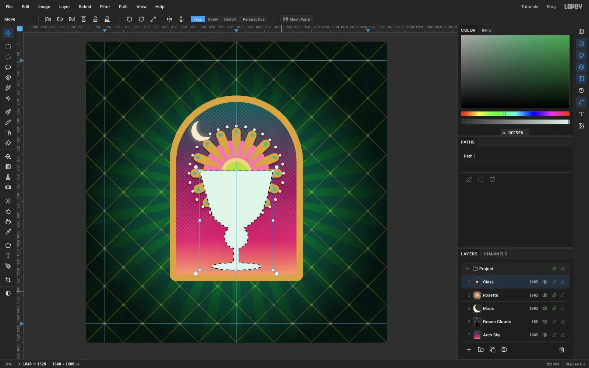

The `Glass` layer sits under `Rosette`. In the Layers panel, drag the `Glass` row by its grip (the dots on the left) up above `Rosette`.

The glass is also a bit small for the window. Hold [[Cmd]] and click its thumbnail, pick the **Move** tool, and [[Cmd]]-drag the bottom-right handle out to make it about 130% of its size. Then drag the selection so the glass is centred on the middle guide with its foot at about y `1215`. The rim lands at about y `687`, right across the rosette's centre, which makes the rosette look like a sun rising out of the glass. Press [[Cmd+D]].

In the effects drawer, turn on **Stroke** with **Width** `4` and the colour `#F7EBD0`, set the blend mode to **Screen**, and set the opacity to `45%`. For now the glass is a pale ghost. You'll firm it up later.

## Select the liquid with an intersection

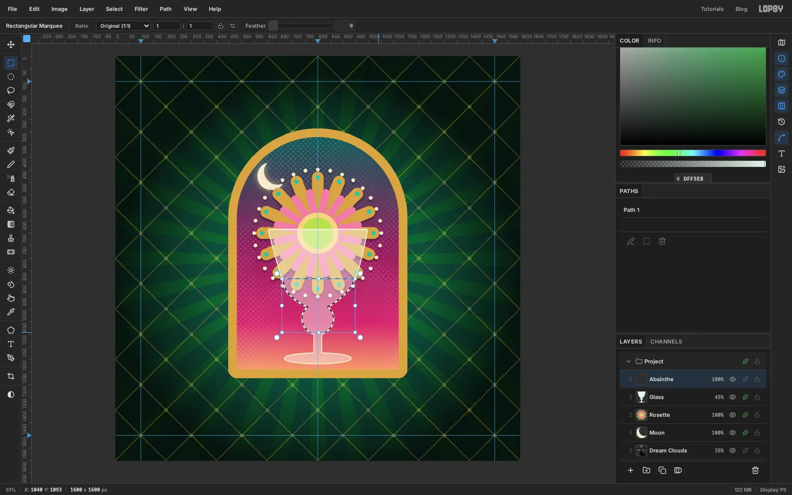

Click **Add Layer** and name it `Absinthe`.

1. [[Cmd]]-click the `Glass` thumbnail to select the glass.
2. Pick the **Rectangular Marquee**, hold [[Shift]] and [[Alt]] together, and drag from `560, 880` to `1040, 1093`. Shift+Alt **intersects**, keeping only the part of the glass inside the rectangle: the bottom of the bowl and the reservoir, but not the stem.

## Fill the absinthe and make it glow

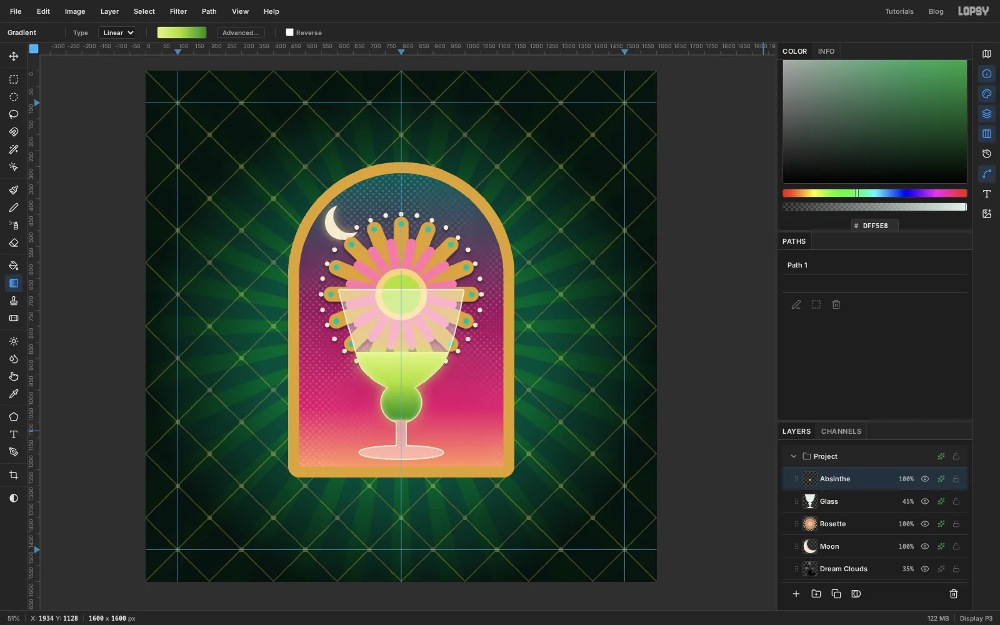

1. Set up a three-stop linear gradient: `#E2F58A` at the left, `#B8E04A` at about 45% and `#3E8E2E` at the right. Hold [[Shift]] and drag from the liquid's surface (`800, 880`) down to `800, 1093`. Press [[Cmd+D]].
2. In the effects drawer, turn on **Outer Glow** with **Size** `70`, **Opacity** `80` and the colour `#C8F560`.
3. Turn on **Inner Glow** with **Size** `24`, **Opacity** `60` and the colour `#F6FFD0`.

The pale top and dark bottom read as liquid with depth, and the glow is the "green fairy" the drink is famous for.

## Build the slotted spoon

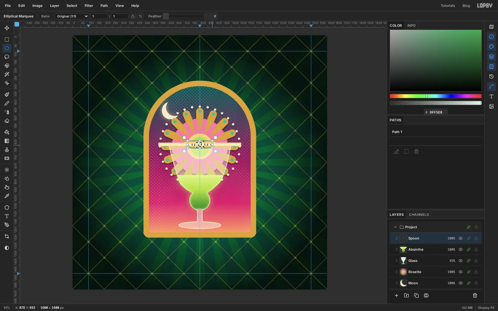

Click **Add Layer** and name it `Spoon`.

1. With the **Rectangular Marquee**, drag the handle from `540, 676` to `1060, 698`.
2. Pick the **Lasso** ([[L]]), hold [[Shift]] and draw a pointed leaf shape around the middle of the handle, about 210 px wide and 60 px tall, centred on `800, 687`.
3. Set up a five-stop gradient for polished gold: `#8A5A1C`, `#F6D57E` at 35%, `#FFF4C9` at 55%, `#D9A441` at 75% and `#8A5A1C` at the right. [[Shift]]-drag from `800, 650` down to `800, 724`. Press [[Cmd+D]].
4. Now punch the slots with the **Elliptical Marquee**, all centred on the spoon's middle line (y `687`). Drag the first hole, then hold [[Shift]] for every hole after it so they add up into one selection: three 20 px circles at x `760`, `800` and `840`, two 10 px circles at x `727` and `873`, and four 12 px circles, two just above the middle hole (y `670`) and two just below it (y `704`), at x `780` and `820`. **Snap to Guides** is on by default, so the edges of those last four nearest the centre guide snap onto it and stretch into neat paired slots.
5. Press [[Delete]], then [[Cmd+D]]. Add a **Drop Shadow** with **Offset Y** `8`, **Blur** `10` and **Opacity** `55`.

## Add the sugar cube and the drips

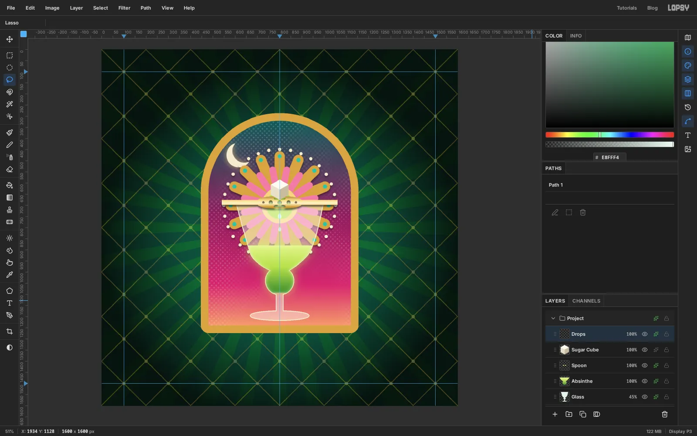

The ritual is to drip ice water over a sugar cube on the spoon.

1. Click **Add Layer** and name it `Sugar Cube`. The cube has 46 px edges, and its bottom corner rests on the spoon at `800, 676`. Draw it one face at a time with the **Lasso**: lasso the top diamond and fill it with `#FFFBF0`, press [[Cmd+D]], lasso the left face below it and fill with `#E9DFC8`, press [[Cmd+D]], then lasso the right face and fill with `#C9BC9E`.
2. [[Cmd]]-click the thumbnail and choose **Filter → Add Noise…** with **Amount** `18`. Sugar is grainy, and the noise sells it. Press [[Cmd+D]].
3. Click **Add Layer**, name it `Drops`, and lasso two small teardrops under the spoon at about `800, 745` and `800, 805`. Fill with `#E8FFF4` and add an **Outer Glow** with **Size** `14`, **Opacity** `70` and the colour `#E8FF9A`.

## Group the glass

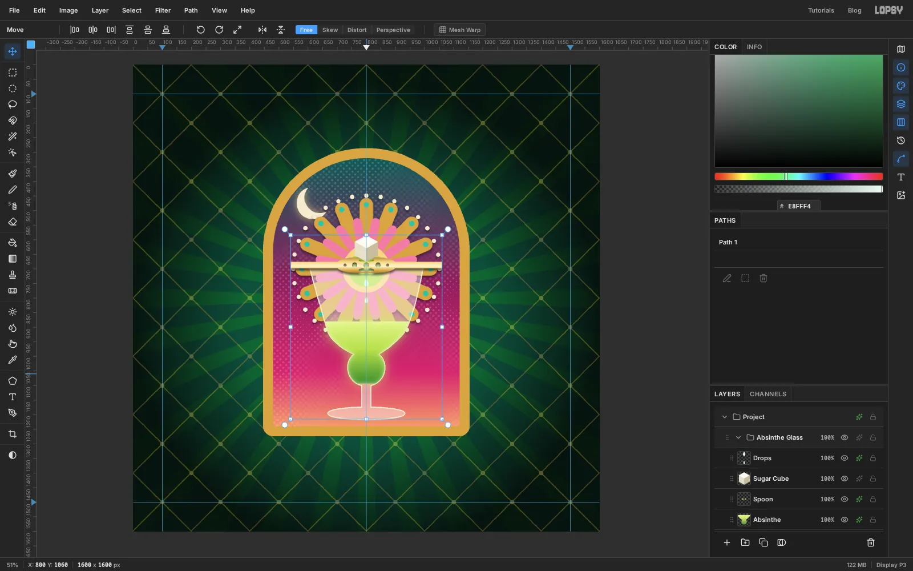

Click the `Glass` row, [[Shift]]-click the `Drops` row to select all five, and choose **Layer → Group Layers**. Rename the group `Absinthe Glass`.

Now the glass moves as one piece. Click the group row, pick the **Move** tool and drag on the canvas: the liquid, spoon, cube and drops all travel together. If you try it, press [[Cmd+Z]] to put it back. One undo restores the whole group.

## Paint a wormwood frond

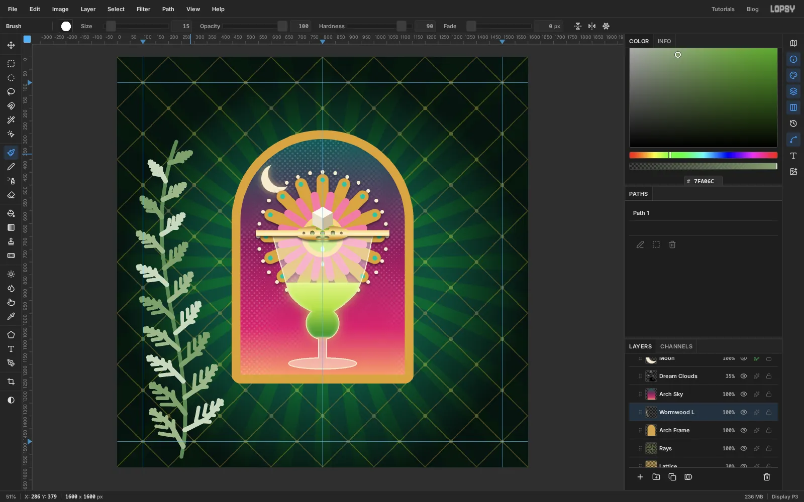

Absinthe is made from wormwood, a silvery plant with feathery leaves. Click the `Arch Frame` row and **Add Layer**, and name it `Wormwood L`. It sits under the sky and over the frame's edge, so the plants look like they grow in front of the wall but behind the window.

Pick the **Brush** with **Hardness** `90` and **Opacity** `100`.

1. **Stem:** colour `#5E8A55`, **Size** `16`. Drag one long, gentle S-curve from the bottom edge at `250, 1560` up to about `230, 330`, bowing out to the left around y `800`.
2. **Leaves:** at intervals of roughly 80 px up the stem, alternating sides, drag a leaf outwards and upwards at about 50° from the stem. Use **Size** `20`, and make leaves about 190 px long at the bottom and less than half that near the top.
3. **Lobes:** along each leaf, add four pairs of short side strokes with **Size** `15`, angled forward like the barbs of a feather.
4. Change colour every leaf or two between `#9DB88A`, `#C9D9C0` and `#7FA06C`, so the frond has light and shade.

Then paint a second, smaller frond on the same layer, from `420, 1560` up to about `420, 820`, three-quarters the size. Finish with a **Drop Shadow**: **Offset X** `6`, **Offset Y** `10`, **Blur** `12`, **Opacity** `50`.

## Mirror the fronds to the right side

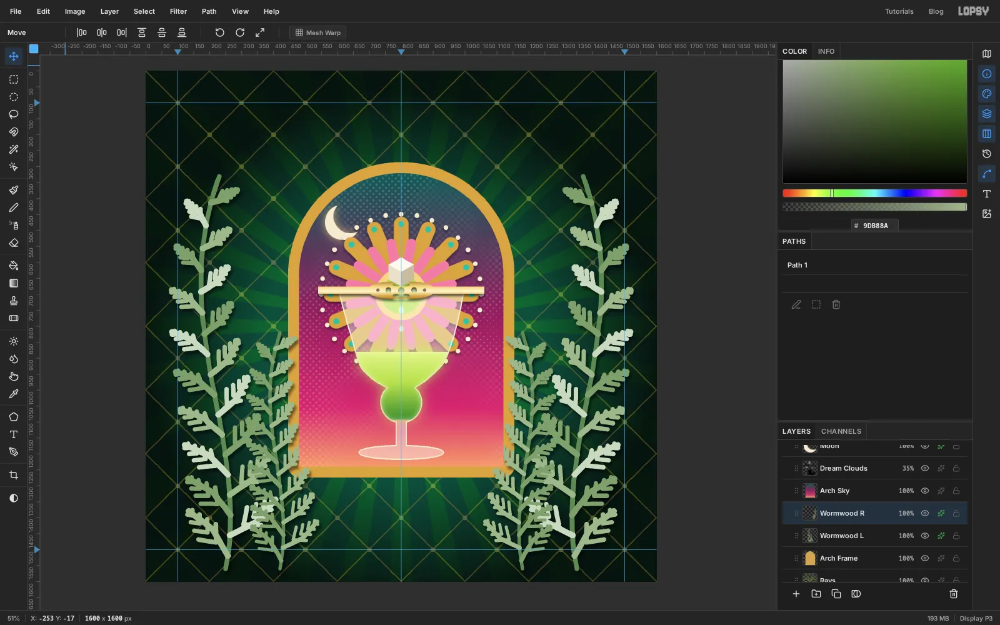

1. Click **Duplicate Layer** in the Layers panel footer and rename the copy `Wormwood R`.
2. [[Cmd]]-click its thumbnail, pick the **Move** tool, and click **Flip Horizontal** in the options bar.
3. Drag the flipped fronds across to the right side until they mirror the left ones. The left fronds span x `72` to `544`, so the copy should span `1056` to `1528`. Press [[Cmd+D]].

Exact mirror symmetry looks formal and decorative, like wallpaper or a stained-glass panel. That's the effect you want here.

## Make a poppy

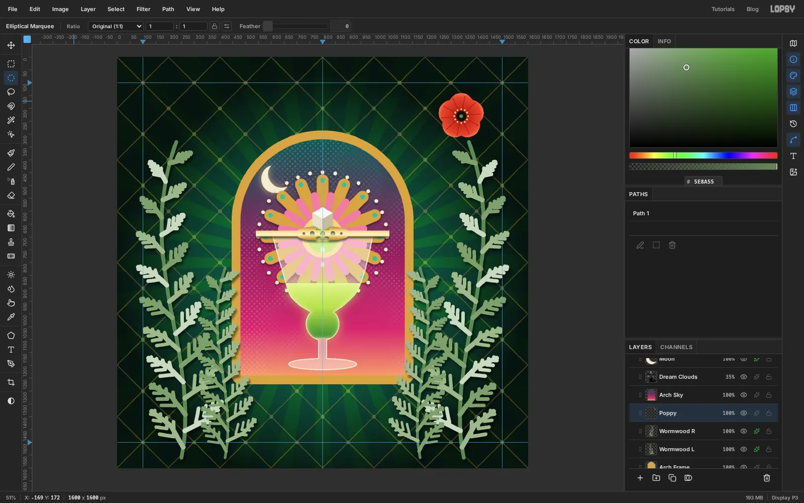

Click `Wormwood R`, **Add Layer**, and name it `Poppy`. Build it in the empty top-right corner, around `1340, 230`, and move it later.

1. **Petals:** with the **Elliptical Marquee**, drag five overlapping 100 px circles whose centres sit 40 px out from the middle, evenly spaced like the points of a star. Hold [[Shift]] for every circle after the first.
2. Set up a radial gradient: `#7A0F12`, `#C8281C` at 35%, `#E8452C` at 80% and `#FF8A5B` at the right. Drag from the centre about 95 px down. Press [[Cmd+D]].
3. **Crinkles:** **Pencil**, **Size** `2`, colour `#9E1B12`. Draw ten short straight lines from near the centre out towards the petal edges (click, then [[Shift]]-click).
4. **Seed head:** fill a circle of radius 20 at the centre with `#14100E`. With the **Brush** at **Size** `8` and colour `#F6D57E`, click twelve stamens in a ring just outside it. Finish with a tiny `#5E8A55` circle in the middle.

## Paste transformed copies

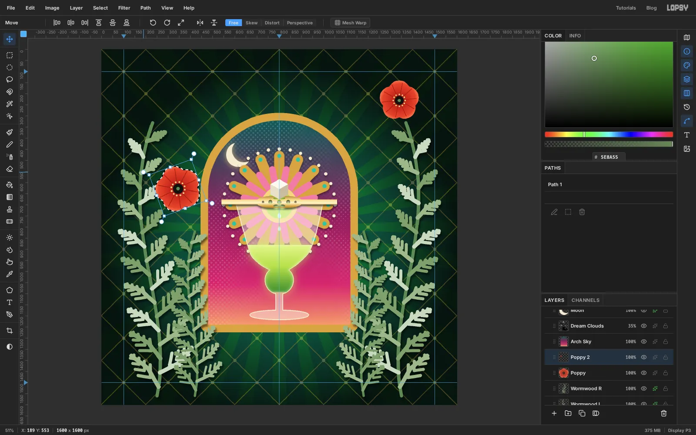

[[Cmd]]-click the `Poppy` thumbnail and press [[Cmd+C]]. Then, five times: press [[Cmd+V]], rename the new layer (`Poppy 2`, `Poppy 3` and so on), drag it into place, [[Cmd]]-click its thumbnail, scale it with a [[Cmd]]-drag on a corner handle, and rotate it by dragging just outside a corner.

- `Poppy 2`: centre `330, 610`, 115%, rotated 20° counter-clockwise
- `Poppy 3`: centre `175, 1050`, 85%, rotated 25° clockwise
- `Poppy 4`: centre `440, 1400`, 100%, rotated 10° clockwise
- `Poppy 5`: centre `1255, 760`, 100%, rotated 35° clockwise
- `Poppy 6`: centre `1440, 1130`, 90%, rotated 15° counter-clockwise

There's no angle readout while you rotate, so the angles are approximate. Different sizes and angles stop the copies looking stamped. Press [[Cmd+D]] after each one.

## Place the poppies

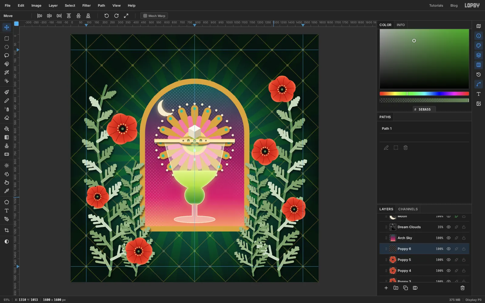

Finally, click the original `Poppy` row and drag it down onto the tip of the right-hand frond, at about `1365, 352`, so it reads as the flower at the top of the stem.

Stand back and check the rhythm. The flowers should sit on the fronds rather than float, alternate in height from side to side, and frame the arch without touching it. Red is the complement of the wormwood greens, so a few blooms go a long way.

## Set the title

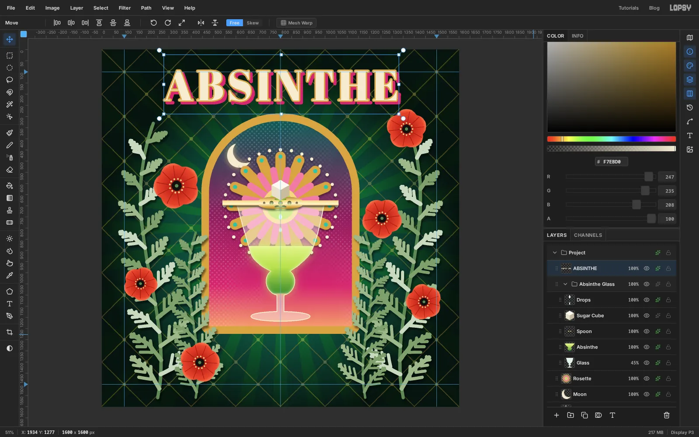

The title goes at the very top of the stack. Clicking the top row won't do it, because the new layer would land inside the `Absinthe Glass` group, and the Text tool's settings restyle whatever text layer is active. So create the title from a plain raster layer and move it up afterwards.

1. Click the `Rosette` row. Pick the **Text** tool ([[T]]), set **Size** `190` and the font to **Abril Fatface**, and set the foreground colour to `#F7EBD0`.
2. Click on empty canvas, type `ABSINTHE`, and press [[Tab]] to commit.
3. In the **Text** panel, set **Letter spacing** to `14`. Wide tracking on all-caps makes a heavy display face feel grand rather than shouty.
4. Pick the **Move** tool and drag the title so it's centred on the middle guide with its top at about y `92`.
5. In the effects drawer, turn on **Stroke** with **Width** `6` and the colour `#D9A441`, and **Drop Shadow** with **Offset X** `12`, **Offset Y** `12`, **Blur** `0`, **Opacity** `100` and the colour `#D6266E`. A hard, offset shadow in a bright colour is a classic poster trick.
6. Drag the `ABSINTHE` row to the top of the Layers panel, above the `Absinthe Glass` group.

## Draw an arc for the band name

The band name will run along the gold frame. With the **Pen** tool, place three anchors, dragging each one in the direction the curve travels:

1. Drag from `472, 640` straight up to `472, 459`.
2. Drag from `800, 312` straight right to `981, 312`.
3. Drag from `1128, 640` straight down to `1128, 821`.

Click the **✓ Commit path** button in the options bar. Don't press Enter: Enter would also stroke the path in paint.

## Bind the band name to the path

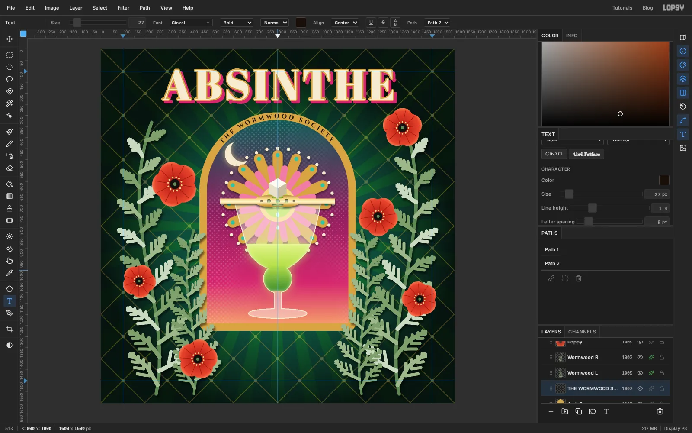

1. Click the `Arch Frame` row so the new text sits just above the frame.
2. Pick the **Text** tool. Set **Size** `27`, font **Cinzel**, weight **Bold**, **Align** **Center** and the colour `#1A0F0A`.
3. Click on empty canvas, type `THE WORMWOOD SOCIETY` and press [[Tab]].
4. In the Text panel, set **Letter spacing** to `9`.
5. In the options bar, set **Path** to `Path 2`. The letters jump onto the arc, centred on its top.

## Write "Daydream" in script

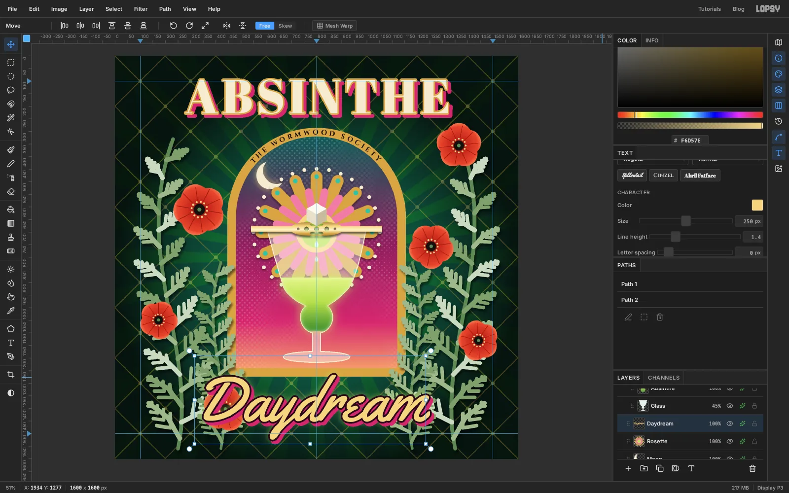

The second half of the title is a script, which gives the cover its third voice.

1. Click the `Rosette` row. Pick the **Text** tool, set **Size** `250`, font **Yellowtail**, **Align** **Left**, and the colour `#F6D57E`.
2. Click on empty canvas, type `Daydream` and press [[Tab]]. In the Text panel make sure **Letter spacing** is `0`, because tracking breaks the joins of a connected script.
3. Move it so it's centred on the middle guide at about y `1395`.
4. Add **Stroke** (**Width** `7`, colour `#2A0A1C`), **Drop Shadow** (**Offset X** `10`, **Offset Y** `12`, **Blur** `0`, **Opacity** `100`, colour `#D6266E`) and **Outer Glow** (**Size** `40`, **Opacity** `55`, colour `#C8F560`).

## Tilt the script

With the **Move** tool and the `Daydream` layer active, handles appear around the text box. Drag just outside the top-left corner, where the cursor turns into a curved arrow, and rotate about 6° counter-clockwise so the word rises to the right. The text stays live, so you can still edit it later.

## Make a starburst badge

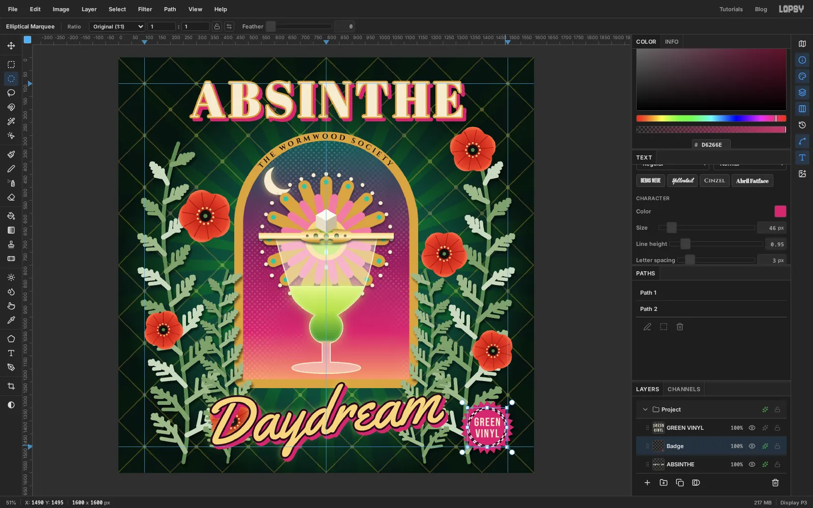

A "Green Vinyl" sticker is the kind of small extra a maximalist cover loves.

1. Click the `ABSINTHE` row, **Add Layer**, and name it `Badge`.
2. Turn off **View → Snap to Guides**. The badge sits right next to the guides at 1500, and snapping would pull one side of each circle onto them.
3. With the **Lasso**, drag a zig-zag star of 24 small points around `1420, 1425`, about 208 px across, with the valleys about 16 px in from the tips. It doesn't need to be perfect: small irregularities read as a die-cut sticker. Fill with `#D6266E` and press [[Cmd+D]].
4. Drag an **Elliptical Marquee** circle of radius 76 on the same centre, then hold [[Alt]] and drag one of radius 70 to subtract it. Fill with `#F7EBD0`, press [[Cmd+D]], and add a **Drop Shadow** (**Offset X** `6`, **Offset Y** `8`, **Blur** `6`, **Opacity** `60`).
5. Pick the **Text** tool, set **Size** `46`, font **Bebas Neue**, **Align** **Center** and colour `#F7EBD0`. Click empty canvas, type `GREEN`, press [[Enter]], type `VINYL` and press [[Tab]]. In the Text panel set **Line height** `0.95` and **Letter spacing** `3`, then centre the text on the badge.

## Group and rotate the sticker

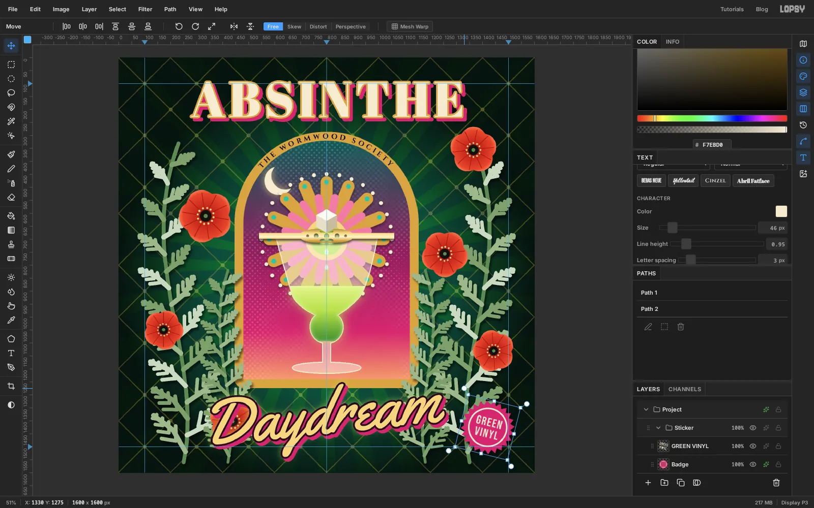

Click `Badge`, [[Shift]]-click `GREEN VINYL`, choose **Layer → Group Layers**, and name the group `Sticker`. With the group active, pick the **Move** tool and drag a corner's rotation zone clockwise about 14°. The starburst and the text turn together, and the text stays editable.

Stickers on a real sleeve are never applied straight. The tilt sells it.

## Add a double gold border

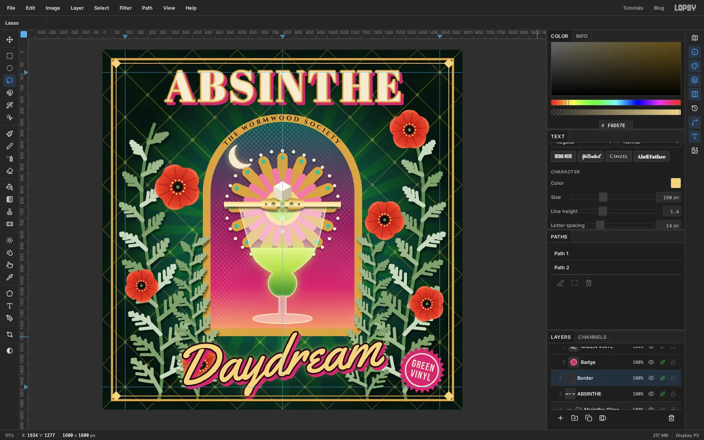

Click the `ABSINTHE` row, **Add Layer**, and name it `Border`. With the **Rectangular Marquee**:

1. Drag from `36, 36` to `1564, 1564`.
2. Hold [[Alt]] and drag from `46, 46` to `1554, 1554`. That leaves a 10 px band.
3. Hold [[Shift]] and drag from `58, 58` to `1542, 1542`, then hold [[Alt]] and drag from `62, 62` to `1538, 1538`. That adds a second, 4 px band inside the first.
4. Fill with `#D9A441` and press [[Cmd+D]].
5. With the **Lasso**, draw a small diamond (22 px from centre to point) on each corner of the inner rule, holding [[Shift]] after the first. Fill with `#F6D57E`. Add a small **Drop Shadow** (**Offset Y** `4`, **Blur** `6`, **Opacity** `60`).

## Add film grain

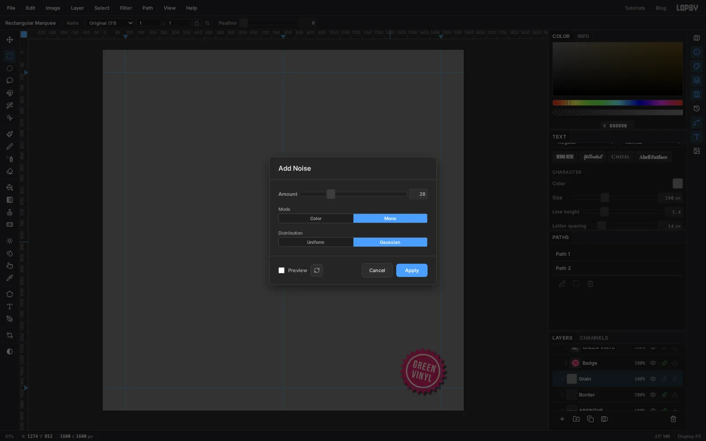

Click `Border`, **Add Layer**, and name it `Grain`. Fill the whole layer with `#808080`, then choose **Filter → Add Noise…** with **Amount** `28`, **Mono** and **Gaussian**. Click **Apply**, set the blend mode to **Overlay** and the opacity to `35%`.

Mid-grey disappears in Overlay, so only the noise shows. Grain ties the flat vector shapes, the halftone sky and the painted fronds together, as if they were all printed on the same paper.

## Add a vignette

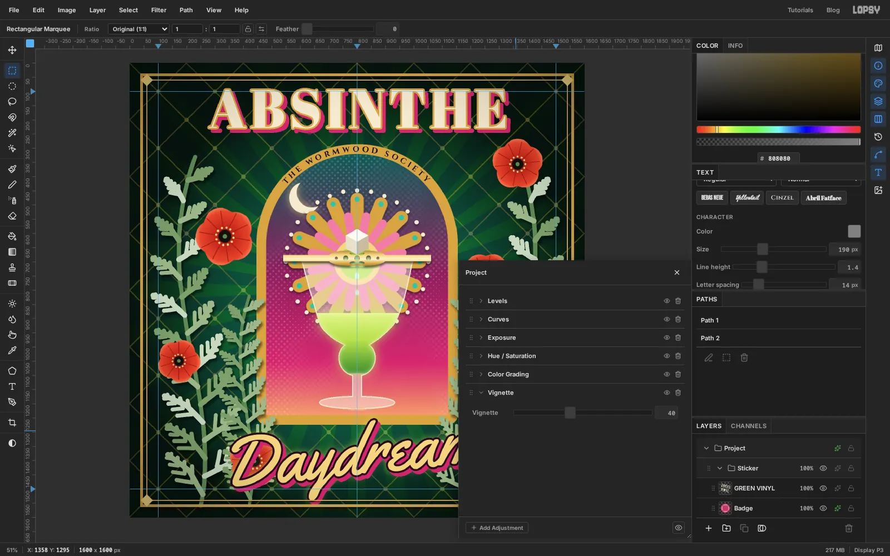

Every document sits inside a root group called `Project`. Click its row at the top of the Layers panel and open its drawer (✦). It already lists **Levels**, **Curves**, **Exposure**, **Hue / Saturation** and **Color Grading** at neutral settings. Click **Add Adjustment → Vignette** and set it to `40`. The corners darken, which pushes the eye towards the glowing glass.

## Refine: deepen the poppies and rebalance

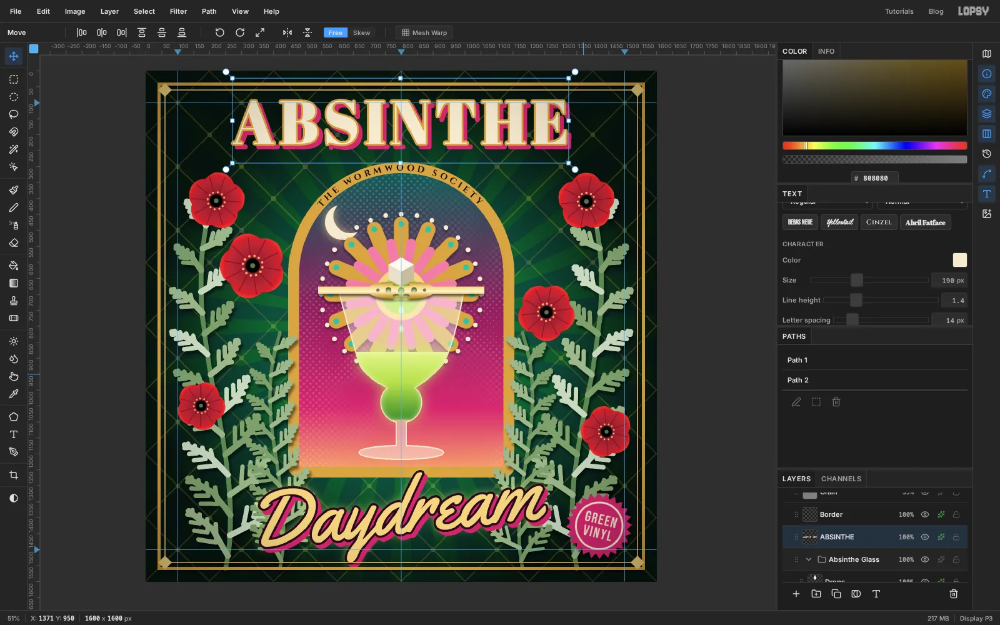

Step back and look at the whole cover. A few things need tightening.

The orange-red poppies fight the magenta sky. Click each poppy layer in turn and choose **Filter → Hue/Saturation…** with **Hue** `-12`, **Saturation** `-8` and **Lightness** `-6`. They become a garnet red that belongs with the pinks.

The left side also has fewer flowers near the top. Move `Poppy 4` (the one behind the "D" of Daydream) up onto the tip of the left frond at about `222, 405`. Move the original `Poppy` down a little to `1380, 405` so the two mirror each other, and nudge `Poppy 2` down to about `345, 705` so it doesn't touch them. Select the `Sticker` group and nudge it 22 px up and 22 px left, so the badge's points stay clear of the border. Finally, set the `Lattice` opacity down to `22%` so it stops buzzing behind the fronds, and nudge `ABSINTHE` 6 px left: its pink shadow hangs to the right and makes the title look off-centre.

## Give the script a cartouche

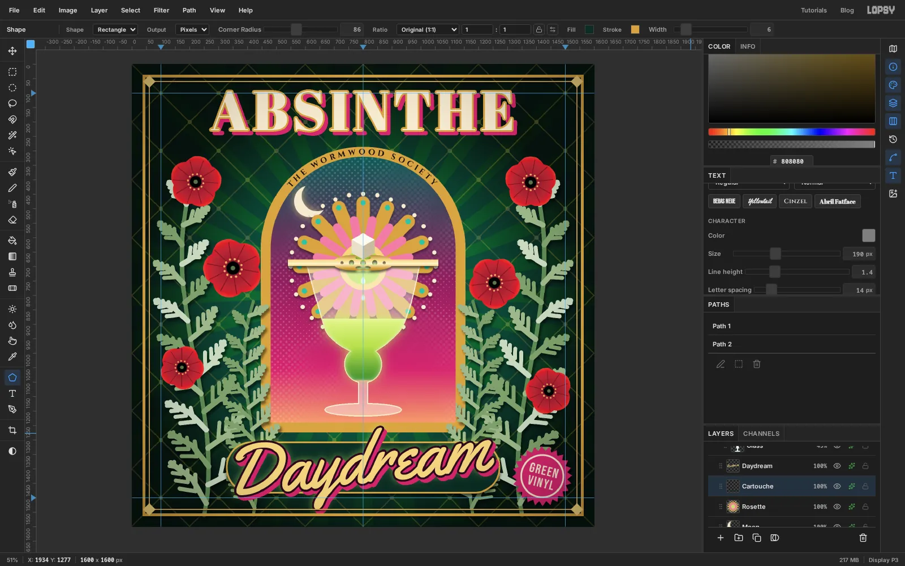

"Daydream" floats on top of everything with no home. A cartouche fixes that.

1. Click the `Rosette` row, **Add Layer**, and name it `Cartouche`. It lands just under `Daydream`.
2. Pick the **Shape** tool ([[U]]). Set **Shape** to **Rectangle**, **Output** to **Pixels** and **Corner Radius** to `86`. Click the **Fill** swatch and set `#0B2E24`. Click **Add stroke color**, set `#D9A441`, and set **Width** to `6`.
3. A shape grows from the point you press. Press at the centre of where the script sits (`800, 1395`) and drag out to `1272, 1482`.
4. Add a **Drop Shadow** with **Offset Y** `10`, **Blur** `16` and **Opacity** `60`.

## Resize the type to fit

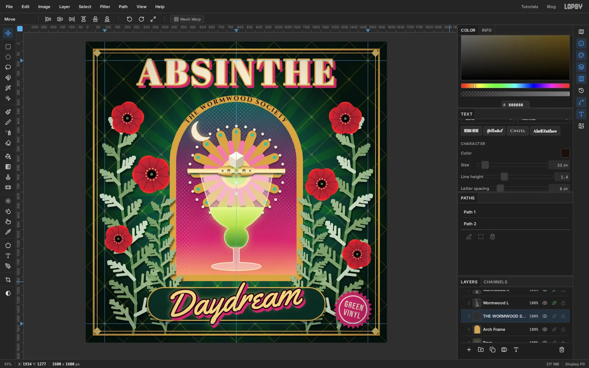

1. Click `Daydream` and, in the Text panel, change **Size** to `196`. Re-centre it on the middle guide. The rotation is kept.
2. The "y" now reaches up towards the arch and down towards the border. With the **Move** tool, nudge `Daydream` down about 14 px and `Cartouche` down 8 px with the arrow keys, so the top of the "y" clears the gold frame and its tail stops well short of the inner border rule. A script letter that breaks out of its band looks deliberate. One that touches the frame looks like a mistake.
3. Click the `THE WORMWOOD SOCIETY` layer and, in the Text panel, set **Size** `33` and **Letter spacing** `6`. The band name was too small to read at thumbnail size.

## Widen the gold band

At 33 px the band name nearly touches the outer edge of the gold. Click the `Arch Frame` row, [[Cmd]]-click its thumbnail, choose **Select → Grow…** with `10`, fill with `#D9A441` and press [[Cmd+D]]. Now there's a margin above the letters.

## Make the glass read as glass

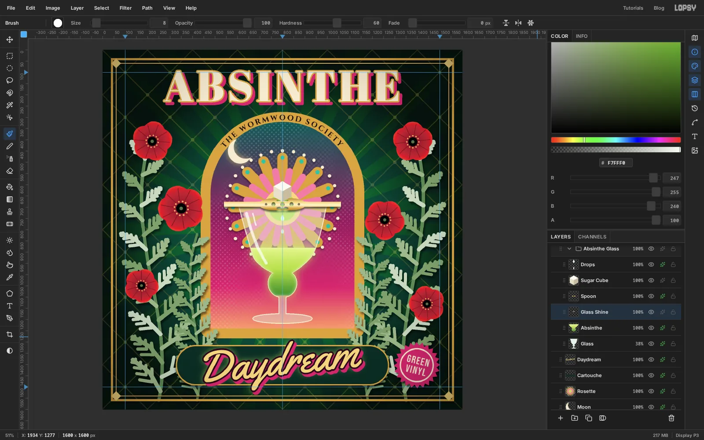

1. Click the `Glass` row. In the effects drawer, set the blend mode back to **Normal**, then set the opacity to `38%`. The rosette behind now looks seen through frosted glass instead of cut out.
2. Click the `Absinthe` row, **Add Layer**, and name it `Glass Shine`. It sits between `Absinthe` and `Spoon`.
3. Select an ellipse for the rim, centred on `800, 688`, 390 px wide and 30 px tall. Hold [[Alt]] and subtract one 378 × 20 px on the same centre. Fill with `#F7FFF0` and press [[Cmd+D]]. Most of the ring hides behind the spoon, and the ends give the glass a lip.
4. **Brush**, **Size** `16`, **Opacity** `75`, **Hardness** `60`, colour `#F7FFF0`. Drag one long, slightly curving streak down the left of the bowl from `640, 728` to `728, 950`, and a short thin one (**Size** `8`) beside it near the top. Set the layer to **Screen** and the brush opacity back to `100`.

A single sharp highlight on the curve does more to say "glass" than any amount of transparency.

## Export

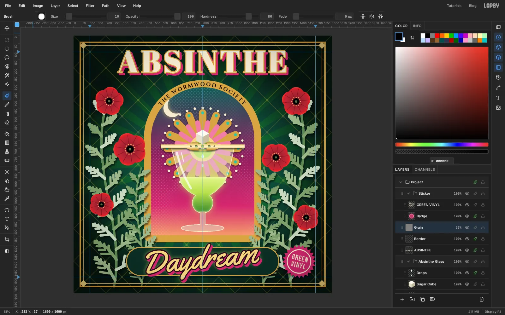

Choose **File → Quick Export PNG** for the finished cover, and **File → Save Project** to keep every layer, effect, path and live text layer editable.

To take it further, try swapping the jewel tones: an amber velvet and a violet sky turn the same cover into a whisky record. Or replace the poppies with a second, smaller rosette painted with radial symmetry at 8 segments for a more geometric look.
