Maximalism is "more is more": layered ornament, clashing colours and
something happening in every corner. On a t-shirt it still has to read
from across the street, so the trick is to stack lots of detail around one
strong silhouette. Here that silhouette is a swordfish. Its Latin name,
*Xiphias gladius*, gives the design its title: **XIPHIAS PARADISE**, a
1500 × 1800 graphic for a dark plum tee.

You'll build a badge from the inside out:

- a sunburst medallion with waves, a checker ring and a bead ring
- banana leaves and hibiscus flowers fanning out behind and around it
- a painted swordfish, cut out, posterized, recoloured with a Gradient Map and set leaping out of the ring
- a ribbon banner, a title set on an arc, sparkles, and a worn screen-print texture over everything

You'll need one image from Wikimedia Commons: **Swordfish (Duane
Raver).png**, a painting by Duane Raver for the U.S. Fish and Wildlife
Service. It is in the **public domain**, so you can use it on a shirt you
sell. Download the original file (744 × 316 px). It's small, but the
posterize and recolour steps hide the enlargement.

The tools you'll use:

- the **Lasso**, **Magic Wand** and the **Elliptical** and **Rectangular Marquee** with their exact-size dialogs
- the **Pen** tool, to stroke lines, to make straight-edged selections with **Path to Selection**, and to set text on a path
- the **Brush** with **Radial Symmetry**, plus **Spacing** for dotted lines
- **Filter → Sunburst**, **Posterize**, **Add Noise**, **Gaussian Blur** and **Threshold**
- **Define Pattern** and **Fill with Pattern**
- **Copy**, **Paste**, **Flip Horizontal**, and the **Move** tool's scale and rotate handles
- groups, a group **Gradient Map** adjustment and a group rotation
- layer effects: **Stroke**, **Drop Shadow** and **Color Overlay**
- live text in three Google fonts: **Bungee Inline**, **Shrikhand** and **Bungee**

The palette clashes on purpose. Hot pink, tangerine and emerald fight for
attention, and the plum ground ties them together:

- Shirt plum `#26101F` (the background, not an ink)
- Sunburst saffron `#FFC23D`, tangerine `#FF6A1F`
- Hot pink `#FF2E88`, ribbon tails `#C4136A`, fold `#7A0C43`
- Cream `#FFF1D6`
- Waves turquoise `#1FBFB0`, cobalt `#2549D8`, deep cobalt `#1A2F9E`
- Leaves emerald `#12A36B`, shade `#0A6B4C`, midrib mint `#8FF0B4`, corner fronds `#1E7A55`
- Hibiscus coral `#FF5A36`, rim `#B8321F`, throat `#FFD23F`
- Fish map `#1C2566` → `#2B3A8F` → `#4FB3C8` → `#F6E7C8` → `#FFFFFF`

> **Tip:** On a wide-gamut (Display P3) screen, Lopsy reads typed hex codes as P3 colours. These codes were picked as P3 values, so they match the finished shirt. On an sRGB screen they come out a little duller.

> **Note:** Shortcuts are written for a Mac. On Windows, use [[Ctrl]] wherever it says [[Cmd]].

## Set the shirt colour and centre guides

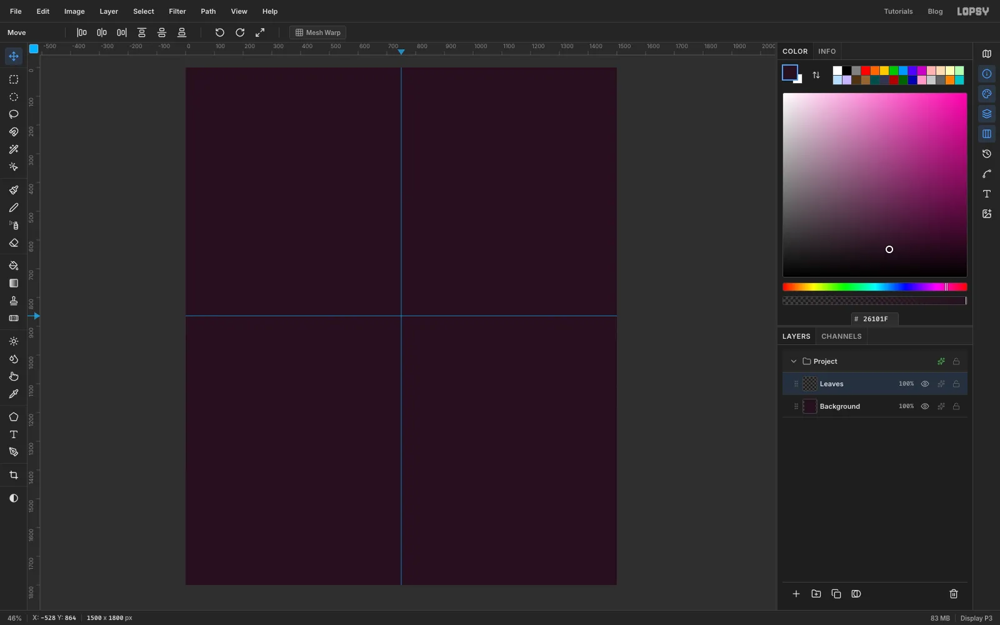

Choose **File → New**, keep the units on **Pixels**, and make the document
**1500** wide and **1800** high, and leave the background on **White**
(that also gives you an empty *Layer 1*). Click the *Background* row, set the
foreground to shirt plum `#26101F` and choose **Edit → Fill**. Designing
on the real shirt colour stops the brights from looking washed out later.

Click the top ruler at **750** to drop a vertical guide down the middle.
Click the left ruler at **864** for a horizontal guide. The medallion will
be centred where they cross, a little below the middle of the canvas, which
leaves room for the title on top.

Click the *Layer 1* row, double-click its name and rename it *Leaves*. It
stays active for the next few steps.

## Lasso eight banana leaves

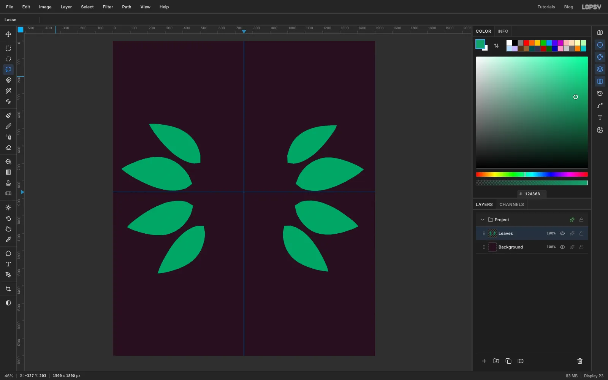

Set the foreground to emerald `#12A36B`. Pick the **Lasso** (L) and draw
a long, pointed leaf. Start about 300 px from the guide crossing and drag out
past where the medallion's edge will be: wide in the middle, tapering to a
point. Choose **Edit → Fill** and press [[Cmd+D]].

That's the first of four on the left side. Fan them out from about 45°
below the horizontal guide to about 40° above it, two below the guide and
two above, each 370–420 px long. Then draw four matching
leaves on the right. Their inner ends will hide behind the medallion, so
only the outer halves need to look good. Keep every tip at least 45 px
from the canvas edge, or the print will look cropped.

## Shade one half of each leaf

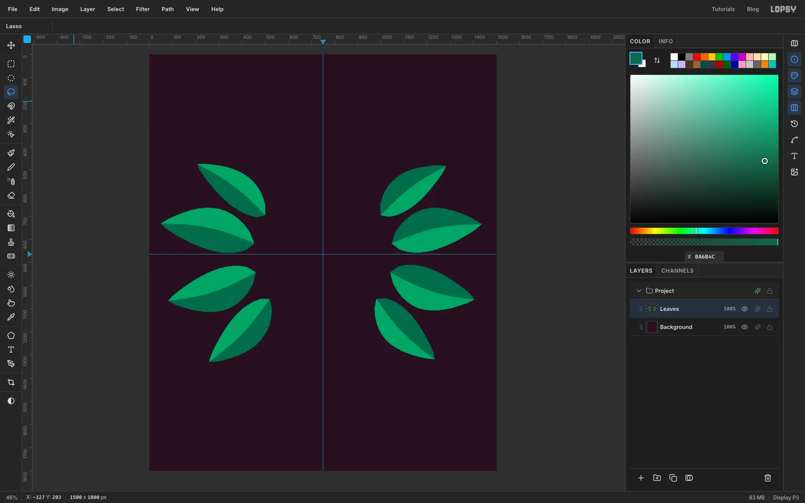

Set the foreground to `#0A6B4C`. For each leaf, lasso from the base along
the leaf's centre line to the tip, then back down along one edge, and fill.
Shade the lower half of each left-hand leaf and the upper half of each
right-hand leaf, so the two sides mirror each other. Two flat tones give
you the screen-print look; a gradient here would look like clip art.

## Tear the leaf edges

Banana leaves split along their veins. With the **Lasso**, draw a thin
wedge that starts just outside the leaf's edge and points in towards the
spine, slanting towards the tip. Press [[Delete]] and [[Cmd+D]]. Make three
tears on one edge of each leaf and two on the other, spaced unevenly.

## Stroke the midribs with the Pen

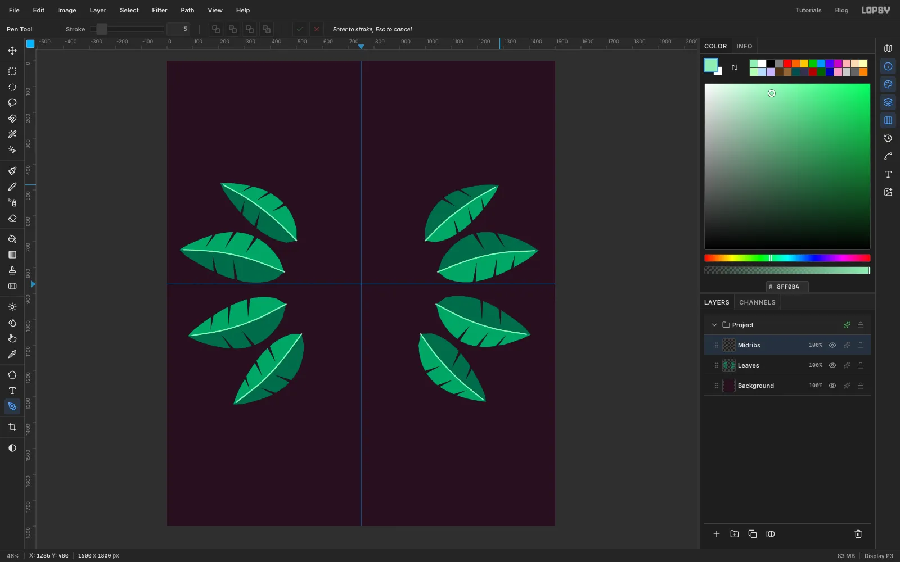

Click **Add Layer** in the Layers panel and name the layer *Midribs*. Set
the foreground to mint `#8FF0B4`. Pick the **Pen** (P), set **Stroke** to
**5** in the options bar, and click four points along a leaf's spine, from
base to tip. Drag slightly on the middle points to curve the line with the
leaf. Press [[Enter]] to stroke the path with the foreground colour.

Open the **Paths** panel (the curve icon in the strip on the right edge of
the window) and click **Delete Path**. A Pen click close to the selected
path edits that path instead of starting a new one. Clearing it each time
also keeps the Paths list empty for the title arc later. Repeat for all
eight leaves.

## Fill the medallion and burst the rays

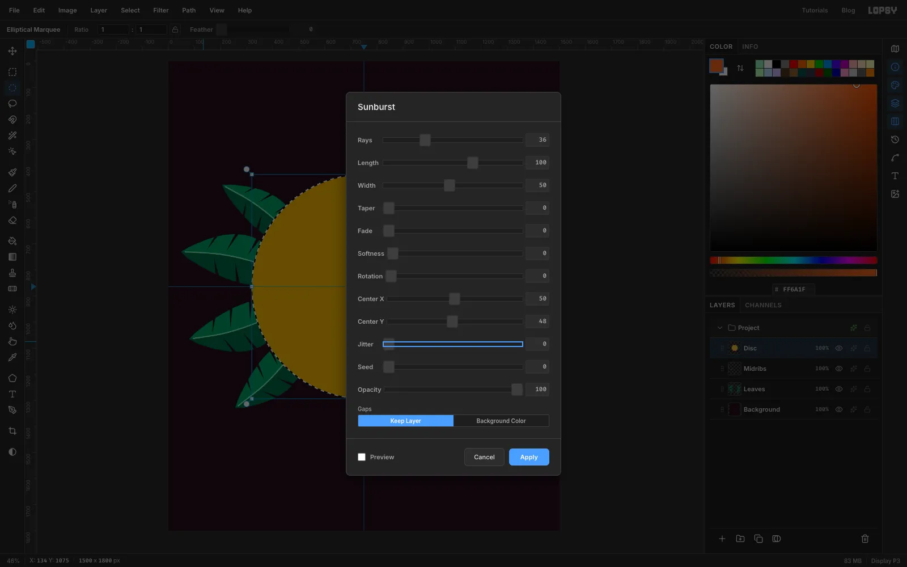

Add a layer called *Disc*. Pick the **Elliptical Marquee** and click once
on the canvas without dragging to open the exact-size dialog. Set **From**
to **320, 434** and **To** to **1180, 1294** (an 860 px circle on the
guide crossing) and press [[Enter]]. Fill it with saffron `#FFC23D`.

Keep the selection. Set the foreground to tangerine `#FF6A1F` and choose
**Filter → Sunburst…**. Use **Rays 36**, **Length 100**, **Width 50**,
**Taper 0**, **Center X 50** and **Center Y 48**, then click **Apply**.
Center Y 48 puts the burst exactly on the 864 px guide. The rays stay
inside the selection, so the disc edge is crisp. Press [[Cmd+D]].

## Lay three wave bands over the bottom

Add a layer called *Waves*. With the **Lasso**, draw a band whose top edge
is a gentle wave across the lower third of the disc. Let the band run past
both sides of the disc and well below it. Fill it with turquoise `#1FBFB0`.

Draw a second band about 70 px lower with a slightly different rhythm and
fill it with cobalt `#2549D8`. Draw a third band 75 px below that and fill
it with deep cobalt `#1A2F9E`. Overlapping bands with offset rhythms look
like rolling water.

Set the foreground to cream `#FFF1D6`. With the **Pen** at **Stroke 6**,
click along the top of each band and press [[Enter]] to draw a crest line.
Delete each path in the Paths panel after you stroke it. The crests are
close together, and a click near a live path would add to it. Don't worry
about the overhang; you'll trim it next.

## Trim the waves to the disc

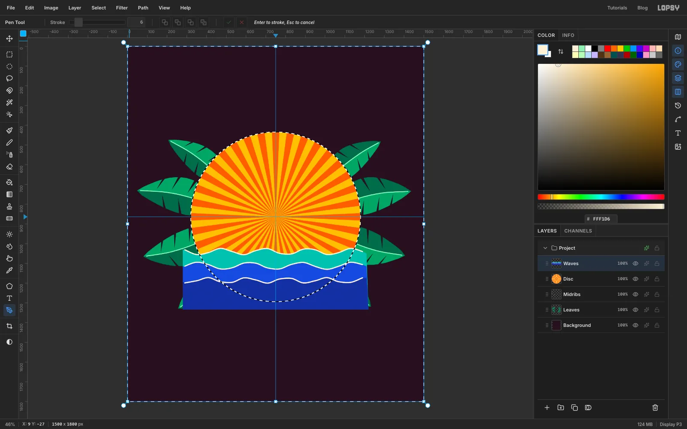

With *Waves* still active, [[Cmd]]-click the *Disc* layer's thumbnail to
load the circle as a selection. Choose **Select → Inverse**, press
[[Delete]], then [[Cmd+D]]. The waves now sit exactly inside the
medallion.

## Make a checker pattern

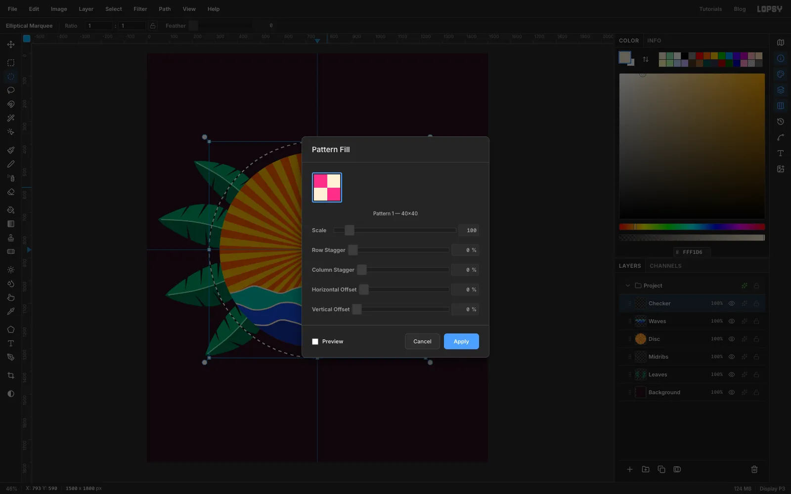

Add a layer called *Checker*. First build a 40 px tile in the top-left
corner. The marquee's click-once dialog only opens when nothing is
selected, so press [[Cmd+D]] before each click:

1. With the **Rectangular Marquee**, click once and use the dialog to select **0, 0** to **40, 40**. Fill it with hot pink `#FF2E88`.
2. Deselect, then select **20, 0** to **40, 20** and fill it with cream `#FFF1D6`.
3. Deselect, then select **0, 20** to **20, 40** and fill it with cream too.
4. Deselect, select **0, 0** to **40, 40** again and choose **Edit → Define Pattern**.

Press [[Delete]] to clear the tile and [[Cmd+D]].

Now pick the **Elliptical Marquee**, click once, and use its dialog to select **274, 388** to
**1226, 1340**, a circle 46 px bigger than the disc all round. Choose
**Edit → Fill with Pattern…**, click your checker tile and click **Apply**.

## Cut the checker into a ring

Press [[Cmd+D]], then click once with the Elliptical Marquee and select the
disc circle again (**320, 434** to **1180, 1294**). Press [[Delete]] and
[[Cmd+D]]. You're left with a checker ring.

Click the sparkle button on the *Checker* row to open its effects. Enable
**Stroke**, set **Width 6** and colour plum `#26101F`, and close the
drawer. The thin plum outline separates the ring from the rays and the
leaves.

## Bead the ring with Radial Symmetry

Add a layer called *Beads*. Pick the **Brush** (B) and open its presets
from the tip button. Set **Size 30**, **Hardness 100** and **Spacing 4**.
Make sure **Taper** is **0**.

Click **Radial Symmetry** in the options bar and set **Segments** to
**32**. [[Cmd]]-click the guide crossing to move the symmetry centre
there. Set the foreground to turquoise `#1FBFB0` and click once on the
vertical guide just outside the checker ring, leaving a small gap. One click
makes all 32 beads.

Change the size to **12** and the foreground to saffron `#FFC23D`. Click
once halfway between the top bead and its right-hand neighbour. A small
gold dot lands between every pair of beads. Turn **Radial
Symmetry** off.

## Group the medallion

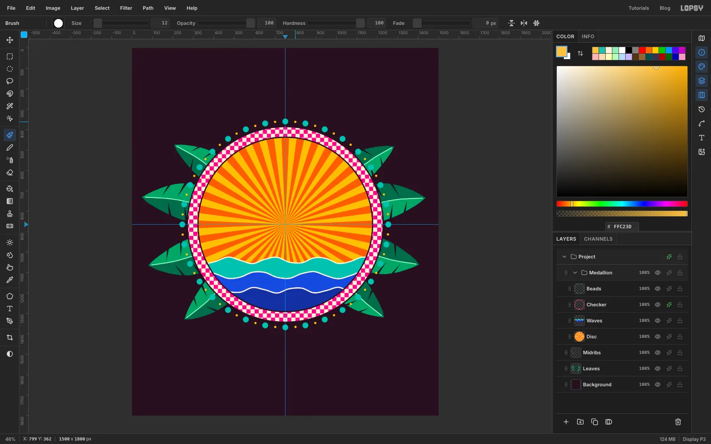

Click the *Disc* row, [[Shift]]-click the *Beads* row, and click **Group
Layers** at the bottom of the Layers panel. Rename the group *Medallion*
and click its arrow to collapse it.

## Paint a hibiscus with five-way symmetry

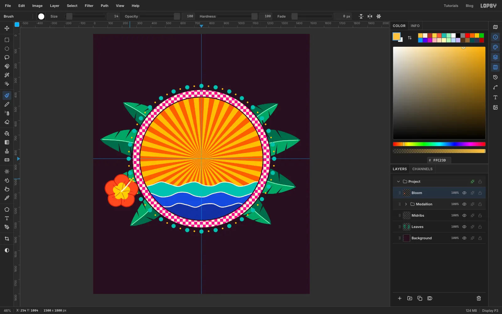

With the collapsed *Medallion* row active, add a layer called *Bloom*. The
flower sits left of the medallion, centred at about **196, 1090**.

Turn **Radial Symmetry** on, set **Segments** to **5**, and [[Cmd]]-click
the flower's centre. Each stroke you paint now becomes five petals:

1. **Rim:** Brush size **115**, foreground `#B8321F`. Drag a short stroke straight up, starting a little above the centre and stopping about a third of the way to the flower's edge.
2. **Petals:** Size **103**, foreground coral `#FF5A36`. Repeat the same stroke. The darker rim peeks out around the edge of each petal.
3. **Creases:** Size **5**, foreground `#B8321F`. Drag a line from near the centre out almost to the edge, in the notch between two petals.
4. **Throat:** Size **54**, foreground `#FFD23F`. Drag a short stroke up from the centre.
5. **Veins:** Size **3**, foreground `#B8321F`. Draw a gently curving line out through one petal.

Turn **Radial Symmetry** off. Finish with a stamen: at size **9** in cream
`#FFF1D6`, drag a curve from the centre up and to the right, about 100 px
long. Then click five size **14** saffron dots around its tip for pollen.

## Copy, flip and shrink a second bloom

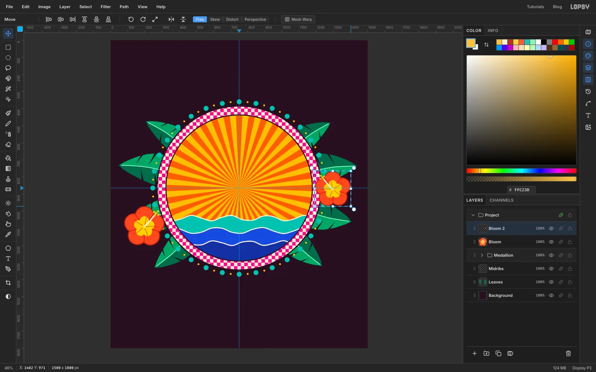

Drag a marquee around the bloom and press [[Cmd+C]], then [[Cmd+V]]. Name
the pasted layer *Bloom 2*, choose **Image → Flip Horizontal**, and press
[[Cmd+D]].

Pick the **Move** tool (V) and drag the copy to the right of the
medallion, centred at about **1310, 880**, over the leaves. Press
[[Cmd+D]], draw a marquee snugly around the flower with the **Rectangular
Marquee** (M), then press **V** again: the scale handles only move the
pixels while the Move tool is active. [[Cmd]]-drag the bottom-right corner
handle inwards until the flower is about 12% smaller. [[Cmd]] keeps the
proportions. Press [[Cmd+D]] to commit.

## Turn the second bloom

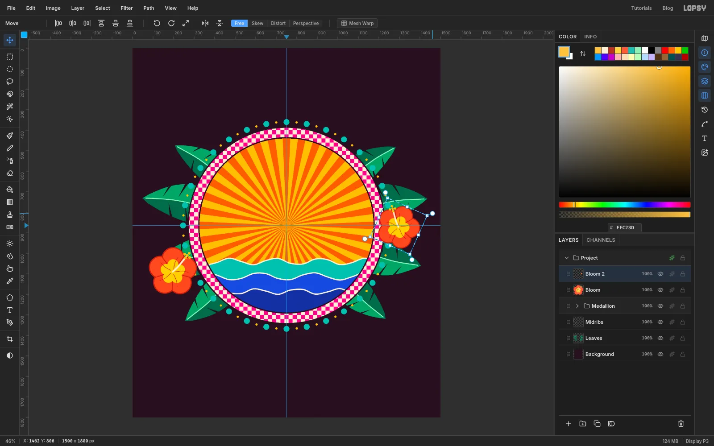

Draw a marquee around the copy again and press **V**. Hover just outside
its top-right corner until the cursor becomes a crosshair, then drag
clockwise to turn it about **24°**. Press [[Cmd+D]]. Now the two flowers
don't look stamped from one template.

## Drop in the swordfish

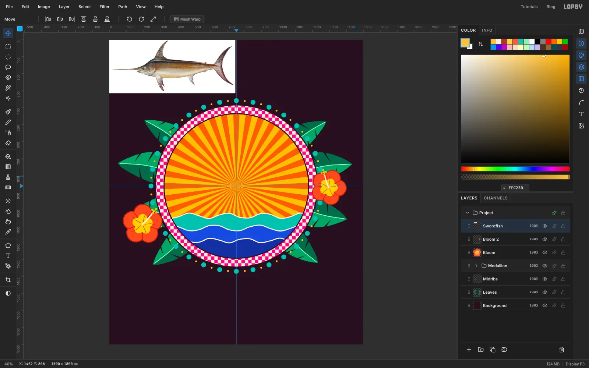

Click *Bloom 2* so the photo lands above it. Drag the downloaded
**Swordfish (Duane Raver).png** from your folder onto the canvas. It
arrives at full size in the top-left corner. Rename the layer *Swordfish*
and press [[Cmd+D]].

## Wand away the white backdrop

Pick the **Magic Wand** (W), set **Tolerance** to **24**, and tick
**Contiguous**. Click the white just inside the photo's top-left corner.
Contiguous keeps the white highlight in the eye from being selected. Press
[[Delete]] and [[Cmd+D]].

## Flip the fish and scale it up

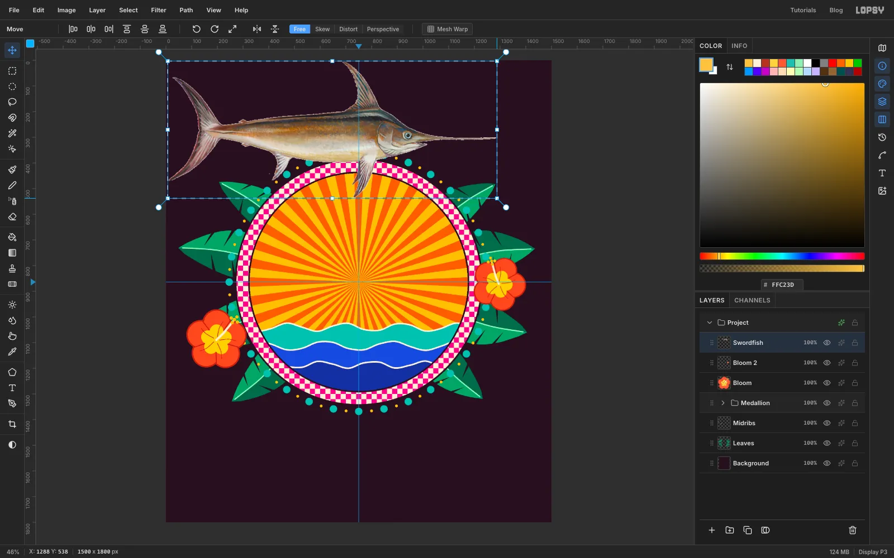

The painting faces left, but the leap should read left to right, so choose
**Image → Flip Horizontal**. Do the flip now, while the layer is a plain
upright image, so the later scale and rotation work on the final
orientation.

Draw a marquee snugly around the fish and press **V** for the Move tool.
[[Cmd]]-drag the bottom-right corner handle out until the fish is about
**1310 px** long (176%). Watch the top ruler: the tail should reach about
x 1310. Press [[Cmd+D]].

## Posterize the painting

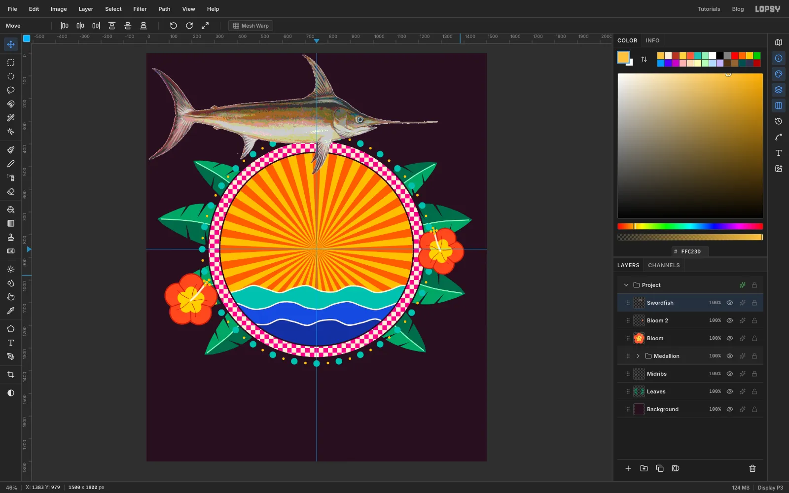

Choose **Filter → Posterize…** with **Levels 6**. Posterizing after the
enlargement turns the soft, blown-up shading into crisp bands, the way a
screen printer separates a photo into a few inks.

## Rotate the fish into a leap

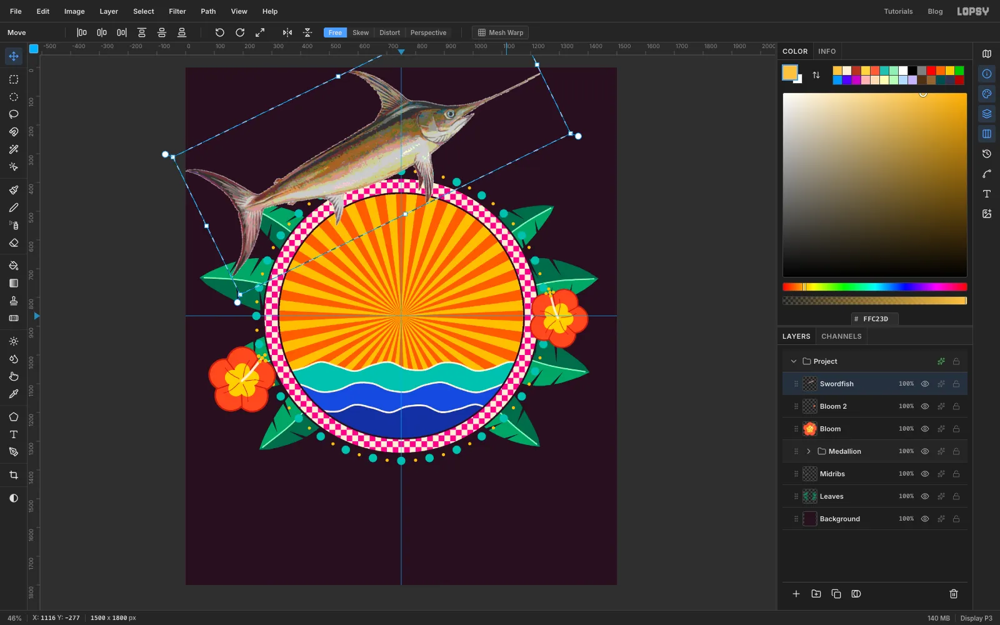

Marquee around the fish again and press **V**. Grab the rotate handle just outside the
top-right corner and drag *counter-clockwise* until the bill points up and
to the right, about **26°**. Press [[Cmd+D]].

With the **Move** tool, drag the fish so its middle sits just right of the
guide crossing, at about **770, 860**. The bill should break out of the
checker ring at the top right and the tail should dip into the waves at
the bottom left. Breaking the frame is what makes the badge feel alive.

## Outline the fish

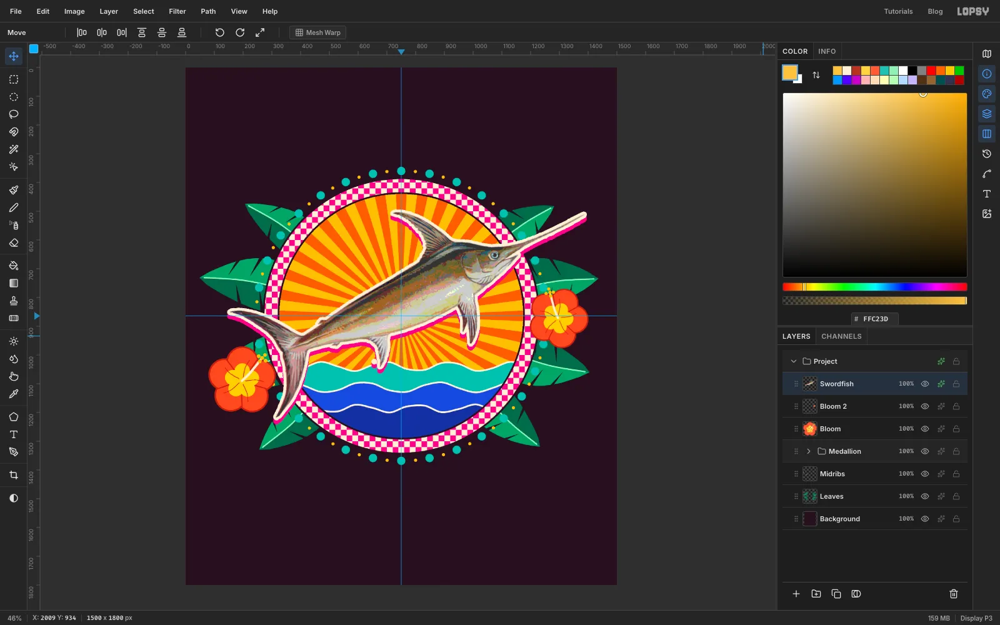

Open the *Swordfish* effects. Enable **Stroke**, **Width 9**, cream
`#FFF1D6`. Then enable **Drop Shadow** with **Offset X 0**, **Offset Y 14**,
**Blur 0**, **Opacity 100**, colour hot pink `#FF2E88`. Close the drawer.

Keep the shadow straight down. A diagonal offset slides past the tip of the
bill, and the bill seems to grow a second blade.

## Throw up a splash

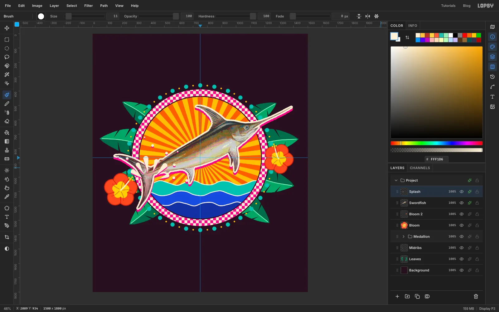

Add a layer called *Splash* (it lands above *Swordfish*). Find where the
tail crosses the top wave, at about **395, 1040**. Set the foreground to
cream `#FFF1D6`. With the **Lasso**, draw six teardrops fanning upward from
that point: start each one in a narrow point about 70 px out and swell it
into a round end 75–120 px further on. Fill and deselect after each.

Pick the **Brush** with **Hardness 100** and click six size **20** drops
in an arc beyond the teardrops. Add three size **11** drops further out.
Give the layer a **Drop Shadow** at **Offset X 0**, **Offset Y 7**, **Blur 0**,
**Opacity 100**, colour hot pink.

## Recolour the fish with a Gradient Map

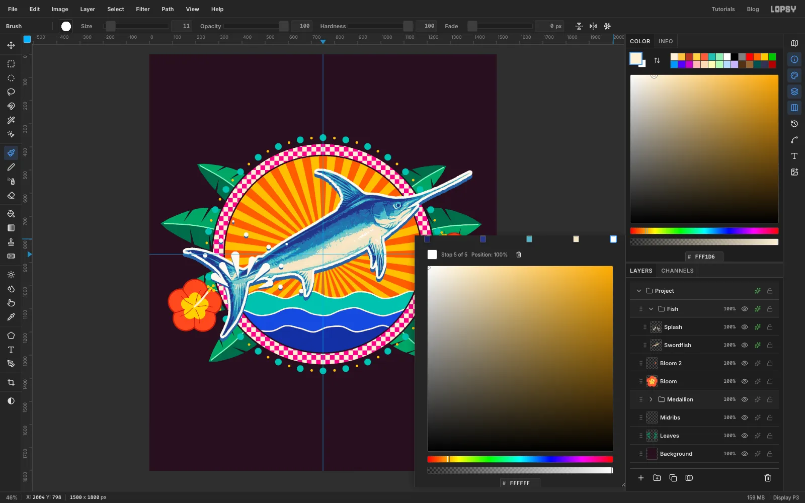

The painted fish is khaki, which disappears against the orange rays. Click
*Swordfish*, [[Shift]]-click *Splash*, click **Group Layers**, and name the
group *Fish*.

Open the *Fish* group's effects with the sparkle button on its row, click
**Add Adjustment** and choose **Gradient Map**. Click the gradient bar three
times, at about 30%, 55% and 80%, to add stops. Then click each stop in
turn and type its hex code in the drawer's Hex field:

- `#1C2566` at 0%
- `#2B3A8F` at 30%
- `#4FB3C8` at 55%
- `#F6E7C8` at 80%
- `#FFFFFF` at 100%

The posterized bands become indigo, teal and cream. The adjustment also
maps the cream outline to white and the pink shadow to a deep blue, so the
whole fish turns into a cool tritone that pops off the warm sunburst. Close
the drawer and collapse the group.

## Build the ribbon banner

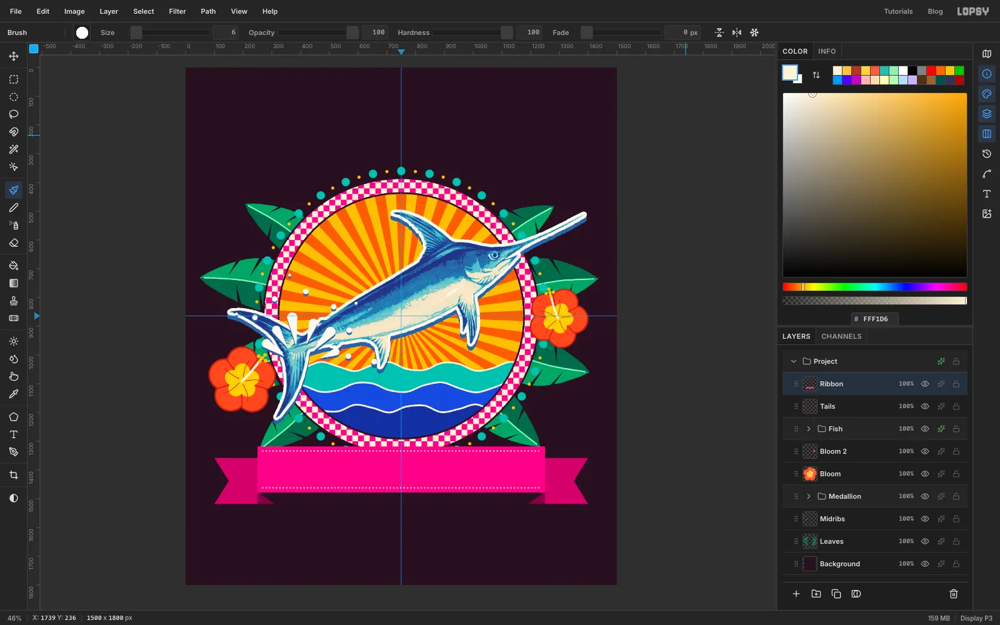

The ribbon sits across the bottom of the medallion, from x 250 to 1250 and
y 1318 to 1478. Its swallow-tailed ends hang 40 px lower, tucked behind it.
These shapes have straight edges, so draw them with the **Pen** using
plain clicks (no dragging) instead of the freehand Lasso.

Click the collapsed *Fish* row and add a layer called *Tails*. With the
**Pen**, click the five corners of the left tail: **260, 1358** (hidden
under the ribbon), out to **100, 1358**, in to **150, 1438** for the V
notch, back out to **100, 1518**, and **260, 1518**. Then click the first
point again to close the shape. In the **Paths** panel, click **Path to
Selection**, then **Delete Path**. Fill it with `#C4136A` and deselect.
Make the right tail the same way, mirrored: **1240, 1358**, **1400, 1358**,
**1350, 1438**, **1400, 1518**, **1240, 1518**.

The folds are small dark triangles where the ribbon turns back into each
tail. Pen-click **250, 1476**, **310, 1518** and **250, 1518**, close the
shape, make it a selection and fill it with `#7A0C43`. Mirror it on the
right at **1250, 1476**, **1190, 1518** and **1250, 1518**.

Add a layer called *Ribbon*. With nothing selected, click once with the
**Rectangular Marquee** and select **250, 1318** to **1250, 1478** in the
dialog. Fill it with hot pink `#FF2E88` and deselect.

For the stitching, pick the **Brush** and open its presets: **Size 6**,
**Hardness 100**, **Spacing 200** (the maximum). Spacing that wide turns a
stroke into dots. With cream as the foreground, click 18 px in from the top-left corner
of the ribbon. Then [[Shift]]-click 18 px in from the top-right corner for a
straight dotted line. Do the same 16 px above the bottom edge. Set
**Spacing** back to **4**.

## Set PARADISE in the ribbon

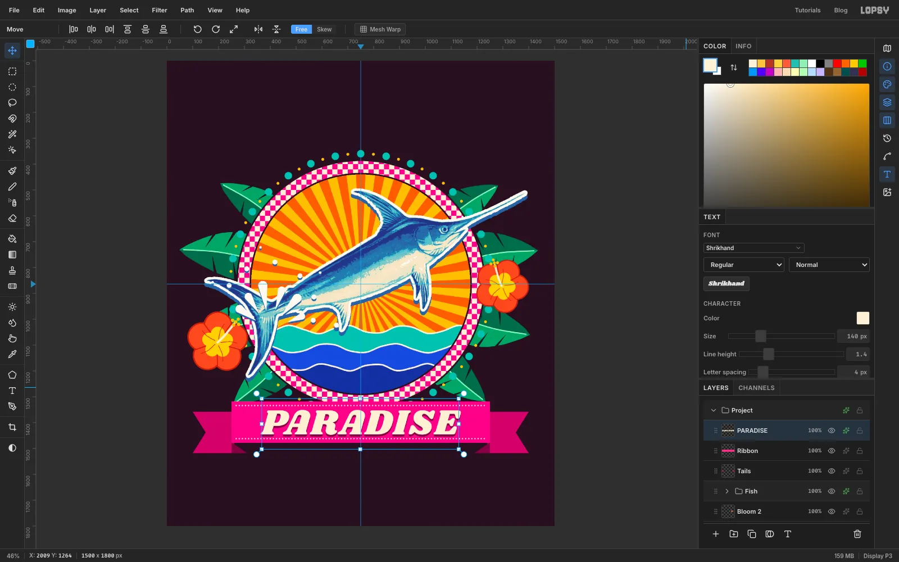

With *Ribbon* active, pick the **Text** tool (T). Set the font to
**Shrikhand**, **Size 140**, colour cream `#FFF1D6`. Click in the empty
plum space below the ribbon, type `PARADISE` and press [[Tab]] to commit.
In the **Text** panel (the **T** icon in the strip on the right edge of the
window), set **Letter spacing** to **4**.

With the **Move** tool, nudge it with the arrow keys ([[Shift]] moves
10 px) until the letters sit centred in the ribbon, with the same gap above
the caps as below the baseline, clear of both stitch lines. Give it a
**Drop Shadow**: **Offset X 0**, **Offset Y 8**, **Blur 0**, **Opacity
100**, colour `#7A0C43`.

## Add the club line

Click *Ribbon* (a raster layer) so the next text doesn't restyle
PARADISE. With the **Text** tool, set the font to **Bungee**, **Size 46**,
colour turquoise `#1FBFB0`. Click in empty space near the bottom of the
canvas and type `SWORDFISH SOCIAL CLUB · EST. 1758`. (Linnaeus named the
swordfish in 1758.) Press [[Tab]], then set **Letter spacing** to **3** in
the Text panel.

Press **V** and nudge it with the arrow keys so it's centred on the
vertical guide, with its cap tops about 70 px below the ribbon. That's
roughly the height of the ribbon's tails, so the two blocks feel like one
lockup.

## Group the banner and tilt it

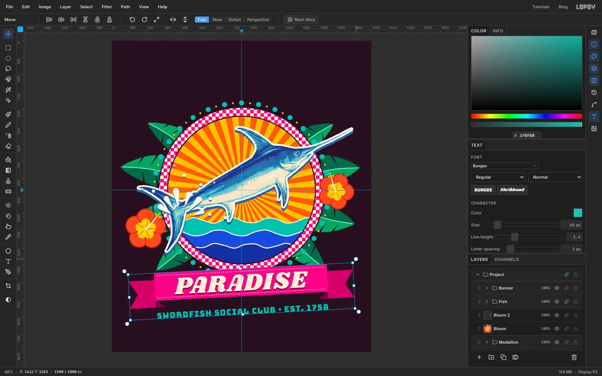

Click *Tails*, [[Shift]]-click *PARADISE* (the top row of the banner),
click **Group Layers** and name the group *Banner*. Collapse it.

With the *Banner* row active and nothing selected, pick the **Move** tool.
Drag the rotate handle just outside the group box's top-right corner
counter-clockwise by about **3°**, and press [[Cmd+D]]. The ribbon, PARADISE
and the club line tilt together, and the text stays live. A slight tilt
gives the badge some swagger. Anything over 5° starts to look like a
mistake.

## Draw the title's arc

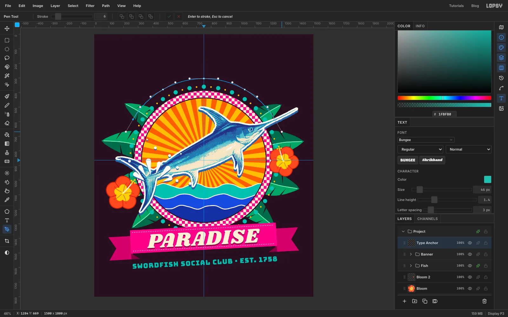

Click the collapsed *Banner* row and add a layer called *Type Anchor*. This
empty raster layer is somewhere safe to click before you make new text.

Pick the **Pen**. Draw an arc concentric with the medallion, 560 px from the
guide crossing: click and drag at **265, 584** (lower left), **470, 379**,
**750, 304** (top centre), **1030, 379** and **1235, 584** (lower right),
dragging each handle about **100 px** along the curve (left to right) so
the segments join into one smooth circle. Click the ✓ **Commit path** button in
the options bar. Don't press Enter, or the Pen will stroke the path.

## Set XIPHIAS on the arc

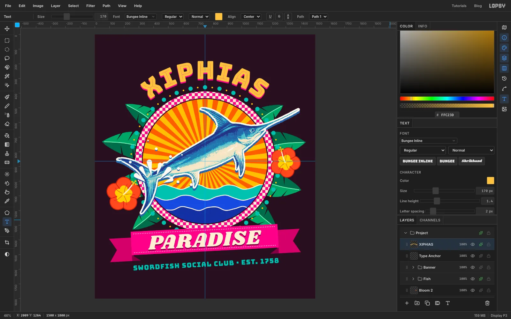

Click *Type Anchor*. Pick the **Text** tool and set **Bungee Inline**,
**Size 170**, colour saffron `#FFC23D`. Click in empty space near the bottom
of the canvas, type `XIPHIAS` and press [[Tab]]. Set **Letter spacing** to
**2** in the Text panel.

With the new text layer active and the Text tool still selected, choose
your arc in the options bar's **Path** dropdown. The letters jump onto the
curve. Set **Align** to **Center** so they spread evenly over the top. In
the **Paths** panel, click the selected path's row to hide its outline.

Add a **Drop Shadow**: **Offset X 0**, **Offset Y 9**, **Blur 0**,
**Opacity 100**, hot pink. Check the seating: the bottoms of the letters
should sit an even 40–50 px above the beads all the way round. If the gap
grows towards the ends, your arc isn't quite circular; redraw it with
longer handles.

## Scatter sparkles, stars and corner fronds

Click the *XIPHIAS* row and add a layer called *Sparkles*. The sparkles
and stars have straight sides, so draw each one with **Pen** clicks around
its points, close it, click **Path to Selection** and **Delete Path** in
the Paths panel, then fill and deselect. A four-point sparkle is four long
points with the inner corners pulled in close to the centre, to about a
fifth of the point length.

- cream `#FFF1D6`, about 90 px across, at the top left around **150, 300**
- saffron `#FFC23D`, about 60 px, beside the bill tip around **1420, 620**
- saffron, about 70 px, low on the left around **90, 1300**
- cream, about 80 px, low on the right around **1400, 1240**
- turquoise `#1FBFB0`, about 45 px, above the title around **515, 160** and **990, 160**, clear of the letters

Then add four hot-pink `#FF2E88` five-point stars, about 35 px across:
two flanking the ends of the title around **270, 230** and **1230, 230**,
and two at **470, 1685** and **1030, 1655**, where the dotted rule will end.
With the **Brush** at **Size 12**, **Hardness 100**, click six turquoise
dots into the empty gaps around the leaves.

Add a layer called *Corner Fronds*. With the **Lasso**, draw a small
pointed leaf about 220 px long in each corner, pointing diagonally in
towards the design and keeping 60–80 px clear of the canvas edges. Fill
them with `#1E7A55`, a darker green that sits back behind the main leaves.
Tear two notches into each with thin Lasso wedges and [[Delete]], as you
did for the big leaves. Then give each one a midrib: mint `#8FF0B4`, **Pen**
at **Stroke 4**, four clicks along the spine, [[Enter]], and **Delete Path**.

Click *Sparkles* again for the dotted rule. Set the Brush to **Size 7** and
**Spacing 200** in its presets, with cream as the foreground. Click at
**520, 1682** and [[Shift]]-click at **980, 1658**. The rule climbs 3° to
match the tilted banner. Set **Spacing** back to **4**.

## Copy and enlarge one sparkle

The bill tip needs a glint. Marquee around the cream sparkle at the top
left, press [[Cmd+C]] and [[Cmd+V]], and name the new layer *Big Sparkle*.
Press [[Cmd+D]].

With the **Move** tool (V), drag it to about **1300, 380**, just above and
left of the bill tip, and press [[Cmd+D]]. Marquee around it, press **V**,
and [[Cmd]]-drag the bottom-right handle out about 40 px so it grows to
roughly 1.4×. Press [[Cmd+D]].

## Tilt the big sparkle

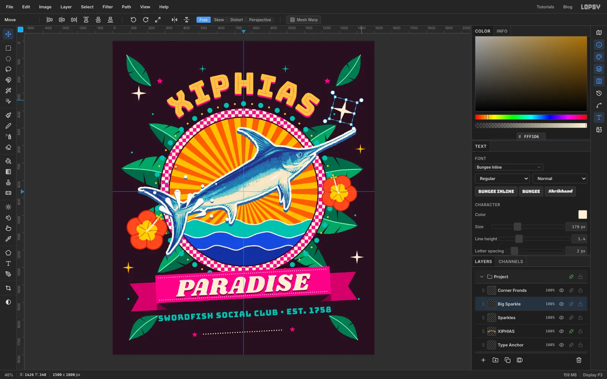

Marquee around the sparkle again, press **V**, and drag the rotate handle
clockwise about **15°**. Press [[Cmd+D]]. Tipped off the vertical, it looks
like a glint catching the bill rather than a sticker placed beside it.

## Make the worn-ink texture

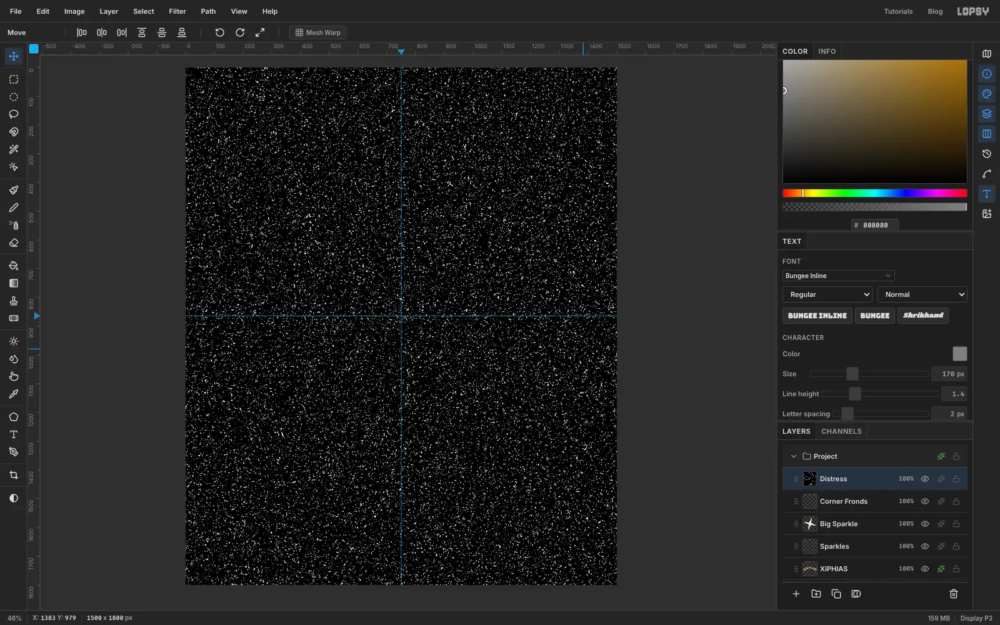

Screen-printed ink cracks and wears. You'll fake that with a speckle layer
in the shirt colour on top of everything.

Click *Corner Fronds* (the top layer) and add a layer called *Distress*.
Set the foreground to mid-grey `#808080`, choose **Edit → Fill** with
nothing selected, then run:

1. **Filter → Add Noise…** at **Amount 100**, **Mono**, **Gaussian**
2. **Filter → Gaussian Blur…** at **Radius 3**
3. **Filter → Threshold…** at **Level 135**

Start from mid-grey: Add Noise moves pixels both ways, so the threshold
catches the bright end. The blur clumps the noise first, so you get small
irregular flecks instead of single-pixel salt. Only a light scatter of
white should be left. If it looks like snow, undo and raise the Threshold
level by one or two.

## Knock the specks out in the shirt colour

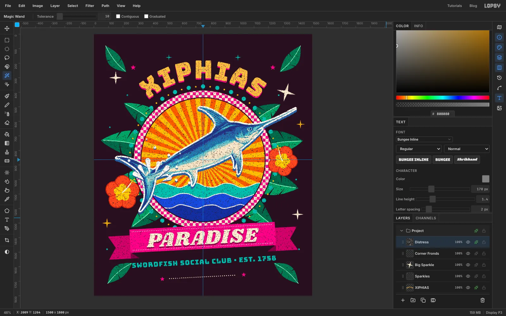

Pick the **Magic Wand**, untick **Contiguous**, set **Tolerance 10**, and
click a black area of *Distress*. Every black pixel is selected. Press
[[Delete]] and [[Cmd+D]], so only the white flecks remain. Tick
**Contiguous** again.

Open the layer's effects and enable **Color Overlay** with plum `#26101F`.
The flecks now look like holes in the ink where the shirt shows through.

## Vary the wear with the Eraser

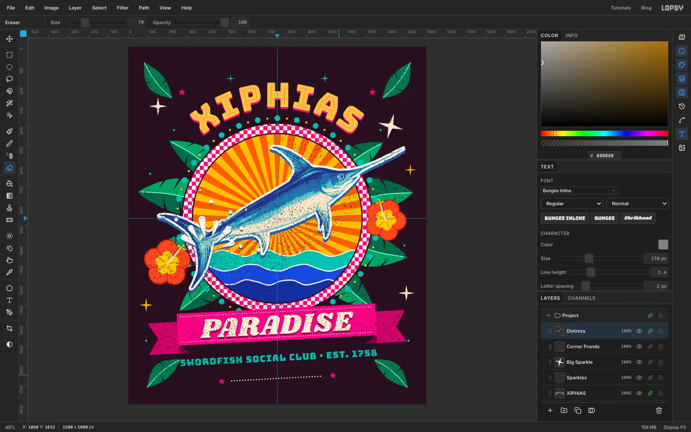

Even speckle looks like a filter. Real wear comes and goes. Pick the
**Eraser** (E) on *Distress*. The Eraser's dabs overlap and build up, so a
single sweep clears almost everything down its middle, even at half
opacity. The variety comes from *where* you sweep and from the soft edge of
a big brush, which leaves a fade of specks on either side:

- **Size 240**, **Opacity 55**: one sweep across the fish's head and eye, and one along the arc of the title, so the focal points stay clean.
- **Size 300**, **Opacity 70**: four or five loose passes over parts of the sunburst, the leaves and the area under the banner. Leave other patches untouched, so some areas look worn and others fresh.
- **Size 70**, **Opacity 100**: one pass along the dotted rule, so no dots go missing.

Choose **File → Save Project**, then **File → Quick Export PNG**. The
export keeps the plum background, which is what you want for a mock-up or a
direct-to-garment print on a plum shirt.

> **Tip:** Zoom out until the design is about the size of your palm. You should still read the fish, PARADISE and XIPHIAS at once. If something busy fights them, it's too loud; tone it down rather than adding more.
