**Memphis** was a design collective that formed in Milan in 1981 around Ettore Sottsass. Their furniture and fabrics broke every rule of good taste on purpose. They put flat candy colours next to each other: bubblegum pink, signal yellow, cobalt and mint. They drew thick black outlines, laid down checkerboards and dot grids, and covered surfaces in squiggly "Bacterio" prints. Simple solid shapes like cones, balls and stepped blocks sat in a scatter of confetti. The look took over record sleeves, TV sets and shop windows for most of the decade.

In this tutorial you'll make a square album cover in that style: **Zigzag Summer** by an imaginary new-wave band, **The Pastel Telephones**. It's 1600 × 1600 px. The finished cover has:

- a pink sky with a dot grid, a checkerboard horizon and a turquoise pool
- a big yellow sun with a squiggle pattern, and a cobalt zigzag ribbon rising from behind it
- a geometric palm tree, a red cone and a blue ball with halftone highlights
- a striped life ring, sun reflections, zigzag ripples and a lane rope of beads
- chunky title type, a band-name pill and a tilted 33⅓ sticker

The tools you'll use:

- **Edit → Fill**, **Edit → Define Pattern** and **Edit → Fill with Pattern**
- the **Shape** tool for circles, rounded rectangles and triangles
- the **Brush**, the **Lasso**, and both **Marquee** tools with Shift (add), Alt (subtract) and Shift+Alt (intersect)
- the **Stroke** and **Drop Shadow** effects
- the **Gradient** tool, **Filter → Halftone**, **Filter → Invert** and the **Screen** blend mode
- **Copy**, **Paste**, **Merge Down**, the **Move** tool with its scale and rotate handles, and **groups**
- **guides** and the **grid** with snapping, and the **Text** tool

The fonts are free Google Fonts from Lopsy's font picker: **Rubik Mono One** for ZIGZAG and the sticker, **Shrikhand** for Summer, and **Space Grotesk** for the small type.

The palette is flat, with no gradients you can see. Every colour is used at full strength:

- Sky pink `#F7B2C4`, dots `#E5799A`
- Ink `#161616`, cream `#FFFDF7`
- Sun yellow `#FFD12E`, sun orange `#FF9A1F`, squiggles `#F28C0F`
- Vermilion `#FF5A36`, cone shade `#C9361B`
- Cobalt `#2340D9`, pool turquoise `#19C3C0`
- Palm green `#20A35B`, midribs `#0F6E3A`, trunk orange `#E8892B`
- Confetti mint `#A8E6CF`, lilac `#B79CF2`

> **Tip:** Positions are written as `x, y` in document pixels, measured from the top-left corner. The status bar at the bottom left shows where the cursor is, so you can watch it while you drag. Key names are Mac keys. On Windows and Linux, use Ctrl for Cmd. Most shapes in this cover get the same treatment: a **6 px black outside Stroke** and a **Drop Shadow** with **Offset X** and **Offset Y** `12`, **Blur** `0` and **Opacity** `100`. "Outline and shadow it" in the steps below means exactly that.

> **Tip:** For exact selections, **click once** with a marquee tool instead of dragging. A dialog asks for the **From** and **To** corners. It only opens when nothing is selected, so press [[Cmd+D]] first if marching ants are showing.

## Set up the canvas and guides

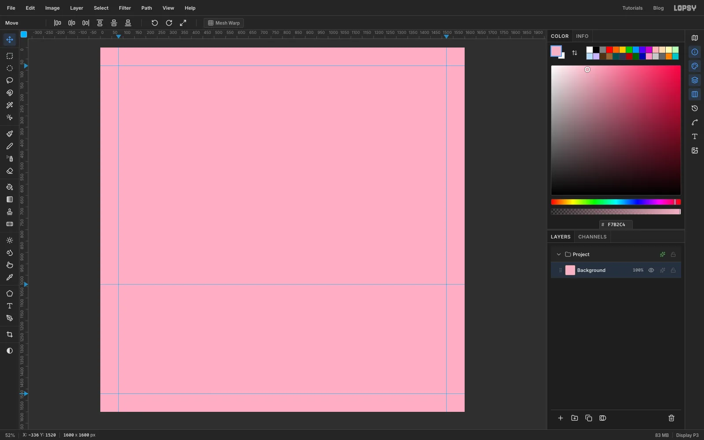

Open [Lopsy](/). In the **New Document** dialog set **Width** and **Height** to `1600` and click **Create**.

1. Delete the empty `Layer 1` with the bin button at the bottom of the Layers panel.
2. Click **Background**, type `F7B2C4` into the hex field of the Color panel, and choose **Edit → Fill**.
3. Click the top ruler at **80** and **1520** to drop two vertical guides for the side margins.
4. Click the left ruler at **80** and **1520** for the top and bottom margins, and at **1040** for the horizon.

The 80 px guides mark a safe area: nothing important goes outside them. The type will sit 20 px further in, on a 100 px margin, so it never crowds the guides.

## Make a dot tile

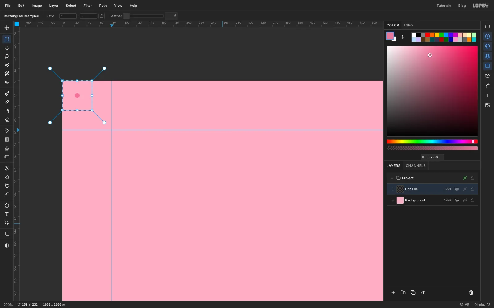

Memphis surfaces are rarely plain, so the sky gets a dot grid. You'll make one dot and let Lopsy repeat it.

1. Add a layer with the **+** button and name it `Dot Tile` (double-click a layer's name to rename it).
2. Set the foreground colour to `#E5799A`.
3. Pick the **Elliptical Marquee** ([[M]] cycles the marquees) and **click once** on the canvas without dragging. In the dialog enter **From** `20, 20` and **To** `28, 28` and press Enter, then choose **Edit → Fill**. That's an 8 px dot. Zoom in on the top-left corner to see it.
4. Press [[Cmd+D]], switch to the **Rectangular Marquee**, click once, and enter `0, 0` to `48, 48`. The dot now sits in the middle of a 48 px square.
5. Choose **Edit → Define Pattern**, then delete the `Dot Tile` layer. The pattern is saved, so you don't need the layer any more.

## Fill the sky with dots

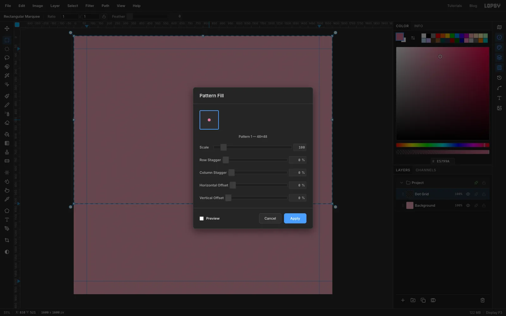

1. Add a layer named `Dot Grid`.
2. Click once with the **Rectangular Marquee** and select `0, 0` to `1600, 1040`: the whole sky down to the horizon guide.
3. Choose **Edit → Fill with Pattern…**, click the dot thumbnail, leave **Scale** at `100%` and click **Apply**.
4. Press [[Cmd+D]] to deselect.

The dots repeat every 48 px, in neat rows.

## Brush the zigzag ribbon

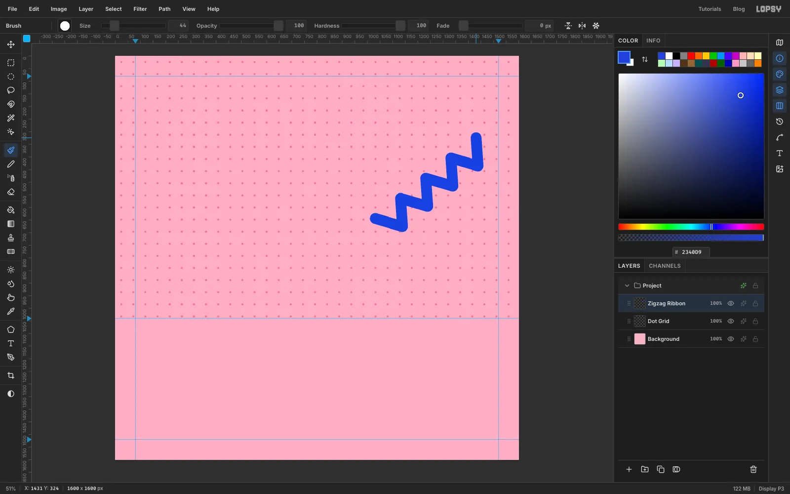

1. Add a layer named `Zigzag Ribbon`.
2. Pick the **Brush** ([[B]]) and set **Size** to `44`, **Hardness** `100` and **Opacity** `100`. Set the colour to `#2340D9`.
3. Click at `1031, 644`, then **Shift-click** each corner in turn so the brush joins them with straight strokes. Each tooth is two moves: about 108 px right and 32 px down, then 8 px left and 112 px up. The first corners are `1139, 676` and `1131, 564`.
4. Make four teeth, so the ribbon ends at about `1431, 324`, well inside the right margin.

The zigzag climbs up and to the right. Its first two corners will end up hidden behind the sun, so the ribbon looks as if it comes out from behind it.

## Outline the ribbon and give it a hard shadow

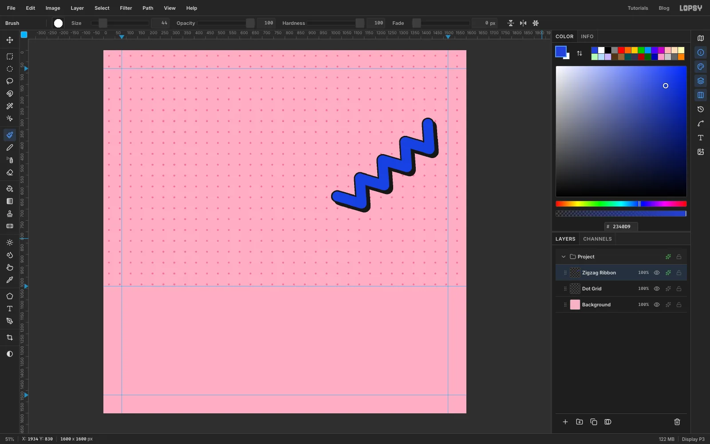

Click the **fx** button on the `Zigzag Ribbon` row to open the effects drawer.

1. Tick **Stroke**. Set **Width** to `6`, keep the position **outside**, and type `161616` for the colour.
2. Tick **Drop Shadow**. Set **Offset X** and **Offset Y** to `12`, **Blur** to `0`, **Spread** to `0` and **Opacity** to `100`, with the colour `161616`.
3. Close the drawer.

A shadow with no blur reads as a solid flat shape, the way a screen-printed sleeve would print it.

## Draw the sun with the Shape tool

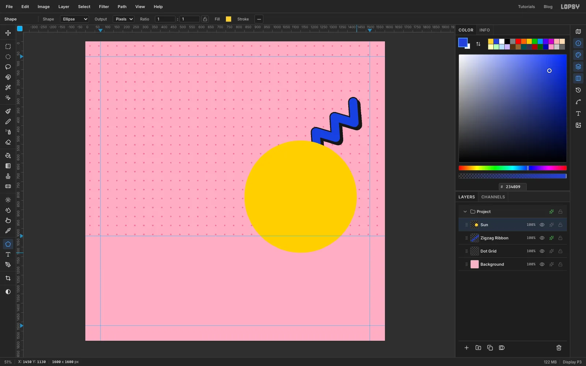

1. Add a layer named `Sun`.
2. Pick the **Shape** tool ([[U]]). In the options bar, set **Shape** to **Ellipse** and **Output** to **Pixels**. Click the fill swatch and enter `FFD12E`. Make sure there's no stroke: the stroke swatch should show a dash. If it shows a colour, click it and choose **Remove stroke**.
3. Shapes grow out from where you press. Hold **Cmd** (to keep it a perfect circle), press at `1150, 830` and drag out to `1450, 1130`. That makes a circle 600 px across.
4. Outline it and give it the same 12 px hard shadow as the ribbon.

The circle's lower part runs past the horizon. The checkerboard deck will cover it later, so the sun looks as if it's setting behind the pool.

## Select a crescent for the sun's shade

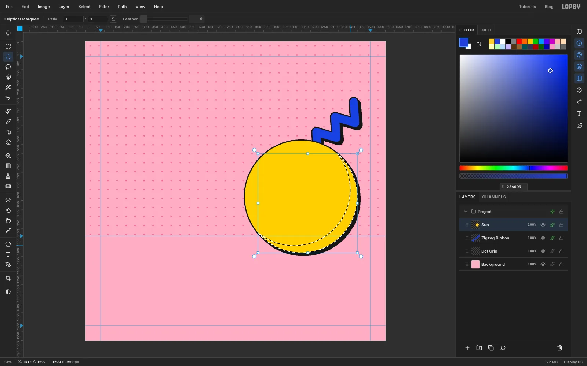

Memphis shading is flat: one darker shape on the side away from the light.

1. **Cmd-click** the `Sun` layer's thumbnail. That selects everything on the layer, so the whole circle is selected.
2. Pick the **Elliptical Marquee**, hold **Alt** and drag a second circle of the same size from `812, 492` to `1412, 1092`. It's the sun's circle moved 38 px up and to the left. Alt subtracts it, so only a crescent on the lower right is left.
3. Add a layer named `Sun Shade`, set the colour to `#FF9A1F` and choose **Edit → Fill**. Deselect.

## Draw a Bacterio squiggle tile

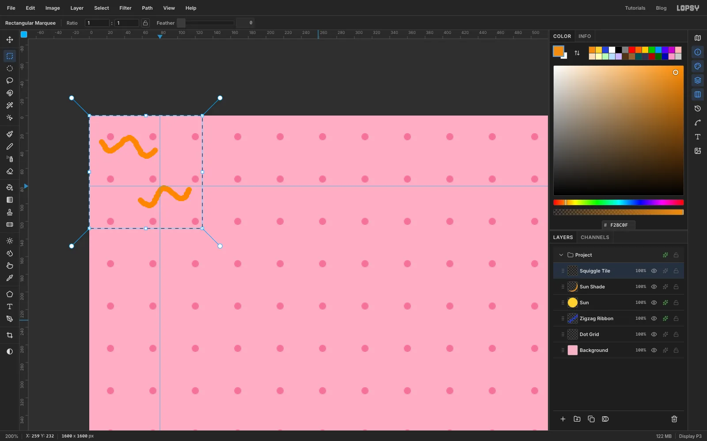

Sottsass's "Bacterio" print is a scatter of little worm shapes. You'll draw two and repeat them.

1. Add a layer named `Squiggle Tile`.
2. Pick the **Brush**, set **Size** to `7` and the colour to `#F28C0F`.
3. Zoom in on the top-left corner. Inside the first 128 px of the canvas, drag two short wiggles, each about 60 px long with a wave and a half in it. Draw one near the top and one near the bottom, tilted slightly differently. Keep both well away from the square's edges.
4. Click once with the **Rectangular Marquee**, select `0, 0` to `128, 128` and choose **Edit → Define Pattern**. Delete the `Squiggle Tile` layer.

## Pour the squiggles into the sun

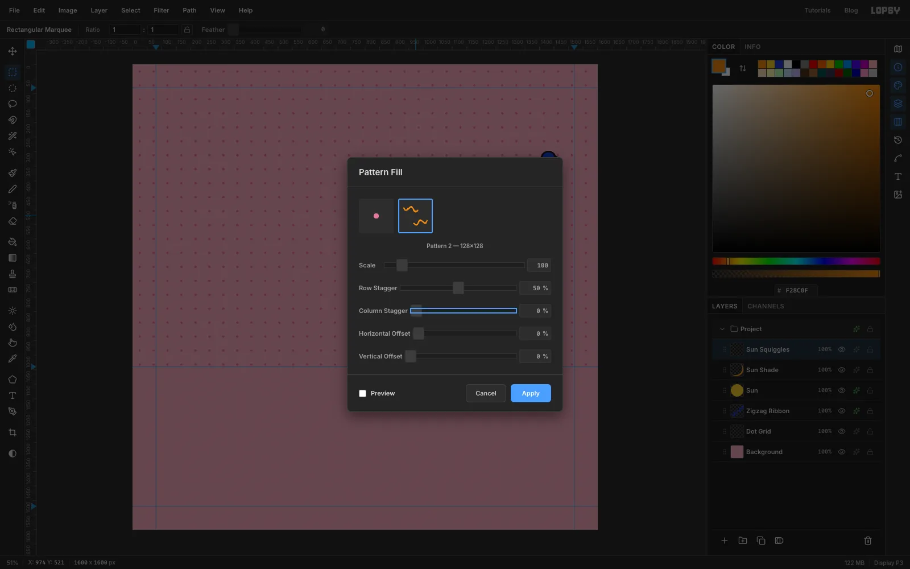

1. Click `Sun Shade`, then add a layer named `Sun Squiggles`.
2. **Cmd-click** the `Sun` thumbnail to select the circle again.
3. Choose **Edit → Fill with Pattern…**, pick the squiggle tile and set **Row Stagger** to `50%`. Each row of tiles shifts half a tile sideways, so the worms look scattered rather than lined up in a grid.
4. Click **Apply** and deselect.

The fill stays inside the selection, so only the sun gets the pattern. Because the squiggles are a deeper orange, they all but disappear over the shade crescent, which keeps the shading readable.

## Turn on the grid for the deck

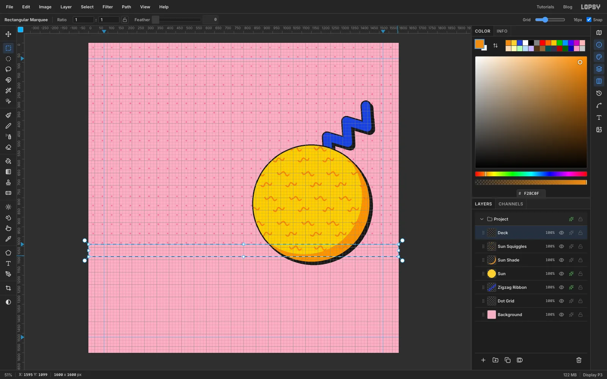

1. Add a layer named `Deck` (above `Sun Squiggles`).
2. Choose **View → Show Grid**. The grid is 16 px, and turning it on also turns on **Snap to Grid**.
3. With the **Rectangular Marquee**, drag from the left edge at the horizon to the right edge one 64 px band lower. You don't have to be exact: the corners snap to the grid lines, giving a selection from `0, 1040` to `1600, 1104`.
4. Set the colour to `#FFFDF7` and choose **Edit → Fill**. Deselect.

## Make a checkerboard tile

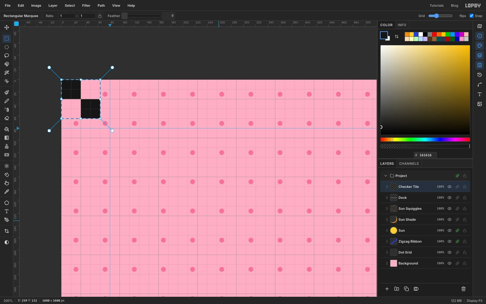

1. Add a layer named `Checker Tile` and set the colour to `#161616`.
2. Drag a marquee over the first 32 px square at the top-left corner, then **Shift-drag** a second one from `32, 32` to `64, 64`. The grid snaps them to exact 32 px squares. Fill.
3. Press [[Cmd+D]], click once with the Rectangular Marquee to select `0, 0` to `64, 64`, choose **Edit → Define Pattern**, and delete the layer.

## Fill the deck with the checkerboard

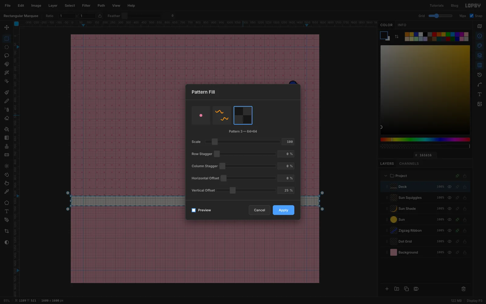

1. Click `Deck` and select the deck band again (`0, 1040` to `1600, 1104`; the grid still snaps).
2. Choose **Edit → Fill with Pattern…** and pick the checker tile.
3. Set **Vertical Offset** to `25%` and click **Apply**.

The tiles are counted from the top of the canvas, and 1040 isn't a multiple of 64, so without the offset the squares would be cut in half at the top of the band. A quarter of a tile is 16 px, which lines the rows up exactly with the band. Deselect, then give `Deck` a **Stroke** of **Width** `4` in `161616`. That draws a crisp black rule along its top and bottom.

## Fill the pool

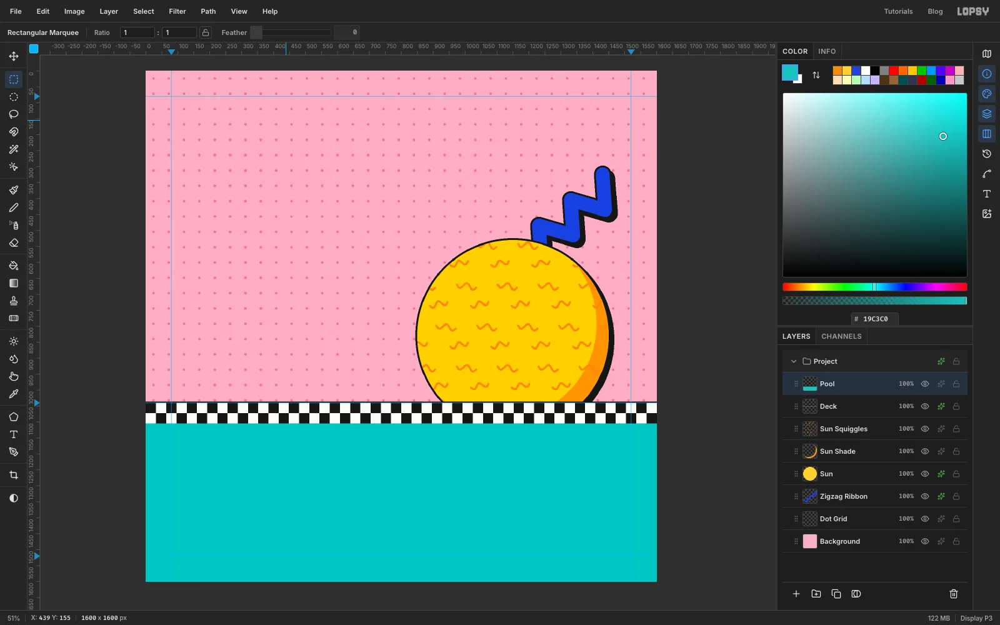

1. Add a layer named `Pool`.
2. Drag a marquee from just under the deck to the bottom-right corner. It snaps to `0, 1104` to `1600, 1600`.
3. Fill with `#19C3C0` and deselect.
4. Choose **View → Show Grid** again to hide the grid and turn off its snapping.

The sun now sinks behind the deck.

## Lay down the sun's reflection

A reflection in Memphis isn't a soft fade. It's a stack of solid bars that get shorter toward you.

1. Add a layer named `Sun Reflection`. Zoom in to 100% so each bar is easy to drag; watch the status bar for the corners.
2. Drag a marquee for the first bar, 520 px wide and 16 px tall and centred under the sun: `890, 1124` to `1410, 1140`.
3. **Shift-drag** two more: `990, 1184` to `1310, 1200` and `1090, 1244` to `1210, 1260`. Fill them with `#FFD12E`.
4. Deselect, then marquee the two bars in between, `940, 1154` to `1360, 1170` and `1040, 1214` to `1260, 1230`, and fill them with `#FF9A1F`.

You now have five bars stepping down from 520 px to 120 px wide, alternating yellow and orange.

## Draw one ripple and paste copies

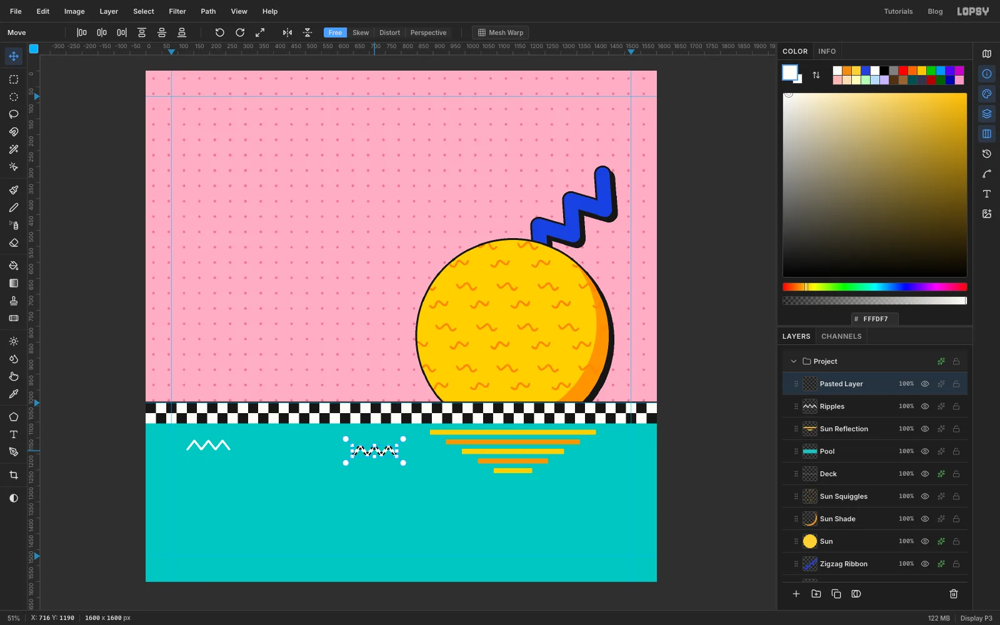

1. Add a layer named `Ripples`.
2. Pick the **Brush**, set **Size** to `8` and the colour to `#FFFDF7`.
3. Click at `130, 1186`, then **Shift-click** your way to the right, alternately 28 px up and 28 px down every 22 px. Stop at `262, 1186`. That's a little zigzag with three peaks.
4. Drag a marquee around it and press [[Cmd+C]].
5. Press [[Cmd+V]]. The copy lands on a new layer in the same place, already selected, with the **Move** tool active. Drag it to the right, to start at about `650, 1190`, and choose **Layer → Merge Down** to fold it into `Ripples`.
6. Paste again and drag the next copy to about `1150, 1385`, below the reflection. Merge Down.

## Add a bigger ripple

Ripples that are all the same size look like wallpaper, so draw one bigger one by hand.

On `Ripples`, with the same brush, click at `760, 1380`, then **Shift-click** up and down across 210 px: alternately 40 px up and 40 px down about every 26 px, ending at `970, 1380`.

That's four peaks, twice the height of the small ripples.

## Make a bead tile for the lane rope

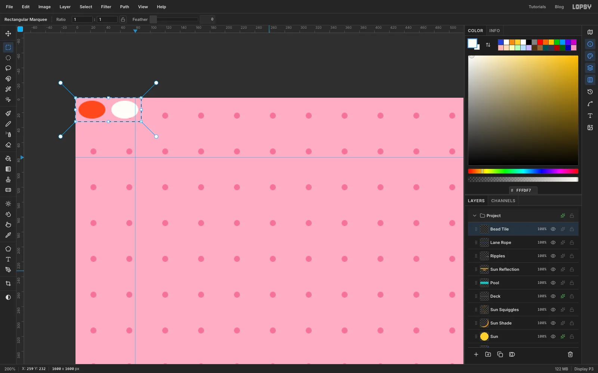

1. Add a layer named `Lane Rope`. With the **Brush** at **Size** `6` in `#2340D9`, click at `2, 1456` and **Shift-click** at `1598, 1456`. That draws a straight line across the pool.
2. Add a layer named `Bead Tile`. Click once with the **Elliptical Marquee**, select `4, 4` to `40, 28` and fill it with `#FF5A36`. Press [[Cmd+D]], click again, select `48, 4` to `84, 28` and fill it with `#FFFDF7`.
3. Press [[Cmd+D]], click once with the **Rectangular Marquee** to select `0, 0` to `88, 32`, choose **Edit → Define Pattern**, and delete the layer.

## String the beads across the pool

1. Click `Lane Rope` and add a layer named `Rope Beads`.
2. Click once with the **Rectangular Marquee** and select `0, 1440` to `1600, 1472`. That's a 32 px band centred on the rope, and 1440 is a multiple of 32, so no offset is needed this time.
3. Choose **Edit → Fill with Pattern…**, pick the bead tile and click **Apply**. Deselect.
4. Give `Rope Beads` a **Stroke** of **Width** `3` in `161616`.

The rope gives the bottom of the cover a strong horizontal line and a band of pattern to balance the sky.

## Select a life ring

You'll build the ring a little too big, where it's easier to place the hole and stripes, then scale it down to fit beside the reflection.

1. Add a layer named `Pool Ring` (above `Rope Beads`).
2. With the **Elliptical Marquee**, drag from `230, 1207` to `710, 1413`. That's a flat oval 480 px wide, so the ring looks as if it's lying on the water.
3. Hold **Alt** and drag the hole from `352, 1261` to `588, 1345`. The hole sits a few pixels above the centre, because you see the ring at an angle.
4. Fill with `#FFFDF7`.

## Paint the red stripes with an intersect lasso

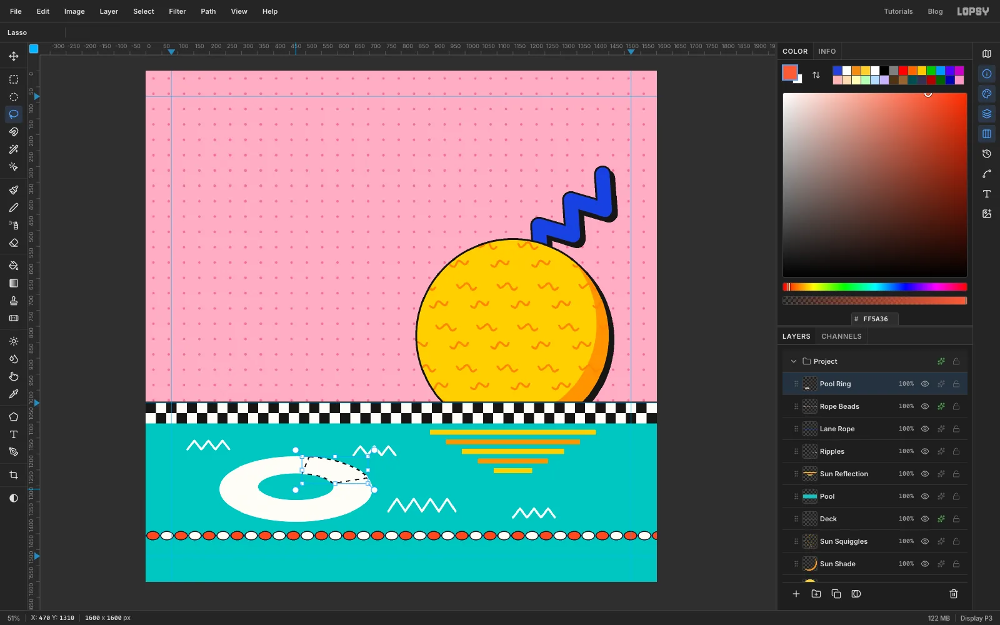

1. Set the colour to `#FF5A36`.
2. **Cmd-click** the `Pool Ring` thumbnail to select the ring.
3. Pick the **Lasso** ([[L]]). Hold **Shift+Alt** and draw a pie slice that starts at the ring's centre and fans out past its edge, covering one sixth of the ring at the top right. Shift+Alt keeps only the overlap, so you get a single stripe with clean ring edges. Choose **Edit → Fill**.
4. Repeat steps 2 and 3 twice more, for a slice at the bottom and one on the left. You get three red stripes with white between them, spaced evenly around the ring.

## Scale the ring down

1. **Cmd-click** the `Pool Ring` thumbnail.
2. Pick the **Move** tool ([[V]]). Hold **Cmd** and drag the bottom-right corner handle inward until the ring is about **392 px** wide, about 82% of its size. Cmd keeps the proportions.
3. Press **Enter** to apply, then deselect.
4. Drag the ring back so it's centred at about `470, 1310`, with a clear gap between its bottom edge and the lane rope.

## Outline the ring

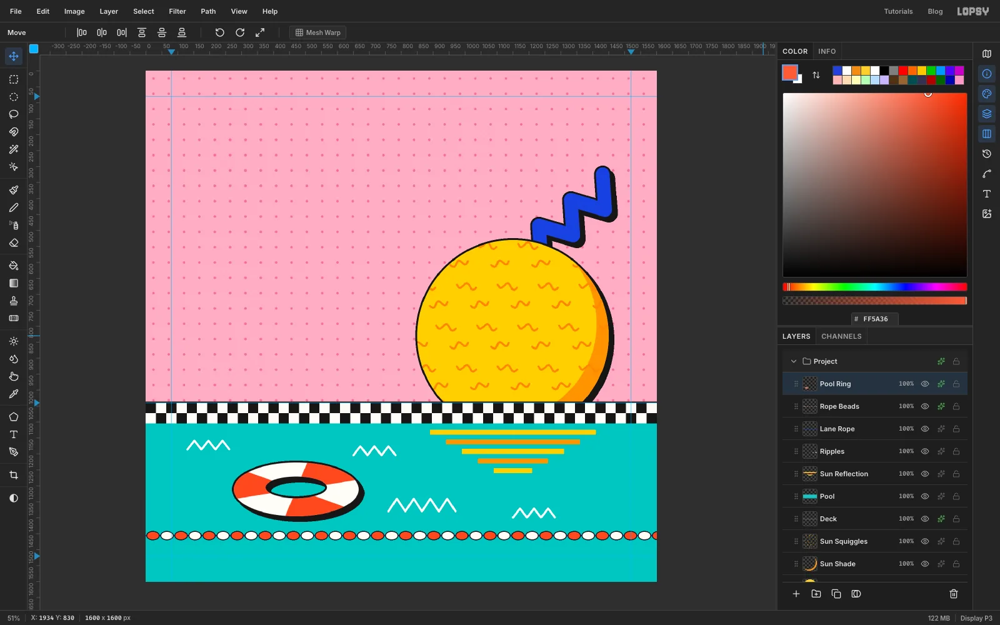

Outline and shadow the `Pool Ring` layer. The shadow lands on the water to the lower right, like the shadows in the sky.

## Stack the palm trunk from rounded rectangles

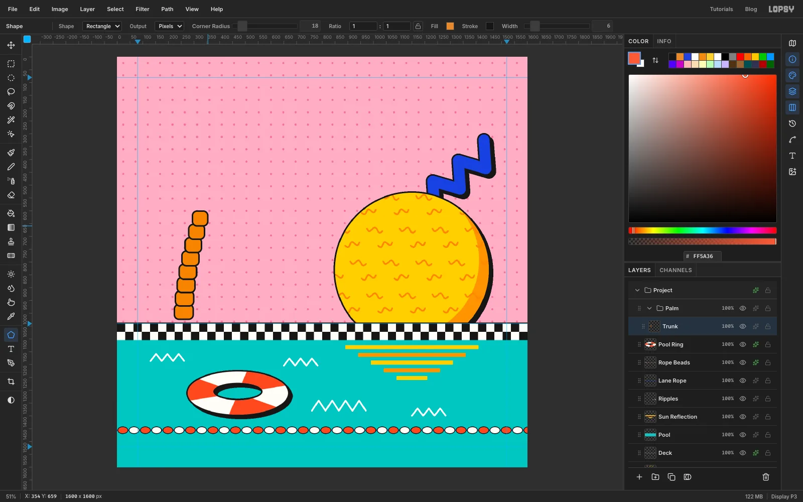

1. Click `Pool Ring`, then click the **New Group** button at the bottom of the Layers panel and name the group `Palm`. Add a layer inside it named `Trunk`.
2. Pick the **Shape** tool and set **Shape** to **Rectangle**. Set the fill to `E8892B`, add a stroke in `161616` at **Width** `6`, and set **Corner Radius** to `18`.
3. Draw eight segments from the bottom up. For each one, press at its centre and drag out to its corner. Shapes grow from the press point, so drag half the segment's width to the right and 29 px down.
   - Start with a segment 74 × 58 centred at `260, 994`, just above the deck.
   - Put each next segment's centre 52 px higher, so it overlaps the one below, and make it 2 px narrower.
   - Shift each one slightly more to the right than the last: 3 px for the second segment, growing to about 14 px for the top one. The top segment ends up 60 px wide at about `324, 630`.

Each new segment is drawn over the last, and the Shape tool's own stroke draws a black line where they overlap. The trunk curves to the right and tapers as it rises. Give `Trunk` the 12 px hard shadow.

## Lasso the fronds

1. Add a layer named `Fronds` inside `Palm`.
2. With the **Lasso**, start at the top of the trunk (about `328, 640`). Draw out along the top edge of a leaf, arching up and then down to its tip. Come back along the underside and let go near where you started to close it. Make it narrow at both ends and about 80 px wide in the middle.
3. Hold **Shift** for each of the next six leaves so they add to the selection. Aim the seven tips at about:
   - `83, 708` (far left), `161, 524`, `321, 470` (straight up, the shortest), `482, 513` and `580, 697` (far right)
   - two long leaves that droop almost to the ground, at `140, 858` and `523, 869`
4. Fill with `#20A35B` and deselect.

## Bite notches out of the fronds

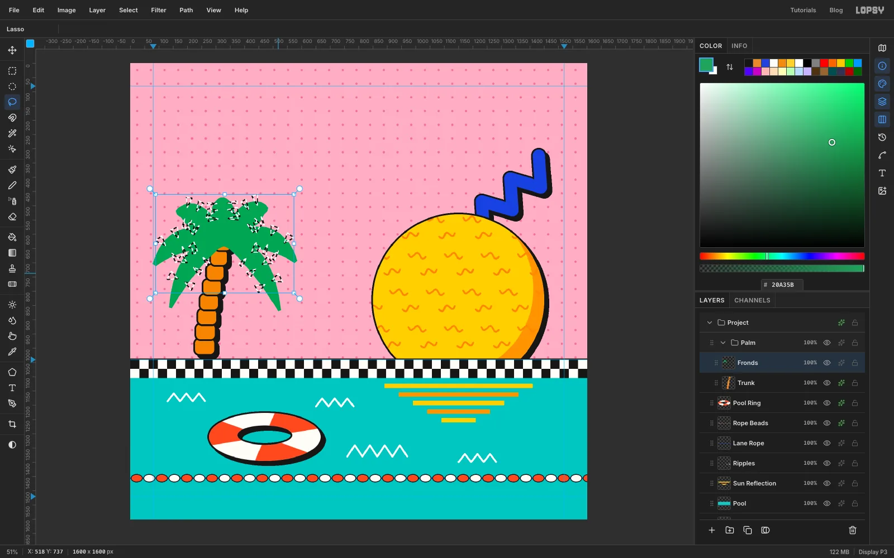

Palm fronds are made of many separate leaflets. A few V-shaped notches along each edge are enough to suggest them.

1. With the **Lasso**, draw a small V-shaped notch on one frond's edge, about 20 px wide at the edge and 25 px deep. Start just outside the edge, cut in to a point about halfway to the middle of the leaf, and come back out. Hold **Shift** and add more: three on each side of every frond, spaced along its outer half.
2. Press **Delete** to cut them out, then deselect.
3. Outline and shadow `Fronds`.

The black outline follows each notch, so every bite turns into a sharp serration.

## Finish the palm and move the group

1. Add a layer named `Midribs`. With the **Brush** at **Size** `6` in `#0F6E3A`, click near the base of each frond and **Shift-click** three more points down its middle, following its curve.
2. Add a layer named `Coconuts`. With the **Elliptical Marquee**, **Cmd-drag** a 44 px circle just under the crown at about `306, 664`. **Cmd+Shift-drag** two more: one overlapping it on the right and one just below, between the two. Fill with `#FFD12E`, deselect, and give the layer a 5 px black **Stroke**.
3. Step back and look at the palm: its leaves crowd the left margin. Click the `Palm` group's row in the Layers panel and, with the **Move** tool, drag on the canvas to move it about **32 px to the right**, until the trunk's base is centred at about x = 292. The trunk, fronds, midribs and coconuts all move together, and their shadows come with them.

If you overshoot, [[Cmd+Z]] puts the whole group back at once. Collapse the `Palm` group when you're done.

## Build the cone

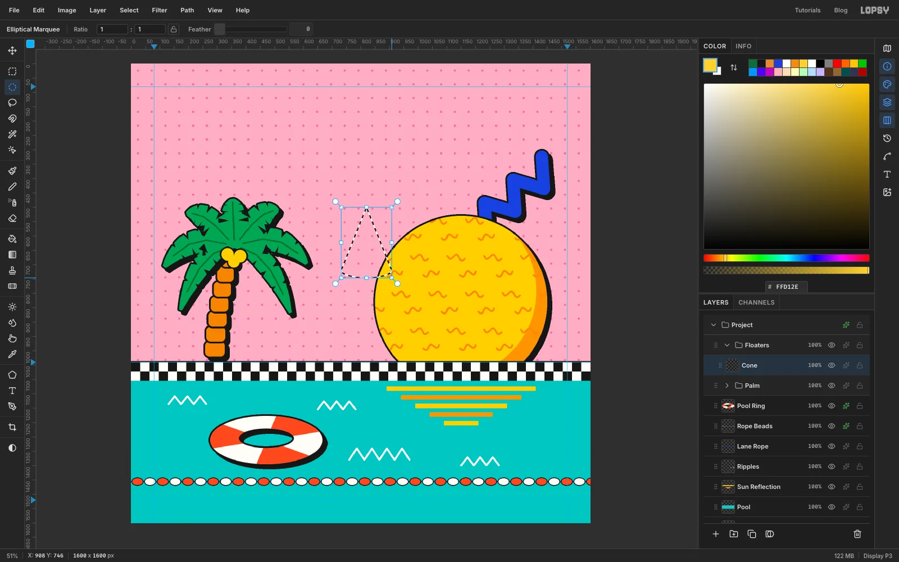

1. Click `Palm` and make a **New Group** named `Floaters`. Add a layer named `Cone`.
2. With the **Lasso**, draw a triangle with its tip at `820, 500` and its base corners at `732, 720` and `908, 720`.
3. Hold **Shift** and, with the **Elliptical Marquee**, drag a flat ellipse from `732, 694` to `908, 746` to round off the base. Fill with `#FF5A36`.
4. **Cmd-click** the `Cone` thumbnail. With the **Lasso** and **Shift+Alt**, draw a four-sided shape around the cone's right part: from `816, 480` just left of the tip, across to `960, 480`, down to `960, 780`, and back to `844, 780`, slightly right of the base's centre. Only the part inside the cone stays selected. Add a layer named `Cone Shade` and fill the selection with `#C9361B`. Deselect.
5. Click `Cone` and outline and shadow it.

The base's right corner overlaps the sun on purpose. A small, clear overlap reads as depth. A near-miss that almost touches reads as a mistake.

## Shade a ball with a radial gradient

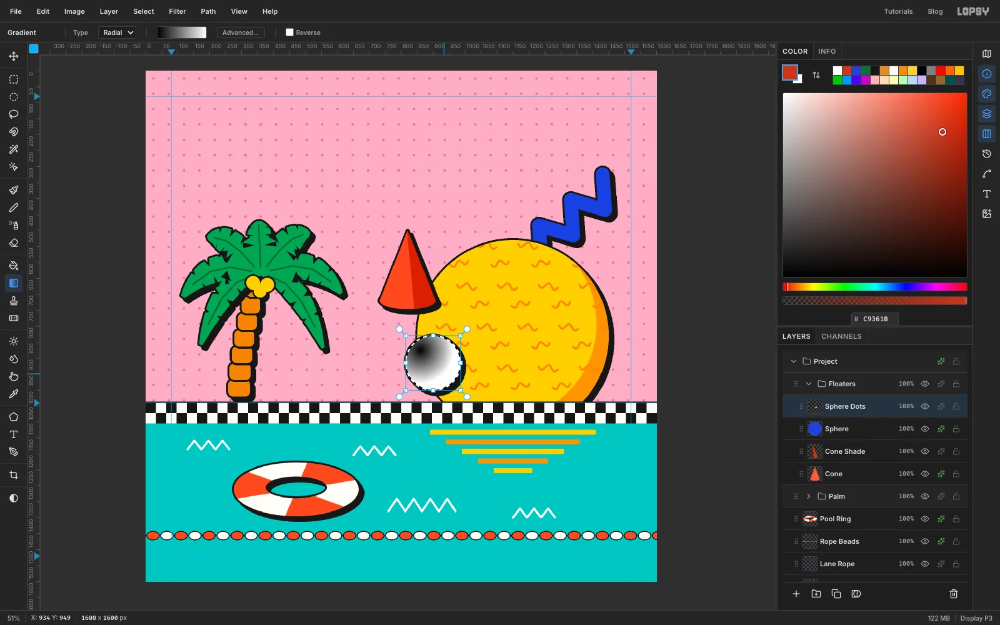

1. Click `Cone Shade` and add a layer named `Sphere`.
2. With the **Shape** tool, set **Ellipse**, fill `2340D9`, no stroke. Hold **Cmd** and drag from `900, 915` to `986, 1001`, a 172 px ball. Outline and shadow it.
3. Add a layer named `Sphere Dots` and **Cmd-click** the `Sphere` thumbnail.
4. Pick the **Gradient** tool and set **Type** to **Radial**. Click **Advanced…** and set the two stops to black `#000000` on the left and white `#FFFFFF` on the right.
5. Drag from `860, 875`, the upper-left of the ball where the light hits, to `934, 949`.

## Turn the gradient into halftone dots

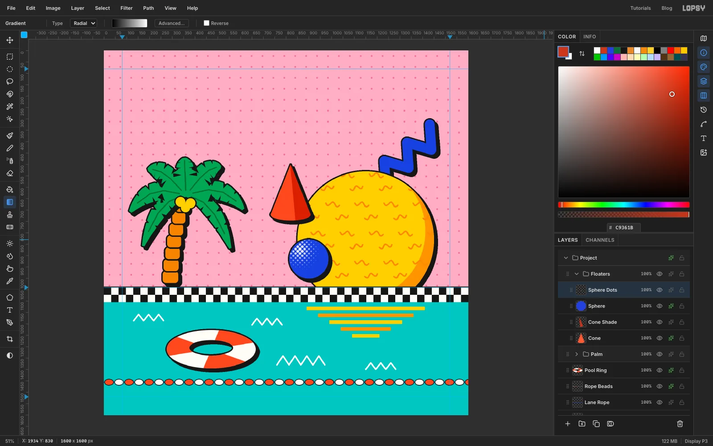

1. With the selection still active, choose **Filter → Halftone…**. Set **Dot Size** to `14`, **Angle** to `45` and **Softness** to `0`, and click **Apply**. Dark areas turn into big dots and white into none, so the dots are biggest where the gradient started.
2. Choose **Filter → Invert**. The dots turn white and the background turns black.
3. Deselect, open the layer's **fx** drawer and set the blend mode to **Screen**. Black vanishes in Screen mode, so only the white dots stay, as a printed highlight.

## Scatter and rotate the confetti

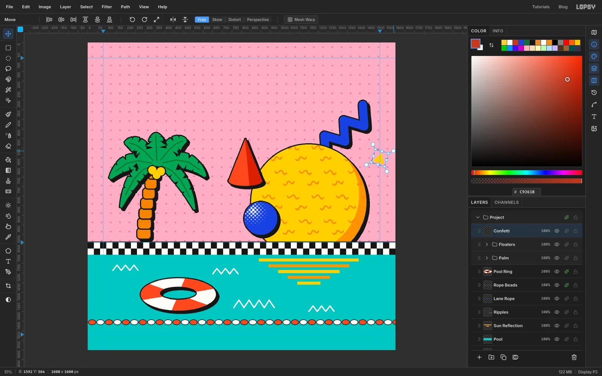

1. Collapse `Floaters`, click it and add a layer named `Confetti`.
2. Pick the **Shape** tool, set **Shape** to **Polygon** and **Sides** to `3`, with no stroke. You'll draw four triangles and tilt each one as soon as you draw it:
   - yellow `FFD12E`, 60 px, centred at `1520, 600`
   - mint `A8E6CF`, 48 px, at `1340, 230`
   - yellow, 46 px, at `470, 955`
   - lilac `B79CF2`, 52 px, at `130, 430`
3. For each one, set the fill, hold **Cmd** and drag from its centre. Then drag a marquee just around it, pick the **Move** tool, and drag just outside a corner of the box to rotate it. Give each a different tilt, from a small nudge to about a ninth of a turn, some clockwise and some counter-clockwise. Press **Enter**, deselect, and go back to the Shape tool for the next.
4. Add three small dots with the **Elliptical Marquee** and **Edit → Fill**: red `#FF5A36`, 28 px across, at `990, 470`; red, 24 px, at `643, 950`; and cobalt `#2340D9`, 24 px, at `1520, 905`.
5. Give `Confetti` a 6 px black **Stroke** and a hard **Drop Shadow** with offsets of `10`.

## Add squiggles and a ring

1. Add a layer named `Squiggles`. With the **Brush** at **Size** `10` in `#161616`, draw four short zigzags by clicking and Shift-clicking, each about 75 px long and 28 px tall, with two or three peaks. Put them in the open pink at about `196, 317`, `1098, 430`, `1500, 712` and `156, 926`.
2. Pick the **Shape** tool, set **Ellipse**, remove the fill and add a `161616` stroke at **Width** `7`. Hold **Cmd** and drag a 40 px ring at `92, 600`.

Keep every piece of confetti at least a few dozen pixels away from the big shapes and from the horizon. Confetti that touches something looks like a mistake.

## Set the title type

1. Click `Squiggles`. Before each new piece of type, click a non-text layer first. Otherwise, changing the font or size restyles the text layer that's selected.
2. Pick the **Text** tool ([[T]]). In the options bar choose **Shrikhand**, set **Size** to `200`, and set the colour to `#2340D9`. Click at `330, 175` and type `Summer`. Press **Tab** to finish.
3. Click `Squiggles` again. Choose **Rubik Mono One** at **Size** `180` in `#161616`, click at `86, 46` and type `ZIGZAG`. Press **Tab**.

The point you click is the top-left of the line box, which is taller than the capitals and has a little space before the Z. Clicking at `86, 46` puts the capitals' top-left corner at `100, 100`, on the type margin. ZIGZAG is created on top of `Squiggles`, which puts it under Summer, so Summer can overlap it.

## Tilt Summer

1. Click the `Summer` layer and pick the **Move** tool.
2. Hover just outside the top-right corner of its box until the cursor becomes a rotate arrow, and drag up to turn it **counter-clockwise** a little, about 7°. That's when the end of the r sits roughly 90 px higher than the bottom of the S.
3. Press **Enter**.

The text stays live, so you can still change the font or the word later. The S tucks in under the I of ZIGZAG, and the r rises toward the band-name pill without touching it.

## Outline and shadow the title

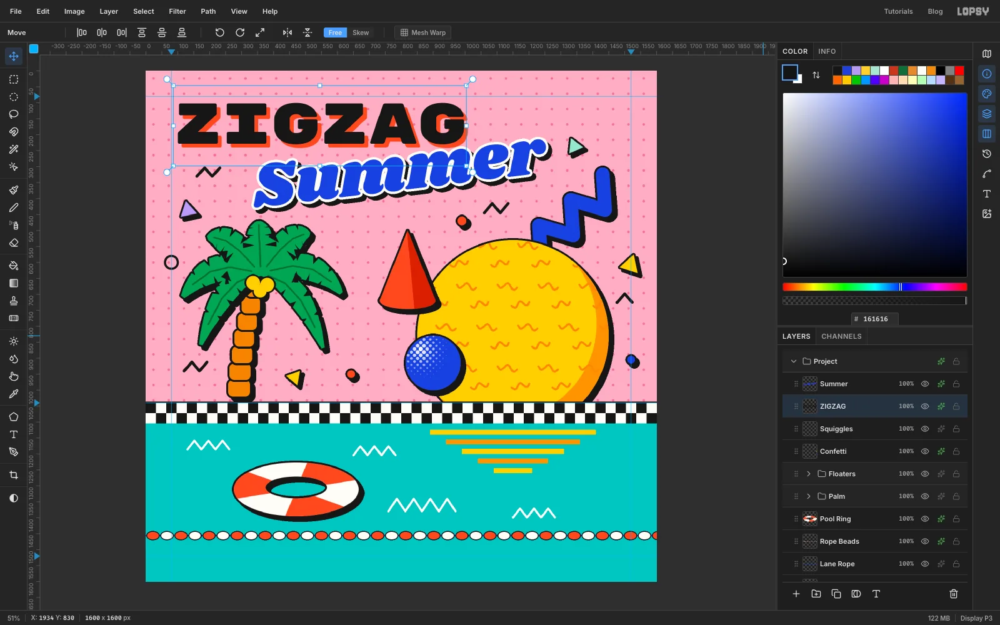

1. On `Summer`, add a **Stroke** of **Width** `8` in `FFFDF7` (cream), plus the black 12 px hard shadow.
2. On `ZIGZAG`, add only a **Drop Shadow**: offsets `12`, **Blur** `0`, **Opacity** `100`, colour `FF5A36`.

The cream outline separates the blue script from everything behind it. The vermilion shadow makes the black capitals look stamped twice, slightly out of register.

## Make the band-name pill

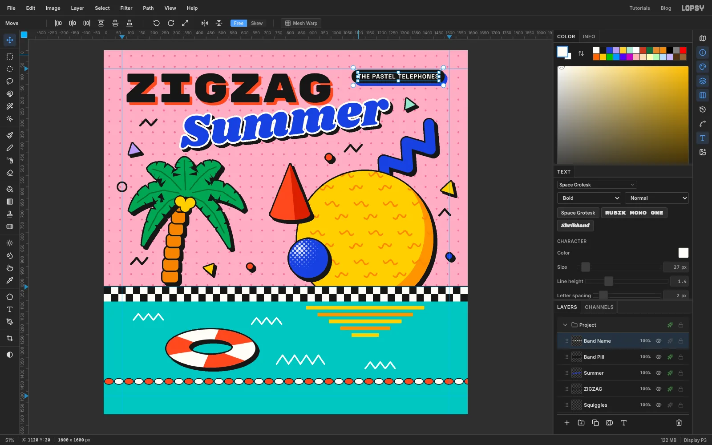

1. Click `Summer` and add a layer named `Band Pill`.
2. With the **Shape** tool, choose **Rectangle**, fill `161616`, no stroke, **Corner Radius** `30`. Press at `1295, 114` and drag out to `1500, 144`. That makes a 410 × 60 pill whose right edge sits on the 100 px margin, matching ZIGZAG's left margin.
3. Give it a hard **Drop Shadow** with offsets of `12` in `2340D9`.
4. With `Band Pill` active, pick the **Text** tool, choose **Space Grotesk**, **Bold**, **Size** `27`, colour `#FFFDF7`, click in an empty area of the canvas and type `THE PASTEL TELEPHONES`. Press **Tab**, rename the layer `Band Name`, and in the **Text** panel set **Letter spacing** to `2`.
5. With the **Move** tool and the arrow keys, nudge the text until it sits in the middle of the pill, with equal space at both ends.

## Build the sticker as a group

1. Click `Band Pill`, make a **New Group** named `Sticker`, and add a layer named `Sticker Disc` inside it.
2. With the **Shape** tool, choose **Ellipse**, fill `FFD12E`, stroke `161616` at **Width** `6`. Hold **Cmd** and drag from `1400, 1310` out to `1486, 1396`. Give the layer a 12 px hard shadow.
3. With `Sticker Disc` active, pick the **Text** tool, choose **Rubik Mono One**, **Size** `50`, black, click in an empty area and type `33⅓`. There's no key for ⅓: copy it from this page, or use the Character Viewer ([[Ctrl+Cmd+Space]]) and search for "one third". Press **Tab** and rename the layer `33 RPM`.
4. Click `Sticker Disc` again and type `LONG PLAY` in **Space Grotesk Bold**, **Size** `19`, letter spacing `3`. Rename it `Long Play`.
5. With the **Move** tool, nudge them so `33⅓` sits just above the middle of the disc and `LONG PLAY` about 50 px below it. Leave at least 25 px between the ends of `33⅓` and the outline.

## Rotate the whole sticker

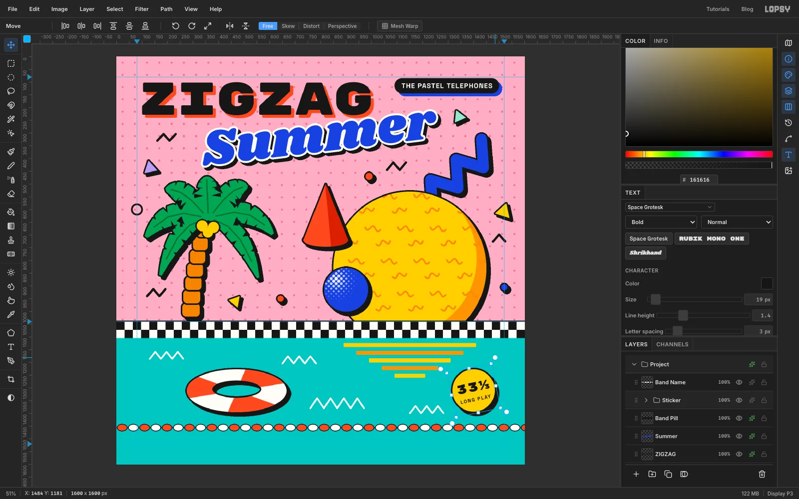

1. Collapse `Sticker` and click its row, so the Move tool transforms the whole group.
2. With the **Move** tool, drag from just outside a corner to tilt it **counter-clockwise**, about 12°: a bit less than the 15° steps you get by holding Cmd. 33⅓ should climb gently to the right.
3. Press **Enter**.

The disc and both text layers turn together around the same centre, so the two lines stay on one angle.

## Add the catalogue line and export

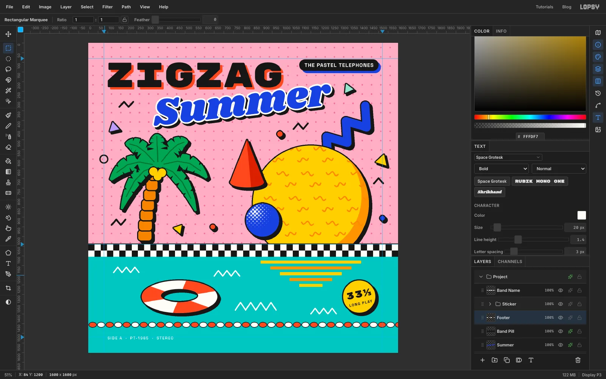

1. Click `Band Pill`, pick the **Text** tool, click in an empty area and type `SIDE A  ·  PT-1985  ·  STEREO` in **Space Grotesk Bold**, **Size** `20`, colour `#FFFDF7`, letter spacing `3`. The middle dot is [[Option+Shift+9]] on a Mac. Rename the layer `Footer`.
2. Nudge it so it starts at **x = 100**, the same margin as ZIGZAG, with its baseline at about **1530**: halfway between the lane rope and the bottom edge.
3. Save the project with **File → Save Project**, then **File → Quick Export PNG** for the artwork.

Before you call it finished, look closely at every edge where two things meet. Each overlap should be clearly an overlap, and each gap clearly a gap. That one check is what makes a busy Memphis cover look designed rather than thrown together.
