**Memphis** was a group of Milan designers led by Ettore Sottsass, who launched their first collection in 1981. Their furniture looked like toys built by architects: flat slabs of colour, stripes, dots, squiggly "Bacterio" patterns, black outlines and objects perched on pedestals. Through the 1980s that look spread to record sleeves, TV idents and shop windows.

In this tutorial you'll make a 1500 × 1500 px sleeve for **Zebra Overture**, an imaginary album by an imaginary band called **Soft Furniture**. The idea is a joke about classical music: the zebra gets the composer-bust treatment and sits on a Memphis plinth. It has:

- a photo of a zebra cut into a bust with the Lasso, with a cream sticker edge and a hard black shadow
- a plinth with a squiggle-pattern column, built from a tile you draw yourself
- flat Memphis shapes: a striped cobalt disc, a dot grid, a mint quarter-circle, a yellow triangle and a lilac pill
- confetti: a Pen-drawn squiggle, brush dashes and copied rings
- outlined title type with a block shadow, a tilted label and vertical band name
- print grain and an ink border

The tools you'll use:

- the **Elliptical** and **Rectangular Marquee** (including **Shift+Option** intersect), the **Lasso**, **Select → Inverse** and the **Brush** with **Shift**-click straight lines
- **Desaturate**, **Brightness/Contrast** and **Add Noise**
- the **Stroke** and **Color Overlay** layer effects, **Duplicate Layer** and the **Overlay** blend mode
- **Define Pattern** and **Fill with Pattern**
- the **Shape** tool's ellipses, rounded rectangles and triangles, and the **Pen** tool
- **Copy**, **Paste**, **Merge Down** and **Group Layers**
- the **Move** tool's scale and rotation handles, on a photo, a shape, live text and a group
- the **Text** tool and **Image → Border**

You need one photo: [Zebra head](https://commons.wikimedia.org/wiki/File:Zebra_head_(8596322554).jpg) by flowcomm on Wikimedia Commons (CC BY 2.0). Download the largest size. It's a side-on head with a soft green background, which makes it easy to trace.

The fonts are all free Google Fonts in Lopsy's font picker: **Rammetto One** for the title, **Rubik Mono One** for OVERTURE, **Shrikhand** for the subtitle and **Righteous** for the band name and credits.

The palette:

- Pink ground `#F7B9CC`, cream `#FFF8EC`, ink `#151515`
- Cobalt `#2541D9`, tomato `#FF5638`, yellow `#FFD33D`
- Mint `#7FD8BE`, lilac `#B9A2F2`, grain grey `#808080`

> **Tip:** Positions are written as `x, y` in document pixels. The status bar at the bottom left shows the cursor position as you move. With **nothing selected**, a click with a marquee tool (without dragging) opens a small dialog where you type the two corners, such as `800, 1003` to `1080, 1500`. If something is already selected, that click just deselects, so press [[Cmd+D]] first. Key names are Mac keys. On Windows and Linux use Ctrl for Cmd, except when you hold Cmd on a transform handle: there Lopsy reads the Windows key.

## Set up a pink square with guides

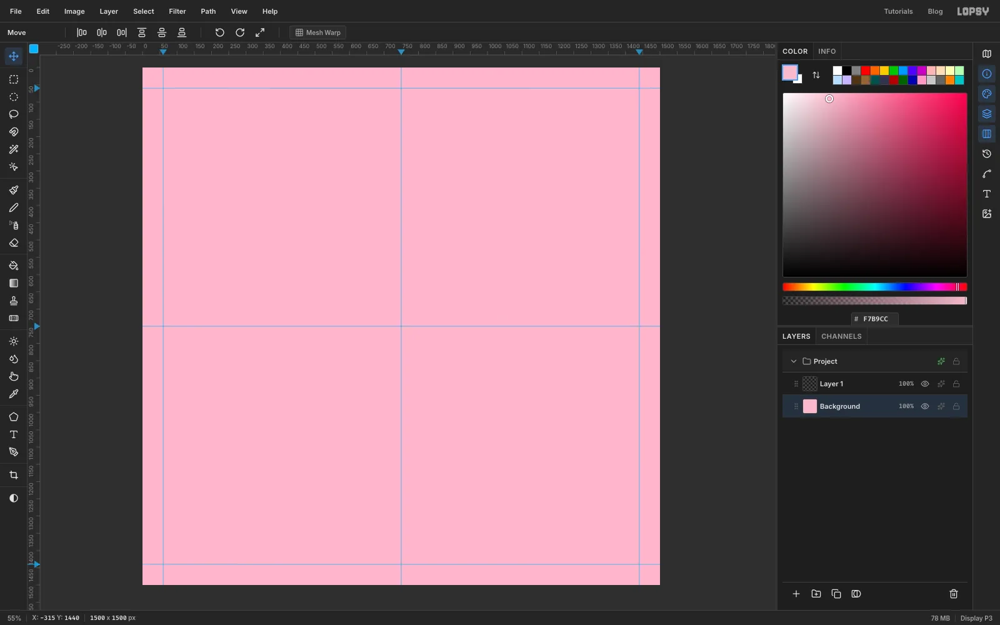

1. Open [Lopsy](/). In the **New Document** dialog set **Width** and **Height** to `1500`, then click **Create**.
2. Click the `Background` layer. Type `F7B9CC` in the Color panel's hex field and choose **Edit → Fill**.
3. Click the top ruler at **60**, **750** and **1440** to drop vertical guides, then click the left ruler at the same three numbers for horizontal guides. The outer guides are your margins. The middle ones mark the centre.

## Draw the cobalt disc

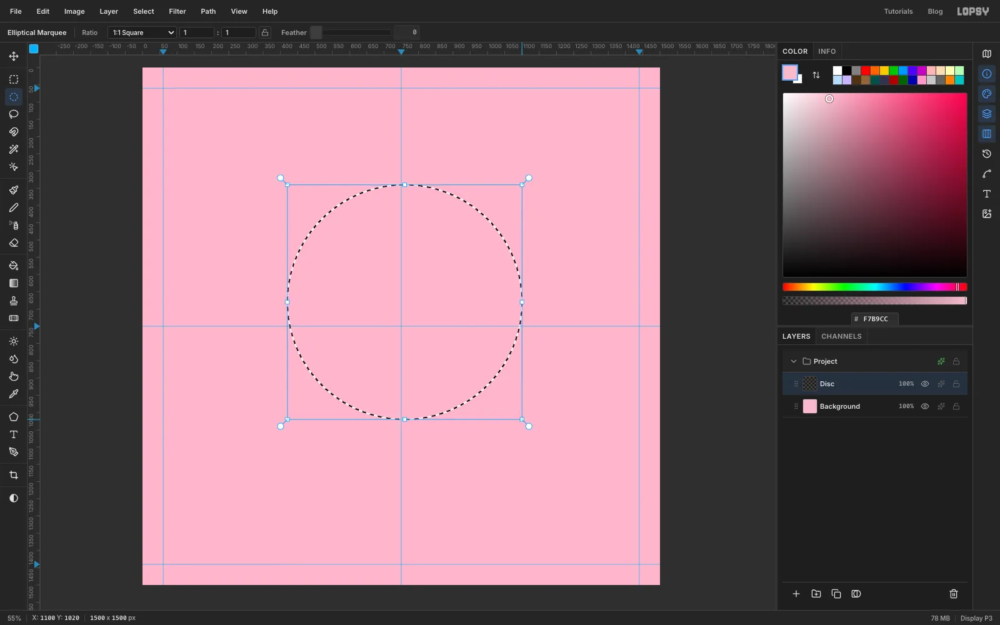

The disc will sit behind the zebra's head like a halo.

1. Double-click `Layer 1` and rename it `Disc`.
2. Pick the **Elliptical Marquee**. Click once on the canvas without dragging and enter `420, 340` to `1100, 1020`. That's a circle 680 px across, centred at `760, 680`.
3. Set the colour to `#2541D9` and choose **Edit → Fill**. Leave the selection active for the next step.

## Keep only the bottom half of the circle selected

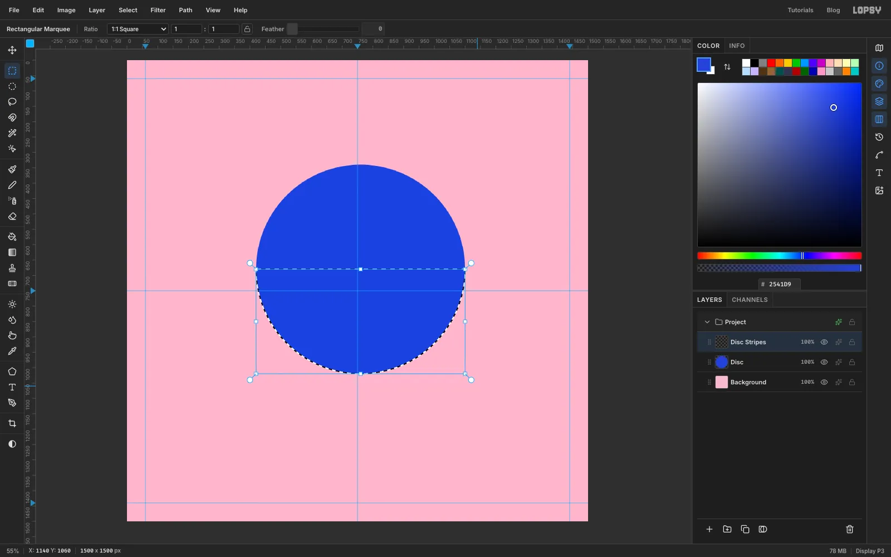

You'll paint stripes in the lower half of the disc only. The quickest way to get that shape is to intersect the circle with a rectangle.

1. Click the `Disc` layer, then **Add Layer** (the + button at the bottom of the Layers panel). Name the new layer `Disc Stripes`.
2. The circle selection is still there. Switch to the **Rectangular Marquee** ([[M]]). Hold **Shift+Option** and drag a rectangle from just left of the disc at the level of its centre (`380, 680`) down past its bottom-right (`1140, 1060`).

When you let go, only the bottom half of the circle stays selected.

## Brush the cream stripes

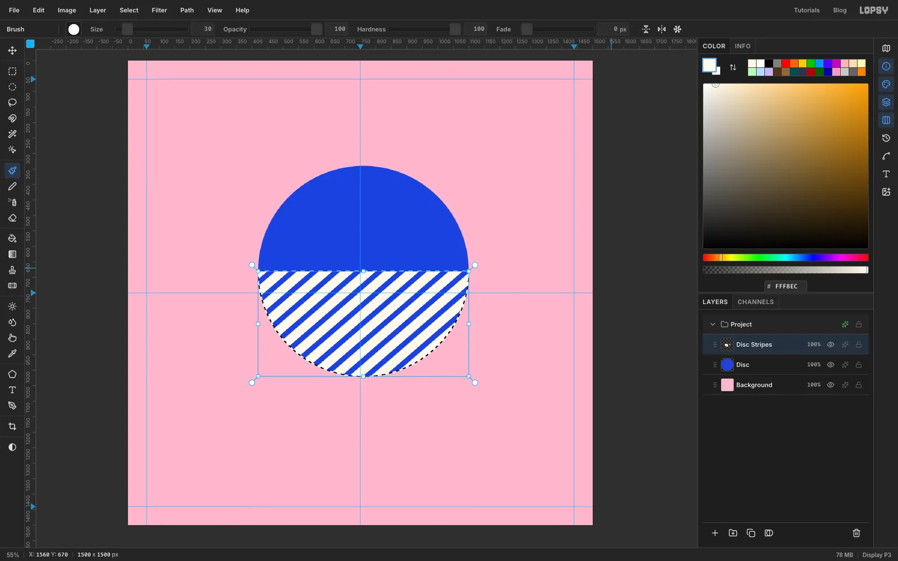

The Brush only paints inside a selection, so you can draw long lines and let the selection trim them.

1. Pick the **Brush** ([[B]]). In the options bar set **Size** to `30`, **Hardness** to `100` and **Opacity** to `100`. Click the brush-tip thumbnail at the left of the options bar, and on the **Shape** tab set **Spacing** to `1`. Close the Brushes window.
2. Set the colour to `#FFF8EC`.
3. Draw a diagonal line: click below and left of the disc, then **Shift**-click about 440 px to the right and 380 px higher. Lopsy joins the two clicks with a straight stroke. Start the first line at `0, 1050` and finish it at `440, 670`.
4. Repeat every 70 px along the bottom (the next one runs from `70, 1050` to `510, 670`) until the stripes cover the whole half-disc. You need about 17 lines.
5. Press [[Cmd+D]] to deselect.

## Dot a grid behind the disc

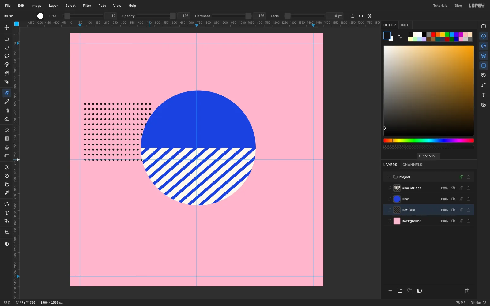

A grid of dots is the most Memphis texture there is. A brush with very wide spacing paints a dotted line in one Shift-click.

1. Click the `Background` layer, then **Add Layer**. Name it `Dot Grid`. New layers go directly above the active one, so this one sits under the disc.
2. Keep the Brush. Set **Size** to `12`, then open the brush-tip window again and set **Spacing** to `200`. Each dot is now 24 px from the next.
3. Set the colour to `#151515`.
4. Click at `90, 420` and **Shift**-click at `474, 420`. That gives a row of dots.
5. Repeat every 30 px down the page (`90, 450` to `474, 450`, and so on) until the last row at `y = 750`. That's 12 rows.
6. Set **Spacing** back to `1` so the next brush strokes are solid.

## Place and scale the zebra photo

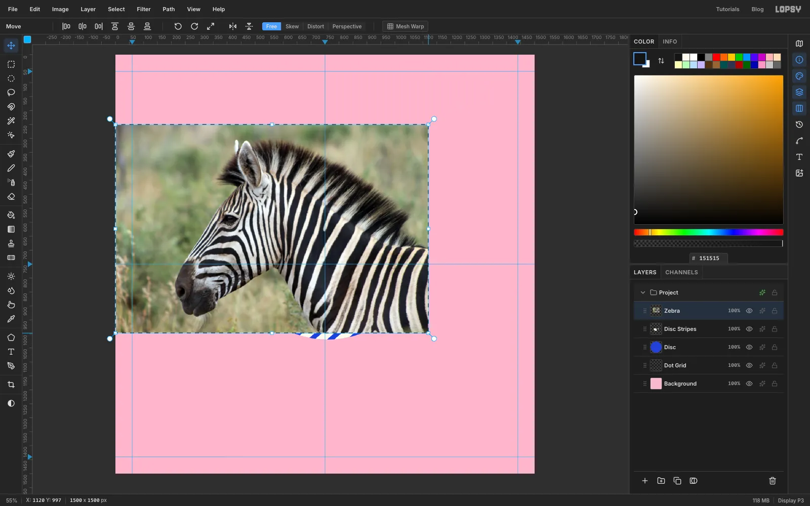

1. Click the `Disc Stripes` layer so the photo lands on top of it.
2. Drag the downloaded zebra photo from your desktop onto the canvas. Lopsy adds it as a new layer, fitted to the canvas width, and shows its transform handles. Rename the layer `Zebra`.
3. Hold [[Cmd]] and drag the **bottom-right** corner handle up and to the left until the photo is about **1120 px** wide. Cmd keeps the proportions. Press [[Enter]] to apply, then [[Cmd+D]].
4. With the **Move** tool ([[V]]), drag the photo so its top-left corner is at about `130, 277`. The zebra's nose should now be just right of the dot grid, and its ear tips just above the disc.

## Trace the bust with the Lasso

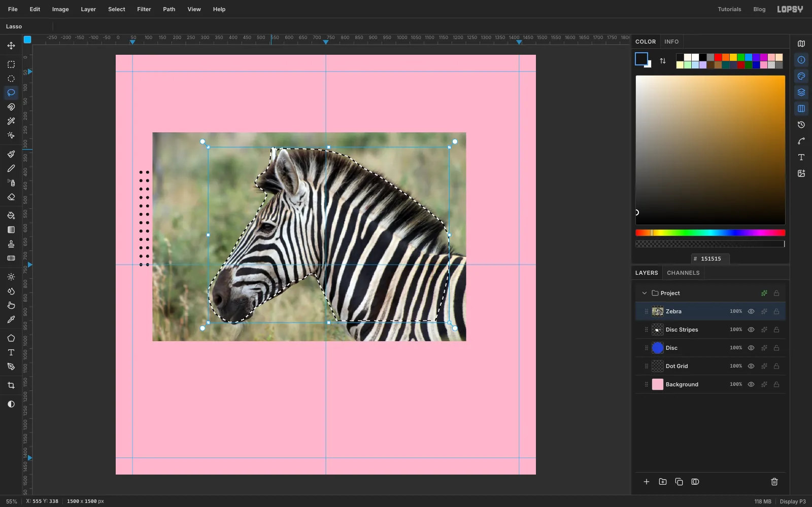

A classical bust ends in a flat cut, so you'll trace the head and mane carefully and cut the neck off straight.

1. Zoom in ([[Cmd+=]]) if it helps. Pick the **Lasso** ([[L]]).
2. Start at the tip of the back ear and drag around the outline: over the front ear, along the top of the mane, down the back of the neck, and around the nose and chin. Stay a pixel or two **inside** the hair, so no green background gets in.
3. Cut the bust off with two clean lines: down the back of the neck near `x = 1180`, then across at `y = 950`, back to the throat. The Lasso is freehand, so drag slowly and steadily here. The sticker edge you add later hides small wobbles. Close the loop at the ear tip.

## Cut out and desaturate the bust

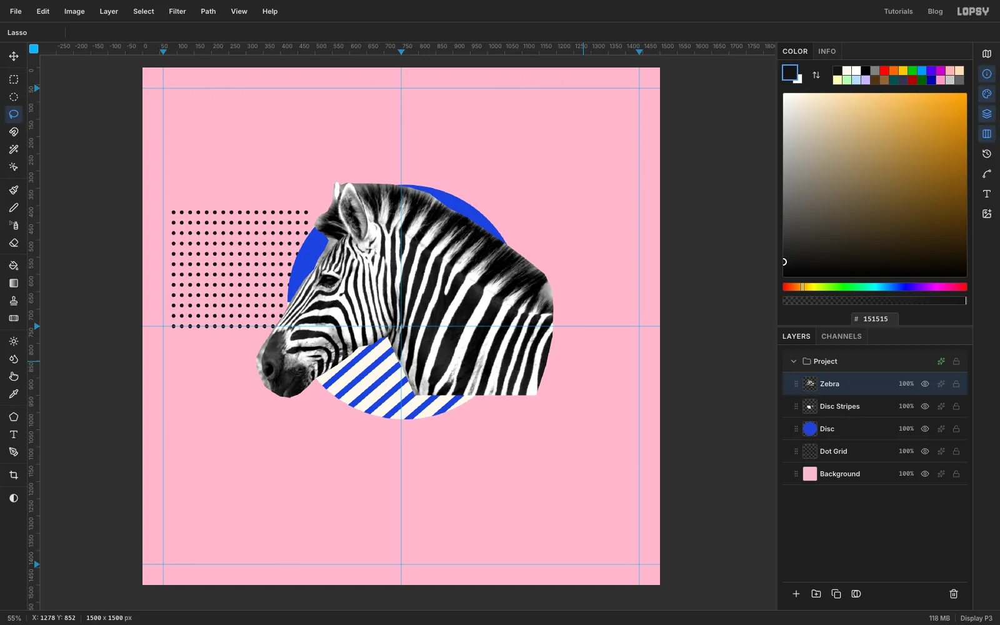

1. Choose **Select → Inverse**, then press [[Delete]]. Everything outside the bust is gone. Press [[Cmd+D]].
2. Choose **Filter → Desaturate** to turn the photo grey. That suits a black-and-white animal, and it stops the leftover green fringe from clashing with the pink.
3. Choose **Filter → Brightness/Contrast…**. Set **Brightness** to `8` and **Contrast** to `35`, then click **Apply**. The white stripes now glow like paper.

## Give the bust a sticker edge

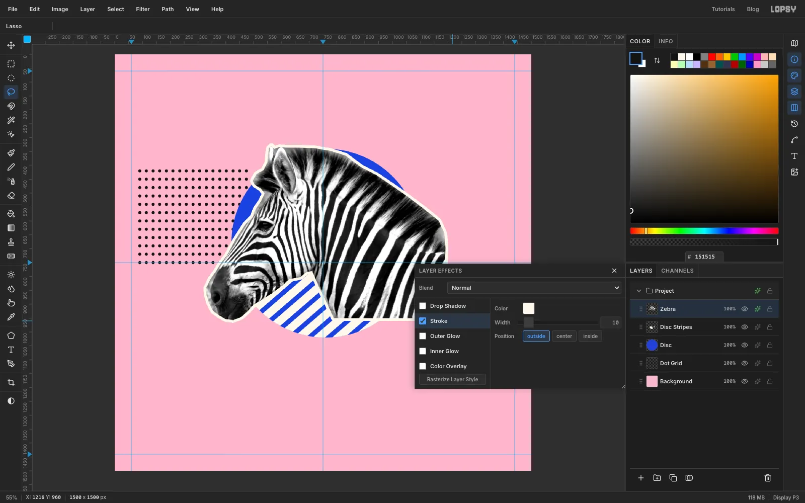

A cream outline makes the photo look scissored out of a magazine, and it hides any small fringe the Lasso left.

1. Click the ✦ (layer effects) button on the `Zebra` row.
2. Tick **Stroke**. Set **Width** to `10` and the colour to `#FFF8EC`. Leave the position on **Outside**.
3. Close the effects drawer.

## Add a hard black shadow

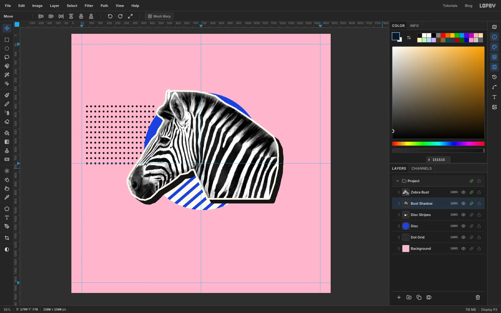

Memphis shadows are solid shapes, not soft blurs. The easiest way to get one is to duplicate the layer and turn the copy underneath into a silhouette.

1. Click **Duplicate Layer** at the bottom of the Layers panel. The copy appears above the original. Rename the copy `Zebra Bust`.
2. Duplicate Layer sometimes offsets the copy by 10 px. If yours has moved, nudge it back with the arrow keys so it lines up exactly with the original.
3. Click the original `Zebra` layer and rename it `Bust Shadow`. In its effects drawer, tick **Color Overlay** and set it to `#151515`. Change the **Stroke** colour to `#151515` too, so the shadow includes the sticker edge.
4. With the **Move** tool, nudge the shadow 26 px right and 22 px down. [[Shift+→]] moves 10 px and [[→]] moves 1 px.

## Draw a squiggle tile

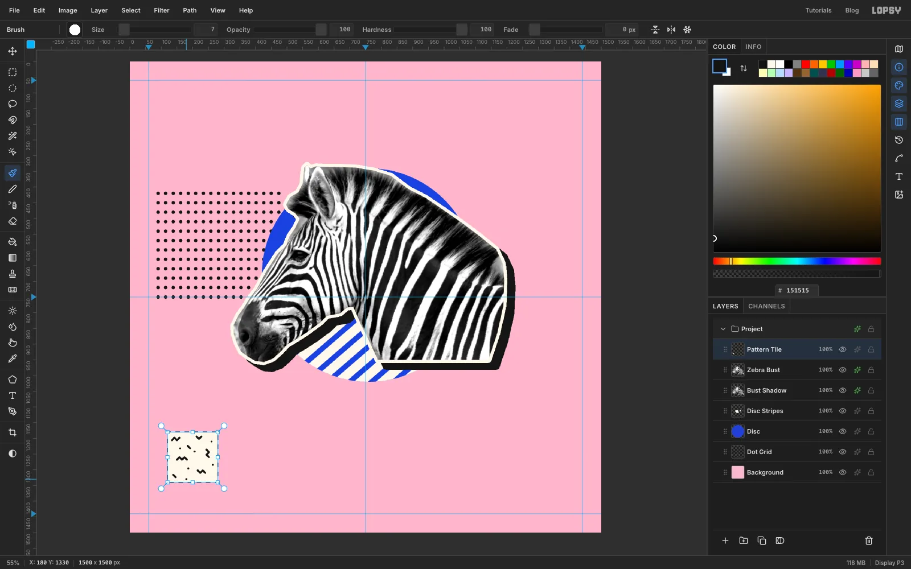

The plinth's column gets a Bacterio-style squiggle pattern. You'll draw one 160 px tile in an empty corner and let Lopsy repeat it.

1. Click `Zebra Bust`, then **Add Layer**. Name it `Pattern Tile`.
2. With the **Rectangular Marquee**, click once and enter `120, 1180` to `280, 1340`. Fill it with `#FFF8EC`.
3. Pick the **Brush**, set **Size** to `7` and the colour to `#151515`. Draw six or seven short zigzags across the tile. Each one is a click followed by two or three **Shift**-clicks about 8 px apart, going up and down. Vary their directions, and keep them a few pixels inside the edges.
4. Click once in five or six empty spots to add single dots.
5. Choose **Edit → Define Pattern**. Press [[Cmd+D]], then delete the `Pattern Tile` layer with the bin button. The pattern is saved, so you don't need the layer any more.

## Fill the column with the pattern

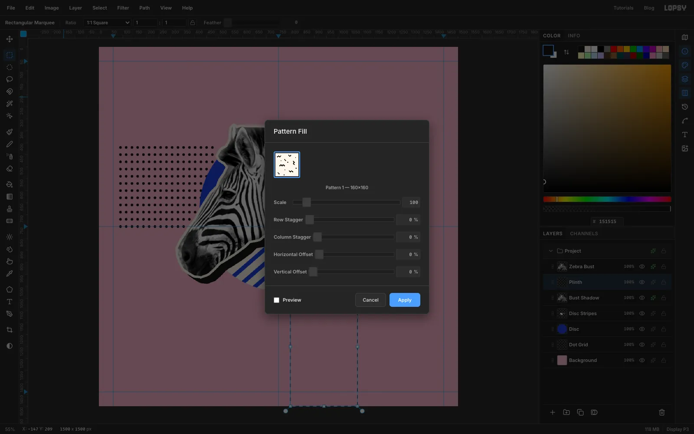

1. Click the `Bust Shadow` layer, then **Add Layer**. Name it `Plinth`. It sits between the shadow and the bust, so the plinth's cap will hide the bottom of the shadow.
2. With the **Rectangular Marquee**, click once and enter `800, 1003` to `1080, 1500`. That's the front of the column, running off the bottom of the cover.
3. Choose **Edit → Fill with Pattern…**, click your squiggle tile (the last swatch) and click **Apply**.

## Build the rest of the plinth

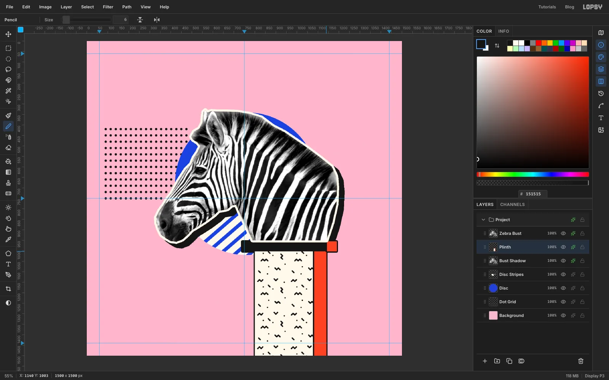

Every right-hand face of the plinth is tomato red. That one rule makes the flat rectangles read as blocks.

1. Press [[Cmd+D]], then select `1080, 1003` to `1140, 1500` and fill it with `#FF5638`. This is the column's side.
2. Deselect, then select `740, 955` to `1140, 1003` and fill it with `#151515`. This is the cap, and the bust sits on its top edge.
3. Deselect, then select `1140, 955` to `1190, 1003` and fill it with `#FF5638`. This is the side of the cap. Press [[Cmd+D]].
4. Open the effects drawer for `Plinth`, tick **Stroke**, and set **Width** to `6` and the colour to `#151515`.
5. Pick the **Pencil** ([[N]]), set **Size** to `6` and the colour to `#151515`, and draw the two seams where front meets side. Click at `1080, 1003` and **Shift**-click at `1080, 1499`. Then click at `1140, 955` and **Shift**-click at `1140, 1003`.

## Add a mint quarter-circle with the Shape tool

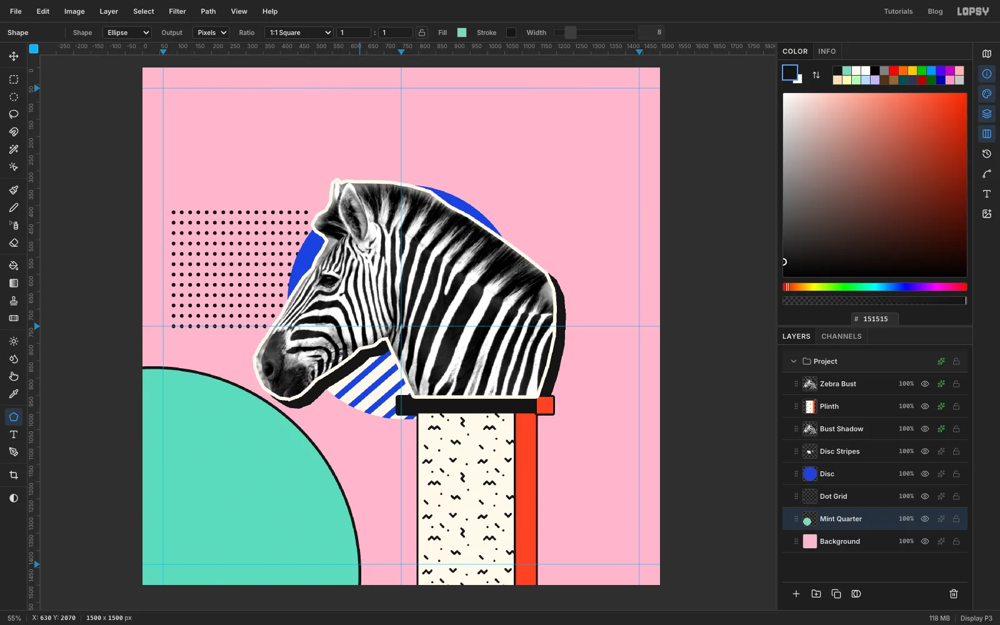

1. Click `Background`, then **Add Layer**. Name it `Mint Quarter`.
2. Pick the **Shape** tool ([[U]]). In the options bar set **Shape** to **Ellipse** and **Output** to **Pixels**. Click the **Fill** swatch and enter `7FD8BE`. Click the **Stroke** swatch and enter `151515`, then set **Width** to `8`.
3. The Shape tool grows shapes out from where you press. Zoom out ([[Cmd+-]]) so there's room below the canvas. Press near the bottom-left corner (`30, 1470`) and drag down and to the right, past the edge of the canvas, until the circle's top edge reaches about `y = 870`. That's a radius of 600 px. Only the quarter inside the canvas shows.

## Draw and tilt the yellow triangle

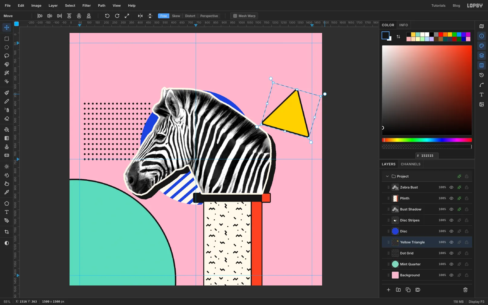

1. Click `Dot Grid`, then **Add Layer**. Name it `Yellow Triangle`. It sits under the disc and bust.
2. With the **Shape** tool, set **Shape** to **Polygon**, **Sides** to `3` and **Corner Radius** to `10`. Set the fill to `FFD33D` and keep the black 8 px stroke.
3. Press at the triangle's centre, `1315, 455`, and drag out to the corner of its box, 150 px down and right at `1465, 605`.
4. Draw a **Rectangular Marquee** around the triangle and switch to the **Move** tool. Grab the round rotation handle just outside the top-right corner and drag it clockwise by about 16°. Press [[Enter]], then [[Cmd+D]].

## Draw the lilac pill for the band name

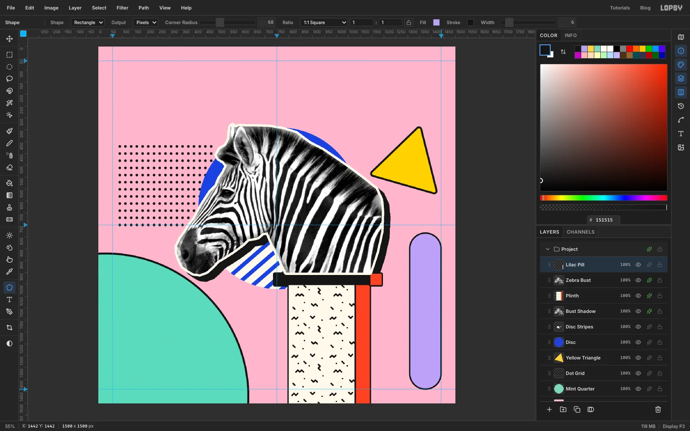

1. Click `Zebra Bust`, then **Add Layer**. Name it `Lilac Pill`.
2. With the **Shape** tool, set **Shape** to **Rectangle** and **Corner Radius** to `68`. Set the fill to `B9A2F2`, the stroke to `151515` and **Width** to `6`.
3. Press at the pill's centre, `1374, 1112`, and drag out to its bottom-right corner at `1442, 1442`. The pill ends 58 px from the right and bottom edges. You'll use that 58 px margin all round the cover.

## Draw a squiggle with the Pen

1. With `Lilac Pill` active, click **New Group** (the folder button) and name the group `Confetti`. Click **Add Layer** and name the new layer `Squiggle`. It goes inside the group.
2. Set the colour to `#151515`. Pick the **Pen** tool ([[P]]) and set **Stroke** in the options bar to `14`.
3. Make nine anchors down a vertical line near `x = 690`, from `y = 1060` to `y = 1430`, about 46 px apart. Put them alternately 24 px left and right of the line (`x = 666`, then `714`, and so on). At each anchor, press and drag straight down about 23 px. That pulls out the handles that make the curve smooth.
4. Press [[Enter]] to stroke the path with the colour. Then open the **Paths** panel (the curve icon in the right-hand strip) and delete the path, so its outline doesn't get in the way.

## Brush the confetti dashes

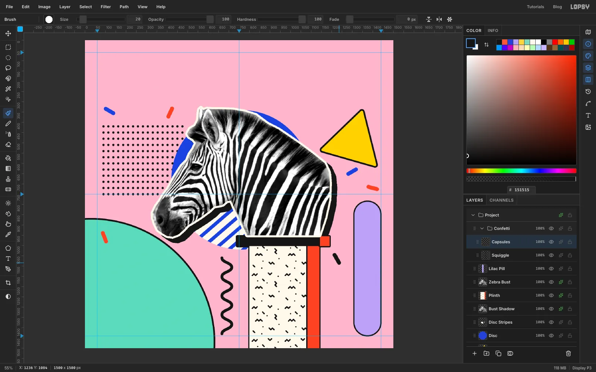

1. Click **Add Layer** and name it `Capsules`.
2. Pick the **Brush**, with **Size** `20` and **Hardness** `100`. Each dash is a short drag, about 44 px long. A round brush gives it rounded ends.
3. Scatter six dashes in the empty pink areas, at different angles:
   - cobalt `#2541D9` at the top left (`120, 345`) and under the triangle (`1300, 640`)
   - tomato `#FF5638` just left of the ears (`415, 352`), on the mint (`95, 960`) and above the lilac pill (`1400, 720`)
   - ink `#151515` between the plinth and the pill (`1225, 1065`)

Keep every dash at least 25 px away from other shapes. A dash that almost touches something looks like a mistake.

## Copy a ring with Copy and Paste

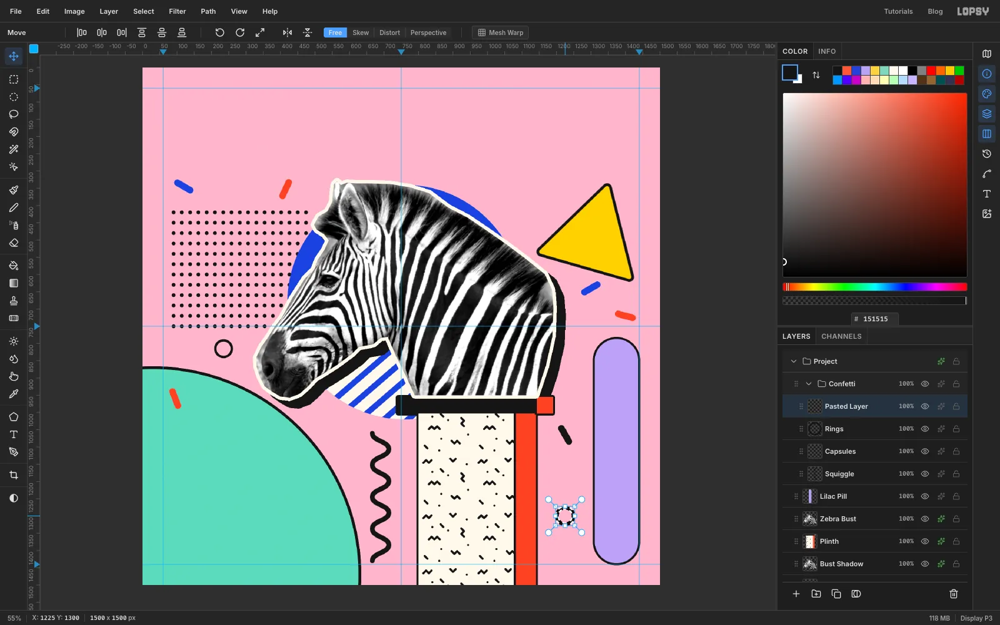

1. Click **Add Layer** and name it `Rings`.
2. With the **Shape** tool, set **Shape** to **Ellipse**. Click the **Fill** swatch and click **Remove fill**. Set the stroke to `151515` and **Width** to `7`.
3. Press at the ring's centre, `235, 815`, just under the dot grid, and drag 24 px down and right. That makes a ring 48 px across.
4. Draw a **Rectangular Marquee** around the ring and press [[Cmd+C]], then [[Cmd+V]]. The paste lands on its own layer, in place.
5. With the **Move** tool, drag the copy from its **middle** to `1225, 1300`, between the plinth and the pill. Press [[Enter]]. Don't grab it near the edge of its box: the edges are scale handles.

## Merge the copy back into the Rings layer

Press [[Cmd+D]], then choose **Layer → Merge Down**. The pasted ring joins the `Rings` layer, so the Confetti group holds just three layers.

## Set the OVERTURE label and the small type

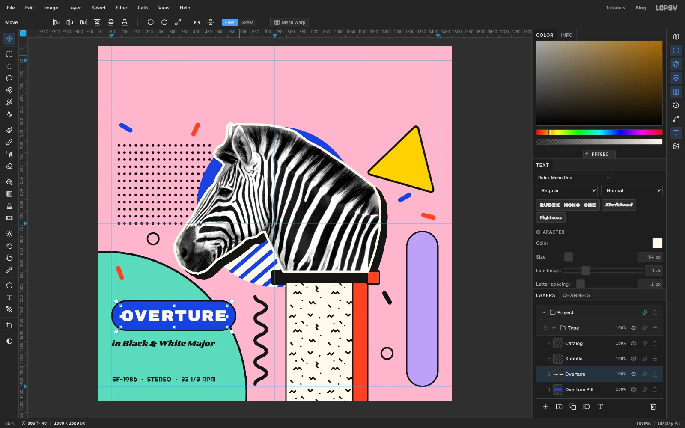

All the type goes in its own group on top of the artwork.

1. Click the collapse arrow on the `Confetti` group, then click the group row. Click **Add Layer** and name it `Type Anchor`. Because the group was collapsed, this layer lands above the group, not inside it.
2. Click **New Group** and name it `Type`. Click **Add Layer** and name it `Overture Pill`.
3. With the **Shape** tool, draw a **Rectangle** with **Corner Radius** `62`, fill `2541D9`, stroke `151515` and **Width** `6`. Press at the pill's centre, `322, 1140`, and drag out to `584, 1202`. That makes a pill 524 × 124 px.
4. Make the **credits line**. Pick the **Text** tool ([[T]]), choose **Righteous** at size `26` with **Align** on **Left**, and set the colour to `#151515`. Click near the bottom left, at `62, 1392`. Type `SF-1986  ·  STEREO  ·  33 1/3 RPM`, press [[Tab]] to finish, and rename the layer `Catalog`. In the **Text** panel set **Letter spacing** to `1`. Then nudge it with the Move tool so its left edge is at `x = 58`.
5. Make the **subtitle**. Click `Overture Pill` first. Choose **Shrikhand** at `36`, in `#151515`, aligned **Left**. Click at `62, 1235`, type `in Black & White Major`, press [[Tab]] and rename it `Subtitle`. Set **Letter spacing** to `0` and nudge its left edge to `x = 58`.
6. Make **OVERTURE**. Click `Overture Pill` first. Choose **Rubik Mono One** at `64` and set the colour to `#FFF8EC`. Click in empty space near the top of the canvas, type `OVERTURE`, press [[Tab]] and rename it `Overture`. Set **Letter spacing** to `2`. With the **Move** tool, drag it from the middle of its box down onto the pill, then nudge it with the arrow keys until it sits in the middle, with the same gap above and below the letters.

> **Tip:** Before each new text, click a non-text layer such as `Overture Pill`. If a text layer is active, changing the font or size restyles that text. Make each new text in empty space and then move it into place, because a click inside an existing text's box edits that text instead of starting a new one.

## Rotate the band name upright

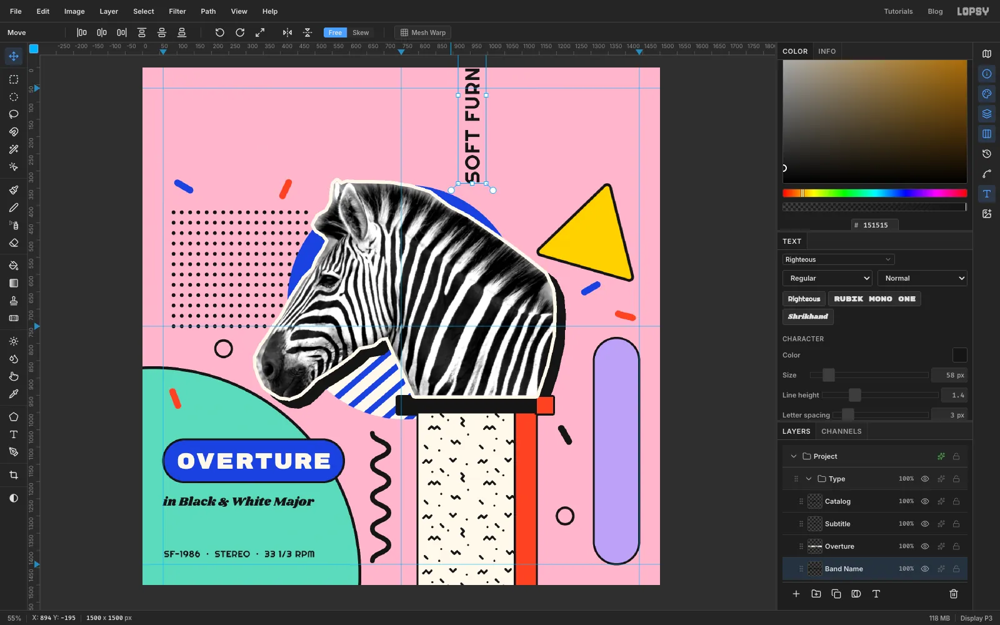

1. Click `Overture Pill` first. With the **Text** tool, choose **Righteous** at `58` in `#151515`. Click in empty space at the top of the canvas and type `SOFT FURNITURE`. Press [[Tab]], rename it `Band Name`, and set **Letter spacing** to `3`.
2. Switch to the **Move** tool. Hold [[Cmd]] and drag the rotation handle at the top-right corner counter-clockwise. Cmd snaps the angle to 15° steps, so you can land exactly on −90°. Press [[Enter]]. The text reads bottom to top, like the spine of a record.
3. Drag the text from the middle of its box onto the lilac pill, then nudge it with the arrow keys until it sits in the middle, with equal space at both ends and both sides.

## Type the title

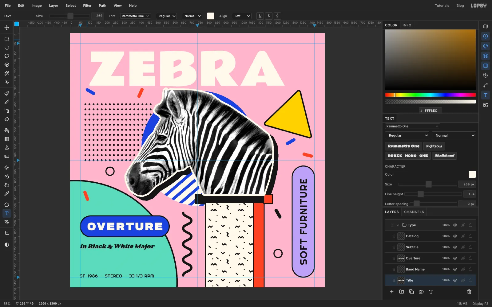

1. First, tidy the credits. Click `Catalog` and nudge it down with the **Move** tool until its bottom sits level with the bottom of the lilac pill (`y = 1442`).
2. Click `Overture Pill`. With the **Text** tool, choose **Rammetto One** at `260` in `#FFF8EC`, with **Letter spacing** `0`. Click near the top left and type `ZEBRA`. Press [[Tab]] and rename it `Title`.
3. With the **Move** tool, nudge the title so it sits just under the top margin guide, a few pixels left of the centre guide. Its shadow (next step) will push it 14 px to the right, and you want the whole block centred.

Cream on pink is hard to read. The next two steps fix that.

## Outline the title

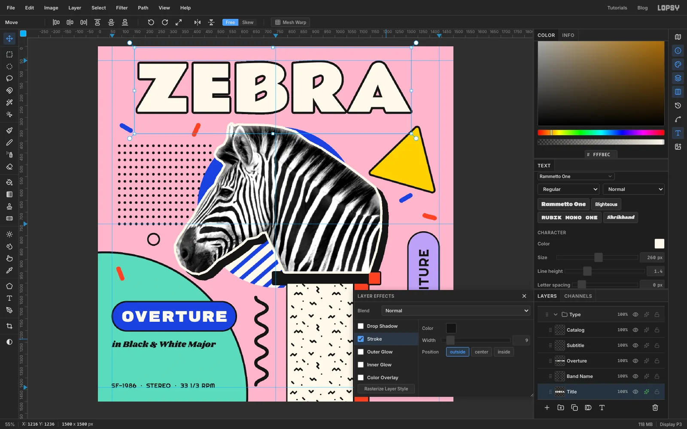

Open the effects drawer for the title, tick **Stroke**, and set **Width** to `9` and the colour to `#151515`. The letters still stay editable text.

## Give the title a cobalt block shadow

You'll use the same trick as the bust's shadow.

1. Click **Duplicate Layer** and rename the copy `Title Front`. As with the bust, line it up with the original if the copy was offset.
2. Click the original `Title` layer and rename it `Title Shadow`. Tick **Color Overlay** and set it to `#2541D9`. The black outline stays, so the shadow looks like the side of a block.
3. Nudge the shadow 14 px right and 14 px down.

## Group the label and tilt it

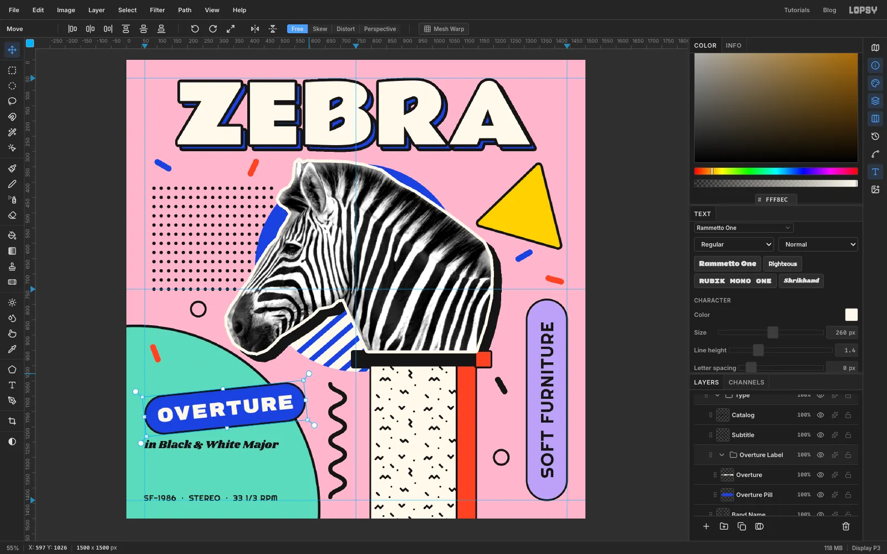

Memphis layouts are a little off-kilter. Tilting the label is enough to make the whole bottom-left corner feel looser.

1. Click `Overture Pill`, then [[Cmd]]-click `Overture` so both are selected.
2. Choose **Layer → Group Layers** and rename the group `Overture Label`.
3. With the group active, use the **Move** tool's top-right rotation handle to turn it about 6° counter-clockwise. Press [[Enter]]. The pill and its text turn together, and the text stays editable.

## Add print grain

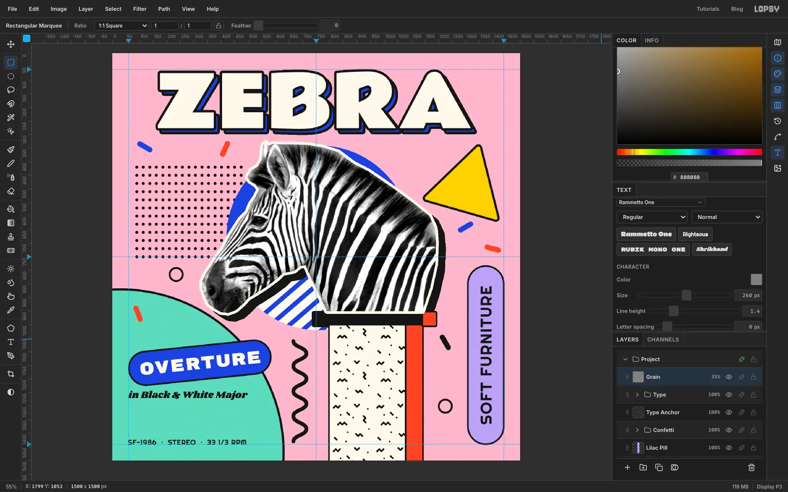

1. Collapse the `Overture Label` and `Type` groups, then click the `Type` group. Click **Add Layer** and name it `Grain`. It lands above everything.
2. Choose **Select → All**, fill with `#808080`, and press [[Cmd+D]].
3. Choose **Filter → Add Noise…**. Set **Amount** to `100`, click **Mono** and **Gaussian**, then click **Apply**.
4. In the effects drawer, set the blend mode to **Overlay**. Mid-grey disappears in Overlay, so only the speckles show. Set the layer's opacity to `35%`.

## Frame it with a border

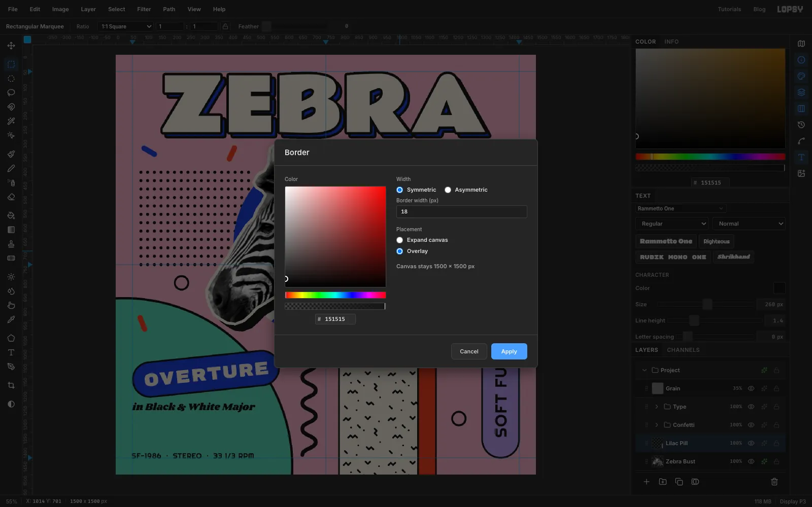

1. Click `Type Anchor` and delete it. It has done its job.
2. Set the colour to `#151515`.
3. Choose **Image → Border…**. Pick **Symmetric**, enter `18` for **Border width (px)**, and pick **Overlay**. Overlay keeps the canvas at 1500 × 1500 and adds a black frame layer on top. **Expand canvas** would add the border outside the artwork instead.
4. Click **Apply**.

Save the project with **File → Save Project**, and export it with **File → Quick Export PNG**.
