In 1981 a group of Milan designers led by Ettore Sottsass showed a collection of furniture under the name **Memphis**. It looked nothing like tasteful modern design: loud plastic laminates, clashing colours, squiggly prints and bookcases that seemed to be dancing. It went on to define the look of the 1980s, which makes it a good fit for an app about 80s aerobics.

This board presents **Rad Aerobics**, a made-up fitness app. The idea is a pun: three phone screens stand on a staircase, because it's a *step* class, and each step is one stage of using the app. Here's what makes it read as Memphis:

- flat, clashing colour with heavy black outlines
- a different laminate pattern on every surface
- hard shadows with no blur
- a black and white photo cut out like a paper collage

The board is 2400 × 1800 px and holds a tilted headline, a concentric arch, three working-looking app screens, a staircase in three patterns, and a halftone dancer who kicks out of her phone.

You'll need one photo from Wikimedia Commons: [Aerobics class.jpg](https://commons.wikimedia.org/wiki/File:Aerobics_class.jpg) by Bill Branson, released by the National Cancer Institute and in the **public domain**. It shows a class at a senior centre, with a woman in a blue tracksuit kicking in the foreground. Download the full-size version (2700 × 1800).

The tools you'll use:

- **Show Seamless Pattern**, **Define Pattern**, **Fill with Pattern** and **Define Brush**
- the **Shape** tool's exact-size dialog, with corner radius and stroke
- the marquees' exact-corners dialog
- the **Pen** tool with **Path to Selection**, for straight-edged shapes
- **Quick Selection**, the **Lasso** and the **Magic Wand**, and adding and subtracting from a selection
- layer masks, **Convert mask to selection**, **Copy** and **Paste**
- **Select → Feather**, **Grow**, **Shrink** and **Inverse**
- **Dodge/Burn**, **Desaturate**, **Brightness/Contrast** and **Halftone**
- the Brush's **Radial Symmetry**
- live text in three Google fonts, including rotating live text
- scaling two layers at once, rotating a group, duplicating a group, and **Merge Down**
- layer effects: **Stroke**, **Drop Shadow** and **Color Overlay**

The palette is the kind of thing Memphis laminates were made of:

- Wall mint `#5FDDC8`
- Coral `#FF5A4E`, canary `#FFD21F`, pink `#FF9CC2`
- Cobalt `#2438D8`, lilac `#B79CFF`
- Ink `#111114`, paper `#FFF9EC`

> **Tip:** On a wide-gamut (Display P3) screen, Lopsy reads typed hex codes as P3 colours. These codes were picked on one, so on an sRGB screen they come out a touch duller.

> **Note:** Shortcuts are written for a Mac. On Windows, [[Ctrl]] works for keyboard shortcuts and for clicking a layer thumbnail. Where this tutorial holds [[Cmd]] while dragging a handle, or [[Cmd]]-clicks on the canvas, use the [[Win]] key.

> **Tip:** Patterns and custom brush tips don't survive a reload or a reopened project. Build the tiles and the staircase in one sitting, without reloading the tab.

## Draw a squiggle tile

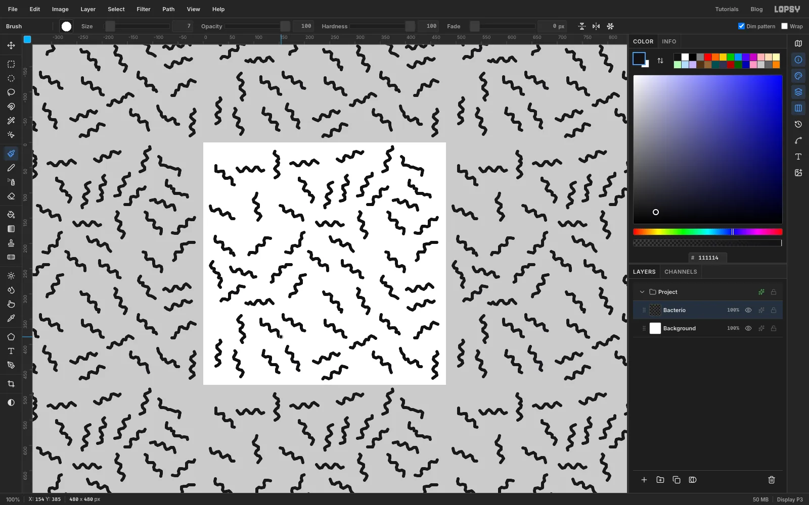

The squiggle print is a nod to *Bacterio*, the laminate Sottsass designed in the late 1970s and later used on Memphis furniture. You'll draw one square of it and repeat it.

Choose **File → New**, make a document **480** × **480** and leave the background White. Click *Layer 1* and rename it *Bacterio*. Turn on **View → Show Seamless Pattern**, so you can see the tile repeating while you draw.

Pick the **Brush** (B). Click the brush-tip thumbnail at the left of the options bar to open the Brushes window, choose **Hard Round**, and set Size to **7** and Spacing to **5**. Set the foreground to ink `#111114`.

Paint about 55 short wiggles, each roughly 70 px long, pointing in every direction. Two rules make it look right:

- Don't let any wiggle touch another. Real Bacterio is evenly spaced, and crossings look like mistakes.
- Stay about 8 px inside the tile's edges, so nothing gets cut off at a seam.

Look at the grey repeats. If you can see a bald patch or a clump, undo a few wiggles and redo them.

With *Bacterio* active and nothing selected, choose **Edit → Define Pattern**. The tile is saved with its transparent background, so you can fill it over any colour.

## Cut a stripe tile with the Pen

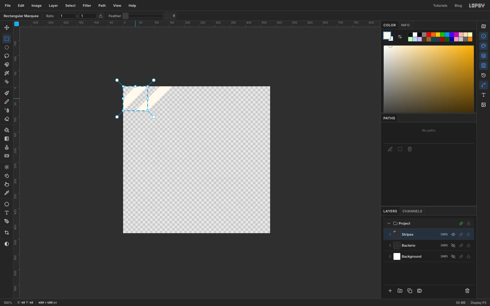

You'll use the Pen for every straight-edged shape in this project, because the Lasso is freehand. Here's the recipe, which later steps call a **Pen shape**:

1. Pick the **Pen** (P) and click each corner.
2. Click the first anchor again to close the path.
3. In the **Paths** panel (the curve icon in the strip on the far right), click **Path to Selection**.
4. Click **Delete Path**, so your next click starts a new path. The selection stays.

Turn **View → Show Seamless Pattern** off. Add a layer called *Stripes*. Click the eye icons on *Bacterio* and *Background* to hide them, so the stripes show up against the checkerboard. Set the foreground to paper `#FFF9EC`.

This is one place where exact numbers matter, because the stripes have to meet at the tile's edges. The status bar shows your cursor's position as you move. Zoom in on the top left corner and make a Pen shape with corners at **40, 0**, **80, 0**, **0, 80** and **-40, 80**. That last one is off the canvas, which is fine. Choose **Edit → Fill**.

Make a second Pen shape at **120, 0**, **160, 0**, **80, 80** and **40, 80**, and fill it too.

Press [[Cmd+D]]. Pick the **Rectangular Marquee** and click once on the canvas without dragging. With nothing selected, that opens a dialog for exact corners. Enter From **0, 0** and To **80, 80**. Choose **Edit → Define Pattern**, which saves only what's inside the marquee.

## Start the board and drop three guides

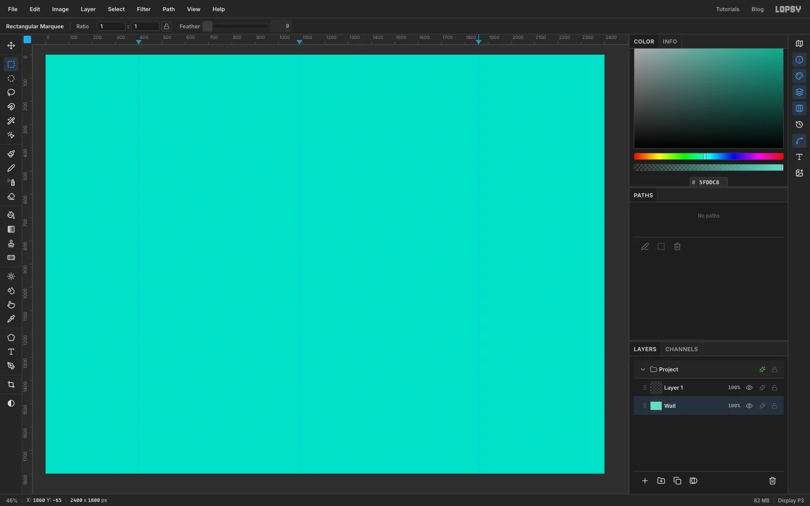

Press [[Cmd+D]], choose **File → New**, and make the board **2400** × **1800** with a White background. Your two patterns carry over to the new document.

Click *Background*, rename it *Wall*, set the foreground to mint `#5FDDC8` and choose **Edit → Fill**.

Click the top ruler at **400**, **1090** and **1860** to drop three vertical guides. These are the centre lines of your three phones.

## Add a blue disc with squiggles

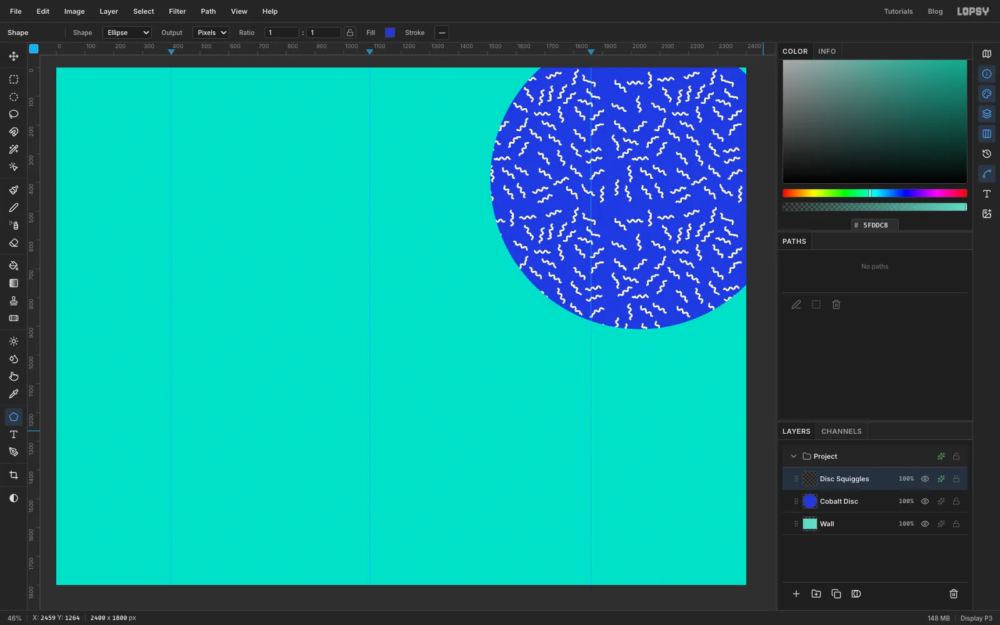

Click *Layer 1* and rename it *Cobalt Disc*.

Pick the **Shape** tool (U). Set Shape to **Ellipse**, Output to **Pixels**, Fill to cobalt `#2438D8` and Stroke to none. Click once towards the top right of the canvas, and in the size dialog enter **1040** × **1040**. The shape appears centred on your click, and you want it running off the top and right edges. If it's not quite there, pick the **Move** tool (V) and drag it.

[[Cmd]]-click the *Cobalt Disc* thumbnail in the Layers panel to load its shape as a selection. Click **Add Layer** and name the new layer *Disc Squiggles*.

Choose **Edit → Fill with Pattern…**, pick your squiggles and leave Scale at **100**. Click **Apply**, then press [[Cmd+D]].

The squiggles are black, and you want them cream. Click the layer's effects button, tick **Color Overlay** and set it to paper `#FFF9EC`.

## Build the concentric arch

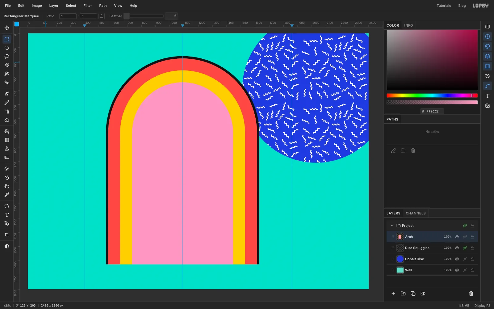

Add a layer called *Arch*. An arch is a circle with a rectangle underneath it, and you'll build it four times, from the largest down. The bands only look right if they're concentric, so use the exact-corners dialog rather than dragging.

For each band below, set the foreground colour, then:

1. With the **Elliptical Marquee**, click once and type the circle's corners. Choose **Edit → Fill**, then press [[Cmd+D]].
2. With the **Rectangular Marquee**, click once and type the rectangle's corners. Fill it and press [[Cmd+D]].

The bands, as From and To corners:

- Ink: circle **550, 160** to **1630, 1240**, rectangle **550, 700** to **1630, 1625**
- Coral: circle **566, 176** to **1614, 1224**, rectangle **566, 700** to **1614, 1625**
- Canary: circle **650, 260** to **1530, 1140**, rectangle **650, 700** to **1530, 1625**
- Pink: circle **734, 344** to **1446, 1056**, rectangle **734, 700** to **1446, 1625**

## Add a lilac peak

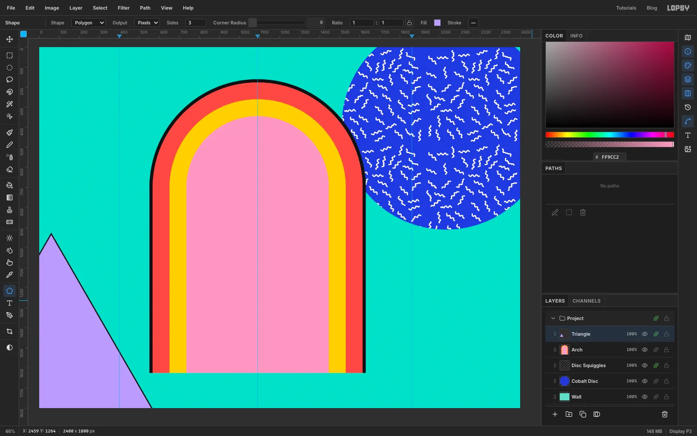

Add a layer called *Triangle*. With the **Shape** tool, set Shape to **Polygon**, Sides to **3**, and Fill to lilac `#B79CFF`.

Click near the lower left corner and enter **1120** × **1120**. With the **Move** tool, drag it so its point sits about halfway down the canvas, about 60 px in from the left edge, and its base runs off the bottom.

Open the layer's effects and add a **Stroke**: Width **6**, ink, position **inside**. The rest of the board has heavy outlines, and without one this shape looks like something left behind.

## Block out the staircase

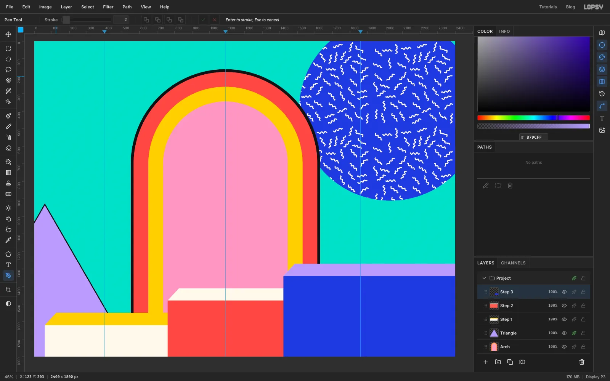

Each step is a flat front with a slanted top, which gives you a simple 3D look. Each one goes on its own layer, and each is about 140 px taller than the last. Draw the fronts with the **Rectangular Marquee**, and the tops as Pen shapes: a parallelogram 70 px tall that leans 65 px to the right.

**Step 1.** Add a layer called *Step 1*. Draw the front from about 60 px in from the left edge to about a third of the way across, and from 180 px above the bottom of the canvas down past the bottom edge. Fill it with paper. Make the top as a Pen shape sitting on the front, and fill it with canary. Press [[Cmd+D]].

**Step 2.** Add a layer called *Step 2*. Start its front where Step 1 ends and make it about 660 px wide, with its top about 320 px above the bottom of the canvas. Fill it with coral, then make the same leaning top and fill it with paper.

**Step 3.** Add a layer called *Step 3*. Start its front where Step 2 ends, run it off the right edge, and put its top about 460 px above the bottom of the canvas. Fill it with cobalt. Make its top run off the right edge and fill it with lilac.

## Give the steps their laminates

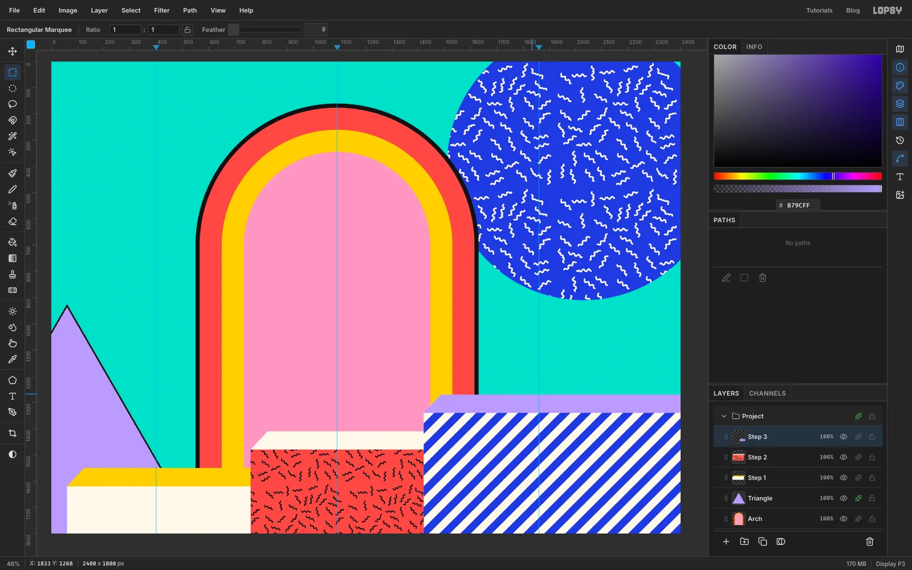

Click *Step 2* and marquee just its coral front. Choose **Edit → Fill with Pattern…**, pick the squiggles, and set Scale to **67** and Row Stagger to **50**. Staggering the rows hides the repeat. Apply and deselect.

Click *Step 3*, marquee its cobalt front and run **Fill with Pattern** with your stripe tile at Scale **100**. Apply and deselect.

Painting the stripes directly on the step's own layer matters here. If they sit on a layer above, they'll cover the outline you're about to add.

## Paint terrazzo with a custom brush

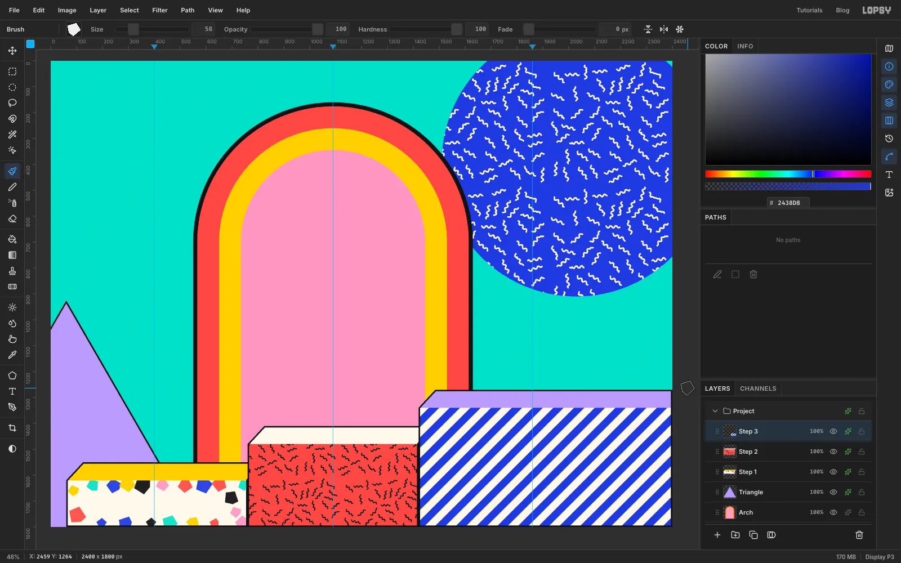

Terrazzo is stone chips set in a pale floor, and you can paint it with a brush tip shaped like a chip.

Add a temporary layer. With the **Lasso**, draw an irregular five-sided chip about 90 px across and fill it with ink. Choose **Edit → Define Brush…**, name it *Shard*, then press [[Cmd+D]] and delete the temporary layer.

Click *Step 1*. In the Brushes window, set Angle Jitter to **100** and Scatter to **0**, then close it. Marquee the cream front of the step, so nothing paints outside it.

Now click once for each chip, changing the foreground colour as you go. Use coral, cobalt, ink, mint, pink and canary in turn. Every few chips, change Size in the options bar to something between **40** and **70**, because Size Jitter only works along a stroke and has no effect on single clicks. Leave a gap between chips, and keep them to the outer edges of the step: you'll need clear space across the middle for a label. About 45 chips is plenty. Deselect.

Finally, click each step in turn and add a **Stroke**: Width **6**, ink, position **inside**.

## Stand three phones on the steps

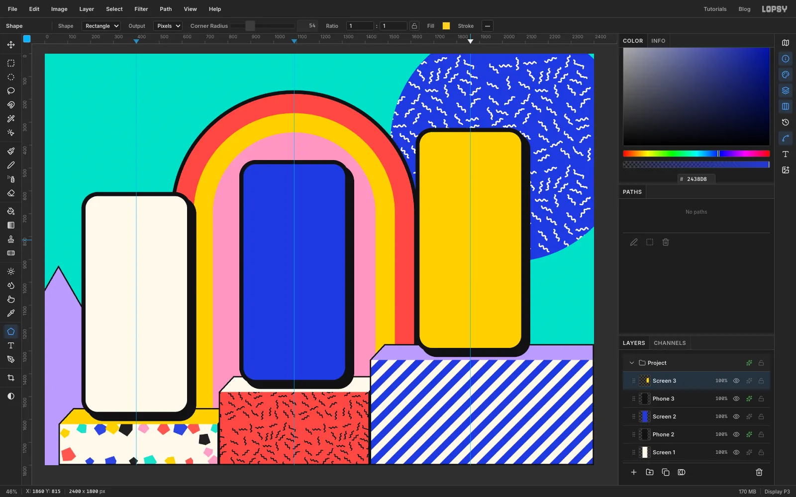

Click *Step 3*, so the phones land above all the steps. For each phone you'll make two layers, a body and a screen.

Add a layer called *Phone 1*. With the **Shape** tool, set Shape to **Rectangle**, Fill to ink, Stroke to none and Corner Radius to **72**. Click on the left guide and enter **480** × **980**. With the **Move** tool, drag it so its base is halfway across the top surface of Step 1. Pink alignment lines appear as you drag, to show when you're centred on something.

Add a **Drop Shadow** with Offset X **22**, Offset Y **22**, Blur **0**, Spread **0**, Opacity **100**, in ink. Blur 0 gives you the hard, printed-looking shadow that suits this style.

Add a layer called *Screen 1*. With the Shape tool, set Fill to paper and Corner Radius to **54**, click in the centre of the body, and enter **444** × **944**.

Repeat for the other two, on the middle and right guides, with each standing on its own step:

- *Phone 2* and *Screen 2*, with a cobalt screen
- *Phone 3* and *Screen 3*, with a canary screen

## Drop in the photo

Click *Screen 3*, then drag **Aerobics class.jpg** from your desktop onto the canvas. It lands on a new layer, scaled to fit. Rename the layer *Dancer*.

A dropped image comes in with a selection around it, and that matters for the next step: Quick Selection adds to whatever is already selected. Press [[Cmd+D]] now.

## Select the tracksuit with Quick Selection

Pick **Quick Selection** from the toolbox. Set Size to **20**, Tolerance to **46** and Edge Strength to **40**.

Her tracksuit is a strong blue against a duller room, so this tool does most of the work. Paint short strokes well inside the blue: one down the torso, one along each sleeve, one down each trouser leg. Each stroke grows the selection to the edges of the colour. Keep your strokes on the blue. A single stroke that touches the floor will select the whole room, and you'd need to undo it.

It won't be perfect. It picks up some blue and dark clothing from the people behind her, and you'll fix that next.

## Add her head, hands and shoes with the Lasso

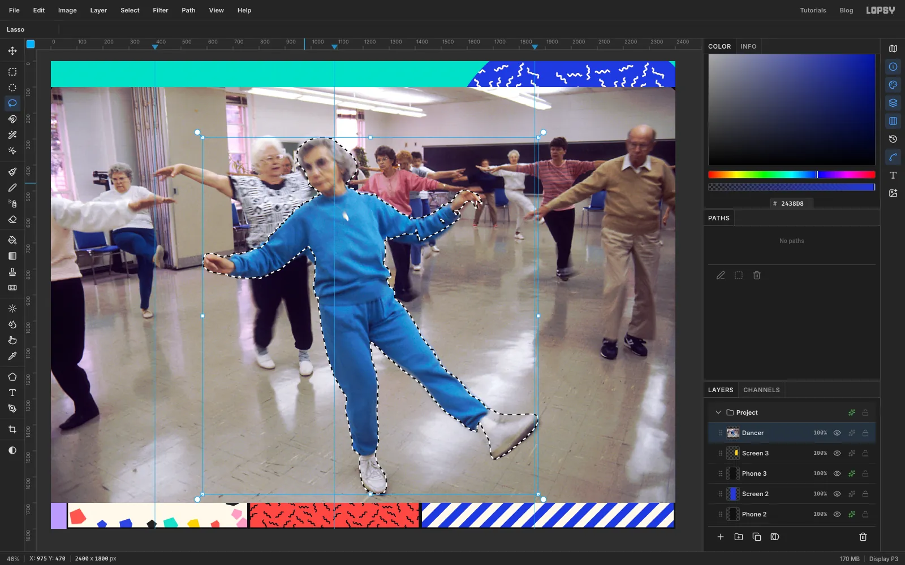

Pick the **Lasso**, and zoom in to around 200% so you can follow the edges. If a shape goes wrong, [[Cmd+Z]] takes back only that shape.

**Adding.** Hold [[Shift]] and trace each part that isn't blue. Take your time on these, because the outline you draw is the outline you'll see in the final design:

- her head, around the outside of the hair and into the collar
- each hand, following the fist on the left of the photo and the fingers on the right
- both shoes, overlapping the trouser cuffs
- the pendant on her sweater, which Quick Selection left as a hole

**Subtracting.** Hold [[Alt]] and draw around anything that doesn't belong:

- under the sleeve on the right of the photo, where another woman's blue trousers got picked up
- along the arm and hip on the left of the photo, where there's a strip of dark trousers
- the bit of patterned shirt beside her cheek and neck

To close small gaps, choose **Select → Grow…** at **2**, then **Select → Shrink…** at **2**.

## Turn the selection into a layer mask

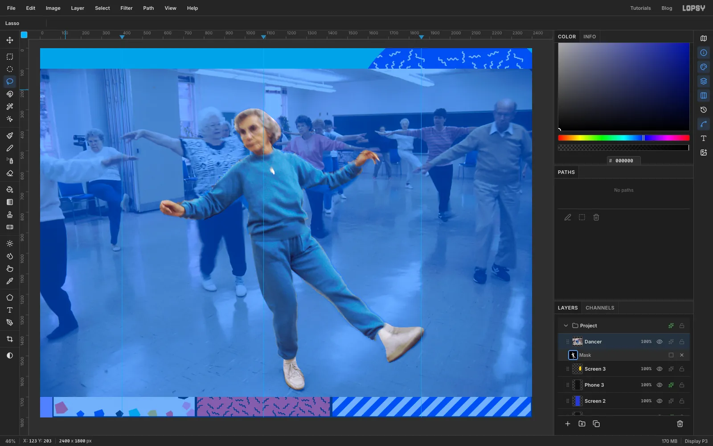

Using a mask means you can check the cut against the board and fix it without losing any of the photo.

With *Dancer* active, click **Add Mask** in the Layers panel. A new mask starts out showing everything, whatever you have selected, so you need to hide the rest yourself.

Click the mask thumbnail to edit the mask. Choose **Select → Inverse** to select the room, set the foreground to black and choose **Edit → Fill**. Press [[Cmd+D]]. The blue tint you can see is the mask overlay, which only shows while you're editing the mask.

## Lift the cut-out onto its own layer

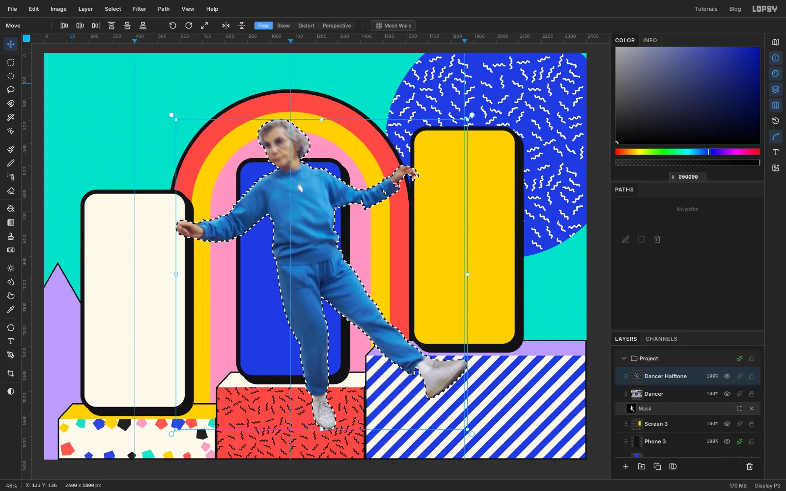

A layer mask stays put when you scale the layer's pixels, so you need the cut-out as real pixels on its own layer.

Click **Convert mask to selection** on the mask row. This selects the area the mask *hides*, so choose **Select → Inverse** to select the woman instead. Choose **Edit → Copy**, then **Edit → Paste**. The cut-out lands right on top of the original. Rename the new layer *Dancer Halftone*.

## Give her a smooth die-cut outline

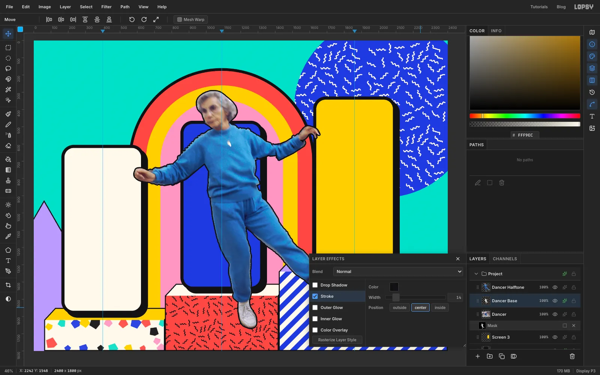

The edge from the selection is a bit lumpy, and a heavy outline would show every lump. Here's a way to smooth it: feather the shape, then let a stroke trace it.

Click *Dancer* and add a layer called *Dancer Base*, so it sits between the photo and the cut-out. [[Cmd]]-click the *Dancer Halftone* thumbnail to load the figure's shape, then choose **Select → Feather…** at **5**. Set the foreground to paper and choose **Edit → Fill**. Press [[Cmd+D]].

Add a **Stroke** to *Dancer Base*: Width **14**, ink, position **center**. A stroke follows the middle of a soft edge, so the feather rounds off the lumps. A centred stroke also covers the blurry part of that edge, which would otherwise show as a grey ring.

Click **Rasterize Layer Style** to bake it in. Doing this while the figure is still big means it stays smooth when you scale it down.

## Scale the figure and its outline together

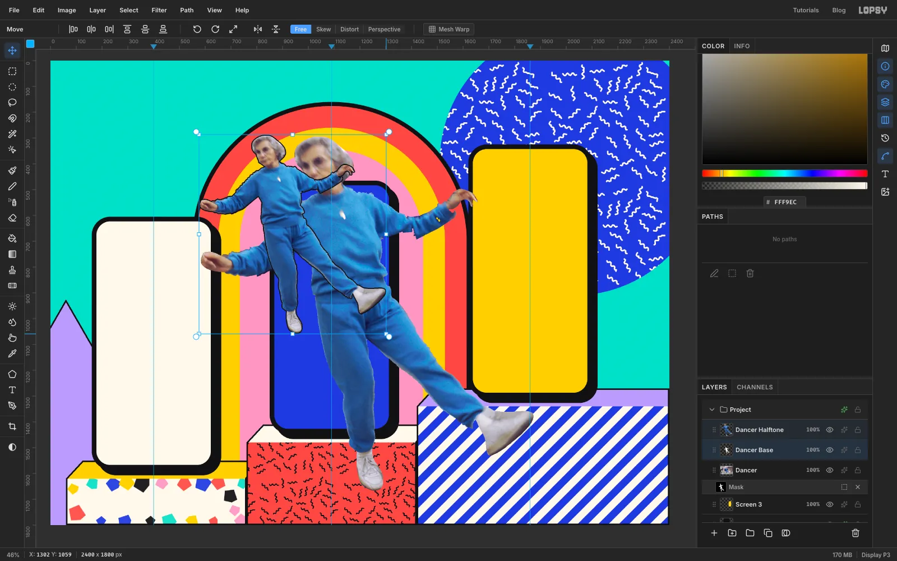

Click *Dancer Base*, then [[Shift]]-click *Dancer Halftone* so both are selected. Press [[Cmd+D]] if there's still a selection, then pick the **Move** tool. The handles now frame both layers together.

Hold [[Cmd]] to keep the proportions, and drag the bottom right corner handle inward until the figure is about **56%** of its size. Her outline should end up roughly 730 px wide.

## Place her on the middle phone

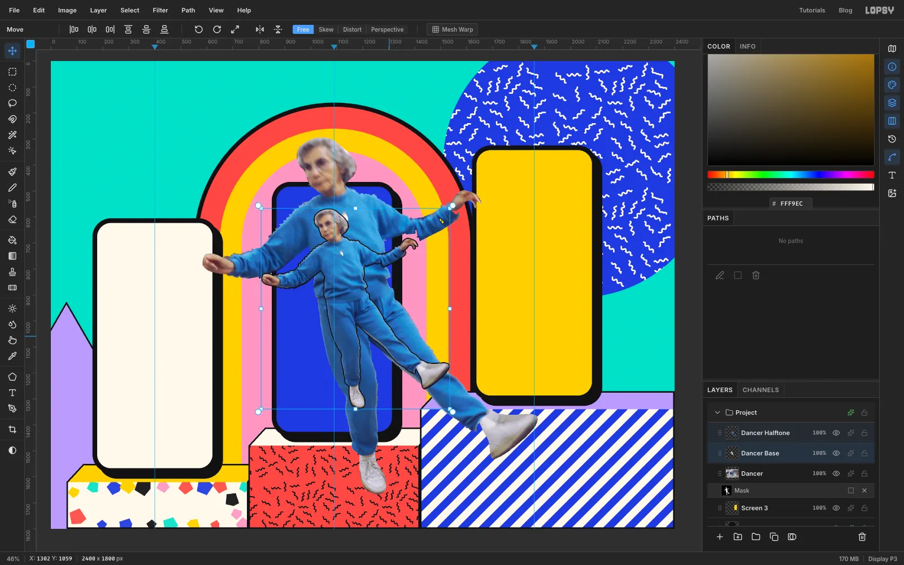

With both layers still selected, drag the figure onto the middle phone, and use the arrow keys for the fine positioning.

Her head should sit about 100 px below the top of the phone, because a notch goes there later. Her standing foot should end about 90 px above the bottom of the screen, because she'll be standing on a button you'll add there. The hand on the left should poke out over the phone's edge, and her kicking shoe should reach well past the other edge, without touching Phone 3.

Now click the *Dancer* photo layer and click **Delete Layer**.

> **Tip:** Delete the photo only after you've scaled her. Scaling a layer pasted from a masked photo doesn't currently work once the photo is gone.

## Add a solid shadow and set the contrast

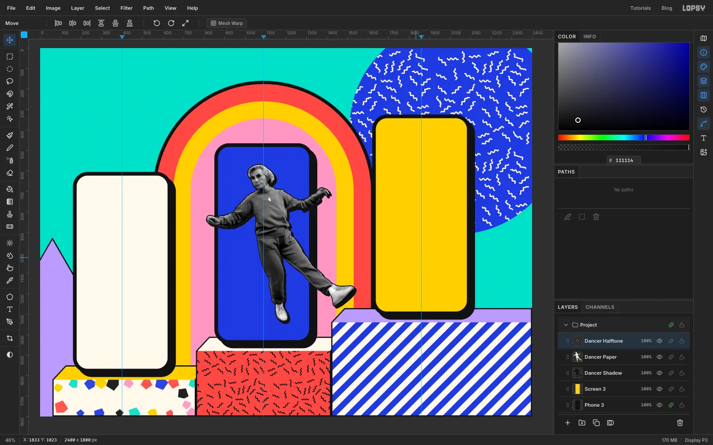

Click *Dancer Base* and choose **Layer → Duplicate Layer**. Name the copy *Dancer Paper*, and rename the original *Dancer Shadow*.

[[Cmd]]-click the *Dancer Shadow* thumbnail, set the foreground to ink, choose **Edit → Fill**, then press [[Cmd+D]]. With the **Move** tool, press the arrow keys to nudge it about **9** px right and **9** px down.

This does the same job as a Drop Shadow, but it's a plain shape, so you get solid ink all the way to the edge.

Click *Dancer Halftone*. Choose **Filter → Desaturate**, then **Filter → Brightness/Contrast…** with Brightness **-12** and Contrast **58**.

## Bring her face back with Dodge and Burn

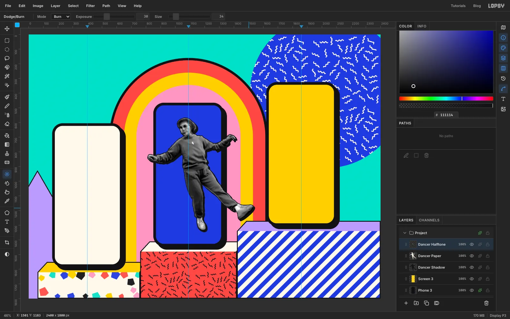

The photo is slightly motion-blurred, so at this size her face and hair blend into the same grey. Halftone dots will make that worse, so fix it first. Zoom in on her head and pick **Dodge/Burn** (O).

- **Lighten the skin.** Mode **Dodge**, Exposure **22**, Size **26**. Paint once over her forehead, down her cheek and along her jaw.
- **Darken the hair.** Mode **Burn**, Exposure **45**, Size **30**. Paint a couple of arcs right around the hair, so it reads as a dark mass around a light face.
- **Draw the features.** Still Burn, Exposure **35**, Size **12**. Add one short stroke over each eye, one down the side of the nose and one along the mouth.
- **Shape the shoes.** Still Burn, Exposure **30**, Size **34**. Paint along the sole and heel of each shoe. Otherwise they go solid white and look like socks.

## Print her as a halftone

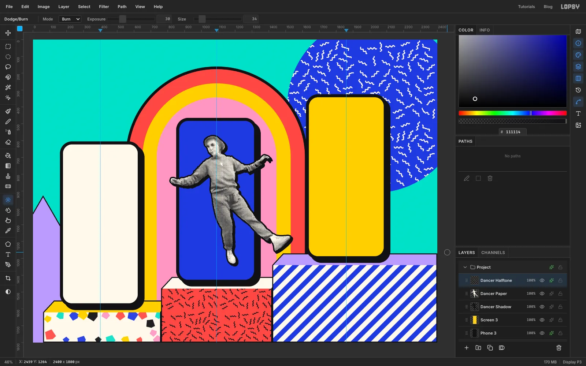

With *Dancer Halftone* still active, choose **Filter → Halftone…** with Dot Size **6**, Density **1.05**, Angle **45** and Softness **0.5**. White areas print no dots, so the paper layer shows through.

The dots keep some of the photo's grey, and you want them black. Add a **Color Overlay** in ink.

Zoom to 100% to judge it. Don't judge halftone when zoomed out, because the dots blend together on screen and it just looks grey.

## Add the status bar and title

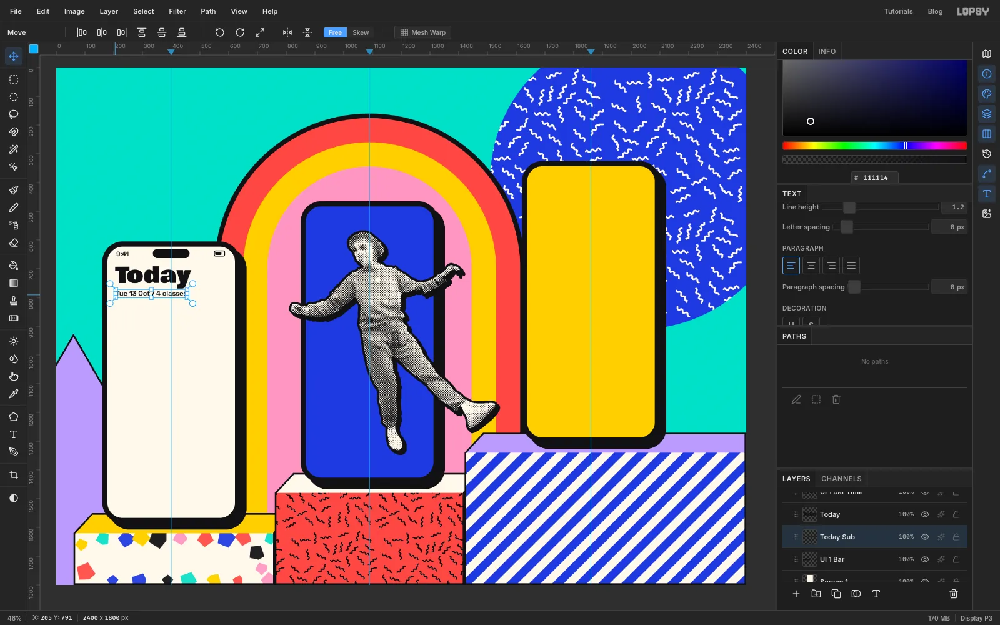

Now for the screens. Click *Screen 1*, so what you add stays below the later phones and the dancer.

Three text rules apply from here on:

- **Colour.** New text takes the foreground colour, so set it before you type.
- **Settings carry over.** Letter spacing, Line height and Align all stick from one text layer to the next, so check them. Line height and Letter spacing are in the **Text** panel, the T icon in the strip on the far right. Keep Letter spacing at **0** and Align on left unless a step says otherwise.
- **Where you click.** Before typing new text, click a non-text layer in the Layers panel, because with a text layer active the settings change that layer instead. Click well away from existing text too, because a click inside another text box edits that text. Line boxes reach further than the letters do.

**Status bar.** Add a layer called *UI 1 Bar*. With the **Shape** tool draw an ink notch, **128** × **32** with Corner Radius **16**, centred at the top of the screen. Add a tiny battery at the top right: a **36** × **18** rectangle with no fill, an ink stroke of Width **3** and Corner Radius **5**, and a solid ink **22** × **10** rectangle inside it, with Corner Radius **2** and no stroke. Then pick the **Text** tool and type *9:41* in ink at the top left, in **Space Grotesk**, Bold, Size **22**.

**Title.** Type *Today* in **Bowlby One** at Size **76**, with Line height **1**. Below it, type *Tue 13 Oct / 4 classes* in Space Grotesk Bold at **24**, with Line height **1.2**. Commit each with [[Tab]].

To position text, pick the **Move** tool and drag it, or use the arrow keys for small moves.

## Add the week strip

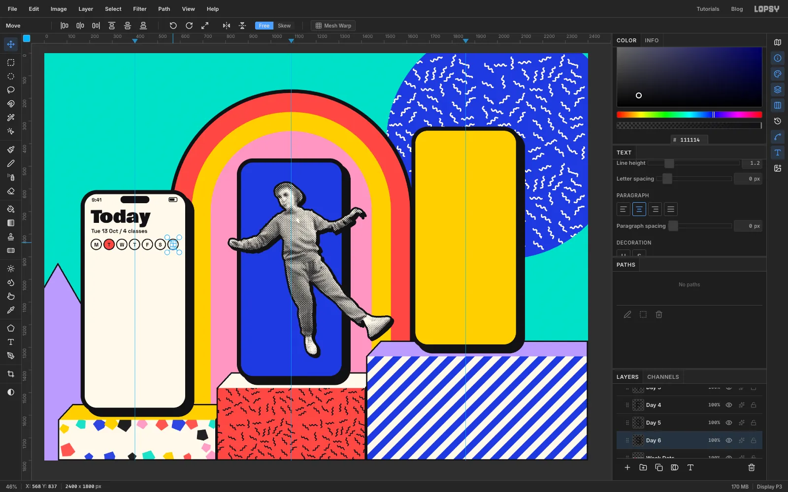

Add a layer called *Week Dots*. Set the Shape tool to **Ellipse**, Fill paper, Stroke ink, Width **4**. Click to make seven circles **46** × **46**, with their centres about 56 px apart. Then set Fill to coral and draw another on top of the second circle, for today.

Set the foreground to ink. Add a letter on each circle (M T W T F S S) in Space Grotesk Bold at **22**, with Align set to center. Click *Week Dots* before typing each one.

## Build one class card

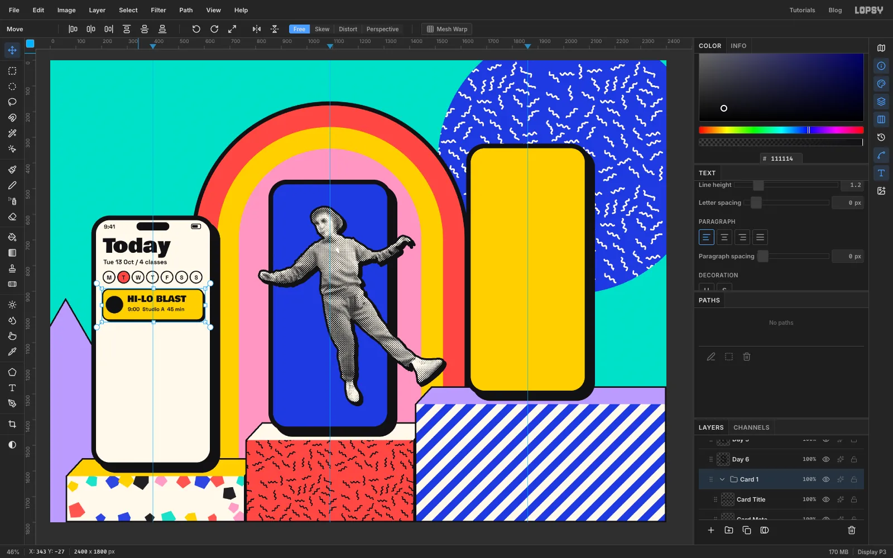

Click *Week Dots* and add a layer called *Card BG*.

With the Shape tool set to **Rectangle**, Corner Radius **24**, first draw the shadow: Fill ink, no stroke, **392** × **120**. Then draw the card itself, 8 px up and to the left of the shadow: Fill canary, Stroke ink, Width **5**, same size.

Add a layer called *Card Disc* and draw an ink circle **68** × **68** near the card's left end, leaving about 12 px of space around it.

With Align back on left and the foreground on ink, type the title *HI-LO BLAST* in Bowlby One at **33**, to the right of the disc. Then click *Card Disc* and type *9:00  Studio A  45 min* in Space Grotesk Bold at **21** below it. Rename them *Card Title* and *Card Meta*.

Click *Card BG*, [[Shift]]-click *Card Title*, and choose **Layer → Group Layers**. Name the group *Card 1*. Check that all four layers are inside it.

## Duplicate the card three times

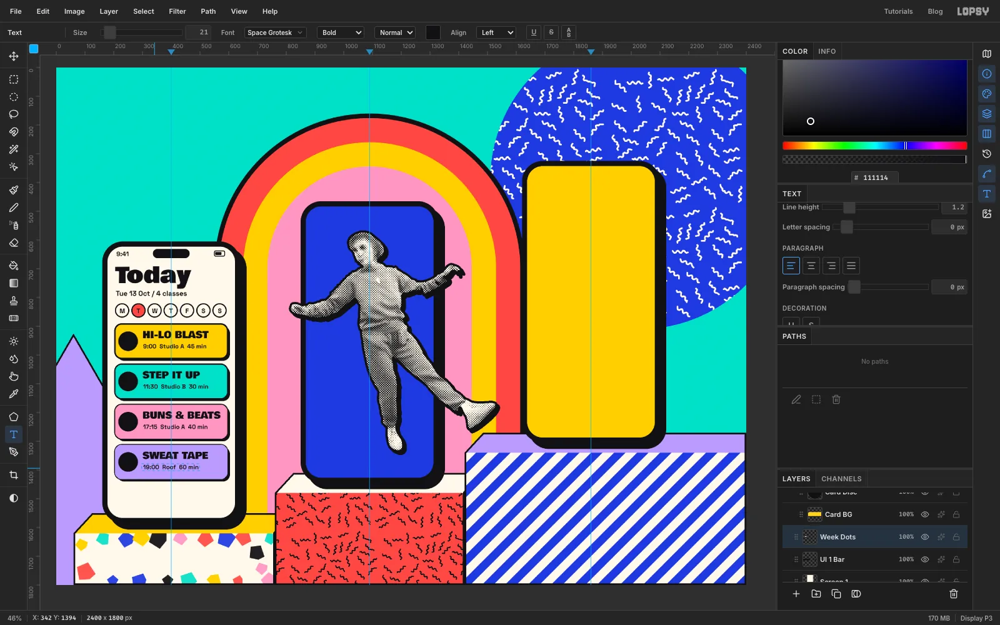

With *Card 1* active, choose **Layer → Duplicate Layer** and name the copy *Card 2*. With the **Move** tool, drag it straight down about 140 px, so it clears the card above by about 20 px.

Expand the group and click its *Card BG…* row. Pick the **Magic Wand** (W) and click the yellow inside the card. Choose **Select → Grow…** at **1**, so the fill reaches under the outline. Set the foreground to mint, choose **Edit → Fill**, and press [[Cmd+D]].

To change the words, pick the **Text** tool, click on the title, press [[Cmd+A]], type *STEP IT UP*, then press [[Tab]]. Do the same for the time line, typing *11:30  Studio B  30 min*. The font and size stay as they were.

Duplicate the newest card twice more the same way:

- pink, *BUNS & BEATS*, *17:15  Studio A  40 min*
- lilac, *SWEAT TAPE*, *19:00  Roof  60 min*

## Add icons and a nav bar

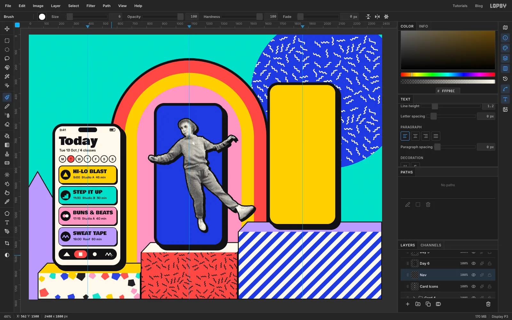

Collapse *Card 4* with the arrow on its row and click the row. Then add a layer called *Card Icons*, which lands directly above the group rather than inside it.

Memphis loves plain geometry, so keep each icon to basic shapes about 36 px across, in the card's colour:

- a canary triangle, as a Pen shape
- three small mint marquee rectangles, stepping up
- two small overlapping circles, one pink and one paper, with the Elliptical Marquee
- a lilac zigzag, with the **Brush**

For the zigzag, the Brush still has your Shard tip. Open the Brushes window, choose **Hard Round**, set Size to **7**, and set Angle Jitter back to **0**. Click once, then [[Shift]]-click each corner to draw straight lines between them.

Add a layer called *Nav*. Draw an ink pill **396** × **76** with Corner Radius **38** under the cards. Add a coral highlight **88** × **52**, Corner Radius **26**, on the second icon's spot. Then add four small paper icons along it: a triangle as a Pen shape, a marquee square, an elliptical marquee circle and a Brush zigzag at Size **6**.

## Design the hero screen

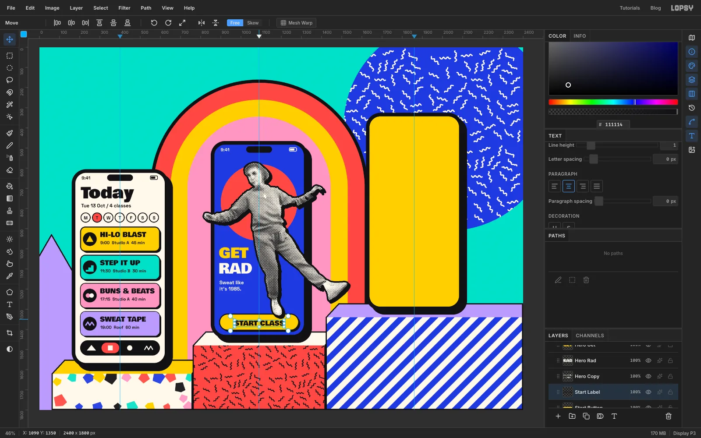

Click *Screen 2*, then repeat the status bar in paper instead of ink. Everything here goes under the dancer, so it's fine to place it right behind her.

**Sun.** Add a layer called *Hero Disc*. Draw a coral circle **380** × **380** centred on the phone, sitting behind her head and shoulders. Leave blue around all sides of it, including above, so it doesn't touch the notch.

**Headline.** In the empty space below the arm on the left, type *GET* in canary and then *RAD* in paper, both Bowlby One at **70**, on separate text layers. Below them, type two lines, *Sweat like* and *it's 1985.*, in Space Grotesk Bold at **25**, paper. Leave a clear gap between the type and her leg.

**Button.** Add a layer called *Start Button*. Draw it the same way as the cards: an ink shadow, then a canary pill **392** × **80** with Corner Radius **40** and Stroke ink **5**. Slide it up under her foot, so the shoe overlaps the top of the button by about 16 px. Set the foreground to ink and type *START CLASS* in Bowlby One at **33**, with Align set to center, and centre it in the button.

## Draw the timer's ticks with Radial Symmetry

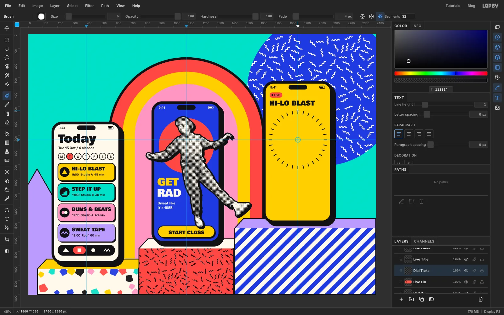

Click *Screen 3* and add the status bar in ink.

Add a layer called *Live Pill*. Draw a coral pill **88** × **36** with Corner Radius **18** at the top left of the screen, with a small ink dot at its left end. With the foreground on ink and Align back on left, type *LIVE* in Space Grotesk Bold at **21**. Dark text is easier to read on coral than cream. Below the pill, type *HI-LO BLAST* in Bowlby One at **45**.

Click the left ruler at about **730** to drop a horizontal guide. Where it crosses the right-hand guide is the centre of your dial, and you'll use that crossing for everything in the next two steps.

Add a layer called *Dial Ticks*. Pick the **Brush** with Hard Round at Size **6**, in ink.

Click **Radial Symmetry** in the options bar and set Segments to **32**. [[Cmd]]-click the crossing to set the symmetry centre. Then drag one short tick, about 20 px long and about 180 px straight above that centre. All 32 appear at once. Click **Radial Symmetry** again to turn it off.

## Add the dial and its progress ring

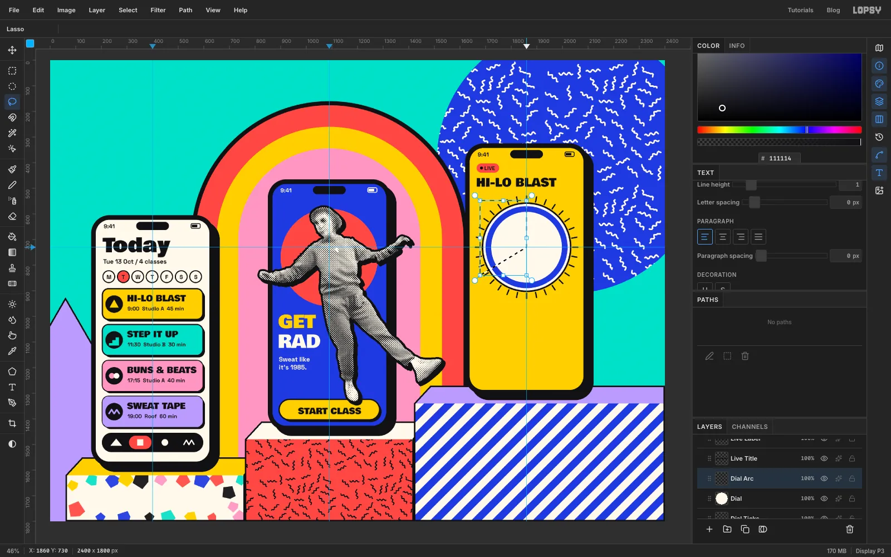

Add a layer called *Dial*. Draw an **Ellipse** with the Shape tool, **344** × **344**, Fill paper, Stroke ink, Width **6**, centred on the crossing.

Add a layer called *Dial Arc*. Draw another Ellipse, **298** × **298**, with no fill and a cobalt Stroke of Width **22**, on the same centre. That's a full ring, and the timer should look part-way through.

With the **Lasso**, draw a wedge over the piece of ring you want to remove, from the centre out and around from about 8 o'clock to 12 o'clock. Press [[Delete]], then [[Cmd+D]].

## Set the timer and stat chips

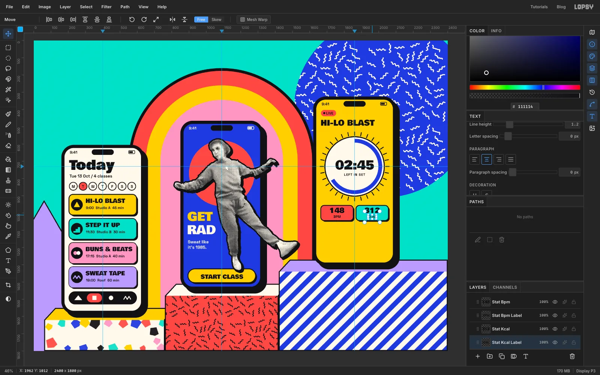

Set the foreground to ink for all the text in this step.

**Timer.** Type *02:45* in the dial in Bowlby One at **70**, with Align set to center. A workout timer has to be readable at arm's length, so don't be tempted to use a thin font here. Below it, type *LEFT IN SET* in Space Grotesk Bold at **19**, with Letter spacing **2**. Then set Letter spacing back to **0**.

**Stats.** Add a layer called *Stat Chips*. Draw two cards with their shadows, **188** × **88**, Corner Radius **20**, side by side below the dial: coral on the left and mint on the right. Keep them clear of the ticks.

In the coral one, type *148* in Bowlby One at **40**, with *BPM* below it in Space Grotesk Bold at **20**, both centred. In the mint one, type *312* and *KCAL* the same way.

## Add the cassette and Pause button

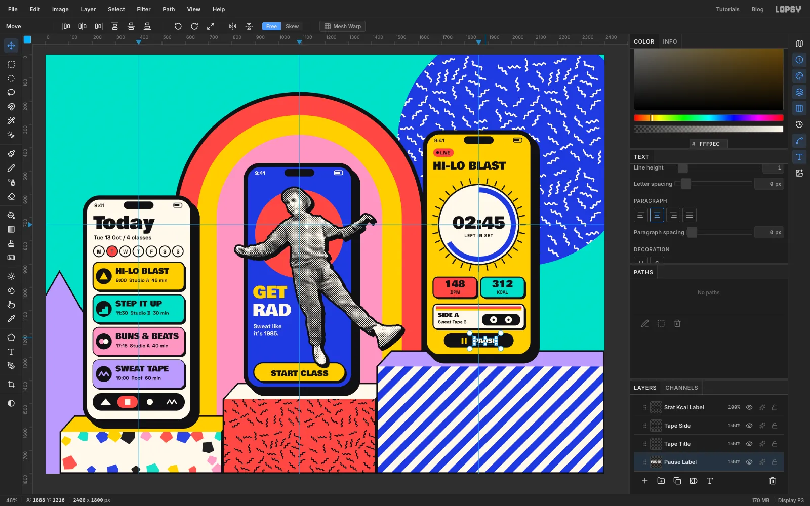

**Cassette.** Add a layer called *Tape* and draw a paper card with its shadow, **392** × **106**, Corner Radius **18**.

Add a layer called *Tape Parts*. Along the top of the card, marquee a thin coral stripe and a thin canary one below it. On the right, draw an ink pill **164** × **50** with Corner Radius **22**, then two paper reels **30** across and two ink hubs **10** across inside it.

With the foreground on ink and Align back on left, type *SIDE A* on the left in Bowlby One at **24**, and *Sweat Tape 3* below it in Space Grotesk Bold at **19**.

**Pause.** Add a layer called *Pause*. Draw an ink pill **300** × **60** with Corner Radius **30** at the bottom of the screen. Add two small canary marquee bars for the icon, then type *PAUSE* in Bowlby One at **26** in paper. Centre the icon and word together in the pill. A live screen with no way to stop looks like a poster, not an app.

## Set and tilt the RAD letters

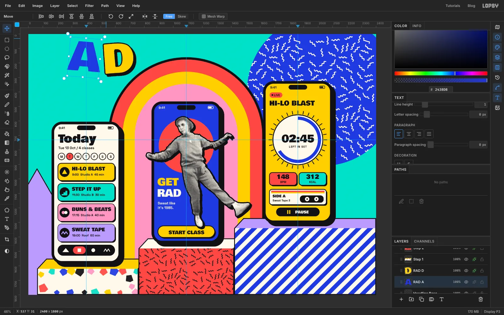

Click *Triangle* and add a layer called *Headline Base*. It stays empty, and it's only there to keep text in the right spot in the stack.

Each letter gets its own text layer, so it can tilt and overlap with its own outline. Using one text layer and cutting up the letters leaves faint ghost lines behind.

Set the text to Bowlby One at **270**, Line height **1**. Then, working from right to left and clicking *Headline Base* before each one:

- type *D* in canary, with its left edge about 525 px from the canvas edge, and rename the layer *RAD D*
- type *A* in cobalt, about 275 px in, and rename it *RAD A*
- type *R* in coral, about 70 px in, and rename it *RAD R*

Now tilt them. With a letter active, pick the **Move** tool and drag the round handle just outside a corner of its box. Turn *D* a little anticlockwise, *A* a little clockwise and *R* a bit further anticlockwise, so the word rocks from side to side. Compare with the finished image. Text stays editable while it's rotated. Nudge each up or down a few pixels, so the baseline bounces.

Give each letter a **Stroke** (Width **7**, ink, **outside**) and a **Drop Shadow** (Offset X **14**, Offset Y **14**, Blur **0**, Spread **0**, Opacity **100**, ink).

## Fill the D with squiggles

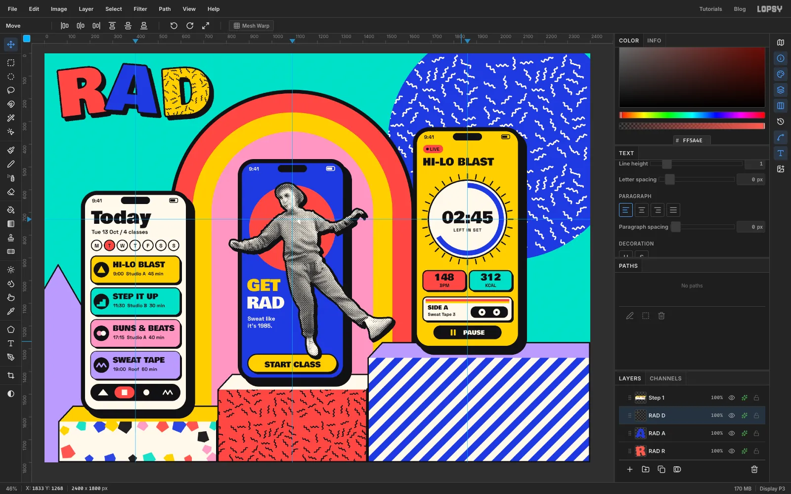

A pattern fill needs pixels, so click *RAD D* and click **Rasterize Layer** in the Layers panel.

[[Cmd]]-click its thumbnail to select the letter. Choose **Edit → Fill with Pattern…**, pick the squiggles, and set Scale to **47**. Apply, then press [[Cmd+D]].

## Add AEROBICS and the tilted tagline

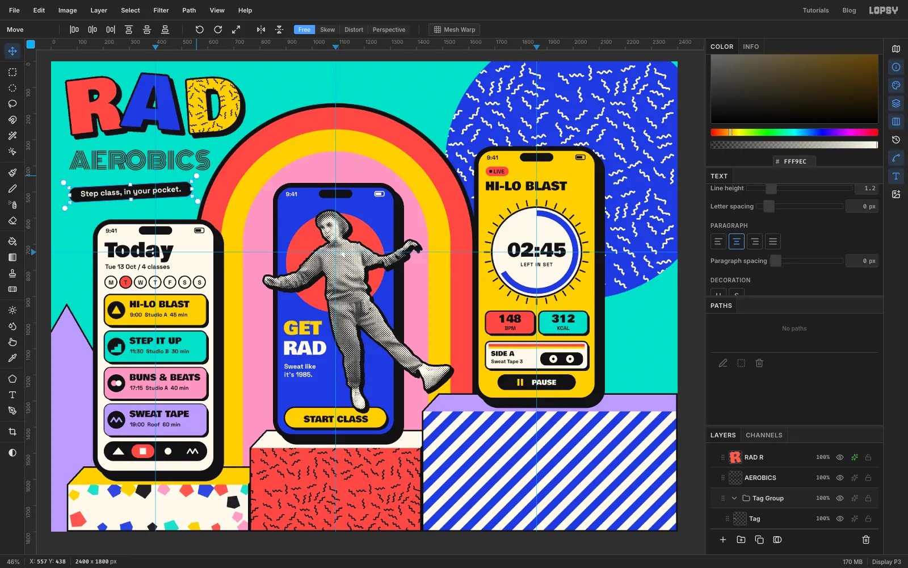

Click *Headline Base* and type *AEROBICS* in **Monoton** at **90**, in ink. Line it up with the left side of the R, and check it stays clear of the arch.

Add a layer called *Tag Pill*. Draw an ink pill **470** × **58** with Corner Radius **28** under the word, with the same left edge. Type *Step class, in your pocket.* on it in Space Grotesk Bold at **30**, in paper, with Align set to center. Centre it in the pill, and check that the comma and the *p* hang inside the pill with room to spare.

Click *Tag Pill*, [[Shift]]-click the text, and choose **Layer → Group Layers**. Name it *Tag Group*. With the group active, pick the **Move** tool and drag the round handle outside a corner to give it a slight tilt, rising to the right. The live text turns with its pill.

## Label the steps

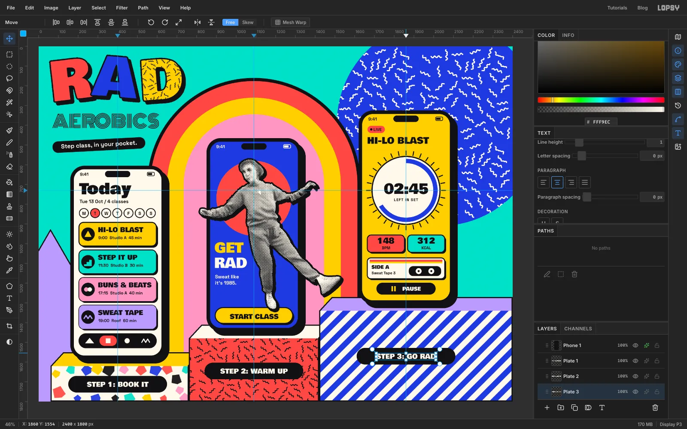

This is where the pun pays off. Click *Step 3* and add a layer called *Plates*.

With the Shape tool, draw three ink pills **500** × **84** with Corner Radius **42**, one centred under each phone, in the middle of each step's front. The pill on Step 1 should sit in the clear space you left in the terrazzo.

Then type the three labels in Bowlby One at **34**, in paper, with Align set to center: *STEP 1: BOOK IT*, *STEP 2: WARM UP* and *STEP 3: GO RAD*. Centre each one in its pill. Click *Plates* before typing each one.

## Build a Memphis totem

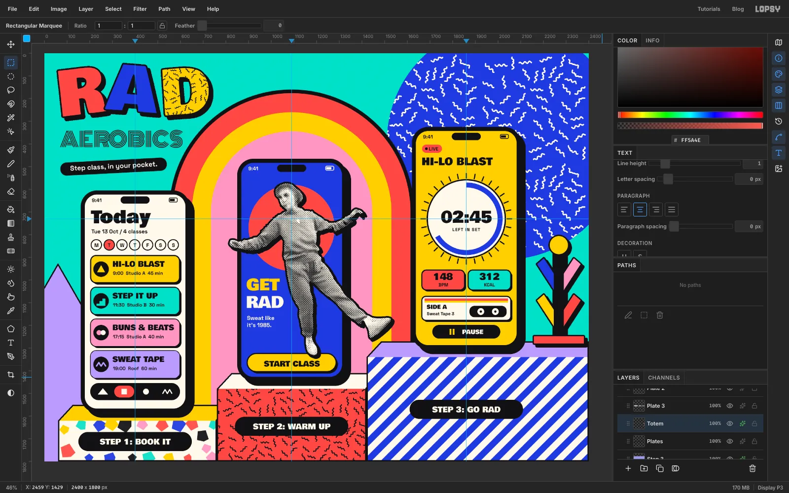

The space to the right of Phone 3 needs something tall, so here's a small nod to Sottsass's *Carlton* bookcase, with its splayed, slanted arms.

Add a layer called *Totem*. It stands on the top step, about 150 px to the right of the phone, and it's about 460 px tall.

Make four slanted bars as Pen shapes, each about 40 px wide and 130 px long, in two rising V shapes, and fill each one: canary and coral for the lower pair, cobalt and pink for the upper pair. Marquee a post **44** px wide up the middle and fill it with ink, so it covers the point where the arms meet. Add a canary circle **80** across on top and a coral **220** × **32** plinth at the bottom, standing on the lilac step.

Give the layer a **Stroke** (Width **6**, ink, **outside**) and a **Drop Shadow** (Offset **12**, **12**, Blur **0**, Opacity **100**, ink). Keep the plinth clear of the phone's shadow.

## Stick on a starburst

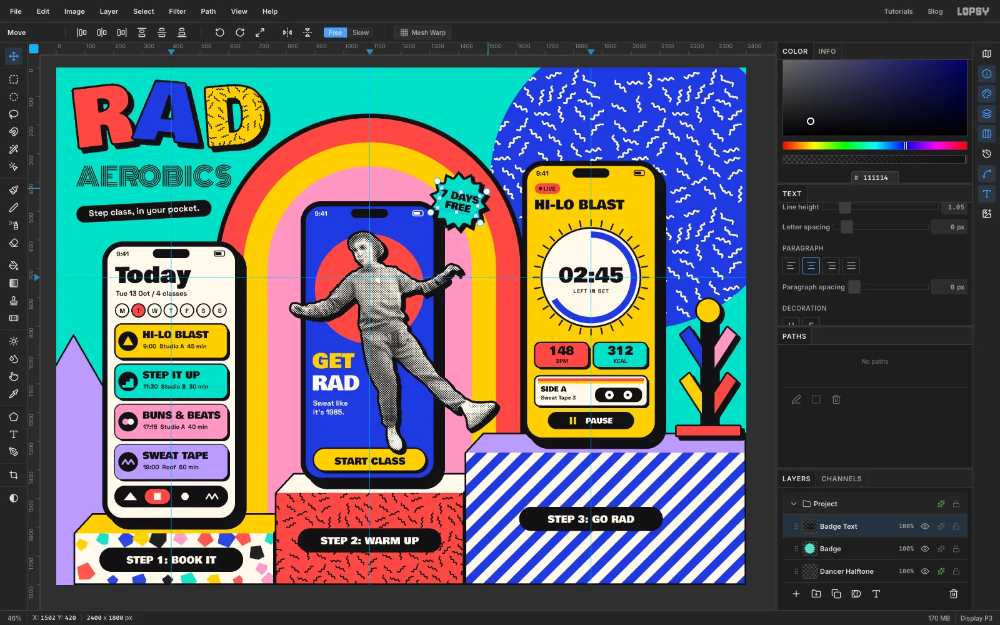

Click *Dancer Halftone* and add a layer called *Badge*, so the badge sits on top of everything on that phone.

On the phone's top right corner, make a **14**-point star as a Pen shape, about 210 px across. That's 28 clicks, alternating between an outer and an inner circle, and it doesn't need to be perfect. Fill it with ink.

Pick the **Rectangular Marquee**, so the arrow keys move the outline rather than the pixels. Nudge the selection about 8 px right and 8 px down, and fill it again. That gives you a hard shadow. Nudge it back, choose **Select → Shrink…** at **8**, and fill that with mint. Press [[Cmd+D]].

Type *7 DAYS* and *FREE* on two lines in Bowlby One at **34**, in ink, with Align set to center and Line height **1.05**. Centre it in the star, then rotate the live text clockwise by about 12° with the Move tool's round handle.

## Scatter the confetti

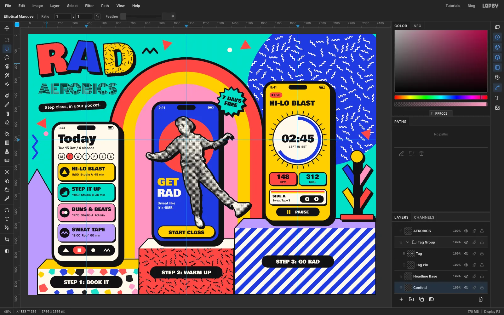

Click *Triangle* and add a layer called *Confetti*. It sits behind the phones, so nothing can overlap the screens.

Make one small coral triangle at the top of the board as a Pen shape and fill it. Choose **Edit → Copy**. Then, for each of three more:

1. Choose **Edit → Paste**.
2. With the **Move** tool, rotate it with the round handle outside a corner, and drag it to an open area.
3. Press [[Cmd+D]] and choose **Layer → Merge Down**.

Then use the Brush at Size **14** for an ink zigzag at the top, near the triangle (click, then [[Shift]]-click the corners), and a cobalt one on the far left. Add a few dots with small circle marquees, in paper and pink.

Be careful with placement. Give each piece some room, because a shape that nearly touches a neighbour looks like a mistake. Overlapping something on purpose is fine, like the triangle on the blue disc. A few pieces placed well will look better than lots scattered around.

> **Tip:** A marquee that starts or ends within a few pixels of a guide snaps to it, which can squash a small circle into an oval. If that happens, turn off **View → Snap to Guides** while you draw it.

## Group everything and test it

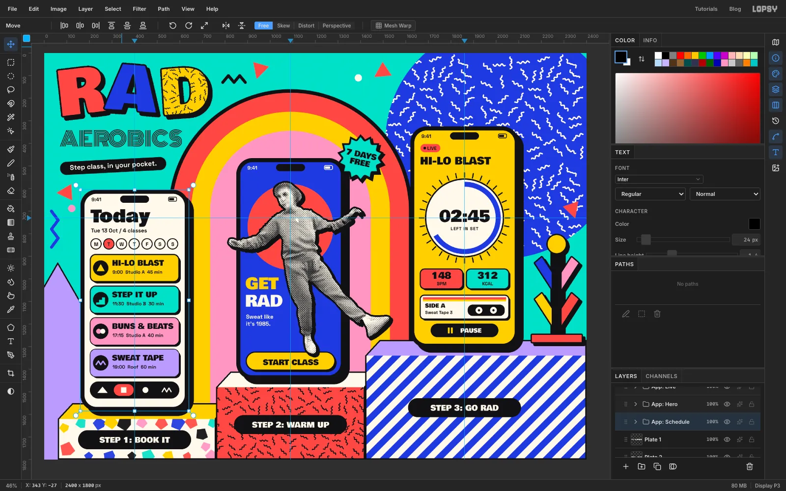

Tidy the stack. Click *Phone 1*, [[Shift]]-click the top layer of that phone's screen, and choose **Layer → Group Layers**. Name it *App: Schedule*. Do the same for *App: Hero* and *App: Live*, and group the three dancer layers as *Dancer*. Collapse the groups with the arrows on their rows.

Now check it holds together. Click *App: Live* and drag it with the **Move** tool. The whole phone moves, text and all. Press [[Cmd+Z]] to put it back. If you try the same with a rotation on *App: Hero*, its text and effects turn with it. Undo that too.

## Clean up and export

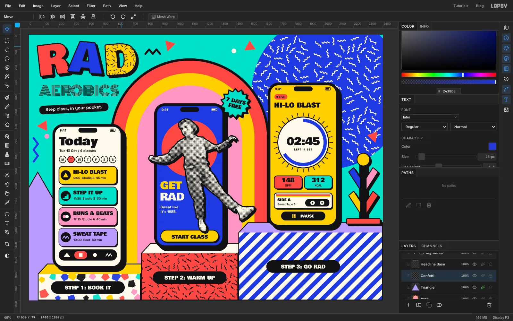

Choose **Edit → Clear Guides** and press [[Cmd+D]]. Zoom in to 100% and check these:

- Her hands, shoes and head should have a smooth black outline.
- No type should touch the edge of its pill or card.
- Nothing should nearly touch anything else, especially around the notch on the middle phone, and between the kicking shoe and Phone 3.

Save with **File → Save Project**, then **File → Quick Export PNG**.

> **Tip:** To make this your own, change the three phrases on the steps. Book It, Warm Up and Go Rad would work just as well as Browse, Add and Checkout for a shop, as long as the staircase still means something for your app.
